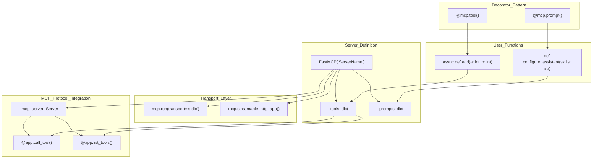
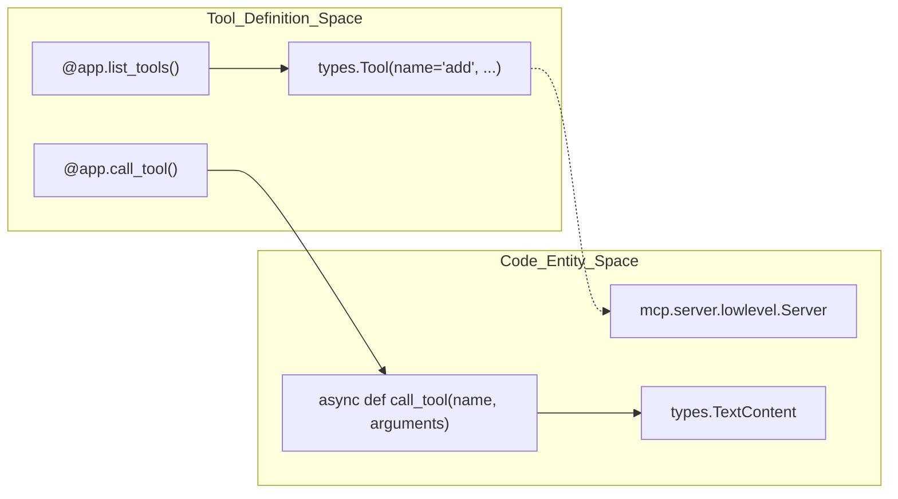
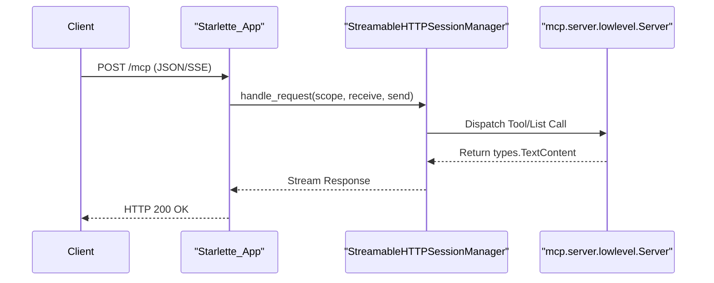

<!-- source: DeepWiki mcp.deepwiki.com · repo langchain-ai/langchain-mcp-adapters · page 4.3 Creating Custom MCP Servers · fetched 2026-10-26 -->

# Creating Custom MCP Servers

Relevant source files

The following files were used as context for generating this wiki page:

- [examples/servers/streamable-http-stateless/README.md](examples/servers/streamable-http-stateless/README.md)
- [examples/servers/streamable-http-stateless/mcp_simple_streamablehttp_stateless/server.py](examples/servers/streamable-http-stateless/mcp_simple_streamablehttp_stateless/server.py)
- [examples/servers/streamable-http-stateless/pyproject.toml](examples/servers/streamable-http-stateless/pyproject.toml)
- [examples/servers/streamable-http-stateless/uv.lock](examples/servers/streamable-http-stateless/uv.lock)
- [langchain_mcp_adapters/__init__.py](langchain_mcp_adapters/__init__.py)

This page provides a comprehensive guide for building custom MCP (Model Context Protocol) servers that integrate with `langchain-mcp-adapters`. MCP servers expose tools, prompts, and resources that can be consumed by LangChain applications through the adapter layer.

There are two primary approaches to creating MCP servers:

1.  **FastMCP Framework** - High-level, decorator-based approach for rapid development (recommended for most use cases).
2.  **Low-Level MCP SDK** - Direct use of `mcp.server.lowlevel.Server` for fine-grained control, often used for custom transport implementations like stateless HTTP.

## Approach 1: FastMCP Framework (High-Level)

The FastMCP framework provides a decorator-based approach to building MCP servers with minimal boilerplate. The core architecture revolves around a single `FastMCP` instance that manages tool and prompt registrations.

### FastMCP Component Architecture

**Diagram: FastMCP Component Architecture**

Sources: `FastMCP` usage is reflected in the server patterns demonstrated in [examples/servers/streamable-http-stateless/mcp_simple_streamablehttp_stateless/server.py:56-135]() and underlying SDK behavior.

### Tool Definition

Tools are the primary interface for MCP servers. The `@mcp.tool()` decorator (or low-level equivalents) registers functions as MCP tools with proper schema generation.

**Tool Definition Components**

| Component | Purpose | Example |
| :--- | :--- | :--- |
| Function signature | Defines parameters and types | `async def add(a: int, b: int)` |
| `inputSchema` | JSON Schema for validation | `{"type": "object", "properties": {...}}` |
| Return value | Serialized content | `list[types.TextContent]` |

**Diagram: Tool Registration and Execution (Low-Level)**

Sources: [examples/servers/streamable-http-stateless/mcp_simple_streamablehttp_stateless/server.py:58-135]()

## Approach 2: Low-Level MCP SDK (Custom Transports)

For advanced scenarios, such as stateless HTTP deployments in multi-node environments, the low-level `Server` class is used directly. This allows for manual control over tool listing and execution logic.

### Stateless HTTP Server Implementation

In a stateless configuration, each request creates an ephemeral connection. This is ideal for serverless or load-balanced environments.

**Diagram: Stateless HTTP Flow**

Sources: [examples/servers/streamable-http-stateless/mcp_simple_streamablehttp_stateless/server.py:138-181]()

### Implementation Details

1.  **Server Initialization**: Create a `mcp.server.lowlevel.Server` instance [examples/servers/streamable-http-stateless/mcp_simple_streamablehttp_stateless/server.py:56]().
2.  **Tool Handling**: Implement `@app.list_tools()` to define available tools [examples/servers/streamable-http-stateless/mcp_simple_streamablehttp_stateless/server.py:91-135]() and `@app.call_tool()` to execute them [examples/servers/streamable-http-stateless/mcp_simple_streamablehttp_stateless/server.py:58-89]().
3.  **Session Management**: Use `StreamableHTTPSessionManager` with `stateless=True` to avoid maintaining server-side state between requests [examples/servers/streamable-http-stateless/mcp_simple_streamablehttp_stateless/server.py:138-143]().
4.  **Deployment**: Wrap the manager in an ASGI application (e.g., Starlette) and run with a production server like `uvicorn` [examples/servers/streamable-http-stateless/mcp_simple_streamablehttp_stateless/server.py:175-185]().

## Deployment and Transport Options

Custom servers can be exposed via different transports depending on the use case:

| Transport | Deployment Scenario | Implementation |
| :--- | :--- | :--- |
| **stdio** | Local tools, CLI utilities | `mcp.run(transport='stdio')` |
| **HTTP (SSE)** | Web-based tools, Remote agents | `StreamableHTTPSessionManager` |
| **Stateless HTTP** | Multi-node, Serverless, K8s | `stateless=True` in manager |

Sources: [examples/servers/streamable-http-stateless/mcp_simple_streamablehttp_stateless/server.py:138-143](), [examples/servers/streamable-http-stateless/README.md:5-13]()

---

