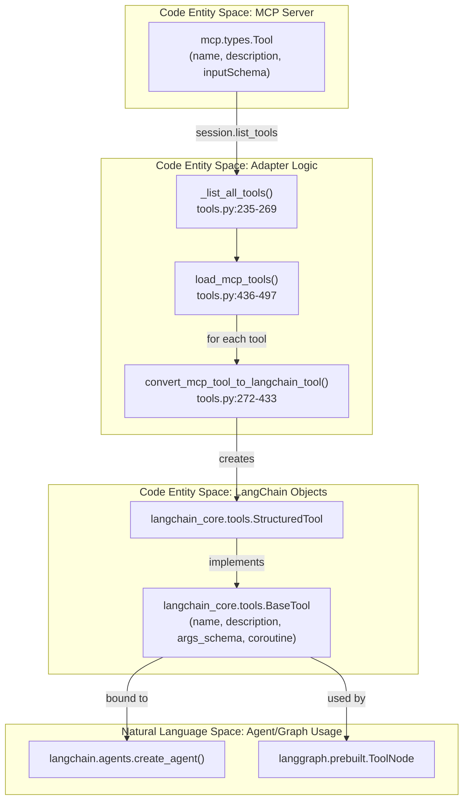
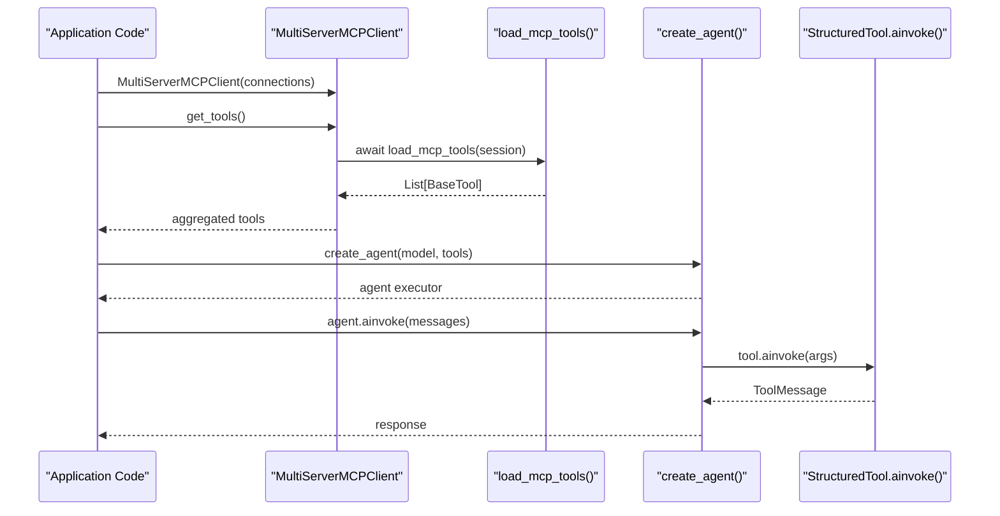
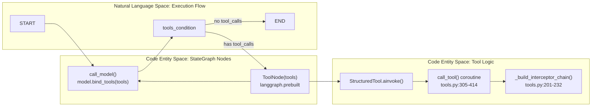
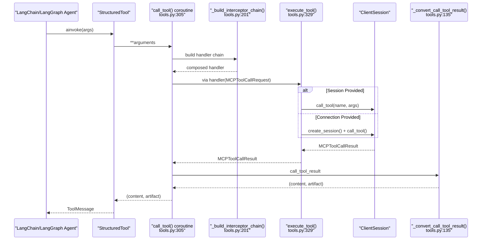

<!-- source: DeepWiki mcp.deepwiki.com · repo langchain-ai/langchain-mcp-adapters · page 5 Integration with LangChain and LangGraph · fetched 2026-10-26 -->

# Integration with LangChain and LangGraph

<details>
<summary>Relevant source files</summary>

The following files were used as context for generating this wiki page:

- [README.md](README.md)
- [langchain_mcp_adapters/tools.py](langchain_mcp_adapters/tools.py)
- [static/img/mcp.png](static/img/mcp.png)

</details>


This document explains how MCP tools are converted to LangChain-compatible tools and integrated into LangChain agents and LangGraph workflows. It covers the conversion pipeline, tool execution lifecycle, and integration patterns for both frameworks.

For detailed examples of using tools in agents, see [Using Tools in LangChain Agents](#5.1). For LangGraph StateGraph patterns, see [LangGraph Integration](#5.2). For deployment scenarios, see [LangGraph API Server Deployment](#5.3).

## Tool Conversion Pipeline

The adapter converts MCP tools into LangChain `BaseTool` objects through primary functions in `langchain_mcp_adapters/tools.py`. The conversion process transforms MCP's JSON schema-based tool definitions into LangChain's `StructuredTool` instances that can be invoked by agents.

### Conversion Flow


Sources: [langchain_mcp_adapters/tools.py:235-497](), [README.md:12-13]()

### Core Conversion Functions

| Function | Purpose | Key Parameters |
|----------|---------|---------------|
| `load_mcp_tools()` | Load all tools from MCP session and convert to LangChain format | `session`, `connection`, `callbacks`, `tool_interceptors` |
| `convert_mcp_tool_to_langchain_tool()` | Convert single MCP tool to LangChain `BaseTool` | `session`, `tool`, `server_name`, `tool_name_prefix` |
| `_list_all_tools()` | Fetch all tools with pagination support | `session` |

The conversion process at [langchain_mcp_adapters/tools.py:272-433]() creates a `StructuredTool` with:
- **name**: Tool name, optionally prefixed with server name. [langchain_mcp_adapters/tools.py:280-295]()
- **description**: Tool description from MCP. [langchain_mcp_adapters/tools.py:296]()
- **args_schema**: JSON schema derived from `tool.inputSchema`. [langchain_mcp_adapters/tools.py:297]()
- **coroutine**: Async function wrapping tool execution (`call_tool`). [langchain_mcp_adapters/tools.py:305-414]()
- **response_format**: Set to `"content_and_artifact"` for structured responses. [langchain_mcp_adapters/tools.py:431]()

Sources: [langchain_mcp_adapters/tools.py:272-497]()

## LangChain Agent Integration

LangChain agents use converted MCP tools through the standard `BaseTool` interface. The adapter ensures MCP tools behave identically to native LangChain tools.

### Basic Usage Pattern


Sources: [README.md:115-138](), [langchain_mcp_adapters/tools.py:436-497]()

### Tool Loading with MultiServerMCPClient

The `MultiServerMCPClient` aggregates tools from multiple servers:

```python
# From README.md:115-137
client = MultiServerMCPClient({
    "math": {"command": "python", "args": ["math_server.py"], "transport": "stdio"},
    "weather": {"url": "http://localhost:8000/mcp", "transport": "http"}
})
tools = await client.get_tools()  # Returns List[BaseTool]
agent = create_agent("openai:gpt-4.1", tools)
```
The `get_tools()` method calls `load_mcp_tools()` for each configured server and concatenates results. [langchain_mcp_adapters/client.py:108-142]()

Sources: [README.md:115-138](), [langchain_mcp_adapters/client.py:108-142]()

## LangGraph StateGraph Integration

LangGraph uses MCP tools through the `ToolNode` component, which executes tools selected by the model and returns results to the state graph.

### StateGraph Pattern


Sources: [README.md:238-281](), [langchain_mcp_adapters/tools.py:201-414]()

### LangGraph-Specific Features

The adapter supports LangGraph's `Command` pattern for state updates, enabled if `langgraph` is installed. [langchain_mcp_adapters/tools.py:50-56]()

**Type Definition** at [langchain_mcp_adapters/tools.py:62-66]():
```python
if LANGGRAPH_PRESENT:
    ConvertedToolResult = list[ToolMessageContentBlock] | ToolMessage | Command
else:
    ConvertedToolResult = list[ToolMessageContentBlock] | ToolMessage
```

Interceptors can return `Command` objects to update graph state directly, enabling patterns like conditional routing or state updates without additional model calls.

Sources: [langchain_mcp_adapters/tools.py:50-66]()

## Tool Execution Lifecycle

When an agent or graph invokes a tool, the execution flows through multiple layers: interceptor chain, session management, and result conversion.

### Execution Pipeline


Sources: [langchain_mcp_adapters/tools.py:305-414](), [langchain_mcp_adapters/tools.py:135-198](), [langchain_mcp_adapters/tools.py:201-232]()

### Session Management Modes

Tool execution supports two session management modes:

| Mode | Configuration | Behavior | Use Case |
|------|--------------|----------|----------|
| **Persistent Session** | `session` provided | Reuses existing `ClientSession` | Multiple tool calls, shared state |
| **Ephemeral Session** | `connection` provided | Creates new session per invocation | Stateless tools, HTTP servers |

The logic at [langchain_mcp_adapters/tools.py:366-401]() manages these sessions. Ephemeral sessions are created via `create_session` and closed after execution.

Sources: [langchain_mcp_adapters/tools.py:366-401](), [langchain_mcp_adapters/tools.py:48]()

### Content Conversion

The `_convert_call_tool_result()` function transforms MCP content to LangChain format. [langchain_mcp_adapters/tools.py:135-198]()

| MCP Type | LangChain Type | Notes |
|----------|----------------|-------|
| `TextContent` | `TextContentBlock` | Direct text mapping |
| `ImageContent` | `ImageContentBlock` | Base64 image data |
| `ResourceLink` (image/*) | `ImageContentBlock` | URL-based image |
| `ResourceLink` (other) | `FileContentBlock` | Generic file URL |
| `EmbeddedResource` (text) | `TextContentBlock` | Embedded text resource |
| `EmbeddedResource` (blob) | `ImageContentBlock` or `FileContentBlock` | Based on MIME type |
| `AudioContent` | N/A | Raises `NotImplementedError` |

The function also extracts `structuredContent` from MCP results and wraps it in `MCPToolArtifact`. [langchain_mcp_adapters/tools.py:191-196]()

Sources: [langchain_mcp_adapters/tools.py:135-198](), [langchain_mcp_adapters/tools.py:175-233]()

## Interceptor Chain Integration

Tool interceptors wrap the execution pipeline, enabling request/response modification, caching, and error handling.

### Chain Composition

The `_build_interceptor_chain()` function composes interceptors in an onion pattern. [langchain_mcp_adapters/tools.py:201-232]()

Interceptors are applied in reverse order (using `reversed()` at [langchain_mcp_adapters/tools.py:218]()), ensuring the first interceptor in the list becomes the outermost layer.

Sources: [langchain_mcp_adapters/tools.py:201-232]()

## Response Format and Artifacts

Converted tools use `response_format="content_and_artifact"` at [langchain_mcp_adapters/tools.py:431](), returning both displayable content and structured data.

### MCPToolArtifact Structure

The `MCPToolArtifact` TypedDict at [langchain_mcp_adapters/tools.py:161-172]() wraps structured content from MCP:

```python
class MCPToolArtifact(TypedDict):
    structured_content: dict[str, Any]
```

The artifact is populated when MCP returns `structuredContent` at [langchain_mcp_adapters/tools.py:191-196]().

Sources: [langchain_mcp_adapters/tools.py:161-172](), [langchain_mcp_adapters/tools.py:191-196](), [langchain_mcp_adapters/tools.py:431]()

## Callback Integration

Tools support the `Callbacks` system for handling logging, progress, and elicitation events during execution. [langchain_mcp_adapters/callbacks.py:126-169]()

Callbacks are converted to MCP format and passed to the session at [langchain_mcp_adapters/tools.py:320-326](). The progress callback is explicitly passed to `call_tool()` at [langchain_mcp_adapters/tools.py:380]() and [langchain_mcp_adapters/tools.py:398]().

Sources: [langchain_mcp_adapters/tools.py:320-326](), [langchain_mcp_adapters/tools.py:380](), [langchain_mcp_adapters/tools.py:398](), [langchain_mcp_adapters/callbacks.py:126-169]()

---

