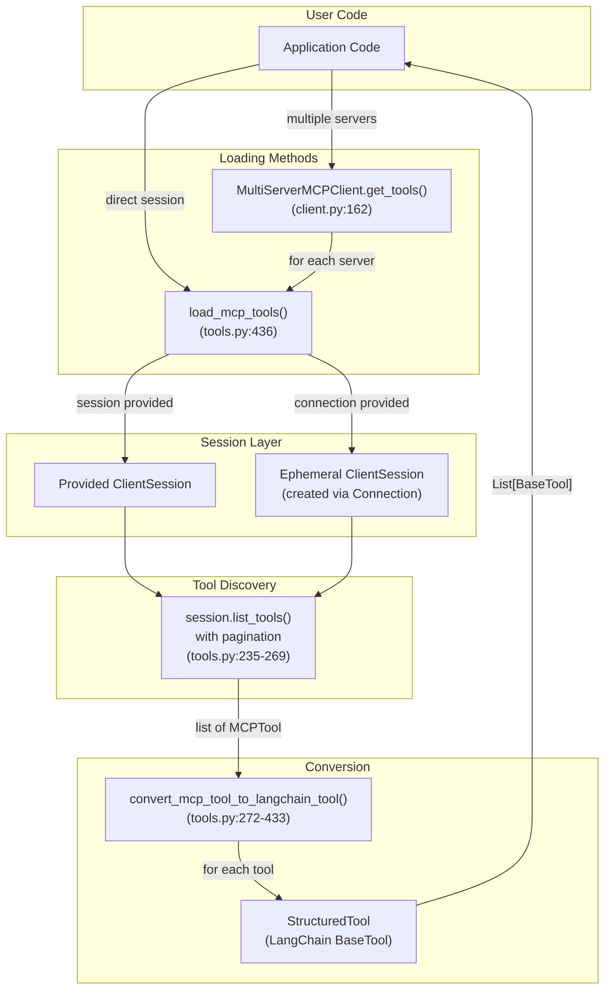
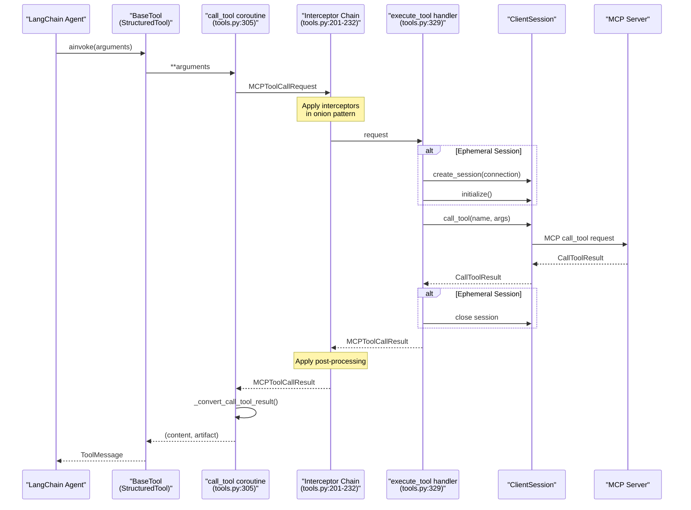
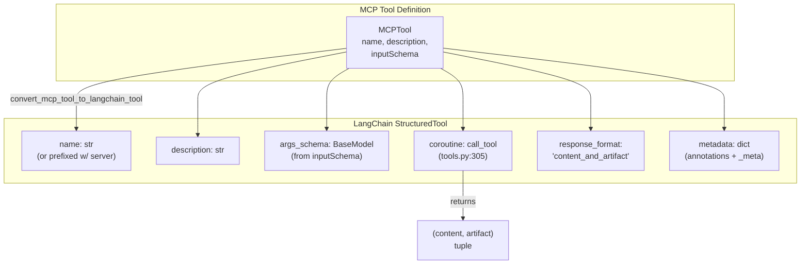

<!-- source: DeepWiki mcp.deepwiki.com · repo langchain-ai/langchain-mcp-adapters · page 5.1 Using Tools in LangChain Agents · fetched 2026-10-26 -->

# Using Tools in LangChain Agents

<details>
<summary>Relevant source files</summary>

The following files were used as context for generating this wiki page:

- [README.md](README.md)
- [langchain_mcp_adapters/client.py](langchain_mcp_adapters/client.py)
- [langchain_mcp_adapters/tools.py](langchain_mcp_adapters/tools.py)
- [static/img/mcp.png](static/img/mcp.png)

</details>


This page demonstrates how to load MCP tools and integrate them with LangChain agents. It covers the `load_mcp_tools` function, `MultiServerMCPClient.get_tools()` method, and the `create_agent` pattern for building agents that can execute MCP tools. For information about using tools in LangGraph `StateGraph` workflows, see [LangGraph Integration](#5.2). For details on the tool conversion mechanism, see [Tool Adapters](#2.2).

## Overview

The `langchain-mcp-adapters` package converts MCP tools into LangChain `BaseTool` instances that can be used with any LangChain agent. The conversion process handles:

- **Schema conversion**: MCP tool input schemas to Pydantic models.
- **Execution bridging**: LangChain tool invocation to MCP `call_tool` requests.
- **Result transformation**: MCP content blocks to LangChain `ToolMessage` format.
- **Session management**: Creating and managing MCP `ClientSession` connections.

## Loading MCP Tools

There are two primary methods for loading MCP tools into LangChain format.

### Direct Loading with load_mcp_tools

The `load_mcp_tools` function converts all tools from an MCP server into LangChain `BaseTool` instances. This function requires either an active `ClientSession` or a `Connection` configuration.

**Using an active session:**

```python
from mcp import ClientSession, StdioServerParameters
from mcp.client.stdio import stdio_client
from langchain_mcp_adapters.tools import load_mcp_tools

server_params = StdioServerParameters(
    command="python",
    args=["/path/to/math_server.py"],
)

async with stdio_client(server_params) as (read, write):
    async with ClientSession(read, write) as session:
        await session.initialize()
        tools = await load_mcp_tools(session)
```

**Using a connection configuration (creates ephemeral sessions):**

```python
from langchain_mcp_adapters.tools import load_mcp_tools

# Session will be created on-demand for each tool call
tools = await load_mcp_tools(
    session=None,
    connection={
        "command": "python",
        "args": ["/path/to/math_server.py"],
        "transport": "stdio",
    }
)
```

Sources: [langchain_mcp_adapters/tools.py:436-497](), [README.md:56-82]()

### Multi-Server Loading with MultiServerMCPClient

The `MultiServerMCPClient` class manages connections to multiple MCP servers and aggregates their tools.

```python
from langchain_mcp_adapters.client import MultiServerMCPClient

client = MultiServerMCPClient(
    {
        "math": {
            "command": "python",
            "args": ["/path/to/math_server.py"],
            "transport": "stdio",
        },
        "weather": {
            "url": "http://localhost:8000/mcp",
            "transport": "http",
        }
    }
)

# Get tools from all servers
all_tools = await client.get_tools()

# Get tools from a specific server
math_tools = await client.get_tools(server_name="math")
```

Sources: [langchain_mcp_adapters/client.py:162-200](), [README.md:116-138]()

## Tool Loading Architecture



**Tool Loading Flow**

Sources: [langchain_mcp_adapters/tools.py:436-497](), [langchain_mcp_adapters/client.py:162-200]()

## Creating LangChain Agents

The `create_agent` function from LangChain provides a simple way to create agents that can use MCP tools.

### Basic Agent Creation

```python
from langchain.agents import create_agent
from langchain_mcp_adapters.client import MultiServerMCPClient

client = MultiServerMCPClient({
    "math": {
        "command": "python",
        "args": ["/path/to/math_server.py"],
        "transport": "stdio",
    }
})

tools = await client.get_tools()
agent = create_agent("openai:gpt-4.1", tools)

# Invoke the agent
response = await agent.ainvoke({
    "messages": "what's (3 + 5) x 12?"
})
```

Sources: [README.md:56-82](), [README.md:116-138]()

### Agent with Multiple Tool Sources

```python
from langchain.agents import create_agent
from langchain_mcp_adapters.client import MultiServerMCPClient

client = MultiServerMCPClient(
    {
        "math": {
            "command": "python",
            "args": ["/path/to/math_server.py"],
            "transport": "stdio",
        },
        "weather": {
            "url": "http://localhost:8000/mcp",
            "transport": "http",
        }
    }
)

tools = await client.get_tools()
agent = create_agent("openai:gpt-4.1", tools)

# Agent can now use tools from both servers
math_response = await agent.ainvoke({
    "messages": "what's (3 + 5) x 12?"
})
weather_response = await agent.ainvoke({
    "messages": "what is the weather in nyc?"
})
```

Sources: [README.md:116-138]()

## Session Management Patterns

MCP tools require a `ClientSession` to execute. The `langchain-mcp-adapters` package supports two session management patterns.

### Ephemeral Sessions (Default Pattern)

When tools are loaded with a `connection` parameter instead of a `session`, each tool invocation creates a new `ClientSession` that is automatically closed after execution. This is the default pattern when using `MultiServerMCPClient.get_tools()`.

**Characteristics:**
- New session created for each tool call.
- Automatic session initialization and cleanup.
- No shared state between tool calls.
- Suitable for stateless tools.

```python
client = MultiServerMCPClient({
    "math": {
        "command": "python",
        "args": ["/path/to/math_server.py"],
        "transport": "stdio",
    }
})

# Tools will create ephemeral sessions
tools = await client.get_tools()
```

**Implementation**: When a tool is invoked, the execution flow creates a session on-demand in `execute_tool`:

[langchain_mcp_adapters/tools.py:372-384]()

Sources: [langchain_mcp_adapters/tools.py:305-414](), [README.md:140-149]()

### Persistent Sessions

For tools that maintain state or when you want to control session lifecycle explicitly, use the `MultiServerMCPClient.session()` context manager.

**Characteristics:**
- Single session shared across multiple tool calls.
- Manual session lifecycle control.
- Can maintain state between calls.
- More efficient for multiple operations.

```python
from langchain_mcp_adapters.client import MultiServerMCPClient
from langchain_mcp_adapters.tools import load_mcp_tools

client = MultiServerMCPClient({...})
async with client.session("math") as session:
    tools = await load_mcp_tools(session)
```

Sources: [langchain_mcp_adapters/client.py:124-160](), [README.md:140-149]()

## Session Management Comparison

| Pattern | Session Creation | Session Lifecycle | Use Case |
|---------|-----------------|-------------------|----------|
| **Ephemeral** | Per tool call | Automatic | Stateless tools, simple use cases |
| **Persistent** | Once per context | Manual (context manager) | Stateful tools, multiple operations |

## Tool Execution Pipeline

When a LangChain agent invokes an MCP tool, the execution flows through multiple layers of the adapter system.



**MCP Tool Execution Flow**

Sources: [langchain_mcp_adapters/tools.py:305-414]()

### Execution Steps

1. **Agent Invocation**: LangChain agent calls `tool.ainvoke(arguments)`.
2. **Interceptor Chain**: Request passes through optional interceptors [langchain_mcp_adapters/tools.py:201-232]().
3. **Session Management**: 
   - Ephemeral: Creates new session [langchain_mcp_adapters/tools.py:372-384]().
   - Persistent: Uses provided session [langchain_mcp_adapters/tools.py:395-399]().
4. **MCP Call**: Executes `session.call_tool(name, args)`.
5. **Result Conversion**: Converts `CallToolResult` to LangChain format [langchain_mcp_adapters/tools.py:135-198]().
6. **Response**: Returns `(content, artifact)` tuple to agent.

Sources: [langchain_mcp_adapters/tools.py:305-414](), [langchain_mcp_adapters/tools.py:135-198]()

## Tool Conversion Details

The `convert_mcp_tool_to_langchain_tool` function creates a `StructuredTool` that bridges MCP and LangChain:

### Converted Tool Structure



**Tool Conversion Mapping**

| MCP Tool Field | LangChain BaseTool Field | Notes |
|----------------|-------------------------|-------|
| `name` | `name` | Optionally prefixed with server name |
| `description` | `description` | Used by LLM for tool selection |
| `inputSchema` | `args_schema` | JSON Schema to Pydantic model |
| `annotations` | `metadata` | MCP annotations preserved |
| - | `coroutine` | Async execution wrapper |
| - | `response_format` | Always `"content_and_artifact"` |

Sources: [langchain_mcp_adapters/tools.py:272-433]()

### Tool Name Prefixing

When loading tools from multiple servers, tool name conflicts can occur. The `tool_name_prefix` parameter adds server names as prefixes:

```python
client = MultiServerMCPClient(
    connections={...},
    tool_name_prefix=True  # Enable prefixing
)
```

[langchain_mcp_adapters/client.py:68-71]()

Sources: [langchain_mcp_adapters/tools.py:421-424](), [langchain_mcp_adapters/client.py:68-71]()

## Tool Response Format

MCP tools use the `response_format="content_and_artifact"` convention, returning a tuple of:

1. **Content**: The primary result, which can be:
   - `list[ToolMessageContentBlock]`: Text, image, or file content blocks.
   - `ToolMessage`: Pre-constructed LangChain message.
   - `Command`: LangGraph command (if LangGraph is installed) [langchain_mcp_adapters/tools.py:52-66]().

2. **Artifact**: Optional `MCPToolArtifact` containing structured data:
   ```python
   class MCPToolArtifact(TypedDict):
       structured_content: dict[str, Any]
   ```
   [langchain_mcp_adapters/tools.py:161-172]()

### Content Block Conversion

MCP content types are converted to LangChain content blocks via `_convert_mcp_content_to_lc_block`:

| MCP Content Type | LangChain Block Type | Example |
|-----------------|---------------------|---------|
| `TextContent` | `TextContentBlock` | `{"type": "text", "text": "..."}` |
| `ImageContent` | `ImageContentBlock` | `{"type": "image", "base64": "..."}` |
| `ResourceLink` (image) | `ImageContentBlock` | `{"type": "image", "url": "..."}` |
| `ResourceLink` (other) | `FileContentBlock` | `{"type": "file", "url": "..."}` |
| `EmbeddedResource` | Text/Image/File Block | Based on embedded type |
| `AudioContent` | ❌ Not supported | Raises `NotImplementedError` |

Sources: [langchain_mcp_adapters/tools.py:175-232]()

## Tool Metadata and Annotations

MCP tool annotations are preserved in the `metadata` field of the converted `BaseTool`:

```python
tool = convert_mcp_tool_to_langchain_tool(session, mcp_tool)

# Access metadata
base_annotations = tool.metadata  # From tool.annotations
meta_field = tool.metadata.get("_meta")  # From tool.meta attribute
```

[langchain_mcp_adapters/tools.py:416-419]()

Sources: [langchain_mcp_adapters/tools.py:416-419]()

## Example: Complete Agent Setup

Here's a complete example demonstrating tool loading and agent creation:

```python
from langchain.agents import create_agent
from langchain_mcp_adapters.client import MultiServerMCPClient

# Initialize client with multiple servers
client = MultiServerMCPClient(
    connections={
        "math": {
            "command": "python",
            "args": ["/absolute/path/to/math_server.py"],
            "transport": "stdio",
        },
        "weather": {
            "url": "http://localhost:8000/mcp",
            "transport": "http",
        }
    },
    tool_name_prefix=True
)

# Load all tools (ephemeral sessions)
tools = await client.get_tools()

# Create agent with tools
agent = create_agent("openai:gpt-4.1", tools)
```

Sources: [README.md:116-138](), [langchain_mcp_adapters/client.py:45-112]()

## Related Patterns

- **Interceptors**: Modify tool requests/responses before execution. See [Interceptors](#2.6)
- **Callbacks**: Monitor tool execution events. See [Callbacks](#2.5)
- **LangGraph Integration**: Use tools in `StateGraph` workflows. See [LangGraph Integration](#5.2)
- **API Deployment**: Deploy agents with MCP tools to LangGraph API Server. See [LangGraph API Server Deployment](#5.3)

---

