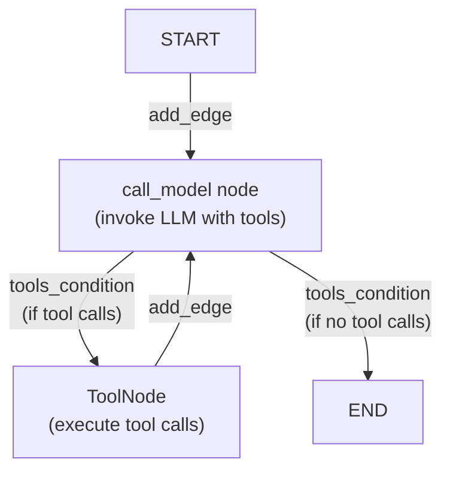
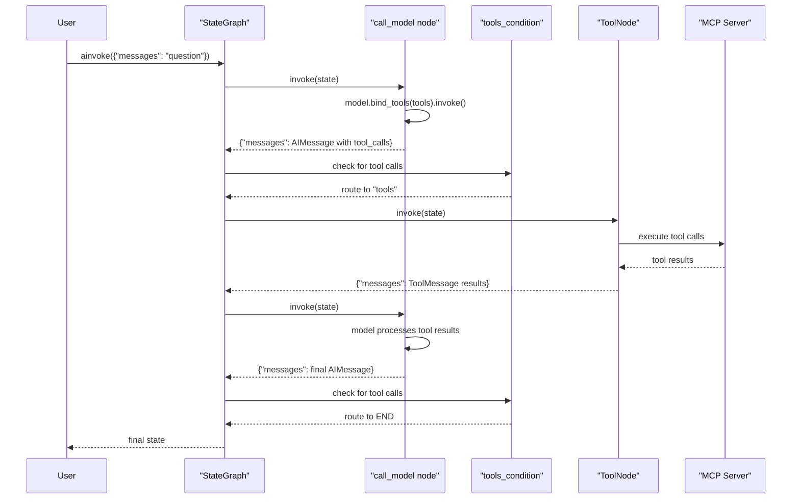
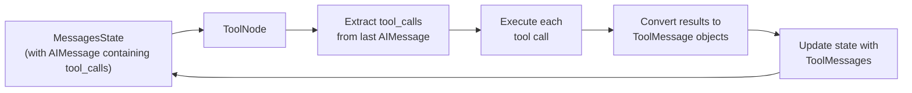
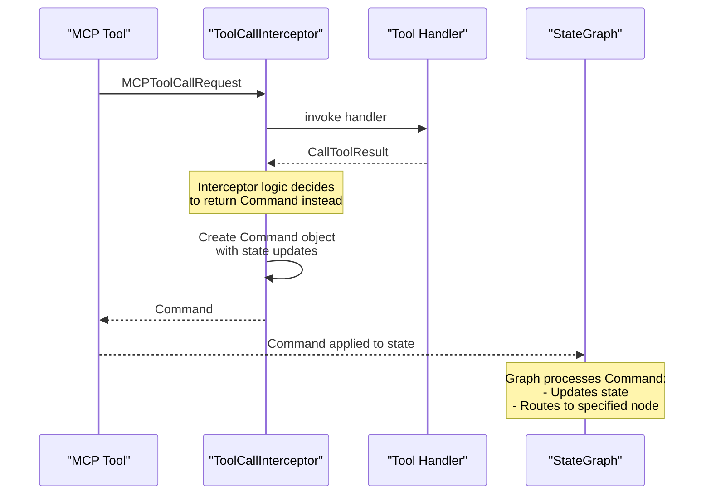
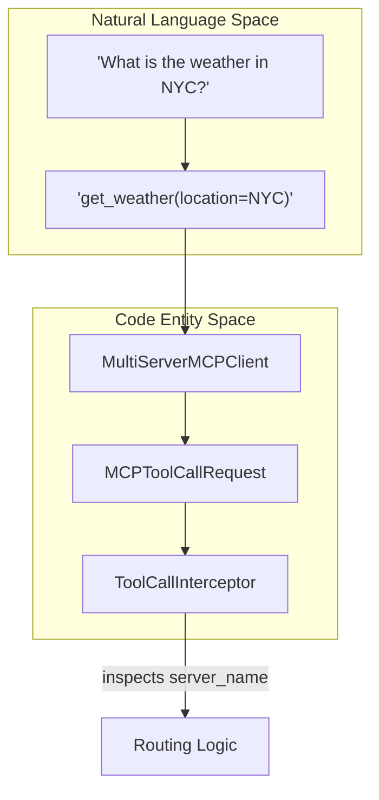

<!-- source: DeepWiki mcp.deepwiki.com · repo langchain-ai/langchain-mcp-adapters · page 5.2 LangGraph Integration · fetched 2026-10-26 -->

# LangGraph Integration

<details>
<summary>Relevant source files</summary>

The following files were used as context for generating this wiki page:

- [README.md](README.md)
- [langchain_mcp_adapters/interceptors.py](langchain_mcp_adapters/interceptors.py)
- [static/img/mcp.png](static/img/mcp.png)
- [tests/test_callbacks.py](tests/test_callbacks.py)
- [tests/test_interceptors.py](tests/test_interceptors.py)
- [uv.lock](uv.lock)

</details>


This page explains how to integrate MCP tools with LangGraph's `StateGraph` architecture. It covers the `StateGraph` pattern, `ToolNode` usage for tool execution, and the `Command` pattern for state updates when using interceptors.

## StateGraph Architecture with MCP Tools

LangGraph's `StateGraph` provides a structured approach to building agentic workflows with explicit state management and control flow. MCP tools integrate as standard LangChain tools within this architecture.

### StateGraph Components

| Component | Role | Source |
|-----------|------|--------|
| `StateGraph` | Defines the workflow graph structure | `langgraph.graph.StateGraph` |
| `MessagesState` | Built-in state schema with message tracking | `langgraph.graph.MessagesState` |
| `ToolNode` | Pre-built node for tool execution | `langgraph.prebuilt.ToolNode` |
| `tools_condition` | Conditional edge router based on tool calls | `langgraph.prebuilt.tools_condition` |

### Basic StateGraph Structure

The following diagram illustrates the standard flow where a model node generates tool calls, and a `ToolNode` executes them via the MCP adapter.


**Sources:** [README.md:238-281]()

### Integration Pattern

The standard pattern for integrating MCP tools with `StateGraph` involves:

1. **Load Tools**: Use `MultiServerMCPClient.get_tools()` to retrieve MCP tools [README.md:134-135]().
2. **Define Model Node**: Create a node that invokes the LLM with tools bound [README.md:265-267]().
3. **Add ToolNode**: Add a `ToolNode` initialized with MCP tools [README.md:271]().
4. **Configure Routing**: Use `tools_condition` for conditional routing [README.md:273-276]().
5. **Create Loop**: Add edge from `ToolNode` back to the model node [README.md:277]().


**Sources:** [README.md:238-281]()

## ToolNode Integration

`ToolNode` is a pre-built LangGraph node that handles tool execution. It accepts a list of LangChain `BaseTool` instances, which includes tools loaded via `load_mcp_tools` or `MultiServerMCPClient.get_tools()`.

### Execution Flow


**Sources:** [README.md:271]()

## Command Pattern Integration

When LangGraph is installed, the interceptor system supports returning `Command` objects in addition to `CallToolResult` and `ToolMessage`. This enables advanced state management patterns where tool execution can trigger specific graph actions.

### Command Type Support

The `MCPToolCallResult` type alias is dynamically defined based on the presence of the `langgraph` package [langchain_mcp_adapters/interceptors.py:19-36]().

| Environment | `MCPToolCallResult` Definition |
|-------------|-------------------------------|
| **LangGraph Present** | `CallToolResult \| ToolMessage \| Command` |
| **LangGraph Absent** | `CallToolResult \| ToolMessage` |

**Sources:** [langchain_mcp_adapters/interceptors.py:31-36]()

### Interceptor Returning Command

Interceptors defined by the `ToolCallInterceptor` protocol can modify the tool execution lifecycle [langchain_mcp_adapters/interceptors.py:112-141](). If LangGraph is used, an interceptor can return a `Command` to update graph state or control flow directly from the tool call layer.


**Sources:** [langchain_mcp_adapters/interceptors.py:125-141](), [langchain_mcp_adapters/interceptors.py:31-34]()

### Example: State-Modifying Interceptor

An interceptor can return a `Command` to update the graph state based on tool execution results:

```python
from langgraph.types import Command
from langchain_mcp_adapters.interceptors import MCPToolCallRequest

async def state_updating_interceptor(
    request: MCPToolCallRequest,
    handler
) -> Command:
    # Execute the tool
    result = await handler(request)
    
    # Return Command to update state instead of raw result
    return Command(
        update={
            "custom_metadata": {"server": request.server_name},
            "messages": [result]  # Include tool result in message history
        }
    )
```
**Sources:** [langchain_mcp_adapters/interceptors.py:52-73](), [langchain_mcp_adapters/interceptors.py:125-141]()

## Multi-Server Routing in LangGraph

When using `MultiServerMCPClient`, tools are aggregated from multiple servers. The `MCPToolCallRequest` passed to interceptors includes context fields like `server_name` and `runtime` to help route or log calls within a complex graph [langchain_mcp_adapters/interceptors.py:64-67]().


**Sources:** [langchain_mcp_adapters/interceptors.py:52-73](), [langchain_mcp_adapters/client.py:116-133]()

## Callback Integration

LangGraph workflows often require visibility into long-running tool executions. The `Callbacks` system in `langchain-mcp-adapters` allows progress updates and logging messages from MCP servers to be surfaced within the LangGraph runtime [tests/test_callbacks.py:86-112]().

1. **Initialization**: Provide a `Callbacks` object to `MultiServerMCPClient` [tests/test_callbacks.py:103-111]().
2. **Execution**: When a `ToolNode` executes an MCP tool, the adapter translates MCP notifications into the provided callbacks [tests/test_callbacks.py:121-144]().
3. **Context**: Each callback receives a `CallbackContext` containing the `server_name` and `tool_name` [langchain_mcp_adapters/callbacks.py:11-12]().

**Sources:** [tests/test_callbacks.py:86-112](), [langchain_mcp_adapters/callbacks.py:10-40]()

---

