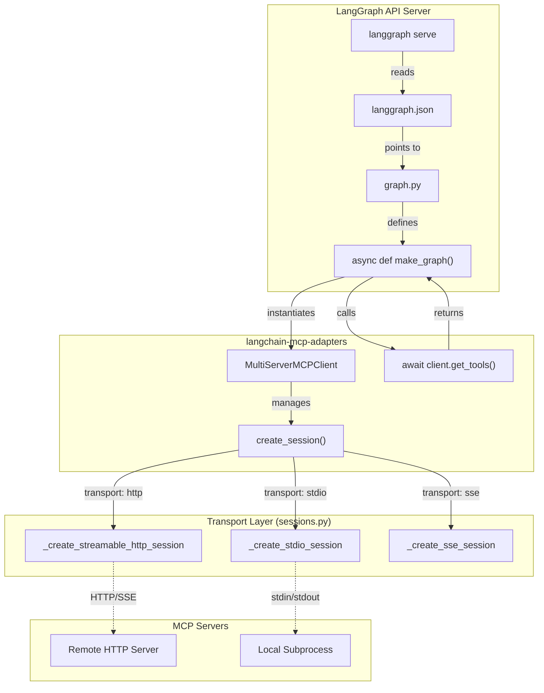
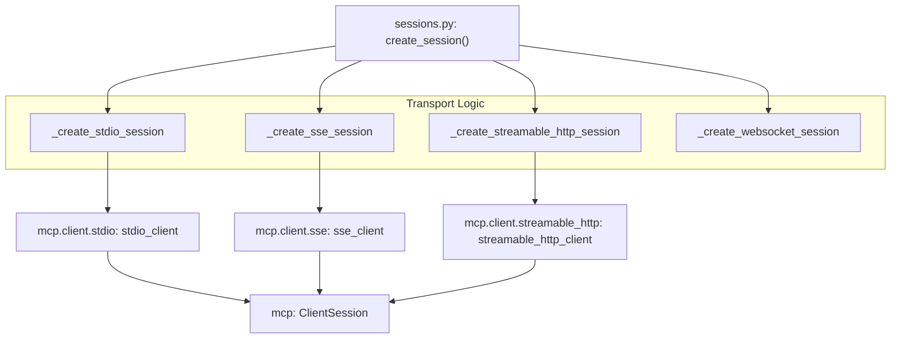

<!-- source: DeepWiki mcp.deepwiki.com · repo langchain-ai/langchain-mcp-adapters · page 5.3 LangGraph API Server Deployment · fetched 2026-10-26 -->

# LangGraph API Server Deployment

<details>
<summary>Relevant source files</summary>

The following files were used as context for generating this wiki page:

- [README.md](README.md)
- [langchain_mcp_adapters/sessions.py](langchain_mcp_adapters/sessions.py)
- [static/img/mcp.png](static/img/mcp.png)

</details>


This page covers deploying agents that use MCP tools to LangGraph API Server. It explains graph entrypoint patterns, transport selection for production deployments, and session management considerations when running MCP clients in a long-running server context.

For basic LangGraph integration patterns (StateGraph, ToolNode), see [LangGraph Integration](#5.2). For general agent usage patterns, see [Using Tools in LangChain Agents](#5.1).

## Graph Entrypoint Patterns

LangGraph API Server requires graph definitions to be specified in `langgraph.json`. When using MCP tools, the graph must be created through an async factory function because tool loading requires async operations.

### Async Factory Function

The recommended pattern is to define an async function that creates and returns the graph. This function is executed when the LangGraph API Server initializes the graph.

```python
# graph.py
from langchain_mcp_adapters.client import MultiServerMCPClient
from langchain.agents import create_agent

async def make_graph():
    client = MultiServerMCPClient({...})
    tools = await client.get_tools()
    agent = create_agent("openai:gpt-4.1", tools)
    return agent
```

The `langgraph.json` configuration specifies this function as the graph entrypoint:

```json
{
  "dependencies": ["."],
  "graphs": {
    "agent": "./graph.py:make_graph"
  }
}
```

**Sources:** [README.md:119-138](), [README.md:283-329]()

### Entrypoint Specification Format

The entrypoint follows the format `<path>:<function_name>`:
- **path**: Relative path to the Python module (e.g., `./graph.py`).
- **function_name**: Name of the async function that returns the graph (e.g., `make_graph`).

The function must:
1. Be async (use `async def`).
2. Return a LangChain agent or LangGraph compiled graph.
3. Handle all tool loading via `MultiServerMCPClient.get_tools` [langchain_mcp_adapters/client.py:126-150]() or `load_mcp_tools` [langchain_mcp_adapters/tools.py:117-135]().

## Transport Selection for Production

When deploying to LangGraph API Server, transport selection is critical. The library supports four transport types via the `Connection` union type [langchain_mcp_adapters/sessions.py:207-209]().

### Transport Comparison

| Transport | Production Ready | Use Case | Implementation Function |
|-----------|-----------------|----------|-------------------------|
| `http` (streamable_http) | ✓ Yes | Remote MCP servers | `_create_streamable_http_session` [langchain_mcp_adapters/sessions.py:290-333]() |
| `sse` | ✓ Yes | Event streaming | `_create_sse_session` [langchain_mcp_adapters/sessions.py:255-288]() |
| `websocket` | ✓ Yes | Full-duplex | `_create_websocket_session` [langchain_mcp_adapters/sessions.py:335-357]() |
| `stdio` | ⚠ Caution | Local development | `_create_stdio_session` [langchain_mcp_adapters/sessions.py:213-253]() |

### HTTP Transport (Recommended)

HTTP transport (`streamable_http`) is the recommended option for production. It uses `streamable_http_client` from the MCP SDK [langchain_mcp_adapters/sessions.py:313-313]() and supports custom `headers` [langchain_mcp_adapters/sessions.py:171-171]() for authentication.

```python
async def make_graph():
    client = MultiServerMCPClient({
        "weather": {
            "url": "http://localhost:8000/mcp",
            "transport": "http",
        }
    })
    tools = await client.get_tools()
    agent = create_agent("openai:gpt-4.1", tools)
    return agent
```

**Sources:** [langchain_mcp_adapters/sessions.py:164-194](), [README.md:190-204]()

### Stdio Transport Limitations

The `stdio` transport [langchain_mcp_adapters/sessions.py:82-128]() spawns a subprocess using `stdio_client` [langchain_mcp_adapters/sessions.py:237-237](). In a server context:
1. **Process Management**: Each connection spawns a subprocess that must be managed.
2. **Environment Expansion**: The adapter provides `_expand_env_vars` [langchain_mcp_adapters/sessions.py:35-45]() to handle `${VAR}` references in strings, which is useful for dynamic configuration in `langgraph.json`.

**Sources:** [README.md:304-307](), [langchain_mcp_adapters/sessions.py:82-128]()

## Deployment Architecture

The following diagram shows how LangGraph API Server integrates with MCP servers using the `MultiServerMCPClient`.



**Diagram: LangGraph API Server deployment architecture showing transport routing**

**Sources:** [langchain_mcp_adapters/client.py:126-150](), [langchain_mcp_adapters/sessions.py:360-432]()

## Session Management in Server Context

The `MultiServerMCPClient` manages MCP sessions differently depending on usage patterns.

### Ephemeral Session Pattern

When using `client.get_tools()` [langchain_mcp_adapters/client.py:126-150](), the client stores the connection configuration but does not keep a session open. When a tool is invoked, it uses `client.session(server_name)` [langchain_mcp_adapters/client.py:152-171]() to create a context-managed session that closes after the call.

**Sources:** [README.md:140-149](), [langchain_mcp_adapters/client.py:152-171]()

### Persistent Session Pattern

For long-lived connections, you can explicitly manage the session lifecycle:

```python
client = MultiServerMCPClient({...})
async with client.session("math") as session:
    tools = await load_mcp_tools(session)
    # tools are bound to this specific session
```

**Sources:** [langchain_mcp_adapters/client.py:152-171](), [langchain_mcp_adapters/tools.py:117-135]()

### Session Creation Flow

The `create_session` function [langchain_mcp_adapters/sessions.py:360-432]() acts as a dispatcher for different transport types.



**Diagram: Internal data flow from create_session to MCP SDK ClientSession**

**Sources:** [langchain_mcp_adapters/sessions.py:360-432](), [langchain_mcp_adapters/sessions.py:213-357]()

## Complete Deployment Example

### graph.py

```python
from langchain_mcp_adapters.client import MultiServerMCPClient
from langchain.agents import create_agent

async def make_graph():
    # MultiServerMCPClient configuration [sessions.py:207]
    client = MultiServerMCPClient({
        "weather": {
            "transport": "http",
            "url": "http://weather-service:8000/mcp",
            "headers": {
                "Authorization": "Bearer ${AUTH_TOKEN}"
            }
        }
    })
    
    # Loads tools via session initialization [client.py:139]
    tools = await client.get_tools()
    return create_agent("openai:gpt-4.1", tools)
```

### Authentication and Headers

For production, pass headers in the `StreamableHttpConnection` [langchain_mcp_adapters/sessions.py:164-194]() or `SSEConnection` [langchain_mcp_adapters/sessions.py:129-162](). These are passed to the underlying `httpx.AsyncClient` via the `McpHttpClientFactory` protocol [langchain_mcp_adapters/sessions.py:60-80]().

**Sources:** [langchain_mcp_adapters/sessions.py:60-80](), [langchain_mcp_adapters/sessions.py:171-171](), [README.md:206-236]()

## Best Practices

1. **Environment Variables**: Use `${VAR}` syntax in connection configs to allow `_expand_env_vars` [langchain_mcp_adapters/sessions.py:35-45]() to inject secrets from the LangGraph environment.
2. **Timeouts**: Configure `timeout` and `sse_read_timeout` in `SSEConnection` [langchain_mcp_adapters/sessions.py:140-148]() to prevent hanging connections in the API server.
3. **Encoding**: For `stdio` transport, ensure `encoding` (default `utf-8`) [langchain_mcp_adapters/sessions.py:50]() matches the MCP server to avoid `EncodingErrorHandler` triggers [langchain_mcp_adapters/sessions.py:48]().

**Sources:** [langchain_mcp_adapters/sessions.py:35-58](), [langchain_mcp_adapters/sessions.py:140-148]()

---

