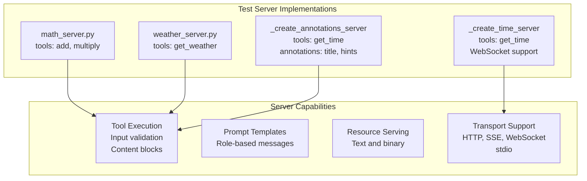
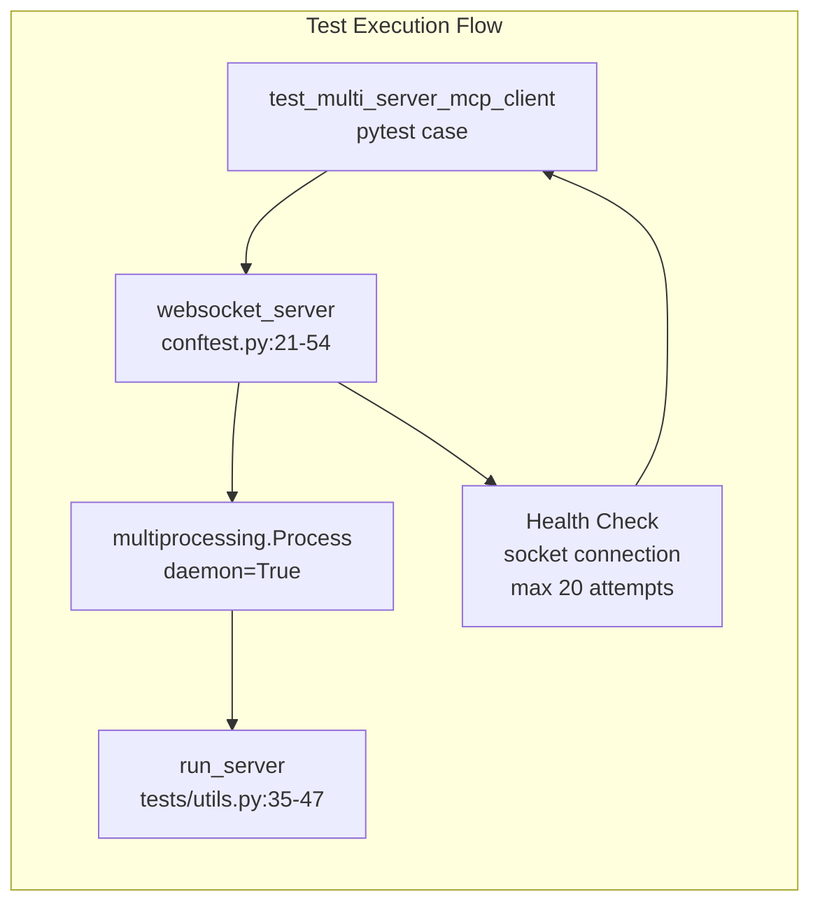

<!-- source: DeepWiki mcp.deepwiki.com · repo langchain-ai/langchain-mcp-adapters · page 6 Testing Framework · fetched 2026-10-26 -->

# Testing Framework

<details>
<summary>Relevant source files</summary>

The following files were used as context for generating this wiki page:

- [tests/conftest.py](tests/conftest.py)
- [tests/test_client.py](tests/test_client.py)
- [tests/test_tools.py](tests/test_tools.py)

</details>


The Testing Framework provides a comprehensive infrastructure for validating the `langchain-mcp-adapters` library. It includes reusable test servers, utilities for process isolation, and extensive test suites covering all adapter components, transport mechanisms, and integration scenarios.

For information about running the tests, see [Running Tests](#6.1). For details on test utilities and fixtures, see [Test Utilities and Fixtures](#6.2). For specific testing patterns and examples, see [Testing Patterns](#6.3).

## Purpose and Scope

This page provides an overview of the testing infrastructure used to validate the `langchain-mcp-adapters` library. The testing framework ensures:

- **Correctness**: MCP-to-LangChain conversions preserve semantics across tool calls, prompts, and resources.
- **Transport coverage**: All connection types (stdio, HTTP, SSE, WebSocket) are tested.
- **Integration validation**: Tools work correctly with LangChain agents and LangGraph workflows.
- **Isolation**: Tests run in isolated processes with controlled network access.
- **Reliability**: Comprehensive error handling and edge case coverage.

The framework consists of three main components: test servers (FastMCP-based implementations), test utilities (helpers for spawning servers and managing processes), and test suites (organized collections of tests for each module).

Sources: [tests/test_tools.py:1-50](), [tests/test_client.py:1-43]()

## Test Server Architecture

The testing framework includes several `FastMCP`-based test servers that implement realistic MCP server functionality. These servers expose tools, prompts, and resources for validation.



### Server Factory and Scripts

Test servers are either defined in standalone scripts for `stdio` testing or created using factory functions for network-based testing.

**Example Server Script (stdio)**:
[tests/test_client.py:127-142]() - The `MultiServerMCPClient` is tested using `math_server.py` and `weather_server.py` scripts spawned via `python3`.

**Example Server Factory (Annotations)**:
[tests/test_tools.py:535-547]() - `_create_annotations_server()` creates a server with specific `ToolAnnotations`:

```python
def _create_annotations_server():
    server = FastMCP(port=8181)
    
    @server.tool(
        annotations=ToolAnnotations(
            title="Get Time", readOnlyHint=True, idempotentHint=False
        ),
    )
    def get_time() -> str:
        """Get current time"""
        return "5:20:00 PM EST"
    
    return server
```

Sources: [tests/test_client.py:120-148](), [tests/test_tools.py:535-547](), [tests/test_tools.py:684-692]()

## Test Utilities and Process Isolation

The framework uses `multiprocessing` to run real MCP servers in isolation during integration tests.



### WebSocket Server Fixture

The `websocket_server` fixture in `conftest.py` demonstrates the standard pattern for spawning a network-based test server:

[tests/conftest.py:21-54]() - Fixture implementation:

| Phase | Action |
|-------|--------|
| **Spawn** | Creates a `multiprocessing.Process` targeting `run_server`. |
| **Start** | Launches the process as a daemon. |
| **Health Check** | Attempts a `socket.connect` to the port up to 20 times with 0.1s delays. |
| **Cleanup** | Kills the process and joins to ensure no leaked resources. |

### Socket Management

To support network-based tests while maintaining security, the `socket_enabled` fixture allows connections only to localhost:

[tests/conftest.py:55-69]() - `pytest_socket` configuration:
```python
def socket_enabled():
    pytest_socket.enable_socket()
    pytest_socket.socket_allow_hosts(["127.0.0.1", "localhost"], allow_unix_socket=True)
    yield
    # Restore state...
```

Sources: [tests/conftest.py:12-69](), [tests/utils.py:19-47]()

## Test Suite Organization

| Test File | Primary Focus | Key Entities |
|-----------|---------------|--------------|
| `tests/test_tools.py` | Tool conversion and invocation | `_convert_call_tool_result`, `convert_mcp_tool_to_langchain_tool`, `load_mcp_tools` |
| `tests/test_client.py` | Client orchestration and sessions | `MultiServerMCPClient`, `_create_stdio_session` |
| `tests/test_interceptors.py` | Interceptor logic | `ToolCallInterceptor`, `MCPToolCallRequest` |

### Tool Result Conversion Tests

A significant portion of the test suite validates how MCP `CallToolResult` objects are mapped to LangChain content blocks:

[tests/test_tools.py:41-120]() - Covers:
- `TextContent` mapping to LangChain text blocks.
- `ImageContent` and `EmbeddedResource` mapping.
- Error handling (mapping `isError=True` to `ToolException`).

### Multi-Server Orchestration

Tests verify that the `MultiServerMCPClient` can aggregate tools from multiple servers using different transports simultaneously:

[tests/test_client.py:120-177]() - A single client connects to:
1. Math Server (stdio)
2. Weather Server (stdio)
3. Time Server (WebSocket)

It then verifies tool name disambiguation and successful invocation across all three.

Sources: [tests/test_tools.py:41-120](), [tests/test_client.py:120-200]()

## Testing Patterns

### Pattern: Environment Variable Expansion

Tests validate that `stdio` sessions correctly handle environment variable expansion, a critical feature for passing secrets to MCP servers:

[tests/test_client.py:46-65]() - `test_stdio_session_expands_env_vars` uses `monkeypatch` to verify `${VAR}` syntax expansion in the `env` dictionary.

### Pattern: ID Matching

Because LangChain content blocks require unique IDs, tests use a regex-based matcher to validate these generated fields:

[tests/utils.py:15-16]() - `IsLangChainID = IsStr(regex=r"lc_.*")`
[tests/test_tools.py:51-60]() - Usage in assertions: `assert content == [{"type": "text", "text": "test result", "id": IsLangChainID}]`

Sources: [tests/test_client.py:46-65](), [tests/utils.py:15-16](), [tests/test_tools.py:51-60]()

---

