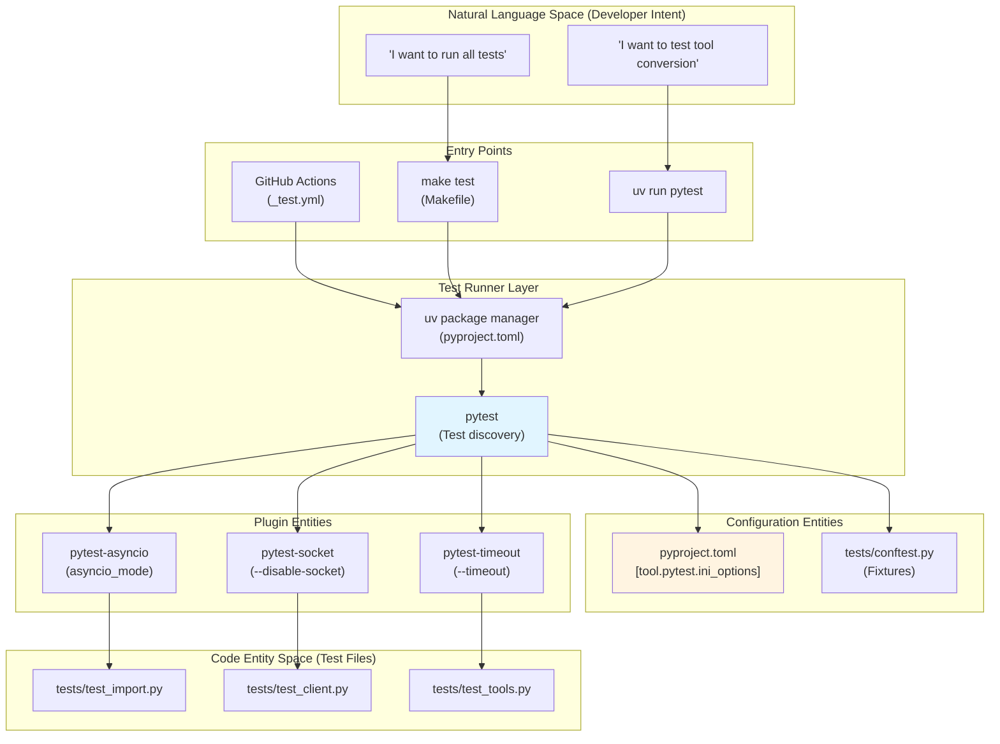
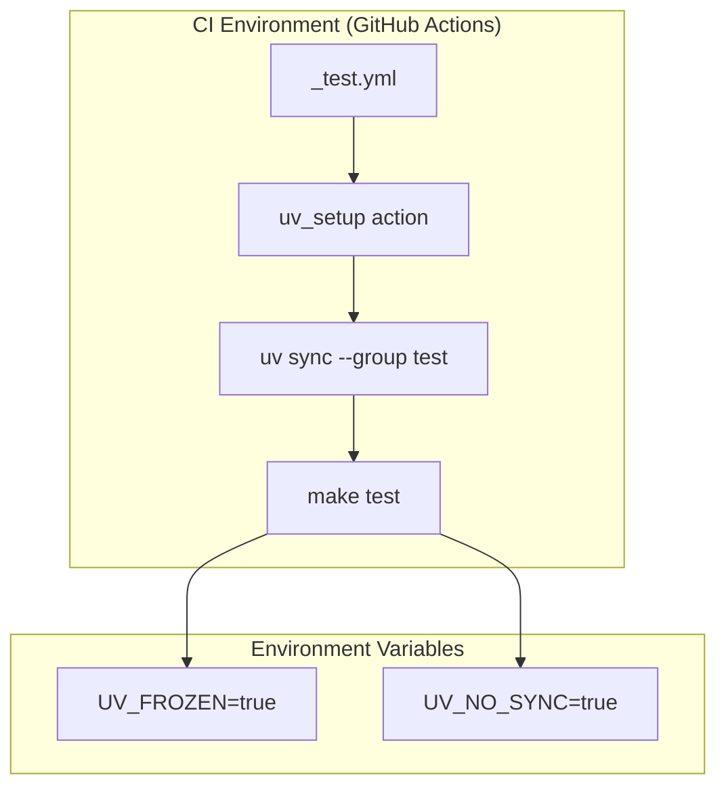

<!-- source: DeepWiki mcp.deepwiki.com · repo langchain-ai/langchain-mcp-adapters · page 6.1 Running Tests · fetched 2026-10-26 -->

# Running Tests

<details>
<summary>Relevant source files</summary>

The following files were used as context for generating this wiki page:

- [.github/workflows/_test.yml](.github/workflows/_test.yml)
- [Makefile](Makefile)
- [pyproject.toml](pyproject.toml)
- [tests/test_import.py](tests/test_import.py)

</details>


## Overview

This document covers how to run the test suite for the `langchain-mcp-adapters` project, including test configuration, available commands, fixtures, and integration with CI/CD. The test suite uses `pytest` as the test runner with several plugins for async support, socket control, and timeout protection.

For information about test utilities and fixtures available for writing new tests, see [Test Utilities and Fixtures](6.2). For patterns and best practices when writing tests, see [Testing Patterns](6.3).

## Test Execution Architecture

The following diagram illustrates how test execution flows through the various tooling layers, bridging the "Natural Language Space" of developer intent to the "Code Entity Space" of the execution environment.



**Sources:** [Makefile:13-14](), [pyproject.toml:40-51](), [.github/workflows/_test.yml:42-45]()

## Basic Test Commands

### Running All Tests

The simplest way to run the entire test suite is using the `Makefile` target:

```bash
make test
```

This executes the command defined in the `Makefile`, which leverages `uv` to run `pytest` with specific safety flags:
```bash
uv run pytest --disable-socket --allow-unix-socket $(TEST_FILE) --timeout 10
```

**Sources:** [Makefile:13-14]()

### Running Specific Test Files

To run tests in a specific file, pass the `TEST_FILE` variable to `make`:

```bash
make test TEST_FILE=tests/test_tools.py
```

Alternatively, run directly via `uv`:

```bash
uv run pytest tests/test_tools.py --disable-socket --allow-unix-socket --timeout 10
```

**Sources:** [Makefile:10-14]()

### Running Specific Tests

To run a specific test function, use the standard `pytest` syntax:

```bash
uv run pytest tests/test_import.py::test_import --disable-socket --allow-unix-socket --timeout 10
```

**Sources:** [tests/test_import.py:1-10]()

## Test Configuration

### Pytest Settings

The test configuration is centralized in `pyproject.toml` under the `[tool.pytest.ini_options]` section:

| Setting | Value | Purpose |
|---------|-------|---------|
| `minversion` | `"8.0"` | Requires pytest 8.0 or higher |
| `addopts` | `"-ra -q -v --durations=5"` | Default pytest options for reporting and verbosity |
| `testpaths` | `["tests"]` | Root directory for test discovery |
| `python_files` | `["test_*.py"]` | Pattern for test modules |
| `python_functions` | `["test_*"]` | Pattern for test functions |
| `asyncio_mode` | `"auto"` | Automatic async test detection |
| `asyncio_default_fixture_loop_scope` | `"function"` | Event loop scope for fixtures |

**Command-line options breakdown:**
- `-ra`: Report all extra test outcomes (passed, skipped, failed, etc.).
- `-q`: Quiet mode for less cluttered output.
- `-v`: Verbose output to display detailed test names.
- `--durations=5`: Show the 5 slowest tests after the run for performance tuning.

**Sources:** [pyproject.toml:40-51]()

### Async Test Configuration

The project uses `pytest-asyncio` to handle asynchronous MCP communication tests. The configuration in `pyproject.toml` ensures that `async def` functions are handled automatically.

**Sources:** [pyproject.toml:30](), [pyproject.toml:50-51]()

### Socket Control and Isolation

To prevent tests from making accidental external network calls, the `Makefile` enforces socket isolation:

- `--disable-socket`: Blocks all network connections by default.
- `--allow-unix-socket`: Permits Unix domain sockets, which are often used for `stdio` transport in MCP.

**Sources:** [Makefile:14](), [pyproject.toml:29]()

### Timeout Protection

All tests are subject to a 10-second timeout to prevent CI pipelines or local runs from hanging indefinitely due to deadlocked MCP sessions.

**Sources:** [Makefile:14](), [pyproject.toml:33]()

## Test Dependencies

Test dependencies are managed in the `[dependency-groups]` section of `pyproject.toml`.

| Package | Version | Role |
|---------|---------|------|
| `pytest` | `>=8.0.0` | Core test runner |
| `pytest-socket` | `>=0.7.0` | Network isolation |
| `pytest-asyncio` | `>=0.26.0` | Async support |
| `pytest-timeout` | `>=2.4.0` | Hang protection |
| `ruff` | `>=0.9.4` | Linting and formatting |
| `mypy` | `>=1.8.0` | Type checking |
| `websockets` | `>=15.0.1` | Support for WebSocket transport testing |
| `dirty-equals` | `>=0.9.0` | Simplified assertions for complex objects |

**Sources:** [pyproject.toml:25-35]()

## CI Workflow Integration

Tests are executed automatically in GitHub Actions via the `_test.yml` reusable workflow.



The CI process ensures:
1. **Consistency**: Uses the same `make test` command as local development.
2. **Speed**: Utilizes `uv` for fast dependency installation.
3. **Reproducibility**: `UV_FROZEN="true"` ensures the environment matches the lockfile exactly.

**Sources:** [.github/workflows/_test.yml:18-45]()

## Code Quality and Linting

Before running tests, the codebase is typically validated using `ruff` and `mypy`. The `Makefile` provides targets for these tasks:

- `make lint`: Runs `ruff` to check for formatting and linting errors.
- `make format`: Runs `ruff` to automatically fix formatting and linting issues.

The `pyproject.toml` file contains extensive `ruff` configurations, including specific ignore rules for the `tests/` directory to allow for common testing patterns like `assert` statements and magic values.

**Sources:** [Makefile:28-35](), [pyproject.toml:53-119]()

## Test File Organization

The `tests/` directory is organized by component:

| File | Component Tested |
|------|------------------|
| `tests/test_import.py` | Validates that all sub-packages (`callbacks`, `client`, `prompts`, `resources`, `tools`) can be imported. |
| `tests/test_client.py` | Integration tests for the `MultiServerMCPClient`. |
| `tests/test_tools.py` | Logic for converting MCP tools to LangChain tools. |
| `tests/test_prompts.py` | Logic for converting MCP prompts to LangChain messages. |
| `tests/test_resources.py` | Logic for converting MCP resources to LangChain blobs. |

**Sources:** [tests/test_import.py:3-9](), [pyproject.toml:47-48]()

---

