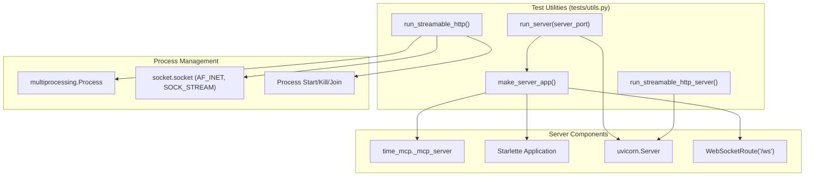
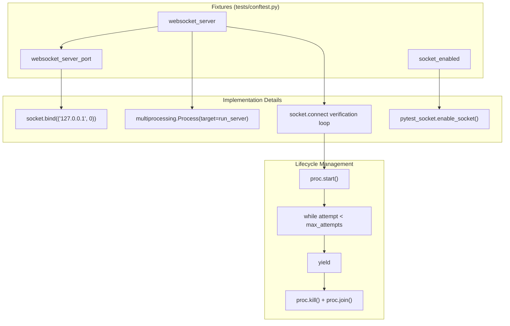

<!-- source: DeepWiki mcp.deepwiki.com · repo langchain-ai/langchain-mcp-adapters · page 6.2 Test Utilities and Fixtures · fetched 2026-10-26 -->

# Test Utilities and Fixtures

Relevant source files

The following files were used as context for generating this wiki page:

- [tests/conftest.py](tests/conftest.py)
- [tests/servers/__init__.py](tests/servers/__init__.py)
- [tests/servers/math_server.py](tests/servers/math_server.py)
- [tests/servers/weather_server.py](tests/servers/weather_server.py)
- [tests/utils.py](tests/utils.py)

## Purpose and Scope

This document covers the test utilities, fixtures, and infrastructure provided by the `langchain-mcp-adapters` project for testing MCP server integrations. The testing framework includes utilities for managing test servers across different transport protocols, pytest fixtures for consistent test setup, and example servers for testing various MCP functionality.

For information about the overall testing framework structure, see [6.1 Running Tests](). For development workflows and automation, see [7.3 Development Automation]().

## Test Server Management

The project provides utilities for managing test servers during testing, particularly for servers that need to run in separate processes or require network connections.

### Server Process Management

The core server management utilities handle the lifecycle of test servers across different transport protocols:

**Diagram: Test Server Management Architecture**

Sources: [tests/utils.py:19-32](), [tests/utils.py:35-42](), [tests/utils.py:49-58](), [tests/utils.py:61-100]()

### WebSocket Server Management

The `make_server_app()` function creates a `Starlette` application that hosts an MCP server over WebSocket connections. It integrates the `time_mcp` instance with WebSocket transport:

- Accesses the underlying server via `time_mcp._mcp_server` [tests/utils.py:20]().
- Uses `mcp.server.websocket.websocket_server` to handle the stream conversion [tests/utils.py:23-25]().
- Creates a `WebSocketRoute` at the `/ws` endpoint [tests/utils.py:30]().

The `run_server()` function launches this application using `uvicorn.Server` and includes a synchronization loop that waits for `server.started` to be true [tests/utils.py:37-46]().

Sources: [tests/utils.py:19-47]()

### HTTP Server Management

For streamable HTTP and SSE transport testing, the utilities provide both direct server execution and context manager patterns.

**HTTP Server Functions:**

| Function | Purpose | Implementation Detail |
|----------|---------|------------|
| `run_streamable_http_server` | Direct server execution in a process | Calls `server.streamable_http_app()` [tests/utils.py:52]() |
| `run_streamable_http` | Context manager for test isolation | Wraps `run_streamable_http_server` in `multiprocessing.Process` [tests/utils.py:69-73]() |

**Connection Verification:**

The `run_streamable_http` context manager implements robust startup verification:
- Maximum 20 connection attempts [tests/utils.py:77]().
- 0.1 second intervals between attempts [tests/utils.py:86]().
- Socket-based connection testing to `127.0.0.1:server_port` [tests/utils.py:82-83]().
- Raises `RuntimeError` if the server fails to start [tests/utils.py:89]().

**Process Cleanup:**

Server cleanup follows this sequence:
1. `proc.kill()` - Send kill signal to the daemon process [tests/utils.py:95]().
2. `proc.join(timeout=2)` - Wait up to 2 seconds for termination [tests/utils.py:96]().
3. `proc.is_alive()` check - Verify process termination [tests/utils.py:97]().

Sources: [tests/utils.py:49-100]()

## Pytest Fixtures

The test framework provides several pytest fixtures in `tests/conftest.py` for consistent test environment setup.

**Diagram: Pytest Fixture Dependencies and Lifecycle**

Sources: [tests/conftest.py:12-17](), [tests/conftest.py:20-53](), [tests/conftest.py:55-69]()

### Port Management Fixture

The `websocket_server_port` fixture provides dynamic port allocation for test servers. It uses `socket.bind` with port `0` to allow the operating system to assign an available ephemeral port [tests/conftest.py:14-16]().

### Server Lifecycle Fixture

The `websocket_server` fixture manages the complete lifecycle of a WebSocket test server. It launches the server as a `daemon` process [tests/conftest.py:25]() and implements the same connection verification logic used in the HTTP utilities to ensure the server is ready before the test proceeds [tests/conftest.py:33-42]().

### Socket Configuration Fixture

The `socket_enabled` fixture handles `pytest-socket` configuration. It allows tests to explicitly enable network access for localhost while preventing accidental external connections:
- Calls `pytest_socket.enable_socket()` [tests/conftest.py:59]().
- Uses `pytest_socket.socket_allow_hosts(["127.0.0.1", "localhost"])` [tests/conftest.py:62-64]().
- Restores previous state in the `finally` block [tests/conftest.py:68]().

Sources: [tests/conftest.py:55-69]()

## Example Test Servers

The project includes several `FastMCP` servers used to verify different capabilities like tools, prompts, and resources.

### Math Server
The `Math` server (`tests/servers/math_server.py`) defines tools for arithmetic and a prompt for assistant configuration.

| Entity | Type | Name/URI | Details |
|--------|------|----------|---------|
| `add` | Tool | `add` | Adds two integers [tests/servers/math_server.py:7-9]() |
| `multiply` | Tool | `multiply` | Multiplies two integers [tests/servers/math_server.py:13-15]() |
| `configure_assistant` | Prompt | `configure_assistant` | Returns assistant role message [tests/servers/math_server.py:19-28]() |
| `get_math_formulas` | Resource | `math://formulas` | Returns "E = mc^2" [tests/servers/math_server.py:31-34]() |

### Weather Server
The `Weather` server (`tests/servers/weather_server.py`) demonstrates asynchronous tool handling.

| Entity | Type | Name/URI | Details |
|--------|------|----------|---------|
| `get_weather` | Tool | `get_weather` | Async function returning location string [tests/servers/weather_server.py:7-9]() |
| `get_weather_forecast` | Resource | `weather://forecast` | Returns forecast text [tests/servers/weather_server.py:12-15]() |

Sources: [tests/servers/math_server.py:1-35](), [tests/servers/weather_server.py:1-15]()

---

