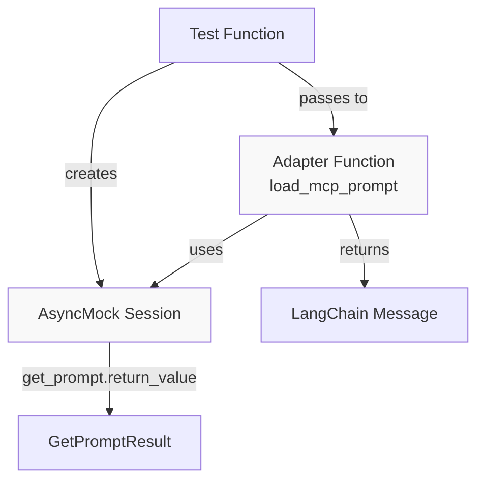
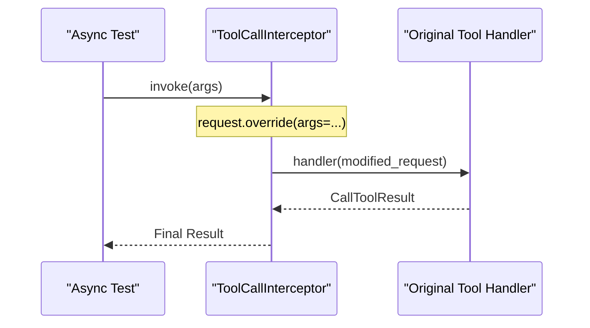
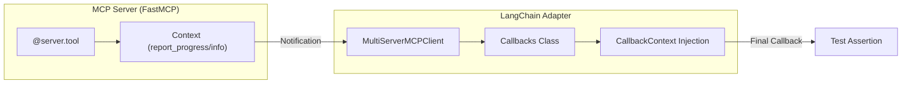

<!-- source: DeepWiki mcp.deepwiki.com · repo langchain-ai/langchain-mcp-adapters · page 6.3 Testing Patterns · fetched 2026-10-26 -->

# Testing Patterns

<details>
<summary>Relevant source files</summary>

The following files were used as context for generating this wiki page:

- [langchain_mcp_adapters/callbacks.py](langchain_mcp_adapters/callbacks.py)
- [langchain_mcp_adapters/interceptors.py](langchain_mcp_adapters/interceptors.py)
- [tests/test_callbacks.py](tests/test_callbacks.py)
- [tests/test_elicitation.py](tests/test_elicitation.py)
- [tests/test_interceptors.py](tests/test_interceptors.py)
- [tests/test_prompts.py](tests/test_prompts.py)
- [tests/test_resources.py](tests/test_resources.py)
- [tests/test_tools.py](tests/test_tools.py)

</details>


This document describes common patterns and best practices for testing MCP adapter functionality, including mocking strategies, async test handling, integration testing approaches, and specialized testing techniques for interceptors and callbacks. For information on running tests and available pytest configurations, see [Running Tests](). For documentation of test fixtures and utilities, see [Test Utilities and Fixtures]().

## Mocking Patterns

### Mocking MCP Sessions

The most common testing pattern involves mocking MCP session objects to test conversion logic without requiring actual MCP server connections. This pattern isolates the adapter layer from the transport layer.

**Basic Session Mocking**



Sources: [tests/test_prompts.py:63-82](), [tests/test_resources.py:59-78]()

The typical pattern:
1. Create an `AsyncMock` session object [tests/test_prompts.py:64]().
2. Configure `return_value` for expected method calls like `get_prompt` [tests/test_prompts.py:65-76]() or `read_resource` [tests/test_resources.py:63-69]().
3. Pass the mock to adapter functions.
4. Verify results match expected LangChain types (e.g., `HumanMessage`, `AIMessage`, or `Blob`).

Example from [tests/test_prompts.py:63-82]():
```python
session = AsyncMock()
session.get_prompt = AsyncMock(
    return_value=AsyncMock(
        messages=[
            PromptMessage(role="user", content=TextContent(type="text", text="Hello")),
        ],
    ),
)
result = await load_mcp_prompt(session, "test_prompt")
```

Sources: [tests/test_prompts.py:63-82](), [tests/test_resources.py:59-78]()

### Mocking Tool Response Variants

Testing tool result conversion involves validating how `CallToolResult` is transformed into LangChain content blocks.

| Response Type | Configuration | File Reference |
|--------------|---------------|----------------|
| Single text | `content=[TextContent(...)]` | [tests/test_tools.py:51-60]() |
| Multiple texts | `content=[TextContent(...), TextContent(...)]` | [tests/test_tools.py:63-79]() |
| Mixed content | `TextContent` + `ImageContent` + `EmbeddedResource` | [tests/test_tools.py:82-120]() |
| Error result | `isError=True` | [tests/test_tools.py:122-132]() |
| Structured data | `structuredContent={"key": "value"}` | [tests/test_tools.py:134-148]() |

**Testing Structured Content**
[tests/test_tools.py:134-148]() demonstrates that `structuredContent` in an MCP result is preserved as a `MCPToolArtifact`:
```python
result = CallToolResult(
    content=[TextContent(type="text", text="text result")],
    isError=False,
    structuredContent={"key": "value"},
)
content, artifact = _convert_call_tool_result(result)
assert artifact == MCPToolArtifact(structured_content={"key": "value"})
```

Sources: [tests/test_tools.py:31-148]()

## Interceptor Testing Patterns

Interceptors are tested by wrapping tool execution and verifying that the `MCPToolCallRequest` is modified or the `MCPToolCallResult` is transformed.

**Interceptor Request Modification Flow**



Sources: [tests/test_interceptors.py:38-64]()

### Testing Request Overrides
Interceptors can modify arguments or tool names before execution. [tests/test_interceptors.py:41-64]() shows an interceptor doubling input arguments:
```python
async def modify_args_interceptor(request: MCPToolCallRequest, handler) -> CallToolResult:
    modified_args = {k: v * 2 for k, v in request.args.items()}
    modified_request = request.override(args=modified_args)
    return await handler(modified_request)
```

### Testing Advanced Patterns (Caching)
Interceptors are used to implement cross-cutting concerns like caching. [tests/test_interceptors.py:171-200]() demonstrates a pattern where the `handler` is only called if a cache miss occurs.

Sources: [tests/test_interceptors.py:11-200]()

## Callback Verification Patterns

Testing callbacks requires verifying that notifications from the MCP server correctly trigger the `Callbacks` protocols and inject the appropriate `CallbackContext`.

### Testing Callback Conversion
The `Callbacks.to_mcp_format` method is tested to ensure that LangChain-specific context is correctly injected when the MCP SDK triggers a callback [tests/test_callbacks.py:18-60]().

### Integration with Tool Execution
Full integration tests verify that progress and logging messages emitted during a tool run are captured by the client [tests/test_callbacks.py:86-144]().

**Callback Data Flow**



Sources: [tests/test_callbacks.py:62-144]()

### Elicitation Testing
Elicitation is a specialized callback where the server requests information from the user during tool execution. Tests verify that the user's response (`accept`, `decline`, or `cancel`) is correctly returned to the server [tests/test_elicitation.py:52-165]().

Sources: [tests/test_elicitation.py:1-165](), [langchain_mcp_adapters/callbacks.py:71-84]()

## Resource and Prompt Testing

### Resource Conversion
Tests for `convert_mcp_resource_to_langchain_blob` verify handling of both text and binary (base64) data. Binary data is decoded from base64 back into raw bytes within the LangChain `Blob` [tests/test_resources.py:22-49]().

### Prompt Message Conversion
Prompt testing focuses on role mapping (e.g., MCP "assistant" to LangChain `AIMessage`) and content validation. [tests/test_prompts.py:19-32]() uses parametrization to test these mappings.

Sources: [tests/test_resources.py:1-249](), [tests/test_prompts.py:1-83]()

## Summary of Key Patterns

| Pattern | Use Case | Key Files |
|---------|----------|-----------|
| `AsyncMock` Session | Isolating conversion logic | [tests/test_prompts.py:64]() |
| `request.override()` | Testing interceptor logic | [langchain_mcp_adapters/interceptors.py:75-108]() |
| `run_streamable_http` | Integration testing with real servers | [tests/test_interceptors.py:50]() |
| `CallbackContext` | Verifying metadata in callbacks | [langchain_mcp_adapters/callbacks.py:29-34]() |
| `pytest.mark.parametrize` | Testing multiple message/role types | [tests/test_prompts.py:19-21]() |

Sources: [tests/test_tools.py](), [tests/test_interceptors.py](), [tests/test_callbacks.py](), [tests/test_elicitation.py]()

---

