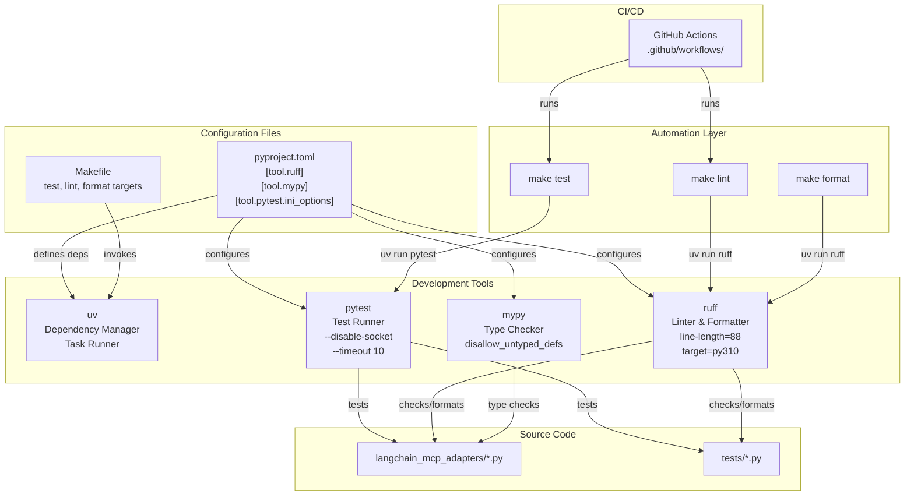
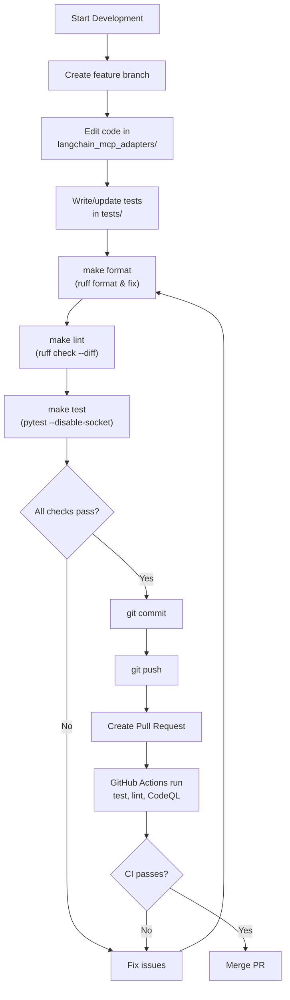

<!-- source: DeepWiki mcp.deepwiki.com · repo langchain-ai/langchain-mcp-adapters · page 7 Development · fetched 2026-10-26 -->

# Development

<details>
<summary>Relevant source files</summary>

The following files were used as context for generating this wiki page:

- [Makefile](Makefile)
- [pyproject.toml](pyproject.toml)
- [tests/test_import.py](tests/test_import.py)
- [uv.lock](uv.lock)

</details>


This page provides guidance for developers contributing to the `langchain-mcp-adapters` package. It covers development environment setup, tooling, workflows, and best practices for making changes to the codebase.

For information about running tests specifically, see [Testing Framework](#6). For detailed API documentation, see [API Reference](#8). For understanding the core architecture, see [Architecture Overview](#1.3).

## Overview

The `langchain-mcp-adapters` project uses modern Python development tooling and practices:

| Tool | Purpose | Configuration |
|------|---------|---------------|
| `uv` | Dependency management and task runner | `pyproject.toml`, `uv.lock` |
| `pytest` | Testing framework | `[tool.pytest.ini_options]` |
| `ruff` | Linting and formatting | `[tool.ruff]`, `[tool.ruff.lint]` |
| `mypy` | Type checking | `[tool.mypy]` |
| `make` | Automation of common tasks | `Makefile` |
| GitHub Actions | CI/CD automation | `.github/workflows/` |

The project requires Python 3.10 or higher and uses `pdm-backend` as its build system [pyproject.toml:1-3]().

**Sources:** [pyproject.toml:1-120](), [Makefile:1-54]()

## Development Environment Setup

### Prerequisites

The project requires Python 3.10 or higher [pyproject.toml:14]():

```bash
# Verify Python version
python --version  # Should be 3.10+
```

### Installing uv

The project uses `uv` for dependency management and running development commands. The `uv.lock` file ensures reproducible environments across different Python versions [uv.lock:1-7]().

### Installing the Package

Clone the repository and install dependencies:

```bash
# Clone the repository
git clone https://github.com/langchain-ai/langchain-mcp-adapters.git
cd langchain-mcp-adapters

# Install the package with all development dependencies
uv sync --all-extras
```

This installs:
- Core dependencies: `langchain-core>=1.0.0`, `mcp>=1.9.2`, `typing-extensions>=4.14.0` [pyproject.toml:15-19]()
- Integration dependencies: `langchain>=1.0.8` [pyproject.toml:22-24]()
- Test dependencies: `pytest`, `ruff`, `mypy`, `pytest-socket`, `pytest-asyncio`, `websockets`, etc. [pyproject.toml:25-35]()

**Sources:** [pyproject.toml:5-35](), [uv.lock:1-31]()

## Development Toolchain Architecture



**Sources:** [pyproject.toml:1-120](), [Makefile:1-54]()

## Project File Structure

The repository follows a standard Python package layout, with functional components organized into modules [tests/test_import.py:3-9]():

```
langchain-mcp-adapters/
├── langchain_mcp_adapters/      # Main package source
│   ├── __init__.py
│   ├── client.py                # MultiServerMCPClient
│   ├── tools.py                 # Tool conversion
│   ├── prompts.py               # Prompt conversion
│   ├── resources.py             # Resource conversion
│   ├── sessions.py              # Session management
│   ├── callbacks.py             # Callback system
│   ├── interceptors.py          # Interceptor protocol
│   └── py.typed                 # Type hint marker
├── tests/                       # Test suite
│   ├── test_client.py
│   ├── test_tools.py
│   ├── test_interceptors.py
│   ├── test_callbacks.py
│   ├── test_import.py           # Verifies imports [tests/test_import.py:1-10]()
│   └── servers/                 # Test MCP servers
├── pyproject.toml               # Package metadata & tool config
├── uv.lock                      # Locked dependencies [uv.lock:1-31]()
├── Makefile                     # Development automation
├── README.md                    # User documentation
└── .github/
    └── workflows/               # CI/CD workflows
```

**Key files:**
- `pyproject.toml` [pyproject.toml:1-120](): Package metadata, dependencies, tool configurations
- `Makefile` [Makefile:1-54](): Development task automation
- `uv.lock` [uv.lock:1-31](): Detailed dependency tree and hashes

**Sources:** [pyproject.toml:5-19](), [tests/test_import.py:1-10](), [uv.lock:1-31]()

## Development Workflow

### Standard Development Cycle



**Sources:** [Makefile:1-54]()

### Running Tests

The `Makefile` provides a `test` target that runs the test suite with socket blocking and timeouts [Makefile:13-14]():

```bash
# Run all tests
make test

# Run specific test file
make test TEST_FILE=tests/test_tools.py

# Run specific test function
uv run pytest tests/test_tools.py::test_convert_mcp_tool
```

The test configuration [pyproject.toml:40-51]() includes:
- `--disable-socket`: Blocks network access during tests (via `pytest-socket`) [Makefile:14]()
- `--allow-unix-socket`: Allows Unix sockets for stdio tests [Makefile:14]()
- `--timeout 10`: Sets 10-second timeout per test [Makefile:14]()
- `-ra -q -v`: Report all outcomes, quiet mode, verbose [pyproject.toml:46]()
- `--durations=5`: Show 5 slowest tests [pyproject.toml:46]()

For more details on testing patterns and fixtures, see [Testing Framework](#6).

**Sources:** [Makefile:13-17](), [pyproject.toml:40-51]()

### Code Formatting and Linting

The project uses `ruff` for both formatting and linting [pyproject.toml:53-66]():

```bash
# Format code (modifies files)
make format

# Check formatting and linting (read-only)
make lint

# Format/lint only changed files
make format_diff
make lint_diff
```

The `ruff` configuration [pyproject.toml:53-66]():
- Line length: 88 characters
- Target version: Python 3.10
- Selects all rules (`ALL`) with specific ignores for complexity and argument counts [pyproject.toml:58-66]()
- Uses Google-style docstrings [pyproject.toml:69-70]()

Test files have relaxed linting rules [pyproject.toml:80-118](), allowing asserts (`S101`), unused fixtures (`ARG`), and missing docstrings.

**Sources:** [Makefile:24-36](), [pyproject.toml:53-118]()

### Type Checking

The project uses `mypy` for static type checking [pyproject.toml:73-78]():

```bash
# Type check the codebase
uv run mypy langchain_mcp_adapters/
```

Configuration:
- Python version: 3.11 for checking [pyproject.toml:74]()
- `warn_return_any = true`: Warns about untyped return values
- `disallow_untyped_defs = true`: Requires type annotations on all functions
- `check_untyped_defs = true`: Type checks even untyped function bodies

**Sources:** [pyproject.toml:73-78]()

## Makefile Targets Reference

The `Makefile` provides convenient shortcuts for common development tasks [Makefile:1-54]():

| Target | Command | Description |
|--------|---------|-------------|
| `help` | `make help` or `make` | Display help message with available targets |
| `test` | `make test` | Run all tests with pytest |
| `test TEST_FILE=<path>` | `make test TEST_FILE=tests/test_tools.py` | Run specific test file |
| `test_watch` | `make test_watch` | Run tests in watch mode with `ptw` |
| `format` | `make format` | Format code with ruff |
| `format_diff` | `make format_diff` | Format only changed files |
| `lint` | `make lint` | Check code with ruff |
| `lint_diff` | `make lint_diff` | Check only changed files |

**Implementation details:**
- All commands use `uv run` to execute tools within the project environment [Makefile:14,29,34]()
- `format_diff` and `lint_diff` operate on files changed from `master` branch [Makefile:26]()

**Sources:** [Makefile:1-54]()

## Child Pages

For detailed information on specific development topics, see the following child pages:

- **[Project Configuration](#7.1)** — Explain `pyproject.toml` structure, including dependencies, tool configurations (`pytest`, `ruff`, `mypy`), and build system.
- **[Dependency Management](#7.2)** — Document the use of `uv` for dependency management, lockfile maintenance, and the dependency tree.
- **[Development Automation](#7.3)** — Explain `Makefile` targets for common development tasks (`test`, `lint`, `format`, `help`).
- **[Code Quality Standards](#7.4)** — Document code quality tools and their configurations: `ruff` for linting/formatting, `mypy` for type checking, `pytest` for testing.
- **[CI/CD Pipeline](#7.5)** — Explain GitHub Actions workflows for testing, releases, and the security-focused separation of build and publish stages.
- **[Security Scanning](#7.6)** — Document CodeQL integration for security analysis, supported languages, and query packs.

---

