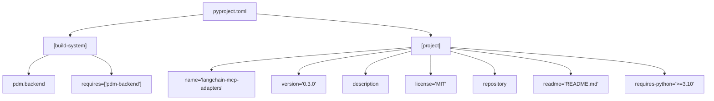
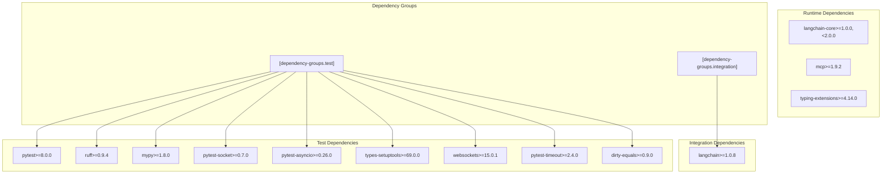
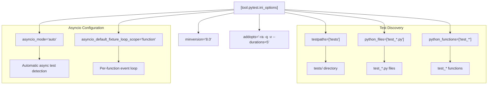
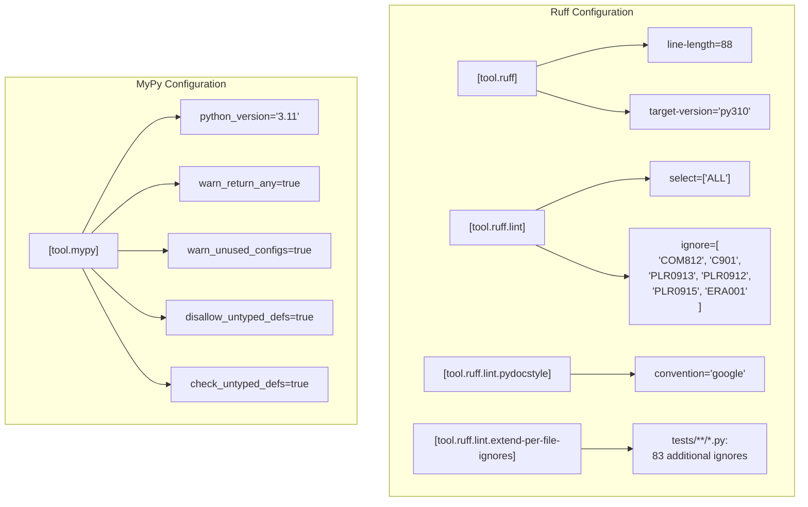
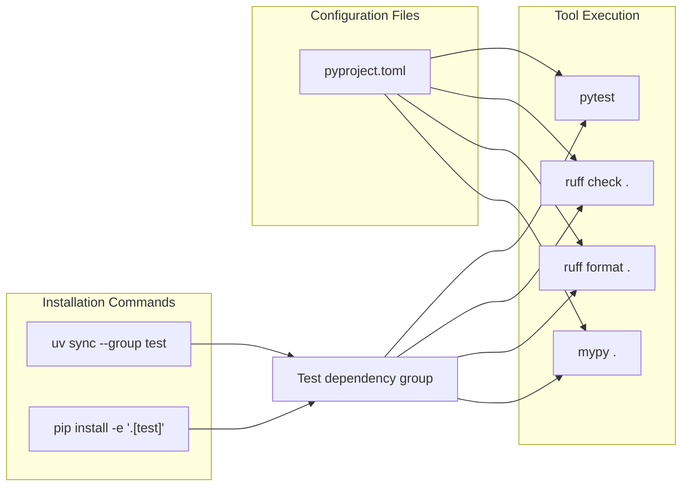

<!-- source: DeepWiki mcp.deepwiki.com · repo langchain-ai/langchain-mcp-adapters · page 7.1 Project Configuration · fetched 2026-10-26 -->

# Project Configuration

Relevant source files

The following files were used as context for generating this wiki page:

- [pyproject.toml](pyproject.toml)

This document covers the project configuration defined in `pyproject.toml`, including build system setup, dependency management, and development tool configurations. The configuration establishes the foundation for dependency resolution, testing framework, code quality tools, and package distribution.

For information about dependency management workflows and lock files, see [Dependency Management](#7.2). For development automation using these configurations, see [Development Automation](#7.3).

## Build System and Package Metadata

The project uses PDM (Python Dependency Manager) as its build backend, configured through the `[build-system]` section. The package metadata defines core project information including versioning, authorship, and distribution settings.

### Build System Configuration

**Build System to Code Entity Mapping**

Sources: [pyproject.toml:1-3]()

The build system configuration maps directly to package distribution functionality:

| Configuration Element | Purpose | Code Impact |
|----------------------|---------|-------------|
| `pdm.backend` | Build backend implementation | Enables `pip install` and PyPI distribution [pyproject.toml:3-3]() |
| `requires-python = ">=3.10"` | Minimum Python version | Enforced during installation and testing [pyproject.toml:14-14]() |
| `name = "langchain-mcp-adapters"` | Package import name | Enables `import langchain_mcp_adapters` [pyproject.toml:6-6]() |
| `version = "0.3.0"` | Package version | Used by dependency resolvers and `__version__` [pyproject.toml:7-7]() |

Sources: [pyproject.toml:5-19]()

## Dependency Architecture

The project defines a two-tier dependency structure: core runtime dependencies and optional development dependency groups.

### Core Dependencies Structure

**Dependency to Functionality Mapping**

Sources: [pyproject.toml:15-35]()

| Dependency | Version Constraint | Purpose |
|------------|-------------------|---------|
| `langchain-core` | `>=1.0.0,<2.0.0` | Core LangChain functionality for tools and messages [pyproject.toml:16-16]() |
| `mcp` | `>=1.9.2` | Model Context Protocol client implementation [pyproject.toml:17-17]() |
| `typing-extensions` | `>=4.14.0` | Backported type hints for Python 3.10+ compatibility [pyproject.toml:18-18]() |
| `langchain` (integration) | `>=1.0.8` | Full LangChain package for agent integration examples [pyproject.toml:23-23]() |
| `pytest` | `>=8.0.0` | Test framework and runner [pyproject.toml:26-26]() |
| `ruff` | `>=0.9.4` | Code linting and formatting [pyproject.toml:27-27]() |
| `mypy` | `>=1.8.0` | Static type checking [pyproject.toml:28-28]() |
| `websockets` | `>=15.0.1` | WebSocket transport support for MCP connections [pyproject.toml:32-32]() |
| `dirty-equals` | `>=0.9.0` | Flexible assertion library for testing [pyproject.toml:34-34]() |

## Development Tools Configuration

The project configures three primary development tools through dedicated `[tool.*]` sections: pytest for testing, ruff for linting/formatting, and mypy for type checking.

### Testing Framework Configuration

**Pytest Configuration Breakdown**

Sources: [pyproject.toml:40-51]()

| Configuration | Value | Impact on Test Execution |
|---------------|-------|--------------------------|
| `addopts = "-ra -q -v --durations=5"` | Report flags | Shows all outcomes, verbose mode, performance timing [pyproject.toml:46-46]() |
| `asyncio_mode = "auto"` | Automatic detection | Enables async/await test functions without decorators [pyproject.toml:50-50]() |
| `asyncio_default_fixture_loop_scope = "function"` | Scope setting | Creates new event loop per test function [pyproject.toml:51-51]() |
| `testpaths = ["tests"]` | Directory specification | Limits test discovery to `tests/` directory [pyproject.toml:47-47]() |

### Code Quality Tools Configuration

**Code Quality Configuration Details**

Sources: [pyproject.toml:53-79](), [pyproject.toml:81-119]()

| Tool | Configuration | Purpose |
|------|---------------|---------|
| `ruff` | `line-length = 88` | Consistent line length across codebase (Black-compatible) [pyproject.toml:54-54]() |
| `ruff` | `target-version = "py310"` | Python 3.10+ syntax and features [pyproject.toml:55-55]() |
| `ruff` | `select = ["ALL"]` | Enable all lint rules (then selectively ignore) [pyproject.toml:58-58]() |
| `ruff` | `ignore = [...]` | Disable specific rules: formatter conflicts, complexity checks [pyproject.toml:59-66]() |
| `ruff.lint.pydocstyle` | `convention = "google"` | Enforce Google-style docstring format [pyproject.toml:70-70]() |
| `ruff.lint.extend-per-file-ignores` | `tests/**/*.py` | Relax numerous lint rules in test files [pyproject.toml:81-119]() |
| `mypy` | `disallow_untyped_defs = true` | Require type annotations on function definitions [pyproject.toml:78-78]() |
| `mypy` | `python_version = "3.11"` | Type checking target version [pyproject.toml:74-74]() |

### Test-Specific Lint Configuration

The project extensively relaxes linting rules for test files to allow common testing patterns while maintaining strict standards for production code.

**Major Test File Exemptions**

Sources: [pyproject.toml:82-119]()

| Rule Category | Exempted Rules | Rationale |
|---------------|----------------|-----------|
| **Assertions** | `S101` | Asserts are fundamental to pytest tests [pyproject.toml:84-84]() |
| **Arguments** | `ARG` | Fixtures may be unused but functionally relevant [pyproject.toml:85-85]() |
| **Booleans** | `FBT` | Boolean flags acceptable in parametrize [pyproject.toml:86-86]() |
| **Docstrings** | `D100-D105`, `D415` | Tests are self-documenting through names [pyproject.toml:91-97]() |
| **Exceptions** | `EM101`, `EM102`, `TRY003`, `TRY004` | Inline exception messages acceptable [pyproject.toml:98-101]() |
| **Type Annotations** | `ANN001`, `ANN201`, `ANN202`, `ANN401` | Type hints less critical in tests [pyproject.toml:106-109]() |
| **Pytest-Specific** | `PT006`, `PT011` | Relaxed pytest.mark and raises requirements [pyproject.toml:110-111]() |
| **Private Access** | `SLF001` | Test files may access private members [pyproject.toml:115-115]() |

## Configuration Integration with Development Workflow

The project configuration integrates with development automation through standardized tool interfaces and dependency group installation.

### Development Tool Integration

**Configuration to Command Mapping**

Sources: [pyproject.toml:21-35](), [pyproject.toml:40-119]()

The project configuration enables consistent development workflows through:

| Configuration Section | Development Command | Purpose |
|----------------------|-------------------|---------|
| `[dependency-groups.test]` | `uv sync --group test` | Install development dependencies [pyproject.toml:25-35]() |
| `[tool.pytest.ini_options]` | `pytest` | Run tests with consistent configuration [pyproject.toml:40-51]() |
| `[tool.ruff]` | `ruff check .` / `ruff format .` | Lint and format code [pyproject.toml:53-70]() |
| `[tool.mypy]` | `mypy .` | Type check codebase [pyproject.toml:73-80]() |

This configuration structure supports both local development and CI/CD pipeline execution, ensuring consistent code quality and testing standards across all environments.

Sources: [pyproject.toml:1-121]()

---

