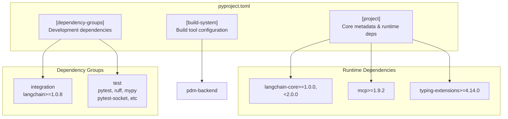
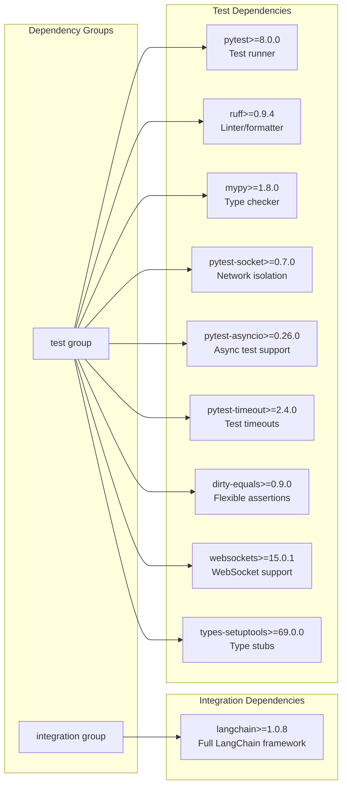
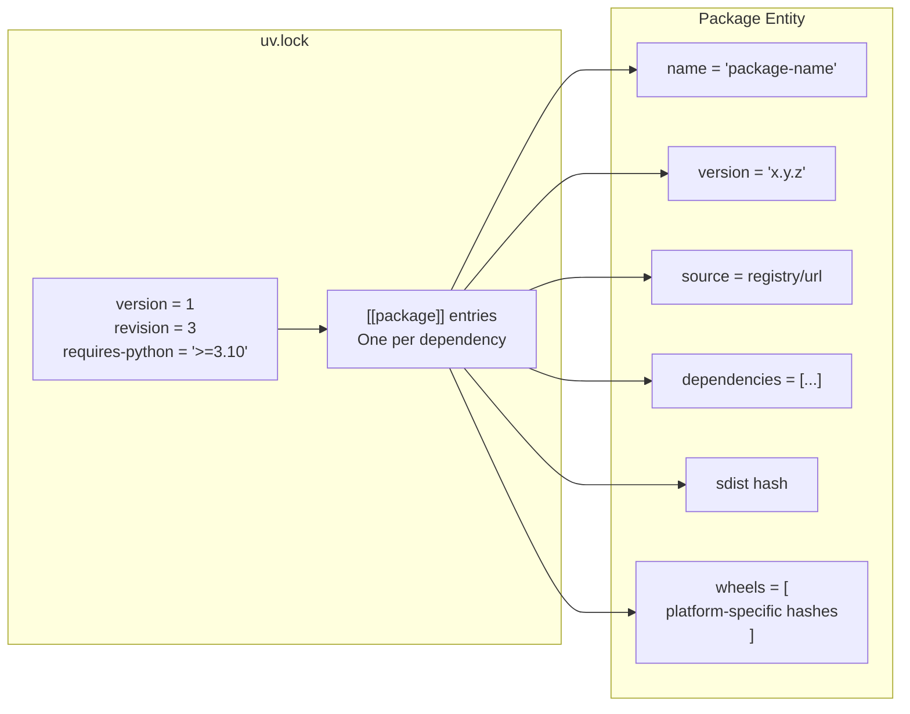

<!-- source: DeepWiki mcp.deepwiki.com · repo langchain-ai/langchain-mcp-adapters · page 7.2 Dependency Management · fetched 2026-10-26 -->

# Dependency Management

Relevant source files

The following files were used as context for generating this wiki page:

- [pyproject.toml](pyproject.toml)
- [uv.lock](uv.lock)

This page documents how dependencies are declared, resolved, and managed in the `langchain-mcp-adapters` project. The project uses modern Python packaging standards with `pyproject.toml` for configuration and the `uv` package manager for fast, reliable dependency resolution.

For information about project configuration more broadly, see [Project Configuration](7.1). For details on development automation using dependencies, see [Development Automation](7.3).

## Overview

The langchain-mcp-adapters project manages three types of dependencies:

1.  **Runtime Dependencies**: Required for the library to function (e.g., `langchain-core`, `mcp`).
2.  **Development Dependencies**: Organized into dependency groups for testing and integration.
3.  **Transitive Dependencies**: Automatically resolved and locked for reproducibility.

All dependency declarations are centralized in `pyproject.toml`, while exact versions and hashes are locked in `uv.lock` for deterministic builds across environments.

**Sources:** [pyproject.toml:1-20](), [uv.lock:1-3]()

## Dependency Declaration Structure

The following diagram maps the logical dependency structure to the configuration entities in the codebase.

**Dependency Organization**

**Sources:** [pyproject.toml:1-35]()

### Runtime Dependencies

Runtime dependencies are declared in the `[project]` section under the `dependencies` key. These packages must be installed for `langchain-mcp-adapters` to function:

| Package | Version Constraint | Purpose |
| :--- | :--- | :--- |
| `langchain-core` | `>=1.0.0, <2.0.0` | Provides core LangChain types (`BaseTool`, `BaseMessage`, `Blob`) |
| `mcp` | `>=1.9.2` | Anthropic's Model Context Protocol SDK for server communication |
| `typing-extensions` | `>=4.14.0` | Backports of newer typing features for Python 3.10+ compatibility |

The version constraints use semantic versioning:
*   `>=1.0.0, <2.0.0` permits any 1.x version, preventing breaking changes from 2.0. [pyproject.toml:16-16]()
*   `>=1.9.2` requires at least version 1.9.2, allowing newer compatible versions. [pyproject.toml:17-17]()

**Sources:** [pyproject.toml:14-19]()

### Dependency Groups

The project uses PEP 735 dependency groups (via `[dependency-groups]`) to organize development-time dependencies. This allows selective installation based on development needs.

**Development Dependency Mapping**

**Sources:** [pyproject.toml:21-35]()

#### Integration Group
The `integration` dependency group includes packages needed to use `langchain-mcp-adapters` with the full LangChain ecosystem. This is separate from runtime dependencies because users may want to use adapters with only `langchain-core` (lighter weight) or with the full `langchain` package (includes agents, chains, etc.). [pyproject.toml:22-24]()

#### Test Group
The `test` dependency group includes all tools needed for development, testing, and code quality. [pyproject.toml:25-35]()

## UV Package Manager

The project uses `uv` as its package manager, a fast Python package installer and resolver. The `uv` tool provides:

1.  **Fast Resolution**: significantly faster than standard pip for dependency resolution.
2.  **Deterministic Builds**: Uses `uv.lock` to pin all dependencies with cryptographic hashes. [uv.lock:1-16]()
3.  **Integrated Workflow**: Combines virtual environment management and package installation.

### UV in the Development Workflow

The `uv` tool is used via the command line or integrated through the project `Makefile`.

*   **Running Tests**: `uv run pytest` is the standard execution method. [pyproject.toml:40-51]()
*   **Linting/Formatting**: `uv run ruff` is used for both linting and formatting. [pyproject.toml:53-71]()
*   **Type Checking**: `uv run mypy` is used for static analysis. [pyproject.toml:73-80]()

The `uv run` command automatically ensures a virtual environment is present and matches the `uv.lock` file before executing the command.

**Sources:** [pyproject.toml:40-80]()

## Lock File Mechanism

The `uv.lock` file provides deterministic, reproducible builds by pinning exact versions of all direct and transitive dependencies with cryptographic hashes.

**Lockfile Structure**

**Sources:** [uv.lock:1-16]()

### Cryptographic Hash Verification

For security and reproducibility, `uv.lock` includes SHA256 hashes for all packages. For example, the `annotated-types` package includes hashes for both the source distribution and the wheel. [uv.lock:10-16]()

This ensures that the exact same binary artifacts are used across all installations, preventing supply-chain attacks and version drift.

## Dependency Resolution Process

The dependency resolution workflow follows these steps:

1.  **Declaration**: Developer specifies version constraints in `pyproject.toml`. [pyproject.toml:15-19]()
2.  **Resolution**: `uv lock` queries the registry (PyPI), resolves all transitive dependencies, and finds compatible versions.
3.  **Locking**: Resolved versions and hashes are written to `uv.lock`. [uv.lock:1-3]()
4.  **Installation**: `uv sync` reads the lock file, downloads packages, verifies hashes, and installs to the local `.venv`.

## Transitive Dependencies

The lock file includes all transitive dependencies. For example, `anyio` (a dependency of `mcp`) itself depends on `idna` and `sniffio`, which are explicitly tracked in the lock file. [uv.lock:19-31]()

The full dependency tree for the project includes many packages when all transitive dependencies are resolved, ensuring that every environment is identical down to the lowest-level library.

## Version Pinning Strategy

The project uses different version pinning strategies for different dependency types:

| Dependency Type | Strategy | Example | Rationale |
| :--- | :--- | :--- | :--- |
| Core runtime | Major version pin | `langchain-core>=1.0.0, <2.0.0` | Allow minor updates, prevent breaking changes. |
| MCP SDK | Minimum version | `mcp>=1.9.2` | Require features from 1.9.2+, allow all compatible updates. |
| Development tools | Minimum version | `pytest>=8.0.0` | Get latest features, maintain compatibility. |
| Exact pins | Lock file only | (Managed by uv) | Deterministic builds via `uv.lock`. |

This strategy balances flexibility (allowing compatible updates in `pyproject.toml`) with reproducibility (exact versions in `uv.lock`).

**Sources:** [pyproject.toml:15-35](), [uv.lock:1-16]()

## Dependency Security

The lock file mechanism provides several security benefits:

1.  **Hash Verification**: Every package download is verified against cryptographic hashes. [uv.lock:13-15]()
2.  **Supply Chain Protection**: Prevents malicious package substitution or corruption.
3.  **Reproducible Builds**: Identical dependencies across all installations.
4.  **Audit Trail**: `uv.lock` provides a complete record of all dependencies and versions.

**Sources:** [uv.lock:1-118]()

---

