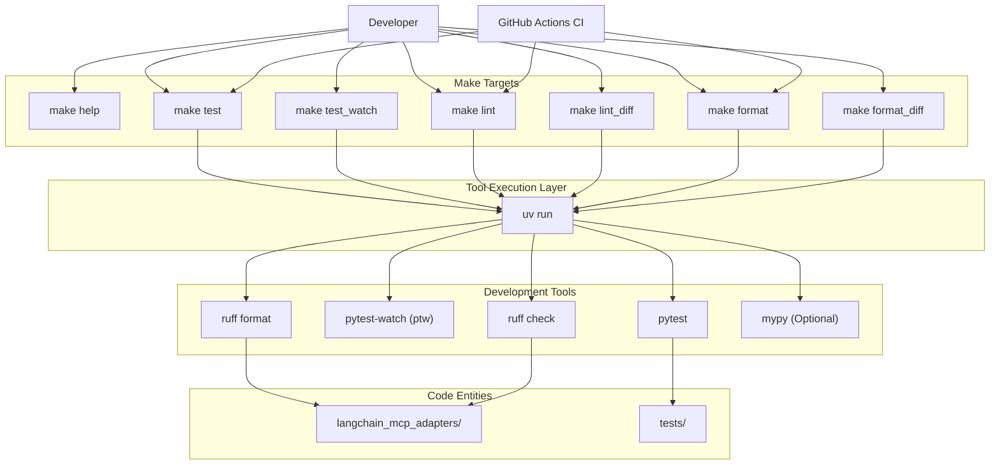
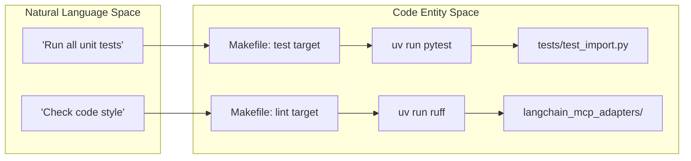

<!-- source: DeepWiki mcp.deepwiki.com · repo langchain-ai/langchain-mcp-adapters · page 7.3 Development Automation · fetched 2026-10-26 -->

# Development Automation

<details>
<summary>Relevant source files</summary>

The following files were used as context for generating this wiki page:

- [Makefile](Makefile)
- [tests/test_import.py](tests/test_import.py)

</details>


This document covers the `Makefile`-based automation system for common development tasks including testing, linting, and code formatting. The Makefile provides convenient command-line targets that developers use during local development and that CI workflows invoke for automated validation. For information about the underlying tool configurations (ruff, mypy, pytest), see [Code Quality Standards](#7.4). For dependency management with `uv`, see [Dependency Management](#7.2). For CI/CD automation, see [CI/CD Pipeline](#7.5).

**Sources:** [Makefile:1-54]()

## Overview

The development automation system is built around GNU Make targets that wrap calls to development tools through `uv run`. This provides a consistent interface for common tasks while ensuring all commands execute in the project's virtual environment with correct dependencies. The Makefile defines targets for testing, linting, formatting, and help documentation.

**Key characteristics:**
- **uv-based execution**: All tool invocations use `uv run` to ensure correct environment.
- **Selective file targeting**: Support for running commands on all files or only changed files.
- **Variable customization**: Allow runtime configuration via environment variables.
- **CI/CD compatibility**: Same commands work locally and in GitHub Actions.

**Sources:** [Makefile:1-54]()

## Make Target Architecture



This diagram shows how developer commands and CI workflows invoke Make targets, which delegate to `uv run` for tool execution against specific code directories.

**Sources:** [Makefile:1-54](), [tests/test_import.py:1-9]()

## Testing Targets

The Makefile provides two testing targets: `test` for single test runs and `test_watch` for continuous testing during development.

### test Target

```makefile
TEST_FILE ?= tests/

test:
	uv run pytest --disable-socket --allow-unix-socket $(TEST_FILE) --timeout 10
```

The `test` target runs the test suite with network isolation and execution timeouts:

**Flags:**
- `--disable-socket`: Blocks network access via `pytest-socket` plugin.
- `--allow-unix-socket`: Permits Unix domain sockets (needed for stdio transport tests).
- `--timeout 10`: Kills tests that exceed 10 seconds (via `pytest-timeout`).
- `$(TEST_FILE)`: Configurable test path (defaults to `tests/`).

**Usage examples:**
```bash
# Run all tests
make test

# Run specific test file
make test TEST_FILE=tests/test_import.py
```

The socket restrictions ensure tests don't make unintended network calls, which could cause flakiness. Unix sockets are permitted because MCP stdio transport uses them for local process communication.

**Sources:** [Makefile:10-14](), [tests/test_import.py:1-9]()

### test_watch Target

```makefile
test_watch:
	uv run ptw . -- $(TEST_FILE)
```

The `test_watch` target uses `pytest-watch` (ptw) to automatically re-run tests when files change. The `.` argument tells ptw to watch the current directory tree. The `--` separator passes remaining arguments to pytest.

**Sources:** [Makefile:16-17]()

## Linting Targets

Linting targets validate code without making changes. The Makefile provides `lint` (check all files) and `lint_diff` (check only changed files).

### File Selection Variables

```makefile
lint format: PYTHON_FILES=langchain_mcp_adapters/ tests/
lint_diff format_diff: PYTHON_FILES=$(shell git diff --relative=. --name-only --diff-filter=d master | grep -E '\.py$$|\.ipynb$$')
```

These target-specific variable assignments define which files to process:
- For `lint`/`format`: All source files in `langchain_mcp_adapters/` and `tests/`.
- For `lint_diff`/`format_diff`: Only Python files modified compared to the `master` branch.

**Sources:** [Makefile:24-26]()

### lint and lint_diff Targets

```makefile
lint lint_diff:
	[ "$(PYTHON_FILES)" = "" ] ||	uv run ruff format $(PYTHON_FILES) --diff
	[ "$(PYTHON_FILES)" = "" ] ||	uv run ruff check $(PYTHON_FILES) --diff
	# [ "$(PYTHON_FILES)" = "" ] || uv run mypy $(PYTHON_FILES)
```

These targets perform checks:
1. **ruff format --diff**: Show formatting changes without applying them.
2. **ruff check --diff**: Show lint violations without auto-fixing.
3. **mypy** (currently commented out in the Makefile): Type checking.

Each command is guarded by `[ "$(PYTHON_FILES)" = "" ] ||` to skip execution if no files match (e.g., in `lint_diff` when no Python files changed).

**Sources:** [Makefile:28-31]()

## Formatting Targets

Formatting targets automatically fix code style issues. Like linting, there are `format` (all files) and `format_diff` (changed files only) variants.

### format and format_diff Targets

```makefile
format format_diff:
	[ "$(PYTHON_FILES)" = "" ] || uv run ruff format $(PYTHON_FILES)
	[ "$(PYTHON_FILES)" = "" ] || uv run ruff check --fix $(PYTHON_FILES)
```

These targets modify files in place:
1. **ruff format**: Apply code formatting (line length, quotes, etc.).
2. **ruff check --fix**: Auto-fix lint violations where possible.

**Sources:** [Makefile:33-35]()

## Help System

```makefile
help:
	@echo '===================='
	@echo '-- LINTING --'
	@echo 'format                       - run code formatters'
	@echo 'lint                         - run linters'
	@echo '-- TESTS --'
	@echo 'test                         - run unit tests'
	@echo 'test TEST_FILE=<test_file>   - run all tests in file'
	@echo '-- DOCUMENTATION tasks are from the top-level Makefile --'
```

The `help` target (also the default target via `all: help`) displays available commands. The `@echo` prefix suppresses command echoing.

**Sources:** [Makefile:39-51]()

## Available Targets Reference

| Target | Purpose | File Scope |
|--------|---------|------------|
| `help` | Display available commands | N/A |
| `test` | Run test suite with network isolation | `tests/` |
| `test_watch` | Run tests continuously on file changes | `tests/` |
| `lint` | Check code style without changes | `langchain_mcp_adapters/` + `tests/` |
| `lint_diff` | Check only changed files | Changed `.py` files vs master |
| `format` | Auto-fix code style issues | `langchain_mcp_adapters/` + `tests/` |
| `format_diff` | Auto-fix only changed files | Changed `.py` files vs master |

**Sources:** [Makefile:1-54]()

## Command Execution Flow



This diagram illustrates how developer intentions map to specific Makefile targets and the underlying code entities they interact with.

**Sources:** [Makefile:1-54](), [tests/test_import.py:1-9]()

## Customization via Variables

The Makefile exposes customization through Make variables:

### TEST_FILE Variable

```makefile
TEST_FILE ?= tests/
```

The `?=` operator sets a default value only if `TEST_FILE` is not already defined. This allows:

```bash
# Override on command line
make test TEST_FILE=tests/test_import.py
```

### PYTHON_FILES Variable

The `PYTHON_FILES` variable is set differently per target to control file scope. For `lint`/`format`, it includes all source files. For `lint_diff`/`format_diff`, it uses a `git diff` command to identify only modified files.

**Sources:** [Makefile:10-26]()

---

