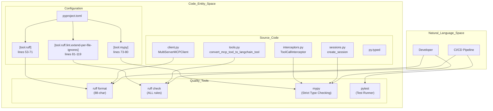
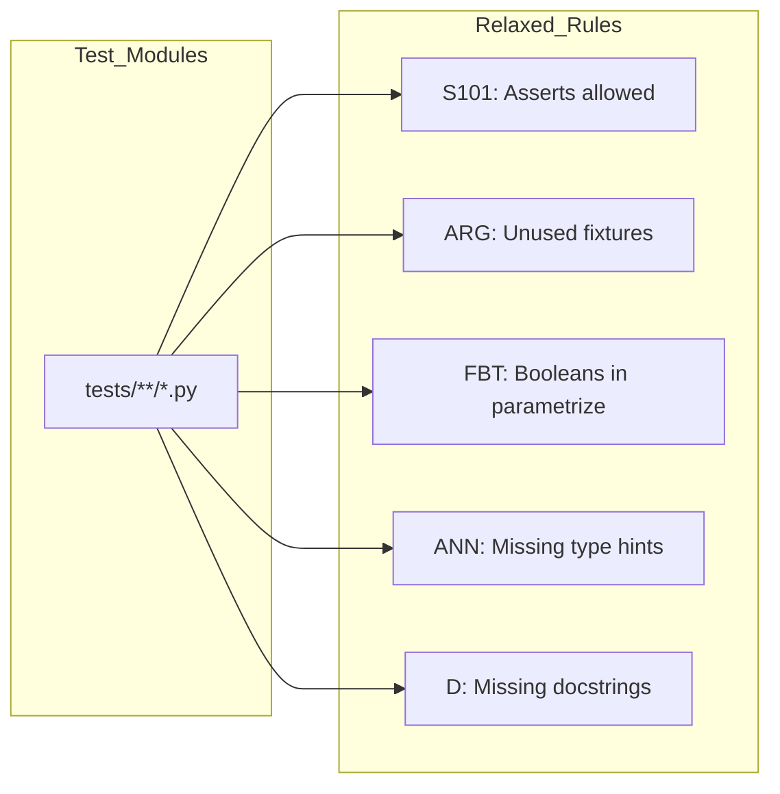

<!-- source: DeepWiki mcp.deepwiki.com · repo langchain-ai/langchain-mcp-adapters · page 7.4 Code Quality Standards · fetched 2026-10-26 -->

# Code Quality Standards

<details>
<summary>Relevant source files</summary>

The following files were used as context for generating this wiki page:

- [langchain_mcp_adapters/py.typed](langchain_mcp_adapters/py.typed)
- [pyproject.toml](pyproject.toml)

</details>


## Purpose and Scope

This document describes the code quality tools, configurations, and standards enforced in the `langchain-mcp-adapters` codebase. It covers the static analysis tools (Ruff and MyPy), their configuration, lint rules, type checking policies, and how to execute quality checks locally. For information about the CI/CD pipeline that runs these checks automatically, see [CI/CD Pipeline](#7.5). For general development automation, see [Development Automation](#7.3).

---

## Overview

The project uses two primary code quality tools:

| Tool | Purpose | Minimum Version | Configuration Location |
|------|---------|----------------|------------------------|
| **Ruff** | Fast Python linter and formatter | 0.9.4 | `[tool.ruff]` in `pyproject.toml` |
| **MyPy** | Static type checker | 1.8.0 | `[tool.mypy]` in `pyproject.toml` |

Both tools are configured in [pyproject.toml:53-80]() and are essential for maintaining the bridge between MCP and LangChain.

---

## Tool Architecture

The diagram below illustrates how quality tools interact with the core library entities and the test suite.

### Quality Tool Data Flow



**Sources:** [pyproject.toml:53-119](), [langchain_mcp_adapters/py.typed:1-1]()

---

## Ruff Configuration

### Core Settings

Ruff is configured with aggressive quality standards targeting modern Python:

```toml
[tool.ruff]
line-length = 88 
target-version = "py310"

[tool.ruff.lint]
select = [ "ALL",]
```

**Key Configuration Points:**

- **Line Length:** 88 characters [pyproject.toml:54]().
- **Target Python:** 3.10+ [pyproject.toml:55]().
- **Rule Selection:** `ALL` rules enabled by default [pyproject.toml:58](), with specific exceptions.
- **Docstring Style:** Google convention [pyproject.toml:70]().

**Sources:** [pyproject.toml:53-71]()

### Global Rule Exceptions

The following rules are globally disabled to accommodate the adapter architecture:

| Rule Code | Description | Rationale |
|-----------|-------------|-----------|
| `COM812` | Missing trailing comma | Conflicts with formatter [pyproject.toml:60](). |
| `C901` | Too complex | Complex conversion logic in tools/prompts [pyproject.toml:61](). |
| `PLR0913` | Too many arguments | MCP Client initialization requires many params [pyproject.toml:62](). |
| `PLR0912` | Too many branches | Necessary for handling varied MCP message types [pyproject.toml:63](). |
| `PLR0915` | Too many statements | Complex session setup sequences [pyproject.toml:64](). |
| `ERA001` | Commented out code | Preserved for development context [pyproject.toml:65](). |

**Sources:** [pyproject.toml:59-66]()

### Test-Specific Exceptions

Tests have relaxed quality requirements to allow for common testing patterns like `assert` and `pytest.mark.parametrize`.



The complete list of test exceptions includes rule codes defined in [pyproject.toml:82-119](). Notable categories include `S101` (asserts), `ANN` (missing type annotations for functions), and `PT` (pytest-specific rules).

**Sources:** [pyproject.toml:81-119]()

---

## MyPy Type Checking

### Strict Type Checking Configuration

MyPy is configured for rigorous type safety, ensuring the adapter correctly maps MCP types to LangChain types.

```toml
[tool.mypy]
python_version = "3.11"
warn_return_any = true
warn_unused_configs = true
disallow_untyped_defs = true
check_untyped_defs = true
```

**Configuration Breakdown:**

| Setting | Value | Enforcement |
|---------|-------|-------------|
| `python_version` | "3.11" | Target Python 3.11 features [pyproject.toml:74](). |
| `warn_return_any` | true | Prevent implicit `Any` returns [pyproject.toml:75](). |
| `disallow_untyped_defs` | true | Require annotations on all functions [pyproject.toml:78](). |
| `check_untyped_defs` | true | Check bodies of untyped functions [pyproject.toml:79](). |

The presence of `langchain_mcp_adapters/py.typed` [langchain_mcp_adapters/py.typed:1-1]() indicates that this package supports inline type hints and can be used by downstream consumers for type checking.

**Sources:** [pyproject.toml:73-80](), [langchain_mcp_adapters/py.typed:1-1]()

---

## Pytest Configuration

The testing framework is configured to handle the asynchronous nature of MCP communication.

**Key Settings:**
- **Min Version:** 8.0 [pyproject.toml:41]().
- **Asyncio Mode:** `auto` [pyproject.toml:50]().
- **Fixture Scope:** `function` scope for the default event loop [pyproject.toml:51]().
- **Output:** Quiet but verbose with duration tracking for the 5 slowest tests [pyproject.toml:46]().

### Test Dependencies
The project relies on a specific set of testing utilities:
- `pytest-asyncio`: For `async` test cases [pyproject.toml:30]().
- `pytest-socket`: To prevent accidental network calls during unit tests [pyproject.toml:29]().
- `dirty-equals`: For flexible object comparisons in assertions [pyproject.toml:34]().
- `websockets`: For testing WebSocket-based MCP transports [pyproject.toml:32]().

**Sources:** [pyproject.toml:25-35](), [pyproject.toml:40-52]()

---

## Integration with Development Workflow

Quality standards are enforced at multiple levels:

1.  **Dependency Management:** `uv` manages the `test` group which includes `ruff`, `mypy`, and `pytest` [pyproject.toml:25-28]().
2.  **Local Execution:** Developers are expected to run these tools before submitting PRs.
3.  **CI Enforcement:** The GitHub Actions pipeline runs `ruff check`, `mypy`, and `pytest` to ensure no regressions.

**Sources:** [pyproject.toml:21-35](), [pyproject.toml:53-80]()

---

