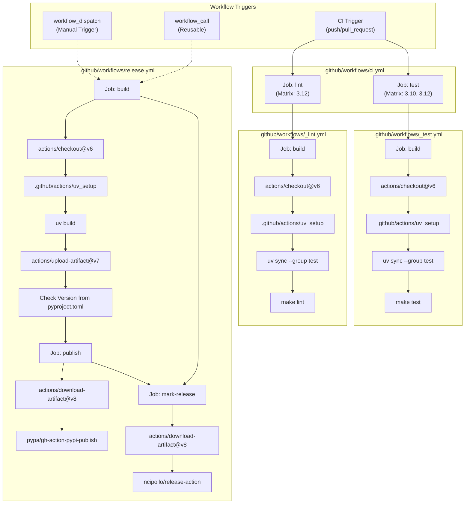
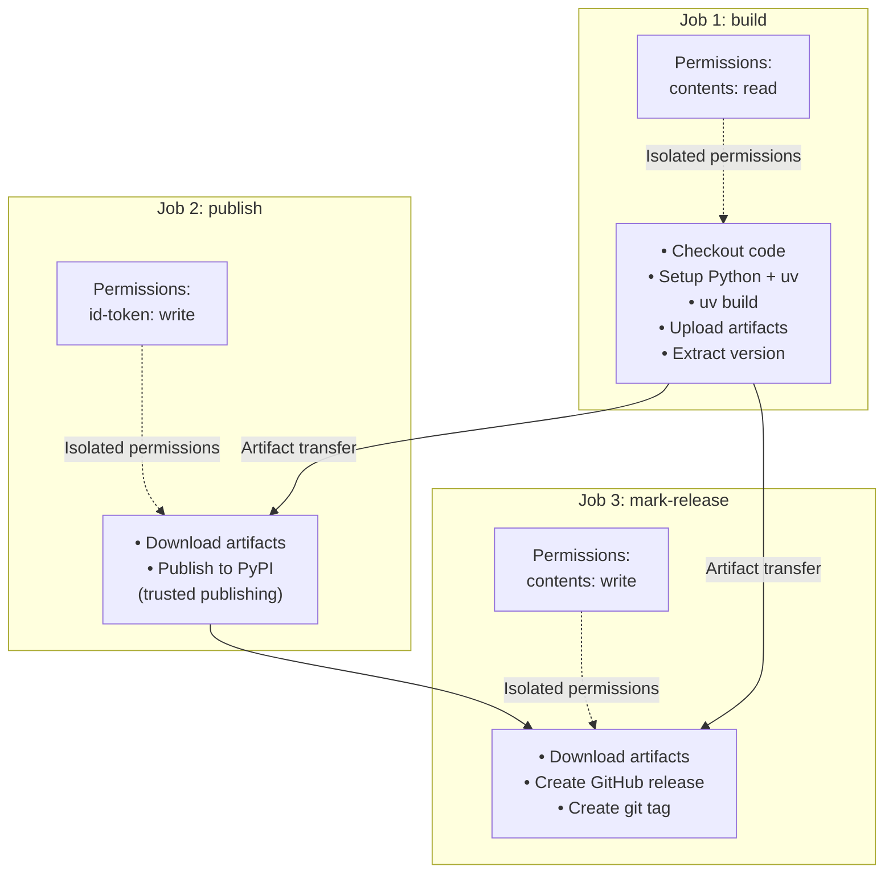
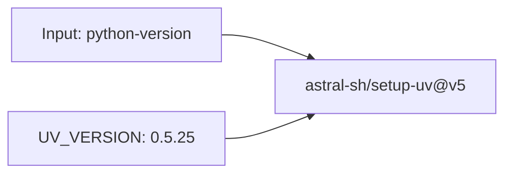

<!-- source: DeepWiki mcp.deepwiki.com · repo langchain-ai/langchain-mcp-adapters · page 7.5 CI/CD Pipeline · fetched 2026-10-26 -->

# CI/CD Pipeline

Relevant source files

The following files were used as context for generating this wiki page:

- [.github/actions/uv_setup/action.yml](.github/actions/uv_setup/action.yml)
- [.github/dependabot.yml](.github/dependabot.yml)
- [.github/workflows/_lint.yml](.github/workflows/_lint.yml)
- [.github/workflows/_test.yml](.github/workflows/_test.yml)
- [.github/workflows/ci.yml](.github/workflows/ci.yml)
- [.github/workflows/release.yml](.github/workflows/release.yml)

## Purpose and Scope

This document describes the GitHub Actions-based CI/CD pipeline for `langchain-mcp-adapters`. The pipeline consists of two primary workflows: a test workflow that validates code changes and a release workflow that publishes the package to PyPI. The release workflow implements a security-focused separation between build and publish stages to prevent credential exposure. For security scanning details, see [Security Scanning](#7.6).

## Workflow Architecture

The CI/CD pipeline is organized into reusable workflow files that can be called from other workflows or triggered manually. Both workflows use `uv` as the build tool and enforce dependency locking for reproducible builds.

**Workflow Overview**

| Workflow | File | Purpose | Reusable |
|----------|------|---------|----------|
| CI Entrypoint | `.github/workflows/ci.yml` | Orchestrates linting and testing on PR/Push | No |
| Test | `.github/workflows/_test.yml` | Run test suite with pytest | Yes |
| Lint | `.github/workflows/_lint.yml` | Run ruff linting and formatting | Yes |
| Release | `.github/workflows/release.yml` | Build, publish to PyPI, create GitHub release | Yes |

Sources: [.github/workflows/ci.yml:1-61](), [.github/workflows/_test.yml:1-46](), [.github/workflows/_lint.yml:1-48](), [.github/workflows/release.yml:1-153]()

## CI Orchestration

The `ci.yml` workflow acts as the primary gatekeeper for code quality. It utilizes a concurrency group to cancel outdated runs when new pushes occur to the same branch or PR [.github/workflows/ci.yml:19-21]().

### Matrix Strategy
To optimize resource usage while ensuring compatibility, the CI uses a version matrix:
- **Linting**: Performed only on Python 3.12 to minimize redundant checks [.github/workflows/ci.yml:34-35]().
- **Testing**: Performed on the minimum (3.10) and maximum (3.12) supported Python versions [.github/workflows/ci.yml:52-54]().

Sources: [.github/workflows/ci.yml:23-60]()

## Test and Lint Workflows

The test and lint workflows are modular, allowing them to be called with specific parameters.

### Test Workflow Execution ([.github/workflows/_test.yml:1-46]())
The test workflow executes the following sequence:
1. **Setup**: Configures `uv` with `UV_FROZEN: "true"` to ensure the lockfile is respected [.github/workflows/_test.yml:19]().
2. **Environment**: Uses the `uv_setup` composite action [.github/workflows/_test.yml:34-37]().
3. **Installation**: Runs `uv sync --group test` to prepare the environment [.github/workflows/_test.yml:40]().
4. **Execution**: Invokes `make test` [.github/workflows/_test.yml:45]().

### Lint Workflow Execution ([.github/workflows/_lint.yml:1-48]())
The lint workflow is similar but specifically configures `RUFF_OUTPUT_FORMAT: github` to provide inline annotations directly in the GitHub PR UI [.github/workflows/_lint.yml:22](). It invokes `make lint` [.github/workflows/_lint.yml:47]().

Sources: [.github/workflows/_test.yml:1-46](), [.github/workflows/_lint.yml:1-48]()

## Release Workflow

The release workflow ([.github/workflows/release.yml:1-153]()) implements a three-stage process for publishing packages to PyPI. It features a security-focused architecture that separates build and publish permissions to prevent credential exposure.

### Security-Focused Job Separation

The release workflow is intentionally split into three separate jobs with distinct permission sets:

**Security Rationale** (from [.github/workflows/release.yml:46-56]()):

> We want to keep this build stage *separate* from the release stage, so that there's no sharing of permissions between them. The release stage has trusted publishing and GitHub repo contents write access, and we want to keep the scope of that access limited just to the release job. Otherwise, a malicious `build` step (e.g. via a compromised dependency) could get access to our GitHub or PyPI credentials.

This architecture follows GitHub's trusted publishing recommendations, ensuring that build-time dependencies cannot access publishing credentials.

Sources: [.github/workflows/release.yml:27-78](), [.github/workflows/release.yml:79-116](), [.github/workflows/release.yml:117-153]()

### Build Job

The build job ([.github/workflows/release.yml:27-78]()) compiles the package and extracts version information:

1. **Branch Safety**: Only runs on `main` unless `dangerous-nonmain-release` is set [.github/workflows/release.yml:30]().
2. **uv build**: Generates distribution files using `uv build` [.github/workflows/release.yml:58]().
3. **Artifact Storage**: Uploads the `dist/` folder using `actions/upload-artifact@v7` [.github/workflows/release.yml:59-63]().
4. **Metadata Extraction**: An inline Python script reads `pyproject.toml` using `tomllib` to set `pkg-name` and `version` outputs [.github/workflows/release.yml:69-78]().

### Publish Job

The publish job ([.github/workflows/release.yml:79-116]()) handles PyPI publication using trusted publishing:

- **OIDC Token**: Requests `id-token: write` permissions [.github/workflows/release.yml:89]().
- **Trusted Publishing**: Uses `pypa/gh-action-pypi-publish` with `attestations: false` as a temporary workaround for recent action changes [.github/workflows/release.yml:109-115]().

### Mark Release Job

The mark-release job ([.github/workflows/release.yml:117-153]()) creates the GitHub release:
- **Permissions**: Requires `contents: write` to create tags and releases [.github/workflows/release.yml:125]().
- **Tagging**: Uses the format `pkg-name==version` (e.g., `langchain-mcp-adapters==0.1.0`) [.github/workflows/release.yml:150]().
- **Notes**: Automatically generates release notes based on commit history [.github/workflows/release.yml:149]().

Sources: [.github/workflows/release.yml:27-153]()

## Dependency Management (Dependabot)

The repository uses Dependabot to keep dependencies current. Configuration is defined in `.github/dependabot.yml`.

| Ecosystem | Interval | Groups |
|-----------|----------|--------|
| `uv` | Monthly | `minor-and-patch`, `major` |
| `github-actions` | Monthly | `minor-and-patch`, `major` |

**Ignored Dependencies**: Certain `langchain` core packages are ignored to maintain specific compatibility versions [.github/dependabot.yml:14-19]().

Sources: [.github/dependabot.yml:1-49]()

## Shared Setup Action

The `.github/actions/uv_setup/action.yml` is a composite action used across all workflows to standardize the environment.

It pins the `uv` version to `0.5.25` to ensure build consistency [.github/actions/uv_setup/action.yml:12]().

Sources: [.github/actions/uv_setup/action.yml:1-22]()

---

