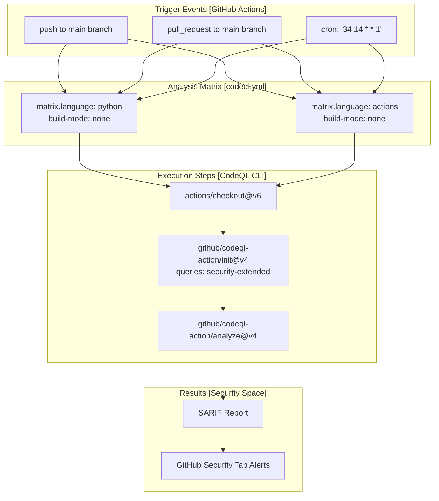
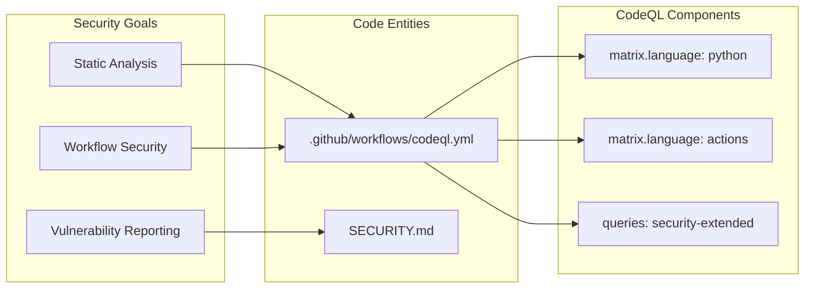

<!-- source: DeepWiki mcp.deepwiki.com · repo langchain-ai/langchain-mcp-adapters · page 7.6 Security Scanning · fetched 2026-10-26 -->

# Security Scanning

Relevant source files

The following files were used as context for generating this wiki page:

- [.github/workflows/codeql.yml](.github/workflows/codeql.yml)
- [SECURITY.md](SECURITY.md)

## Overview

The `langchain-mcp-adapters` project utilizes GitHub CodeQL for automated security vulnerability detection. This integration performs static analysis on both Python source code and GitHub Actions workflows to identify potential security flaws such as injection vulnerabilities, credential exposure, and workflow misconfigurations.

This page details the CodeQL implementation, the automated scanning schedule, supported languages, and the security query packs utilized by the repository.

**Sources**: [.github/workflows/codeql.yml:1-101]()

## Workflow Configuration

The security scanning process is defined in `.github/workflows/codeql.yml` under the workflow name "CodeQL Advanced". It is designed to provide continuous security feedback throughout the development lifecycle.

### CodeQL Workflow Triggers and Execution

The following diagram illustrates how GitHub Actions triggers the CodeQL analysis and the flow of data from the repository to the security alerts dashboard.

**CodeQL Data Flow and Entity Mapping**

**Sources**: [.github/workflows/codeql.yml:12-101]()

### Trigger Schedule

The workflow is configured to run automatically under the following conditions:

| Trigger Type | Condition | Purpose |
|-------------|-----------|---------|
| `push` | Commits to `main` | Detects vulnerabilities introduced in the primary branch. |
| `pull_request` | PRs targeting `main` | Prevents security regressions before code is merged. |
| `schedule` | Weekly (Mondays 14:34 UTC) | Re-scans code against updated CodeQL vulnerability databases. |

**Sources**: [.github/workflows/codeql.yml:14-20]()

## Supported Languages and Build Modes

The analysis utilizes a matrix strategy to scan different components of the repository using specific CodeQL engines.

### Language Matrix

| Language | Build Mode | Target Scope |
|----------|------------|--------------|
| `python` | `none` | Core adapter logic, tool conversion, and tests. |
| `actions` | `none` | CI/CD workflow definitions in `.github/workflows/`. |

The `build-mode: none` configuration is used for both targets, meaning CodeQL performs direct interpretation of the source files without requiring a compilation step.

**Sources**: [.github/workflows/codeql.yml:44-49]()

## Query Packs

The project uses the `security-extended` query suite rather than the default set. This provides a more rigorous analysis of the codebase.

### Security-Extended Suite

The `security-extended` pack includes queries for:
*   **Standard Security**: SQL injection, command injection, and cross-site scripting.
*   **Extended Coverage**: Clear-text logging of sensitive data, weak cryptographic algorithms, and insecure temporary file creation.

The configuration is specified in the `init` step of the workflow:
[ .github/workflows/codeql.yml:79-79 ]()

**Sources**: [.github/workflows/codeql.yml:74-79]()

## Security Permissions

To maintain a secure CI/CD environment, the CodeQL workflow operates with the principle of least privilege.

### Permission Specification

The workflow explicitly defines the following permissions:
*   `security-events: write`: Necessary to upload the resulting SARIF data to the GitHub Security tab.
*   `packages: read`: Required if the workflow needs to fetch internal or private CodeQL packs.
*   `actions: read` and `contents: read`: Required for basic repository access and workflow history.

**Sources**: [.github/workflows/codeql.yml:31-40]()

## Analysis Process

The analysis is performed in three distinct phases managed by the `github/codeql-action`.

### Step-by-Step Execution

**Step 1: Initialization**
The `init` action sets up the CodeQL tools. It identifies the language from the matrix and applies the `security-extended` query pack.
[ .github/workflows/codeql.yml:69-79 ]()

**Step 2: Code Extraction**
Because `build-mode` is set to `none`, CodeQL extracts the source code directly into a relational database representation for querying.
[ .github/workflows/codeql.yml:73-73 ]()

**Step 3: Analysis and Reporting**
The `analyze` action runs the queries against the database. The results are categorized by language to allow for granular filtering in the GitHub UI.
[ .github/workflows/codeql.yml:97-100 ]()

**Sources**: [.github/workflows/codeql.yml:69-100]()

## Security Policy and Reporting

The project maintains a formal security policy. For concerns that fall outside the scope of automated scanning (e.g., architectural flaws or zero-day vulnerabilities), users and contributors are encouraged to contact the maintainers directly.

*   **Contact**: `security@langchain.dev`

**Sources**: [SECURITY.md:1-4]()

## Summary of Security Infrastructure

The following diagram bridges the high-level security goals with the specific CodeQL entities and configuration files used in the repository.

**Security Logic to Code Mapping**

**Sources**: [.github/workflows/codeql.yml:12-101](), [SECURITY.md:1-4]()

---

