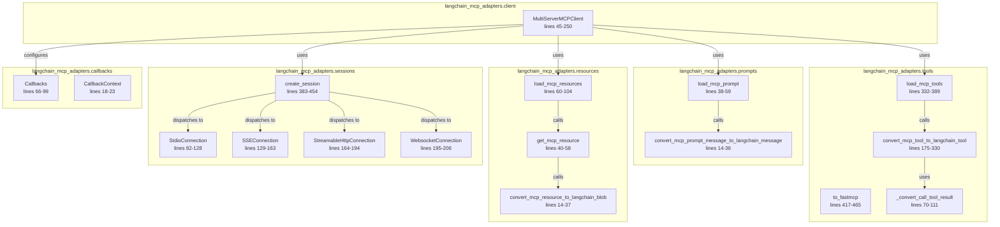
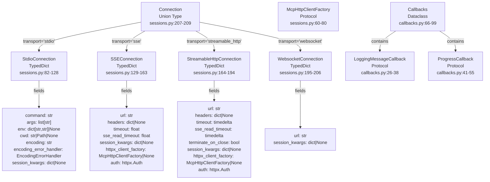

<!-- source: DeepWiki mcp.deepwiki.com · repo langchain-ai/langchain-mcp-adapters · page 8 API Reference · fetched 2026-10-26 -->

# API Reference

<details>
<summary>Relevant source files</summary>

The following files were used as context for generating this wiki page:

- [langchain_mcp_adapters/client.py](langchain_mcp_adapters/client.py)
- [langchain_mcp_adapters/sessions.py](langchain_mcp_adapters/sessions.py)
- [langchain_mcp_adapters/tools.py](langchain_mcp_adapters/tools.py)

</details>


This document provides comprehensive API reference documentation for the `langchain-mcp-adapters` library. It covers all public classes, functions, types, and protocols exposed by the library for converting MCP (Model Context Protocol) servers to LangChain-compatible components.

For specific implementation details and integration patterns, see the following pages:
- Client usage patterns: [Core Components](#2)
- Session lifecycle management: [Session Management and Transport](#3)
- Testing your MCP integrations: [Testing Framework](#6)

## API Organization

The library's API is organized into seven primary modules, each providing specialized functionality:

| Module | Primary Classes/Functions | Purpose |
|--------|---------------------------|---------|
| `client` | `MultiServerMCPClient` | Multi-server orchestration and unified tool/prompt/resource access [langchain_mcp_adapters/client.py:45-49]() |
| `tools` | `convert_mcp_tool_to_langchain_tool`, `load_mcp_tools`, `to_fastmcp` | Tool conversion and execution with interceptor support [langchain_mcp_adapters/tools.py:1-5]() |
| `prompts` | `convert_mcp_prompt_message_to_langchain_message`, `load_mcp_prompt` | Prompt message conversion to LangChain message types [langchain_mcp_adapters/prompts.py:1-5]() |
| `resources` | `convert_mcp_resource_to_langchain_blob`, `get_mcp_resource`, `load_mcp_resources` | Resource content conversion to Blob objects [langchain_mcp_adapters/resources.py:1-5]() |
| `sessions` | `create_session`, `Connection` types | Transport abstraction and session lifecycle management [langchain_mcp_adapters/sessions.py:1-5]() |
| `callbacks` | `Callbacks`, `CallbackContext`, `LoggingMessageCallback`, `ProgressCallback` | Event handling and notification protocols [langchain_mcp_adapters/callbacks.py:1-5]() |
| `interceptors`| `ToolCallInterceptor`, `MCPToolCallRequest`, `MCPToolCallResult` | Request/response modification and middleware [langchain_mcp_adapters/interceptors.py:1-5]() |

**Sources:** [langchain_mcp_adapters/client.py:1-261](), [langchain_mcp_adapters/tools.py:1-442](), [langchain_mcp_adapters/prompts.py:1-60](), [langchain_mcp_adapters/resources.py:1-104](), [langchain_mcp_adapters/sessions.py:1-432](), [langchain_mcp_adapters/callbacks.py:1-100]()

## Module and Class Hierarchy

The following diagram maps the relationships between the high-level orchestration client and the underlying adapter functions.



**Sources:** [langchain_mcp_adapters/client.py:45-250](), [langchain_mcp_adapters/tools.py:70-465](), [langchain_mcp_adapters/sessions.py:82-454](), [langchain_mcp_adapters/callbacks.py:18-99]()

## Type System Overview

The library defines several `TypedDict`-based configuration types for transport and session parameters.



**Sources:** [langchain_mcp_adapters/sessions.py:60-209](), [langchain_mcp_adapters/callbacks.py:26-99]()

## Detailed API Sections

The following sections provide high-level summaries and links to child pages for detailed reference:

### [Client API](#8.1)

The `MultiServerMCPClient` is the primary entry point for managing multiple server connections simultaneously [langchain_mcp_adapters/client.py:45-49](). It handles tool discovery across servers and provides a unified interface for prompts and resources.

For details, see [Client API](#8.1).

**Sources:** [langchain_mcp_adapters/client.py:45-250]()

### [Tool Conversion API](#8.2)

Functions in this module convert `mcp.types.Tool` definitions into LangChain `BaseTool` objects [langchain_mcp_adapters/tools.py:175-180](). This includes handling JSON schemas, argument validation, and execution logic that bridges LangChain tool calls to MCP `callTool` requests.

For details, see [Tool Conversion API](#8.2).

**Sources:** [langchain_mcp_adapters/tools.py:175-465]()

### [Prompt Conversion API](#8.3)

Provides utilities to fetch MCP prompts and convert their message contents into LangChain `HumanMessage` or `AIMessage` formats [langchain_mcp_adapters/prompts.py:14-18](). It supports text and image content blocks.

For details, see [Prompt Conversion API](#8.3).

**Sources:** [langchain_mcp_adapters/prompts.py:14-59]()

### [Resource Conversion API](#8.4)

Enables loading data from MCP servers (text or binary) and wrapping them in LangChain `Blob` objects [langchain_mcp_adapters/resources.py:14-18](). This allows agents to consume server-provided documents or media.

For details, see [Resource Conversion API](#8.4).

**Sources:** [langchain_mcp_adapters/resources.py:14-104]()

### [Session API](#8.5)

Manages the lifecycle of MCP sessions across different transport layers including `stdio`, `sse`, `streamable_http`, and `websocket` [langchain_mcp_adapters/sessions.py:383-388](). It provides the `create_session` factory for abstracting transport-specific initialization.

For details, see [Session API](#8.5).

**Sources:** [langchain_mcp_adapters/sessions.py:82-454]()

### [Callback API](#8.6)

Defines protocols for handling asynchronous notifications from MCP servers, such as logging messages and progress updates during long-running tool executions [langchain_mcp_adapters/callbacks.py:26-55]().

For details, see [Callback API](#8.6).

**Sources:** [langchain_mcp_adapters/callbacks.py:3-99]()

### [Interceptor API](#8.7)

Defines the `ToolCallInterceptor` protocol which allows users to wrap tool execution logic [langchain_mcp_adapters/interceptors.py:112-117](). This is used for cross-cutting concerns like logging, caching, or modifying tool arguments before they reach the MCP server.

For details, see [Interceptor API](#8.7).

**Sources:** [langchain_mcp_adapters/interceptors.py:112-140]()

## Public Exports

The library explicitly exports the following public API through `__all__` declarations in `langchain_mcp_adapters/client.py`:

```python
__all__ = [
    "Callbacks",
    "McpHttpClientFactory",
    "MultiServerMCPClient",
    "SSEConnection",
    "StdioConnection",
    "StreamableHttpConnection",
    "WebsocketConnection",
]
```

**Sources:** [langchain_mcp_adapters/client.py:252-260]()

## Exception Handling

The library defines specific behaviors for error propagation:

| Error Type | Raised By | Condition |
|------------|-----------|-----------|
| `ValueError` | `MultiServerMCPClient` | Server name not found in connections [langchain_mcp_adapters/client.py:144-149]() |
| `_MCPToolExecutionError` | Converted tools | MCP tool call returns `isError=True` [langchain_mcp_adapters/tools.py:99-115]() |
| `NotImplementedError` | `MultiServerMCPClient` | Using client as a context manager (deprecated) [langchain_mcp_adapters/client.py:33-42]() |
| `RuntimeError` | `load_mcp_tools` | Tool pagination exceeds `MAX_ITERATIONS` (1000) [langchain_mcp_adapters/tools.py:356-358]() |

**Sources:** [langchain_mcp_adapters/client.py:33-149](), [langchain_mcp_adapters/tools.py:99-358]()

---

