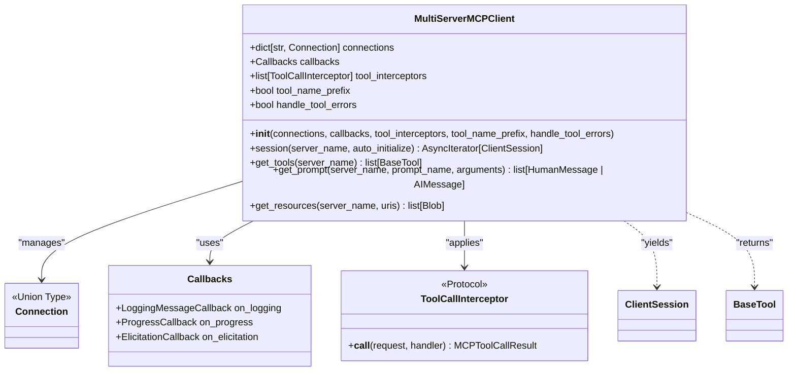
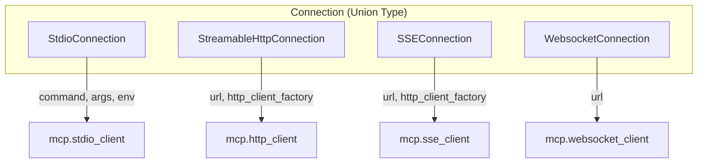

<!-- source: DeepWiki mcp.deepwiki.com · repo langchain-ai/langchain-mcp-adapters · page 8.1 Client API · fetched 2026-10-26 -->

# Client API

<details>
<summary>Relevant source files</summary>

The following files were used as context for generating this wiki page:

- [langchain_mcp_adapters/client.py](langchain_mcp_adapters/client.py)
- [tests/test_client.py](tests/test_client.py)

</details>


## Purpose and Scope

This page provides the API reference for the `MultiServerMCPClient` class and related connection types. The client is the primary entry point for connecting to MCP servers and loading tools, prompts, and resources from them. It serves as a unified interface that abstracts away the underlying transport mechanisms (stdio, HTTP, SSE, WebSocket) and provides LangChain-native objects.

The API reference covers:
- `MultiServerMCPClient` class and its methods
- Connection type definitions for different transport mechanisms
- Configuration for error handling, callbacks, and interceptors

For detailed documentation on specific adapter functions (tool conversion, prompt conversion, resource loading), see sections [8.2](), [8.3](), and [8.4]() respectively.

---

## MultiServerMCPClient Class

The `MultiServerMCPClient` class manages connections to multiple MCP servers. It provides methods to retrieve LangChain-compatible tools, prompts, and resources while handling session lifecycles internally or providing explicit access to sessions.

**Class Definition**

```python
class MultiServerMCPClient:
    def __init__(
        self,
        connections: dict[str, Connection] | None = None,
        *,
        callbacks: Callbacks | None = None,
        tool_interceptors: list[ToolCallInterceptor] | None = None,
        tool_name_prefix: bool = False,
        handle_tool_errors: bool = True,
    ) -> None: ...
```

### Class Structure



Sources: [langchain_mcp_adapters/client.py:45-123]()

---

### Constructor Parameters

The `__init__` method initializes a new client instance.

| Parameter | Type | Default | Description |
|-----------|------|---------|-------------|
| `connections` | `dict[str, Connection] \| None` | `None` | Dictionary mapping server names to connection configurations. |
| `callbacks` | `Callbacks \| None` | `None` | Optional callbacks for handling notifications (logging, progress). |
| `tool_interceptors` | `list[ToolCallInterceptor] \| None` | `None` | Optional interceptors for modifying tool requests and responses. |
| `tool_name_prefix` | `bool` | `False` | If `True`, tool names are prefixed with the server name (e.g., `"weather_search"`). |
| `handle_tool_errors` | `bool` | `True` | If `True`, MCP execution errors are returned as `ToolMessage` with `status="error"`. If `False`, raises `ToolException`. |

**Instance Attributes**

| Attribute | Type | Description |
|-----------|------|-------------|
| `connections` | `dict[str, Connection]` | Stores the connection configurations [langchain_mcp_adapters/client.py:116-118](). |
| `callbacks` | `Callbacks` | Stores the callbacks instance [langchain_mcp_adapters/client.py:119](). |
| `tool_interceptors` | `list[ToolCallInterceptor]` | Stores the interceptor list [langchain_mcp_adapters/client.py:120](). |
| `handle_tool_errors` | `bool` | Flag for handling MCP execution errors [langchain_mcp_adapters/client.py:122](). |

Sources: [langchain_mcp_adapters/client.py:51-122]()

---

## Core Methods

### session

```python
@asynccontextmanager
async def session(
    self,
    server_name: str,
    *,
    auto_initialize: bool = True,
) -> AsyncIterator[ClientSession]:
```

Establishes a connection to a specific MCP server and yields an initialized session.

**Implementation Details**
1. Validates that the `server_name` exists in the `connections` dictionary [langchain_mcp_adapters/client.py:144-149]().
2. Converts internal `Callbacks` to MCP-specific format using `self.callbacks.to_mcp_format` with a `CallbackContext` [langchain_mcp_adapters/client.py:151-153]().
3. Invokes `create_session` from the sessions module [langchain_mcp_adapters/client.py:155-157]().
4. Optionally calls `session.initialize()` if `auto_initialize` is `True` [langchain_mcp_adapters/client.py:158-159]().

Sources: [langchain_mcp_adapters/client.py:124-161]()

---

### get_tools

```python
async def get_tools(self, *, server_name: str | None = None) -> list[BaseTool]:
```

Retrieves tools from MCP servers and converts them to LangChain `BaseTool` instances.

**Behavior**
- **Single Server**: If `server_name` is provided, it calls `load_mcp_tools` for that specific connection [langchain_mcp_adapters/client.py:177-181]().
- **Multi-Server**: If `server_name` is `None`, it iterates through all `self.connections`, creating concurrent tasks to load tools from every server using `asyncio.gather` [langchain_mcp_adapters/client.py:184-200]().
- **Tool Configuration**: Passes `tool_interceptors`, `tool_name_prefix`, and `handle_tool_errors` to the loading logic [langchain_mcp_adapters/client.py:179-181]().

Sources: [langchain_mcp_adapters/client.py:162-200]()

---

### get_prompt

```python
async def get_prompt(
    self,
    server_name: str,
    prompt_name: str,
    *,
    arguments: dict[str, Any] | None = None,
) -> list[HumanMessage | AIMessage]:
```

Retrieves a prompt template from an MCP server and converts it to LangChain message format. It uses an ephemeral session via the `session()` context manager [langchain_mcp_adapters/client.py:210]() and delegates to `load_mcp_prompt` [langchain_mcp_adapters/client.py:211]().

Sources: [langchain_mcp_adapters/client.py:202-211]()

---

### get_resources

```python
async def get_resources(
    self,
    server_name: str | None = None,
    *,
    uris: str | list[str] | None = None,
) -> list[Blob]:
```

Retrieves resources from MCP servers as LangChain `Blob` objects. Like `get_tools`, it supports fetching from a single server [langchain_mcp_adapters/client.py:232-239]() or aggregating from all servers concurrently [langchain_mcp_adapters/client.py:241-253]().

Sources: [langchain_mcp_adapters/client.py:213-253]()

---

## Context Manager Protocol

### __aenter__ and __aexit__

As of version 0.1.0, `MultiServerMCPClient` **cannot** be used directly as a context manager (e.g., `async with MultiServerMCPClient(...)`). Attempting to do so will raise a `NotImplementedError` with a descriptive error message [langchain_mcp_adapters/client.py:33-42]().

Users should instead:
1. Call methods like `get_tools()` directly on the client instance.
2. Use `async with client.session(server_name) as session:` for granular control.

Sources: [langchain_mcp_adapters/client.py:255-279]()

---

## Connection Types

The `Connection` type is a union of transport-specific configurations imported from `langchain_mcp_adapters.sessions` [langchain_mcp_adapters/client.py:22-30]().



| Type | transport | Key Fields |
|------|-----------|------------|
| `StdioConnection` | `"stdio"` | `command`, `args`, `env` |
| `StreamableHttpConnection` | `"http"` | `url`, `http_client_factory` |
| `SSEConnection` | `"sse"` | `url`, `http_client_factory` |
| `WebsocketConnection` | `"websocket"` | `url` |

Sources: [langchain_mcp_adapters/client.py:22-30](), [langchain_mcp_adapters/sessions.py:34-92]()

---

## Public Exports

The following symbols are exported by the `langchain_mcp_adapters.client` module:

- `MultiServerMCPClient`
- `Callbacks`
- `StdioConnection`
- `StreamableHttpConnection`
- `SSEConnection`
- `WebsocketConnection`
- `McpHttpClientFactory`

Sources: [langchain_mcp_adapters/client.py:282-290]()

---

