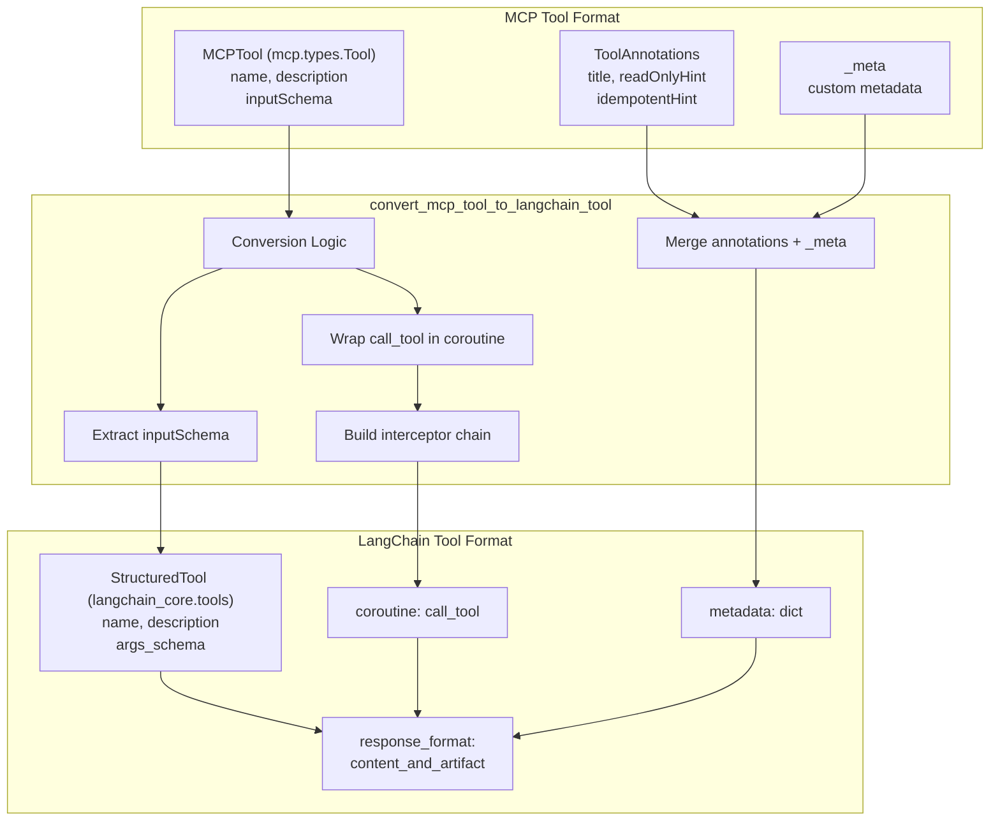
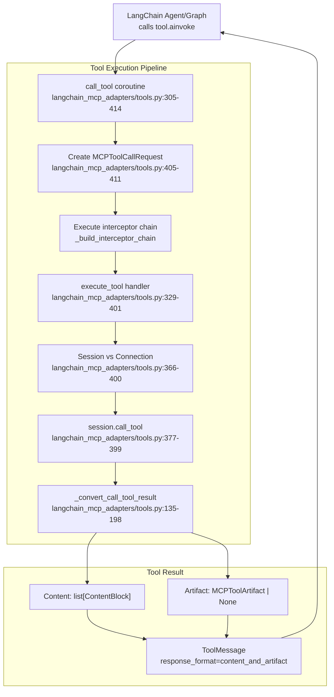

<!-- source: DeepWiki mcp.deepwiki.com · repo langchain-ai/langchain-mcp-adapters · page 8.2 Tool Conversion API · fetched 2026-10-26 -->

# Tool Conversion API

<details>
<summary>Relevant source files</summary>

The following files were used as context for generating this wiki page:

- [langchain_mcp_adapters/tools.py](langchain_mcp_adapters/tools.py)
- [tests/test_tools.py](tests/test_tools.py)

</details>


This page documents the API for converting MCP tools to LangChain-compatible tools and vice versa. The Tool Conversion API provides functions for translating MCP tool definitions into LangChain `BaseTool` instances, handling tool execution with callbacks and interceptors, and converting tool results with support for multiple content types.

For information about loading tools through the multi-server client, see [Client API](#8.1). For details on interceptor patterns, see [Interceptor API](#8.7). For callback handling, see [Callback API](#8.6).

## Overview

The tool conversion system bridges MCP and LangChain tool ecosystems through three primary functions:

- **`convert_mcp_tool_to_langchain_tool`**: Converts a single MCP tool to a LangChain tool [langchain_mcp_adapters/tools.py:272-280]().
- **`load_mcp_tools`**: Bulk loads all tools from an MCP server session [langchain_mcp_adapters/tools.py:436-444]().
- **`to_fastmcp`**: Converts a LangChain tool back to FastMCP format [langchain_mcp_adapters/tools.py:525-525]().

All conversion functions are located in [langchain_mcp_adapters/tools.py]().

## Conversion Pipeline Architecture



**Sources**: [langchain_mcp_adapters/tools.py:272-433]()

## Core Functions

### convert_mcp_tool_to_langchain_tool

Converts a single MCP tool definition into a LangChain `StructuredTool` instance.

**Signature**:
```python
def convert_mcp_tool_to_langchain_tool(
    session: ClientSession | None,
    tool: MCPTool,
    *,
    connection: Connection | None = None,
    callbacks: Callbacks | None = None,
    tool_interceptors: list[ToolCallInterceptor] | None = None,
    server_name: str | None = None,
    tool_name_prefix: bool = False,
) -> BaseTool
```

**Parameters**:

| Parameter | Type | Description |
|-----------|------|-------------|
| `session` | `ClientSession \| None` | Active MCP client session for tool execution |
| `tool` | `MCPTool` | MCP tool definition to convert |
| `connection` | `Connection \| None` | Connection config for creating session if `session` is None |
| `callbacks` | `Callbacks \| None` | Optional callbacks for notifications/events |
| `tool_interceptors` | `list[ToolCallInterceptor] \| None` | Optional interceptors for tool call processing |
| `server_name` | `str \| None` | Name of server this tool belongs to |
| `tool_name_prefix` | `bool` | If True, prefix tool name with server name |

**Returns**: `BaseTool` - A LangChain tool with `response_format="content_and_artifact"` [langchain_mcp_adapters/tools.py:426-433]().

**Key Behaviors**:
- Either `session` or `connection` must be provided [langchain_mcp_adapters/tools.py:293-296]().
- Tool `inputSchema` becomes `args_schema` via Pydantic model creation [langchain_mcp_adapters/tools.py:301-303]().
- Tool annotations are merged into metadata [langchain_mcp_adapters/tools.py:416-419]().
- Tool name prefixing resolves naming conflicts across servers [langchain_mcp_adapters/tools.py:421-424]().
- Converted tool supports async execution only (`_arun`) [langchain_mcp_adapters/tools.py:431]().

**Sources**: [langchain_mcp_adapters/tools.py:272-433](), [tests/test_tools.py:406-453]()

### load_mcp_tools

Loads all available tools from an MCP server session and converts them to LangChain tools.

**Signature**:
```python
async def load_mcp_tools(
    session: ClientSession | None,
    *,
    connection: Connection | None = None,
    callbacks: Callbacks | None = None,
    tool_interceptors: list[ToolCallInterceptor] | None = None,
    server_name: str | None = None,
    tool_name_prefix: bool = False,
) -> list[BaseTool]
```

**Parameters**: Same as `convert_mcp_tool_to_langchain_tool`

**Returns**: `list[BaseTool]` - List of all converted tools from the server [langchain_mcp_adapters/tools.py:497]().

**Key Behaviors**:
- Automatically handles pagination when listing tools [langchain_mcp_adapters/tools.py:461-483]().
- Creates temporary session if only connection provided [langchain_mcp_adapters/tools.py:448-460]().
- Applies `convert_mcp_tool_to_langchain_tool` to all listed tools [langchain_mcp_adapters/tools.py:486-495]().

**Sources**: [langchain_mcp_adapters/tools.py:436-497](), [tests/test_tools.py:455-533]()

### to_fastmcp

Converts a LangChain tool back to FastMCP format for use in MCP servers.

**Signature**:
```python
def to_fastmcp(tool: BaseTool) -> FastMCPTool
```

**Parameters**:
- `tool`: LangChain tool to convert (must have `BaseModel` args_schema) [langchain_mcp_adapters/tools.py:539-543]().

**Returns**: `FastMCPTool` instance [langchain_mcp_adapters/tools.py:572]().

**Constraints**:
- Tool `args_schema` must be a `BaseModel` subclass [langchain_mcp_adapters/tools.py:539-543]().
- Tools with injected arguments (e.g., `InjectedToolArg`) are not supported [langchain_mcp_adapters/tools.py:545-554]().

**Sources**: [langchain_mcp_adapters/tools.py:525-572](), [tests/test_tools.py:596-682]()

## Tool Execution Flow



**Sources**: [langchain_mcp_adapters/tools.py:305-414]()

### Session Management During Execution

When a tool is executed, the system handles session management in two modes:

**Mode 1: Persistent Session** (session provided)
- Uses provided `ClientSession` directly [langchain_mcp_adapters/tools.py:375-379]().
- No session creation/cleanup during execution.

**Mode 2: Ephemeral Session** (connection provided)
- Creates new session for each tool call via `create_session` [langchain_mcp_adapters/tools.py:382-400]().
- Applies modified headers if interceptor changed them [langchain_mcp_adapters/tools.py:346-362]().
- Automatically cleans up after execution.

**Sources**: [langchain_mcp_adapters/tools.py:366-401]()

### Interceptor Chain Composition

The interceptor chain follows an "onion" pattern where the first interceptor in the list becomes the outermost layer. The chain is built by [langchain_mcp_adapters/tools.py:201-232]() using reversed iteration to ensure proper nesting order [langchain_mcp_adapters/tools.py:226-231]().

**Sources**: [langchain_mcp_adapters/tools.py:201-232](), [langchain_mcp_adapters/tools.py:404]()

## Content Block Conversion

MCP content types are converted to LangChain content blocks as follows:

| MCP Content Type | LangChain Block Type | Implementation |
|------------------|---------------------|------------|
| `TextContent` | `TextContentBlock` | `create_text_block` [langchain_mcp_adapters/tools.py:192]() |
| `ImageContent` | `ImageContentBlock` | `create_image_block` [langchain_mcp_adapters/tools.py:195]() |
| `ResourceLink` (image/*) | `ImageContentBlock` | `create_image_block` [langchain_mcp_adapters/tools.py:204]() |
| `ResourceLink` (other) | `FileContentBlock` | `create_file_block` [langchain_mcp_adapters/tools.py:208]() |
| `EmbeddedResource` (text) | `TextContentBlock` | `create_text_block` [langchain_mcp_adapters/tools.py:214]() |
| `EmbeddedResource` (blob, image/*) | `ImageContentBlock` | `create_image_block` [langchain_mcp_adapters/tools.py:222]() |
| `EmbeddedResource` (blob, other) | `FileContentBlock` | `create_file_block` [langchain_mcp_adapters/tools.py:226]() |
| `AudioContent` | ❌ Not Supported | Raises `NotImplementedError` [langchain_mcp_adapters/tools.py:229]() |

**Sources**: [langchain_mcp_adapters/tools.py:175-232](), [tests/test_tools.py:41-404]()

### Result Conversion Pipeline

The `_convert_call_tool_result` function processes the `CallToolResult` from MCP:

1.  **Error Check**: If `isError` is True, it converts content and raises `_MCPToolExecutionError` [langchain_mcp_adapters/tools.py:149-152]().
2.  **Content Conversion**: Iterates through `result.content` and applies `_convert_mcp_content_to_lc_block` [langchain_mcp_adapters/tools.py:154-156]().
3.  **Artifact Extraction**: If `structuredContent` is present, wraps it in `MCPToolArtifact` [langchain_mcp_adapters/tools.py:158-161]().

**Sources**: [langchain_mcp_adapters/tools.py:135-164]()

## Artifact System

### MCPToolArtifact TypedDict

The `MCPToolArtifact` wraps structured content returned from MCP tool calls:

```python
class MCPToolArtifact(TypedDict):
    structured_content: dict[str, Any]
```

**Purpose**: 
- Provides programmatic access to structured data alongside human-readable content [langchain_mcp_adapters/tools.py:161-172]().
- Enables LangChain tools to return both content (for display) and artifacts (for processing).

**Sources**: [langchain_mcp_adapters/tools.py:161-172](), [tests/test_tools.py:134-148]()

## Metadata Handling

Tool metadata is constructed by merging MCP annotations and custom metadata.

**Annotation Fields** (from `mcp.types.ToolAnnotations`):
- `title`: Tool title for display.
- `readOnlyHint`: Indicates tool only reads data.
- `idempotentHint`: Indicates repeated calls produce same result.

**Sources**: [langchain_mcp_adapters/tools.py:416-419](), [tests/test_tools.py:796-861]()

## Tool Name Prefixing

The `tool_name_prefix` parameter resolves naming conflicts when multiple servers expose tools with identical names [langchain_mcp_adapters/tools.py:421-424]().

**Behavior**:
- When `tool_name_prefix=True` and `server_name` is provided, tool names become `{server_name}_{tool.name}` [langchain_mcp_adapters/tools.py:423]().
- Original tool name is always preserved in the underlying MCP call [langchain_mcp_adapters/tools.py:410]().

**Sources**: [langchain_mcp_adapters/tools.py:421-424](), [tests/test_tools.py:1024-1180]()

## Special Interceptor Return Types

Interceptors can return special types that short-circuit normal tool execution:

### ToolMessage Return

When an interceptor returns a `ToolMessage` directly, the conversion logic returns its content and no artifact [langchain_mcp_adapters/tools.py:317-319]().

### Command Return (LangGraph)

When LangGraph is installed and an interceptor returns a `Command`, it is passed through as the tool result [langchain_mcp_adapters/tools.py:321-323]().

**Sources**: [langchain_mcp_adapters/tools.py:317-323](), [tests/test_tools.py:897-995]()

## Pagination Support

The `_list_all_tools` function handles MCP pagination automatically [langchain_mcp_adapters/tools.py:235-269]().

**Configuration**:
- `MAX_ITERATIONS = 1000` defined at [langchain_mcp_adapters/tools.py:67]().
- Prevents infinite loops with malformed pagination [langchain_mcp_adapters/tools.py:254-257]().

**Sources**: [langchain_mcp_adapters/tools.py:235-269]()

## Error Handling

### MCP Tool Errors

When `CallToolResult.isError` is True:
- Content is converted to LangChain blocks [langchain_mcp_adapters/tools.py:150]().
- Raised as `_MCPToolExecutionError` (subclass of `ToolException`) [langchain_mcp_adapters/tools.py:152]().
- Error summary is generated by `_summarize_tool_error` [langchain_mcp_adapters/tools.py:70-96]().

**Sources**: [langchain_mcp_adapters/tools.py:70-132](), [langchain_mcp_adapters/tools.py:152]()

### Session Creation Errors

When creating ephemeral sessions, exceptions are re-raised outside the context manager to work around MCP SDK suppression issues [langchain_mcp_adapters/tools.py:382-393]().

**Sources**: [langchain_mcp_adapters/tools.py:382-393]()

## Type Definitions

### ConvertedToolResult

Union type for tool result content [langchain_mcp_adapters/tools.py:62-65]().

### ToolMessageContentBlock

Type alias for LangChain content blocks used in ToolMessage:
`TextContentBlock | ImageContentBlock | FileContentBlock` [langchain_mcp_adapters/tools.py:59]().

---

