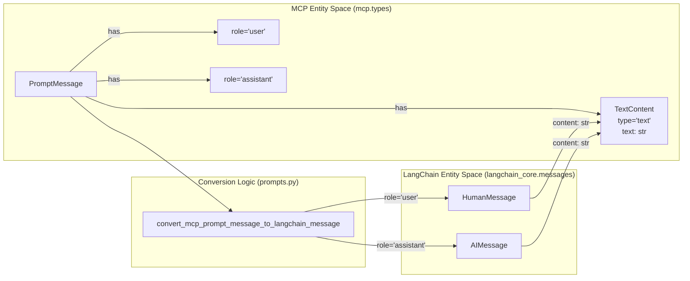
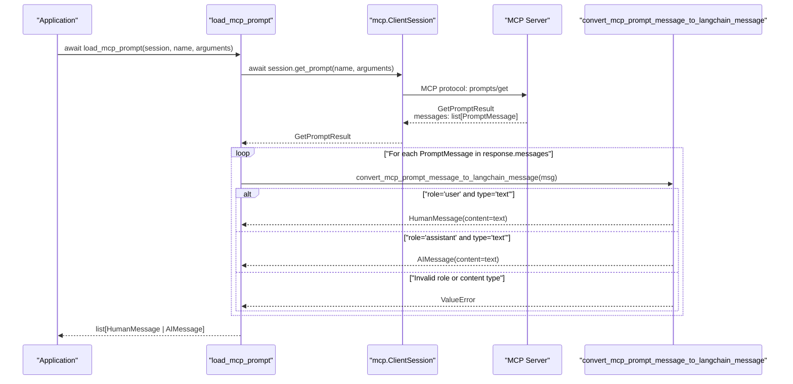

<!-- source: DeepWiki mcp.deepwiki.com · repo langchain-ai/langchain-mcp-adapters · page 8.3 Prompt Conversion API · fetched 2026-10-26 -->

# Prompt Conversion API

<details>
<summary>Relevant source files</summary>

The following files were used as context for generating this wiki page:

- [langchain_mcp_adapters/prompts.py](langchain_mcp_adapters/prompts.py)
- [tests/test_prompts.py](tests/test_prompts.py)
- [tests/test_resources.py](tests/test_resources.py)

</details>


This page provides comprehensive API documentation for the prompt conversion functions in the `langchain_mcp_adapters` library. These functions convert MCP prompt messages into LangChain message objects, enabling MCP prompts to be used seamlessly in LangChain applications.

For information about using prompts in LangChain applications, see [Prompt Adapters](#2.3). For the client-level API that orchestrates prompt loading, see [Client API](#8.1).

## Overview

The prompt conversion API consists of two primary functions located in [langchain_mcp_adapters/prompts.py:1-60]():

| Function | Purpose | Level |
|----------|---------|-------|
| `convert_mcp_prompt_message_to_langchain_message` | Convert a single MCP `PromptMessage` to a LangChain message | Low-level |
| `load_mcp_prompt` | Fetch and convert an entire MCP prompt from a session | High-level |

The conversion process transforms MCP's `PromptMessage` objects (which have `role` and `content` fields) into LangChain's type-specific message classes (`HumanMessage` for user messages, `AIMessage` for assistant messages).

**Sources:** [langchain_mcp_adapters/prompts.py:1-60]()

## Message Type Mapping

The following diagram illustrates how MCP prompt message types map to LangChain message classes, bridging the protocol-specific types to the LangChain entity space.

**Diagram: MCP to LangChain Message Entity Mapping**


**Sources:** [langchain_mcp_adapters/prompts.py:14-36](), [tests/test_prompts.py:19-31]()

## convert_mcp_prompt_message_to_langchain_message

### Function Signature

```python
def convert_mcp_prompt_message_to_langchain_message(
    message: PromptMessage,
) -> HumanMessage | AIMessage
```

Defined at [langchain_mcp_adapters/prompts.py:14-16]()

### Description

Converts a single MCP `PromptMessage` object to the corresponding LangChain message type. This is a synchronous, stateless function that performs pure data transformation.

### Parameters

| Parameter | Type | Required | Description |
|-----------|------|----------|-------------|
| `message` | `PromptMessage` | Yes | The MCP prompt message to convert. Must have `role` and `content` attributes. |

### Return Value

Returns either `HumanMessage` or `AIMessage` depending on the `message.role` field:
- `role="user"` → `HumanMessage` [langchain_mcp_adapters/prompts.py:27-28]()
- `role="assistant"` → `AIMessage` [langchain_mcp_adapters/prompts.py:29-30]()

The returned message's `content` field contains the text from `message.content.text`.

### Behavior

The function performs the following validation and conversion steps:

1. **Content Type Check**: Verifies `message.content.type == "text"` [langchain_mcp_adapters/prompts.py:26]()
2. **Role Mapping**: Maps the role to the appropriate message class [langchain_mcp_adapters/prompts.py:27-30]()
3. **Content Extraction**: Extracts `message.content.text` into the LangChain message's `content` field [langchain_mcp_adapters/prompts.py:28,30]()

### Error Handling

The function raises `ValueError` in the following cases:

| Error Condition | Error Message | Code Location |
|----------------|---------------|---------------|
| Unsupported `message.role` | `"Unsupported prompt message role: {message.role}"` | [langchain_mcp_adapters/prompts.py:31-32]() |
| Non-text `content.type` | `"Unsupported prompt message content type: {message.content.type}"` | [langchain_mcp_adapters/prompts.py:34-35]() |

Note that currently only `TextContent` with `type="text"` is supported. Other content types like `ImageContent` or `EmbeddedResource` will raise `ValueError` [tests/test_prompts.py:35-60]().

**Sources:** [langchain_mcp_adapters/prompts.py:14-36](), [tests/test_prompts.py:19-31]()

## load_mcp_prompt

### Function Signature

```python
async def load_mcp_prompt(
    session: ClientSession,
    name: str,
    *,
    arguments: dict[str, Any] | None = None,
) -> list[HumanMessage | AIMessage]
```

Defined at [langchain_mcp_adapters/prompts.py:38-43]()

### Description

Fetches an MCP prompt from a server via the provided session and converts all its messages to LangChain message objects. This is an async function that performs both I/O (fetching the prompt) and conversion.

### Parameters

| Parameter | Type | Required | Description |
|-----------|------|----------|-------------|
| `session` | `ClientSession` | Yes | Active MCP client session to use for fetching the prompt |
| `name` | `str` | Yes | Name identifier of the prompt to load from the server |
| `arguments` | `dict[str, Any] \| None` | No | Optional arguments to pass to the prompt. Default: `None` |

### Return Value

Returns a list of LangChain messages (`HumanMessage` or `AIMessage`) representing the complete prompt conversation. The order of messages is preserved from the MCP response [langchain_mcp_adapters/prompts.py:56-59]().

### Behavior

The function executes the following steps:

1. **Fetch Prompt**: Calls `session.get_prompt(name, arguments)` to retrieve the prompt from the MCP server [langchain_mcp_adapters/prompts.py:55]()
2. **Extract Messages**: Accesses `response.messages` to get the list of `PromptMessage` objects
3. **Convert Messages**: Iterates through the messages and applies `convert_mcp_prompt_message_to_langchain_message` to each [langchain_mcp_adapters/prompts.py:56-59]()
4. **Return List**: Returns the converted messages as a list

**Sources:** [langchain_mcp_adapters/prompts.py:38-60](), [tests/test_prompts.py:63-82]()

## Conversion Data Flow

The following sequence diagram illustrates the interaction between the application, the MCP session, and the internal conversion logic.

**Diagram: load_mcp_prompt Execution Flow**


**Sources:** [langchain_mcp_adapters/prompts.py:38-59](), [langchain_mcp_adapters/prompts.py:14-36]()

## Supported Content Types

The current implementation supports only text-based prompt messages. The following table summarizes content type support based on validation logic in [langchain_mcp_adapters/prompts.py:26-35]():

| MCP Content Type | Supported | LangChain Representation | Notes |
|------------------|-----------|--------------------------|-------|
| `TextContent` | ✅ Yes | String in `message.content` | Fully supported [langchain_mcp_adapters/prompts.py:26]() |
| `ImageContent` | ❌ No | N/A | Raises `ValueError` [tests/test_prompts.py:54-60]() |
| `EmbeddedResource` | ❌ No | N/A | Raises `ValueError` [tests/test_prompts.py:35-50]() |

**Sources:** [langchain_mcp_adapters/prompts.py:26-35](), [tests/test_prompts.py:35-60]()

## Role Validation

The conversion function enforces strict role validation. Only the following roles are accepted:

| MCP Role | LangChain Message Type | Implementation |
|----------|------------------------|----------------|
| `"user"` | `HumanMessage` | [langchain_mcp_adapters/prompts.py:27-28]() |
| `"assistant"` | `AIMessage` | [langchain_mcp_adapters/prompts.py:29-30]() |

Any other role value will raise `ValueError` with the message: `"Unsupported prompt message role: {message.role}"` [langchain_mcp_adapters/prompts.py:31-32]().

**Sources:** [langchain_mcp_adapters/prompts.py:27-32]()

## Type Definitions

The following table maps the key types used in the prompt conversion API:

| Type | Module | Description |
|------|--------|-------------|
| `PromptMessage` | `mcp.types` | MCP protocol message with `role` and `content` [langchain_mcp_adapters/prompts.py:11]() |
| `TextContent` | `mcp.types` | MCP text content with `type="text"` and `text` field [tests/test_prompts.py:9]() |
| `HumanMessage` | `langchain_core.messages` | LangChain user message [langchain_mcp_adapters/prompts.py:9]() |
| `AIMessage` | `langchain_core.messages` | LangChain assistant message [langchain_mcp_adapters/prompts.py:9]() |
| `ClientSession` | `mcp` | Active MCP client session for server communication [langchain_mcp_adapters/prompts.py:10]() |

**Sources:** [langchain_mcp_adapters/prompts.py:7-11]()

## Testing

The prompt conversion API has comprehensive test coverage at [tests/test_prompts.py:1-83]().

- **Unit Tests**: `test_convert_mcp_prompt_message_to_langchain_message_with_text_content` verifies mapping for both roles [tests/test_prompts.py:23-31]().
- **Validation Tests**: `test_convert_mcp_prompt_message_to_langchain_message_with_resource_content` and `test_convert_mcp_prompt_message_to_langchain_message_with_image_content` verify that unsupported types raise `ValueError` [tests/test_prompts.py:35-60]().
- **Integration Tests**: `test_load_mcp_prompt` uses `AsyncMock` to verify the session interaction and conversion loop [tests/test_prompts.py:63-82]().

**Sources:** [tests/test_prompts.py:1-83]()

---

