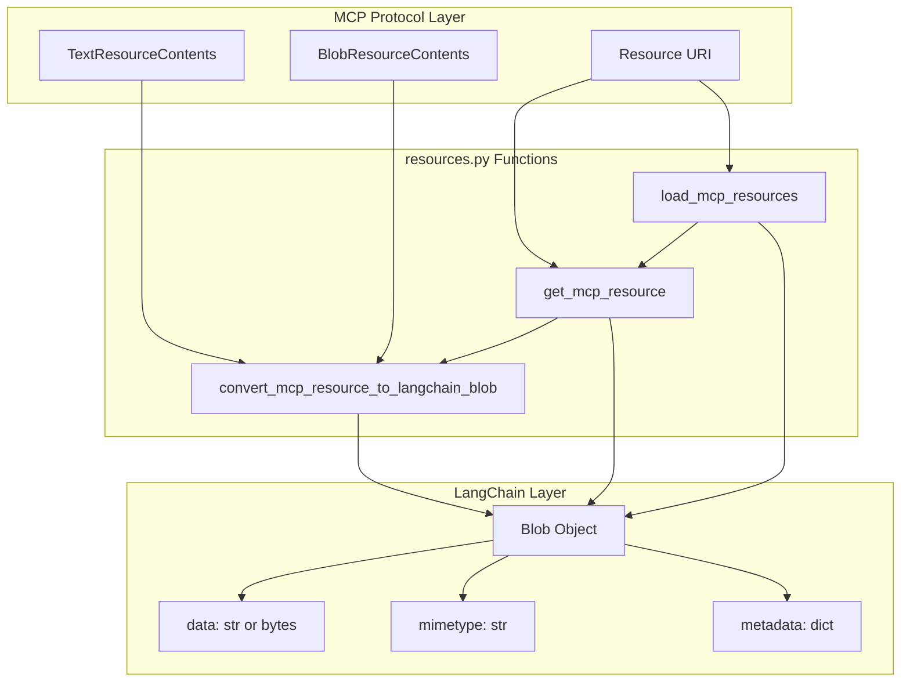
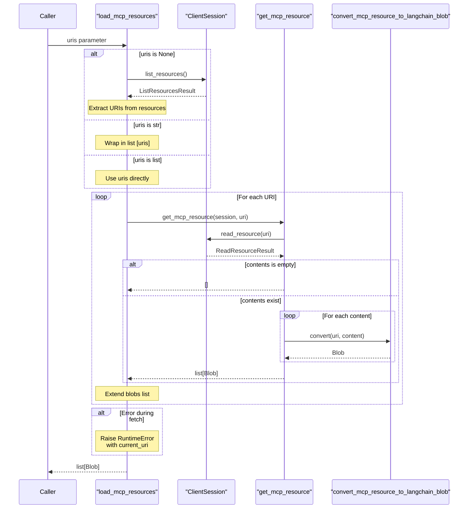
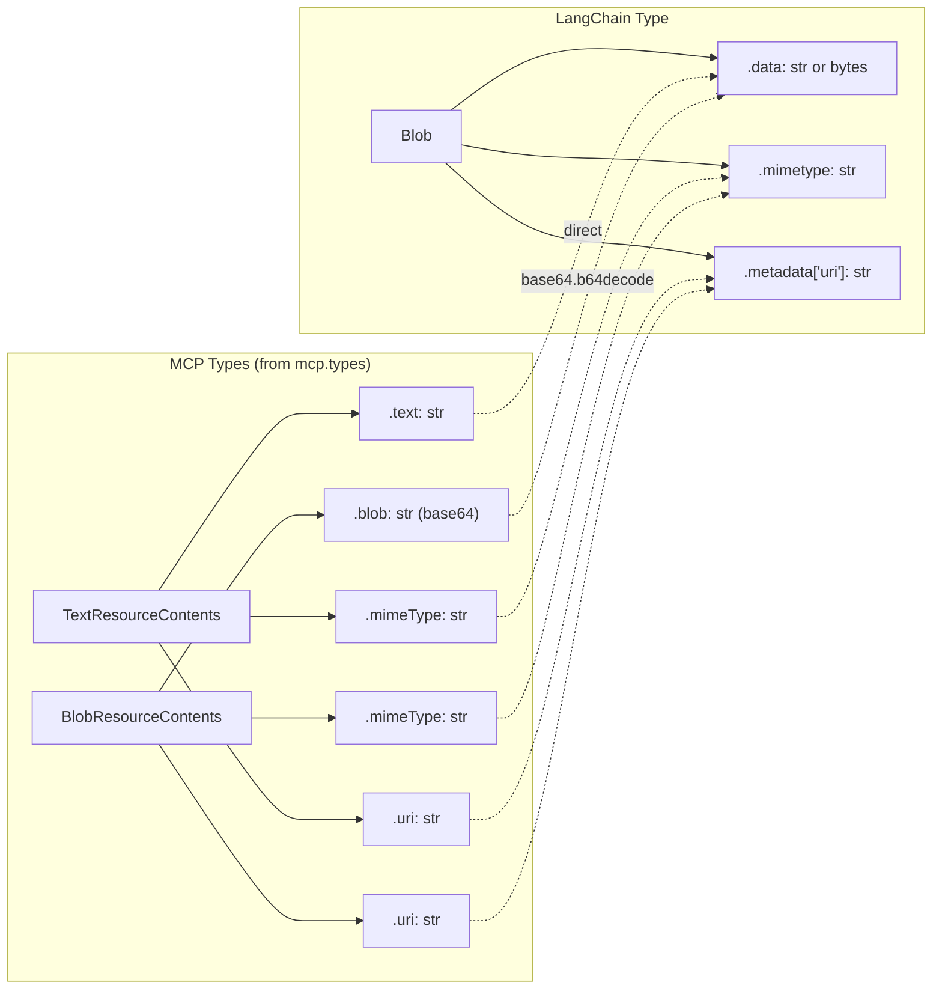
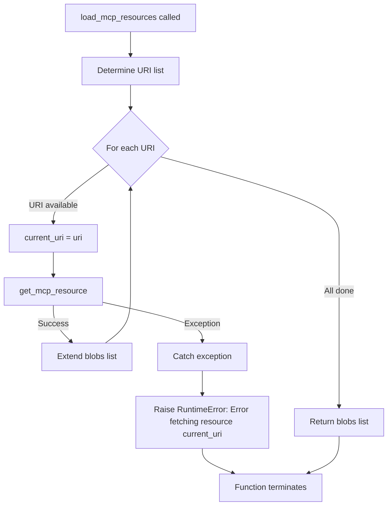

<!-- source: DeepWiki mcp.deepwiki.com · repo langchain-ai/langchain-mcp-adapters · page 8.4 Resource Conversion API · fetched 2026-10-26 -->

# Resource Conversion API

<details>
<summary>Relevant source files</summary>

The following files were used as context for generating this wiki page:

- [langchain_mcp_adapters/resources.py](langchain_mcp_adapters/resources.py)
- [tests/test_prompts.py](tests/test_prompts.py)
- [tests/test_resources.py](tests/test_resources.py)

</details>


## Purpose and Scope

This page documents the public API for converting MCP resources to LangChain [`Blob`](https://api.python.langchain.com/en/latest/documents/langchain_core.documents.base.Blob.html) objects. The resource conversion API provides three core functions for transforming MCP resource data into LangChain-compatible formats, handling both text and binary content types.

For information about tool conversion, see [Tool Conversion API](#8.2). For prompt conversion, see [Prompt Conversion API](#8.3). For the client interface that uses these conversion functions, see [Client API](#8.1).

---

## Overview

The resource conversion API is defined in [langchain_mcp_adapters/resources.py](). It provides a conversion layer between MCP's resource system (which uses `ResourceContents` types) and LangChain's `Blob` abstraction for representing arbitrary data with MIME type metadata.

**Title: Resource Conversion Architecture**



Sources: [langchain_mcp_adapters/resources.py:1-104]()

---

## Core Functions

### convert_mcp_resource_to_langchain_blob

**Function Signature:**
```python
def convert_mcp_resource_to_langchain_blob(
    resource_uri: str, 
    contents: ResourceContents
) -> Blob
```

Converts a single MCP resource content object to a LangChain `Blob`. This is the low-level conversion function used internally by the higher-level loader functions.

| Parameter | Type | Description |
|-----------|------|-------------|
| `resource_uri` | `str` | URI identifying the resource |
| `contents` | `ResourceContents` | MCP resource contents (either `TextResourceContents` or `BlobResourceContents`) |
| **Returns** | `Blob` | LangChain Blob object containing the resource data |

**Raises:**
- `TypeError`: If the `contents` parameter is neither `TextResourceContents` nor `BlobResourceContents` [langchain_mcp_adapters/resources.py:32-33]()

**Implementation Details:**
- For `TextResourceContents`: Uses the `text` field directly as blob data [langchain_mcp_adapters/resources.py:27-28]()
- For `BlobResourceContents`: Base64 decodes the `blob` field to obtain binary data [langchain_mcp_adapters/resources.py:29-30]()
- Creates blob using `Blob.from_data()` with MIME type from contents and URI in metadata [langchain_mcp_adapters/resources.py:35-37]()

Sources: [langchain_mcp_adapters/resources.py:14-37](), [tests/test_resources.py:22-56]()

---

### get_mcp_resource

**Function Signature:**
```python
async def get_mcp_resource(
    session: ClientSession, 
    uri: str
) -> list[Blob]
```

Fetches a single resource from an MCP server via a session and converts it to LangChain `Blob` objects. A resource URI may return multiple content items, hence the list return type.

| Parameter | Type | Description |
|-----------|------|-------------|
| `session` | `ClientSession` | Active MCP client session |
| `uri` | `str` | URI of the resource to fetch |
| **Returns** | `list[Blob]` | List of LangChain Blob objects (empty list if resource has no contents) |

**Implementation Details:**
- Calls `session.read_resource(uri)` to fetch resource contents [langchain_mcp_adapters/resources.py:50]()
- Returns empty list if `contents` is None or empty [langchain_mcp_adapters/resources.py:51-52]()
- Converts each content item using `convert_mcp_resource_to_langchain_blob()` [langchain_mcp_adapters/resources.py:54-57]()

Sources: [langchain_mcp_adapters/resources.py:40-57](), [tests/test_resources.py:59-123]()

---

### load_mcp_resources

**Function Signature:**
```python
async def load_mcp_resources(
    session: ClientSession,
    *,
    uris: str | list[str] | None = None,
) -> list[Blob]
```

Loads one or more MCP resources and converts them to LangChain `Blob` objects. This is the primary high-level function for batch resource loading.

| Parameter | Type | Description |
|-----------|------|-------------|
| `session` | `ClientSession` | Active MCP client session |
| `uris` | `str \| list[str] \| None` | URIs to load. Single string, list of strings, or `None` to load all available resources |
| **Returns** | `list[Blob]` | List of all loaded and converted Blob objects |

**Raises:**
- `RuntimeError`: If an error occurs while fetching any resource (includes the problematic URI in the error message) [langchain_mcp_adapters/resources.py:99-101]()

**Behavior by Parameter:**

| `uris` Value | Behavior |
|--------------|----------|
| `None` | Calls `session.list_resources()` to discover all available resources, then loads each [langchain_mcp_adapters/resources.py:85-87]() |
| Single string | Loads that one resource URI [langchain_mcp_adapters/resources.py:88-89]() |
| List of strings | Loads all specified resource URIs [langchain_mcp_adapters/resources.py:90-91]() |

**Important Note:** When `uris=None`, dynamic resources (those requiring parameters) are not loaded, as they are excluded by the MCP SDK's `list_resources()` method [langchain_mcp_adapters/resources.py:72-75]().

**Title: load_mcp_resources Execution Flow**



Sources: [langchain_mcp_adapters/resources.py:60-103](), [tests/test_resources.py:125-276]()

---

## Type Mappings

The conversion API handles two MCP resource content types and maps them to LangChain's unified `Blob` type:

**Title: MCP to LangChain Type Conversion**



### Type Conversion Table

| MCP Type | Field | LangChain Blob Attribute | Transformation |
|----------|-------|--------------------------|----------------|
| `TextResourceContents` | `.text` | `.data` | Direct assignment (string) [langchain_mcp_adapters/resources.py:28]() |
| `TextResourceContents` | `.mimeType` | `.mimetype` | Direct assignment [langchain_mcp_adapters/resources.py:36]() |
| `TextResourceContents` | `.uri` | `.metadata["uri"]` | Stored in metadata dict [langchain_mcp_adapters/resources.py:36]() |
| `BlobResourceContents` | `.blob` | `.data` | Base64 decode to bytes [langchain_mcp_adapters/resources.py:30]() |
| `BlobResourceContents` | `.mimeType` | `.mimetype` | Direct assignment [langchain_mcp_adapters/resources.py:36]() |
| `BlobResourceContents` | `.uri` | `.metadata["uri"]` | Stored in metadata dict [langchain_mcp_adapters/resources.py:36]() |

Sources: [langchain_mcp_adapters/resources.py:14-37](), [tests/test_resources.py:22-48]()

---

## Content Type Handling

### Text Resources

Text resources contain string data and are represented by `TextResourceContents` from the MCP SDK. Common MIME types include:
- `text/plain`
- `text/html`
- `text/markdown`
- `application/json`

The text content is stored directly in the `Blob.data` field as a string [langchain_mcp_adapters/resources.py:28]().

**Example from tests:** [tests/test_resources.py:22-34]() demonstrates text resource conversion with MIME type `text/plain`.

### Binary Resources

Binary resources contain base64-encoded binary data and are represented by `BlobResourceContents`. Common MIME types include:
- `image/png`
- `image/jpeg`
- `application/pdf`
- `application/octet-stream`

The base64-encoded blob is decoded using `base64.b64decode()` [langchain_mcp_adapters/resources.py:30]() before storage in `Blob.data` as bytes.

**Example from tests:** [tests/test_resources.py:36-48]() demonstrates binary resource conversion with base64 decoding.

### Mixed Content Resources

A single resource URI can return multiple content items of different types. The `get_mcp_resource()` function returns a list to accommodate this [langchain_mcp_adapters/resources.py:40, 54-57]().

```python
# Single URI may return multiple Blob objects
blobs = await get_mcp_resource(session, "file:///mixed")
# blobs[0] might be text, blobs[1] might be binary
```

**Example from tests:** [tests/test_resources.py:80-111]() demonstrates a resource returning both text and binary content.

Sources: [langchain_mcp_adapters/resources.py:27-30](), [tests/test_resources.py:22-111]()

---

## Error Handling

### TypeError for Unsupported Content Types

If `convert_mcp_resource_to_langchain_blob()` receives a `ResourceContents` object that is neither `TextResourceContents` nor `BlobResourceContents`, it raises a `TypeError` [langchain_mcp_adapters/resources.py:32-33]().

**Test coverage:** [tests/test_resources.py:51-56]()

### RuntimeError During Batch Loading

When `load_mcp_resources()` encounters an error while fetching any resource, it raises a `RuntimeError` that includes the problematic URI in the error message [langchain_mcp_adapters/resources.py:99-101]().

The error handling preserves the original exception as the cause using `raise ... from e` for full stack trace debugging.

**Test coverage:** [tests/test_resources.py:229-249]()

**Title: Error Handling in load_mcp_resources**



Sources: [langchain_mcp_adapters/resources.py:93-101](), [tests/test_resources.py:229-249]()

---

## Usage Patterns

### Loading All Resources from a Session

```python
# Load all available resources from an MCP server
async with client.session_for_server("my_server") as session:
    blobs = await load_mcp_resources(session)
    # blobs contains all non-dynamic resources
```

Note: Dynamic resources requiring parameters are excluded when loading all resources as they are ignored by `session.list_resources()` [langchain_mcp_adapters/resources.py:72-75]().

### Loading Specific Resources

```python
# Single resource
async with client.session_for_server("my_server") as session:
    blobs = await load_mcp_resources(session, uris="file:///path/to/resource.txt")

# Multiple resources
async with client.session_for_server("my_server") as session:
    blobs = await load_mcp_resources(
        session, 
        uris=["file:///doc1.txt", "file:///doc2.pdf"]
    )
```

### Direct Conversion (Advanced)

For cases where you already have `ResourceContents` objects from MCP operations:

```python
# Direct conversion without session
from mcp.types import TextResourceContents
from langchain_mcp_adapters.resources import convert_mcp_resource_to_langchain_blob

contents = TextResourceContents(
    uri="file:///example.txt",
    mimeType="text/plain",
    text="Hello, world!"
)

blob = convert_mcp_resource_to_langchain_blob("file:///example.txt", contents)
```

Sources: [langchain_mcp_adapters/resources.py:60-103](), [tests/test_resources.py:125-276]()

---

## Return Value Characteristics

### Empty Resource Handling

When a resource has no contents, `get_mcp_resource()` returns an empty list rather than raising an exception [langchain_mcp_adapters/resources.py:51-52]().

**Test coverage:** [tests/test_resources.py:113-123]()

### Multiple Contents per Resource

Both `get_mcp_resource()` and `load_mcp_resources()` return `list[Blob]` because:
1. A single resource URI can provide multiple content representations [langchain_mcp_adapters/resources.py:54-57]()
2. Batch loading combines results from multiple URIs [langchain_mcp_adapters/resources.py:97-98]()
3. Consistent return type simplifies handling

**Test coverage:** [tests/test_resources.py:59-78]() shows a resource returning multiple content items.

### Metadata Preservation

Every `Blob` returned includes the source URI in its metadata dictionary:

```python
blob.metadata["uri"]  # Original resource URI
```

This allows tracing each blob back to its MCP source [langchain_mcp_adapters/resources.py:36]().

Sources: [langchain_mcp_adapters/resources.py:35-37, 51-57](), [tests/test_resources.py:59-123]()

---

## Integration with MultiServerMCPClient

While the functions in `resources.py` operate on MCP `ClientSession` objects, the typical usage pattern involves obtaining sessions through `MultiServerMCPClient`:

```python
from langchain_mcp_adapters import MultiServerMCPClient
from langchain_mcp_adapters.resources import load_mcp_resources

client = MultiServerMCPClient(servers={...})

# Get resources through client's convenience method
async with client.session_for_server("my_server") as session:
    blobs = await load_mcp_resources(session)
```

For detailed information about the client API, see [Client API](#8.1). For session management details, see [Session API](#8.5).

Sources: [langchain_mcp_adapters/resources.py:1-104]()

---

