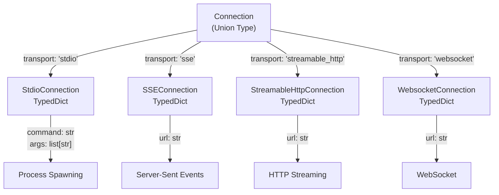
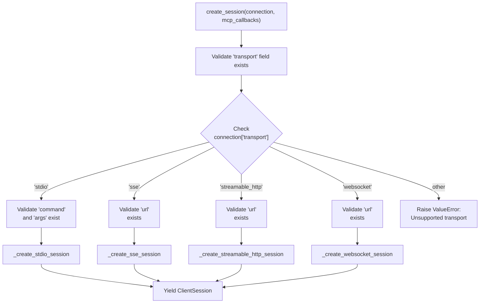
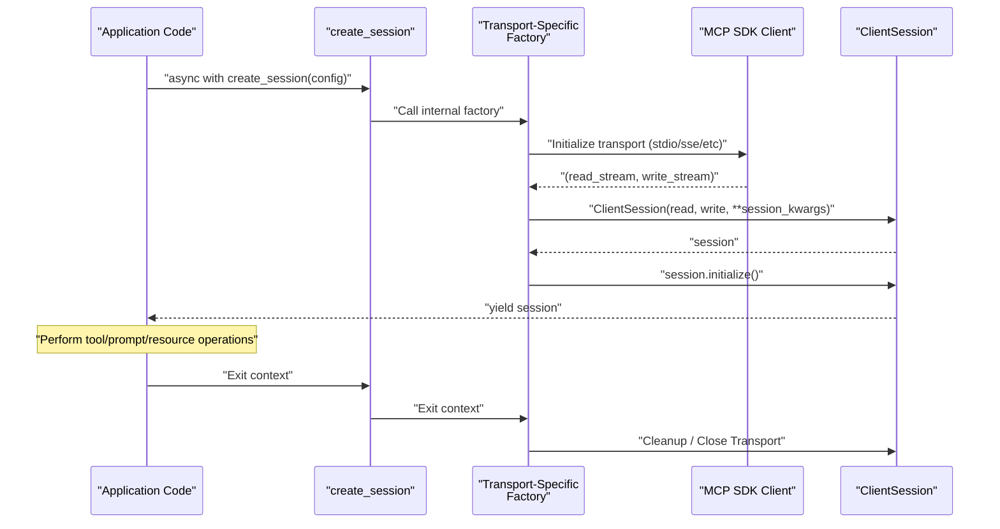

<!-- source: DeepWiki mcp.deepwiki.com · repo langchain-ai/langchain-mcp-adapters · page 8.5 Session API · fetched 2026-10-26 -->

# Session API

Relevant source files

The following files were used as context for generating this wiki page:

- [langchain_mcp_adapters/sessions.py](langchain_mcp_adapters/sessions.py)

## Purpose and Scope

The Session API provides connection configuration types and session factory functions for establishing connections to MCP servers using different transport protocols. This module manages the low-level lifecycle of `ClientSession` instances, abstracting the differences between process-based (stdio) and network-based (SSE, HTTP, WebSocket) transports.

**Sources:** [langchain_mcp_adapters/sessions.py:1-10]()

## Connection Type Hierarchy

The Session API defines four transport-specific connection configuration types, unified under a single `Connection` union type.

Title: Connection Type Dispatch

**Sources:** [langchain_mcp_adapters/sessions.py:82-209]()

## Connection Types

### StdioConnection

Configuration for stdio transport, which spawns a local process to run an MCP server.

| Field | Type | Required | Description |
|-------|------|----------|-------------|
| `transport` | `Literal["stdio"]` | Yes | Transport identifier |
| `command` | `str` | Yes | Executable to run to start the server |
| `args` | `list[str]` | Yes | Command line arguments for the executable |
| `env` | `dict[str, str] \| None` | No | Environment variables. Supports `${VAR}` expansion via `_expand_env_vars`. |
| `cwd` | `str \| Path \| None` | No | Working directory for the spawned process |
| `encoding` | `str` | No | Text encoding for messages. Default: `utf-8` |
| `encoding_error_handler` | `EncodingErrorHandler` | No | Error handling strategy: `strict`, `ignore`, or `replace`. Default: `strict` |
| `session_kwargs` | `dict[str, Any] \| None` | No | Additional keyword arguments passed to `ClientSession` |

**Sources:** [langchain_mcp_adapters/sessions.py:82-127](), [langchain_mcp_adapters/sessions.py:35-45]()

### SSEConnection

Configuration for Server-Sent Events (SSE) transport, which connects to an HTTP endpoint that streams events.

| Field | Type | Required | Description |
|-------|------|----------|-------------|
| `transport` | `Literal["sse"]` | Yes | Transport identifier |
| `url` | `str` | Yes | URL of the SSE endpoint |
| `headers` | `dict[str, Any] \| None` | No | HTTP headers to send to the endpoint |
| `timeout` | `float` | No | HTTP request timeout in seconds. Default: `5` |
| `sse_read_timeout` | `float` | No | Time to wait for new events before disconnecting. Default: `300` (5 minutes) |
| `session_kwargs` | `dict[str, Any] \| None` | No | Additional keyword arguments passed to `ClientSession` |
| `httpx_client_factory` | `McpHttpClientFactory \| None` | No | Custom factory for creating `httpx.AsyncClient` instances |
| `auth` | `httpx.Auth` | No | Authentication configuration for HTTP client |

**Sources:** [langchain_mcp_adapters/sessions.py:129-162]()

### StreamableHttpConnection

Configuration for Streamable HTTP transport, which provides bidirectional communication over HTTP.

| Field | Type | Required | Description |
|-------|------|----------|-------------|
| `transport` | `Literal["streamable_http"]` | Yes | Transport identifier |
| `url` | `str` | Yes | URL of the endpoint |
| `headers` | `dict[str, Any] \| None` | No | HTTP headers to send to the endpoint |
| `timeout` | `float \| timedelta` | No | HTTP request timeout. Default: `30s` |
| `sse_read_timeout` | `float \| timedelta` | No | Time to wait for new events before disconnecting. Default: `300s` |
| `terminate_on_close` | `bool` | No | Whether to terminate the session on close. Default: `True` |
| `session_kwargs` | `dict[str, Any] \| None` | No | Additional keyword arguments passed to `ClientSession` |
| `httpx_client_factory` | `McpHttpClientFactory \| None` | No | Custom factory for creating `httpx.AsyncClient` instances |
| `auth` | `httpx.Auth` | No | Authentication configuration for HTTP client |

**Sources:** [langchain_mcp_adapters/sessions.py:164-193]()

### WebsocketConnection

Configuration for WebSocket transport, which maintains a persistent bidirectional connection.

| Field | Type | Required | Description |
|-------|------|----------|-------------|
| `transport` | `Literal["websocket"]` | Yes | Transport identifier |
| `url` | `str` | Yes | URL of the WebSocket endpoint |
| `session_kwargs` | `dict[str, Any] \| None` | No | Additional keyword arguments passed to `ClientSession` |

**Note:** WebSocket support requires the `websockets` package.

**Sources:** [langchain_mcp_adapters/sessions.py:195-205]()

## Session Factory Functions

### create_session

Main entry point for creating sessions. It validates the configuration and dispatches to the appropriate internal factory.

Title: create_session Data Flow

**Function Signature:**
[langchain_mcp_adapters/sessions.py:360-363]()

**Implementation Details:**
- Extracts parameters excluding the `transport` field [langchain_mcp_adapters/sessions.py:386-387]().
- Injects `mcp_callbacks.logging_callback` and `mcp_callbacks.elicitation_callback` into `session_kwargs` if they are present in the `_MCPCallbacks` object [langchain_mcp_adapters/sessions.py:389-398]().
- Dispatches to transport-specific internal functions [langchain_mcp_adapters/sessions.py:400-432]().

**Sources:** [langchain_mcp_adapters/sessions.py:360-432]()

### Transport-Specific Factory Functions

These functions are internal async context managers that wrap the MCP SDK's transport clients.

#### _create_stdio_session
Uses `stdio_client` and `StdioServerParameters` to spawn a process. It performs environment variable expansion on the `env` dictionary using `_expand_env_vars` [langchain_mcp_adapters/sessions.py:222-226]().

**Sources:** [langchain_mcp_adapters/sessions.py:213-234]()

#### _create_sse_session
Uses `sse_client` from the MCP SDK. It supports custom `httpx.AsyncClient` creation via `httpx_client_factory` [langchain_mcp_adapters/sessions.py:268-274]().

**Sources:** [langchain_mcp_adapters/sessions.py:237-274]()

#### _create_streamable_http_session
Uses `streamable_http_client` and `create_mcp_http_client`. This transport is designed for environments where persistent SSE connections might be interrupted [langchain_mcp_adapters/sessions.py:311-322]().

**Sources:** [langchain_mcp_adapters/sessions.py:277-322]()

#### _create_websocket_session
Lazily imports `websocket_client`. If `websockets` is not installed, it raises an `ImportError` with instructions to install `mcp[ws]` [langchain_mcp_adapters/sessions.py:343-351]().

**Sources:** [langchain_mcp_adapters/sessions.py:325-357]()

## Session Lifecycle and Context Management

Title: Session Initialization Sequence

**Sources:** [langchain_mcp_adapters/sessions.py:213-432]()

## Supporting Types and Protocols

### McpHttpClientFactory
A `Protocol` for creating `httpx.AsyncClient` instances. This allows for custom headers, timeouts, and authentication logic [langchain_mcp_adapters/sessions.py:60-79]().

### EncodingErrorHandler
A `Literal` type restricting error handling strategies to `strict`, `ignore`, or `replace` [langchain_mcp_adapters/sessions.py:48]().

### Environment Variable Expansion
The `_expand_env_vars` function uses the regex `_BRACED_VAR_RE` (`\$\{([^}]+)\}`) to safely expand variables from `os.environ` while ignoring bare `$VAR` syntax to prevent corruption of literal strings like passwords [langchain_mcp_adapters/sessions.py:31-45]().

**Sources:** [langchain_mcp_adapters/sessions.py:31-79]()

---

