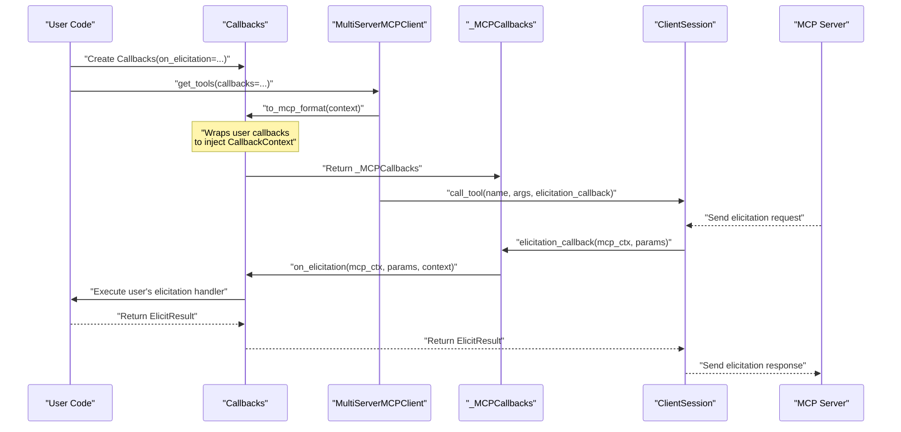
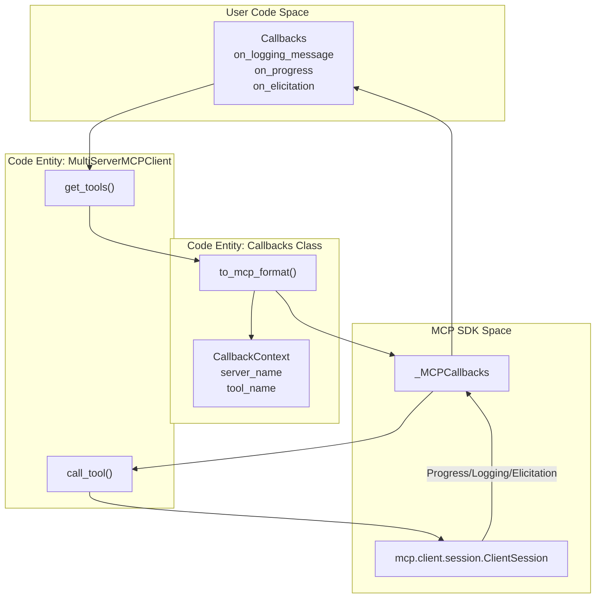

<!-- source: DeepWiki mcp.deepwiki.com · repo langchain-ai/langchain-mcp-adapters · page 8.6 Callback API · fetched 2026-10-26 -->

# Callback API

<details>
<summary>Relevant source files</summary>

The following files were used as context for generating this wiki page:

- [langchain_mcp_adapters/callbacks.py](langchain_mcp_adapters/callbacks.py)
- [tests/test_elicitation.py](tests/test_elicitation.py)

</details>


This page documents the callback system for handling MCP server events, including logging notifications, progress updates, and elicitation requests. The Callback API provides a structured way to observe and respond to events occurring during MCP server interactions, particularly during tool execution.

For information about tool execution mechanics, see [Tool Adapters](#2.2). For details on tool call interception and modification, see [Callbacks](#2.5).

## Overview

The callback system consists of several main components defined in [langchain_mcp_adapters/callbacks.py:1-142]():

- **`CallbackContext`**: Contextual information about where callbacks are invoked (server name, tool name).
- **`LoggingMessageCallback`**: Protocol for handling logging messages from MCP servers.
- **`ProgressCallback`**: Protocol for handling progress updates during tool execution.
- **`ElicitationCallback`**: Protocol for handling user input requests (elicitation) from servers.
- **`Callbacks`**: User-facing dataclass aggregating callback handlers.

These components work together to enable observability and interactivity of MCP server operations, allowing applications to log events, track progress, and satisfy model-requested user input.

**Sources:** [langchain_mcp_adapters/callbacks.py:1-142]()

## Core Types

### CallbackContext

The `CallbackContext` dataclass provides contextual information to callback handlers:

```python
@dataclass
class CallbackContext:
    server_name: str
    tool_name: str | None = None
```

Defined at [langchain_mcp_adapters/callbacks.py:28-34](), this context is automatically injected as the last argument to all callback functions, allowing handlers to identify which server and tool triggered the event.

| Field | Type | Description |
|-------|------|-------------|
| `server_name` | `str` | Name of the MCP server that generated the event |
| `tool_name` | `str \| None` | Name of the tool being executed, if applicable |

**Sources:** [langchain_mcp_adapters/callbacks.py:28-34]()

### Callback Protocols

The system uses `@runtime_checkable` protocols to define callback signatures. Each protocol injects `CallbackContext` as the final argument.

#### LoggingMessageCallback
Handles logging notifications from MCP servers [langchain_mcp_adapters/callbacks.py:36-50]().
- **Signature**: `async def __call__(self, params: LoggingMessageNotificationParams, context: CallbackContext) -> None`

#### ProgressCallback
Handles progress updates during long-running tool operations [langchain_mcp_adapters/callbacks.py:52-68]().
- **Signature**: `async def __call__(self, progress: float, total: float | None, message: str | None, context: CallbackContext) -> None`

#### ElicitationCallback
Handles requests for user information (e.g., confirmation or additional data) initiated by the server [langchain_mcp_adapters/callbacks.py:70-85]().
- **Signature**: `async def __call__(self, mcp_context: MCPRequestContext, params: ElicitRequestParams, context: CallbackContext) -> MCPElicitResult`

**Sources:** [langchain_mcp_adapters/callbacks.py:36-85]()

### Callbacks Dataclass

The main user-facing `Callbacks` dataclass aggregates callback handlers:

```python
@dataclass
class Callbacks:
    on_logging_message: LoggingMessageCallback | None = None
    on_progress: ProgressCallback | None = None
    on_elicitation: ElicitationCallback | None = None
```

Defined at [langchain_mcp_adapters/callbacks.py:96-142](), this class provides the `to_mcp_format` method which converts LangChain-style callbacks (with context) into MCP SDK-compatible callbacks (`_MCPCallbacks`).

**Sources:** [langchain_mcp_adapters/callbacks.py:96-142]()

## Callback Conversion and Execution Flow



**Diagram: Elicitation Callback Execution Flow**

The conversion process, implemented in [langchain_mcp_adapters/callbacks.py:104-141](), wraps user-provided callbacks to automatically inject `CallbackContext`:

1. User creates `Callbacks` instance with handler functions.
2. The client or adapter calls `callbacks.to_mcp_format(context=CallbackContext(...))`.
3. Method creates wrapper functions (e.g., `mcp_elicitation_callback`) that:
   - Accept MCP SDK callback signatures (without `CallbackContext`).
   - Inject the provided `CallbackContext` as an additional argument.
   - Call the original user handler.
4. Returns `_MCPCallbacks` instance compatible with the underlying `mcp` library.

**Sources:** [langchain_mcp_adapters/callbacks.py:104-141](), [tests/test_elicitation.py:70-78]()

## Integration with Tool Execution



**Diagram: Callback Integration in Client Pipeline**

Callbacks integrate with tool execution primarily via the `MultiServerMCPClient`. When a tool is invoked, the client ensures that any provided callbacks are correctly wrapped with the relevant `server_name` and `tool_name` context before being passed to the underlying session.

In elicitation scenarios, the server may pause tool execution to ask for clarification or data. The `ElicitationCallback` allows the LangChain application to respond to these requests programmatically or by prompting a human user [tests/test_elicitation.py:58-67]().

**Sources:** [langchain_mcp_adapters/callbacks.py:104-141](), [tests/test_elicitation.py:52-104]()

## Usage Patterns

### Elicitation Request Handling

Elicitation is used when a tool requires additional user input during its execution.

```python
async def on_elicitation(
    mcp_context: RequestContext,
    params: ElicitRequestParams,
    context: CallbackContext,
) -> ElicitResult:
    # Logic to provide requested data
    return ElicitResult(
        action="accept",
        content={"email": "alice@example.com", "age": 28},
    )

callbacks = Callbacks(on_elicitation=on_elicitation)
client = MultiServerMCPClient(..., callbacks=callbacks)
```

**Sources:** [tests/test_elicitation.py:58-78]()

### Basic Logging and Progress

```python
async def my_logging_handler(params, context):
    print(f"[{context.server_name}] {params.level}: {params.data}")

async def my_progress_handler(progress, total, message, context):
    print(f"Progress on {context.tool_name}: {progress}/{total}")

callbacks = Callbacks(
    on_logging_message=my_logging_handler,
    on_progress=my_progress_handler
)
```

**Sources:** [langchain_mcp_adapters/callbacks.py:100-102]()

## Type Aliases and Internal Types

The module defines type aliases for MCP SDK types to reduce direct dependencies [langchain_mcp_adapters/callbacks.py:21-25]():

| Alias | MCP SDK Type | Purpose |
|-------|--------------|---------|
| `LoggingFnT` | `mcp.client.session.LoggingFnT` | Type for MCP logging callbacks |
| `ProgressFnT` | `mcp.shared.session.ProgressFnT` | Type for MCP progress callbacks |
| `ElicitationFnT` | `mcp.client.session.ElicitationFnT` | Type for MCP elicitation callbacks |
| `LoggingMessageNotificationParams` | `mcp.types.LoggingMessageNotificationParams` | Logging notification parameters |
| `ElicitRequestParams` | `mcp.types.ElicitRequestParams` | Elicitation request parameters |

### _MCPCallbacks (Internal)

The `_MCPCallbacks` dataclass at [langchain_mcp_adapters/callbacks.py:88-94]() is for internal use only. It holds callbacks in the format expected by the MCP SDK (without `CallbackContext` injection).

**Sources:** [langchain_mcp_adapters/callbacks.py:21-94]()

---

