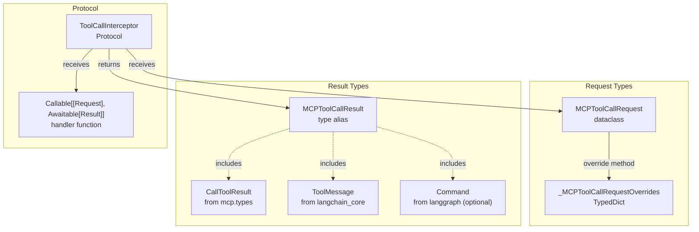
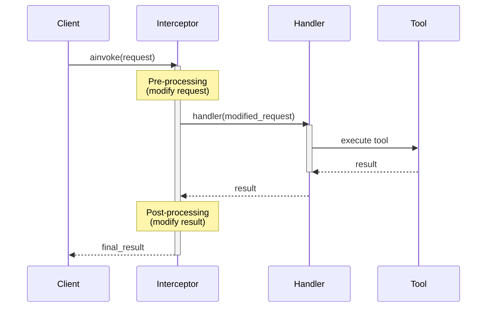
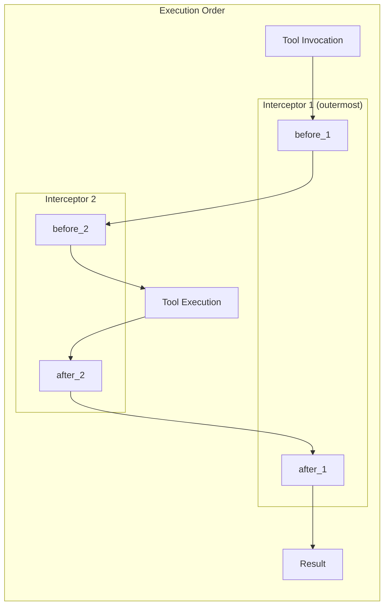
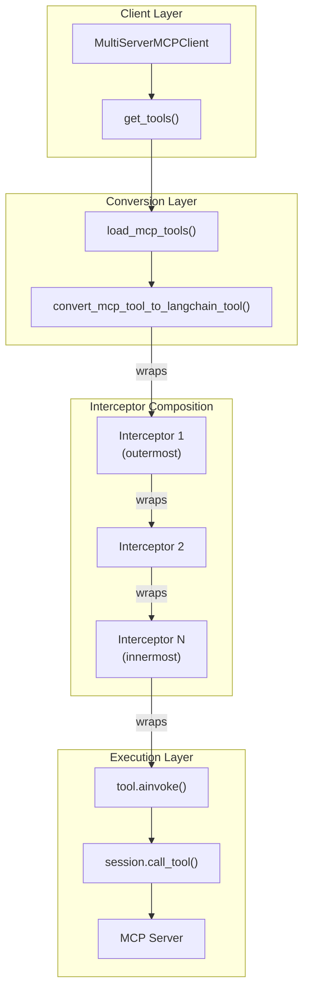

<!-- source: DeepWiki mcp.deepwiki.com · repo langchain-ai/langchain-mcp-adapters · page 8.7 Interceptor API · fetched 2026-10-26 -->

# Interceptor API

<details>
<summary>Relevant source files</summary>

The following files were used as context for generating this wiki page:

- [langchain_mcp_adapters/interceptors.py](langchain_mcp_adapters/interceptors.py)
- [tests/test_callbacks.py](tests/test_callbacks.py)
- [tests/test_interceptors.py](tests/test_interceptors.py)

</details>


This document describes the tool call interceptor system for wrapping and modifying MCP tool execution. Interceptors enable cross-cutting concerns like request/response modification, caching, retry logic, rate limiting, and authorization checks without modifying tool implementation code.

For general callback functionality (logging, progress tracking), see [Callback API](#8.6). For tool loading and conversion, see [Tool Conversion API](#8.2).

## Overview

The interceptor system implements a handler callback pattern where interceptors wrap tool execution, receiving both the request and a handler function to invoke the next layer. Multiple interceptors compose in an "onion" pattern, with the first interceptor in the list forming the outermost layer.

**Key characteristics:**
- Async callable protocol supporting request/response modification [langchain_mcp_adapters/interceptors.py:112-123]()
- Immutable request objects with `override()` method for creating modified copies [langchain_mcp_adapters/interceptors.py:75-108]()
- Handler can be called multiple times (retry), skipped (caching), or wrapped with error handling [langchain_mcp_adapters/interceptors.py:119-120]()
- Supports returning `CallToolResult`, `ToolMessage`, or `Command` (when LangGraph is installed) [langchain_mcp_adapters/interceptors.py:34-36]()
- Access to context fields like `server_name` and `runtime` (LangGraph runtime) [langchain_mcp_adapters/interceptors.py:64-67]()

Sources: [langchain_mcp_adapters/interceptors.py:1-142]()

## Core Types

### MCPToolCallRequest

The `MCPToolCallRequest` dataclass represents a tool execution request passed to interceptors. It separates modifiable fields from read-only context fields. [langchain_mcp_adapters/interceptors.py:52-73]()

```python
@dataclass
class MCPToolCallRequest:
    name: str                        # Modifiable: Tool name to invoke
    args: dict[str, Any]             # Modifiable: Tool arguments
    server_name: str                 # Context: MCP server name (read-only)
    headers: dict[str, Any] | None   # Modifiable: HTTP headers (SSE/HTTP only)
    runtime: object | None           # Context: LangGraph runtime (read-only)
```

| Field | Type | Modifiable | Purpose |
|-------|------|------------|---------|
| `name` | `str` | Yes | Tool name to invoke |
| `args` | `dict[str, Any]` | Yes | Tool arguments as key-value pairs |
| `headers` | `dict[str, Any] \| None` | Yes | HTTP headers for SSE/HTTP transports |
| `server_name` | `str` | No | Name of MCP server handling the tool |
| `runtime` | `object \| None` | No | LangGraph runtime context if applicable |

The `override()` method creates a new request with specified fields replaced using an immutable pattern. [langchain_mcp_adapters/interceptors.py:75-108]()

**Example usage:**
```python
# Modify arguments
modified = request.override(args={"value": request.args["value"] * 2})

# Redirect to different tool
modified = request.override(name="multiply", args={"a": 10, "b": 20})

# Add authentication header
modified = request.override(headers={"Authorization": "Bearer token123"})
```

Sources: [langchain_mcp_adapters/interceptors.py:39-109]()

### ToolCallInterceptor Protocol

The `ToolCallInterceptor` is a runtime-checkable protocol defining the interceptor interface: [langchain_mcp_adapters/interceptors.py:111-141]()

```python
@runtime_checkable
class ToolCallInterceptor(Protocol):
    async def __call__(
        self,
        request: MCPToolCallRequest,
        handler: Callable[[MCPToolCallRequest], Awaitable[MCPToolCallResult]],
    ) -> MCPToolCallResult:
        ...
```

**Parameters:**
- `request`: Tool call request containing modifiable fields and context.
- `handler`: Async callable that executes the next layer (next interceptor or actual tool).

**Returns:** `MCPToolCallResult` which is a type union: [langchain_mcp_adapters/interceptors.py:34-36]()
- `CallToolResult` - Standard MCP result with content blocks.
- `ToolMessage` - LangChain tool message.
- `Command` - LangGraph command object (when LangGraph installed).

Sources: [langchain_mcp_adapters/interceptors.py:19-37](), [langchain_mcp_adapters/interceptors.py:111-141]()

### Type Definitions



**Conditional typing based on LangGraph presence:**

The `MCPToolCallResult` type is conditionally defined based on whether `langgraph` is present in the environment. [langchain_mcp_adapters/interceptors.py:19-37]()

Sources: [langchain_mcp_adapters/interceptors.py:19-37](), [langchain_mcp_adapters/interceptors.py:51-109](), [langchain_mcp_adapters/interceptors.py:111-141]()

## Interceptor Execution Flow

### Single Interceptor Pattern



**Example: Modify arguments before execution**

```python
async def double_args_interceptor(
    request: MCPToolCallRequest,
    handler,
) -> CallToolResult:
    # Pre-process: double all numeric arguments
    modified_args = {k: v * 2 for k, v in request.args.items()}
    modified_request = request.override(args=modified_args)
    
    # Execute with modified request
    result = await handler(modified_request)
    return result
```

Sources: [tests/test_interceptors.py:38-63]()

### Onion Composition Pattern

Multiple interceptors compose in an "onion" pattern where the first interceptor in the list forms the outermost layer. [langchain_mcp_adapters/interceptors.py:117-118]()



Sources: [tests/test_interceptors.py:219-262](), [langchain_mcp_adapters/interceptors.py:111-123]()

## Common Patterns

### Request Modification

Interceptors can modify `name`, `args`, or `headers` using `request.override()`. [langchain_mcp_adapters/interceptors.py:75-108]()

#### Redirecting to Different Tool

```python
async def redirect_interceptor(
    request: MCPToolCallRequest,
    handler,
) -> CallToolResult:
    if request.name == "add":
        modified_request = request.override(name="multiply")
        return await handler(modified_request)
    return await handler(request)
```

Sources: [tests/test_interceptors.py:65-92]()

### Response Modification

Interceptors can modify the result after tool execution by manipulating the `CallToolResult` content blocks. [tests/test_interceptors.py:100-120]()

```python
async def modify_result_interceptor(
    request: MCPToolCallRequest,
    handler,
) -> CallToolResult:
    result = await handler(request)
    # Post-process: prepend "Modified: " to text content
    modified_content = [
        TextContent(type="text", text=f"Modified: {c.text}") if isinstance(c, TextContent) else c
        for c in result.content
    ]
    return CallToolResult(content=modified_content, isError=result.isError)
```

Sources: [tests/test_interceptors.py:97-136]()

### Short-Circuiting and Caching

Interceptors can skip the handler invocation entirely to implement caching or custom responses. [tests/test_interceptors.py:171-190]()

```python
cache = {}

async def caching_interceptor(request, handler):
    cache_key = f"{request.name}:{request.args}"
    if cache_key in cache:
        return cache[cache_key]
    
    result = await handler(request)
    cache[cache_key] = result
    return result
```

Sources: [tests/test_interceptors.py:138-216]()

## Integration with Tool Loading

Interceptors are passed to `load_mcp_tools()` via the `tool_interceptors` parameter. [tests/test_interceptors.py:51-58]()

```python
from langchain_mcp_adapters.tools import load_mcp_tools

tools = await load_mcp_tools(
    None,
    connection={"url": "...", "transport": "streamable_http"},
    tool_interceptors=[auth_interceptor, logging_interceptor]
)
```



Sources: [langchain_mcp_adapters/interceptors.py:1-8](), [tests/test_interceptors.py:51-58](), [langchain_mcp_adapters/client.py:103-111]()

---

