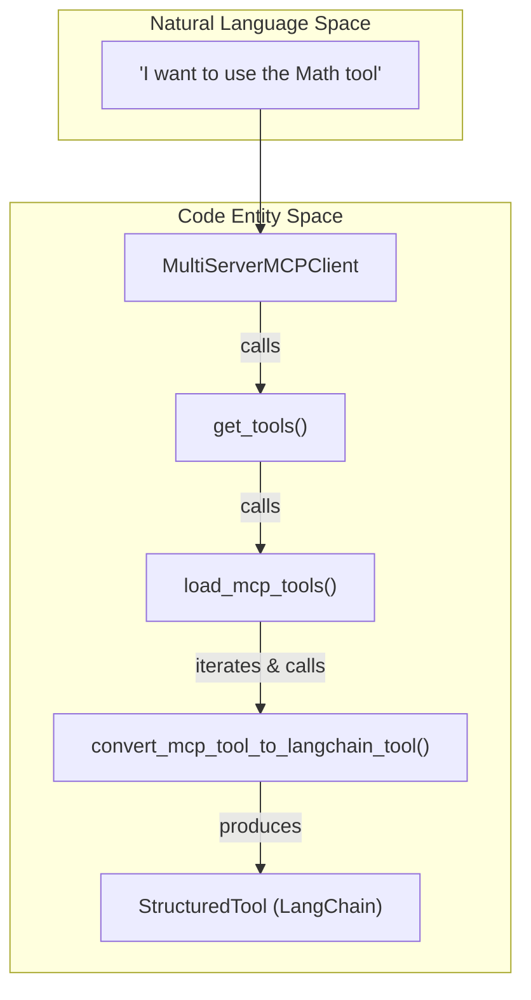
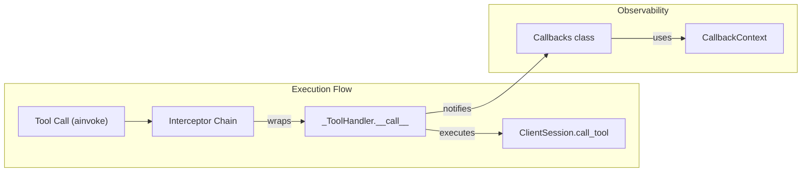

<!-- source: DeepWiki mcp.deepwiki.com · repo langchain-ai/langchain-mcp-adapters · page 9 Glossary · fetched 2026-10-26 -->

# Glossary

Relevant source files

The following files were used as context for generating this wiki page:

- [README.md](README.md)
- [langchain_mcp_adapters/callbacks.py](langchain_mcp_adapters/callbacks.py)
- [langchain_mcp_adapters/client.py](langchain_mcp_adapters/client.py)
- [langchain_mcp_adapters/interceptors.py](langchain_mcp_adapters/interceptors.py)
- [langchain_mcp_adapters/sessions.py](langchain_mcp_adapters/sessions.py)
- [langchain_mcp_adapters/tools.py](langchain_mcp_adapters/tools.py)
- [static/img/mcp.png](static/img/mcp.png)
- [tests/test_callbacks.py](tests/test_callbacks.py)
- [tests/test_elicitation.py](tests/test_elicitation.py)
- [tests/test_interceptors.py](tests/test_interceptors.py)
- [uv.lock](uv.lock)

This glossary defines technical terms, jargon, and abbreviations used throughout the `langchain-mcp-adapters` codebase. It serves as a reference for onboarding engineers to understand the mapping between the Model Context Protocol (MCP) specification and the LangChain framework implementation.

## Core Concepts

### Model Context Protocol (MCP)
A standardized protocol that allows AI models to access external data and functionality. In this codebase, it refers specifically to the integration layer that allows LangChain agents to consume tools, prompts, and resources from any compliant MCP server.
*   **Sources:** [README.md:1-5]()

### MultiServerMCPClient
The primary entry point for users of this library. It manages a dictionary of `Connection` configurations and handles the lifecycle of `ClientSession` objects across multiple servers.
*   **Implementation:** [langchain_mcp_adapters/client.py:45-51]()
*   **Key Method:** `get_tools()` which aggregates tools from all configured servers [langchain_mcp_adapters/client.py:162-168]().

### Connection
A `TypedDict` representing the configuration required to establish a transport layer with an MCP server. Supported types include `stdio`, `sse`, `websocket`, and `streamable_http`.
*   **Definition:** [langchain_mcp_adapters/sessions.py:207-209]()
*   **Factory:** `create_session` uses these configurations to instantiate the appropriate MCP client [langchain_mcp_adapters/sessions.py:276-282]().

---

## Technical Jargon & Components

### Interceptor
A mechanism following the "onion" middleware pattern that allows developers to wrap tool execution. Interceptors can modify the `MCPToolCallRequest` before it reaches the server or the `MCPToolCallResult` before it is returned to the LangChain agent.
*   **Protocol:** `ToolCallInterceptor` [langchain_mcp_adapters/interceptors.py:112-124]()
*   **Data Structure:** `MCPToolCallRequest` [langchain_mcp_adapters/interceptors.py:52-67]()
*   **Sources:** [langchain_mcp_adapters/interceptors.py:1-8](), [tests/test_interceptors.py:41-49]()

### Elicitation
A specific MCP capability where a tool execution is suspended to request additional information or confirmation from the user.
*   **Callback:** `ElicitationCallback` [langchain_mcp_adapters/callbacks.py:71-76]()
*   **Logic:** Handled via the `on_elicitation` hook in the `Callbacks` class [langchain_mcp_adapters/callbacks.py:102-102]().
*   **Sources:** [tests/test_elicitation.py:24-32]()

### Tool Adapter
The logic responsible for transforming an `MCPTool` (from the MCP SDK) into a LangChain `BaseTool` (specifically a `StructuredTool`).
*   **Function:** `convert_mcp_tool_to_langchain_tool` [langchain_mcp_adapters/tools.py:265-275]()
*   **Error Handling:** Uses `_MCPToolExecutionError` to wrap `isError=True` responses from servers [langchain_mcp_adapters/tools.py:99-115]().

---

## Architectural Mapping

### Diagram: Natural Language Space to Code Entity Space (Tools)
This diagram shows how a user's natural language request for a "Tool" maps to specific classes and functions in the codebase.

*   **Sources:** [langchain_mcp_adapters/client.py:162-185](), [langchain_mcp_adapters/tools.py:265-270](), [langchain_mcp_adapters/tools.py:490-500]()

### Diagram: Request Lifecycle (Interceptors & Callbacks)
This diagram illustrates the data flow from a Tool Call initiation through the Interceptor chain and Callback system.

*   **Sources:** [langchain_mcp_adapters/interceptors.py:112-124](), [langchain_mcp_adapters/callbacks.py:29-34](), [langchain_mcp_adapters/tools.py:350-370]()

---

## Abbreviations Table

| Abbreviation | Full Term | Context in Codebase |
| :--- | :--- | :--- |
| **MCP** | Model Context Protocol | The underlying protocol used for server communication. |
| **LC** | LangChain | Refers to `langchain-core` objects like `BaseTool` or `HumanMessage`. |
| **SSE** | Server-Sent Events | A transport type defined in `SSEConnection` [langchain_mcp_adapters/sessions.py:129](). |
| **HTTP** | Hypertext Transfer Protocol | Used for `StreamableHttpConnection` [langchain_mcp_adapters/sessions.py:164](). |
| **Stdio** | Standard Input/Output | Local process transport via `StdioConnection` [langchain_mcp_adapters/sessions.py:82](). |

*   **Sources:** [langchain_mcp_adapters/sessions.py:82-209](), [langchain_mcp_adapters/client.py:1-5]()