# Page: Overview

# Overview

<details>
<summary>Relevant source files</summary>

The following files were used as context for generating this wiki page:

- [README.md](README.md)
- [langchain_mcp_adapters/py.typed](langchain_mcp_adapters/py.typed)
- [static/img/mcp.png](static/img/mcp.png)
- [uv.lock](uv.lock)

</details>


This document provides an introduction to the `langchain-mcp-adapters` package, explaining its purpose as a bridge between Anthropic's Model Context Protocol (MCP) servers and LangChain/LangGraph applications. It covers the core concepts, architecture, and use cases that define the package's scope.

For installation instructions, see [Installation](#1.1). For hands-on examples, see [Quick Start](#1.2). For detailed architecture, see [Architecture Overview](#1.3).

## Purpose and Scope

The `langchain-mcp-adapters` package is a Python library that converts [Anthropic Model Context Protocol (MCP)](https://modelcontextprotocol.io/introduction) tools, prompts, and resources into formats compatible with [LangChain](https://github.com/langchain-ai/langchain) and [LangGraph](https://github.com/langchain-ai/langgraph) agents. It enables developers to:

1. **Connect to MCP servers** via multiple transport mechanisms (stdio, HTTP, WebSocket, SSE) [[README.md:116-133]()]
2. **Convert MCP tools** into `langchain.tools.BaseTool` instances that LangChain agents can invoke [[README.md:12-13](), [README.md:58-82]()]
3. **Load MCP prompts** and convert them to LangChain message formats [[README.md:238-257]()]
4. **Access MCP resources** and convert them to LangChain `Blob` objects [[README.md:259-281]()]
5. **Manage multiple servers** simultaneously through a unified client interface [[README.md:84-138]()]

**Sources:** [pyproject.toml:5-9](), [README.md:1-13]()

## What is MCP?

The Model Context Protocol (MCP) is an open standard developed by Anthropic for exposing tools, prompts, and contextual resources to AI applications. MCP servers are standalone processes that:

- Define **tools** (functions) that AI agents can call [[README.md:41-49]()]
- Provide **prompts** (template messages) for agents to use [[README.md:238-257]()]
- Expose **resources** (text/binary data) as context [[README.md:259-281]()]

MCP servers can be written in any language and deployed locally (via stdio) or remotely (via HTTP/WebSocket/SSE). This package enables LangChain/LangGraph applications to consume these MCP capabilities seamlessly.

**Sources:** [README.md:3](), [README.md:36-53]()

## Core Components

The package is organized around three main layers:

### Client Layer: MultiServerMCPClient

The `MultiServerMCPClient` class provides the primary interface for connecting to one or more MCP servers and retrieving their capabilities.

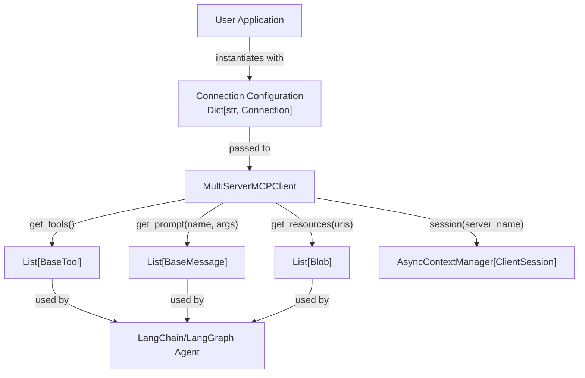

**Title:** MultiServerMCPClient API Surface

**Sources:** [README.md:116-138](), [README.md:143-149]()

### Adapter Layer: Format Converters

Three adapter modules convert between MCP types and LangChain types:

| Adapter Module | MCP Type | LangChain Type | Key Function |
|----------------|----------|----------------|--------------|
| `tools.py` | `mcp.types.Tool` | `langchain.tools.BaseTool` | `load_mcp_tools()`, `convert_mcp_tool_to_langchain_tool()` |
| `prompts.py` | `mcp.types.PromptMessage` | `langchain.schema.BaseMessage` | `load_mcp_prompt()`, `convert_mcp_prompt_message_to_langchain_message()` |
| `resources.py` | `mcp.types.ResourceContents` | `langchain.schema.Blob` | `load_mcp_resources()`, `convert_mcp_resource_to_langchain_blob()` |

**Sources:** [README.md:58-82](), [README.md:238-281]()

### Transport Layer: Session Management

The package abstracts several transport mechanisms defined in the MCP specification:

- **stdio**: Local subprocess communication for development [[README.md:65-69]()]
- **http**: Streamable HTTP for stateless remote servers [[README.md:151-204]()]
- **sse**: Server-Sent Events for streaming [[README.md:208-212]()]
- **websocket**: WebSocket for full-duplex communication

For detailed transport documentation, see [Connection Types](#3.1).

**Sources:** [README.md:65-69](), [README.md:151-204](), [README.md:208-212]()

## Architecture Overview

The following diagram maps the package architecture to concrete code entities:

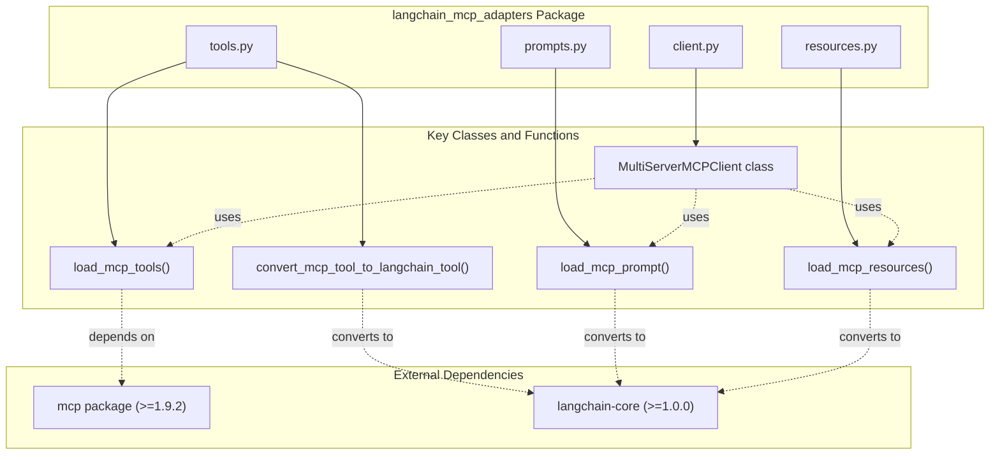

**Title:** Package Structure and Code Entity Relationships

**Sources:** [pyproject.toml:15-19](), [README.md:58-82]()

## Data Flow: MCP Server to LangChain Agent

The following diagram illustrates how data flows from MCP servers through the adapter layers to LangChain agents:

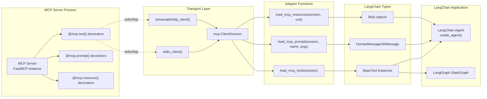

**Title:** End-to-End Data Flow from MCP Servers to LangChain Agents

**Sources:** [README.md:36-82](), [README.md:238-281]()

## Use Cases

The `langchain-mcp-adapters` package is designed for scenarios where:

### 1. Integrating Existing MCP Tools
You have existing MCP servers (developed in Python, Node.js, or other languages) and want to use their tools in LangChain agents without rewriting them. [[README.md:12-13]()]

### 2. Multi-Server Tool Aggregation
You need to connect to multiple MCP servers simultaneously and aggregate their tools into a single agent. For example, combining a local math server (stdio) with a remote weather API (HTTP). [[README.md:84-138]()]

**Example Configuration:**
```python
client = MultiServerMCPClient({
    "math": {"transport": "stdio", "command": "python", "args": ["/path/to/math_server.py"]},
    "weather": {"transport": "http", "url": "http://localhost:8000/mcp"}
})
```

**Sources:** [README.md:116-133]()

### 3. LangGraph Deployment
You want to deploy LangGraph agents that use MCP tools to production environments like LangGraph API Server, where tools need to be loaded asynchronously at graph creation time. [[README.md:283-329]()]

For deployment guidance, see [LangGraph API Server Deployment](#5.3).

### 4. Custom Transport Headers
You need to pass authentication tokens or custom metadata to remote MCP servers via `http` or `sse` transports. [[README.md:206-236]()]

**Sources:** [README.md:219-230]()

## Package Dependencies

The package has minimal required dependencies to maintain a lightweight footprint:

| Dependency | Version Constraint | Purpose |
|------------|-------------------|---------|
| `langchain-core` | `>=1.0.0,<2.0.0` | Provides `BaseTool`, `BaseMessage`, `Blob` types |
| `mcp` | `>=1.9.2` | Anthropic's MCP SDK for protocol implementation |

**Sources:** [pyproject.toml:15-19]()

## Version and License

- **Current Version:** 0.2.1 [[pyproject.toml:7]()]
- **License:** MIT [[pyproject.toml:14]()]
- **Python Requirement:** >=3.10 [[pyproject.toml:6]()]
- **Repository:** https://github.com/langchain-ai/langchain-mcp-adapters

**Sources:** [pyproject.toml:6-14]()

## Next Steps

To get started with the package:

1. Follow [Installation](#1.1) instructions to install dependencies.
2. Walk through the [Quick Start](#1.2) guide for a minimal working example.
3. Review [Architecture Overview](#1.3) for deeper understanding of the system design.

**Sources:** [README.md:15-28]()

---

# Page: Installation

# Installation

<details>
<summary>Relevant source files</summary>

The following files were used as context for generating this wiki page:

- [pyproject.toml](pyproject.toml)
- [uv.lock](uv.lock)

</details>


This page provides instructions for installing the `langchain-mcp-adapters` package and understanding its dependency requirements. For information about getting started with the package after installation, see [Quick Start](1.2). For development setup including testing tools and workflows, see [Development](7).

---

## System Requirements

The `langchain-mcp-adapters` package requires Python 3.10 or higher. This requirement is enforced at the package level to ensure compatibility with modern type hints and async features.

| Requirement | Version Constraint | Source |
|-------------|-------------------|---------|
| Python | >=3.10 | [pyproject.toml:14]() |

**Sources:** [pyproject.toml:14]()

---

## Basic Installation

Install the package from PyPI using pip:

```bash
pip install langchain-mcp-adapters
```

This installs the core package along with its required dependencies. The package is distributed via the Python Package Index and uses the `pdm-backend` build system [pyproject.toml:1-3]().

**Package Metadata:**

| Property | Value |
|----------|-------|
| Package Name | `langchain-mcp-adapters` |
| Current Version | 0.3.0 |
| License | MIT |
| Build Backend | pdm-backend |

**Sources:** [pyproject.toml:1-19]()

---

## Core Dependencies

The basic installation automatically includes three core dependencies that provide the essential functionality for bridging MCP servers and LangChain:

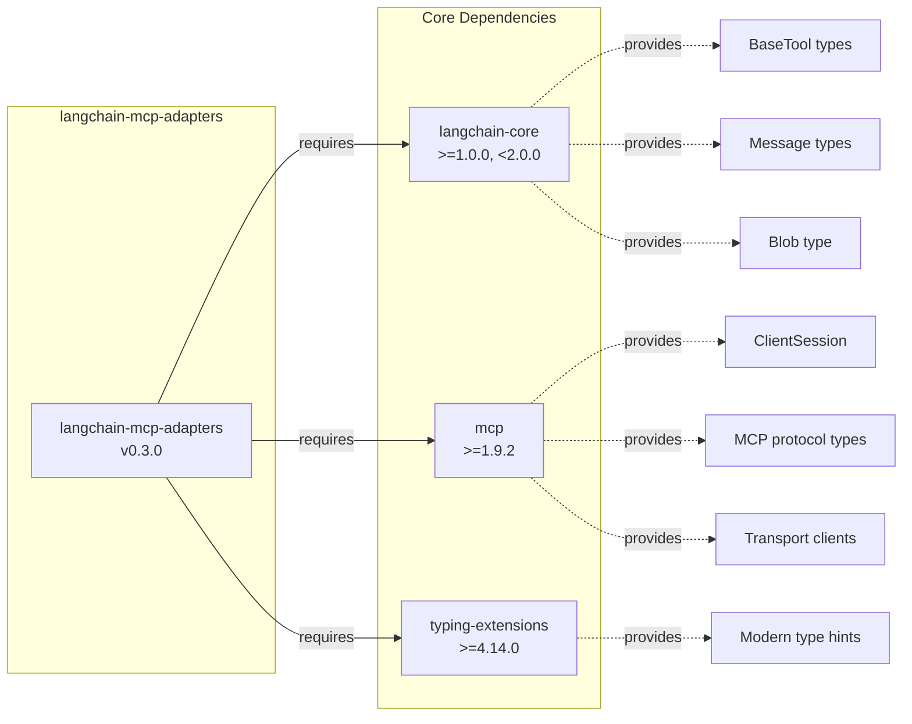

**Dependency Details:**

| Dependency | Version Constraint | Purpose |
|------------|-------------------|---------|
| `langchain-core` | >=1.0.0, <2.0.0 | Provides base types (`BaseTool`, `HumanMessage`, `AIMessage`, `Blob`) for LangChain integration |
| `mcp` | >=1.9.2 | Official Model Context Protocol SDK providing `ClientSession` and transport clients |
| `typing-extensions` | >=4.14.0 | Backports modern typing features for Python 3.10 compatibility |

**Sources:** [pyproject.toml:15-19]()

---

## Optional Dependencies

### Integration Dependency Group

For full LangChain agent functionality, install the integration dependency group:

```bash
pip install "langchain-mcp-adapters[integration]"
```

This adds the `langchain` package (>=1.0.8), which provides higher-level agent abstractions and utilities. The core package only requires `langchain-core`, keeping the base installation lightweight.

| Dependency | Version Constraint | Included In |
|------------|-------------------|-------------|
| `langchain` | >=1.0.8 | integration group |

**Sources:** [pyproject.toml:21-24]()

### Test Dependency Group

For contributors and developers running the test suite, install the test dependency group:

```bash
pip install "langchain-mcp-adapters[test]"
```

This installs development tools for testing, linting, and type checking:

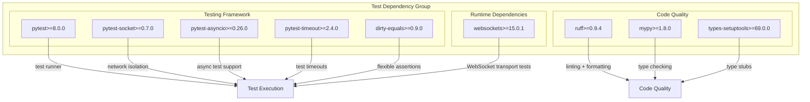

**Test Dependencies:**

| Dependency | Version | Purpose |
|------------|---------|---------|
| `pytest` | >=8.0.0 | Test framework and runner |
| `pytest-socket` | >=0.7.0 | Network access control in tests |
| `pytest-asyncio` | >=0.26.0 | Async/await test support |
| `pytest-timeout` | >=2.4.0 | Test timeout enforcement |
| `dirty-equals` | >=0.9.0 | Flexible assertion matching |
| `ruff` | >=0.9.4 | Fast Python linter and formatter |
| `mypy` | >=1.8.0 | Static type checker |
| `types-setuptools` | >=69.0.0 | Type stubs for setuptools |
| `websockets` | >=15.0.1 | WebSocket protocol implementation for transport tests |

**Sources:** [pyproject.toml:25-35]()

---

## Installation Flow

The following diagram shows how the installation process resolves and installs dependencies based on the installation method chosen:

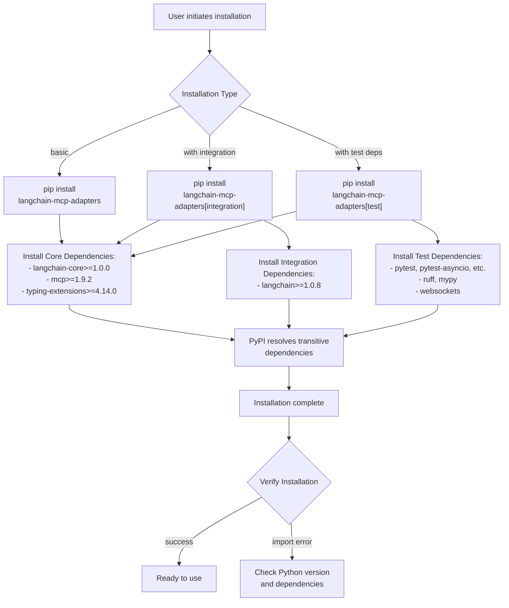

**Sources:** [pyproject.toml:15-35]()

---

## Verifying Installation

After installation, verify the package is correctly installed and can import successfully:

```python
import langchain_mcp_adapters
from langchain_mcp_adapters.client import MultiServerMCPClient
from langchain_mcp_adapters.tools import load_mcp_tools

# Check version
print(langchain_mcp_adapters.__version__)
```

The package provides a `py.typed` marker file indicating it includes type hints for static type checking with tools like mypy.

**Expected Import Structure:**

| Module Path | Primary Exports |
|-------------|-----------------|
| `langchain_mcp_adapters.client` | `MultiServerMCPClient` |
| `langchain_mcp_adapters.tools` | `load_mcp_tools`, `convert_mcp_tool_to_langchain_tool` |
| `langchain_mcp_adapters.prompts` | `load_mcp_prompt` |
| `langchain_mcp_adapters.resources` | `load_mcp_resources` |
| `langchain_mcp_adapters.sessions` | `create_session` |
| `langchain_mcp_adapters.callbacks` | `Callbacks` |
| `langchain_mcp_adapters.interceptors` | `ToolCallInterceptor` |

**Sources:** Architecture overview and project directory structure.

---

## Dependency Version Management

The package uses a lockfile system for reproducible builds during development. The `uv.lock` file pins exact versions of all transitive dependencies to ensure consistency across environments.

**Version Constraints Strategy:**

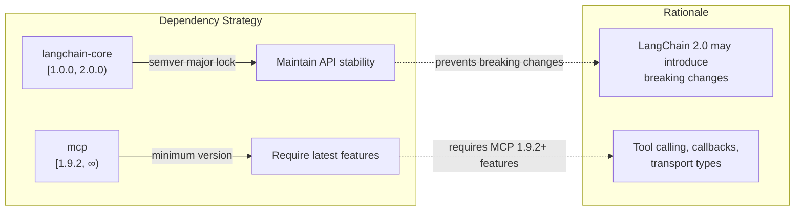

**Version Constraint Rationale:**

| Package | Constraint Type | Reasoning |
|---------|----------------|-----------|
| `langchain-core` | Upper bound (<2.0.0) | Prevents automatic upgrades to potentially breaking LangChain 2.x [pyproject.toml:16]() |
| `mcp` | Lower bound (>=1.9.2) | Requires features introduced in MCP 1.9.2 for full functionality [pyproject.toml:17]() |
| `typing-extensions` | Lower bound (>=4.14.0) | Ensures availability of modern typing constructs [pyproject.toml:18]() |

**Sources:** [pyproject.toml:15-19](), [uv.lock:1-7]()

---

## Build System Configuration

The package uses PDM (Python Development Master) as its build backend, specified in the `[build-system]` section. This is primarily relevant for contributors building the package from source or creating distributions.

**Build System Specification:**

| Property | Value |
|----------|-------|
| Build System | `pdm-backend` |
| Build Requirements | `["pdm-backend"]` |

For development workflows including building from source, see [Development Automation](7.3) and [Dependency Management](7.2).

**Sources:** [pyproject.toml:1-3]()

---

## Troubleshooting Installation

### Python Version Issues

If you encounter errors about Python version compatibility:

```
ERROR: Package 'langchain-mcp-adapters' requires a different Python: 3.9.0 not in '>=3.10'
```

**Solution:** Upgrade to Python 3.10 or higher. The package requires modern async features and type hints available only in Python 3.10+ [pyproject.toml:14]().

### Dependency Conflicts

If pip reports dependency conflicts with existing packages:

**Solution:** Create a fresh virtual environment to isolate dependencies:

```bash
python -m venv venv
source venv/bin/activate  # On Windows: venv\Scripts\activate
pip install langchain-mcp-adapters
```

### Import Errors After Installation

If imports fail with `ModuleNotFoundError`:

**Solution:** Verify the package is installed in the active Python environment:

```bash
pip list | grep langchain-mcp-adapters
python -c "import langchain_mcp_adapters; print(langchain_mcp_adapters.__file__)"
```

**Sources:** General Python packaging best practices and [pyproject.toml:14]() for version requirements.

---

# Page: Quick Start

# Quick Start

<details>
<summary>Relevant source files</summary>

The following files were used as context for generating this wiki page:

- [README.md](README.md)
- [langchain_mcp_adapters/client.py](langchain_mcp_adapters/client.py)
- [static/img/mcp.png](static/img/mcp.png)

</details>


This page provides working examples to get you up and running with `langchain-mcp-adapters` immediately. It demonstrates the core usage patterns for connecting MCP servers to LangGraph agents, covering both single-server and multi-server configurations.

For detailed documentation of individual components, see **2. Core Components**. For advanced transport configuration options, see **3.1 Connection Types**. For creating custom MCP servers, see **4.3 Creating Custom MCP Servers**.

## Prerequisites

Install the required packages:

```bash
pip install langchain-mcp-adapters langgraph "langchain[openai]"
export OPENAI_API_KEY=<your_api_key>
```

## Basic Single Server Example

The simplest usage pattern involves connecting to a single MCP server and loading its tools into a LangChain agent.

### Server Setup

**MCP Server with FastMCP**
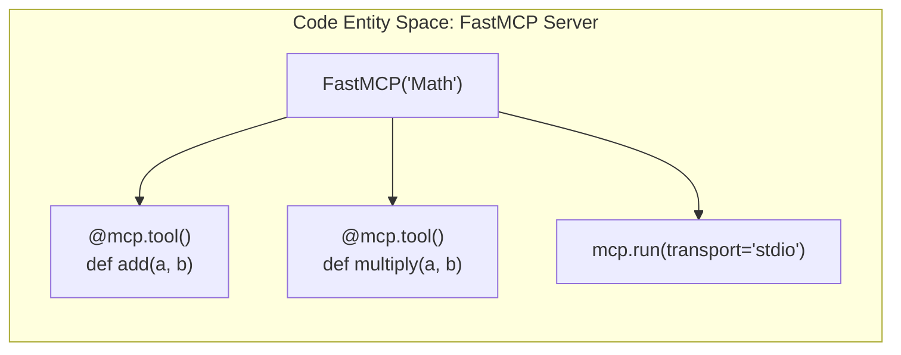

Create a simple math server using `FastMCP`:

*Sources: [README.md:32-53]()*

### Client Connection

**Single Server Connection Flow**
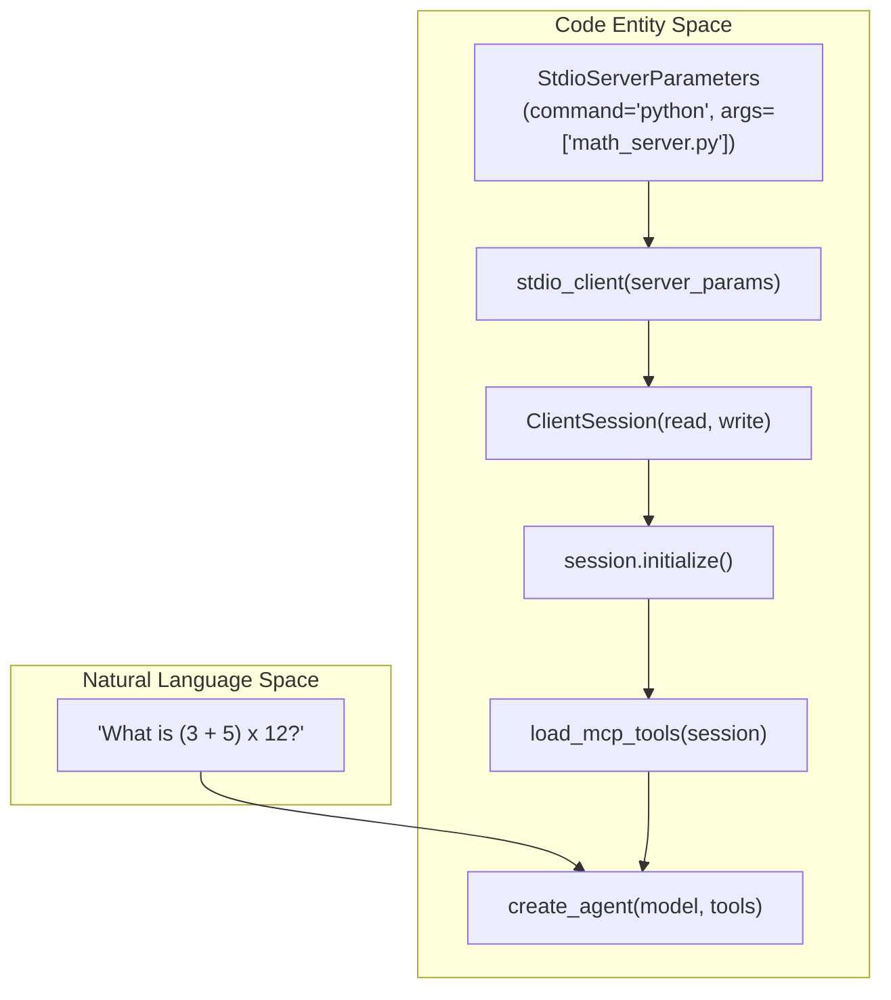

The client code demonstrates the standard connection pattern using the `mcp` Python SDK and `langchain_mcp_adapters.tools.load_mcp_tools` [langchain_mcp_adapters/tools.py:108-111]():

1. Create `StdioServerParameters` with command and args.
2. Establish connection using `stdio_client`.
3. Initialize `ClientSession`.
4. Load tools using `load_mcp_tools` [langchain_mcp_adapters/tools.py:108-111]().
5. Run the agent.

*Sources: [README.md:55-83]()*

## Multi-Server Configuration

The `MultiServerMCPClient` [langchain_mcp_adapters/client.py:45-49]() enables connecting to multiple MCP servers simultaneously, aggregating their tools into a unified interface.

### Server Configuration

**Multi-Server Architecture**
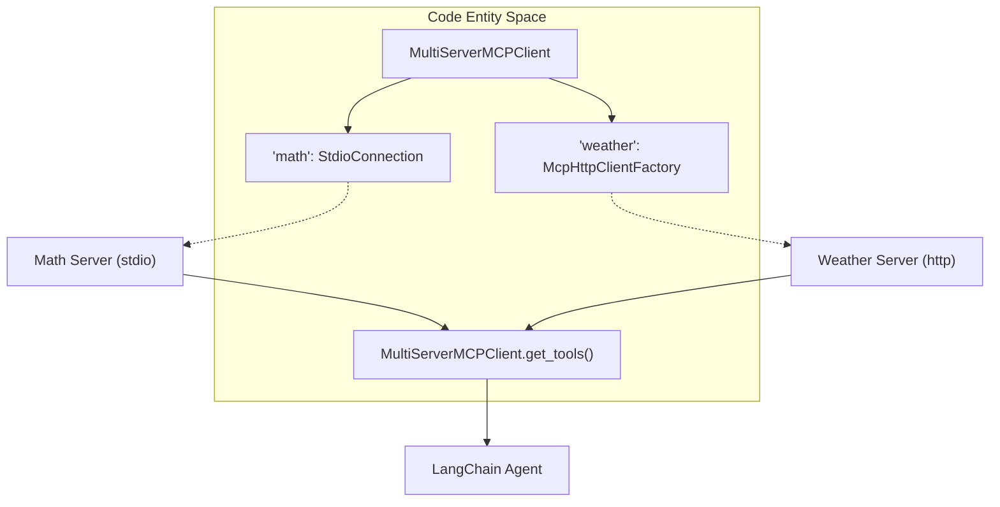

The weather server example shows HTTP transport usage:

*Sources: [README.md:87-114](), [langchain_mcp_adapters/client.py:86-103]()*

### Client Usage

The multi-server client configuration accepts a dictionary mapping server names to their `Connection` [langchain_mcp_adapters/sessions.py:41-41]() parameters:

| Server | Transport | Configuration Key |
|--------|-----------|---------------|
| math | `stdio` | `command`, `args` [langchain_mcp_adapters/sessions.py:44-48]() |
| weather | `http` | `url` [langchain_mcp_adapters/sessions.py:65-68]() |

Key methods:
- `client.get_tools()` [langchain_mcp_adapters/client.py:162-162](): Returns aggregated tools from all servers. It creates a new session for each tool call by default [langchain_mcp_adapters/client.py:171-171]().
- `client.session(server_name)` [langchain_mcp_adapters/client.py:124-124](): An `asynccontextmanager` that yields an initialized `ClientSession` for a specific server.

*Sources: [README.md:116-149](), [langchain_mcp_adapters/client.py:124-161]()*

## Transport Options

The adapter supports multiple transport mechanisms for connecting to MCP servers via the `create_session` utility [langchain_mcp_adapters/sessions.py:128-128]().

**Transport Layer Overview**
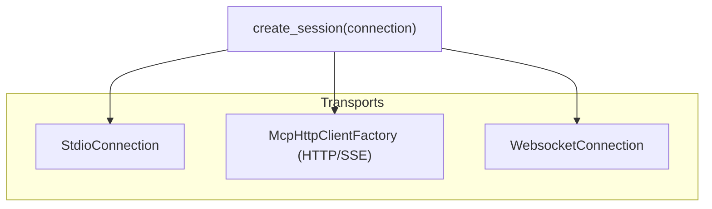

### Streamable HTTP Example

For HTTP-based MCP servers, `MultiServerMCPClient` supports the `http` transport type, which handles streamable HTTP [langchain_mcp_adapters/sessions.py:65-68]():

```python
client = MultiServerMCPClient({
    "math": {
        "transport": "http",
        "url": "http://localhost:3000/mcp"
    }
})
```

*Sources: [README.md:186-204](), [langchain_mcp_adapters/sessions.py:65-68]()*

### Passing Runtime Headers

When using `http` or `sse` transports, you can include custom headers for authentication:

```python
client = MultiServerMCPClient({
    "weather": {
        "transport": "http",
        "url": "http://localhost:8000/mcp",
        "headers": {
            "Authorization": "Bearer YOUR_TOKEN"
        }
    }
})
```

*Sources: [README.md:213-234](), [langchain_mcp_adapters/sessions.py:61-61]()*

## Bidirectional Tool Conversion

The adapter supports converting LangChain tools to MCP format using `to_fastmcp` [langchain_mcp_adapters/tools.py:353-353]():

**LangChain to MCP Conversion**
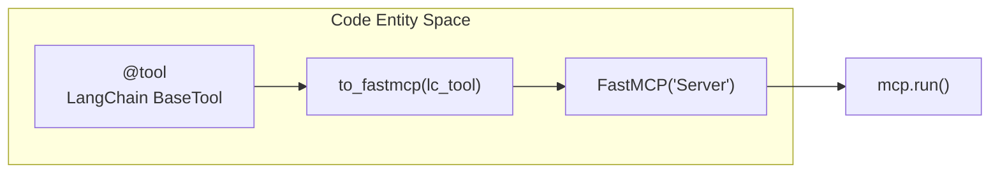

This enables using existing LangChain tools within MCP servers by wrapping them in a `FastMCP` instance.

*Sources: [README.md:293-316](), [langchain_mcp_adapters/tools.py:353-376]()*

---

# Page: Architecture Overview

# Architecture Overview

<details>
<summary>Relevant source files</summary>

The following files were used as context for generating this wiki page:

- [README.md](README.md)
- [langchain_mcp_adapters/client.py](langchain_mcp_adapters/client.py)
- [langchain_mcp_adapters/sessions.py](langchain_mcp_adapters/sessions.py)
- [langchain_mcp_adapters/tools.py](langchain_mcp_adapters/tools.py)
- [static/img/mcp.png](static/img/mcp.png)

</details>


This document explains the high-level architecture of `langchain-mcp-adapters`, showing how components interact to bridge Model Context Protocol (MCP) servers with LangChain/LangGraph agents. It covers the layered design, data flow patterns, transport abstraction, and extension mechanisms.

## System Overview

The `langchain-mcp-adapters` package implements a layered architecture that provides protocol translation between MCP servers and LangChain agents. The system is organized into five primary layers:

Title: High-Level Component Interaction
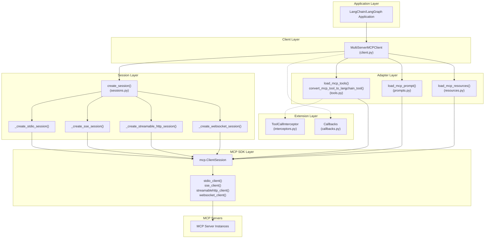

Sources: [langchain_mcp_adapters/client.py:1-42](), [langchain_mcp_adapters/tools.py:1-48](), [langchain_mcp_adapters/sessions.py:1-5]()

## Core Architecture Layers

The system is decomposed into distinct layers with well-defined responsibilities:

| Layer | Primary Components | Responsibility | Key Files |
|-------|-------------------|----------------|-----------|
| **Client Layer** | `MultiServerMCPClient` | Entry point for managing multiple MCP server connections | `client.py` |
| **Adapter Layer** | Tool, Prompt, Resource adapters | Protocol translation between MCP and LangChain formats | `tools.py`, `prompts.py`, `resources.py` |
| **Extension Layer** | `ToolCallInterceptor`, `Callbacks` | Request/response modification and event handling | `interceptors.py`, `callbacks.py` |
| **Session Layer** | `create_session()`, transport implementations | Connection management and transport abstraction | `sessions.py` |
| **MCP SDK Layer** | `mcp.ClientSession` | Low-level MCP protocol implementation | External dependency |

### Client Layer

The `MultiServerMCPClient` class ([langchain_mcp_adapters/client.py:45-49]()) serves as the primary interface for applications. It manages a dictionary of server connections ([langchain_mcp_adapters/client.py:116-118]()), aggregates tools from multiple servers ([langchain_mcp_adapters/client.py:162-200]()), and provides methods for accessing prompts and resources.

Title: MultiServerMCPClient Structure
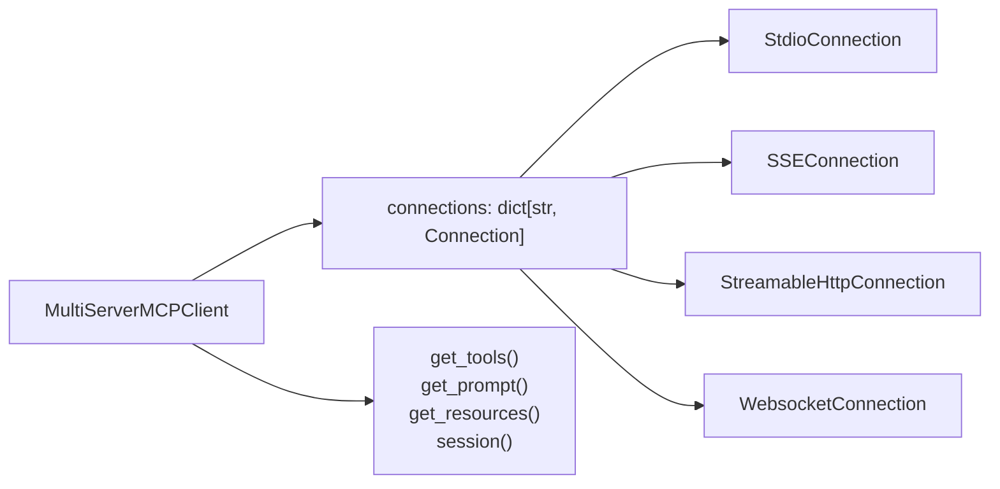

Sources: [langchain_mcp_adapters/client.py:45-123](), [langchain_mcp_adapters/sessions.py:207-209]()

### Adapter Layer

The adapter layer provides specialized conversion functions:

1. **Tool Adapter**: Converts `mcp.types.Tool` to `langchain_core.tools.BaseTool` using `load_mcp_tools()` ([langchain_mcp_adapters/tools.py:436-497]()). Each converted tool wraps the MCP tool call mechanism and converts results using `_convert_call_tool_result()` ([langchain_mcp_adapters/tools.py:135-198]()).
2. **Prompt Adapter**: Transforms `mcp.types.PromptMessage` to LangChain messages (`HumanMessage`/`AIMessage`) through `load_mcp_prompt()` ([langchain_mcp_adapters/prompts.py:1-5]()).
3. **Resource Adapter**: Loads MCP resources and converts them to `langchain_core.documents.Blob` objects via `load_mcp_resources()` ([langchain_mcp_adapters/resources.py:1-5]()).

Sources: [langchain_mcp_adapters/tools.py:1-5](), [langchain_mcp_adapters/prompts.py:1-5](), [langchain_mcp_adapters/resources.py:1-5]()

## Data Flow Pipeline

The following diagram shows the complete data flow for tool execution, the most common operation:

Title: Tool Execution Data Flow
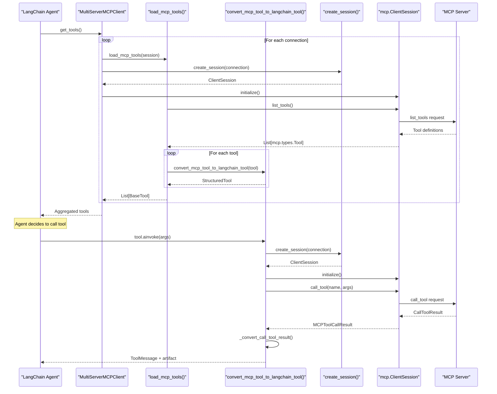

**Key data transformations:**

| Stage | Input Type | Output Type | Function |
|-------|-----------|-------------|----------|
| Tool Discovery | `mcp.types.Tool` | `langchain_core.tools.BaseTool` | `convert_mcp_tool_to_langchain_tool()` [langchain_mcp_adapters/tools.py:436]() |
| Result Conversion | `MCPToolCallResult` | `list[ToolMessageContentBlock]` | `_convert_call_tool_result()` [langchain_mcp_adapters/tools.py:135]() |
| Content Block | `mcp.types.ContentBlock` | `ToolMessageContentBlock` | `_convert_mcp_content_to_lc_block()` [langchain_mcp_adapters/tools.py:175]() |

Sources: [langchain_mcp_adapters/tools.py:84-497](), [langchain_mcp_adapters/client.py:162-200]()

## Transport Abstraction

The session layer implements a dispatcher pattern to abstract transport differences:

Title: Session Dispatcher Pattern
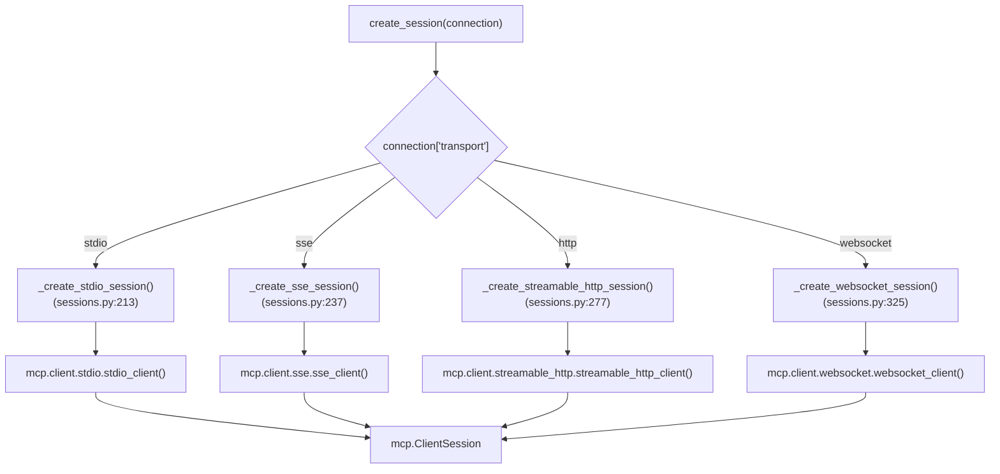

### Connection Type Configurations

Each transport type uses a `TypedDict` configuration ([langchain_mcp_adapters/sessions.py:82-205]()):

| Transport | Config Type | Required Fields | Transport Mechanism |
|-----------|-------------|-----------------|---------------------|
| `stdio` | `StdioConnection` | `command`, `args` | Subprocess stdin/stdout |
| `sse` | `SSEConnection` | `url` | Server-Sent Events over HTTP |
| `streamable_http` | `StreamableHttpConnection` | `url` | HTTP streaming with SSE |
| `websocket` | `WebsocketConnection` | `url` | WebSocket bidirectional |

Sources: [langchain_mcp_adapters/sessions.py:82-357]()

## Component Interaction Patterns

### Session Creation Modes

The system supports two session creation patterns:

1. **Ephemeral Sessions**: A new session is created for each tool call when only a `Connection` is provided. This is the default behavior when using `MultiServerMCPClient.get_tools()` ([langchain_mcp_adapters/client.py:171]()).
2. **Persistent Sessions**: Applications can explicitly manage sessions using the `MultiServerMCPClient.session()` context manager ([langchain_mcp_adapters/client.py:125-161]()) for long-lived connections.

Title: Session Lifecycle Patterns
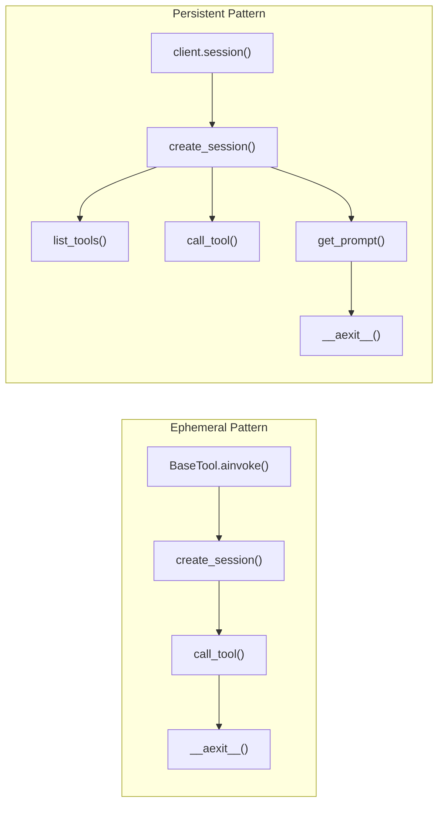

Sources: [langchain_mcp_adapters/client.py:114-161](), [langchain_mcp_adapters/client.py:169-171]()

### Interceptor Chain Composition

The interceptor mechanism uses function composition to build an onion-layer architecture. The `MultiServerMCPClient` accepts a list of `tool_interceptors` ([langchain_mcp_adapters/client.py:56]()) which are applied to tool calls.

Title: Tool Call Interceptor Chain


Sources: [langchain_mcp_adapters/client.py:56-59](), [langchain_mcp_adapters/interceptors.py:1-5]()

---

# Page: Core Components

# Core Components

<details>
<summary>Relevant source files</summary>

The following files were used as context for generating this wiki page:

- [examples/servers/streamable-http-stateless/mcp_simple_streamablehttp_stateless/server.py](examples/servers/streamable-http-stateless/mcp_simple_streamablehttp_stateless/server.py)
- [langchain_mcp_adapters/__init__.py](langchain_mcp_adapters/__init__.py)
- [langchain_mcp_adapters/client.py](langchain_mcp_adapters/client.py)
- [langchain_mcp_adapters/tools.py](langchain_mcp_adapters/tools.py)

</details>


## Purpose and Scope

This document provides an overview of the main components that constitute the `langchain-mcp-adapters` system. These components work together to bridge Anthropic's Model Context Protocol (MCP) with LangChain and LangGraph frameworks. The focus is on the architectural structure and how the core modules interact to enable MCP-to-LangChain translation.

For detailed information about specific transport mechanisms and connection management, see [Session Management and Transport](#3). For integration patterns with LangChain agents and LangGraph workflows, see [Integration with LangChain and LangGraph](#5).

## Component Architecture

The adapter system consists of six primary components organized in three layers: orchestration, conversion, and cross-cutting concerns.

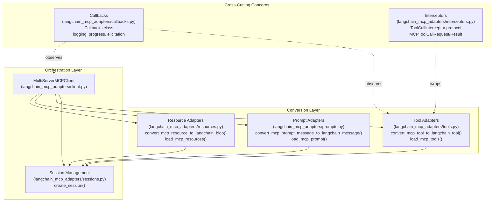

**Sources:** [langchain_mcp_adapters/client.py:1-42](), [langchain_mcp_adapters/tools.py:1-49]()

## Core Components Overview

### MultiServerMCPClient

The `MultiServerMCPClient` class serves as the primary entry point for interacting with MCP servers. It orchestrates connections to multiple servers simultaneously and provides unified methods for retrieving tools, prompts, and resources. For details, see [MultiServerMCPClient](#2.1).

| Method | Purpose | Return Type |
|--------|---------|-------------|
| `session(server_name)` | Create async context manager for server connection | `AsyncIterator[ClientSession]` |
| `get_tools(server_name?)` | Load tools from one or all servers | `list[BaseTool]` |
| `get_prompt(server_name, prompt_name)` | Load specific prompt from server | `list[HumanMessage \| AIMessage]` |
| `get_resources(server_name?, uris?)` | Load resources from one or all servers | `list[Blob]` |

**Sources:** [langchain_mcp_adapters/client.py:45-280]()

### Tool Adapters

The tool adapter system converts MCP tool definitions into LangChain `BaseTool` instances. The core conversion function is `convert_mcp_tool_to_langchain_tool()`, which creates `StructuredTool` objects. For details, see [Tool Adapters](#2.2).

The conversion handles complex content types via `_convert_mcp_content_to_lc_block()`:

| MCP Content Type | LangChain Content Block |
|-----------------|------------------------|
| `TextContent` | `{"type": "text", "text": ...}` |
| `ImageContent` | `{"type": "image", "image_url": {"url": "data:..."}}` |
| `ResourceLink` (image) | `{"type": "image", "image_url": {"url": ...}}` |
| `ResourceLink` (other) | `{"type": "file", "file_data": {"url": ...}}` |
| `EmbeddedResource` (text) | `{"type": "text", "text": ...}` |
| `AudioContent` | Not supported (raises `NotImplementedError`) |

**Sources:** [langchain_mcp_adapters/tools.py:175-233](), [langchain_mcp_adapters/tools.py:416-497]()

### Prompt Adapters

Prompt adapters convert MCP `PromptMessage` objects to LangChain message types. The system maps role-based messages:
- `role="user"` → `HumanMessage`
- `role="assistant"` → `AIMessage`

For details, see [Prompt Adapters](#2.3).

**Sources:** [langchain_mcp_adapters/client.py:202-211]()

### Resource Adapters

Resource adapters transform MCP resources into LangChain `Blob` objects. The `load_mcp_resources()` function supports loading all resources or filtering by specific URIs. For details, see [Resource Adapters](#2.4).

**Sources:** [langchain_mcp_adapters/client.py:213-253]()

## Data Flow Through Components

The following diagram maps the transition from MCP server entities to LangChain code entities.

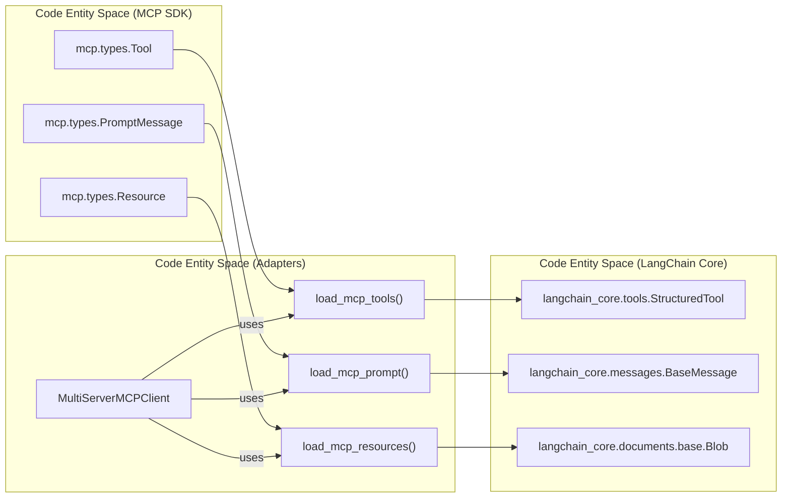

**Sources:** [langchain_mcp_adapters/client.py:152-253](), [langchain_mcp_adapters/tools.py:416-497]()

## Cross-Cutting Concerns

### Callbacks System

The `Callbacks` class provides observability into MCP operations. It supports logging, progress tracking, and elicitation (interactive prompts). Callbacks are contextualized via `CallbackContext`. For details, see [Callbacks](#2.5).

**Sources:** [langchain_mcp_adapters/client.py:119](), [langchain_mcp_adapters/client.py:151-153]()

### Interceptors System

The `ToolCallInterceptor` protocol enables request/response modification using an "onion pattern". The chain is built via `_build_interceptor_chain()`. For details, see [Interceptors](#2.6).

**Sources:** [langchain_mcp_adapters/tools.py:201-232](), [langchain_mcp_adapters/client.py:56-57]()

## Tool Execution Pipeline

This diagram bridges the high-level execution flow to the internal adapter functions.

```mermaid
sequenceDiagram
    participant A as "LangChain Agent"
    participant T as "StructuredTool"
    participant I as "_build_interceptor_chain()"
    participant S as "mcp.ClientSession"
    
    A->>T: ainvoke(args)
    T->>I: execute_tool(request)
    Note over I: Applies ToolCallInterceptor logic
    I->>S: call_tool(name, arguments)
    S-->>I: CallToolResult
    I-->>T: MCPToolCallResult
    T->>T: _convert_call_tool_result()
    T-->>A: (content, artifact)
```

**Sources:** [langchain_mcp_adapters/tools.py:305-414](), [langchain_mcp_adapters/tools.py:201-232]()

## Tool Name Prefixing and Error Handling

- **Prefixing**: The `tool_name_prefix` parameter on `MultiServerMCPClient` prevents name collisions (e.g., `"weather_search"`).
- **Error Handling**: `handle_tool_errors=True` converts MCP execution errors (`isError=True`) into `ToolMessage` with `status="error"`, allowing agents to self-correct.

**Sources:** [langchain_mcp_adapters/client.py:68-79](), [langchain_mcp_adapters/tools.py:99-158]()

## Pagination Support

The `_list_all_tools()` helper function handles MCP's pagination protocol using the `nextCursor` field, with a safety limit of `MAX_ITERATIONS=1000`.

**Sources:** [langchain_mcp_adapters/tools.py:235-269](), [langchain_mcp_adapters/tools.py:67]()

---

# Page: MultiServerMCPClient

# MultiServerMCPClient

<details>
<summary>Relevant source files</summary>

The following files were used as context for generating this wiki page:

- [langchain_mcp_adapters/client.py](langchain_mcp_adapters/client.py)
- [tests/test_client.py](tests/test_client.py)

</details>


## Purpose and Scope

The `MultiServerMCPClient` class is the primary interface for connecting to and managing multiple MCP (Model Context Protocol) servers within a LangChain application. This class provides a unified API for loading tools, prompts, and resources from one or more MCP servers, abstracting the complexity of managing individual server connections and transport protocols.

This page documents the client's architecture, initialization, session management, and methods for accessing MCP artifacts. For details on how tools are converted from MCP to LangChain format, see [Tool Adapters](2.2). For prompt and resource conversion details, see [Prompt Adapters](2.3) and [Resource Adapters](2.4).

## Class Architecture

The `MultiServerMCPClient` serves as an orchestration layer that manages multiple MCP server connections and delegates to specialized conversion modules for transforming MCP artifacts into LangChain-compatible objects.

### Core Class Structure

```mermaid
classDiagram
    class MultiServerMCPClient {
        +dict connections
        +Callbacks callbacks
        +list tool_interceptors
        +bool tool_name_prefix
        +bool handle_tool_errors
        +__init__(connections, callbacks, tool_interceptors, tool_name_prefix, handle_tool_errors)
        +session(server_name, auto_initialize) AsyncIterator
        +get_tools(server_name) list[BaseTool]
        +get_prompt(server_name, prompt_name, arguments) list[Message]
        +get_resources(server_name, uris) list[Blob]
    }
    
    class Connection {
        <<TypedDict>>
        +str transport
        +str command
        +list args
        +str url
        +dict headers
    }
    
    class Callbacks {
        +LoggingMessageCallback on_logging_message
        +ProgressCallback on_progress
        +to_mcp_format(context) _MCPCallbacks
    }
    
    class ToolCallInterceptor {
        <<Protocol>>
        +__call__(request, execute_tool) result
    }
    
    MultiServerMCPClient --> Connection : manages
    MultiServerMCPClient --> Callbacks : uses
    MultiServerMCPClient --> ToolCallInterceptor : applies
    MultiServerMCPClient ..> ClientSession : creates via create_session
    
    class ClientSession {
        <<mcp.ClientSession>>
        +initialize()
        +list_tools()
        +call_tool()
        +list_prompts()
        +get_prompt()
        +list_resources()
        +read_resource()
    }
```

**Sources:** [langchain_mcp_adapters/client.py:45-122](), [langchain_mcp_adapters/callbacks.py:1-99](), [langchain_mcp_adapters/sessions.py:22-30]()

### Component Relationships

The following diagram shows how `MultiServerMCPClient` interacts with other adapter components to fulfill requests:

```mermaid
graph TB
    Client["MultiServerMCPClient"]
    
    subgraph "Client State"
        Connections["connections: dict[str, Connection]"]
        Callbacks["callbacks: Callbacks"]
        Interceptors["tool_interceptors: list[ToolCallInterceptor]"]
        ErrorHandling["handle_tool_errors: bool"]
    end
    
    subgraph "Session Layer"
        CreateSession["create_session()"]
        ClientSession["ClientSession"]
    end
    
    subgraph "Conversion Modules"
        LoadTools["load_mcp_tools()"]
        LoadPrompt["load_mcp_prompt()"]
        LoadResources["load_mcp_resources()"]
    end
    
    subgraph "Output"
        BaseTool["BaseTool instances"]
        Messages["HumanMessage/AIMessage instances"]
        Blobs["Blob instances"]
    end
    
    Client --> Connections
    Client --> Callbacks
    Client --> Interceptors
    Client --> ErrorHandling
    
    Client --> CreateSession
    CreateSession --> ClientSession
    
    Client --> LoadTools
    Client --> LoadPrompt
    Client --> LoadResources
    
    LoadTools --> ClientSession
    LoadPrompt --> ClientSession
    LoadResources --> ClientSession
    
    LoadTools --> BaseTool
    LoadPrompt --> Messages
    LoadResources --> Blobs
```

**Sources:** [langchain_mcp_adapters/client.py:1-31](), [langchain_mcp_adapters/tools.py:1-31](), [langchain_mcp_adapters/prompts.py:1-20](), [langchain_mcp_adapters/resources.py:1-21]()

## Initialization

### Constructor Parameters

The `MultiServerMCPClient` constructor accepts parameters for configuring client behavior and error handling:

| Parameter | Type | Required | Description |
|-----------|------|----------|-------------|
| `connections` | `dict[str, Connection] \| None` | No | Dictionary mapping server names to connection configurations |
| `callbacks` | `Callbacks \| None` | No | Callback handlers for logging and progress events |
| `tool_interceptors` | `list[ToolCallInterceptor] \| None` | No | Chain of interceptors for modifying tool requests/responses |
| `tool_name_prefix` | `bool` | No | If `True`, prefixes tool names with server name (e.g., `"math_add"`) |
| `handle_tool_errors` | `bool` | No | If `True` (default), returns `isError=True` as a `ToolMessage` status="error" for agent self-correction |

**Sources:** [langchain_mcp_adapters/client.py:51-80]()

### Tool Execution Error Handling

The `handle_tool_errors` parameter controls how the client behaves when an MCP tool execution fails (`isError=True` in `CallToolResult`):
- **True (Default):** The error is captured and returned as a `ToolMessage` with `status="error"`. This allows LangChain agents to observe the error and attempt to self-correct. [langchain_mcp_adapters/client.py:72-75]()
- **False:** A `ToolException` is raised immediately. [langchain_mcp_adapters/client.py:75-76]()

Note that transport failures or content conversion errors (e.g., unsupported audio) will always raise exceptions regardless of this setting. [langchain_mcp_adapters/client.py:76-79]()

#### Tool Name Prefixing

When `tool_name_prefix=True`, the client automatically prefixes tool names with their server name using an underscore separator:

```python
client = MultiServerMCPClient(
    connections={
        "math": {...},
        "weather": {...}
    },
    tool_name_prefix=True
)

tools = await client.get_tools()
# Tool names will be: "math_add", "weather_get_weather"
```

**Sources:** [langchain_mcp_adapters/client.py:68-71](), [langchain_mcp_adapters/client.py:121]()

### Connection Configuration Structure

Each entry in the `connections` dictionary maps a user-defined server name to a `Connection` configuration. Supported transports include `stdio`, `http`, `sse`, and `websocket`.

#### Stdio Transport

```python
{
    "math": {
        "transport": "stdio",
        "command": "python3",
        "args": ["math_server.py"],
        "env": {"API_KEY": "secret"} # Optional environment variables
    }
}
```

**Sources:** [langchain_mcp_adapters/sessions.py:33-42](), [tests/test_client.py:133-137]()

#### HTTP and WebSocket Transports

```python
{
    "weather": {
        "transport": "http", # or "sse" or "websocket"
        "url": "http://localhost:8000/mcp",
        "headers": {"Authorization": "Bearer ..."} # Optional
    }
}
```

**Sources:** [langchain_mcp_adapters/client.py:95-99](), [langchain_mcp_adapters/sessions.py:45-66]()

## Session Management

### The `session()` Method

The `session()` method creates and manages a temporary connection to a specific MCP server. It returns an async context manager that yields an initialized `ClientSession`.

```python
@asynccontextmanager
async def session(
    self,
    server_name: str,
    *,
    auto_initialize: bool = True,
) -> AsyncIterator[ClientSession]:
```

**Sources:** [langchain_mcp_adapters/client.py:124-143]()

### Session Request Flow

```mermaid
sequenceDiagram
    participant App as "Application Code"
    participant Client as "MultiServerMCPClient"
    participant CreateSession as "create_session()"
    participant CS as "ClientSession"
    participant Server as "MCP Server"
    
    App->>Client: session("math")
    Client->>Client: Lookup "math" in connections
    Client->>Client: Prepare CallbackContext
    Client->>CreateSession: create_session(connection, mcp_callbacks)
    CreateSession->>CS: Create session based on transport
    CS->>Server: Connect
    CreateSession-->>Client: session
    Client->>CS: initialize() (if auto_initialize=True)
    CS->>Server: Initialize protocol
    Server-->>CS: Initialize response
    Client-->>App: Yield ClientSession
    
    Note over App,CS: Application uses session
    
    App->>Client: Exit context
    Client->>CS: Close session
    CS->>Server: Disconnect
```

**Sources:** [langchain_mcp_adapters/client.py:144-161](), [langchain_mcp_adapters/sessions.py:100-110]()

## Loading Capabilities

### Tools: `get_tools()`

The `get_tools()` method loads MCP tools from one or all configured servers.

#### Method Signature

```python
async def get_tools(self, *, server_name: str | None = None) -> list[BaseTool]:
```

If `server_name` is `None`, the client iterates through all configured connections and loads tools concurrently using `asyncio.gather`. [langchain_mcp_adapters/client.py:177-192]()

**Important:** A new session is created for every tool invocation when tools are loaded via `get_tools()`. [langchain_mcp_adapters/client.py:169-171]()

### Prompts: `get_prompt()`

Loads a specific prompt from an MCP server and converts it to LangChain messages.

```python
async def get_prompt(
    self,
    server_name: str,
    prompt_name: str,
    *,
    arguments: dict[str, Any] | None = None,
) -> list[HumanMessage | AIMessage]:
```

**Sources:** [langchain_mcp_adapters/client.py:194-211]()

### Resources: `get_resources()`

Loads resources (text or binary) from MCP servers as LangChain `Blob` objects.

```python
async def get_resources(
    self,
    server_name: str | None = None,
    *,
    uris: str | list[str] | None = None,
) -> list[Blob]:
```

**Sources:** [langchain_mcp_adapters/client.py:213-253]()

## Context Manager Deprecation

As of `langchain-mcp-adapters 0.1.0`, `MultiServerMCPClient` cannot be used directly as a context manager (e.g., `async with MultiServerMCPClient(...)`). Attempting to do so will raise an error explaining the correct usage patterns.

**Correct Patterns:**
1. Call methods directly: `await client.get_tools()`
2. Use explicit sessions: `async with client.session(server_name) as session:`

**Sources:** [langchain_mcp_adapters/client.py:33-42](), [langchain_mcp_adapters/client.py:255-263]()

---

# Page: Tool Adapters

# Tool Adapters

<details>
<summary>Relevant source files</summary>

The following files were used as context for generating this wiki page:

- [langchain_mcp_adapters/tools.py](langchain_mcp_adapters/tools.py)
- [tests/test_tools.py](tests/test_tools.py)

</details>


## Purpose and Scope

This document describes how MCP (Model Context Protocol) tools are converted to LangChain-compatible `BaseTool` instances. Tool adapters enable MCP server tools to be used in LangChain agents and LangGraph workflows by translating between MCP's tool format and LangChain's tool interface.

For information about managing connections to MCP servers, see [MultiServerMCPClient](2.1). For details on interceptors and callbacks that modify tool behavior, see [Callbacks](2.5) and [Interceptors](2.6).

**Sources**: [langchain_mcp_adapters/tools.py:1-48]()

## Core Conversion Functions

The tools module provides three primary functions for tool conversion:

| Function | Purpose | Input | Output |
|----------|---------|-------|--------|
| `convert_mcp_tool_to_langchain_tool()` | Convert a single MCP tool | `MCPTool` | `BaseTool` (specifically `StructuredTool`) |
| `load_mcp_tools()` | Load all tools from a session | `ClientSession` or `Connection` | `list[BaseTool]` |
| `to_fastmcp()` | Convert LangChain tool back to FastMCP | `BaseTool` | `FastMCPTool` |

All conversion functions support optional parameters for callbacks, interceptors, and server naming. The `load_mcp_tools()` function automatically handles pagination when listing tools from MCP servers.

**Sources**: [langchain_mcp_adapters/tools.py:436-538](), [langchain_mcp_adapters/tools.py:541-602](), [langchain_mcp_adapters/tools.py:630-677]()

## MCP Tool to LangChain Tool Conversion

```mermaid
graph TB
    MCPTool["MCPTool<br/>name, description<br/>inputSchema"]
    
    subgraph Conversion["convert_mcp_tool_to_langchain_tool()"]
        ExtractSchema["Extract inputSchema<br/>as args_schema"]
        CreateCoroutine["Create coroutine<br/>call_tool()"]
        BuildChain["Build interceptor chain<br/>_build_interceptor_chain()"]
        ApplyPrefix["Apply server name prefix<br/>(if tool_name_prefix=True)"]
        MergeMetadata["Merge annotations + _meta<br/>into metadata dict"]
    end
    
    StructuredTool["StructuredTool<br/>name, description<br/>args_schema<br/>coroutine<br/>response_format='content_and_artifact'<br/>metadata"]
    
    MCPTool --> ExtractSchema
    ExtractSchema --> CreateCoroutine
    CreateCoroutine --> BuildChain
    BuildChain --> ApplyPrefix
    ApplyPrefix --> MergeMetadata
    MergeMetadata --> StructuredTool
    
    subgraph Execution["Tool Execution Flow"]
        Invoke["ainvoke(args)"]
        ExecuteChain["Execute interceptor chain"]
        CallMCPTool["session.call_tool()"]
        ConvertResult["_convert_call_tool_result()"]
        ReturnTuple["Return (content, artifact)"]
    end
    
    StructuredTool --> Invoke
    Invoke --> ExecuteChain
    ExecuteChain --> CallMCPTool
    CallMCPTool --> ConvertResult
    ConvertResult --> ReturnTuple
```

The conversion process creates a `StructuredTool` instance where:
- `name` is derived from the MCP tool name, optionally prefixed with server name [langchain_mcp_adapters/tools.py:526-529]().
- `description` comes from the MCP tool description [langchain_mcp_adapters/tools.py:530]().
- `args_schema` is the MCP `inputSchema` dictionary (JSON Schema format) [langchain_mcp_adapters/tools.py:531]().
- `coroutine` is the async `call_tool()` function that handles execution [langchain_mcp_adapters/tools.py:436-515]().
- `response_format` is set to `"content_and_artifact"` to return both content and structured data [langchain_mcp_adapters/tools.py:532]().
- `metadata` merges tool annotations and optional `_meta` fields [langchain_mcp_adapters/tools.py:521-525]().

**Sources**: [langchain_mcp_adapters/tools.py:436-538]()

## Content Block Conversion

MCP tools return results as `CallToolResult` objects containing a list of content blocks. These blocks must be converted to LangChain's content block format:

```mermaid
graph LR
    subgraph MCP["MCP Content Types"]
        TextContent["TextContent<br/>text"]
        ImageContent["ImageContent<br/>data (base64)<br/>mimeType"]
        ResourceLink["ResourceLink<br/>uri<br/>mimeType"]
        EmbeddedResource["EmbeddedResource<br/>TextResourceContents<br/>or BlobResourceContents"]
        AudioContent["AudioContent<br/>(not supported)"]
    end
    
    subgraph Converter["_convert_mcp_content_to_lc_block()"]
        Convert["Conversion Logic"]
    end
    
    subgraph LangChain["LangChain Content Blocks"]
        TextBlock["TextContentBlock<br/>{type: 'text'<br/>text: str}"]
        ImageBlock["ImageContentBlock<br/>{type: 'image'<br/>base64 or url<br/>mime_type}"]
        FileBlock["FileContentBlock<br/>{type: 'file'<br/>base64 or url<br/>mime_type}"]
    end
    
    TextContent --> Convert
    ImageContent --> Convert
    ResourceLink --> Convert
    EmbeddedResource --> Convert
    AudioContent --> Convert
    
    Convert --> TextBlock
    Convert --> ImageBlock
    Convert --> FileBlock
    Convert -.raises NotImplementedError.-> AudioContent
```

### Content Block Mapping Rules

| MCP Type | Condition | LangChain Type | Fields |
|----------|-----------|----------------|--------|
| `TextContent` | Always | `TextContentBlock` | `text` |
| `ImageContent` | Always | `ImageContentBlock` | `base64`, `mime_type` |
| `ResourceLink` | `mimeType` starts with `image/` | `ImageContentBlock` | `url`, `mime_type` |
| `ResourceLink` | Other `mimeType` | `FileContentBlock` | `url`, `mime_type` |
| `EmbeddedResource` | Contains `TextResourceContents` | `TextContentBlock` | `text` |
| `EmbeddedResource` | Contains `BlobResourceContents` with image MIME | `ImageContentBlock` | `base64`, `mime_type` |
| `EmbeddedResource` | Contains `BlobResourceContents` with other MIME | `FileContentBlock` | `base64`, `mime_type` |
| `AudioContent` | N/A | Not supported | Raises `NotImplementedError` |

**Sources**: [langchain_mcp_adapters/tools.py:175-223](), [langchain_mcp_adapters/tools.py:226-289](), [tests/test_tools.py:41-404]()

## Tool Execution Flow with Interceptors

The tool execution process involves multiple layers, with interceptors forming an "onion pattern" around the core execution:

```mermaid
graph TD
    Invoke["StructuredTool.ainvoke(args)"]
    
    subgraph CallTool["call_tool() coroutine"]
        CreateCallbacks["Create _MCPCallbacks<br/>from Callbacks"]
        BuildRequest["Build MCPToolCallRequest<br/>{name, args, server_name<br/>headers=None, runtime}"]
        
        subgraph Chain["Interceptor Chain (Onion Pattern)"]
            Outer["Outer Interceptor"]
            Middle["Middle Interceptor"]
            Inner["Inner Interceptor"]
        end
        
        subgraph Execute["execute_tool() handler"]
            CheckSession["Session provided?"]
            CreateSession["Create temp session<br/>with create_session()"]
            UseSession["Use existing session"]
            CallMCP["session.call_tool()<br/>(with progress_callback)"]
            HandleException["Capture and re-raise<br/>exceptions"]
        end
        
        ConvertResult["_convert_call_tool_result()"]
        ReturnTuple["Return (content, artifact)"]
    end
    
    Invoke --> CreateCallbacks
    CreateCallbacks --> BuildRequest
    BuildRequest --> Outer
    Outer --> Middle
    Middle --> Inner
    Inner --> CheckSession
    
    CheckSession -->|No| CreateSession
    CheckSession -->|Yes| UseSession
    CreateSession --> CallMCP
    UseSession --> CallMCP
    CallMCP --> HandleException
    
    HandleException --> ConvertResult
    ConvertResult --> ReturnTuple
    ReturnTuple --> Invoke
```

### Key Execution Details

1. **Session Handling**: If no `session` is provided, a temporary session is created using `connection` config [langchain_mcp_adapters/tools.py:471-498]().

2. **Interceptor Chain**: Interceptors are composed in reverse order using `_build_interceptor_chain()`, creating an onion pattern where the first interceptor in the list becomes the outermost layer [langchain_mcp_adapters/tools.py:306-337]().

3. **Runtime Context**: The `runtime` parameter (from LangGraph's `InjectedToolArg`) is passed through `MCPToolCallRequest` to interceptors [langchain_mcp_adapters/tools.py:411-516]().

4. **Header Modification**: Interceptors can modify headers in `MCPToolCallRequest`, which creates a new connection config for HTTP-based transports [langchain_mcp_adapters/tools.py:450-467]().

5. **Exception Handling**: Exceptions are captured and re-raised outside the context manager to work around MCP SDK issues [langchain_mcp_adapters/tools.py:487-498]().

**Sources**: [langchain_mcp_adapters/tools.py:411-519](), [langchain_mcp_adapters/tools.py:306-337](), [langchain_mcp_adapters/tools.py:434-506]()

## Tool Artifacts and Structured Content

MCP tools can return structured content in addition to human-readable content. This is handled via the `MCPToolArtifact` TypedDict:

```mermaid
graph LR
    subgraph MCPResult["CallToolResult"]
        Content["content: list[ContentBlock]<br/>(text, images, files)"]
        StructuredContent["structuredContent: dict | None<br/>(machine-readable data)"]
        IsError["isError: bool"]
    end
    
    subgraph Conversion["_convert_call_tool_result()"]
        ConvertBlocks["Convert each ContentBlock<br/>to LangChain format"]
        CheckError["Check isError"]
        WrapStructured["Wrap structuredContent<br/>in MCPToolArtifact"]
    end
    
    subgraph Result["Return Tuple"]
        ContentList["content: list[ToolMessageContentBlock]<br/>or ToolMessage or Command"]
        Artifact["artifact: MCPToolArtifact | None"]
    end
    
    Content --> ConvertBlocks
    IsError --> CheckError
    StructuredContent --> WrapStructured
    
    ConvertBlocks --> ContentList
    CheckError -.raises ToolException if True.-> ContentList
    WrapStructured --> Artifact
```

### MCPToolArtifact Structure

```python
class MCPToolArtifact(TypedDict):
    """Artifact returned from MCP tool calls.
    
    Attributes:
        structured_content: The structured content returned by the MCP tool,
            corresponding to the structuredContent field in CallToolResult.
    """
    structured_content: dict[str, Any]
```

The artifact system allows tools to return both human-readable content (for display) and structured data (for programmatic processing). LangChain agents can access artifacts via `ToolMessage.artifact`.

**Sources**: [langchain_mcp_adapters/tools.py:161-172](), [langchain_mcp_adapters/tools.py:226-289](), [tests/test_tools.py:134-148]()

## Tool Naming and Metadata

### Server Name Prefixing

When working with multiple MCP servers that may have identically-named tools, the `tool_name_prefix` parameter prevents name conflicts:

```mermaid
graph LR
    subgraph Servers["Multiple MCP Servers"]
        WeatherServer["weather server<br/>tool: search"]
        FlightsServer["flights server<br/>tool: search"]
    end
    
    subgraph Config["MultiServerMCPClient Config"]
        PrefixFalse["tool_name_prefix=False"]
        PrefixTrue["tool_name_prefix=True"]
    end
    
    subgraph WithoutPrefix["Without Prefix"]
        Conflict["Both tools named 'search'<br/>(name conflict)"]
    end
    
    subgraph WithPrefix["With Prefix"]
        WeatherTool["weather_search"]
        FlightsTool["flights_search"]
    end
    
    WeatherServer --> PrefixFalse
    FlightsServer --> PrefixFalse
    PrefixFalse --> Conflict
    
    WeatherServer --> PrefixTrue
    FlightsServer --> PrefixTrue
    PrefixTrue --> WeatherTool
    PrefixTrue --> FlightsTool
```

When `tool_name_prefix=True` and `server_name` is provided, the tool name becomes `{server_name}_{tool.name}` [langchain_mcp_adapters/tools.py:526-529]().

### Metadata Handling

Tool metadata is constructed by merging MCP tool annotations and optional `_meta` fields:

```python
# From convert_mcp_tool_to_langchain_tool()
meta = getattr(tool, "meta", None)
base = tool.annotations.model_dump() if tool.annotations is not None else {}
meta = {"_meta": meta} if meta is not None else {}
metadata = {**base, **meta} or None
```

MCP `ToolAnnotations` fields are flattened into the metadata dict:
- `title`: String title for the tool
- `readOnlyHint`: Boolean indicating read-only operations
- `idempotentHint`: Boolean indicating idempotent operations
- `destructiveHint`: Boolean indicating destructive operations
- `openWorldHint`: Boolean indicating open-world assumptions

If a tool has `_meta` attribute, it's nested under `"_meta"` key in the metadata dict.

**Sources**: [langchain_mcp_adapters/tools.py:521-525](), [tests/test_tools.py:796-861](), [tests/test_tools.py:1024-1128]()

## Tool Pagination

The `_list_all_tools()` helper function handles pagination when listing tools from MCP servers:

```mermaid
graph TD
    Start["Start with cursor=None"]
    CallListTools["session.list_tools(cursor)"]
    ExtendList["Extend all_tools list"]
    CheckCursor{"nextCursor present<br/>and not empty?"}
    UpdateCursor["cursor = nextCursor"]
    CheckIterations{"iterations > 1000?"}
    RaiseError["Raise RuntimeError"]
    Return["Return all_tools"]
    
    Start --> CallListTools
    CallListTools --> ExtendList
    ExtendList --> CheckIterations
    CheckIterations -->|Yes| RaiseError
    CheckIterations -->|No| CheckCursor
    CheckCursor -->|Yes| UpdateCursor
    UpdateCursor --> CallListTools
    CheckCursor -->|No| Return
```

The function implements a safety limit of 1000 iterations to prevent infinite loops [langchain_mcp_adapters/tools.py:67](). The MCP pagination spec allows `nextCursor` to be either `None` or an empty string to indicate no more pages [langchain_mcp_adapters/tools.py:340-374]().

**Sources**: [langchain_mcp_adapters/tools.py:340-374](), [langchain_mcp_adapters/tools.py:67]()

## Reverse Conversion: to_fastmcp()

The `to_fastmcp()` function converts LangChain tools back to FastMCP tools for use in creating MCP servers:

```mermaid
graph LR
    subgraph Input["LangChain BaseTool"]
        ToolName["name"]
        ToolDescription["description"]
        ArgsSchema["args_schema (BaseModel)"]
        Ainvoke["ainvoke() method"]
    end
    
    subgraph Conversion["to_fastmcp()"]
        ValidateSchema["Validate args_schema<br/>is BaseModel subclass"]
        ExtractParameters["Extract JSON schema<br/>from tool_call_schema"]
        CreateArgModel["Create ArgModelBase<br/>with field_definitions"]
        CreateFnMetadata["Create FuncMetadata<br/>with arg_model"]
        WrapAinvoke["Wrap ainvoke()<br/>in async fn"]
        CheckInjected["Check for<br/>InjectedToolArg"]
    end
    
    subgraph Output["FastMCPTool"]
        FastMCPName["name"]
        FastMCPDesc["description"]
        Parameters["parameters (JSON schema)"]
        FnMetadata["fn_metadata"]
        Fn["fn (async function)"]
        IsAsync["is_async=True"]
    end
    
    ToolName --> ValidateSchema
    ArgsSchema --> ValidateSchema
    ValidateSchema --> ExtractParameters
    ExtractParameters --> CreateArgModel
    CreateArgModel --> CreateFnMetadata
    Ainvoke --> WrapAinvoke
    ArgsSchema --> CheckInjected
    
    ToolName --> FastMCPName
    ToolDescription --> FastMCPDesc
    ExtractParameters --> Parameters
    CreateFnMetadata --> FnMetadata
    WrapAinvoke --> Fn
    
    CheckInjected -.raises NotImplementedError if present.-> Fn
```

### Limitations

- Only supports tools where `args_schema` is a `BaseModel` subclass (not dict-based schemas) [langchain_mcp_adapters/tools.py:630-635]().
- Does not support tools with `InjectedToolArg` annotations [langchain_mcp_adapters/tools.py:605-627]().
- Always creates async functions regardless of original tool type [langchain_mcp_adapters/tools.py:677]().

**Sources**: [langchain_mcp_adapters/tools.py:630-677](), [langchain_mcp_adapters/tools.py:605-627](), [tests/test_tools.py:596-682]()

## Usage Examples

### Basic Tool Loading

```python
from langchain_mcp_adapters.client import MultiServerMCPClient

# Load tools from a single server
client = MultiServerMCPClient({
    "weather": {
        "url": "http://localhost:8080/mcp",
        "transport": "streamable_http"
    }
})

tools = await client.get_tools(server_name="weather")
```

### Multi-Server with Name Prefixing

```python
# Prevent name conflicts across servers
client = MultiServerMCPClient(
    {
        "weather": {"url": "...", "transport": "streamable_http"},
        "flights": {"url": "...", "transport": "streamable_http"}
    },
    tool_name_prefix=True  # Creates weather_search and flights_search
)

tools = await client.get_tools()  # Get from all servers
```

### Direct Conversion

```python
from langchain_mcp_adapters.tools import convert_mcp_tool_to_langchain_tool
from langchain_mcp_adapters.sessions import create_session

async with create_session(connection_config) as session:
    await session.initialize()
    
    # Get MCP tools
    mcp_tools = await session.list_tools()
    
    # Convert each tool
    lc_tools = [
        convert_mcp_tool_to_langchain_tool(session, tool)
        for tool in mcp_tools.tools
    ]
```

### Accessing Tool Artifacts

```python
# Tool returns structured content
result = await tool.ainvoke({"args": {...}, "id": "call_1", "type": "tool_call"})

# Access human-readable content
print(result.content)  # List of content blocks

# Access structured data if present
if result.artifact:
    structured_data = result.artifact["structured_content"]
    print(structured_data)  # Dict with machine-readable data
```

**Sources**: [tests/test_tools.py:455-533](), [tests/test_tools.py:1024-1128](), [tests/test_tools.py:134-148]()

---

# Page: Prompt Adapters

# Prompt Adapters

<details>
<summary>Relevant source files</summary>

The following files were used as context for generating this wiki page:

- [langchain_mcp_adapters/prompts.py](langchain_mcp_adapters/prompts.py)
- [tests/test_prompts.py](tests/test_prompts.py)
- [tests/test_resources.py](tests/test_resources.py)

</details>


The prompt adapters module provides functionality for converting Model Context Protocol (MCP) prompts into LangChain message formats. This enables LangChain agents to utilize structured prompts defined on MCP servers, handling the bidirectional mapping between MCP `PromptMessage` objects and LangChain's `HumanMessage` and `AIMessage` classes.

## Architecture Overview

The prompt adapter system operates as a transformation layer between the MCP `ClientSession` and LangChain's message-based interfaces. It encapsulates the logic for fetching remote prompts and iterating through their message contents to produce LangChain-compatible objects.

### Data Flow: MCP to LangChain

```mermaid
graph TB
    subgraph "MCP Server Space"
        MCP_PROMPTS["MCP Prompts"]
        PROMPT_MSG["mcp.types.PromptMessage"]
    end
    
    subgraph "langchain_mcp_adapters.prompts"
        LOAD_PROMPT["load_mcp_prompt()"]
        CONVERT_MSG["convert_mcp_prompt_message_to_langchain_message()"]
    end
    
    subgraph "LangChain Entity Space"
        HUMAN_MSG["langchain_core.messages.HumanMessage"]
        AI_MSG["langchain_core.messages.AIMessage"]
    end
    
    subgraph "mcp.ClientSession"
        CLIENT_SESSION["ClientSession"]
        GET_PROMPT["session.get_prompt()"]
    end
    
    MCP_PROMPTS --> GET_PROMPT
    GET_PROMPT --> PROMPT_MSG
    CLIENT_SESSION --> LOAD_PROMPT
    LOAD_PROMPT --> CONVERT_MSG
    PROMPT_MSG --> CONVERT_MSG
    CONVERT_MSG --> HUMAN_MSG
    CONVERT_MSG --> AI_MSG
```

Sources: [langchain_mcp_adapters/prompts.py:1-60](), [tests/test_prompts.py:63-83]()

## Message Conversion Process

The core conversion process maps MCP prompt message roles and content types to appropriate LangChain message classes. Currently, the adapter strictly supports text-based content.

```mermaid
graph LR
    subgraph "MCP PromptMessage Input"
        MCP_USER["role: 'user'<br/>content: TextContent"]
        MCP_ASSISTANT["role: 'assistant'<br/>content: TextContent"]
        MCP_UNSUPPORTED_ROLE["role: 'system' or other"]
        MCP_UNSUPPORTED_CONTENT["content: ImageContent or EmbeddedResource"]
    end
    
    subgraph "Logic: convert_mcp_prompt_message_to_langchain_message"
        CONVERTER["Conversion Logic"]
    end
    
    subgraph "LangChain Output"
        HUMAN["HumanMessage"]
        AI["AIMessage"]
        ERROR["ValueError"]
    end
    
    MCP_USER --> CONVERTER
    MCP_ASSISTANT --> CONVERTER
    MCP_UNSUPPORTED_ROLE --> CONVERTER
    MCP_UNSUPPORTED_CONTENT --> CONVERTER
    
    CONVERTER --> HUMAN
    CONVERTER --> AI
    CONVERTER --> ERROR
```

Sources: [langchain_mcp_adapters/prompts.py:14-35](), [tests/test_prompts.py:19-61]()

## Key Functions

### `convert_mcp_prompt_message_to_langchain_message`

This function handles the low-level mapping of a single `PromptMessage` to a LangChain message. [langchain_mcp_adapters/prompts.py:14-16]()

| MCP Role | LangChain Message Type | Content Support |
|----------|----------------------|-----------------|
| `user` | `HumanMessage` | `TextContent` only |
| `assistant` | `AIMessage` | `TextContent` only |
| Other roles | N/A | Raises `ValueError` |

**Supported Content Types:**
- `TextContent`: The `text` field is extracted and assigned to the LangChain message `content`. [langchain_mcp_adapters/prompts.py:26-30]()
- `ImageContent`: Not supported; raises `ValueError`. [tests/test_prompts.py:54-60]()
- `EmbeddedResource`: Not supported; raises `ValueError`. [tests/test_prompts.py:35-50]()

Sources: [langchain_mcp_adapters/prompts.py:26-35](), [tests/test_prompts.py:19-32]()

### `load_mcp_prompt`

An asynchronous utility that retrieves a prompt from an MCP server and converts all its messages into a list of LangChain messages. [langchain_mcp_adapters/prompts.py:38-43]()

**Workflow:**
1. Calls `session.get_prompt(name, arguments)` to fetch the prompt definition from the server. [langchain_mcp_adapters/prompts.py:55]()
2. Iterates through the `messages` list in the response. [langchain_mcp_adapters/prompts.py:56-59]()
3. Applies `convert_mcp_prompt_message_to_langchain_message` to each message. [langchain_mcp_adapters/prompts.py:57]()

Sources: [langchain_mcp_adapters/prompts.py:38-59](), [tests/test_prompts.py:63-83]()

## Error Handling

The implementation enforces strict schema validation for MCP messages to ensure compatibility with LangChain's core message types.

```mermaid
graph TD
    INPUT["PromptMessage"]
    CHECK_CONTENT["Is message.content.type == 'text'?"]
    CHECK_ROLE["Is message.role supported?"]
    
    VAL_CONTENT_ERR["ValueError: Unsupported prompt message content type"]
    VAL_ROLE_ERR["ValueError: Unsupported prompt message role"]
    
    INPUT --> CHECK_CONTENT
    CHECK_CONTENT -- "No" --> VAL_CONTENT_ERR
    CHECK_CONTENT -- "Yes" --> CHECK_ROLE
    
    CHECK_ROLE -- "user" --> RET_HUMAN["Return HumanMessage"]
    CHECK_ROLE -- "assistant" --> RET_AI["Return AIMessage"]
    CHECK_ROLE -- "other" --> VAL_ROLE_ERR
```

Sources: [langchain_mcp_adapters/prompts.py:26-35](), [tests/test_prompts.py:49-60]()

## Implementation Examples

### Manual Message Conversion
You can convert individual messages if you have already retrieved them from an MCP server:

```python
from mcp.types import PromptMessage, TextContent
from langchain_mcp_adapters.prompts import convert_mcp_prompt_message_to_langchain_message

mcp_msg = PromptMessage(
    role="user", 
    content=TextContent(type="text", text="Hello from MCP")
)
lc_msg = convert_mcp_prompt_message_to_langchain_message(mcp_msg)
# Result: HumanMessage(content="Hello from MCP")
```
Sources: [tests/test_prompts.py:23-32]()

### Loading a Remote Prompt
To load a template defined on an MCP server (e.g., a "translator" prompt):

```python
# Assuming 'session' is an active mcp.ClientSession
from langchain_mcp_adapters.prompts import load_mcp_prompt

messages = await load_mcp_prompt(
    session, 
    "translator", 
    arguments={"language": "French", "text": "Hello"}
)
# Result: [HumanMessage(...), AIMessage(...)]
```
Sources: [langchain_mcp_adapters/prompts.py:38-59](), [tests/test_prompts.py:77-82]()

---

# Page: Resource Adapters

# Resource Adapters

<details>
<summary>Relevant source files</summary>

The following files were used as context for generating this wiki page:

- [langchain_mcp_adapters/resources.py](langchain_mcp_adapters/resources.py)
- [tests/test_prompts.py](tests/test_prompts.py)
- [tests/test_resources.py](tests/test_resources.py)

</details>


Resource Adapters provide functionality for loading and converting MCP (Model Context Protocol) resources into LangChain `Blob` objects. This system enables seamless integration of file-based and data resources from MCP servers into LangChain applications, handling both text and binary content.

For information about converting MCP tools to LangChain tools, see [Tool Adapters](#2.2). For MCP prompt conversion, see [Prompt Adapters](#2.3).

## Core Functionality

The resource adapter system handles the conversion between MCP's resource format and LangChain's `Blob` format. Resources are fetched from MCP servers through established `ClientSession` objects and converted to a standardized format that LangChain applications can consume.

### Resource Content Types

The system supports two primary MCP resource content types defined in the MCP specification:

| Content Type | MCP Class | Description | Conversion Method |
|--------------|-----------|-------------|-------------------|
| Text Resources | `TextResourceContents` | Plain text content with MIME type | Direct text extraction |
| Binary Resources | `BlobResourceContents` | Base64-encoded binary data | Base64 decoding |

Sources: [langchain_mcp_adapters/resources.py:11-37]()

## Resource Conversion Architecture

The following diagram illustrates the flow from an MCP Server's internal representation to LangChain `Blob` objects.

### Data Flow: MCP to LangChain Space
```mermaid
graph TD
    subgraph "MCP Server Space"
        MCP_SERVER["MCP Server"]
        TEXT_RES["mcp.types.TextResourceContents"]
        BLOB_RES["mcp.types.BlobResourceContents"]
    end
    
    subgraph "langchain-mcp-adapters (Code Entity Space)"
        LOAD_FUNC["load_mcp_resources"]
        GET_FUNC["get_mcp_resource"]
        CONV_FUNC["convert_mcp_resource_to_langchain_blob"]
    end
    
    subgraph "MCP Client Session"
        SESSION["mcp.ClientSession"]
        READ_OP["session.read_resource"]
        LIST_OP["session.list_resources"]
    end
    
    subgraph "LangChain Space"
        LC_BLOB["langchain_core.documents.base.Blob"]
    end
    
    MCP_SERVER -.->|Exposes| TEXT_RES
    MCP_SERVER -.->|Exposes| BLOB_RES
    
    LOAD_FUNC -->|Calls| LIST_OP
    LOAD_FUNC -->|Calls| GET_FUNC
    GET_FUNC -->|Calls| READ_OP
    
    READ_OP -->|Returns| TEXT_RES
    READ_OP -->|Returns| BLOB_RES
    
    TEXT_RES --> CONV_FUNC
    BLOB_RES --> CONV_FUNC
    
    CONV_FUNC -->|Returns| LC_BLOB
```
Sources: [langchain_mcp_adapters/resources.py:14-103]()

## Core Functions

### convert_mcp_resource_to_langchain_blob

The fundamental conversion function that transforms MCP resource content into LangChain `Blob` objects.

```python
def convert_mcp_resource_to_langchain_blob(
    resource_uri: str, contents: ResourceContents
) -> Blob:
```

**Processing Logic:**
- **Text resources:** If the content is `TextResourceContents`, the `text` attribute is used as data [langchain_mcp_adapters/resources.py:27-28]().
- **Binary resources:** If the content is `BlobResourceContents`, the `blob` attribute is decoded from base64 [langchain_mcp_adapters/resources.py:29-30]().
- **Metadata:** The resulting `Blob` includes the original URI in its metadata and preserves the `mimeType` [langchain_mcp_adapters/resources.py:35-37]().

Sources: [langchain_mcp_adapters/resources.py:14-37]()

### get_mcp_resource

Fetches a single resource from an MCP server and converts it to a list of LangChain `Blob` objects.

```python
async def get_mcp_resource(session: ClientSession, uri: str) -> list[Blob]:
```

**Process Flow:**
1. Calls `session.read_resource(uri)` [langchain_mcp_adapters/resources.py:50]().
2. Validates that the result contains data [langchain_mcp_adapters/resources.py:51-52]().
3. Maps each item in the `contents` list through `convert_mcp_resource_to_langchain_blob` [langchain_mcp_adapters/resources.py:54-57]().

Sources: [langchain_mcp_adapters/resources.py:40-57]()

### load_mcp_resources

Primary entry point for loading multiple MCP resources with flexible URI specification.

```python
async def load_mcp_resources(
    session: ClientSession,
    *,
    uris: str | list[str] | None = None,
) -> list[Blob]:
```

**URI Handling Logic:**
- **`None`:** The function calls `session.list_resources()` to discover all available static resources [langchain_mcp_adapters/resources.py:85-87]().
- **`str`:** A single URI is wrapped in a list for processing [langchain_mcp_adapters/resources.py:88-89]().
- **`list[str]`:** The provided list is used directly [langchain_mcp_adapters/resources.py:91]().

**Dynamic Resource Limitation:** When `uris` is `None`, dynamic resources (templates) are not loaded because they require specific parameters and are not returned by the MCP SDK's `list_resources` method [langchain_mcp_adapters/resources.py:70-75]().

Sources: [langchain_mcp_adapters/resources.py:60-103]()

## Sequence of Operations

The following diagram shows the interaction between the adapter and the MCP session during a resource load.

### Resource Loading Sequence
```mermaid
sequenceDiagram
    participant User as "Caller"
    participant LR as "load_mcp_resources"
    participant GR as "get_mcp_resource"
    participant CS as "mcp.ClientSession"
    participant CV as "convert_mcp_resource_to_langchain_blob"

    User->>LR: "load_mcp_resources(session, uris=['file:///a.txt'])"
    loop For each URI
        LR->>GR: "get_mcp_resource(session, uri)"
        GR->>CS: "read_resource(uri)"
        CS-->>GR: "ReadResourceResult(contents=[...])"
        loop For each content in result
            GR->>CV: "convert_mcp_resource_to_langchain_blob(uri, content)"
            CV-->>GR: "langchain_core.documents.base.Blob"
        end
        GR-->>LR: "list[Blob]"
    end
    LR-->>User: "list[Blob]"
```
Sources: [langchain_mcp_adapters/resources.py:40-103]()

## Content Type Handling

### Text Resources
Text-based resources are processed without encoding conversion. The `TextResourceContents` object provides the raw string which is passed to `Blob.from_data`.
Sources: [langchain_mcp_adapters/resources.py:27-28]()

### Binary Resources
Binary resources are handled via `BlobResourceContents`. The `blob` field in MCP is a base64-encoded string, which the adapter decodes using `base64.b64decode()` before creating the `Blob`.
Sources: [langchain_mcp_adapters/resources.py:29-30](), [langchain_mcp_adapters/resources.py:7]()

## Error Handling

The resource adapter system implements specific error handling for conversion and retrieval:

- **Type Errors:** If a resource content type is encountered that is neither `TextResourceContents` nor `BlobResourceContents`, a `TypeError` is raised [langchain_mcp_adapters/resources.py:31-33]().
- **Runtime Errors:** If any exception occurs during the iteration and fetching of resources in `load_mcp_resources`, it is caught and re-raised as a `RuntimeError` with the context of the specific URI that failed [langchain_mcp_adapters/resources.py:94-101]().

Sources: [langchain_mcp_adapters/resources.py:31-33](), [langchain_mcp_adapters/resources.py:94-101]()

---

# Page: Callbacks

# Callbacks

<details>
<summary>Relevant source files</summary>

The following files were used as context for generating this wiki page:

- [langchain_mcp_adapters/callbacks.py](langchain_mcp_adapters/callbacks.py)
- [langchain_mcp_adapters/interceptors.py](langchain_mcp_adapters/interceptors.py)
- [tests/test_callbacks.py](tests/test_callbacks.py)
- [tests/test_elicitation.py](tests/test_elicitation.py)
- [tests/test_interceptors.py](tests/test_interceptors.py)

</details>


The callback system provides mechanisms for monitoring and responding to asynchronous notifications from MCP servers during tool execution. This includes logging messages, progress updates, and elicitation requests (interactive prompts for user input). Callbacks enable visibility into long-running tool operations and support interactive workflows.

For modifying tool requests and responses, see [Interceptors](2.6). For the client class that accepts callbacks, see [MultiServerMCPClient](2.1).

**Sources:** [langchain_mcp_adapters/callbacks.py:1-142]()

## Purpose and Scope

The callback system addresses three operational needs when executing MCP tools:

1. **Observability**: Logging messages emitted by MCP servers during tool execution.
2. **Progress Tracking**: Monitoring long-running operations with progress notifications.
3. **User Interaction**: Handling elicitation requests where tools require user input mid-execution.

The system wraps MCP SDK callback interfaces with LangChain-specific context, providing the server name and tool name for each notification.

**Sources:** [langchain_mcp_adapters/callbacks.py:1-26](), [tests/test_callbacks.py:1-144]()

## Callback Architecture

```mermaid
graph TB
    subgraph "User Application"
        UserCallbacks["User-Defined Callbacks<br/>on_logging_message<br/>on_progress<br/>on_elicitation"]
    end
    
    subgraph "langchain_mcp_adapters/callbacks.py"
        Callbacks["Callbacks dataclass"]
        Context["CallbackContext<br/>server_name<br/>tool_name"]
        ToMCPFormat["to_mcp_format() method"]
        MCPCallbacks["_MCPCallbacks<br/>(internal)"]
    end
    
    subgraph "MCP SDK Integration"
        LoggingFnT["mcp.client.session.LoggingFnT"]
        ProgressFnT["mcp.shared.session.ProgressFnT"]
        ElicitationFnT["mcp.client.session.ElicitationFnT"]
    end
    
    subgraph "MCP Server Tool Execution"
        ServerTool["Tool Implementation<br/>ctx.info()<br/>ctx.report_progress()<br/>ctx.elicit()"]
    end
    
    UserCallbacks -->|instantiate| Callbacks
    Callbacks -->|provides| Context
    Callbacks -->|calls| ToMCPFormat
    ToMCPFormat -->|creates| MCPCallbacks
    
    MCPCallbacks -->|wraps as| LoggingFnT
    MCPCallbacks -->|wraps as| ProgressFnT
    MCPCallbacks -->|wraps as| ElicitationFnT
    
    ServerTool -->|notifies| LoggingFnT
    ServerTool -->|notifies| ProgressFnT
    ServerTool -->|requests| ElicitationFnT
    
    LoggingFnT -.->|injects context| UserCallbacks
    ProgressFnT -.->|injects context| UserCallbacks
    ElicitationFnT -.->|injects context| UserCallbacks
```

**Diagram: Callback System Data Flow**

The callback system acts as an adapter layer between user-defined callback functions and the MCP SDK's callback interfaces. The `to_mcp_format()` method creates wrapper functions that inject `CallbackContext` before invoking user callbacks.

**Sources:** [langchain_mcp_adapters/callbacks.py:87-142](), [tests/test_callbacks.py:86-144]()

## Callback Types

### LoggingMessageCallback

Receives logging messages emitted by MCP servers during tool execution. The MCP SDK defines several log levels (debug, info, warning, error, critical).

```mermaid
classDiagram
    class LoggingMessageCallback {
        <<Protocol>>
        +__call__(params, context) None
    }
    
    class LoggingMessageNotificationParams {
        +level: str
        +data: dict
        +logger: str | None
    }
    
    class CallbackContext {
        +server_name: str
        +tool_name: str | None
    }
    
    LoggingMessageCallback --> LoggingMessageNotificationParams : receives
    LoggingMessageCallback --> CallbackContext : receives
```

**Diagram: LoggingMessageCallback Protocol**

**Type Signature:** [langchain_mcp_adapters/callbacks.py:36-49]()

```python
async def __call__(
    self,
    params: LoggingMessageNotificationParams,
    context: CallbackContext,
) -> None
```

**Fields:**
- `params.level`: Log level (debug, info, warning, error, critical).
- `params.data`: Log message data.
- `params.logger`: Optional logger name.
- `context.server_name`: Name of the MCP server.
- `context.tool_name`: Name of the tool being executed (if applicable).

**Sources:** [langchain_mcp_adapters/callbacks.py:36-49](), [tests/test_callbacks.py:86-144]()

### ProgressCallback

Receives progress notifications for long-running tool operations. The MCP server can report progress as a fraction with optional total and message.

```mermaid
classDiagram
    class ProgressCallback {
        <<Protocol>>
        +__call__(progress, total, message, context) None
    }
    
    class CallbackContext {
        +server_name: str
        +tool_name: str | None
    }
    
    ProgressCallback --> CallbackContext : receives
    ProgressCallback : progress: float
    ProgressCallback : total: float | None
    ProgressCallback : message: str | None
```

**Diagram: ProgressCallback Protocol**

**Type Signature:** [langchain_mcp_adapters/callbacks.py:52-67]()

```python
async def __call__(
    self,
    progress: float,
    total: float | None,
    message: str | None,
    context: CallbackContext,
) -> None
```

**Parameters:**
- `progress`: Current progress value.
- `total`: Total expected progress (if known).
- `message`: Optional human-readable progress message.
- `context`: Callback context with server and tool names.

**Sources:** [langchain_mcp_adapters/callbacks.py:52-67](), [tests/test_callbacks.py:62-84]()

### ElicitationCallback

Handles elicitation requests where an MCP tool needs user input during execution. The callback must return an `ElicitResult` indicating the user's action.

```mermaid
classDiagram
    class ElicitationCallback {
        <<Protocol>>
        +__call__(mcp_context, params, context) ElicitResult
    }
    
    class ElicitRequestParams {
        +message: str
        +schema: dict
    }
    
    class ElicitResult {
        +action: "accept" | "decline" | "cancel"
        +content: dict | None
    }
    
    class CallbackContext {
        +server_name: str
        +tool_name: str | None
    }
    
    ElicitationCallback --> ElicitRequestParams : receives
    ElicitationCallback --> ElicitResult : returns
    ElicitationCallback --> CallbackContext : receives
```

**Diagram: ElicitationCallback Protocol**

**Type Signature:** [langchain_mcp_adapters/callbacks.py:70-84]()

```python
async def __call__(
    self,
    mcp_context: MCPRequestContext,
    params: ElicitRequestParams,
    context: CallbackContext,
) -> MCPElicitResult
```

**Parameters:**
- `mcp_context`: MCP SDK request context (`mcp.shared.context.RequestContext`).
- `params.message`: Elicitation prompt message.
- `params.schema`: JSON schema for expected input.
- `context`: Callback context with server and tool names.

**Return Actions:**
- `accept`: User provided data (included in `content` field).
- `decline`: User declined to provide data.
- `cancel`: User cancelled the operation.

**Sources:** [langchain_mcp_adapters/callbacks.py:70-84](), [tests/test_elicitation.py:1-165]()

## CallbackContext

The `CallbackContext` dataclass provides contextual information about the MCP operation that triggered a callback.

```mermaid
classDiagram
    class CallbackContext {
        +server_name: str
        +tool_name: str | None
    }
```

**Diagram: CallbackContext Structure**

**Definition:** [langchain_mcp_adapters/callbacks.py:28-34]()

| Field | Type | Description |
|-------|------|-------------|
| `server_name` | `str` | Name of the MCP server handling the request. |
| `tool_name` | `str \| None` | Name of the tool being executed (None if not tool-specific). |

The context enables callback implementations to route or filter notifications based on which server or tool generated them.

**Sources:** [langchain_mcp_adapters/callbacks.py:28-34](), [tests/test_callbacks.py:40-60]()

## Callbacks Class

The `Callbacks` dataclass aggregates the three callback types into a single configuration object.

```mermaid
classDiagram
    class Callbacks {
        +on_logging_message: LoggingMessageCallback | None
        +on_progress: ProgressCallback | None
        +on_elicitation: ElicitationCallback | None
        +to_mcp_format(context) _MCPCallbacks
    }
    
    class _MCPCallbacks {
        +logging_callback: LoggingFnT | None
        +progress_callback: ProgressFnT | None
        +elicitation_callback: ElicitationFnT | None
    }
    
    Callbacks --> _MCPCallbacks : creates via to_mcp_format()
```

**Diagram: Callbacks Class and Conversion**

**Definition:** [langchain_mcp_adapters/callbacks.py:96-142]()

| Field | Type | Description |
|-------|------|-------------|
| `on_logging_message` | `LoggingMessageCallback \| None` | Handler for logging notifications. |
| `on_progress` | `ProgressCallback \| None` | Handler for progress updates. |
| `on_elicitation` | `ElicitationCallback \| None` | Handler for elicitation requests. |

**Sources:** [langchain_mcp_adapters/callbacks.py:96-142]()

## Integration with MultiServerMCPClient

The `Callbacks` object is passed to `MultiServerMCPClient` during initialization and applied to all tool executions across all connected servers.

### Usage Example

**Test Reference:** [tests/test_callbacks.py:86-144]()

```python
from langchain_mcp_adapters.callbacks import Callbacks, CallbackContext
from langchain_mcp_adapters.client import MultiServerMCPClient

async def progress_callback(progress, total, message, context):
    print(f"[{context.tool_name}] Progress: {progress}/{total} - {message}")

async def logging_callback(params, context):
    print(f"[{context.server_name}] {params.level}: {params.data}")

callbacks = Callbacks(
    on_progress=progress_callback,
    on_logging_message=logging_callback,
)

client = MultiServerMCPClient(
    {
        "math": {"command": "python", "args": ["server.py"], "transport": "stdio"}
    },
    callbacks=callbacks,
)

tools = await client.get_tools()
# Callbacks are automatically attached to all tool executions
```

**Sources:** [tests/test_callbacks.py:86-144](), [langchain_mcp_adapters/client.py:103-111]()

## Callback Execution Flow

```mermaid
sequenceDiagram
    participant User as "User Code"
    participant Client as "MultiServerMCPClient"
    participant Tool as "LangChain Tool"
    participant Callbacks as "Callbacks.to_mcp_format()"
    participant Session as "mcp.ClientSession"
    participant Server as "MCP Server"
    
    User->>Client: MultiServerMCPClient(configs, callbacks=...)
    User->>Client: get_tools()
    Client->>Tool: create tool with callbacks
    
    User->>Tool: ainvoke(args)
    Tool->>Callbacks: to_mcp_format(context)
    Callbacks-->>Tool: _MCPCallbacks
    Tool->>Session: call_tool(name, args, callbacks=...)
    
    Session->>Server: execute tool
    
    Server->>Session: ctx.info("Starting...")
    Session->>Callbacks: logging_callback(params)
    Callbacks->>User: on_logging_message(params, context)
    
    Server->>Session: ctx.report_progress(0.5, 1.0)
    Session->>Callbacks: progress_callback(0.5, 1.0, None)
    Callbacks->>User: on_progress(0.5, 1.0, None, context)
    
    Server->>Session: ctx.elicit(message, schema)
    Session->>Callbacks: elicitation_callback(mcp_ctx, params)
    Callbacks->>User: on_elicitation(mcp_ctx, params, context)
    User-->>Callbacks: ElicitResult(action="accept", content={...})
    Callbacks-->>Session: ElicitResult
    Session-->>Server: ElicitResult
    
    Server-->>Session: tool result
    Session-->>Tool: CallToolResult
    Tool-->>User: ToolMessage
```

**Diagram: Callback Execution During Tool Invocation**

This sequence shows how callbacks flow through the system during a tool execution:

1. User creates `MultiServerMCPClient` with `Callbacks` object.
2. Tools are created with callback references.
3. During `ainvoke()`, callbacks are converted to MCP SDK format via `to_mcp_format()`.
4. MCP server emits notifications (logging, progress, elicitation).
5. MCP SDK invokes wrapped callbacks.
6. Wrapped callbacks inject `CallbackContext` and invoke user callbacks.

**Sources:** [tests/test_callbacks.py:86-144](), [tests/test_elicitation.py:52-103]()

## Implementation: to_mcp_format() Method

The `to_mcp_format()` method converts LangChain-style callbacks to MCP SDK-compatible functions by wrapping them with context injection.

**Method Signature:** [langchain_mcp_adapters/callbacks.py:104-141]()

```python
def to_mcp_format(self, *, context: CallbackContext) -> _MCPCallbacks:
    """Convert the LangChain MCP client callbacks to MCP SDK callbacks.
    
    Injects the LangChain CallbackContext as the last argument.
    """
```

### Conversion Logic

For each callback type, the method:

1. **Checks if callback is defined** (`if self.on_logging_message is not None`).
2. **Creates wrapper function** that captures the `context` parameter.
3. **Wrapper invokes user callback** with MCP parameters plus injected context.
4. **Returns None-safe wrapper** (None if user callback not provided).

**Example for logging callback:** [langchain_mcp_adapters/callbacks.py:109-116]()

```python
if (on_logging_message := self.on_logging_message) is not None:
    async def mcp_logging_callback(
        params: LoggingMessageNotificationParams,
    ) -> None:
        await on_logging_message(params, context)
else:
    mcp_logging_callback = None
```

The wrapper functions match the MCP SDK's expected signatures (`mcp.client.session.LoggingFnT`, `mcp.shared.session.ProgressFnT`, `mcp.client.session.ElicitationFnT`) while adding the `CallbackContext` parameter for user convenience.

**Sources:** [langchain_mcp_adapters/callbacks.py:104-141]()

## Testing Patterns

### Testing Logging and Progress Callbacks

**Test Reference:** [tests/test_callbacks.py:86-144]()

The test creates an MCP server tool using `FastMCP` that emits various notifications during execution:

```python
@server.tool()
async def execute_task(task: str, ctx: Context[ServerSession, None]) -> str:
    await ctx.info(f"Starting task: {task}")
    await ctx.report_progress(progress=0.0, total=1.0)
    # ... more work ...
    await ctx.report_progress(progress=1.0, total=1.0)
    return f"Executed: {task}"
```

The test verifies that callbacks receive the correct parameters and context:

```python
assert len(progress_calls) >= 3
assert 0.0 in [call[0] for call in progress_calls]
assert 1.0 in [call[0] for call in progress_calls]
```

**Sources:** [tests/test_callbacks.py:62-144]()

### Testing Elicitation Callbacks

**Test Reference:** [tests/test_elicitation.py:52-103]()

The test verifies all three elicitation actions:

| Action | Test | Expected Behavior |
|--------|------|-------------------|
| `accept` | [tests/test_elicitation.py:52-103]() | Callback returns data, tool completes normally. |
| `decline` | [tests/test_elicitation.py:105-134]() | Callback returns decline, tool handles gracefully. |
| `cancel` | [tests/test_elicitation.py:136-165]() | Callback returns cancel, tool terminates. |

The tests verify that tool code before `ctx.elicit()` only executes once, ensuring the server does not re-execute logic when resuming from elicitation.

**Sources:** [tests/test_elicitation.py:1-165]()

## Type Aliases

The module defines type aliases to avoid direct MCP SDK type dependencies in user code:

| Alias | MCP SDK Type | Purpose |
|-------|--------------|---------|
| `LoggingFnT` | `mcp.client.session.LoggingFnT` | Logging callback signature. |
| `ProgressFnT` | `mcp.shared.session.ProgressFnT` | Progress callback signature. |
| `ElicitationFnT` | `mcp.client.session.ElicitationFnT` | Elicitation callback signature. |
| `LoggingMessageNotificationParams` | `mcp.types.LoggingMessageNotificationParams` | Logging parameters. |
| `ElicitRequestParams` | `mcp.types.ElicitRequestParams` | Elicitation request parameters. |

**Definition:** [langchain_mcp_adapters/callbacks.py:20-25]()

**Sources:** [langchain_mcp_adapters/callbacks.py:1-26]()

## Summary Table

| Component | File Location | Purpose |
|-----------|---------------|---------|
| `Callbacks` | [langchain_mcp_adapters/callbacks.py:97-102]() | Main callbacks configuration class. |
| `CallbackContext` | [langchain_mcp_adapters/callbacks.py:28-34]() | Context passed to all callbacks. |
| `LoggingMessageCallback` | [langchain_mcp_adapters/callbacks.py:37-50]() | Protocol for logging notifications. |
| `ProgressCallback` | [langchain_mcp_adapters/callbacks.py:53-68]() | Protocol for progress updates. |
| `ElicitationCallback` | [langchain_mcp_adapters/callbacks.py:71-85]() | Protocol for elicitation requests. |
| `to_mcp_format()` | [langchain_mcp_adapters/callbacks.py:104-141]() | Converts callbacks to MCP SDK format. |
| `_MCPCallbacks` | [langchain_mcp_adapters/callbacks.py:88-94]() | Internal MCP SDK callback wrapper. |

**Sources:** [langchain_mcp_adapters/callbacks.py:1-142]()

---

# Page: Interceptors

# Interceptors

<details>
<summary>Relevant source files</summary>

The following files were used as context for generating this wiki page:

- [langchain_mcp_adapters/interceptors.py](langchain_mcp_adapters/interceptors.py)
- [tests/test_callbacks.py](tests/test_callbacks.py)
- [tests/test_interceptors.py](tests/test_interceptors.py)
- [tests/test_tools.py](tests/test_tools.py)

</details>


This document describes the interceptor system for MCP tool call execution in `langchain-mcp-adapters`. Interceptors provide a handler callback pattern for wrapping and controlling tool invocations, enabling request/response modification, caching, retry logic, rate limiting, and other cross-cutting concerns.

For information about tool conversion and execution, see [Tool Adapters](#2.2). For callback handling during tool execution, see [Callbacks](#2.5).

---

## Overview

The interceptor system provides middleware-style control over MCP tool execution. Interceptors wrap the tool call lifecycle using a handler callback pattern, where each interceptor receives the request and a handler function to invoke the next layer or the actual tool.

**Key characteristics:**
- **Handler callback pattern**: Each interceptor receives a `handler` callable that it can invoke, skip, or call multiple times.
- **Onion composition**: Multiple interceptors compose in layers, with the first interceptor in the list forming the outermost layer.
- **Request/response control**: Interceptors can modify requests before execution and responses after execution.
- **Short-circuiting**: Interceptors can skip tool execution entirely and return cached or synthetic results.
- **LangGraph integration**: Interceptors can return `Command` objects to update agent state.

Sources: [langchain_mcp_adapters/interceptors.py:1-142]()

---

## Protocol and Types

### ToolCallInterceptor Protocol

The `ToolCallInterceptor` protocol defines the interceptor interface as a runtime-checkable protocol [langchain_mcp_adapters/interceptors.py:111-112]():

```mermaid
classDiagram
    class ToolCallInterceptor {
        <<Protocol>>
        +__call__(request, handler) MCPToolCallResult
    }
    
    class MCPToolCallRequest {
        +name: str
        +args: dict
        +server_name: str
        +headers: dict | None
        +runtime: object | None
        +override(**overrides) MCPToolCallRequest
    }
    
    class MCPToolCallResult {
        <<Union>>
        CallToolResult
        ToolMessage
        Command*
    }
    
    ToolCallInterceptor --> MCPToolCallRequest : receives
    ToolCallInterceptor --> MCPToolCallResult : returns
    MCPToolCallRequest --> MCPToolCallRequest : creates via override()
    
    note for MCPToolCallResult "* Command only when\nLangGraph installed"
```

**Interceptor signature:**

```python
async def __call__(
    self,
    request: MCPToolCallRequest,
    handler: Callable[[MCPToolCallRequest], Awaitable[MCPToolCallResult]],
) -> MCPToolCallResult
```

The interceptor receives the `request` and a `handler` callable that executes the next interceptor or the actual tool. The interceptor controls whether and how to invoke the handler [langchain_mcp_adapters/interceptors.py:125-140]().

Sources: [langchain_mcp_adapters/interceptors.py:111-142]()

### MCPToolCallRequest

The request object contains both modifiable fields and read-only context [langchain_mcp_adapters/interceptors.py:52-73]():

| Field | Type | Category | Description |
|-------|------|----------|-------------|
| `name` | `str` | Modifiable | Tool name to invoke |
| `args` | `dict[str, Any]` | Modifiable | Tool arguments as key-value pairs |
| `headers` | `dict[str, Any] \| None` | Modifiable | HTTP headers for applicable transports |
| `server_name` | `str` | Context | Name of the MCP server handling the tool |
| `runtime` | `object \| None` | Context | LangGraph runtime context (if any) |

The `override()` method creates a new request with modified fields while preserving context using an immutable pattern [langchain_mcp_adapters/interceptors.py:75-108]():

```python
# Modify arguments
new_request = request.override(args={"value": 10})

# Change tool name
new_request = request.override(name="different_tool")
```

Sources: [langchain_mcp_adapters/interceptors.py:51-109]()

### MCPToolCallResult

The result type is a union that varies based on whether LangGraph is installed [langchain_mcp_adapters/interceptors.py:19-36]():

```mermaid
graph TB
    subgraph "With LangGraph"
        Result1["MCPToolCallResult"]
        Result1 --> CallToolResult1["CallToolResult<br/>(MCP native)"]
        Result1 --> ToolMessage1["ToolMessage<br/>(LangChain)"]
        Result1 --> Command1["Command<br/>(LangGraph)"]
    end
    
    subgraph "Without LangGraph"
        Result2["MCPToolCallResult"]
        Result2 --> CallToolResult2["CallToolResult<br/>(MCP native)"]
        Result2 --> ToolMessage2["ToolMessage<br/>(LangChain)"]
    end
```

- **`CallToolResult`**: MCP's native result format with content and error flag [mcp.types:CallToolResult]().
- **`ToolMessage`**: LangChain message type, allows direct message construction [langchain_core.messages:ToolMessage]().
- **`Command`**: LangGraph state update command (only available when LangGraph is installed) [langgraph.types:Command]().

Sources: [langchain_mcp_adapters/interceptors.py:19-36]()

---

## Handler Callback Pattern

The handler callback pattern gives interceptors fine-grained control over execution:

```mermaid
sequenceDiagram
    participant Caller as "Tool Invocation"
    participant I1 as "Interceptor 1"
    participant I2 as "Interceptor 2"
    participant Handler as "Tool Handler"
    participant Server as "MCP Server"
    
    Caller->>I1: request, handler_1
    Note over I1: Pre-processing
    I1->>I2: request, handler_2
    Note over I2: Pre-processing
    I2->>Handler: request, execute
    Handler->>Server: call_tool(name, args)
    Server-->>Handler: CallToolResult
    Handler-->>I2: result
    Note over I2: Post-processing
    I2-->>I1: modified result
    Note over I1: Post-processing
    I1-->>Caller: final result
```

**Handler invocation patterns:**

| Pattern | Description | Example Use Case |
|---------|-------------|------------------|
| **Pass-through** | `return await handler(request)` | Logging, monitoring |
| **Skip** | Return result without calling handler | Caching, mocking |
| **Modify request** | Modify request, then call handler | Argument transformation, routing |
| **Modify response** | Call handler, modify result | Content filtering, enrichment |
| **Retry** | Call handler multiple times on failure | Transient error handling |
| **Conditional** | Call handler based on request properties | Feature flags, A/B testing |

Sources: [langchain_mcp_adapters/interceptors.py:111-142](), [tests/test_interceptors.py:35-217]()

---

## Interceptor Composition

Multiple interceptors compose in an "onion" pattern where the first interceptor in the list forms the outermost layer [langchain_mcp_adapters/interceptors.py:117-118]():

```mermaid
graph LR
    subgraph "Execution Flow"
        Request["Request"] --> I1_Before["Interceptor 1<br/>Before"]
        I1_Before --> I2_Before["Interceptor 2<br/>Before"]
        I2_Before --> Tool["Tool<br/>Execution"]
        Tool --> I2_After["Interceptor 2<br/>After"]
        I2_After --> I1_After["Interceptor 1<br/>After"]
        I1_After --> Response["Response"]
    end
```

**Composition order:**

```python
tool_interceptors=[interceptor_1, interceptor_2, interceptor_3]
```

Results in execution order:
1. `interceptor_1` (before)
2. `interceptor_2` (before)
3. `interceptor_3` (before)
4. Tool execution
5. `interceptor_3` (after)
6. `interceptor_2` (after)
7. `interceptor_1` (after)

Sources: [langchain_mcp_adapters/interceptors.py:111-124](), [tests/test_interceptors.py:219-262]()

---

## Common Use Cases

### Request Modification

**Modifying arguments:**
Interceptors can intercept a request and call `request.override(args=...)` before passing it to the next handler [tests/test_interceptors.py:41-48]().

```python
async def modify_args_interceptor(request, handler):
    # Double the arguments
    modified_args = {k: v * 2 for k, v in request.args.items()}
    modified_request = request.override(args=modified_args)
    return await handler(modified_request)
```

Sources: [tests/test_interceptors.py:38-63]()

**Redirecting to different tools:**
An interceptor can change the `name` of the tool being called [tests/test_interceptors.py:68-76]().

```python
async def redirect_tool_interceptor(request, handler):
    if request.name == "add":
        modified_request = request.override(name="multiply")
        return await handler(modified_request)
    return await handler(request)
```

Sources: [tests/test_interceptors.py:65-91]()

### Response Modification

**Transforming results:**
Interceptors can wait for the handler to return a `CallToolResult` and then modify its `content` [tests/test_interceptors.py:100-120]().

```python
async def modify_result_interceptor(request, handler):
    result = await handler(request)
    modified_content = [
        TextContent(type="text", text=f"Modified: {c.text}") if isinstance(c, TextContent) else c 
        for c in result.content
    ]
    return CallToolResult(content=modified_content, isError=result.isError)
```

Sources: [tests/test_interceptors.py:97-136]()

### Caching

**Implement result caching to avoid redundant server calls:**
By checking a cache before calling the handler, an interceptor can short-circuit the execution [tests/test_interceptors.py:176-189]().

```python
async def caching_interceptor(request, handler):
    cache_key = f"{request.name}:{request.args}"
    if cache_key in cache:
        return cache[cache_key]
    result = await handler(request)
    cache[cache_key] = result
    return result
```

Sources: [tests/test_interceptors.py:171-217]()

### LangGraph State Updates

**Return Command objects to update agent state:**
When LangGraph is used, interceptors can return a `Command` object. This allows the tool execution to trigger graph state updates or control flow changes [langchain_mcp_adapters/interceptors.py:34]().

```python
async def counter_interceptor(request, handler):
    # Return Command instead of executing tool
    return Command(
        update={"counter": 42},
        goto="__end__",
    )
```

Sources: [langchain_mcp_adapters/interceptors.py:19-36](), [tests/test_tools.py:897-995]()

---

## Integration with MultiServerMCPClient

Interceptors are registered when creating the `MultiServerMCPClient` or via `load_mcp_tools`.

**Global interceptors:**

```python
client = MultiServerMCPClient(
    connections={...},
    tool_interceptors=[logging_interceptor, retry_interceptor],
)
```

**Per-connection interceptors:**

```python
tools = await load_mcp_tools(
    session=None,
    connection={"url": "...", "transport": "streamable_http"},
    tool_interceptors=[custom_interceptor],
)
```

Sources: [langchain_mcp_adapters/client.py](), [langchain_mcp_adapters/tools.py:35](), [tests/test_interceptors.py:51-58]()

---

## Error Handling

Exceptions in interceptors propagate to the caller. Interceptors can also wrap the `handler` in a try-except block to provide custom error handling or fallbacks [tests/test_interceptors.py:264-289]().

```python
async def error_handling_interceptor(request, handler):
    try:
        return await handler(request)
    except Exception as e:
        return CallToolResult(
            content=[TextContent(type="text", text=f"Handled error: {str(e)}")],
            isError=True,
        )
```

Sources: [tests/test_interceptors.py:264-289]()

---

# Page: Session Management and Transport

# Session Management and Transport

<details>
<summary>Relevant source files</summary>

The following files were used as context for generating this wiki page:

- [langchain_mcp_adapters/client.py](langchain_mcp_adapters/client.py)
- [langchain_mcp_adapters/sessions.py](langchain_mcp_adapters/sessions.py)

</details>


## Purpose and Scope

This document covers the session management and transport layer in `langchain-mcp-adapters`. This layer provides the abstraction for creating and managing connections to MCP servers over four different transport protocols: stdio, HTTP (streamable), Server-Sent Events (SSE), and WebSocket. 

For details on specific transport configurations and when to use each type, see [Connection Types](#3.1). For information on session initialization and lifecycle patterns, see [Session Lifecycle](#3.2). For how the `MultiServerMCPClient` uses sessions, see [MultiServerMCPClient](#2.1).

**Sources**: [langchain_mcp_adapters/sessions.py:1-433]()

## Overview

The session management layer serves as a transport abstraction that allows the `MultiServerMCPClient` to interact with MCP servers regardless of their deployment model. A **session** represents an active connection to an MCP server and provides the interface for executing protocol operations (listing tools, calling tools, getting prompts, etc.).

The key abstraction is the `mcp.ClientSession` class from the MCP SDK [langchain_mcp_adapters/client.py:16-16](). All transport-specific implementations converge on this unified interface, allowing higher-level code to remain transport-agnostic.

### Transport to Code Entity Mapping

This diagram bridges the conceptual transport mechanisms to the specific implementation functions and SDK components used in the codebase.

```mermaid
graph TB
    subgraph "Application Layer"
        MSC["MultiServerMCPClient<br/>(client.py)"]
    end
    
    subgraph "Session Management - sessions.py"
        CreateSession["create_session()<br/>(dispatcher function)"]
        
        StdioImpl["_create_stdio_session()"]
        SseImpl["_create_sse_session()"]
        HttpImpl["_create_streamable_http_session()"]
        WsImpl["_create_websocket_session()"]
    end
    
    subgraph "MCP SDK"
        StdioClient["stdio_client()"]
        SseClient["sse_client()"]
        HttpClient["streamable_http_client()"]
        WsClient["websocket_client()"]
        
        ClientSession["mcp.ClientSession<br/>(unified interface)"]
    end
    
    subgraph "MCP Servers"
        LocalServer["Local Process<br/>(stdio)"]
        HttpServer["HTTP/SSE Server<br/>(remote)"]
        WsServer["WebSocket Server<br/>(remote)"]
    end
    
    MSC -->|"Connection config"| CreateSession
    
    CreateSession -->|"transport='stdio'"| StdioImpl
    CreateSession -->|"transport='sse'"| SseImpl
    CreateSession -->|"transport='streamable_http'"| HttpImpl
    CreateSession -->|"transport='websocket'"| WsImpl
    
    StdioImpl --> StdioClient
    SseImpl --> SseClient
    HttpImpl --> HttpClient
    WsImpl --> WsClient
    
    StdioClient --> ClientSession
    SseClient --> ClientSession
    HttpClient --> ClientSession
    WsClient --> ClientSession
    
    ClientSession -.->|"protocol operations"| LocalServer
    ClientSession -.->|"protocol operations"| HttpServer
    ClientSession -.->|"protocol operations"| WsServer
```

**Sources**: [langchain_mcp_adapters/sessions.py:191-433](), [langchain_mcp_adapters/client.py:125-161]()

## Connection Configuration Types

The session management layer defines connection configurations as `TypedDict` classes. Each transport type has its own configuration structure, and these are unified under the `Connection` union type [langchain_mcp_adapters/sessions.py:207-209]():

| Configuration Class | Transport Value | Primary Use Case | Required Fields |
|-------------------|-----------------|------------------|-----------------|
| `StdioConnection` | `"stdio"` | Local MCP servers running as subprocesses | `command`, `args` |
| `SSEConnection` | `"sse"` | Remote servers using Server-Sent Events | `url` |
| `StreamableHttpConnection` | `"streamable_http"` | Remote servers with HTTP streaming support | `url` |
| `WebsocketConnection` | `"websocket"` | Remote servers using WebSocket protocol | `url` |

The `Connection` union type is defined as:

```python
Connection = (
    StdioConnection | SSEConnection | StreamableHttpConnection | WebsocketConnection
)
```

All configuration types share optional fields for customization:
- `session_kwargs`: Additional arguments passed to `mcp.ClientSession` [langchain_mcp_adapters/sessions.py:125-126]()
- HTTP-based transports support `headers`, `timeout`, `auth`, and `httpx_client_factory` [langchain_mcp_adapters/sessions.py:137-162]()

**Sources**: [langchain_mcp_adapters/sessions.py:82-209]()

## The create_session Dispatcher

The `create_session` function is the primary entry point for creating sessions. It implements a dispatcher pattern that routes to transport-specific implementations based on the `transport` field in the connection configuration [langchain_mcp_adapters/sessions.py:360-433]().

### Dispatcher Logic Flow

The following diagram maps the internal logic of `create_session` to the specific validation and session creation entities in `sessions.py`.

```mermaid
flowchart TD
    Start["create_session(connection, mcp_callbacks)"]
    
    ValidateTransport{{"'transport' key<br/>present?"}}
    ErrorTransport["raise ValueError:<br/>'Missing transport key'"]
    
    ExtractParams["Extract params<br/>(exclude 'transport')"]
    
    InjectCallbacks{{"mcp_callbacks<br/>provided?"}}
    AddCallbacks["Add callbacks to<br/>session_kwargs"]
    
    CheckTransport{{"connection['transport']"}}
    
    ValidateStdio{{"'command' and<br/>'args' present?"}}
    ErrorStdio["raise ValueError:<br/>'command/args required'"]
    StdioSession["async with<br/>_create_stdio_session(**params)"]
    
    ValidateSse{{"'url' present?"}}
    ErrorSse["raise ValueError:<br/>'url required'"]
    SseSession["async with<br/>_create_sse_session(**params)"]
    
    ValidateHttp{{"'url' present?"}}
    ErrorHttp["raise ValueError:<br/>'url required'"]
    HttpSession["async with<br/>_create_streamable_http_session(**params)"]
    
    ValidateWs{{"'url' present?"}}
    ErrorWs["raise ValueError:<br/>'url required'"]
    WsSession["async with<br/>_create_websocket_session(**params)"]
    
    ErrorUnknown["raise ValueError:<br/>'Unsupported transport'"]
    
    YieldSession["yield session"]
    
    Start --> ValidateTransport
    ValidateTransport -->|No| ErrorTransport
    ValidateTransport -->|Yes| ExtractParams
    
    ExtractParams --> InjectCallbacks
    InjectCallbacks -->|Yes| AddCallbacks
    InjectCallbacks -->|No| CheckTransport
    AddCallbacks --> CheckTransport
    
    CheckTransport -->|"'stdio'"| ValidateStdio
    CheckTransport -->|"'sse'"| ValidateSse
    CheckTransport -->|"'streamable_http'<br/>'http'"| ValidateHttp
    CheckTransport -->|"'websocket'"| ValidateWs
    CheckTransport -->|other| ErrorUnknown
    
    ValidateStdio -->|No| ErrorStdio
    ValidateStdio -->|Yes| StdioSession
    StdioSession --> YieldSession
    
    ValidateSse -->|No| ErrorSse
    ValidateSse -->|Yes| SseSession
    SseSession --> YieldSession
    
    ValidateHttp -->|No| ErrorHttp
    ValidateHttp -->|Yes| HttpSession
    HttpSession --> YieldSession
    
    ValidateWs -->|No| ErrorWs
    ValidateWs -->|Yes| WsSession
    WsSession --> YieldSession
```

**Sources**: [langchain_mcp_adapters/sessions.py:360-433]()

## Transport-Specific Session Creation

Each transport type has a dedicated async context manager function that handles the specifics of establishing a connection and creating a `ClientSession`. These functions follow a consistent pattern of wrapping the MCP SDK client context managers.

### Function Mapping Table

| Function | MCP SDK Client | Lines | Key Characteristics |
|----------|---------------|-------|---------------------|
| `_create_stdio_session` | `stdio_client()` | [213-234]() | Spawns subprocess, manages stdin/stdout streams |
| `_create_sse_session` | `sse_client()` | [237-274]() | HTTP GET with SSE event stream |
| `_create_streamable_http_session` | `streamable_http_client()` | [277-322]() | HTTP POST with streaming response |
| `_create_websocket_session` | `websocket_client()` | [325-357]() | WebSocket connection, requires `mcp[ws]` |

**Sources**: [langchain_mcp_adapters/sessions.py:213-357]()

## Default Configuration Values

The session module defines sensible defaults for timeout and encoding configurations:

| Constant | Value | Applies To | Purpose |
|----------|-------|------------|---------|
| `DEFAULT_ENCODING` | `"utf-8"` | stdio | Text encoding for process I/O [langchain_mcp_adapters/sessions.py:50-50]() |
| `DEFAULT_ENCODING_ERROR_HANDLER` | `"strict"` | stdio | Encoding error handling policy [langchain_mcp_adapters/sessions.py:51-51]() |
| `DEFAULT_HTTP_TIMEOUT` | `5` seconds | SSE | HTTP request timeout [langchain_mcp_adapters/sessions.py:53-53]() |
| `DEFAULT_SSE_READ_TIMEOUT` | `300` seconds | SSE | SSE stream read timeout [langchain_mcp_adapters/sessions.py:54-54]() |
| `DEFAULT_STREAMABLE_HTTP_TIMEOUT` | `30` seconds | streamable_http | HTTP request timeout [langchain_mcp_adapters/sessions.py:56-56]() |
| `DEFAULT_STREAMABLE_HTTP_SSE_READ_TIMEOUT` | `300` seconds | streamable_http | SSE stream read timeout [langchain_mcp_adapters/sessions.py:57-57]() |

**Sources**: [langchain_mcp_adapters/sessions.py:50-57]()

## The McpHttpClientFactory Protocol

For HTTP-based transports, the package supports custom HTTP client configuration through the `McpHttpClientFactory` protocol [langchain_mcp_adapters/sessions.py:60-80](). This allows advanced users to customize HTTP behavior (proxies, auth, etc.) by providing a callable that returns an `httpx.AsyncClient`.

**Sources**: [langchain_mcp_adapters/sessions.py:60-80]()

## Callback Integration

The `create_session` function supports integration with the callback system. When `mcp_callbacks` are provided, the function injects logging and elicitation callbacks into the session's initialization parameters at lines [389-398]().

**Sources**: [langchain_mcp_adapters/sessions.py:389-398]()

## Usage Pattern

Sessions are designed to be used as async context managers, ensuring proper resource cleanup. The `MultiServerMCPClient` uses the `session()` method [langchain_mcp_adapters/client.py:125-161]() to wrap `create_session` and provide automatic initialization.

```python
# MultiServerMCPClient internal pattern
async with self.session("server_name") as session:
    # Session is initialized and ready
    tools = await load_mcp_tools(session)
```

**Sources**: [langchain_mcp_adapters/client.py:125-161](), [langchain_mcp_adapters/sessions.py:360-433]()

---

# Page: Connection Types

# Connection Types

<details>
<summary>Relevant source files</summary>

The following files were used as context for generating this wiki page:

- [README.md](README.md)
- [langchain_mcp_adapters/sessions.py](langchain_mcp_adapters/sessions.py)
- [static/img/mcp.png](static/img/mcp.png)

</details>


This document covers the four transport protocols supported by `langchain-mcp-adapters` for connecting to MCP servers: **stdio**, **WebSocket**, **Server-Sent Events (SSE)**, and **Streamable HTTP**. Each connection type has specific configuration requirements and use cases.

For information about how these connections are managed and used within the `MultiServerMCPClient`, see [MultiServerMCPClient](2.1). For broader session management concepts, see [Session Management and Transport](3).

## Overview

The `langchain-mcp-adapters` library supports four distinct transport mechanisms for connecting to MCP servers. Each transport is implemented as a typed configuration dictionary and has a corresponding session creation function. The connection types are defined as the union type `Connection` [langchain_mcp_adapters/sessions.py:207-209]() and handled by the `create_session` factory function [langchain_mcp_adapters/sessions.py:262-262]().

### Connection Type Mapping

```mermaid
graph TB
    subgraph "Connection Configuration Types (Code Entities)"
        StdioConnection["StdioConnection<br/>transport: 'stdio'"]
        WebsocketConnection["WebsocketConnection<br/>transport: 'websocket'"]
        SSEConnection["SSEConnection<br/>transport: 'sse'"]
        StreamableHttpConnection["StreamableHttpConnection<br/>transport: 'streamable_http'"]
    end
    
    subgraph "Session Creation Logic"
        create_stdio_session["_create_stdio_session()"]
        create_websocket_session["_create_websocket_session()"]
        create_sse_session["_create_sse_session()"]
        create_streamable_http_session["_create_streamable_http_session()"]
    end
    
    subgraph "Unified Interface"
        create_session["create_session(connection: Connection)"]
        ClientSession["ClientSession (from mcp SDK)"]
    end
    
    StdioConnection --> create_stdio_session
    WebsocketConnection --> create_websocket_session
    SSEConnection --> create_sse_session
    StreamableHttpConnection --> create_streamable_http_session
    
    create_stdio_session --> create_session
    create_websocket_session --> create_session
    create_sse_session --> create_session
    create_streamable_http_session --> create_session
    
    create_session --> ClientSession
```

**Sources:** [langchain_mcp_adapters/sessions.py:82-209](), [langchain_mcp_adapters/sessions.py:262-343]()

---

## stdio Connection

The `StdioConnection` type is used for connecting to MCP servers that run as command-line executables and communicate via standard input/output streams [langchain_mcp_adapters/sessions.py:82-83](). This is the most common connection type for locally-hosted MCP servers.

### Configuration Parameters

| Parameter | Type | Required | Default | Description |
|-----------|------|----------|---------|-------------|
| `transport` | `"stdio"` | Yes | - | Transport type identifier [langchain_mcp_adapters/sessions.py:85-85]() |
| `command` | `str` | Yes | - | Executable command to run [langchain_mcp_adapters/sessions.py:87-88]() |
| `args` | `list[str]` | Yes | - | Command line arguments [langchain_mcp_adapters/sessions.py:90-91]() |
| `env` | `dict[str, str] \| None` | No | `None` | Environment variables [langchain_mcp_adapters/sessions.py:93-93]() |
| `cwd` | `str \| Path \| None` | No | `None` | Working directory [langchain_mcp_adapters/sessions.py:106-106]() |
| `encoding` | `str` | No | `"utf-8"` | Text encoding [langchain_mcp_adapters/sessions.py:109-109]() |
| `encoding_error_handler` | `EncodingErrorHandler` | No | `"strict"` | Error handling strategy [langchain_mcp_adapters/sessions.py:115-115]() |

### Implementation Details

The `_create_stdio_session` function manages the subprocess lifecycle using the `mcp.client.stdio.stdio_client` [langchain_mcp_adapters/sessions.py:19-19](). It includes a utility function `_expand_env_vars` to resolve `${VAR}` references within the configuration [langchain_mcp_adapters/sessions.py:35-45]().

```mermaid
sequenceDiagram
    participant App as "MultiServerMCPClient"
    participant Factory as "create_session()"
    participant Stdio as "_create_stdio_session()"
    participant Subprocess as "mcp.client.stdio.stdio_client"
    
    App->>Factory: "StdioConnection dict"
    Factory->>Stdio: "Extract command, args, env"
    Stdio->>Stdio: "_expand_env_vars() for custom env"
    Stdio->>Subprocess: "StdioServerParameters(command, args, env)"
    Subprocess-->>Stdio: "read/write streams"
    Stdio-->>App: "yield ClientSession(read, write)"
```

**Sources:** [langchain_mcp_adapters/sessions.py:35-45](), [langchain_mcp_adapters/sessions.py:82-128](), [langchain_mcp_adapters/sessions.py:125-166]()

---

## WebSocket Connection

The `WebsocketConnection` type enables communication with MCP servers over WebSocket protocols [langchain_mcp_adapters/sessions.py:195-196]().

### Configuration Parameters

| Parameter | Type | Required | Default | Description |
|-----------|------|----------|---------|-------------|
| `transport` | `"websocket"` | Yes | - | Transport type identifier [langchain_mcp_adapters/sessions.py:198-198]() |
| `url` | `str` | Yes | - | WebSocket endpoint URL [langchain_mcp_adapters/sessions.py:200-201]() |
| `session_kwargs` | `dict[str, Any] \| None` | No | `None` | Additional ClientSession arguments [langchain_mcp_adapters/sessions.py:203-204]() |

### Dependencies
This transport requires the `mcp[ws]` extra or the `websockets` package. The implementation in `_create_websocket_session` performs a runtime check and raises an `ImportError` with installation instructions if missing [langchain_mcp_adapters/sessions.py:233-243]().

**Sources:** [langchain_mcp_adapters/sessions.py:195-206](), [langchain_mcp_adapters/sessions.py:233-259]()

---

## Server-Sent Events (SSE) Connection

The `SSEConnection` type is used for servers providing a unidirectional streaming connection from server to client with HTTP-based message posting [langchain_mcp_adapters/sessions.py:129-130]().

### Configuration Parameters

| Parameter | Type | Required | Default | Description |
|-----------|------|----------|---------|-------------|
| `transport` | `"sse"` | Yes | - | Transport identifier [langchain_mcp_adapters/sessions.py:132-132]() |
| `url` | `str` | Yes | - | SSE endpoint URL [langchain_mcp_adapters/sessions.py:134-135]() |
| `headers` | `dict[str, Any] \| None` | No | `None` | Custom HTTP headers [langchain_mcp_adapters/sessions.py:137-138]() |
| `timeout` | `float` | No | `5.0` | Connection timeout [langchain_mcp_adapters/sessions.py:140-145]() |
| `sse_read_timeout` | `float` | No | `300.0` | Event read timeout [langchain_mcp_adapters/sessions.py:147-152]() |

### HTTP Client Customization
Users can provide a `McpHttpClientFactory` to control how the underlying `httpx.AsyncClient` is instantiated [langchain_mcp_adapters/sessions.py:60-80](), [langchain_mcp_adapters/sessions.py:157-158]().

**Sources:** [langchain_mcp_adapters/sessions.py:129-163](), [langchain_mcp_adapters/sessions.py:169-196]()

---

## Streamable HTTP Connection

The `StreamableHttpConnection` type supports the newer MCP "Streamable HTTP" transport specification, which allows for stateless-friendly bidirectional communication [README.md:151-153]().

### Configuration Parameters

| Parameter | Type | Required | Default | Description |
|-----------|------|----------|---------|-------------|
| `transport` | `"streamable_http"` | Yes | - | Transport identifier [langchain_mcp_adapters/sessions.py:167-167]() |
| `url` | `str` | Yes | - | Endpoint URL [langchain_mcp_adapters/sessions.py:169-170]() |
| `headers` | `dict[str, Any] \| None` | No | `None` | Custom HTTP headers [langchain_mcp_adapters/sessions.py:172-173]() |
| `timeout` | `float \| timedelta` | No | `30s` | Operation timeout [langchain_mcp_adapters/sessions.py:175-176]() |
| `terminate_on_close` | `bool` | No | `True` | Close session on exit [langchain_mcp_adapters/sessions.py:182-183]() |

### Usage with MultiServerMCPClient
The `MultiServerMCPClient` maps the `"http"` transport string to `streamable_http` internally for convenience [README.md:196-197]().

**Sources:** [langchain_mcp_adapters/sessions.py:164-194](), [langchain_mcp_adapters/sessions.py:199-230](), [README.md:151-204]()

---

## Factory Logic and Validation

The `create_session` function acts as a dispatcher. It validates the configuration dictionary and routes it to the appropriate internal creator [langchain_mcp_adapters/sessions.py:262-343]().

### Error Handling

| Scenario | Resulting Error |
|----------|-----------------|
| Missing `transport` key | `ValueError: Connection configuration must contain a 'transport' key.` [langchain_mcp_adapters/sessions.py:277-279]() |
| Unknown `transport` value | `ValueError: Unsupported transport: <type>` [langchain_mcp_adapters/sessions.py:339-340]() |
| Missing `command` for stdio | `ValueError: 'command' is required for stdio transport.` [langchain_mcp_adapters/sessions.py:316-318]() |
| Missing `url` for HTTP/SSE/WS | `ValueError: 'url' is required for <type> transport.` [langchain_mcp_adapters/sessions.py:290-292]() |

### Data Flow Diagram

```mermaid
flowchart TD
    Config["Connection Configuration (TypedDict)"] --> Dispatch["create_session()"]
    
    Dispatch --> TypeCheck{Check 'transport'}
    
    TypeCheck -- "stdio" --> Stdio["_create_stdio_session()"]
    TypeCheck -- "sse" --> SSE["_create_sse_session()"]
    TypeCheck -- "streamable_http" --> SHTTP["_create_streamable_http_session()"]
    TypeCheck -- "websocket" --> WS["_create_websocket_session()"]
    
    Stdio --> Params["StdioServerParameters"]
    SSE --> SSEClient["mcp.client.sse.sse_client"]
    SHTTP --> SHTTPClient["mcp.client.streamable_http.streamable_http_client"]
    WS --> WSClient["mcp.client.websocket.connect"]
    
    Params --> Session["ClientSession"]
    SSEClient --> Session
    SHTTPClient --> Session
    WSClient --> Session
```

**Sources:** [langchain_mcp_adapters/sessions.py:262-343](), [langchain_mcp_adapters/sessions.py:125-259]()

---

# Page: Session Lifecycle

# Session Lifecycle

<details>
<summary>Relevant source files</summary>

The following files were used as context for generating this wiki page:

- [langchain_mcp_adapters/client.py](langchain_mcp_adapters/client.py)
- [langchain_mcp_adapters/sessions.py](langchain_mcp_adapters/sessions.py)
- [tests/test_client.py](tests/test_client.py)

</details>


This document explains how sessions are created, managed, and cleaned up in the `langchain-mcp-adapters` library. It covers the context manager pattern used for session management, the distinction between temporary and persistent sessions, and best practices for resource management.

For information about the different transport types and their specific configurations, see [Connection Types](3.1).

## Overview

A **session** represents an active connection to an MCP server. Sessions are implemented using the `ClientSession` class from the `mcp` SDK and manage the bidirectional communication channel between the client and server. All sessions in this library follow the async context manager pattern, ensuring proper resource cleanup.

The session lifecycle consists of four distinct stages:

### Session State Diagram

```mermaid
stateDiagram-v2
    [*] --> Creation: "create_session() or client.session()"
    Creation --> Initialization: "session.initialize()"
    Initialization --> Active: "Ready for tool calls, prompts, resources"
    Active --> Cleanup: "Context manager exit"
    Cleanup --> [*]: "Resources released"
    
    note right of Creation
        Transport-specific setup
        Connection established
    end note
    
    note right of Initialization
        Capability negotiation
        Server metadata exchange
    end note
    
    note right of Active
        Tools/prompts/resources accessible
        Can make multiple requests
    end note
    
    note right of Cleanup
        Connection closed
        Processes terminated
        Network sockets released
    end note
```

Sources: [langchain_mcp_adapters/sessions.py:360-431](), [langchain_mcp_adapters/client.py:125-161]()

## Session Creation

Session creation is handled by the `create_session` factory function, which dispatches to transport-specific session factories based on the `Connection` configuration.

### Code Entity Space: Creation Flow

This diagram maps the high-level creation logic to specific internal functions and external SDK calls.

```mermaid
graph TB
    UserCode["User Code"]
    CreateSession["create_session()<br/>[langchain_mcp_adapters/sessions.py:360]"]
    TransportCheck{"connection['transport']"}
    
    StdioFactory["_create_stdio_session()<br/>[langchain_mcp_adapters/sessions.py:212]"]
    SSEFactory["_create_sse_session()<br/>[langchain_mcp_adapters/sessions.py:434]"]
    HTTPFactory["_create_streamable_http_session()<br/>[langchain_mcp_adapters/sessions.py:474]"]
    WSFactory["_create_websocket_session()<br/>[langchain_mcp_adapters/sessions.py:522]"]
    
    StdioClient["stdio_client()<br/>[mcp.client.stdio]"]
    SSEClient["sse_client()<br/>[mcp.client.sse]"]
    HTTPClient["streamable_http_client()<br/>[mcp.client.streamable_http]"]
    WSClient["websocket_client()<br/>[mcp.client.websocket]"]
    
    MCPSession["ClientSession<br/>[mcp.ClientSession]"]
    
    UserCode -->|"Connection dict"| CreateSession
    CreateSession --> TransportCheck
    
    TransportCheck -->|"'stdio'"| StdioFactory
    TransportCheck -->|"'sse'"| SSEFactory
    TransportCheck -->|"'streamable_http'"| HTTPFactory
    TransportCheck -->|"'websocket'"| WSFactory
    
    StdioFactory --> StdioClient
    SSEFactory --> SSEClient
    HTTPFactory --> HTTPClient
    WSFactory --> WSClient
    
    StdioClient --> MCPSession
    SSEClient --> MCPSession
    HTTPClient --> MCPSession
    WSClient --> MCPSession
    
    MCPSession -->|"yields"| UserCode
```

Sources: [langchain_mcp_adapters/sessions.py:360-431](), [langchain_mcp_adapters/sessions.py:212-234](), [langchain_mcp_adapters/sessions.py:434-471](), [langchain_mcp_adapters/sessions.py:474-519](), [langchain_mcp_adapters/sessions.py:522-554]()

### Creation Parameters

The `create_session` function [langchain_mcp_adapters/sessions.py:360-363]() accepts:

| Parameter | Type | Purpose |
|-----------|------|---------|
| `connection` | `Connection` | Transport configuration (`StdioConnection`, `SSEConnection`, etc.) |
| `mcp_callbacks` | `_MCPCallbacks \| None` | Optional callbacks for logging and event handling |

The function extracts the `transport` key [langchain_mcp_adapters/sessions.py:386]() and passes remaining parameters to the appropriate factory. If `mcp_callbacks` are provided, they are injected into the `session_kwargs` [langchain_mcp_adapters/sessions.py:389-397]().

### Transport Dispatch

The `create_session` function validates the transport type and dispatches:

- **stdio**: Requires `command` and `args` parameters [langchain_mcp_adapters/sessions.py:411-418](). Environment variables in `env` are expanded using `_expand_env_vars` [langchain_mcp_adapters/sessions.py:35-45]().
- **sse**: Requires `url` parameter [langchain_mcp_adapters/sessions.py:399-404]().
- **streamable_http**: Requires `url` parameter [langchain_mcp_adapters/sessions.py:405-410]().
- **websocket**: Requires `url` parameter [langchain_mcp_adapters/sessions.py:420-425]().

Sources: [langchain_mcp_adapters/sessions.py:360-431]()

## Session Initialization

After creation, sessions must be **initialized** to negotiate capabilities. This is handled by calling `session.initialize()` on the `ClientSession` object.

The `MultiServerMCPClient.session()` method [langchain_mcp_adapters/client.py:125-161]() provides automatic initialization through its `auto_initialize` parameter:

```mermaid
sequenceDiagram
    participant Code as "User Code"
    participant ClientMethod as "MultiServerMCPClient.session()<br/>[client.py:125]"
    participant CreateSession as "create_session()<br/>[sessions.py:360]"
    participant Session as "ClientSession"
    participant Server as "MCP Server"
    
    Code->>ClientMethod: "async with client.session(server_name)"
    ClientMethod->>ClientMethod: "Lookup connection config"
    ClientMethod->>CreateSession: "Create session with callbacks"
    CreateSession->>Session: "Initialize ClientSession"
    CreateSession-->>ClientMethod: "Yield session"
    
    alt auto_initialize=True (default)
        ClientMethod->>Session: "session.initialize() [client.py:159]"
        Session->>Server: "Initialize request"
        Server-->>Session: "Server capabilities"
        Session-->>ClientMethod: "Ready"
    end
    
    ClientMethod-->>Code: "Yield initialized session"
    
    Note over Code,Session: Session active, tools/prompts/resources available
    
    Code->>ClientMethod: "Exit context manager"
    ClientMethod->>Session: "Close session"
    Session->>Server: "Disconnect"
```

The `auto_initialize` parameter defaults to `True` [langchain_mcp_adapters/client.py:129]().

Sources: [langchain_mcp_adapters/client.py:125-161]()

## Session Usage Patterns

The library supports two distinct session usage patterns: **temporary sessions** and **persistent sessions**.

### Temporary Sessions (Ephemeral)

Temporary sessions are created on-demand for individual operations. This is the default behavior when calling `client.get_tools()` [langchain_mcp_adapters/client.py:162-192]().

```mermaid
graph TB
    GetTools["client.get_tools()<br/>[client.py:162]"]
    LoadTools["load_mcp_tools()<br/>[tools.py]"]
    ExecuteTool["tool.ainvoke()"]
    CreateTempSession["create_session() [via tool.py]"]
    AutoCleanup["Automatic cleanup"]
    
    GetTools -->|"No session provided"| LoadTools
    LoadTools -->|"Stores Connection in tool"| ExecuteTool
    ExecuteTool --> CreateTempSession
    CreateTempSession --> AutoCleanup
    
    note right of CreateTempSession
        Session created when tool invoked
        [client.py:169]
    end note
```

When `get_tools()` is called without an active session [langchain_mcp_adapters/client.py:169-172](), the returned tools are configured to open a new session for every `ainvoke` call.

Sources: [langchain_mcp_adapters/client.py:162-192]()

### Persistent Sessions

Persistent sessions are explicitly managed by the user and can be reused for multiple operations, reducing connection overhead.

```python
# Example from [langchain_mcp_adapters/client.py:105-114]
client = MultiServerMCPClient({...})
async with client.session("math") as session:
    tools = await load_mcp_tools(session)
    # The same session is used for subsequent operations
```

**Comparison Table:**

| Aspect | Temporary Sessions | Persistent Sessions |
|--------|-------------------|---------------------|
| **Creation** | Automatic per tool call | Explicit via `client.session()` |
| **Resource Usage** | Higher (repeated handshakes) | Lower (connection reused) |
| **Use Case** | Simple agent scripts | High-performance/Stateful agents |

Sources: [langchain_mcp_adapters/client.py:81-115]()

## Session Cleanup and Resource Management

All session creation functions are async context managers that guarantee proper resource cleanup using the `@asynccontextmanager` decorator [langchain_mcp_adapters/sessions.py:212](), [langchain_mcp_adapters/sessions.py:434](), [langchain_mcp_adapters/sessions.py:474](), [langchain_mcp_adapters/sessions.py:522]().

### Code Entity Space: Cleanup Responsibilities

```mermaid
graph TB
    ContextExit["Context Manager Exit"]
    
    subgraph "stdio cleanup [sessions.py:212]"
        StdioSession["ClientSession.__aexit__"]
        StdioProcess["Process termination"]
    end
    
    subgraph "HTTP-based cleanup [sessions.py:434/474]"
        HTTPSession["ClientSession.__aexit__"]
        HTTPClient["httpx.AsyncClient cleanup"]
    end
    
    subgraph "WebSocket cleanup [sessions.py:522]"
        WSSession["ClientSession.__aexit__"]
        WSConn["WebSocket close handshake"]
    end
    
    ContextExit --> StdioSession
    ContextExit --> HTTPSession
    ContextExit --> WSSession
```

Sources: [langchain_mcp_adapters/sessions.py:212-234](), [langchain_mcp_adapters/sessions.py:434-471](), [langchain_mcp_adapters/sessions.py:474-519](), [langchain_mcp_adapters/sessions.py:522-554]()

## Context Manager Removal

As of version 0.1.0, the `MultiServerMCPClient` itself cannot be used as a context manager [langchain_mcp_adapters/client.py:33-42](). Attempting to do so will raise a `TypeError` or `NotImplementedError` with a migration guide [langchain_mcp_adapters/client.py:225-249]().

**Migration:**
- **Old:** `async with MultiServerMCPClient(...) as client:`
- **New:** `client = MultiServerMCPClient(...)` then `async with client.session("name") as session:`

Sources: [langchain_mcp_adapters/client.py:33-42](), [langchain_mcp_adapters/client.py:225-249]()

## Best Practices

1. **Environment Variables**: For `stdio` connections, use `${VAR}` syntax in the `env` dict to safely expand variables from the host environment [langchain_mcp_adapters/sessions.py:35-45]().
2. **Error Handling**: Enable `handle_tool_errors=True` in `MultiServerMCPClient` to allow agents to self-correct on MCP execution errors rather than crashing the session [langchain_mcp_adapters/client.py:72-79]().
3. **Timeouts**: Default HTTP timeouts are 5s [langchain_mcp_adapters/sessions.py:53](). For slow tools, increase the `timeout` in the `Connection` dict [langchain_mcp_adapters/sessions.py:140]().

Sources: [langchain_mcp_adapters/sessions.py:35-58](), [langchain_mcp_adapters/client.py:72-79]()

---

# Page: MCP Servers

# MCP Servers

<details>
<summary>Relevant source files</summary>

The following files were used as context for generating this wiki page:

- [examples/servers/streamable-http-stateless/uv.lock](examples/servers/streamable-http-stateless/uv.lock)
- [tests/servers/__init__.py](tests/servers/__init__.py)
- [tests/servers/math_server.py](tests/servers/math_server.py)
- [tests/servers/weather_server.py](tests/servers/weather_server.py)

</details>


This document provides an overview of Model Context Protocol (MCP) servers and their role in the `langchain-mcp-adapters` ecosystem. MCP servers are external processes or services that expose tools, prompts, and resources through the Model Context Protocol, which the adapters translate into LangChain-compatible types.

For detailed information about:
- Understanding MCP server architecture and communication patterns, see [Understanding MCP Servers](#4.1)
- Example server implementations in the test suite, see [Example Servers](#4.2)
- Creating your own MCP servers, see [Creating Custom MCP Servers](#4.3)
- How the adapters connect to and manage MCP servers, see [MultiServerMCPClient](#2.1) and [Session Management and Transport](#3)

## What Are MCP Servers

MCP servers are standalone processes or network services that implement the Anthropic Model Context Protocol. They provide capabilities to LLM applications by exposing three types of entities:

| Entity Type | Purpose | Example |
|-------------|---------|---------|
| **Tools** | Functions that agents can invoke to perform actions | `add()`, `get_weather()` |
| **Prompts** | Pre-configured message templates for system instructions | `configure_assistant()` |
| **Resources** | Static or dynamic content accessible via URI schemes | `math://formulas`, `weather://forecast` |

The `langchain-mcp-adapters` library acts as a bridge, converting these MCP entities into LangChain types (`BaseTool`, `HumanMessage`/`AIMessage`, `Blob`) that can be used with LangChain agents and LangGraph workflows.

**Sources:** [tests/servers/math_server.py:6-34](), [tests/servers/weather_server.py:6-15]()

## MCP Server Architecture

### Server-Client Communication Model

```mermaid
graph TB
    subgraph "MCP_Server_Process"
        SERVER["FastMCP_Server_Instance"]
        TOOLS_REG["Tool_Registry<br/>@mcp.tool()"]
        PROMPTS_REG["Prompt_Registry<br/>@mcp.prompt()"]
        RESOURCES_REG["Resource_Registry<br/>@mcp.resource()"]
        TRANSPORT_HANDLER["Transport_Handler<br/>stdio/http/sse/websocket"]
    end
    
    subgraph "langchain-mcp-adapters_Client"
        SESSION["mcp.ClientSession"]
        ADAPTER["MultiServerMCPClient"]
    end
    
    subgraph "Protocol_Layer"
        INITIALIZE["initialize()"]
        LIST_TOOLS["list_tools()"]
        CALL_TOOL["call_tool()"]
        LIST_PROMPTS["list_prompts()"]
        GET_PROMPT["get_prompt()"]
        LIST_RESOURCES["list_resources()"]
        READ_RESOURCE["read_resource()"]
    end
    
    SERVER --> TOOLS_REG
    SERVER --> PROMPTS_REG
    SERVER --> RESOURCES_REG
    SERVER --> TRANSPORT_HANDLER
    
    TRANSPORT_HANDLER <-.transport.-> SESSION
    SESSION --> ADAPTER
    
    ADAPTER --> INITIALIZE
    INITIALIZE --> LIST_TOOLS
    INITIALIZE --> LIST_PROMPTS
    INITIALIZE --> LIST_RESOURCES
    
    LIST_TOOLS --> CALL_TOOL
    LIST_PROMPTS --> GET_PROMPT
    LIST_RESOURCES --> READ_RESOURCE
```

**Diagram: MCP Server Communication Architecture**

The server-client relationship follows a request-response pattern where:
1. The server starts and listens on a transport (stdio, HTTP, SSE, or WebSocket).
2. The client establishes a `ClientSession` via the appropriate transport mechanism.
3. The client calls `initialize()` to negotiate capabilities.
4. The client discovers available tools, prompts, and resources via `list_*()` methods.
5. The client invokes specific capabilities via `call_tool()`, `get_prompt()`, or `read_resource()`.

**Sources:** [tests/servers/math_server.py:37-38](), [tests/servers/weather_server.py:18-19]()

## Server Components

### FastMCP Server Instance

MCP servers are typically built using the `FastMCP` class from `mcp.server.fastmcp`. This provides a decorator-based API for registering tools, prompts, and resources:

```python
from mcp.server.fastmcp import FastMCP

mcp = FastMCP("Math")
```

The server name ("Math", "Weather", etc.) identifies the server in client connections.

**Sources:** [tests/servers/math_server.py:1-3](), [tests/servers/weather_server.py:1-3]()

### Tools Registration

Tools are Python functions decorated with `@mcp.tool()` that become callable operations for LLM agents:

```python
@mcp.tool()
def add(a: int, b: int) -> int:
    """Add two numbers"""
    return a + b

@mcp.tool()
async def get_weather(location: str) -> str:
    """Get weather for location."""
    return f"It's always sunny in {location}"
```

Key characteristics:
- Function signatures define the tool's input schema (parameter names and types).
- Docstrings provide the tool description exposed to LLM agents.
- Functions can be synchronous or asynchronous.
- Return values are serialized and sent back to clients.

**Sources:** [tests/servers/math_server.py:6-15](), [tests/servers/weather_server.py:6-9]()

### Prompts Registration

Prompts are template functions decorated with `@mcp.prompt()` that return message structures:

```python
@mcp.prompt()
def configure_assistant(skills: str) -> list[dict]:
    return [
        {
            "role": "assistant",
            "content": (
                f"You are a helpful assistant. You have these skills: {skills}. "
                "Always use only one tool at a time."
            ),
        },
    ]
```

Prompts return a list of message dictionaries with `role` and `content` fields, which the adapters convert to LangChain message types.

**Sources:** [tests/servers/math_server.py:18-28]()

### Resources Registration

Resources are content providers decorated with `@mcp.resource()` that respond to URI-based requests:

```python
@mcp.resource("math://formulas")
def get_math_formulas() -> str:
    """Get math formulas."""
    return "E = mc^2"

@mcp.resource("weather://forecast")
def get_weather_forecast() -> str:
    """Get weather forecast."""
    return "Sunny with a chance of clouds"
```

Resources are identified by URI schemes (e.g., `math://`, `weather://`) and can provide text or binary content.

**Sources:** [tests/servers/math_server.py:31-34](), [tests/servers/weather_server.py:12-15]()

## Transport Mechanisms

MCP servers support multiple transport mechanisms for client communication:

```mermaid
graph LR
    subgraph "Transport_Options"
        STDIO["stdio_Transport<br/>stdin/stdout"]
        HTTP["http_Transport<br/>Streamable_HTTP"]
        SSE["sse_Transport<br/>Server-Sent_Events"]
        WS["websocket_Transport<br/>Bidirectional"]
    end
    
    subgraph "Server_Startup"
        RUN["mcp.run(transport=...)"]
    end
    
    subgraph "Client_Connection"
        STDIO_CLIENT["stdio_client()"]
        HTTP_CLIENT["streamablehttp_client()"]
        SSE_CLIENT["sse_client()"]
    end
    
    STDIO --> RUN
    HTTP --> RUN
    SSE --> RUN
    WS --> RUN
    
    RUN -.-> STDIO_CLIENT
    RUN -.-> HTTP_CLIENT
    RUN -.-> SSE_CLIENT
```

**Diagram: MCP Server Transport Mechanisms**

| Transport | Use Case | Server Code | Client Code |
|-----------|----------|-------------|-------------|
| `stdio` | Local processes on user's machine | `mcp.run(transport="stdio")` | `stdio_client(StdioServerParameters)` |
| `http` | Stateless network services | `mcp.run(transport="http")` | `streamablehttp_client(url)` |
| `sse` | Server-sent events streaming | `mcp.run(transport="sse")` | `sse_client(url)` |
| `websocket` | Bidirectional real-time communication | `mcp.run(transport="websocket")` | WebSocket client |

**Sources:** [tests/servers/math_server.py:37-38](), [tests/servers/weather_server.py:18-19]()

## Server Lifecycle

### Startup Sequence

```mermaid
sequenceDiagram
    participant Process as "Server Process"
    participant FastMCP as "FastMCP Instance"
    participant Transport as "Transport Handler"
    participant Client as "ClientSession"
    
    Process->>FastMCP: Initialize mcp = FastMCP("Name")
    Process->>FastMCP: Register tools/prompts/resources
    Process->>FastMCP: mcp.run(transport="...")
    FastMCP->>Transport: Start transport listener
    Transport-->>Client: Accept connection
    Client->>Transport: initialize() request
    Transport->>FastMCP: Route to server
    FastMCP-->>Transport: Capabilities response
    Transport-->>Client: Server ready
    Client->>Transport: list_tools() / list_prompts() / list_resources()
    Transport->>FastMCP: Discovery requests
    FastMCP-->>Client: Registry contents
```

**Diagram: MCP Server Startup and Initialization**

1. **Server Creation**: The Python script instantiates `FastMCP` with a server name.
2. **Registration Phase**: Decorated functions are registered in the tool, prompt, and resource registries.
3. **Transport Start**: `mcp.run()` starts the appropriate transport listener.
4. **Client Connection**: The client establishes a connection via the transport.
5. **Initialization**: The client sends `initialize()` to negotiate protocol version and capabilities.
6. **Discovery**: The client lists available tools, prompts, and resources.
7. **Operation**: The client invokes specific capabilities as needed.

**Sources:** [tests/servers/math_server.py:1-38](), [tests/servers/weather_server.py:1-19]()

## Server Examples in Test Suite

The repository includes example MCP servers in the test suite:

| Server | File | Tools | Prompts | Resources | Transport |
|--------|------|-------|---------|-----------|-----------|
| Math | `tests/servers/math_server.py` | `add()`, `multiply()` | `configure_assistant()` | `math://formulas` | stdio |
| Weather | `tests/servers/weather_server.py` | `get_weather()` | - | `weather://forecast` | stdio |

These servers demonstrate:
- Tool registration with type-annotated parameters.
- Prompt templates with dynamic content.
- Resource URIs with custom schemes.
- Both synchronous and asynchronous tool implementations.

**Sources:** [tests/servers/math_server.py:1-39](), [tests/servers/weather_server.py:1-20]()

## Integration with Adapters

```mermaid
graph TB
    subgraph "MCP_Servers"
        MATH_SERVER["math_server.py<br/>add(), multiply()"]
        WEATHER_SERVER["weather_server.py<br/>get_weather()"]
    end
    
    subgraph "langchain-mcp-adapters"
        CLIENT["MultiServerMCPClient"]
        LOAD_TOOLS["load_mcp_tools()"]
        CONVERT["convert_mcp_tool_to_langchain_tool()"]
    end
    
    subgraph "LangChain_LangGraph"
        TOOLS["List[BaseTool]"]
        AGENT["create_agent()"]
        GRAPH["StateGraph"]
    end
    
    MATH_SERVER --> CLIENT
    WEATHER_SERVER --> CLIENT
    CLIENT --> LOAD_TOOLS
    LOAD_TOOLS --> CONVERT
    CONVERT --> TOOLS
    TOOLS --> AGENT
    TOOLS --> GRAPH
```

**Diagram: MCP Server to LangChain Integration Flow**

The adapters provide the translation layer:
1. **Discovery**: `MultiServerMCPClient` connects to servers and lists available capabilities.
2. **Conversion**: `load_mcp_tools()` retrieves tools from sessions and converts them using `convert_mcp_tool_to_langchain_tool()`.
3. **Usage**: Converted `BaseTool` instances work seamlessly with LangChain agents and LangGraph workflows.

For details on the conversion process, see [Tool Adapters](#2.2).

**Sources:** [tests/servers/math_server.py:6-15](), [tests/servers/weather_server.py:6-9]()

---

# Page: Understanding MCP Servers

# Understanding MCP Servers

<details>
<summary>Relevant source files</summary>

The following files were used as context for generating this wiki page:

- [README.md](README.md)
- [static/img/mcp.png](static/img/mcp.png)
- [uv.lock](uv.lock)

</details>


## Purpose and Scope

This page explains the fundamental concepts of Model Context Protocol (MCP) servers, the FastMCP framework used to build them, and the decorator-based patterns for defining capabilities. It covers how servers expose tools, prompts, and resources to clients through a standardized protocol. For examples of specific server implementations, see [Example Servers](#4.2). For guidance on building your own servers, see [Creating Custom MCP Servers](#4.3).

## What is an MCP Server?

An MCP server is a process that exposes capabilities (tools, prompts, and resources) through the Model Context Protocol. The server receives requests from MCP clients and executes the corresponding functionality. In the context of `langchain-mcp-adapters`, these servers provide tools that can be converted into LangChain `BaseTool` instances and used by agents.

MCP servers are standalone processes that communicate with clients through various transport mechanisms (stdio, HTTP, WebSocket, SSE). They implement the MCP specification, which defines how to list, describe, and invoke capabilities.

**Key Characteristics:**
- Stateless or stateful operation depending on transport [README.md:151-155]()
- Declarative capability definition using decorators [README.md:41-49]()
- Support for multiple transport mechanisms (stdio, http, sse) [README.md:208-212]()
- Automatic JSON schema generation for tools [README.md:41-49]()
- Built-in type validation and error handling [README.md:41-49]()

Sources: [README.md:1-53](), [README.md:151-155](), [README.md:208-212]()

## The FastMCP Framework

FastMCP is a Python framework from the MCP SDK that simplifies MCP server creation. It provides a decorator-based API for defining server capabilities and handles protocol implementation details automatically.

### Server Initialization

An MCP server is initialized by creating a `FastMCP` instance with a server name:

```python
from mcp.server.fastmcp import FastMCP

mcp = FastMCP("Math")
```

The server name identifies the server to clients and appears in logging and error messages. Each server instance maintains registries for tools, prompts, and resources defined through decorators.

Sources: [README.md:37-39](), [README.md:98]()

### FastMCP Architecture

```mermaid
graph TB
    subgraph "MCP Server Process"
        FastMCP["FastMCP Instance<br/>(Server Name)"]
        ToolRegistry["Tool Registry<br/>@mcp.tool()"]
        PromptRegistry["Prompt Registry<br/>@mcp.prompt()"]
        ResourceRegistry["Resource Registry<br/>@mcp.resource()"]
        Transport["Transport Handler<br/>stdio/http/ws"]
        
        FastMCP --> ToolRegistry
        FastMCP --> PromptRegistry
        FastMCP --> ResourceRegistry
        FastMCP --> Transport
    end
    
    subgraph "Decorator Registration"
        ToolDecorator["@mcp.tool()<br/>Function Decorator"]
        PromptDecorator["@mcp.prompt()<br/>Function Decorator"]
        ResourceDecorator["@mcp.resource(uri)<br/>Function Decorator"]
        
        ToolDecorator --> ToolRegistry
        PromptDecorator --> PromptRegistry
        ResourceDecorator --> ResourceRegistry
    end
    
    subgraph "Client Communication"
        Client["MCP Client"]
        ListRequest["list_tools()<br/>list_prompts()<br/>list_resources()"]
        InvokeRequest["call_tool()<br/>get_prompt()<br/>read_resource()"]
        
        Client --> ListRequest
        Client --> InvokeRequest
    end
    
    ListRequest --> Transport
    InvokeRequest --> Transport
    Transport --> ToolRegistry
    Transport --> PromptRegistry
    Transport --> ResourceRegistry
```

Sources: [README.md:37-53](), [README.md:98-107]()

## Defining Tools with @mcp.tool()

The `@mcp.tool()` decorator registers a function as an executable tool that clients can invoke. FastMCP automatically generates JSON schemas from function signatures and docstrings.

### Tool Definition Pattern

```python
@mcp.tool()
def add(a: int, b: int) -> int:
    """Add two numbers"""
    return a + b
```

**Key Elements:**
- **Type Annotations**: Required for parameter validation and schema generation (`a: int`, `b: int`) [README.md:42]()
- **Return Type**: Specifies the output type (`-> int`) [README.md:42]()
- **Docstring**: Used as the tool description in the schema [README.md:43]()
- **Function Name**: Becomes the tool identifier (`add`) [README.md:42]()

Sources: [README.md:41-44](), [README.md:100-103]()

### Tool Registration Flow

```mermaid
sequenceDiagram
    participant Dev as "Developer"
    participant Decorator as "@mcp.tool()"
    participant Registry as "Tool Registry"
    participant Schema as "JSON Schema Generator"
    participant Client as "MCP Client"
    
    Dev->>Decorator: "Define function with<br/>type hints + docstring"
    Decorator->>Schema: "Extract signature<br/>and types"
    Schema->>Schema: "Generate JSON schema<br/>from annotations"
    Decorator->>Registry: "Register tool with schema"
    
    Note over Registry: "Server Ready"
    
    Client->>Registry: "list_tools()"
    Registry-->>Client: "Tool schemas with<br/>name, description, parameters"
    Client->>Registry: "call_tool('add', {a: 3, b: 5})"
    Registry->>Registry: "Validate against schema"
    Registry->>Dev: "Invoke registered function"
    Dev-->>Registry: "Return result"
    Registry-->>Client: "Tool result"
```

Sources: [README.md:41-53](), [README.md:71-82]()

### Synchronous vs Asynchronous Tools

Tools can be defined as synchronous or asynchronous functions:

**Synchronous:**
```python
@mcp.tool()
def multiply(a: int, b: int) -> int:
    """Multiply two numbers"""
    return a * b
```

**Asynchronous:**
```python
@mcp.tool()
async def get_weather(location: str) -> str:
    """Get weather for location."""
    return "It's always sunny in New York"
```

FastMCP handles both types transparently, awaiting async functions when necessary.

Sources: [README.md:46-49](), [README.md:100-103]()

### Tool Schema Generation

```mermaid
graph LR
    subgraph "Function Definition"
        FuncSig["Function Signature<br/>def add(a: int, b: int) -> int"]
        Docstring["Docstring<br/>'Add two numbers'"]
        TypeHints["Type Annotations<br/>a: int, b: int"]
    end
    
    subgraph "Schema Generation"
        Parser["Signature Parser"]
        SchemaBuilder["JSON Schema Builder"]
        
        FuncSig --> Parser
        TypeHints --> Parser
        Docstring --> SchemaBuilder
        Parser --> SchemaBuilder
    end
    
    subgraph "Generated Schema"
        ToolSchema["Tool Schema<br/>{<br/>  name: 'add',<br/>  description: 'Add two numbers',<br/>  inputSchema: {<br/>    type: 'object',<br/>    properties: {<br/>      a: {type: 'integer'},<br/>      b: {type: 'integer'}<br/>    },<br/>    required: ['a', 'b']<br/>  }<br/>}"]
    end
    
    SchemaBuilder --> ToolSchema
```

Sources: [README.md:41-49]()

## Defining Prompts and Resources

While the provided files focus heavily on tool integration via `load_mcp_tools` [README.md:62, 77](), the Model Context Protocol also supports prompts and resources.

### Prompts
Prompts are templates that clients can fetch to configure language models. They are defined using the `@mcp.prompt()` decorator and return a list of messages.

### Resources
Resources are data or documents identified by URIs that clients can read. They are defined using the `@mcp.resource()` decorator.

Sources: [README.md:144-149]()

## Server Initialization and Transport

### Running the Server

Servers start by calling the `run()` method with a transport type:

```python
if __name__ == "__main__":
    mcp.run(transport="stdio")
```

**Supported Transports:**
- `"stdio"`: Standard input/output for local process communication [README.md:52]()
- `"http"`: HTTP transport (including streamable HTTP) [README.md:106, 153]()
- `"sse"`: Server-Sent Events [README.md:208]()

Sources: [README.md:52-53](), [README.md:106](), [README.md:153-155]()

### Transport Selection Guide

| Transport | Use Case | Client Config | Server Config |
|-----------|----------|---------------|---------------|
| `stdio` | Local development, CLI tools | `StdioServerParameters` [README.md:65]() | `transport="stdio"` |
| `http` | Remote servers, stateless | `url` parameter [README.md:129]() | `transport="http"` |
| `sse` | Streaming updates | `url` parameter with SSE endpoint | `transport="sse"` |

Sources: [README.md:65-69](), [README.md:128-131](), [README.md:208-212]()

## Server Lifecycle and Capability Discovery

```mermaid
sequenceDiagram
    participant Server as "FastMCP Server"
    participant Client as "MCP Client"
    participant Session as "ClientSession"
    
    Note over Server: "Server starts with<br/>transport (stdio/http)"
    
    Client->>Server: "Connect via transport"
    Server-->>Client: "Connection established"
    
    Client->>Session: "initialize()"
    Session->>Server: "Initialize handshake"
    Server-->>Session: "Server capabilities"
    Session-->>Client: "Session ready"
    
    Client->>Server: "list_tools()"
    Server->>Server: "Query tool registry"
    Server-->>Client: "Tool schemas"
    
    Note over Client: "Client converts<br/>to LangChain types"
    
    Client->>Server: "call_tool('add', {a: 3, b: 5})"
    Server->>Server: "Validate and execute"
    Server-->>Client: "Tool result"
```

Sources: [README.md:71-82](), [README.md:134-137]()

## Capability Registration Summary

```mermaid
graph TB
    subgraph "Math Server Example"
        Server["FastMCP('Math')"]
        
        Tools["Tools<br/>- add(a, b)<br/>- multiply(a, b)"]
        
        Server --> Tools
    end
    
    subgraph "Weather Server Example"
        Server2["FastMCP('Weather')"]
        
        Tools2["Tools<br/>- get_weather(location)"]
        
        Server2 --> Tools2
    end
    
    subgraph "Client Integration"
        Client["MultiServerMCPClient"]
        MathSession["Math Session<br/>(stdio)"]
        WeatherSession["Weather Session<br/>(http)"]
        
        Client --> MathSession
        Client --> WeatherSession
    end
    
    MathSession --> Server
    WeatherSession --> Server2
```

Sources: [README.md:37-53](), [README.md:98-107](), [README.md:119-137]()

## Key Takeaways

**Server Structure:**
- Servers are initialized with `FastMCP(name)` [README.md:39]()
- Capabilities are registered using decorators like `@mcp.tool()` [README.md:41]()
- Servers run with `mcp.run(transport=...)` [README.md:52]()

**Type Safety:**
- Type annotations are used for automatic schema generation [README.md:42]()
- FastMCP validates tool parameters against these schemas [README.md:41-49]()

**Transport Flexibility:**
- Same server logic can be exposed via `stdio` or `http` [README.md:52, 106]()
- Clients like `MultiServerMCPClient` can mix and match these transports [README.md:119-133]()

Sources: [README.md:37-53](), [README.md:98-107](), [README.md:119-137]()

---

# Page: Example Servers

# Example Servers

<details>
<summary>Relevant source files</summary>

The following files were used as context for generating this wiki page:

- [tests/servers/__init__.py](tests/servers/__init__.py)
- [tests/servers/math_server.py](tests/servers/math_server.py)
- [tests/servers/time_server.py](tests/servers/time_server.py)
- [tests/servers/weather_server.py](tests/servers/weather_server.py)

</details>


This document describes the example FastMCP servers included in the test suite. These servers demonstrate different MCP capabilities including tools, prompts, resources, and various transport mechanisms.

For information about understanding the MCP protocol and server architecture, see [Understanding MCP Servers](#4.1). For guidance on creating your own custom MCP servers, see [Creating Custom MCP Servers](#4.3).

## Purpose and Scope

The langchain-mcp-adapters repository includes three example servers in the `tests/servers/` directory that serve as both reference implementations and test fixtures. These servers showcase:

- Different types of tools (synchronous and asynchronous)
- Prompt templates with dynamic arguments
- Resource endpoints for retrieving data
- Transport mechanisms (stdio, HTTP/SSE, WebSocket)

These servers are implemented using [FastMCP](https://github.com/jlowin/fastmcp), a Python framework for building MCP servers.

## Example Server Overview

The following table summarizes the three example servers:

| Server | File | Tools | Prompts | Resources | Transport Support |
|--------|------|-------|---------|-----------|-------------------|
| Math | [tests/servers/math_server.py:1-39]() | `add`, `multiply` | `configure_assistant` | `math://formulas` | stdio, HTTP/SSE |
| Weather | [tests/servers/weather_server.py:1-20]() | `get_weather` | None | `weather://forecast` | stdio, HTTP/SSE |
| Time | [tests/servers/time_server.py:1-14]() | `get_time` | None | None | stdio, HTTP/SSE, WebSocket |

**Server Feature Distribution**

```mermaid
graph TB
    subgraph MathServer["Math Server (math_server.py)"]
        MathTools["Tools:<br/>add(a, b)<br/>multiply(a, b)"]
        MathPrompts["Prompts:<br/>configure_assistant(skills)"]
        MathResources["Resources:<br/>math://formulas"]
    end
    
    subgraph WeatherServer["Weather Server (weather_server.py)"]
        WeatherTools["Tools:<br/>get_weather(location)"]
        WeatherResources["Resources:<br/>weather://forecast"]
    end
    
    subgraph TimeServer["Time Server (time_server.py)"]
        TimeTools["Tools:<br/>get_time()"]
    end
    
    FastMCP["FastMCP Framework"]
    
    FastMCP --> MathServer
    FastMCP --> WeatherServer
    FastMCP --> TimeServer
```

Sources: [tests/servers/math_server.py:3-31](), [tests/servers/weather_server.py:3-12](), [tests/servers/time_server.py:3-7]()

## Math Server

The Math server is the most feature-complete example, demonstrating tools, prompts, and resources.

### Server Definition

```mermaid
graph LR
    FastMCP["FastMCP('Math')"]
    
    subgraph Tools
        Add["@mcp.tool()<br/>add(a: int, b: int) -> int"]
        Multiply["@mcp.tool()<br/>multiply(a: int, b: int) -> int"]
    end
    
    subgraph Prompts
        ConfigAssist["@mcp.prompt()<br/>configure_assistant(skills: str)"]
    end
    
    subgraph Resources
        Formulas["@mcp.resource('math://formulas')<br/>get_math_formulas() -> str"]
    end
    
    FastMCP --> Add
    FastMCP --> Multiply
    FastMCP --> ConfigAssist
    FastMCP --> Formulas
```

Sources: [tests/servers/math_server.py:3-34]()

### Tools

The Math server exposes two arithmetic tools:

**`add`** - Adds two integers  
[tests/servers/math_server.py:6-9]()

The function signature defines the tool's input schema: `a` and `b` are both required integer parameters. The docstring provides the tool description.

**`multiply`** - Multiplies two integers  
[tests/servers/math_server.py:12-15]()

Both tools use synchronous implementations, demonstrating that FastMCP automatically handles the async protocol wrapper.

### Prompts

**`configure_assistant`** - Returns a system prompt template  
[tests/servers/math_server.py:18-28]()

This prompt accepts a `skills` parameter and returns a list of message dictionaries with:
- `role`: "assistant" 
- `content`: A formatted string describing the assistant's skills and constraints [tests/servers/math_server.py:24-25]()

### Resources

**`math://formulas`** - Returns mathematical formulas  
[tests/servers/math_server.py:31-34]()

The resource is identified by the URI scheme `math://formulas` and returns the static string `"E = mc^2"`.

### Entry Point

[tests/servers/math_server.py:37-38]()

The `if __name__ == "__main__"` block demonstrates running the server as a standalone process using stdio transport via `mcp.run(transport="stdio")`.

Sources: [tests/servers/math_server.py:1-39]()

## Weather Server

The Weather server demonstrates asynchronous tool implementation and resource endpoints.

### Server Structure

```mermaid
graph TB
    FastMCP["FastMCP('Weather')"]
    
    subgraph Tools
        GetWeather["@mcp.tool()<br/>async get_weather(location: str)"]
    end
    
    subgraph Resources
        Forecast["@mcp.resource('weather://forecast')<br/>get_weather_forecast()"]
    end
    
    FastMCP --> GetWeather
    FastMCP --> Forecast
    
    GetWeather -.returns.-> Response["'It's always sunny in {location}'"]
    Forecast -.returns.-> ForecastData["'Sunny with a chance of clouds'"]
```

Sources: [tests/servers/weather_server.py:1-20]()

### Asynchronous Tool

**`get_weather`** - Async tool returning weather for a location  
[tests/servers/weather_server.py:6-9]()

This tool is defined as `async def`, demonstrating that FastMCP supports both synchronous and asynchronous tool implementations.

### Resource

**`weather://forecast`** - Returns weather forecast data  
[tests/servers/weather_server.py:12-15]()

Similar to the Math server's resource, this uses a custom URI scheme (`weather://`) to identify the resource endpoint.

Sources: [tests/servers/weather_server.py:1-20]()

## Time Server

The Time server is a minimal implementation primarily used for verifying tool execution and WebSocket transport capabilities in the test suite.

### Server Implementation

[tests/servers/time_server.py:3-13]()

**`get_time`** - Returns a hardcoded current time  
[tests/servers/time_server.py:6-9]()

The server uses the default `mcp.run()` which defaults to stdio unless configured otherwise by the test harness.

Sources: [tests/servers/time_server.py:1-14]()

## Running Example Servers

The test suite includes utilities for running these servers in different modes.

### Natural Language to Code Mapping: Server Execution

```mermaid
graph LR
    subgraph "Natural Language Concept"
        Stdio["Stdio Transport"]
        HTTP["HTTP/SSE Transport"]
        WS["WebSocket Transport"]
    end

    subgraph "Code Entity Space"
        RunStdio["mcp.run(transport='stdio')"]
        Streamable["server.streamable_http_app()"]
        WSRoute["WebSocketRoute('/ws')"]
    end

    Stdio --- RunStdio
    HTTP --- Streamable
    WS --- WSRoute
```

Sources: [tests/servers/math_server.py:38](), [tests/servers/weather_server.py:19]()

### HTTP/SSE Transport

Example servers can be wrapped in an HTTP/SSE interface using FastMCP's `streamable_http_app()` method. This allows the servers to be hosted by standard ASGI servers like Uvicorn.

### WebSocket Transport

For WebSocket testing, the `time_server` is typically wrapped in a Starlette application with a `WebSocketRoute`.

```mermaid
graph TB
    subgraph "WebSocket Server Components"
        TimeServer["time_server.py: mcp"]
        WSRoute["WebSocketRoute('/ws')"]
        WSServer["mcp.server.websocket.websocket_server"]
    end
    
    TimeServer --> WSRoute
    WSRoute --> WSServer
```

Sources: [tests/servers/time_server.py:3-13]()

## Key Observations

### Feature Coverage

The three example servers collectively demonstrate:

1. **Tool Variety**: Synchronous (`add`, `multiply`) and asynchronous (`get_weather`, `get_time`) implementations.
2. **Prompts**: Dynamic template rendering with parameters (`configure_assistant`).
3. **Resources**: Static data endpoints with custom URI schemes (`math://formulas`, `weather://forecast`).
4. **Transports**: Explicit stdio configuration and default execution modes.

### Production Guidance

While these are test servers, they demonstrate production-ready patterns:
- Type annotations for input schemas (e.g., `a: int, b: int`).
- Descriptive docstrings for tool descriptions.
- Resource URI conventions.
- Async/sync flexibility.

Sources: [tests/servers/math_server.py](), [tests/servers/weather_server.py](), [tests/servers/time_server.py]()

---

# Page: Creating Custom MCP Servers

# Creating Custom MCP Servers

<details>
<summary>Relevant source files</summary>

The following files were used as context for generating this wiki page:

- [examples/servers/streamable-http-stateless/README.md](examples/servers/streamable-http-stateless/README.md)
- [examples/servers/streamable-http-stateless/mcp_simple_streamablehttp_stateless/server.py](examples/servers/streamable-http-stateless/mcp_simple_streamablehttp_stateless/server.py)
- [examples/servers/streamable-http-stateless/pyproject.toml](examples/servers/streamable-http-stateless/pyproject.toml)
- [examples/servers/streamable-http-stateless/uv.lock](examples/servers/streamable-http-stateless/uv.lock)
- [langchain_mcp_adapters/__init__.py](langchain_mcp_adapters/__init__.py)

</details>


This page provides a comprehensive guide for building custom MCP (Model Context Protocol) servers that integrate with `langchain-mcp-adapters`. MCP servers expose tools, prompts, and resources that can be consumed by LangChain applications through the adapter layer.

There are two primary approaches to creating MCP servers:

1.  **FastMCP Framework** - High-level, decorator-based approach for rapid development (recommended for most use cases).
2.  **Low-Level MCP SDK** - Direct use of `mcp.server.lowlevel.Server` for fine-grained control, often used for custom transport implementations like stateless HTTP.

## Approach 1: FastMCP Framework (High-Level)

The FastMCP framework provides a decorator-based approach to building MCP servers with minimal boilerplate. The core architecture revolves around a single `FastMCP` instance that manages tool and prompt registrations.

### FastMCP Component Architecture

**Diagram: FastMCP Component Architecture**
```mermaid
graph TD
    subgraph "Server_Definition"
        FASTMCP["FastMCP('ServerName')"]
        TOOL_REGISTRY["_tools: dict"]
        PROMPT_REGISTRY["_prompts: dict"]
    end
    
    subgraph "Decorator_Pattern"
        TOOL_DEC["@mcp.tool()"]
        PROMPT_DEC["@mcp.prompt()"]
    end
    
    subgraph "User_Functions"
        TOOL_FUNC["async def add(a: int, b: int)"]
        PROMPT_FUNC["def configure_assistant(skills: str)"]
    end
    
    subgraph "Transport_Layer"
        RUN_METHOD["mcp.run(transport='stdio')"]
        HTTP_METHOD["mcp.streamable_http_app()"]
    end
    
    subgraph "MCP_Protocol_Integration"
        MCP_SERVER["_mcp_server: Server"]
        TOOL_HANDLER["@app.call_tool()"]
        LIST_HANDLER["@app.list_tools()"]
    end
    
    FASTMCP --> TOOL_REGISTRY
    FASTMCP --> PROMPT_REGISTRY
    FASTMCP --> MCP_SERVER
    
    TOOL_DEC --> TOOL_FUNC
    PROMPT_DEC --> PROMPT_FUNC
    
    TOOL_FUNC --> TOOL_REGISTRY
    PROMPT_FUNC --> PROMPT_REGISTRY
    
    FASTMCP --> RUN_METHOD
    FASTMCP --> HTTP_METHOD
    
    MCP_SERVER --> TOOL_HANDLER
    MCP_SERVER --> LIST_HANDLER
    TOOL_REGISTRY --> TOOL_HANDLER
    TOOL_REGISTRY --> LIST_HANDLER
```
Sources: `FastMCP` usage is reflected in the server patterns demonstrated in [examples/servers/streamable-http-stateless/mcp_simple_streamablehttp_stateless/server.py:56-135]() and underlying SDK behavior.

### Tool Definition

Tools are the primary interface for MCP servers. The `@mcp.tool()` decorator (or low-level equivalents) registers functions as MCP tools with proper schema generation.

**Tool Definition Components**

| Component | Purpose | Example |
| :--- | :--- | :--- |
| Function signature | Defines parameters and types | `async def add(a: int, b: int)` |
| `inputSchema` | JSON Schema for validation | `{"type": "object", "properties": {...}}` |
| Return value | Serialized content | `list[types.TextContent]` |

**Diagram: Tool Registration and Execution (Low-Level)**
```mermaid
graph LR
    subgraph "Tool_Definition_Space"
        LIST_TOOLS["@app.list_tools()"]
        CALL_TOOL["@app.call_tool()"]
        TOOL_DEF["types.Tool(name='add', ...)"]
    end
    
    subgraph "Code_Entity_Space"
        SERVER_INST["mcp.server.lowlevel.Server"]
        HANDLER_FUNC["async def call_tool(name, arguments)"]
        TEXT_CONTENT["types.TextContent"]
    end
    
    LIST_TOOLS --> TOOL_DEF
    CALL_TOOL --> HANDLER_FUNC
    HANDLER_FUNC --> TEXT_CONTENT
    TOOL_DEF -.-> SERVER_INST
```
Sources: [examples/servers/streamable-http-stateless/mcp_simple_streamablehttp_stateless/server.py:58-135]()

## Approach 2: Low-Level MCP SDK (Custom Transports)

For advanced scenarios, such as stateless HTTP deployments in multi-node environments, the low-level `Server` class is used directly. This allows for manual control over tool listing and execution logic.

### Stateless HTTP Server Implementation

In a stateless configuration, each request creates an ephemeral connection. This is ideal for serverless or load-balanced environments.

**Diagram: Stateless HTTP Flow**
```mermaid
sequenceDiagram
    participant Client
    participant Starlette as "Starlette_App"
    participant Manager as "StreamableHTTPSessionManager"
    participant Server as "mcp.server.lowlevel.Server"

    Client->>Starlette: POST /mcp (JSON/SSE)
    Starlette->>Manager: handle_request(scope, receive, send)
    Manager->>Server: Dispatch Tool/List Call
    Server-->>Manager: Return types.TextContent
    Manager-->>Starlette: Stream Response
    Starlette-->>Client: HTTP 200 OK
```
Sources: [examples/servers/streamable-http-stateless/mcp_simple_streamablehttp_stateless/server.py:138-181]()

### Implementation Details

1.  **Server Initialization**: Create a `mcp.server.lowlevel.Server` instance [examples/servers/streamable-http-stateless/mcp_simple_streamablehttp_stateless/server.py:56]().
2.  **Tool Handling**: Implement `@app.list_tools()` to define available tools [examples/servers/streamable-http-stateless/mcp_simple_streamablehttp_stateless/server.py:91-135]() and `@app.call_tool()` to execute them [examples/servers/streamable-http-stateless/mcp_simple_streamablehttp_stateless/server.py:58-89]().
3.  **Session Management**: Use `StreamableHTTPSessionManager` with `stateless=True` to avoid maintaining server-side state between requests [examples/servers/streamable-http-stateless/mcp_simple_streamablehttp_stateless/server.py:138-143]().
4.  **Deployment**: Wrap the manager in an ASGI application (e.g., Starlette) and run with a production server like `uvicorn` [examples/servers/streamable-http-stateless/mcp_simple_streamablehttp_stateless/server.py:175-185]().

## Deployment and Transport Options

Custom servers can be exposed via different transports depending on the use case:

| Transport | Deployment Scenario | Implementation |
| :--- | :--- | :--- |
| **stdio** | Local tools, CLI utilities | `mcp.run(transport='stdio')` |
| **HTTP (SSE)** | Web-based tools, Remote agents | `StreamableHTTPSessionManager` |
| **Stateless HTTP** | Multi-node, Serverless, K8s | `stateless=True` in manager |

Sources: [examples/servers/streamable-http-stateless/mcp_simple_streamablehttp_stateless/server.py:138-143](), [examples/servers/streamable-http-stateless/README.md:5-13]()

---

# Page: Integration with LangChain and LangGraph

# Integration with LangChain and LangGraph

<details>
<summary>Relevant source files</summary>

The following files were used as context for generating this wiki page:

- [README.md](README.md)
- [langchain_mcp_adapters/tools.py](langchain_mcp_adapters/tools.py)
- [static/img/mcp.png](static/img/mcp.png)

</details>


This document explains how MCP tools are converted to LangChain-compatible tools and integrated into LangChain agents and LangGraph workflows. It covers the conversion pipeline, tool execution lifecycle, and integration patterns for both frameworks.

For detailed examples of using tools in agents, see [Using Tools in LangChain Agents](#5.1). For LangGraph StateGraph patterns, see [LangGraph Integration](#5.2). For deployment scenarios, see [LangGraph API Server Deployment](#5.3).

## Tool Conversion Pipeline

The adapter converts MCP tools into LangChain `BaseTool` objects through primary functions in `langchain_mcp_adapters/tools.py`. The conversion process transforms MCP's JSON schema-based tool definitions into LangChain's `StructuredTool` instances that can be invoked by agents.

### Conversion Flow

```mermaid
graph TB
    subgraph "Code Entity Space: MCP Server"
        MCPTool["mcp.types.Tool<br/>(name, description, inputSchema)"]
    end
    
    subgraph "Code Entity Space: Adapter Logic"
        LoadTools["load_mcp_tools()<br/>tools.py:436-497"]
        ConvertTool["convert_mcp_tool_to_langchain_tool()<br/>tools.py:272-433"]
        ListTools["_list_all_tools()<br/>tools.py:235-269"]
    end
    
    subgraph "Code Entity Space: LangChain Objects"
        StructuredTool["langchain_core.tools.StructuredTool"]
        BaseTool["langchain_core.tools.BaseTool<br/>(name, description, args_schema, coroutine)"]
    end
    
    subgraph "Natural Language Space: Agent/Graph Usage"
        CreateAgent["langchain.agents.create_agent()"]
        ToolNode["langgraph.prebuilt.ToolNode"]
    end
    
    MCPTool -->|session.list_tools| ListTools
    ListTools --> LoadTools
    LoadTools -->|for each tool| ConvertTool
    ConvertTool -->|creates| StructuredTool
    StructuredTool -->|implements| BaseTool
    BaseTool -->|bound to| CreateAgent
    BaseTool -->|used by| ToolNode
```
Sources: [langchain_mcp_adapters/tools.py:235-497](), [README.md:12-13]()

### Core Conversion Functions

| Function | Purpose | Key Parameters |
|----------|---------|---------------|
| `load_mcp_tools()` | Load all tools from MCP session and convert to LangChain format | `session`, `connection`, `callbacks`, `tool_interceptors` |
| `convert_mcp_tool_to_langchain_tool()` | Convert single MCP tool to LangChain `BaseTool` | `session`, `tool`, `server_name`, `tool_name_prefix` |
| `_list_all_tools()` | Fetch all tools with pagination support | `session` |

The conversion process at [langchain_mcp_adapters/tools.py:272-433]() creates a `StructuredTool` with:
- **name**: Tool name, optionally prefixed with server name. [langchain_mcp_adapters/tools.py:280-295]()
- **description**: Tool description from MCP. [langchain_mcp_adapters/tools.py:296]()
- **args_schema**: JSON schema derived from `tool.inputSchema`. [langchain_mcp_adapters/tools.py:297]()
- **coroutine**: Async function wrapping tool execution (`call_tool`). [langchain_mcp_adapters/tools.py:305-414]()
- **response_format**: Set to `"content_and_artifact"` for structured responses. [langchain_mcp_adapters/tools.py:431]()

Sources: [langchain_mcp_adapters/tools.py:272-497]()

## LangChain Agent Integration

LangChain agents use converted MCP tools through the standard `BaseTool` interface. The adapter ensures MCP tools behave identically to native LangChain tools.

### Basic Usage Pattern

```mermaid
sequenceDiagram
    participant App as "Application Code"
    participant Client as "MultiServerMCPClient"
    participant LoadTools as "load_mcp_tools()"
    participant Agent as "create_agent()"
    participant Tool as "StructuredTool.ainvoke()"
    
    App->>Client: MultiServerMCPClient(connections)
    App->>Client: get_tools()
    Client->>LoadTools: await load_mcp_tools(session)
    LoadTools-->>Client: List[BaseTool]
    Client-->>App: aggregated tools
    
    App->>Agent: create_agent(model, tools)
    Agent-->>App: agent executor
    
    App->>Agent: agent.ainvoke(messages)
    Agent->>Tool: tool.ainvoke(args)
    Tool-->>Agent: ToolMessage
    Agent-->>App: response
```
Sources: [README.md:115-138](), [langchain_mcp_adapters/tools.py:436-497]()

### Tool Loading with MultiServerMCPClient

The `MultiServerMCPClient` aggregates tools from multiple servers:

```python
# From README.md:115-137
client = MultiServerMCPClient({
    "math": {"command": "python", "args": ["math_server.py"], "transport": "stdio"},
    "weather": {"url": "http://localhost:8000/mcp", "transport": "http"}
})
tools = await client.get_tools()  # Returns List[BaseTool]
agent = create_agent("openai:gpt-4.1", tools)
```
The `get_tools()` method calls `load_mcp_tools()` for each configured server and concatenates results. [langchain_mcp_adapters/client.py:108-142]()

Sources: [README.md:115-138](), [langchain_mcp_adapters/client.py:108-142]()

## LangGraph StateGraph Integration

LangGraph uses MCP tools through the `ToolNode` component, which executes tools selected by the model and returns results to the state graph.

### StateGraph Pattern

```mermaid
graph LR
    subgraph "Code Entity Space: StateGraph Nodes"
        CallModel["call_model()<br/>model.bind_tools(tools)"]
        ToolNode["ToolNode(tools)<br/>langgraph.prebuilt"]
    end
    
    subgraph "Natural Language Space: Execution Flow"
        START["START"]
        Condition["tools_condition"]
        END["END"]
    end
    
    subgraph "Code Entity Space: Tool Logic"
        StructuredTool["StructuredTool.ainvoke()"]
        CallTool["call_tool() coroutine<br/>tools.py:305-414"]
        InterceptorChain["_build_interceptor_chain()<br/>tools.py:201-232"]
    end
    
    START --> CallModel
    CallModel --> Condition
    Condition -->|"has tool_calls"| ToolNode
    Condition -->|"no tool_calls"| END
    ToolNode --> CallModel
    
    ToolNode --> StructuredTool
    StructuredTool --> CallTool
    CallTool --> InterceptorChain
```
Sources: [README.md:238-281](), [langchain_mcp_adapters/tools.py:201-414]()

### LangGraph-Specific Features

The adapter supports LangGraph's `Command` pattern for state updates, enabled if `langgraph` is installed. [langchain_mcp_adapters/tools.py:50-56]()

**Type Definition** at [langchain_mcp_adapters/tools.py:62-66]():
```python
if LANGGRAPH_PRESENT:
    ConvertedToolResult = list[ToolMessageContentBlock] | ToolMessage | Command
else:
    ConvertedToolResult = list[ToolMessageContentBlock] | ToolMessage
```

Interceptors can return `Command` objects to update graph state directly, enabling patterns like conditional routing or state updates without additional model calls.

Sources: [langchain_mcp_adapters/tools.py:50-66]()

## Tool Execution Lifecycle

When an agent or graph invokes a tool, the execution flows through multiple layers: interceptor chain, session management, and result conversion.

### Execution Pipeline

```mermaid
sequenceDiagram
    participant Agent as "LangChain/LangGraph Agent"
    participant ST as "StructuredTool"
    participant CallTool as "call_tool() coroutine<br/>tools.py:305"
    participant Chain as "_build_interceptor_chain()<br/>tools.py:201"
    participant Execute as "execute_tool()<br/>tools.py:329"
    participant Session as "ClientSession"
    participant Convert as "_convert_call_tool_result()<br/>tools.py:135"
    
    Agent->>ST: ainvoke(args)
    ST->>CallTool: **arguments
    CallTool->>Chain: build handler chain
    Chain-->>CallTool: composed handler
    CallTool->>Execute: via handler(MCPToolCallRequest)
    
    alt Session Provided
        Execute->>Session: call_tool(name, args)
    else Connection Provided
        Execute->>Session: create_session() + call_tool()
    end
    
    Session-->>Execute: MCPToolCallResult
    Execute-->>CallTool: MCPToolCallResult
    CallTool->>Convert: call_tool_result
    Convert-->>CallTool: (content, artifact)
    CallTool-->>ST: (content, artifact)
    ST-->>Agent: ToolMessage
```
Sources: [langchain_mcp_adapters/tools.py:305-414](), [langchain_mcp_adapters/tools.py:135-198](), [langchain_mcp_adapters/tools.py:201-232]()

### Session Management Modes

Tool execution supports two session management modes:

| Mode | Configuration | Behavior | Use Case |
|------|--------------|----------|----------|
| **Persistent Session** | `session` provided | Reuses existing `ClientSession` | Multiple tool calls, shared state |
| **Ephemeral Session** | `connection` provided | Creates new session per invocation | Stateless tools, HTTP servers |

The logic at [langchain_mcp_adapters/tools.py:366-401]() manages these sessions. Ephemeral sessions are created via `create_session` and closed after execution.

Sources: [langchain_mcp_adapters/tools.py:366-401](), [langchain_mcp_adapters/tools.py:48]()

### Content Conversion

The `_convert_call_tool_result()` function transforms MCP content to LangChain format. [langchain_mcp_adapters/tools.py:135-198]()

| MCP Type | LangChain Type | Notes |
|----------|----------------|-------|
| `TextContent` | `TextContentBlock` | Direct text mapping |
| `ImageContent` | `ImageContentBlock` | Base64 image data |
| `ResourceLink` (image/*) | `ImageContentBlock` | URL-based image |
| `ResourceLink` (other) | `FileContentBlock` | Generic file URL |
| `EmbeddedResource` (text) | `TextContentBlock` | Embedded text resource |
| `EmbeddedResource` (blob) | `ImageContentBlock` or `FileContentBlock` | Based on MIME type |
| `AudioContent` | N/A | Raises `NotImplementedError` |

The function also extracts `structuredContent` from MCP results and wraps it in `MCPToolArtifact`. [langchain_mcp_adapters/tools.py:191-196]()

Sources: [langchain_mcp_adapters/tools.py:135-198](), [langchain_mcp_adapters/tools.py:175-233]()

## Interceptor Chain Integration

Tool interceptors wrap the execution pipeline, enabling request/response modification, caching, and error handling.

### Chain Composition

The `_build_interceptor_chain()` function composes interceptors in an onion pattern. [langchain_mcp_adapters/tools.py:201-232]()

Interceptors are applied in reverse order (using `reversed()` at [langchain_mcp_adapters/tools.py:218]()), ensuring the first interceptor in the list becomes the outermost layer.

Sources: [langchain_mcp_adapters/tools.py:201-232]()

## Response Format and Artifacts

Converted tools use `response_format="content_and_artifact"` at [langchain_mcp_adapters/tools.py:431](), returning both displayable content and structured data.

### MCPToolArtifact Structure

The `MCPToolArtifact` TypedDict at [langchain_mcp_adapters/tools.py:161-172]() wraps structured content from MCP:

```python
class MCPToolArtifact(TypedDict):
    structured_content: dict[str, Any]
```

The artifact is populated when MCP returns `structuredContent` at [langchain_mcp_adapters/tools.py:191-196]().

Sources: [langchain_mcp_adapters/tools.py:161-172](), [langchain_mcp_adapters/tools.py:191-196](), [langchain_mcp_adapters/tools.py:431]()

## Callback Integration

Tools support the `Callbacks` system for handling logging, progress, and elicitation events during execution. [langchain_mcp_adapters/callbacks.py:126-169]()

Callbacks are converted to MCP format and passed to the session at [langchain_mcp_adapters/tools.py:320-326](). The progress callback is explicitly passed to `call_tool()` at [langchain_mcp_adapters/tools.py:380]() and [langchain_mcp_adapters/tools.py:398]().

Sources: [langchain_mcp_adapters/tools.py:320-326](), [langchain_mcp_adapters/tools.py:380](), [langchain_mcp_adapters/tools.py:398](), [langchain_mcp_adapters/callbacks.py:126-169]()

---

# Page: Using Tools in LangChain Agents

# Using Tools in LangChain Agents

<details>
<summary>Relevant source files</summary>

The following files were used as context for generating this wiki page:

- [README.md](README.md)
- [langchain_mcp_adapters/client.py](langchain_mcp_adapters/client.py)
- [langchain_mcp_adapters/tools.py](langchain_mcp_adapters/tools.py)
- [static/img/mcp.png](static/img/mcp.png)

</details>


This page demonstrates how to load MCP tools and integrate them with LangChain agents. It covers the `load_mcp_tools` function, `MultiServerMCPClient.get_tools()` method, and the `create_agent` pattern for building agents that can execute MCP tools. For information about using tools in LangGraph `StateGraph` workflows, see [LangGraph Integration](#5.2). For details on the tool conversion mechanism, see [Tool Adapters](#2.2).

## Overview

The `langchain-mcp-adapters` package converts MCP tools into LangChain `BaseTool` instances that can be used with any LangChain agent. The conversion process handles:

- **Schema conversion**: MCP tool input schemas to Pydantic models.
- **Execution bridging**: LangChain tool invocation to MCP `call_tool` requests.
- **Result transformation**: MCP content blocks to LangChain `ToolMessage` format.
- **Session management**: Creating and managing MCP `ClientSession` connections.

## Loading MCP Tools

There are two primary methods for loading MCP tools into LangChain format.

### Direct Loading with load_mcp_tools

The `load_mcp_tools` function converts all tools from an MCP server into LangChain `BaseTool` instances. This function requires either an active `ClientSession` or a `Connection` configuration.

**Using an active session:**

```python
from mcp import ClientSession, StdioServerParameters
from mcp.client.stdio import stdio_client
from langchain_mcp_adapters.tools import load_mcp_tools

server_params = StdioServerParameters(
    command="python",
    args=["/path/to/math_server.py"],
)

async with stdio_client(server_params) as (read, write):
    async with ClientSession(read, write) as session:
        await session.initialize()
        tools = await load_mcp_tools(session)
```

**Using a connection configuration (creates ephemeral sessions):**

```python
from langchain_mcp_adapters.tools import load_mcp_tools

# Session will be created on-demand for each tool call
tools = await load_mcp_tools(
    session=None,
    connection={
        "command": "python",
        "args": ["/path/to/math_server.py"],
        "transport": "stdio",
    }
)
```

Sources: [langchain_mcp_adapters/tools.py:436-497](), [README.md:56-82]()

### Multi-Server Loading with MultiServerMCPClient

The `MultiServerMCPClient` class manages connections to multiple MCP servers and aggregates their tools.

```python
from langchain_mcp_adapters.client import MultiServerMCPClient

client = MultiServerMCPClient(
    {
        "math": {
            "command": "python",
            "args": ["/path/to/math_server.py"],
            "transport": "stdio",
        },
        "weather": {
            "url": "http://localhost:8000/mcp",
            "transport": "http",
        }
    }
)

# Get tools from all servers
all_tools = await client.get_tools()

# Get tools from a specific server
math_tools = await client.get_tools(server_name="math")
```

Sources: [langchain_mcp_adapters/client.py:162-200](), [README.md:116-138]()

## Tool Loading Architecture

```mermaid
flowchart TB
    subgraph "User Code"
        UserApp["Application Code"]
    end
    
    subgraph "Loading Methods"
        LoadMCPTools["load_mcp_tools()<br/>(tools.py:436)"]
        GetTools["MultiServerMCPClient.get_tools()<br/>(client.py:162)"]
    end
    
    subgraph "Session Layer"
        SessionProvided["Provided ClientSession"]
        SessionCreated["Ephemeral ClientSession<br/>(created via Connection)"]
    end
    
    subgraph "Tool Discovery"
        ListTools["session.list_tools()<br/>with pagination<br/>(tools.py:235-269)"]
    end
    
    subgraph "Conversion"
        ConvertTool["convert_mcp_tool_to_langchain_tool()<br/>(tools.py:272-433)"]
        StructuredTool["StructuredTool<br/>(LangChain BaseTool)"]
    end
    
    UserApp -->|"direct session"| LoadMCPTools
    UserApp -->|"multiple servers"| GetTools
    
    GetTools -->|"for each server"| LoadMCPTools
    
    LoadMCPTools -->|"session provided"| SessionProvided
    LoadMCPTools -->|"connection provided"| SessionCreated
    
    SessionProvided --> ListTools
    SessionCreated --> ListTools
    
    ListTools -->|"list of MCPTool"| ConvertTool
    ConvertTool -->|"for each tool"| StructuredTool
    
    StructuredTool -->|"List[BaseTool]"| UserApp
```

**Tool Loading Flow**

Sources: [langchain_mcp_adapters/tools.py:436-497](), [langchain_mcp_adapters/client.py:162-200]()

## Creating LangChain Agents

The `create_agent` function from LangChain provides a simple way to create agents that can use MCP tools.

### Basic Agent Creation

```python
from langchain.agents import create_agent
from langchain_mcp_adapters.client import MultiServerMCPClient

client = MultiServerMCPClient({
    "math": {
        "command": "python",
        "args": ["/path/to/math_server.py"],
        "transport": "stdio",
    }
})

tools = await client.get_tools()
agent = create_agent("openai:gpt-4.1", tools)

# Invoke the agent
response = await agent.ainvoke({
    "messages": "what's (3 + 5) x 12?"
})
```

Sources: [README.md:56-82](), [README.md:116-138]()

### Agent with Multiple Tool Sources

```python
from langchain.agents import create_agent
from langchain_mcp_adapters.client import MultiServerMCPClient

client = MultiServerMCPClient(
    {
        "math": {
            "command": "python",
            "args": ["/path/to/math_server.py"],
            "transport": "stdio",
        },
        "weather": {
            "url": "http://localhost:8000/mcp",
            "transport": "http",
        }
    }
)

tools = await client.get_tools()
agent = create_agent("openai:gpt-4.1", tools)

# Agent can now use tools from both servers
math_response = await agent.ainvoke({
    "messages": "what's (3 + 5) x 12?"
})
weather_response = await agent.ainvoke({
    "messages": "what is the weather in nyc?"
})
```

Sources: [README.md:116-138]()

## Session Management Patterns

MCP tools require a `ClientSession` to execute. The `langchain-mcp-adapters` package supports two session management patterns.

### Ephemeral Sessions (Default Pattern)

When tools are loaded with a `connection` parameter instead of a `session`, each tool invocation creates a new `ClientSession` that is automatically closed after execution. This is the default pattern when using `MultiServerMCPClient.get_tools()`.

**Characteristics:**
- New session created for each tool call.
- Automatic session initialization and cleanup.
- No shared state between tool calls.
- Suitable for stateless tools.

```python
client = MultiServerMCPClient({
    "math": {
        "command": "python",
        "args": ["/path/to/math_server.py"],
        "transport": "stdio",
    }
})

# Tools will create ephemeral sessions
tools = await client.get_tools()
```

**Implementation**: When a tool is invoked, the execution flow creates a session on-demand in `execute_tool`:

[langchain_mcp_adapters/tools.py:372-384]()

Sources: [langchain_mcp_adapters/tools.py:305-414](), [README.md:140-149]()

### Persistent Sessions

For tools that maintain state or when you want to control session lifecycle explicitly, use the `MultiServerMCPClient.session()` context manager.

**Characteristics:**
- Single session shared across multiple tool calls.
- Manual session lifecycle control.
- Can maintain state between calls.
- More efficient for multiple operations.

```python
from langchain_mcp_adapters.client import MultiServerMCPClient
from langchain_mcp_adapters.tools import load_mcp_tools

client = MultiServerMCPClient({...})
async with client.session("math") as session:
    tools = await load_mcp_tools(session)
```

Sources: [langchain_mcp_adapters/client.py:124-160](), [README.md:140-149]()

## Session Management Comparison

| Pattern | Session Creation | Session Lifecycle | Use Case |
|---------|-----------------|-------------------|----------|
| **Ephemeral** | Per tool call | Automatic | Stateless tools, simple use cases |
| **Persistent** | Once per context | Manual (context manager) | Stateful tools, multiple operations |

## Tool Execution Pipeline

When a LangChain agent invokes an MCP tool, the execution flows through multiple layers of the adapter system.

```mermaid
sequenceDiagram
    participant Agent as "LangChain Agent"
    participant BaseTool as "BaseTool<br/>(StructuredTool)"
    participant CallTool as "call_tool coroutine<br/>(tools.py:305)"
    participant InterceptorChain as "Interceptor Chain<br/>(tools.py:201-232)"
    participant ExecuteTool as "execute_tool handler<br/>(tools.py:329)"
    participant Session as "ClientSession"
    participant MCPServer as "MCP Server"
    
    Agent->>BaseTool: ainvoke(arguments)
    BaseTool->>CallTool: **arguments
    CallTool->>InterceptorChain: MCPToolCallRequest
    
    Note over InterceptorChain: Apply interceptors<br/>in onion pattern
    
    InterceptorChain->>ExecuteTool: request
    
    alt Ephemeral Session
        ExecuteTool->>Session: create_session(connection)
        ExecuteTool->>Session: initialize()
    end
    
    ExecuteTool->>Session: call_tool(name, args)
    Session->>MCPServer: MCP call_tool request
    MCPServer-->>Session: CallToolResult
    Session-->>ExecuteTool: CallToolResult
    
    alt Ephemeral Session
        ExecuteTool->>Session: close session
    end
    
    ExecuteTool-->>InterceptorChain: MCPToolCallResult
    
    Note over InterceptorChain: Apply post-processing
    
    InterceptorChain-->>CallTool: MCPToolCallResult
    CallTool->>CallTool: _convert_call_tool_result()
    CallTool-->>BaseTool: (content, artifact)
    BaseTool-->>Agent: ToolMessage
```

**MCP Tool Execution Flow**

Sources: [langchain_mcp_adapters/tools.py:305-414]()

### Execution Steps

1. **Agent Invocation**: LangChain agent calls `tool.ainvoke(arguments)`.
2. **Interceptor Chain**: Request passes through optional interceptors [langchain_mcp_adapters/tools.py:201-232]().
3. **Session Management**: 
   - Ephemeral: Creates new session [langchain_mcp_adapters/tools.py:372-384]().
   - Persistent: Uses provided session [langchain_mcp_adapters/tools.py:395-399]().
4. **MCP Call**: Executes `session.call_tool(name, args)`.
5. **Result Conversion**: Converts `CallToolResult` to LangChain format [langchain_mcp_adapters/tools.py:135-198]().
6. **Response**: Returns `(content, artifact)` tuple to agent.

Sources: [langchain_mcp_adapters/tools.py:305-414](), [langchain_mcp_adapters/tools.py:135-198]()

## Tool Conversion Details

The `convert_mcp_tool_to_langchain_tool` function creates a `StructuredTool` that bridges MCP and LangChain:

### Converted Tool Structure

```mermaid
graph TB
    subgraph "MCP Tool Definition"
        MCPTool["MCPTool<br/>name, description,<br/>inputSchema"]
    end
    
    subgraph "LangChain StructuredTool"
        Name["name: str<br/>(or prefixed w/ server)"]
        Desc["description: str"]
        Schema["args_schema: BaseModel<br/>(from inputSchema)"]
        Coroutine["coroutine: call_tool<br/>(tools.py:305)"]
        Format["response_format:<br/>'content_and_artifact'"]
        Meta["metadata: dict<br/>(annotations + _meta)"]
    end
    
    MCPTool -->|"convert_mcp_tool_to_langchain_tool"| Name
    MCPTool --> Desc
    MCPTool --> Schema
    MCPTool --> Coroutine
    MCPTool --> Format
    MCPTool --> Meta
    
    Coroutine -->|"returns"| ContentArtifact["(content, artifact)<br/>tuple"]
```

**Tool Conversion Mapping**

| MCP Tool Field | LangChain BaseTool Field | Notes |
|----------------|-------------------------|-------|
| `name` | `name` | Optionally prefixed with server name |
| `description` | `description` | Used by LLM for tool selection |
| `inputSchema` | `args_schema` | JSON Schema to Pydantic model |
| `annotations` | `metadata` | MCP annotations preserved |
| - | `coroutine` | Async execution wrapper |
| - | `response_format` | Always `"content_and_artifact"` |

Sources: [langchain_mcp_adapters/tools.py:272-433]()

### Tool Name Prefixing

When loading tools from multiple servers, tool name conflicts can occur. The `tool_name_prefix` parameter adds server names as prefixes:

```python
client = MultiServerMCPClient(
    connections={...},
    tool_name_prefix=True  # Enable prefixing
)
```

[langchain_mcp_adapters/client.py:68-71]()

Sources: [langchain_mcp_adapters/tools.py:421-424](), [langchain_mcp_adapters/client.py:68-71]()

## Tool Response Format

MCP tools use the `response_format="content_and_artifact"` convention, returning a tuple of:

1. **Content**: The primary result, which can be:
   - `list[ToolMessageContentBlock]`: Text, image, or file content blocks.
   - `ToolMessage`: Pre-constructed LangChain message.
   - `Command`: LangGraph command (if LangGraph is installed) [langchain_mcp_adapters/tools.py:52-66]().

2. **Artifact**: Optional `MCPToolArtifact` containing structured data:
   ```python
   class MCPToolArtifact(TypedDict):
       structured_content: dict[str, Any]
   ```
   [langchain_mcp_adapters/tools.py:161-172]()

### Content Block Conversion

MCP content types are converted to LangChain content blocks via `_convert_mcp_content_to_lc_block`:

| MCP Content Type | LangChain Block Type | Example |
|-----------------|---------------------|---------|
| `TextContent` | `TextContentBlock` | `{"type": "text", "text": "..."}` |
| `ImageContent` | `ImageContentBlock` | `{"type": "image", "base64": "..."}` |
| `ResourceLink` (image) | `ImageContentBlock` | `{"type": "image", "url": "..."}` |
| `ResourceLink` (other) | `FileContentBlock` | `{"type": "file", "url": "..."}` |
| `EmbeddedResource` | Text/Image/File Block | Based on embedded type |
| `AudioContent` | ❌ Not supported | Raises `NotImplementedError` |

Sources: [langchain_mcp_adapters/tools.py:175-232]()

## Tool Metadata and Annotations

MCP tool annotations are preserved in the `metadata` field of the converted `BaseTool`:

```python
tool = convert_mcp_tool_to_langchain_tool(session, mcp_tool)

# Access metadata
base_annotations = tool.metadata  # From tool.annotations
meta_field = tool.metadata.get("_meta")  # From tool.meta attribute
```

[langchain_mcp_adapters/tools.py:416-419]()

Sources: [langchain_mcp_adapters/tools.py:416-419]()

## Example: Complete Agent Setup

Here's a complete example demonstrating tool loading and agent creation:

```python
from langchain.agents import create_agent
from langchain_mcp_adapters.client import MultiServerMCPClient

# Initialize client with multiple servers
client = MultiServerMCPClient(
    connections={
        "math": {
            "command": "python",
            "args": ["/absolute/path/to/math_server.py"],
            "transport": "stdio",
        },
        "weather": {
            "url": "http://localhost:8000/mcp",
            "transport": "http",
        }
    },
    tool_name_prefix=True
)

# Load all tools (ephemeral sessions)
tools = await client.get_tools()

# Create agent with tools
agent = create_agent("openai:gpt-4.1", tools)
```

Sources: [README.md:116-138](), [langchain_mcp_adapters/client.py:45-112]()

## Related Patterns

- **Interceptors**: Modify tool requests/responses before execution. See [Interceptors](#2.6)
- **Callbacks**: Monitor tool execution events. See [Callbacks](#2.5)
- **LangGraph Integration**: Use tools in `StateGraph` workflows. See [LangGraph Integration](#5.2)
- **API Deployment**: Deploy agents with MCP tools to LangGraph API Server. See [LangGraph API Server Deployment](#5.3)

---

# Page: LangGraph Integration

# LangGraph Integration

<details>
<summary>Relevant source files</summary>

The following files were used as context for generating this wiki page:

- [README.md](README.md)
- [langchain_mcp_adapters/interceptors.py](langchain_mcp_adapters/interceptors.py)
- [static/img/mcp.png](static/img/mcp.png)
- [tests/test_callbacks.py](tests/test_callbacks.py)
- [tests/test_interceptors.py](tests/test_interceptors.py)
- [uv.lock](uv.lock)

</details>


This page explains how to integrate MCP tools with LangGraph's `StateGraph` architecture. It covers the `StateGraph` pattern, `ToolNode` usage for tool execution, and the `Command` pattern for state updates when using interceptors.

## StateGraph Architecture with MCP Tools

LangGraph's `StateGraph` provides a structured approach to building agentic workflows with explicit state management and control flow. MCP tools integrate as standard LangChain tools within this architecture.

### StateGraph Components

| Component | Role | Source |
|-----------|------|--------|
| `StateGraph` | Defines the workflow graph structure | `langgraph.graph.StateGraph` |
| `MessagesState` | Built-in state schema with message tracking | `langgraph.graph.MessagesState` |
| `ToolNode` | Pre-built node for tool execution | `langgraph.prebuilt.ToolNode` |
| `tools_condition` | Conditional edge router based on tool calls | `langgraph.prebuilt.tools_condition` |

### Basic StateGraph Structure

The following diagram illustrates the standard flow where a model node generates tool calls, and a `ToolNode` executes them via the MCP adapter.

```mermaid
graph TB
    START["START"]
    CallModel["call_model node<br/>(invoke LLM with tools)"]
    ToolNode["ToolNode<br/>(execute tool calls)"]
    
    START -->|"add_edge"| CallModel
    CallModel -->|"tools_condition<br/>(if tool calls)"| ToolNode
    CallModel -->|"tools_condition<br/>(if no tool calls)"| END["END"]
    ToolNode -->|"add_edge"| CallModel
```
**Sources:** [README.md:238-281]()

### Integration Pattern

The standard pattern for integrating MCP tools with `StateGraph` involves:

1. **Load Tools**: Use `MultiServerMCPClient.get_tools()` to retrieve MCP tools [README.md:134-135]().
2. **Define Model Node**: Create a node that invokes the LLM with tools bound [README.md:265-267]().
3. **Add ToolNode**: Add a `ToolNode` initialized with MCP tools [README.md:271]().
4. **Configure Routing**: Use `tools_condition` for conditional routing [README.md:273-276]().
5. **Create Loop**: Add edge from `ToolNode` back to the model node [README.md:277]().

```mermaid
sequenceDiagram
    participant User
    participant Graph as "StateGraph"
    participant Model as "call_model node"
    participant Condition as "tools_condition"
    participant Tools as "ToolNode"
    participant MCP as "MCP Server"
    
    User->>Graph: ainvoke({"messages": "question"})
    Graph->>Model: invoke(state)
    Model->>Model: model.bind_tools(tools).invoke()
    Model-->>Graph: {"messages": AIMessage with tool_calls}
    
    Graph->>Condition: check for tool calls
    Condition-->>Graph: route to "tools"
    
    Graph->>Tools: invoke(state)
    Tools->>MCP: execute tool calls
    MCP-->>Tools: tool results
    Tools-->>Graph: {"messages": ToolMessage results}
    
    Graph->>Model: invoke(state)
    Model->>Model: model processes tool results
    Model-->>Graph: {"messages": final AIMessage}
    
    Graph->>Condition: check for tool calls
    Condition-->>Graph: route to END
    Graph-->>User: final state
```
**Sources:** [README.md:238-281]()

## ToolNode Integration

`ToolNode` is a pre-built LangGraph node that handles tool execution. It accepts a list of LangChain `BaseTool` instances, which includes tools loaded via `load_mcp_tools` or `MultiServerMCPClient.get_tools()`.

### Execution Flow

```mermaid
graph LR
    State["MessagesState<br/>(with AIMessage containing tool_calls)"]
    ToolNode["ToolNode"]
    Extract["Extract tool_calls<br/>from last AIMessage"]
    Execute["Execute each<br/>tool call"]
    Convert["Convert results to<br/>ToolMessage objects"]
    Update["Update state with<br/>ToolMessages"]
    
    State --> ToolNode
    ToolNode --> Extract
    Extract --> Execute
    Execute --> Convert
    Convert --> Update
    Update --> State
```
**Sources:** [README.md:271]()

## Command Pattern Integration

When LangGraph is installed, the interceptor system supports returning `Command` objects in addition to `CallToolResult` and `ToolMessage`. This enables advanced state management patterns where tool execution can trigger specific graph actions.

### Command Type Support

The `MCPToolCallResult` type alias is dynamically defined based on the presence of the `langgraph` package [langchain_mcp_adapters/interceptors.py:19-36]().

| Environment | `MCPToolCallResult` Definition |
|-------------|-------------------------------|
| **LangGraph Present** | `CallToolResult \| ToolMessage \| Command` |
| **LangGraph Absent** | `CallToolResult \| ToolMessage` |

**Sources:** [langchain_mcp_adapters/interceptors.py:31-36]()

### Interceptor Returning Command

Interceptors defined by the `ToolCallInterceptor` protocol can modify the tool execution lifecycle [langchain_mcp_adapters/interceptors.py:112-141](). If LangGraph is used, an interceptor can return a `Command` to update graph state or control flow directly from the tool call layer.

```mermaid
sequenceDiagram
    participant Tool as "MCP Tool"
    participant Interceptor as "ToolCallInterceptor"
    participant Handler as "Tool Handler"
    participant Graph as "StateGraph"
    
    Tool->>Interceptor: MCPToolCallRequest
    Interceptor->>Handler: invoke handler
    Handler-->>Interceptor: CallToolResult
    
    Note over Interceptor: Interceptor logic decides<br/>to return Command instead
    
    Interceptor->>Interceptor: Create Command object<br/>with state updates
    Interceptor-->>Tool: Command
    Tool-->>Graph: Command applied to state
    
    Note over Graph: Graph processes Command:<br/>- Updates state<br/>- Routes to specified node
```
**Sources:** [langchain_mcp_adapters/interceptors.py:125-141](), [langchain_mcp_adapters/interceptors.py:31-34]()

### Example: State-Modifying Interceptor

An interceptor can return a `Command` to update the graph state based on tool execution results:

```python
from langgraph.types import Command
from langchain_mcp_adapters.interceptors import MCPToolCallRequest

async def state_updating_interceptor(
    request: MCPToolCallRequest,
    handler
) -> Command:
    # Execute the tool
    result = await handler(request)
    
    # Return Command to update state instead of raw result
    return Command(
        update={
            "custom_metadata": {"server": request.server_name},
            "messages": [result]  # Include tool result in message history
        }
    )
```
**Sources:** [langchain_mcp_adapters/interceptors.py:52-73](), [langchain_mcp_adapters/interceptors.py:125-141]()

## Multi-Server Routing in LangGraph

When using `MultiServerMCPClient`, tools are aggregated from multiple servers. The `MCPToolCallRequest` passed to interceptors includes context fields like `server_name` and `runtime` to help route or log calls within a complex graph [langchain_mcp_adapters/interceptors.py:64-67]().

```mermaid
graph TB
    subgraph "Code Entity Space"
        Client["MultiServerMCPClient"]
        Request["MCPToolCallRequest"]
        Interceptor["ToolCallInterceptor"]
    end

    subgraph "Natural Language Space"
        UserQuery["'What is the weather in NYC?'"]
        ToolCall["'get_weather(location=NYC)'"]
    end

    UserQuery --> ToolCall
    ToolCall --> Client
    Client --> Request
    Request --> Interceptor
    Interceptor -->|"inspects server_name"| Route["Routing Logic"]
```
**Sources:** [langchain_mcp_adapters/interceptors.py:52-73](), [langchain_mcp_adapters/client.py:116-133]()

## Callback Integration

LangGraph workflows often require visibility into long-running tool executions. The `Callbacks` system in `langchain-mcp-adapters` allows progress updates and logging messages from MCP servers to be surfaced within the LangGraph runtime [tests/test_callbacks.py:86-112]().

1. **Initialization**: Provide a `Callbacks` object to `MultiServerMCPClient` [tests/test_callbacks.py:103-111]().
2. **Execution**: When a `ToolNode` executes an MCP tool, the adapter translates MCP notifications into the provided callbacks [tests/test_callbacks.py:121-144]().
3. **Context**: Each callback receives a `CallbackContext` containing the `server_name` and `tool_name` [langchain_mcp_adapters/callbacks.py:11-12]().

**Sources:** [tests/test_callbacks.py:86-112](), [langchain_mcp_adapters/callbacks.py:10-40]()

---

# Page: LangGraph API Server Deployment

# LangGraph API Server Deployment

<details>
<summary>Relevant source files</summary>

The following files were used as context for generating this wiki page:

- [README.md](README.md)
- [langchain_mcp_adapters/sessions.py](langchain_mcp_adapters/sessions.py)
- [static/img/mcp.png](static/img/mcp.png)

</details>


This page covers deploying agents that use MCP tools to LangGraph API Server. It explains graph entrypoint patterns, transport selection for production deployments, and session management considerations when running MCP clients in a long-running server context.

For basic LangGraph integration patterns (StateGraph, ToolNode), see [LangGraph Integration](#5.2). For general agent usage patterns, see [Using Tools in LangChain Agents](#5.1).

## Graph Entrypoint Patterns

LangGraph API Server requires graph definitions to be specified in `langgraph.json`. When using MCP tools, the graph must be created through an async factory function because tool loading requires async operations.

### Async Factory Function

The recommended pattern is to define an async function that creates and returns the graph. This function is executed when the LangGraph API Server initializes the graph.

```python
# graph.py
from langchain_mcp_adapters.client import MultiServerMCPClient
from langchain.agents import create_agent

async def make_graph():
    client = MultiServerMCPClient({...})
    tools = await client.get_tools()
    agent = create_agent("openai:gpt-4.1", tools)
    return agent
```

The `langgraph.json` configuration specifies this function as the graph entrypoint:

```json
{
  "dependencies": ["."],
  "graphs": {
    "agent": "./graph.py:make_graph"
  }
}
```

**Sources:** [README.md:119-138](), [README.md:283-329]()

### Entrypoint Specification Format

The entrypoint follows the format `<path>:<function_name>`:
- **path**: Relative path to the Python module (e.g., `./graph.py`).
- **function_name**: Name of the async function that returns the graph (e.g., `make_graph`).

The function must:
1. Be async (use `async def`).
2. Return a LangChain agent or LangGraph compiled graph.
3. Handle all tool loading via `MultiServerMCPClient.get_tools` [langchain_mcp_adapters/client.py:126-150]() or `load_mcp_tools` [langchain_mcp_adapters/tools.py:117-135]().

## Transport Selection for Production

When deploying to LangGraph API Server, transport selection is critical. The library supports four transport types via the `Connection` union type [langchain_mcp_adapters/sessions.py:207-209]().

### Transport Comparison

| Transport | Production Ready | Use Case | Implementation Function |
|-----------|-----------------|----------|-------------------------|
| `http` (streamable_http) | ✓ Yes | Remote MCP servers | `_create_streamable_http_session` [langchain_mcp_adapters/sessions.py:290-333]() |
| `sse` | ✓ Yes | Event streaming | `_create_sse_session` [langchain_mcp_adapters/sessions.py:255-288]() |
| `websocket` | ✓ Yes | Full-duplex | `_create_websocket_session` [langchain_mcp_adapters/sessions.py:335-357]() |
| `stdio` | ⚠ Caution | Local development | `_create_stdio_session` [langchain_mcp_adapters/sessions.py:213-253]() |

### HTTP Transport (Recommended)

HTTP transport (`streamable_http`) is the recommended option for production. It uses `streamable_http_client` from the MCP SDK [langchain_mcp_adapters/sessions.py:313-313]() and supports custom `headers` [langchain_mcp_adapters/sessions.py:171-171]() for authentication.

```python
async def make_graph():
    client = MultiServerMCPClient({
        "weather": {
            "url": "http://localhost:8000/mcp",
            "transport": "http",
        }
    })
    tools = await client.get_tools()
    agent = create_agent("openai:gpt-4.1", tools)
    return agent
```

**Sources:** [langchain_mcp_adapters/sessions.py:164-194](), [README.md:190-204]()

### Stdio Transport Limitations

The `stdio` transport [langchain_mcp_adapters/sessions.py:82-128]() spawns a subprocess using `stdio_client` [langchain_mcp_adapters/sessions.py:237-237](). In a server context:
1. **Process Management**: Each connection spawns a subprocess that must be managed.
2. **Environment Expansion**: The adapter provides `_expand_env_vars` [langchain_mcp_adapters/sessions.py:35-45]() to handle `${VAR}` references in strings, which is useful for dynamic configuration in `langgraph.json`.

**Sources:** [README.md:304-307](), [langchain_mcp_adapters/sessions.py:82-128]()

## Deployment Architecture

The following diagram shows how LangGraph API Server integrates with MCP servers using the `MultiServerMCPClient`.

```mermaid
graph TB
    subgraph "LangGraph API Server"
        LGServer["langgraph serve"]
        LGConfig["langgraph.json"]
        GraphModule["graph.py"]
        MakeGraph["async def make_graph()"]
    end
    
    subgraph "langchain-mcp-adapters"
        Client["MultiServerMCPClient"]
        GetTools["await client.get_tools()"]
        CreateSession["create_session()"]
    end
    
    subgraph "Transport Layer (sessions.py)"
        HttpImpl["_create_streamable_http_session"]
        StdioImpl["_create_stdio_session"]
        SseImpl["_create_sse_session"]
    end
    
    subgraph "MCP Servers"
        RemoteHTTP["Remote HTTP Server"]
        LocalStdio["Local Subprocess"]
    end
    
    LGServer -->|"reads"| LGConfig
    LGConfig -->|"points to"| GraphModule
    GraphModule -->|"defines"| MakeGraph
    MakeGraph -->|"instantiates"| Client
    MakeGraph -->|"calls"| GetTools
    
    Client -->|"manages"| CreateSession
    CreateSession -->|"transport: http"| HttpImpl
    CreateSession -->|"transport: stdio"| StdioImpl
    CreateSession -->|"transport: sse"| SseImpl
    
    HttpImpl -.->|"HTTP/SSE"| RemoteHTTP
    StdioImpl -.->|"stdin/stdout"| LocalStdio
    
    GetTools -->|"returns"| MakeGraph
```

**Diagram: LangGraph API Server deployment architecture showing transport routing**

**Sources:** [langchain_mcp_adapters/client.py:126-150](), [langchain_mcp_adapters/sessions.py:360-432]()

## Session Management in Server Context

The `MultiServerMCPClient` manages MCP sessions differently depending on usage patterns.

### Ephemeral Session Pattern

When using `client.get_tools()` [langchain_mcp_adapters/client.py:126-150](), the client stores the connection configuration but does not keep a session open. When a tool is invoked, it uses `client.session(server_name)` [langchain_mcp_adapters/client.py:152-171]() to create a context-managed session that closes after the call.

**Sources:** [README.md:140-149](), [langchain_mcp_adapters/client.py:152-171]()

### Persistent Session Pattern

For long-lived connections, you can explicitly manage the session lifecycle:

```python
client = MultiServerMCPClient({...})
async with client.session("math") as session:
    tools = await load_mcp_tools(session)
    # tools are bound to this specific session
```

**Sources:** [langchain_mcp_adapters/client.py:152-171](), [langchain_mcp_adapters/tools.py:117-135]()

### Session Creation Flow

The `create_session` function [langchain_mcp_adapters/sessions.py:360-432]() acts as a dispatcher for different transport types.

```mermaid
graph TB
    Dispatcher["sessions.py: create_session()"]
    
    subgraph "Transport Logic"
        Stdio["_create_stdio_session"]
        SSE["_create_sse_session"]
        HTTP["_create_streamable_http_session"]
        WS["_create_websocket_session"]
    end
    
    SDK_Stdio["mcp.client.stdio: stdio_client"]
    SDK_SSE["mcp.client.sse: sse_client"]
    SDK_HTTP["mcp.client.streamable_http: streamable_http_client"]
    
    Session["mcp: ClientSession"]
    
    Dispatcher --> Stdio
    Dispatcher --> SSE
    Dispatcher --> HTTP
    Dispatcher --> WS
    
    Stdio --> SDK_Stdio
    SSE --> SDK_SSE
    HTTP --> SDK_HTTP
    
    SDK_Stdio --> Session
    SDK_SSE --> Session
    SDK_HTTP --> Session
```

**Diagram: Internal data flow from create_session to MCP SDK ClientSession**

**Sources:** [langchain_mcp_adapters/sessions.py:360-432](), [langchain_mcp_adapters/sessions.py:213-357]()

## Complete Deployment Example

### graph.py

```python
from langchain_mcp_adapters.client import MultiServerMCPClient
from langchain.agents import create_agent

async def make_graph():
    # MultiServerMCPClient configuration [sessions.py:207]
    client = MultiServerMCPClient({
        "weather": {
            "transport": "http",
            "url": "http://weather-service:8000/mcp",
            "headers": {
                "Authorization": "Bearer ${AUTH_TOKEN}"
            }
        }
    })
    
    # Loads tools via session initialization [client.py:139]
    tools = await client.get_tools()
    return create_agent("openai:gpt-4.1", tools)
```

### Authentication and Headers

For production, pass headers in the `StreamableHttpConnection` [langchain_mcp_adapters/sessions.py:164-194]() or `SSEConnection` [langchain_mcp_adapters/sessions.py:129-162](). These are passed to the underlying `httpx.AsyncClient` via the `McpHttpClientFactory` protocol [langchain_mcp_adapters/sessions.py:60-80]().

**Sources:** [langchain_mcp_adapters/sessions.py:60-80](), [langchain_mcp_adapters/sessions.py:171-171](), [README.md:206-236]()

## Best Practices

1. **Environment Variables**: Use `${VAR}` syntax in connection configs to allow `_expand_env_vars` [langchain_mcp_adapters/sessions.py:35-45]() to inject secrets from the LangGraph environment.
2. **Timeouts**: Configure `timeout` and `sse_read_timeout` in `SSEConnection` [langchain_mcp_adapters/sessions.py:140-148]() to prevent hanging connections in the API server.
3. **Encoding**: For `stdio` transport, ensure `encoding` (default `utf-8`) [langchain_mcp_adapters/sessions.py:50]() matches the MCP server to avoid `EncodingErrorHandler` triggers [langchain_mcp_adapters/sessions.py:48]().

**Sources:** [langchain_mcp_adapters/sessions.py:35-58](), [langchain_mcp_adapters/sessions.py:140-148]()

---

# Page: Testing Framework

# Testing Framework

<details>
<summary>Relevant source files</summary>

The following files were used as context for generating this wiki page:

- [tests/conftest.py](tests/conftest.py)
- [tests/test_client.py](tests/test_client.py)
- [tests/test_tools.py](tests/test_tools.py)

</details>


The Testing Framework provides a comprehensive infrastructure for validating the `langchain-mcp-adapters` library. It includes reusable test servers, utilities for process isolation, and extensive test suites covering all adapter components, transport mechanisms, and integration scenarios.

For information about running the tests, see [Running Tests](#6.1). For details on test utilities and fixtures, see [Test Utilities and Fixtures](#6.2). For specific testing patterns and examples, see [Testing Patterns](#6.3).

## Purpose and Scope

This page provides an overview of the testing infrastructure used to validate the `langchain-mcp-adapters` library. The testing framework ensures:

- **Correctness**: MCP-to-LangChain conversions preserve semantics across tool calls, prompts, and resources.
- **Transport coverage**: All connection types (stdio, HTTP, SSE, WebSocket) are tested.
- **Integration validation**: Tools work correctly with LangChain agents and LangGraph workflows.
- **Isolation**: Tests run in isolated processes with controlled network access.
- **Reliability**: Comprehensive error handling and edge case coverage.

The framework consists of three main components: test servers (FastMCP-based implementations), test utilities (helpers for spawning servers and managing processes), and test suites (organized collections of tests for each module).

Sources: [tests/test_tools.py:1-50](), [tests/test_client.py:1-43]()

## Test Server Architecture

The testing framework includes several `FastMCP`-based test servers that implement realistic MCP server functionality. These servers expose tools, prompts, and resources for validation.

```mermaid
graph TB
    subgraph TestServers["Test Server Implementations"]
        MathServer["math_server.py<br/>tools: add, multiply"]
        WeatherServer["weather_server.py<br/>tools: get_weather"]
        TimeServer["_create_time_server<br/>tools: get_time<br/>WebSocket support"]
        AnnotationsServer["_create_annotations_server<br/>tools: get_time<br/>annotations: title, hints"]
    end
    
    subgraph ServerCapabilities["Server Capabilities"]
        Tools["Tool Execution<br/>Input validation<br/>Content blocks"]
        Prompts["Prompt Templates<br/>Role-based messages"]
        Resources["Resource Serving<br/>Text and binary"]
        Transports["Transport Support<br/>HTTP, SSE, WebSocket<br/>stdio"]
    end
    
    MathServer --> Tools
    WeatherServer --> Tools
    TimeServer --> Transports
    AnnotationsServer --> Tools
```

### Server Factory and Scripts

Test servers are either defined in standalone scripts for `stdio` testing or created using factory functions for network-based testing.

**Example Server Script (stdio)**:
[tests/test_client.py:127-142]() - The `MultiServerMCPClient` is tested using `math_server.py` and `weather_server.py` scripts spawned via `python3`.

**Example Server Factory (Annotations)**:
[tests/test_tools.py:535-547]() - `_create_annotations_server()` creates a server with specific `ToolAnnotations`:

```python
def _create_annotations_server():
    server = FastMCP(port=8181)
    
    @server.tool(
        annotations=ToolAnnotations(
            title="Get Time", readOnlyHint=True, idempotentHint=False
        ),
    )
    def get_time() -> str:
        """Get current time"""
        return "5:20:00 PM EST"
    
    return server
```

Sources: [tests/test_client.py:120-148](), [tests/test_tools.py:535-547](), [tests/test_tools.py:684-692]()

## Test Utilities and Process Isolation

The framework uses `multiprocessing` to run real MCP servers in isolation during integration tests.

```mermaid
graph LR
    subgraph TestExecution["Test Execution Flow"]
        Test["test_multi_server_mcp_client<br/>pytest case"]
        Fixture["websocket_server<br/>conftest.py:21-54"]
        Process["multiprocessing.Process<br/>daemon=True"]
        Server["run_server<br/>tests/utils.py:35-47"]
        Health["Health Check<br/>socket connection<br/>max 20 attempts"]
    end
    
    Test --> Fixture
    Fixture --> Process
    Process --> Server
    Fixture --> Health
    Health --> Test
```

### WebSocket Server Fixture

The `websocket_server` fixture in `conftest.py` demonstrates the standard pattern for spawning a network-based test server:

[tests/conftest.py:21-54]() - Fixture implementation:

| Phase | Action |
|-------|--------|
| **Spawn** | Creates a `multiprocessing.Process` targeting `run_server`. |
| **Start** | Launches the process as a daemon. |
| **Health Check** | Attempts a `socket.connect` to the port up to 20 times with 0.1s delays. |
| **Cleanup** | Kills the process and joins to ensure no leaked resources. |

### Socket Management

To support network-based tests while maintaining security, the `socket_enabled` fixture allows connections only to localhost:

[tests/conftest.py:55-69]() - `pytest_socket` configuration:
```python
def socket_enabled():
    pytest_socket.enable_socket()
    pytest_socket.socket_allow_hosts(["127.0.0.1", "localhost"], allow_unix_socket=True)
    yield
    # Restore state...
```

Sources: [tests/conftest.py:12-69](), [tests/utils.py:19-47]()

## Test Suite Organization

| Test File | Primary Focus | Key Entities |
|-----------|---------------|--------------|
| `tests/test_tools.py` | Tool conversion and invocation | `_convert_call_tool_result`, `convert_mcp_tool_to_langchain_tool`, `load_mcp_tools` |
| `tests/test_client.py` | Client orchestration and sessions | `MultiServerMCPClient`, `_create_stdio_session` |
| `tests/test_interceptors.py` | Interceptor logic | `ToolCallInterceptor`, `MCPToolCallRequest` |

### Tool Result Conversion Tests

A significant portion of the test suite validates how MCP `CallToolResult` objects are mapped to LangChain content blocks:

[tests/test_tools.py:41-120]() - Covers:
- `TextContent` mapping to LangChain text blocks.
- `ImageContent` and `EmbeddedResource` mapping.
- Error handling (mapping `isError=True` to `ToolException`).

### Multi-Server Orchestration

Tests verify that the `MultiServerMCPClient` can aggregate tools from multiple servers using different transports simultaneously:

[tests/test_client.py:120-177]() - A single client connects to:
1. Math Server (stdio)
2. Weather Server (stdio)
3. Time Server (WebSocket)

It then verifies tool name disambiguation and successful invocation across all three.

Sources: [tests/test_tools.py:41-120](), [tests/test_client.py:120-200]()

## Testing Patterns

### Pattern: Environment Variable Expansion

Tests validate that `stdio` sessions correctly handle environment variable expansion, a critical feature for passing secrets to MCP servers:

[tests/test_client.py:46-65]() - `test_stdio_session_expands_env_vars` uses `monkeypatch` to verify `${VAR}` syntax expansion in the `env` dictionary.

### Pattern: ID Matching

Because LangChain content blocks require unique IDs, tests use a regex-based matcher to validate these generated fields:

[tests/utils.py:15-16]() - `IsLangChainID = IsStr(regex=r"lc_.*")`
[tests/test_tools.py:51-60]() - Usage in assertions: `assert content == [{"type": "text", "text": "test result", "id": IsLangChainID}]`

Sources: [tests/test_client.py:46-65](), [tests/utils.py:15-16](), [tests/test_tools.py:51-60]()

---

# Page: Running Tests

# Running Tests

<details>
<summary>Relevant source files</summary>

The following files were used as context for generating this wiki page:

- [.github/workflows/_test.yml](.github/workflows/_test.yml)
- [Makefile](Makefile)
- [pyproject.toml](pyproject.toml)
- [tests/test_import.py](tests/test_import.py)

</details>


## Overview

This document covers how to run the test suite for the `langchain-mcp-adapters` project, including test configuration, available commands, fixtures, and integration with CI/CD. The test suite uses `pytest` as the test runner with several plugins for async support, socket control, and timeout protection.

For information about test utilities and fixtures available for writing new tests, see [Test Utilities and Fixtures](6.2). For patterns and best practices when writing tests, see [Testing Patterns](6.3).

## Test Execution Architecture

The following diagram illustrates how test execution flows through the various tooling layers, bridging the "Natural Language Space" of developer intent to the "Code Entity Space" of the execution environment.

```mermaid
graph TB
    subgraph "Natural Language Space (Developer Intent)"
        DevIntent["'I want to run all tests'"]
        DevFile["'I want to test tool conversion'"]
    end

    subgraph "Entry Points"
        Make["make test<br/>(Makefile)"]
        Direct["uv run pytest"]
        CI["GitHub Actions<br/>(_test.yml)"]
    end
    
    subgraph "Test Runner Layer"
        UV["uv package manager<br/>(pyproject.toml)"]
        Pytest["pytest<br/>(Test discovery)"]
    end
    
    subgraph "Configuration Entities"
        Pyproject["pyproject.toml<br/>[tool.pytest.ini_options]"]
        Conftest["tests/conftest.py<br/>(Fixtures)"]
    end
    
    subgraph "Plugin Entities"
        AsyncIO["pytest-asyncio<br/>(asyncio_mode)"]
        Socket["pytest-socket<br/>(--disable-socket)"]
        Timeout["pytest-timeout<br/>(--timeout)"]
    end
    
    subgraph "Code Entity Space (Test Files)"
        ImportTest["tests/test_import.py"]
        ClientTest["tests/test_client.py"]
        ToolsTest["tests/test_tools.py"]
    end
    
    DevIntent --> Make
    DevFile --> Direct
    CI --> UV
    
    Make --> UV
    Direct --> UV
    
    UV --> Pytest
    Pytest --> Pyproject
    Pytest --> Conftest
    
    Pytest --> AsyncIO
    Pytest --> Socket
    Pytest --> Timeout
    
    AsyncIO --> ImportTest
    Socket --> ClientTest
    Timeout --> ToolsTest
    
    style Pytest fill:#e1f5ff
    style Pyproject fill:#fff4e1
```

**Sources:** [Makefile:13-14](), [pyproject.toml:40-51](), [.github/workflows/_test.yml:42-45]()

## Basic Test Commands

### Running All Tests

The simplest way to run the entire test suite is using the `Makefile` target:

```bash
make test
```

This executes the command defined in the `Makefile`, which leverages `uv` to run `pytest` with specific safety flags:
```bash
uv run pytest --disable-socket --allow-unix-socket $(TEST_FILE) --timeout 10
```

**Sources:** [Makefile:13-14]()

### Running Specific Test Files

To run tests in a specific file, pass the `TEST_FILE` variable to `make`:

```bash
make test TEST_FILE=tests/test_tools.py
```

Alternatively, run directly via `uv`:

```bash
uv run pytest tests/test_tools.py --disable-socket --allow-unix-socket --timeout 10
```

**Sources:** [Makefile:10-14]()

### Running Specific Tests

To run a specific test function, use the standard `pytest` syntax:

```bash
uv run pytest tests/test_import.py::test_import --disable-socket --allow-unix-socket --timeout 10
```

**Sources:** [tests/test_import.py:1-10]()

## Test Configuration

### Pytest Settings

The test configuration is centralized in `pyproject.toml` under the `[tool.pytest.ini_options]` section:

| Setting | Value | Purpose |
|---------|-------|---------|
| `minversion` | `"8.0"` | Requires pytest 8.0 or higher |
| `addopts` | `"-ra -q -v --durations=5"` | Default pytest options for reporting and verbosity |
| `testpaths` | `["tests"]` | Root directory for test discovery |
| `python_files` | `["test_*.py"]` | Pattern for test modules |
| `python_functions` | `["test_*"]` | Pattern for test functions |
| `asyncio_mode` | `"auto"` | Automatic async test detection |
| `asyncio_default_fixture_loop_scope` | `"function"` | Event loop scope for fixtures |

**Command-line options breakdown:**
- `-ra`: Report all extra test outcomes (passed, skipped, failed, etc.).
- `-q`: Quiet mode for less cluttered output.
- `-v`: Verbose output to display detailed test names.
- `--durations=5`: Show the 5 slowest tests after the run for performance tuning.

**Sources:** [pyproject.toml:40-51]()

### Async Test Configuration

The project uses `pytest-asyncio` to handle asynchronous MCP communication tests. The configuration in `pyproject.toml` ensures that `async def` functions are handled automatically.

**Sources:** [pyproject.toml:30](), [pyproject.toml:50-51]()

### Socket Control and Isolation

To prevent tests from making accidental external network calls, the `Makefile` enforces socket isolation:

- `--disable-socket`: Blocks all network connections by default.
- `--allow-unix-socket`: Permits Unix domain sockets, which are often used for `stdio` transport in MCP.

**Sources:** [Makefile:14](), [pyproject.toml:29]()

### Timeout Protection

All tests are subject to a 10-second timeout to prevent CI pipelines or local runs from hanging indefinitely due to deadlocked MCP sessions.

**Sources:** [Makefile:14](), [pyproject.toml:33]()

## Test Dependencies

Test dependencies are managed in the `[dependency-groups]` section of `pyproject.toml`.

| Package | Version | Role |
|---------|---------|------|
| `pytest` | `>=8.0.0` | Core test runner |
| `pytest-socket` | `>=0.7.0` | Network isolation |
| `pytest-asyncio` | `>=0.26.0` | Async support |
| `pytest-timeout` | `>=2.4.0` | Hang protection |
| `ruff` | `>=0.9.4` | Linting and formatting |
| `mypy` | `>=1.8.0` | Type checking |
| `websockets` | `>=15.0.1` | Support for WebSocket transport testing |
| `dirty-equals` | `>=0.9.0` | Simplified assertions for complex objects |

**Sources:** [pyproject.toml:25-35]()

## CI Workflow Integration

Tests are executed automatically in GitHub Actions via the `_test.yml` reusable workflow.

```mermaid
graph TD
    subgraph "CI Environment (GitHub Actions)"
        Workflow["_test.yml"]
        Setup["uv_setup action"]
        Sync["uv sync --group test"]
        Run["make test"]
    end

    subgraph "Environment Variables"
        Frozen["UV_FROZEN=true"]
        NoSync["UV_NO_SYNC=true"]
    end

    Workflow --> Setup
    Setup --> Sync
    Sync --> Run
    Run --> Frozen
    Run --> NoSync
```

The CI process ensures:
1. **Consistency**: Uses the same `make test` command as local development.
2. **Speed**: Utilizes `uv` for fast dependency installation.
3. **Reproducibility**: `UV_FROZEN="true"` ensures the environment matches the lockfile exactly.

**Sources:** [.github/workflows/_test.yml:18-45]()

## Code Quality and Linting

Before running tests, the codebase is typically validated using `ruff` and `mypy`. The `Makefile` provides targets for these tasks:

- `make lint`: Runs `ruff` to check for formatting and linting errors.
- `make format`: Runs `ruff` to automatically fix formatting and linting issues.

The `pyproject.toml` file contains extensive `ruff` configurations, including specific ignore rules for the `tests/` directory to allow for common testing patterns like `assert` statements and magic values.

**Sources:** [Makefile:28-35](), [pyproject.toml:53-119]()

## Test File Organization

The `tests/` directory is organized by component:

| File | Component Tested |
|------|------------------|
| `tests/test_import.py` | Validates that all sub-packages (`callbacks`, `client`, `prompts`, `resources`, `tools`) can be imported. |
| `tests/test_client.py` | Integration tests for the `MultiServerMCPClient`. |
| `tests/test_tools.py` | Logic for converting MCP tools to LangChain tools. |
| `tests/test_prompts.py` | Logic for converting MCP prompts to LangChain messages. |
| `tests/test_resources.py` | Logic for converting MCP resources to LangChain blobs. |

**Sources:** [tests/test_import.py:3-9](), [pyproject.toml:47-48]()

---

# Page: Test Utilities and Fixtures

# Test Utilities and Fixtures

<details>
<summary>Relevant source files</summary>

The following files were used as context for generating this wiki page:

- [tests/conftest.py](tests/conftest.py)
- [tests/servers/__init__.py](tests/servers/__init__.py)
- [tests/servers/math_server.py](tests/servers/math_server.py)
- [tests/servers/weather_server.py](tests/servers/weather_server.py)
- [tests/utils.py](tests/utils.py)

</details>


## Purpose and Scope

This document covers the test utilities, fixtures, and infrastructure provided by the `langchain-mcp-adapters` project for testing MCP server integrations. The testing framework includes utilities for managing test servers across different transport protocols, pytest fixtures for consistent test setup, and example servers for testing various MCP functionality.

For information about the overall testing framework structure, see [6.1 Running Tests](). For development workflows and automation, see [7.3 Development Automation]().

## Test Server Management

The project provides utilities for managing test servers during testing, particularly for servers that need to run in separate processes or require network connections.

### Server Process Management

The core server management utilities handle the lifecycle of test servers across different transport protocols:

**Diagram: Test Server Management Architecture**

```mermaid
graph TB
    subgraph "Test Utilities (tests/utils.py)"
        make_server_app["make_server_app()"]
        run_server["run_server(server_port)"]
        run_streamable_http_server["run_streamable_http_server()"]
        run_streamable_http["run_streamable_http()"]
    end
    
    subgraph "Server Components"
        time_mcp["time_mcp._mcp_server"]
        starlette_app["Starlette Application"]
        uvicorn_server["uvicorn.Server"]
        websocket_route["WebSocketRoute('/ws')"]
    end
    
    subgraph "Process Management"
        multiprocessing_proc["multiprocessing.Process"]
        socket_check["socket.socket (AF_INET, SOCK_STREAM)"]
        proc_lifecycle["Process Start/Kill/Join"]
    end
    
    make_server_app --> time_mcp
    make_server_app --> starlette_app
    make_server_app --> websocket_route
    
    run_server --> make_server_app
    run_server --> uvicorn_server
    
    run_streamable_http_server --> uvicorn_server
    run_streamable_http --> multiprocessing_proc
    run_streamable_http --> socket_check
    run_streamable_http --> proc_lifecycle
```

Sources: [tests/utils.py:19-32](), [tests/utils.py:35-42](), [tests/utils.py:49-58](), [tests/utils.py:61-100]()

### WebSocket Server Management

The `make_server_app()` function creates a `Starlette` application that hosts an MCP server over WebSocket connections. It integrates the `time_mcp` instance with WebSocket transport:

- Accesses the underlying server via `time_mcp._mcp_server` [tests/utils.py:20]().
- Uses `mcp.server.websocket.websocket_server` to handle the stream conversion [tests/utils.py:23-25]().
- Creates a `WebSocketRoute` at the `/ws` endpoint [tests/utils.py:30]().

The `run_server()` function launches this application using `uvicorn.Server` and includes a synchronization loop that waits for `server.started` to be true [tests/utils.py:37-46]().

Sources: [tests/utils.py:19-47]()

### HTTP Server Management

For streamable HTTP and SSE transport testing, the utilities provide both direct server execution and context manager patterns.

**HTTP Server Functions:**

| Function | Purpose | Implementation Detail |
|----------|---------|------------|
| `run_streamable_http_server` | Direct server execution in a process | Calls `server.streamable_http_app()` [tests/utils.py:52]() |
| `run_streamable_http` | Context manager for test isolation | Wraps `run_streamable_http_server` in `multiprocessing.Process` [tests/utils.py:69-73]() |

**Connection Verification:**

The `run_streamable_http` context manager implements robust startup verification:
- Maximum 20 connection attempts [tests/utils.py:77]().
- 0.1 second intervals between attempts [tests/utils.py:86]().
- Socket-based connection testing to `127.0.0.1:server_port` [tests/utils.py:82-83]().
- Raises `RuntimeError` if the server fails to start [tests/utils.py:89]().

**Process Cleanup:**

Server cleanup follows this sequence:
1. `proc.kill()` - Send kill signal to the daemon process [tests/utils.py:95]().
2. `proc.join(timeout=2)` - Wait up to 2 seconds for termination [tests/utils.py:96]().
3. `proc.is_alive()` check - Verify process termination [tests/utils.py:97]().

Sources: [tests/utils.py:49-100]()

## Pytest Fixtures

The test framework provides several pytest fixtures in `tests/conftest.py` for consistent test environment setup.

**Diagram: Pytest Fixture Dependencies and Lifecycle**

```mermaid
graph TB
    subgraph "Fixtures (tests/conftest.py)"
        websocket_server_port["websocket_server_port"]
        websocket_server["websocket_server"]
        socket_enabled["socket_enabled"]
    end
    
    subgraph "Implementation Details"
        socket_bind["socket.bind(('127.0.0.1', 0))"]
        multiprocessing_target["multiprocessing.Process(target=run_server)"]
        connection_check["socket.connect verification loop"]
        pytest_socket_config["pytest_socket.enable_socket()"]
    end
    
    subgraph "Lifecycle Management"
        process_start["proc.start()"]
        wait_for_server["while attempt < max_attempts"]
        yield_control["yield"]
        process_cleanup["proc.kill() + proc.join()"]
    end
    
    websocket_server_port --> socket_bind
    websocket_server --> websocket_server_port
    websocket_server --> multiprocessing_target
    websocket_server --> connection_check
    
    connection_check --> process_start
    process_start --> wait_for_server
    wait_for_server --> yield_control
    yield_control --> process_cleanup
    
    socket_enabled --> pytest_socket_config
```

Sources: [tests/conftest.py:12-17](), [tests/conftest.py:20-53](), [tests/conftest.py:55-69]()

### Port Management Fixture

The `websocket_server_port` fixture provides dynamic port allocation for test servers. It uses `socket.bind` with port `0` to allow the operating system to assign an available ephemeral port [tests/conftest.py:14-16]().

### Server Lifecycle Fixture

The `websocket_server` fixture manages the complete lifecycle of a WebSocket test server. It launches the server as a `daemon` process [tests/conftest.py:25]() and implements the same connection verification logic used in the HTTP utilities to ensure the server is ready before the test proceeds [tests/conftest.py:33-42]().

### Socket Configuration Fixture

The `socket_enabled` fixture handles `pytest-socket` configuration. It allows tests to explicitly enable network access for localhost while preventing accidental external connections:
- Calls `pytest_socket.enable_socket()` [tests/conftest.py:59]().
- Uses `pytest_socket.socket_allow_hosts(["127.0.0.1", "localhost"])` [tests/conftest.py:62-64]().
- Restores previous state in the `finally` block [tests/conftest.py:68]().

Sources: [tests/conftest.py:55-69]()

## Example Test Servers

The project includes several `FastMCP` servers used to verify different capabilities like tools, prompts, and resources.

### Math Server
The `Math` server (`tests/servers/math_server.py`) defines tools for arithmetic and a prompt for assistant configuration.

| Entity | Type | Name/URI | Details |
|--------|------|----------|---------|
| `add` | Tool | `add` | Adds two integers [tests/servers/math_server.py:7-9]() |
| `multiply` | Tool | `multiply` | Multiplies two integers [tests/servers/math_server.py:13-15]() |
| `configure_assistant` | Prompt | `configure_assistant` | Returns assistant role message [tests/servers/math_server.py:19-28]() |
| `get_math_formulas` | Resource | `math://formulas` | Returns "E = mc^2" [tests/servers/math_server.py:31-34]() |

### Weather Server
The `Weather` server (`tests/servers/weather_server.py`) demonstrates asynchronous tool handling.

| Entity | Type | Name/URI | Details |
|--------|------|----------|---------|
| `get_weather` | Tool | `get_weather` | Async function returning location string [tests/servers/weather_server.py:7-9]() |
| `get_weather_forecast` | Resource | `weather://forecast` | Returns forecast text [tests/servers/weather_server.py:12-15]() |

Sources: [tests/servers/math_server.py:1-35](), [tests/servers/weather_server.py:1-15]()

---

# Page: Testing Patterns

# Testing Patterns

<details>
<summary>Relevant source files</summary>

The following files were used as context for generating this wiki page:

- [langchain_mcp_adapters/callbacks.py](langchain_mcp_adapters/callbacks.py)
- [langchain_mcp_adapters/interceptors.py](langchain_mcp_adapters/interceptors.py)
- [tests/test_callbacks.py](tests/test_callbacks.py)
- [tests/test_elicitation.py](tests/test_elicitation.py)
- [tests/test_interceptors.py](tests/test_interceptors.py)
- [tests/test_prompts.py](tests/test_prompts.py)
- [tests/test_resources.py](tests/test_resources.py)
- [tests/test_tools.py](tests/test_tools.py)

</details>


This document describes common patterns and best practices for testing MCP adapter functionality, including mocking strategies, async test handling, integration testing approaches, and specialized testing techniques for interceptors and callbacks. For information on running tests and available pytest configurations, see [Running Tests](). For documentation of test fixtures and utilities, see [Test Utilities and Fixtures]().

## Mocking Patterns

### Mocking MCP Sessions

The most common testing pattern involves mocking MCP session objects to test conversion logic without requiring actual MCP server connections. This pattern isolates the adapter layer from the transport layer.

**Basic Session Mocking**

```mermaid
graph TB
    Test["Test Function"]
    Mock["AsyncMock Session"]
    Adapter["Adapter Function<br/>load_mcp_prompt"]
    LCMessage["LangChain Message"]
    
    Test -->|"creates"| Mock
    Test -->|"passes to"| Adapter
    Mock -->|"get_prompt.return_value"| MockResult["GetPromptResult"]
    Adapter -->|"uses"| Mock
    Adapter -->|"returns"| LCMessage
    
    style Mock fill:#f9f9f9
    style Adapter fill:#f9f9f9
```

Sources: [tests/test_prompts.py:63-82](), [tests/test_resources.py:59-78]()

The typical pattern:
1. Create an `AsyncMock` session object [tests/test_prompts.py:64]().
2. Configure `return_value` for expected method calls like `get_prompt` [tests/test_prompts.py:65-76]() or `read_resource` [tests/test_resources.py:63-69]().
3. Pass the mock to adapter functions.
4. Verify results match expected LangChain types (e.g., `HumanMessage`, `AIMessage`, or `Blob`).

Example from [tests/test_prompts.py:63-82]():
```python
session = AsyncMock()
session.get_prompt = AsyncMock(
    return_value=AsyncMock(
        messages=[
            PromptMessage(role="user", content=TextContent(type="text", text="Hello")),
        ],
    ),
)
result = await load_mcp_prompt(session, "test_prompt")
```

Sources: [tests/test_prompts.py:63-82](), [tests/test_resources.py:59-78]()

### Mocking Tool Response Variants

Testing tool result conversion involves validating how `CallToolResult` is transformed into LangChain content blocks.

| Response Type | Configuration | File Reference |
|--------------|---------------|----------------|
| Single text | `content=[TextContent(...)]` | [tests/test_tools.py:51-60]() |
| Multiple texts | `content=[TextContent(...), TextContent(...)]` | [tests/test_tools.py:63-79]() |
| Mixed content | `TextContent` + `ImageContent` + `EmbeddedResource` | [tests/test_tools.py:82-120]() |
| Error result | `isError=True` | [tests/test_tools.py:122-132]() |
| Structured data | `structuredContent={"key": "value"}` | [tests/test_tools.py:134-148]() |

**Testing Structured Content**
[tests/test_tools.py:134-148]() demonstrates that `structuredContent` in an MCP result is preserved as a `MCPToolArtifact`:
```python
result = CallToolResult(
    content=[TextContent(type="text", text="text result")],
    isError=False,
    structuredContent={"key": "value"},
)
content, artifact = _convert_call_tool_result(result)
assert artifact == MCPToolArtifact(structured_content={"key": "value"})
```

Sources: [tests/test_tools.py:31-148]()

## Interceptor Testing Patterns

Interceptors are tested by wrapping tool execution and verifying that the `MCPToolCallRequest` is modified or the `MCPToolCallResult` is transformed.

**Interceptor Request Modification Flow**

```mermaid
sequenceDiagram
    participant Test as "Async Test"
    participant Interceptor as "ToolCallInterceptor"
    participant Handler as "Original Tool Handler"
    
    Test->>Interceptor: invoke(args)
    Note over Interceptor: request.override(args=...)
    Interceptor->>Handler: handler(modified_request)
    Handler-->>Interceptor: CallToolResult
    Interceptor-->>Test: Final Result
```

Sources: [tests/test_interceptors.py:38-64]()

### Testing Request Overrides
Interceptors can modify arguments or tool names before execution. [tests/test_interceptors.py:41-64]() shows an interceptor doubling input arguments:
```python
async def modify_args_interceptor(request: MCPToolCallRequest, handler) -> CallToolResult:
    modified_args = {k: v * 2 for k, v in request.args.items()}
    modified_request = request.override(args=modified_args)
    return await handler(modified_request)
```

### Testing Advanced Patterns (Caching)
Interceptors are used to implement cross-cutting concerns like caching. [tests/test_interceptors.py:171-200]() demonstrates a pattern where the `handler` is only called if a cache miss occurs.

Sources: [tests/test_interceptors.py:11-200]()

## Callback Verification Patterns

Testing callbacks requires verifying that notifications from the MCP server correctly trigger the `Callbacks` protocols and inject the appropriate `CallbackContext`.

### Testing Callback Conversion
The `Callbacks.to_mcp_format` method is tested to ensure that LangChain-specific context is correctly injected when the MCP SDK triggers a callback [tests/test_callbacks.py:18-60]().

### Integration with Tool Execution
Full integration tests verify that progress and logging messages emitted during a tool run are captured by the client [tests/test_callbacks.py:86-144]().

**Callback Data Flow**

```mermaid
graph LR
    subgraph "MCP Server (FastMCP)"
        Tool["@server.tool"]
        Ctx["Context (report_progress/info)"]
    end
    
    subgraph "LangChain Adapter"
        Client["MultiServerMCPClient"]
        CB["Callbacks Class"]
        Inject["CallbackContext Injection"]
    end
    
    Tool --> Ctx
    Ctx -->|"Notification"| Client
    Client --> CB
    CB --> Inject
    Inject -->|"Final Callback"| Test["Test Assertion"]
```

Sources: [tests/test_callbacks.py:62-144]()

### Elicitation Testing
Elicitation is a specialized callback where the server requests information from the user during tool execution. Tests verify that the user's response (`accept`, `decline`, or `cancel`) is correctly returned to the server [tests/test_elicitation.py:52-165]().

Sources: [tests/test_elicitation.py:1-165](), [langchain_mcp_adapters/callbacks.py:71-84]()

## Resource and Prompt Testing

### Resource Conversion
Tests for `convert_mcp_resource_to_langchain_blob` verify handling of both text and binary (base64) data. Binary data is decoded from base64 back into raw bytes within the LangChain `Blob` [tests/test_resources.py:22-49]().

### Prompt Message Conversion
Prompt testing focuses on role mapping (e.g., MCP "assistant" to LangChain `AIMessage`) and content validation. [tests/test_prompts.py:19-32]() uses parametrization to test these mappings.

Sources: [tests/test_resources.py:1-249](), [tests/test_prompts.py:1-83]()

## Summary of Key Patterns

| Pattern | Use Case | Key Files |
|---------|----------|-----------|
| `AsyncMock` Session | Isolating conversion logic | [tests/test_prompts.py:64]() |
| `request.override()` | Testing interceptor logic | [langchain_mcp_adapters/interceptors.py:75-108]() |
| `run_streamable_http` | Integration testing with real servers | [tests/test_interceptors.py:50]() |
| `CallbackContext` | Verifying metadata in callbacks | [langchain_mcp_adapters/callbacks.py:29-34]() |
| `pytest.mark.parametrize` | Testing multiple message/role types | [tests/test_prompts.py:19-21]() |

Sources: [tests/test_tools.py](), [tests/test_interceptors.py](), [tests/test_callbacks.py](), [tests/test_elicitation.py]()

---

# Page: Development

# Development

<details>
<summary>Relevant source files</summary>

The following files were used as context for generating this wiki page:

- [Makefile](Makefile)
- [pyproject.toml](pyproject.toml)
- [tests/test_import.py](tests/test_import.py)
- [uv.lock](uv.lock)

</details>


This page provides guidance for developers contributing to the `langchain-mcp-adapters` package. It covers development environment setup, tooling, workflows, and best practices for making changes to the codebase.

For information about running tests specifically, see [Testing Framework](#6). For detailed API documentation, see [API Reference](#8). For understanding the core architecture, see [Architecture Overview](#1.3).

## Overview

The `langchain-mcp-adapters` project uses modern Python development tooling and practices:

| Tool | Purpose | Configuration |
|------|---------|---------------|
| `uv` | Dependency management and task runner | `pyproject.toml`, `uv.lock` |
| `pytest` | Testing framework | `[tool.pytest.ini_options]` |
| `ruff` | Linting and formatting | `[tool.ruff]`, `[tool.ruff.lint]` |
| `mypy` | Type checking | `[tool.mypy]` |
| `make` | Automation of common tasks | `Makefile` |
| GitHub Actions | CI/CD automation | `.github/workflows/` |

The project requires Python 3.10 or higher and uses `pdm-backend` as its build system [pyproject.toml:1-3]().

**Sources:** [pyproject.toml:1-120](), [Makefile:1-54]()

## Development Environment Setup

### Prerequisites

The project requires Python 3.10 or higher [pyproject.toml:14]():

```bash
# Verify Python version
python --version  # Should be 3.10+
```

### Installing uv

The project uses `uv` for dependency management and running development commands. The `uv.lock` file ensures reproducible environments across different Python versions [uv.lock:1-7]().

### Installing the Package

Clone the repository and install dependencies:

```bash
# Clone the repository
git clone https://github.com/langchain-ai/langchain-mcp-adapters.git
cd langchain-mcp-adapters

# Install the package with all development dependencies
uv sync --all-extras
```

This installs:
- Core dependencies: `langchain-core>=1.0.0`, `mcp>=1.9.2`, `typing-extensions>=4.14.0` [pyproject.toml:15-19]()
- Integration dependencies: `langchain>=1.0.8` [pyproject.toml:22-24]()
- Test dependencies: `pytest`, `ruff`, `mypy`, `pytest-socket`, `pytest-asyncio`, `websockets`, etc. [pyproject.toml:25-35]()

**Sources:** [pyproject.toml:5-35](), [uv.lock:1-31]()

## Development Toolchain Architecture

```mermaid
graph TB
    subgraph "Source Code"
        PythonFiles["langchain_mcp_adapters/*.py"]
        TestFiles["tests/*.py"]
    end
    
    subgraph "Configuration Files"
        PyProject["pyproject.toml<br/>[tool.ruff]<br/>[tool.mypy]<br/>[tool.pytest.ini_options]"]
        MakeFile["Makefile<br/>test, lint, format targets"]
    end
    
    subgraph "Development Tools"
        UV["uv<br/>Dependency Manager<br/>Task Runner"]
        Pytest["pytest<br/>Test Runner<br/>--disable-socket<br/>--timeout 10"]
        Ruff["ruff<br/>Linter & Formatter<br/>line-length=88<br/>target=py310"]
        Mypy["mypy<br/>Type Checker<br/>disallow_untyped_defs"]
    end
    
    subgraph "Automation Layer"
        MakeTest["make test"]
        MakeLint["make lint"]
        MakeFormat["make format"]
    end
    
    subgraph "CI/CD"
        GHActions["GitHub Actions<br/>.github/workflows/"]
    end
    
    PyProject -->|"configures"| Ruff
    PyProject -->|"configures"| Mypy
    PyProject -->|"configures"| Pytest
    PyProject -->|"defines deps"| UV
    
    MakeFile -->|"invokes"| UV
    MakeTest -->|"uv run pytest"| Pytest
    MakeLint -->|"uv run ruff"| Ruff
    MakeFormat -->|"uv run ruff"| Ruff
    
    Pytest -->|"tests"| PythonFiles
    Pytest -->|"tests"| TestFiles
    Ruff -->|"checks/formats"| PythonFiles
    Ruff -->|"checks/formats"| TestFiles
    Mypy -->|"type checks"| PythonFiles
    
    GHActions -->|"runs"| MakeTest
    GHActions -->|"runs"| MakeLint
```

**Sources:** [pyproject.toml:1-120](), [Makefile:1-54]()

## Project File Structure

The repository follows a standard Python package layout, with functional components organized into modules [tests/test_import.py:3-9]():

```
langchain-mcp-adapters/
├── langchain_mcp_adapters/      # Main package source
│   ├── __init__.py
│   ├── client.py                # MultiServerMCPClient
│   ├── tools.py                 # Tool conversion
│   ├── prompts.py               # Prompt conversion
│   ├── resources.py             # Resource conversion
│   ├── sessions.py              # Session management
│   ├── callbacks.py             # Callback system
│   ├── interceptors.py          # Interceptor protocol
│   └── py.typed                 # Type hint marker
├── tests/                       # Test suite
│   ├── test_client.py
│   ├── test_tools.py
│   ├── test_interceptors.py
│   ├── test_callbacks.py
│   ├── test_import.py           # Verifies imports [tests/test_import.py:1-10]()
│   └── servers/                 # Test MCP servers
├── pyproject.toml               # Package metadata & tool config
├── uv.lock                      # Locked dependencies [uv.lock:1-31]()
├── Makefile                     # Development automation
├── README.md                    # User documentation
└── .github/
    └── workflows/               # CI/CD workflows
```

**Key files:**
- `pyproject.toml` [pyproject.toml:1-120](): Package metadata, dependencies, tool configurations
- `Makefile` [Makefile:1-54](): Development task automation
- `uv.lock` [uv.lock:1-31](): Detailed dependency tree and hashes

**Sources:** [pyproject.toml:5-19](), [tests/test_import.py:1-10](), [uv.lock:1-31]()

## Development Workflow

### Standard Development Cycle

```mermaid
flowchart TD
    Start["Start Development"]
    
    Branch["Create feature branch"]
    Code["Edit code in<br/>langchain_mcp_adapters/"]
    Test["Write/update tests<br/>in tests/"]
    
    Format["make format<br/>(ruff format & fix)"]
    Lint["make lint<br/>(ruff check --diff)"]
    RunTests["make test<br/>(pytest --disable-socket)"]
    
    Review{"All checks pass?"}
    Fix["Fix issues"]
    Commit["git commit"]
    Push["git push"]
    PR["Create Pull Request"]
    
    CIRun["GitHub Actions run<br/>test, lint, CodeQL"]
    CIPass{"CI passes?"}
    Merge["Merge PR"]
    
    Start --> Branch
    Branch --> Code
    Code --> Test
    Test --> Format
    Format --> Lint
    Lint --> RunTests
    RunTests --> Review
    Review -->|"No"| Fix
    Fix --> Format
    Review -->|"Yes"| Commit
    Commit --> Push
    Push --> PR
    PR --> CIRun
    CIRun --> CIPass
    CIPass -->|"No"| Fix
    CIPass -->|"Yes"| Merge
```

**Sources:** [Makefile:1-54]()

### Running Tests

The `Makefile` provides a `test` target that runs the test suite with socket blocking and timeouts [Makefile:13-14]():

```bash
# Run all tests
make test

# Run specific test file
make test TEST_FILE=tests/test_tools.py

# Run specific test function
uv run pytest tests/test_tools.py::test_convert_mcp_tool
```

The test configuration [pyproject.toml:40-51]() includes:
- `--disable-socket`: Blocks network access during tests (via `pytest-socket`) [Makefile:14]()
- `--allow-unix-socket`: Allows Unix sockets for stdio tests [Makefile:14]()
- `--timeout 10`: Sets 10-second timeout per test [Makefile:14]()
- `-ra -q -v`: Report all outcomes, quiet mode, verbose [pyproject.toml:46]()
- `--durations=5`: Show 5 slowest tests [pyproject.toml:46]()

For more details on testing patterns and fixtures, see [Testing Framework](#6).

**Sources:** [Makefile:13-17](), [pyproject.toml:40-51]()

### Code Formatting and Linting

The project uses `ruff` for both formatting and linting [pyproject.toml:53-66]():

```bash
# Format code (modifies files)
make format

# Check formatting and linting (read-only)
make lint

# Format/lint only changed files
make format_diff
make lint_diff
```

The `ruff` configuration [pyproject.toml:53-66]():
- Line length: 88 characters
- Target version: Python 3.10
- Selects all rules (`ALL`) with specific ignores for complexity and argument counts [pyproject.toml:58-66]()
- Uses Google-style docstrings [pyproject.toml:69-70]()

Test files have relaxed linting rules [pyproject.toml:80-118](), allowing asserts (`S101`), unused fixtures (`ARG`), and missing docstrings.

**Sources:** [Makefile:24-36](), [pyproject.toml:53-118]()

### Type Checking

The project uses `mypy` for static type checking [pyproject.toml:73-78]():

```bash
# Type check the codebase
uv run mypy langchain_mcp_adapters/
```

Configuration:
- Python version: 3.11 for checking [pyproject.toml:74]()
- `warn_return_any = true`: Warns about untyped return values
- `disallow_untyped_defs = true`: Requires type annotations on all functions
- `check_untyped_defs = true`: Type checks even untyped function bodies

**Sources:** [pyproject.toml:73-78]()

## Makefile Targets Reference

The `Makefile` provides convenient shortcuts for common development tasks [Makefile:1-54]():

| Target | Command | Description |
|--------|---------|-------------|
| `help` | `make help` or `make` | Display help message with available targets |
| `test` | `make test` | Run all tests with pytest |
| `test TEST_FILE=<path>` | `make test TEST_FILE=tests/test_tools.py` | Run specific test file |
| `test_watch` | `make test_watch` | Run tests in watch mode with `ptw` |
| `format` | `make format` | Format code with ruff |
| `format_diff` | `make format_diff` | Format only changed files |
| `lint` | `make lint` | Check code with ruff |
| `lint_diff` | `make lint_diff` | Check only changed files |

**Implementation details:**
- All commands use `uv run` to execute tools within the project environment [Makefile:14,29,34]()
- `format_diff` and `lint_diff` operate on files changed from `master` branch [Makefile:26]()

**Sources:** [Makefile:1-54]()

## Child Pages

For detailed information on specific development topics, see the following child pages:

- **[Project Configuration](#7.1)** — Explain `pyproject.toml` structure, including dependencies, tool configurations (`pytest`, `ruff`, `mypy`), and build system.
- **[Dependency Management](#7.2)** — Document the use of `uv` for dependency management, lockfile maintenance, and the dependency tree.
- **[Development Automation](#7.3)** — Explain `Makefile` targets for common development tasks (`test`, `lint`, `format`, `help`).
- **[Code Quality Standards](#7.4)** — Document code quality tools and their configurations: `ruff` for linting/formatting, `mypy` for type checking, `pytest` for testing.
- **[CI/CD Pipeline](#7.5)** — Explain GitHub Actions workflows for testing, releases, and the security-focused separation of build and publish stages.
- **[Security Scanning](#7.6)** — Document CodeQL integration for security analysis, supported languages, and query packs.

---

# Page: Project Configuration

# Project Configuration

<details>
<summary>Relevant source files</summary>

The following files were used as context for generating this wiki page:

- [pyproject.toml](pyproject.toml)

</details>


This document covers the project configuration defined in `pyproject.toml`, including build system setup, dependency management, and development tool configurations. The configuration establishes the foundation for dependency resolution, testing framework, code quality tools, and package distribution.

For information about dependency management workflows and lock files, see [Dependency Management](#7.2). For development automation using these configurations, see [Development Automation](#7.3).

## Build System and Package Metadata

The project uses PDM (Python Dependency Manager) as its build backend, configured through the `[build-system]` section. The package metadata defines core project information including versioning, authorship, and distribution settings.

### Build System Configuration

```mermaid
graph TD
    PYPROJECT["pyproject.toml"] --> BUILD_SYS["[build-system]"]
    BUILD_SYS --> PDM_BACKEND["pdm.backend"]
    BUILD_SYS --> REQUIRES["requires=['pdm-backend']"]
    
    PYPROJECT --> PROJECT_META["[project]"]
    PROJECT_META --> NAME["name='langchain-mcp-adapters'"]
    PROJECT_META --> VERSION["version='0.3.0'"]
    PROJECT_META --> DESCRIPTION["description"]
    PROJECT_META --> LICENSE["license='MIT'"]
    PROJECT_META --> REPO["repository"]
    PROJECT_META --> README["readme='README.md'"]
    PROJECT_META --> PYTHON_REQ["requires-python='>=3.10'"]
```

**Build System to Code Entity Mapping**

Sources: [pyproject.toml:1-3]()

The build system configuration maps directly to package distribution functionality:

| Configuration Element | Purpose | Code Impact |
|----------------------|---------|-------------|
| `pdm.backend` | Build backend implementation | Enables `pip install` and PyPI distribution [pyproject.toml:3-3]() |
| `requires-python = ">=3.10"` | Minimum Python version | Enforced during installation and testing [pyproject.toml:14-14]() |
| `name = "langchain-mcp-adapters"` | Package import name | Enables `import langchain_mcp_adapters` [pyproject.toml:6-6]() |
| `version = "0.3.0"` | Package version | Used by dependency resolvers and `__version__` [pyproject.toml:7-7]() |

Sources: [pyproject.toml:5-19]()

## Dependency Architecture

The project defines a two-tier dependency structure: core runtime dependencies and optional development dependency groups.

### Core Dependencies Structure

```mermaid
graph TB
    subgraph "Runtime Dependencies"
        LANGCHAIN_CORE["langchain-core>=1.0.0,<2.0.0"]
        MCP["mcp>=1.9.2"]
        TYPING_EXT["typing-extensions>=4.14.0"]
    end
    
    subgraph "Dependency Groups"
        INTEGRATION_GROUP["[dependency-groups.integration]"]
        TEST_GROUP["[dependency-groups.test]"]
    end
    
    subgraph "Integration Dependencies"
        LANGCHAIN["langchain>=1.0.8"]
    end
    
    subgraph "Test Dependencies"
        PYTEST["pytest>=8.0.0"]
        RUFF["ruff>=0.9.4"]
        MYPY["mypy>=1.8.0"]
        PYTEST_SOCKET["pytest-socket>=0.7.0"]
        PYTEST_ASYNCIO["pytest-asyncio>=0.26.0"]
        TYPES_SETUPTOOLS["types-setuptools>=69.0.0"]
        WEBSOCKETS["websockets>=15.0.1"]
        PYTEST_TIMEOUT["pytest-timeout>=2.4.0"]
        DIRTY_EQUALS["dirty-equals>=0.9.0"]
    end
    
    INTEGRATION_GROUP --> LANGCHAIN
    
    TEST_GROUP --> PYTEST
    TEST_GROUP --> RUFF
    TEST_GROUP --> MYPY
    TEST_GROUP --> PYTEST_SOCKET
    TEST_GROUP --> PYTEST_ASYNCIO
    TEST_GROUP --> TYPES_SETUPTOOLS
    TEST_GROUP --> WEBSOCKETS
    TEST_GROUP --> PYTEST_TIMEOUT
    TEST_GROUP --> DIRTY_EQUALS
```

**Dependency to Functionality Mapping**

Sources: [pyproject.toml:15-35]()

| Dependency | Version Constraint | Purpose |
|------------|-------------------|---------|
| `langchain-core` | `>=1.0.0,<2.0.0` | Core LangChain functionality for tools and messages [pyproject.toml:16-16]() |
| `mcp` | `>=1.9.2` | Model Context Protocol client implementation [pyproject.toml:17-17]() |
| `typing-extensions` | `>=4.14.0` | Backported type hints for Python 3.10+ compatibility [pyproject.toml:18-18]() |
| `langchain` (integration) | `>=1.0.8` | Full LangChain package for agent integration examples [pyproject.toml:23-23]() |
| `pytest` | `>=8.0.0` | Test framework and runner [pyproject.toml:26-26]() |
| `ruff` | `>=0.9.4` | Code linting and formatting [pyproject.toml:27-27]() |
| `mypy` | `>=1.8.0` | Static type checking [pyproject.toml:28-28]() |
| `websockets` | `>=15.0.1` | WebSocket transport support for MCP connections [pyproject.toml:32-32]() |
| `dirty-equals` | `>=0.9.0` | Flexible assertion library for testing [pyproject.toml:34-34]() |

## Development Tools Configuration

The project configures three primary development tools through dedicated `[tool.*]` sections: pytest for testing, ruff for linting/formatting, and mypy for type checking.

### Testing Framework Configuration

```mermaid
graph TD
    PYTEST_CONFIG["[tool.pytest.ini_options]"] --> MINVERSION["minversion='8.0'"]
    PYTEST_CONFIG --> ADDOPTS["addopts='-ra -q -v --durations=5'"]
    PYTEST_CONFIG --> TESTPATHS["testpaths=['tests']"]
    PYTEST_CONFIG --> PYTHON_FILES["python_files=['test_*.py']"]
    PYTEST_CONFIG --> PYTHON_FUNCTIONS["python_functions=['test_*']"]
    PYTEST_CONFIG --> ASYNCIO_MODE["asyncio_mode='auto'"]
    PYTEST_CONFIG --> ASYNCIO_SCOPE["asyncio_default_fixture_loop_scope='function'"]
    
    subgraph "Test Discovery"
        TESTPATHS --> TESTS_DIR["tests/ directory"]
        PYTHON_FILES --> TEST_FILES["test_*.py files"]
        PYTHON_FUNCTIONS --> TEST_FUNCS["test_* functions"]
    end
    
    subgraph "Asyncio Configuration"
        ASYNCIO_MODE --> AUTO_DETECTION["Automatic async test detection"]
        ASYNCIO_SCOPE --> FUNCTION_SCOPE["Per-function event loop"]
    end
```

**Pytest Configuration Breakdown**

Sources: [pyproject.toml:40-51]()

| Configuration | Value | Impact on Test Execution |
|---------------|-------|--------------------------|
| `addopts = "-ra -q -v --durations=5"` | Report flags | Shows all outcomes, verbose mode, performance timing [pyproject.toml:46-46]() |
| `asyncio_mode = "auto"` | Automatic detection | Enables async/await test functions without decorators [pyproject.toml:50-50]() |
| `asyncio_default_fixture_loop_scope = "function"` | Scope setting | Creates new event loop per test function [pyproject.toml:51-51]() |
| `testpaths = ["tests"]` | Directory specification | Limits test discovery to `tests/` directory [pyproject.toml:47-47]() |

### Code Quality Tools Configuration

```mermaid
graph TB
    subgraph "Ruff Configuration"
        RUFF_CONFIG["[tool.ruff]"] --> LINE_LENGTH["line-length=88"]
        RUFF_CONFIG --> TARGET_VERSION["target-version='py310'"]
        
        RUFF_LINT["[tool.ruff.lint]"] --> SELECT["select=['ALL']"]
        RUFF_LINT --> IGNORE["ignore=[<br/>'COM812', 'C901',<br/>'PLR0913', 'PLR0912',<br/>'PLR0915', 'ERA001'<br/>]"]
        
        RUFF_PYDOCSTYLE["[tool.ruff.lint.pydocstyle]"] --> CONVENTION["convention='google'"]
        
        RUFF_PER_FILE["[tool.ruff.lint.extend-per-file-ignores]"] --> TEST_IGNORES["tests/**/*.py:<br/>83 additional ignores"]
    end
    
    subgraph "MyPy Configuration"
        MYPY_CONFIG["[tool.mypy]"] --> PYTHON_VERSION["python_version='3.11'"]
        MYPY_CONFIG --> WARN_RETURN_ANY["warn_return_any=true"]
        MYPY_CONFIG --> WARN_UNUSED["warn_unused_configs=true"]
        MYPY_CONFIG --> DISALLOW_UNTYPED["disallow_untyped_defs=true"]
        MYPY_CONFIG --> CHECK_UNTYPED["check_untyped_defs=true"]
    end
```

**Code Quality Configuration Details**

Sources: [pyproject.toml:53-79](), [pyproject.toml:81-119]()

| Tool | Configuration | Purpose |
|------|---------------|---------|
| `ruff` | `line-length = 88` | Consistent line length across codebase (Black-compatible) [pyproject.toml:54-54]() |
| `ruff` | `target-version = "py310"` | Python 3.10+ syntax and features [pyproject.toml:55-55]() |
| `ruff` | `select = ["ALL"]` | Enable all lint rules (then selectively ignore) [pyproject.toml:58-58]() |
| `ruff` | `ignore = [...]` | Disable specific rules: formatter conflicts, complexity checks [pyproject.toml:59-66]() |
| `ruff.lint.pydocstyle` | `convention = "google"` | Enforce Google-style docstring format [pyproject.toml:70-70]() |
| `ruff.lint.extend-per-file-ignores` | `tests/**/*.py` | Relax numerous lint rules in test files [pyproject.toml:81-119]() |
| `mypy` | `disallow_untyped_defs = true` | Require type annotations on function definitions [pyproject.toml:78-78]() |
| `mypy` | `python_version = "3.11"` | Type checking target version [pyproject.toml:74-74]() |

### Test-Specific Lint Configuration

The project extensively relaxes linting rules for test files to allow common testing patterns while maintaining strict standards for production code.

**Major Test File Exemptions**

Sources: [pyproject.toml:82-119]()

| Rule Category | Exempted Rules | Rationale |
|---------------|----------------|-----------|
| **Assertions** | `S101` | Asserts are fundamental to pytest tests [pyproject.toml:84-84]() |
| **Arguments** | `ARG` | Fixtures may be unused but functionally relevant [pyproject.toml:85-85]() |
| **Booleans** | `FBT` | Boolean flags acceptable in parametrize [pyproject.toml:86-86]() |
| **Docstrings** | `D100-D105`, `D415` | Tests are self-documenting through names [pyproject.toml:91-97]() |
| **Exceptions** | `EM101`, `EM102`, `TRY003`, `TRY004` | Inline exception messages acceptable [pyproject.toml:98-101]() |
| **Type Annotations** | `ANN001`, `ANN201`, `ANN202`, `ANN401` | Type hints less critical in tests [pyproject.toml:106-109]() |
| **Pytest-Specific** | `PT006`, `PT011` | Relaxed pytest.mark and raises requirements [pyproject.toml:110-111]() |
| **Private Access** | `SLF001` | Test files may access private members [pyproject.toml:115-115]() |

## Configuration Integration with Development Workflow

The project configuration integrates with development automation through standardized tool interfaces and dependency group installation.

### Development Tool Integration

```mermaid
graph LR
    subgraph "Installation Commands"
        UV_SYNC["uv sync --group test"]
        PIP_INSTALL["pip install -e '.[test]'"]
    end
    
    subgraph "Tool Execution"
        PYTEST_CMD["pytest"]
        RUFF_CMD["ruff check ."]
        RUFF_FORMAT["ruff format ."]
        MYPY_CMD["mypy ."]
    end
    
    subgraph "Configuration Files"
        PYPROJECT["pyproject.toml"]
    end
    
    UV_SYNC --> TEST_DEPS["Test dependency group"]
    PIP_INSTALL --> TEST_DEPS
    TEST_DEPS --> PYTEST_CMD
    TEST_DEPS --> RUFF_CMD
    TEST_DEPS --> RUFF_FORMAT
    TEST_DEPS --> MYPY_CMD
    
    PYPROJECT --> PYTEST_CMD
    PYPROJECT --> RUFF_CMD
    PYPROJECT --> RUFF_FORMAT
    PYPROJECT --> MYPY_CMD
```

**Configuration to Command Mapping**

Sources: [pyproject.toml:21-35](), [pyproject.toml:40-119]()

The project configuration enables consistent development workflows through:

| Configuration Section | Development Command | Purpose |
|----------------------|-------------------|---------|
| `[dependency-groups.test]` | `uv sync --group test` | Install development dependencies [pyproject.toml:25-35]() |
| `[tool.pytest.ini_options]` | `pytest` | Run tests with consistent configuration [pyproject.toml:40-51]() |
| `[tool.ruff]` | `ruff check .` / `ruff format .` | Lint and format code [pyproject.toml:53-70]() |
| `[tool.mypy]` | `mypy .` | Type check codebase [pyproject.toml:73-80]() |

This configuration structure supports both local development and CI/CD pipeline execution, ensuring consistent code quality and testing standards across all environments.

Sources: [pyproject.toml:1-121]()

---

# Page: Dependency Management

# Dependency Management

<details>
<summary>Relevant source files</summary>

The following files were used as context for generating this wiki page:

- [pyproject.toml](pyproject.toml)
- [uv.lock](uv.lock)

</details>


This page documents how dependencies are declared, resolved, and managed in the `langchain-mcp-adapters` project. The project uses modern Python packaging standards with `pyproject.toml` for configuration and the `uv` package manager for fast, reliable dependency resolution.

For information about project configuration more broadly, see [Project Configuration](7.1). For details on development automation using dependencies, see [Development Automation](7.3).

## Overview

The langchain-mcp-adapters project manages three types of dependencies:

1.  **Runtime Dependencies**: Required for the library to function (e.g., `langchain-core`, `mcp`).
2.  **Development Dependencies**: Organized into dependency groups for testing and integration.
3.  **Transitive Dependencies**: Automatically resolved and locked for reproducibility.

All dependency declarations are centralized in `pyproject.toml`, while exact versions and hashes are locked in `uv.lock` for deterministic builds across environments.

**Sources:** [pyproject.toml:1-20](), [uv.lock:1-3]()

## Dependency Declaration Structure

The following diagram maps the logical dependency structure to the configuration entities in the codebase.

**Dependency Organization**
```mermaid
graph TB
    subgraph "pyproject.toml"
        PROJECT["[project]<br/>Core metadata & runtime deps"]
        DEPGROUPS["[dependency-groups]<br/>Development dependencies"]
        BUILD["[build-system]<br/>Build tool configuration"]
    end
    
    subgraph "Runtime Dependencies"
        LANGCHAIN["langchain-core>=1.0.0,&lt;2.0.0"]
        MCP["mcp>=1.9.2"]
        TYPING["typing-extensions>=4.14.0"]
    end
    
    subgraph "Dependency Groups"
        INTEGRATION["integration<br/>langchain>=1.0.8"]
        TEST["test<br/>pytest, ruff, mypy<br/>pytest-socket, etc"]
    end
    
    PROJECT --> LANGCHAIN
    PROJECT --> MCP
    PROJECT --> TYPING
    
    DEPGROUPS --> INTEGRATION
    DEPGROUPS --> TEST
    
    BUILD --> PDM["pdm-backend"]
```

**Sources:** [pyproject.toml:1-35]()

### Runtime Dependencies

Runtime dependencies are declared in the `[project]` section under the `dependencies` key. These packages must be installed for `langchain-mcp-adapters` to function:

| Package | Version Constraint | Purpose |
| :--- | :--- | :--- |
| `langchain-core` | `>=1.0.0, <2.0.0` | Provides core LangChain types (`BaseTool`, `BaseMessage`, `Blob`) |
| `mcp` | `>=1.9.2` | Anthropic's Model Context Protocol SDK for server communication |
| `typing-extensions` | `>=4.14.0` | Backports of newer typing features for Python 3.10+ compatibility |

The version constraints use semantic versioning:
*   `>=1.0.0, <2.0.0` permits any 1.x version, preventing breaking changes from 2.0. [pyproject.toml:16-16]()
*   `>=1.9.2` requires at least version 1.9.2, allowing newer compatible versions. [pyproject.toml:17-17]()

**Sources:** [pyproject.toml:14-19]()

### Dependency Groups

The project uses PEP 735 dependency groups (via `[dependency-groups]`) to organize development-time dependencies. This allows selective installation based on development needs.

**Development Dependency Mapping**
```mermaid
graph LR
    subgraph "Dependency Groups"
        INTEGRATION["integration group"]
        TEST["test group"]
    end
    
    subgraph "Integration Dependencies"
        LC["langchain>=1.0.8<br/>Full LangChain framework"]
    end
    
    subgraph "Test Dependencies"
        PYTEST["pytest>=8.0.0<br/>Test runner"]
        RUFF["ruff>=0.9.4<br/>Linter/formatter"]
        MYPY["mypy>=1.8.0<br/>Type checker"]
        SOCKET["pytest-socket>=0.7.0<br/>Network isolation"]
        ASYNCIO["pytest-asyncio>=0.26.0<br/>Async test support"]
        TIMEOUT["pytest-timeout>=2.4.0<br/>Test timeouts"]
        DIRTY["dirty-equals>=0.9.0<br/>Flexible assertions"]
        WS["websockets>=15.0.1<br/>WebSocket support"]
        TYPES["types-setuptools>=69.0.0<br/>Type stubs"]
    end
    
    INTEGRATION --> LC
    TEST --> PYTEST
    TEST --> RUFF
    TEST --> MYPY
    TEST --> SOCKET
    TEST --> ASYNCIO
    TEST --> TIMEOUT
    TEST --> DIRTY
    TEST --> WS
    TEST --> TYPES
```

**Sources:** [pyproject.toml:21-35]()

#### Integration Group
The `integration` dependency group includes packages needed to use `langchain-mcp-adapters` with the full LangChain ecosystem. This is separate from runtime dependencies because users may want to use adapters with only `langchain-core` (lighter weight) or with the full `langchain` package (includes agents, chains, etc.). [pyproject.toml:22-24]()

#### Test Group
The `test` dependency group includes all tools needed for development, testing, and code quality. [pyproject.toml:25-35]()

## UV Package Manager

The project uses `uv` as its package manager, a fast Python package installer and resolver. The `uv` tool provides:

1.  **Fast Resolution**: significantly faster than standard pip for dependency resolution.
2.  **Deterministic Builds**: Uses `uv.lock` to pin all dependencies with cryptographic hashes. [uv.lock:1-16]()
3.  **Integrated Workflow**: Combines virtual environment management and package installation.

### UV in the Development Workflow

The `uv` tool is used via the command line or integrated through the project `Makefile`.

*   **Running Tests**: `uv run pytest` is the standard execution method. [pyproject.toml:40-51]()
*   **Linting/Formatting**: `uv run ruff` is used for both linting and formatting. [pyproject.toml:53-71]()
*   **Type Checking**: `uv run mypy` is used for static analysis. [pyproject.toml:73-80]()

The `uv run` command automatically ensures a virtual environment is present and matches the `uv.lock` file before executing the command.

**Sources:** [pyproject.toml:40-80]()

## Lock File Mechanism

The `uv.lock` file provides deterministic, reproducible builds by pinning exact versions of all direct and transitive dependencies with cryptographic hashes.

**Lockfile Structure**
```mermaid
graph LR
    subgraph "uv.lock"
        HEADER["version = 1<br/>revision = 3<br/>requires-python = '>=3.10'"]
        PACKAGES["[[package]] entries<br/>One per dependency"]
    end
    
    subgraph "Package Entity"
        NAME["name = 'package-name'"]
        VERSION["version = 'x.y.z'"]
        SOURCE["source = registry/url"]
        DEPS["dependencies = [...]"]
        SDIST["sdist hash"]
        WHEELS["wheels = [<br/>  platform-specific hashes<br/>]"]
    end
    
    HEADER --> PACKAGES
    PACKAGES --> NAME
    PACKAGES --> VERSION
    PACKAGES --> SOURCE
    PACKAGES --> DEPS
    PACKAGES --> SDIST
    PACKAGES --> WHEELS
```

**Sources:** [uv.lock:1-16]()

### Cryptographic Hash Verification

For security and reproducibility, `uv.lock` includes SHA256 hashes for all packages. For example, the `annotated-types` package includes hashes for both the source distribution and the wheel. [uv.lock:10-16]()

This ensures that the exact same binary artifacts are used across all installations, preventing supply-chain attacks and version drift.

## Dependency Resolution Process

The dependency resolution workflow follows these steps:

1.  **Declaration**: Developer specifies version constraints in `pyproject.toml`. [pyproject.toml:15-19]()
2.  **Resolution**: `uv lock` queries the registry (PyPI), resolves all transitive dependencies, and finds compatible versions.
3.  **Locking**: Resolved versions and hashes are written to `uv.lock`. [uv.lock:1-3]()
4.  **Installation**: `uv sync` reads the lock file, downloads packages, verifies hashes, and installs to the local `.venv`.

## Transitive Dependencies

The lock file includes all transitive dependencies. For example, `anyio` (a dependency of `mcp`) itself depends on `idna` and `sniffio`, which are explicitly tracked in the lock file. [uv.lock:19-31]()

The full dependency tree for the project includes many packages when all transitive dependencies are resolved, ensuring that every environment is identical down to the lowest-level library.

## Version Pinning Strategy

The project uses different version pinning strategies for different dependency types:

| Dependency Type | Strategy | Example | Rationale |
| :--- | :--- | :--- | :--- |
| Core runtime | Major version pin | `langchain-core>=1.0.0, <2.0.0` | Allow minor updates, prevent breaking changes. |
| MCP SDK | Minimum version | `mcp>=1.9.2` | Require features from 1.9.2+, allow all compatible updates. |
| Development tools | Minimum version | `pytest>=8.0.0` | Get latest features, maintain compatibility. |
| Exact pins | Lock file only | (Managed by uv) | Deterministic builds via `uv.lock`. |

This strategy balances flexibility (allowing compatible updates in `pyproject.toml`) with reproducibility (exact versions in `uv.lock`).

**Sources:** [pyproject.toml:15-35](), [uv.lock:1-16]()

## Dependency Security

The lock file mechanism provides several security benefits:

1.  **Hash Verification**: Every package download is verified against cryptographic hashes. [uv.lock:13-15]()
2.  **Supply Chain Protection**: Prevents malicious package substitution or corruption.
3.  **Reproducible Builds**: Identical dependencies across all installations.
4.  **Audit Trail**: `uv.lock` provides a complete record of all dependencies and versions.

**Sources:** [uv.lock:1-118]()

---

# Page: Development Automation

# Development Automation

<details>
<summary>Relevant source files</summary>

The following files were used as context for generating this wiki page:

- [Makefile](Makefile)
- [tests/test_import.py](tests/test_import.py)

</details>


This document covers the `Makefile`-based automation system for common development tasks including testing, linting, and code formatting. The Makefile provides convenient command-line targets that developers use during local development and that CI workflows invoke for automated validation. For information about the underlying tool configurations (ruff, mypy, pytest), see [Code Quality Standards](#7.4). For dependency management with `uv`, see [Dependency Management](#7.2). For CI/CD automation, see [CI/CD Pipeline](#7.5).

**Sources:** [Makefile:1-54]()

## Overview

The development automation system is built around GNU Make targets that wrap calls to development tools through `uv run`. This provides a consistent interface for common tasks while ensuring all commands execute in the project's virtual environment with correct dependencies. The Makefile defines targets for testing, linting, formatting, and help documentation.

**Key characteristics:**
- **uv-based execution**: All tool invocations use `uv run` to ensure correct environment.
- **Selective file targeting**: Support for running commands on all files or only changed files.
- **Variable customization**: Allow runtime configuration via environment variables.
- **CI/CD compatibility**: Same commands work locally and in GitHub Actions.

**Sources:** [Makefile:1-54]()

## Make Target Architecture

```mermaid
graph TB
    Developer["Developer"]
    CI["GitHub Actions CI"]
    
    subgraph "Make Targets"
        help["make help"]
        test["make test"]
        test_watch["make test_watch"]
        lint["make lint"]
        lint_diff["make lint_diff"]
        format["make format"]
        format_diff["make format_diff"]
    end
    
    subgraph "Tool Execution Layer"
        uv["uv run"]
    end
    
    subgraph "Development Tools"
        pytest["pytest"]
        ptw["pytest-watch (ptw)"]
        ruff_fmt["ruff format"]
        ruff_check["ruff check"]
        mypy["mypy (Optional)"]
    end
    
    subgraph "Code Entities"
        adapters["langchain_mcp_adapters/"]
        tests["tests/"]
    end
    
    Developer --> help
    Developer --> test
    Developer --> test_watch
    Developer --> lint
    Developer --> lint_diff
    Developer --> format
    Developer --> format_diff
    
    CI --> test
    CI --> lint
    CI --> format
    
    test --> uv
    test_watch --> uv
    lint --> uv
    lint_diff --> uv
    format --> uv
    format_diff --> uv
    
    uv --> pytest
    uv --> ptw
    uv --> ruff_fmt
    uv --> ruff_check
    uv --> mypy
    
    pytest --> tests
    ruff_fmt --> adapters
    ruff_check --> adapters
```

This diagram shows how developer commands and CI workflows invoke Make targets, which delegate to `uv run` for tool execution against specific code directories.

**Sources:** [Makefile:1-54](), [tests/test_import.py:1-9]()

## Testing Targets

The Makefile provides two testing targets: `test` for single test runs and `test_watch` for continuous testing during development.

### test Target

```makefile
TEST_FILE ?= tests/

test:
	uv run pytest --disable-socket --allow-unix-socket $(TEST_FILE) --timeout 10
```

The `test` target runs the test suite with network isolation and execution timeouts:

**Flags:**
- `--disable-socket`: Blocks network access via `pytest-socket` plugin.
- `--allow-unix-socket`: Permits Unix domain sockets (needed for stdio transport tests).
- `--timeout 10`: Kills tests that exceed 10 seconds (via `pytest-timeout`).
- `$(TEST_FILE)`: Configurable test path (defaults to `tests/`).

**Usage examples:**
```bash
# Run all tests
make test

# Run specific test file
make test TEST_FILE=tests/test_import.py
```

The socket restrictions ensure tests don't make unintended network calls, which could cause flakiness. Unix sockets are permitted because MCP stdio transport uses them for local process communication.

**Sources:** [Makefile:10-14](), [tests/test_import.py:1-9]()

### test_watch Target

```makefile
test_watch:
	uv run ptw . -- $(TEST_FILE)
```

The `test_watch` target uses `pytest-watch` (ptw) to automatically re-run tests when files change. The `.` argument tells ptw to watch the current directory tree. The `--` separator passes remaining arguments to pytest.

**Sources:** [Makefile:16-17]()

## Linting Targets

Linting targets validate code without making changes. The Makefile provides `lint` (check all files) and `lint_diff` (check only changed files).

### File Selection Variables

```makefile
lint format: PYTHON_FILES=langchain_mcp_adapters/ tests/
lint_diff format_diff: PYTHON_FILES=$(shell git diff --relative=. --name-only --diff-filter=d master | grep -E '\.py$$|\.ipynb$$')
```

These target-specific variable assignments define which files to process:
- For `lint`/`format`: All source files in `langchain_mcp_adapters/` and `tests/`.
- For `lint_diff`/`format_diff`: Only Python files modified compared to the `master` branch.

**Sources:** [Makefile:24-26]()

### lint and lint_diff Targets

```makefile
lint lint_diff:
	[ "$(PYTHON_FILES)" = "" ] ||	uv run ruff format $(PYTHON_FILES) --diff
	[ "$(PYTHON_FILES)" = "" ] ||	uv run ruff check $(PYTHON_FILES) --diff
	# [ "$(PYTHON_FILES)" = "" ] || uv run mypy $(PYTHON_FILES)
```

These targets perform checks:
1. **ruff format --diff**: Show formatting changes without applying them.
2. **ruff check --diff**: Show lint violations without auto-fixing.
3. **mypy** (currently commented out in the Makefile): Type checking.

Each command is guarded by `[ "$(PYTHON_FILES)" = "" ] ||` to skip execution if no files match (e.g., in `lint_diff` when no Python files changed).

**Sources:** [Makefile:28-31]()

## Formatting Targets

Formatting targets automatically fix code style issues. Like linting, there are `format` (all files) and `format_diff` (changed files only) variants.

### format and format_diff Targets

```makefile
format format_diff:
	[ "$(PYTHON_FILES)" = "" ] || uv run ruff format $(PYTHON_FILES)
	[ "$(PYTHON_FILES)" = "" ] || uv run ruff check --fix $(PYTHON_FILES)
```

These targets modify files in place:
1. **ruff format**: Apply code formatting (line length, quotes, etc.).
2. **ruff check --fix**: Auto-fix lint violations where possible.

**Sources:** [Makefile:33-35]()

## Help System

```makefile
help:
	@echo '===================='
	@echo '-- LINTING --'
	@echo 'format                       - run code formatters'
	@echo 'lint                         - run linters'
	@echo '-- TESTS --'
	@echo 'test                         - run unit tests'
	@echo 'test TEST_FILE=<test_file>   - run all tests in file'
	@echo '-- DOCUMENTATION tasks are from the top-level Makefile --'
```

The `help` target (also the default target via `all: help`) displays available commands. The `@echo` prefix suppresses command echoing.

**Sources:** [Makefile:39-51]()

## Available Targets Reference

| Target | Purpose | File Scope |
|--------|---------|------------|
| `help` | Display available commands | N/A |
| `test` | Run test suite with network isolation | `tests/` |
| `test_watch` | Run tests continuously on file changes | `tests/` |
| `lint` | Check code style without changes | `langchain_mcp_adapters/` + `tests/` |
| `lint_diff` | Check only changed files | Changed `.py` files vs master |
| `format` | Auto-fix code style issues | `langchain_mcp_adapters/` + `tests/` |
| `format_diff` | Auto-fix only changed files | Changed `.py` files vs master |

**Sources:** [Makefile:1-54]()

## Command Execution Flow

```mermaid
graph LR
    subgraph "Natural Language Space"
        req_test["'Run all unit tests'"]
        req_lint["'Check code style'"]
    end

    subgraph "Code Entity Space"
        make_test["Makefile: test target"]
        make_lint["Makefile: lint target"]
        pytest_cmd["uv run pytest"]
        ruff_cmd["uv run ruff"]
        test_import["tests/test_import.py"]
        pkg_src["langchain_mcp_adapters/"]
    end

    req_test --> make_test
    req_lint --> make_lint
    
    make_test --> pytest_cmd
    pytest_cmd --> test_import
    
    make_lint --> ruff_cmd
    ruff_cmd --> pkg_src
```

This diagram illustrates how developer intentions map to specific Makefile targets and the underlying code entities they interact with.

**Sources:** [Makefile:1-54](), [tests/test_import.py:1-9]()

## Customization via Variables

The Makefile exposes customization through Make variables:

### TEST_FILE Variable

```makefile
TEST_FILE ?= tests/
```

The `?=` operator sets a default value only if `TEST_FILE` is not already defined. This allows:

```bash
# Override on command line
make test TEST_FILE=tests/test_import.py
```

### PYTHON_FILES Variable

The `PYTHON_FILES` variable is set differently per target to control file scope. For `lint`/`format`, it includes all source files. For `lint_diff`/`format_diff`, it uses a `git diff` command to identify only modified files.

**Sources:** [Makefile:10-26]()

---

# Page: Code Quality Standards

# Code Quality Standards

<details>
<summary>Relevant source files</summary>

The following files were used as context for generating this wiki page:

- [langchain_mcp_adapters/py.typed](langchain_mcp_adapters/py.typed)
- [pyproject.toml](pyproject.toml)

</details>


## Purpose and Scope

This document describes the code quality tools, configurations, and standards enforced in the `langchain-mcp-adapters` codebase. It covers the static analysis tools (Ruff and MyPy), their configuration, lint rules, type checking policies, and how to execute quality checks locally. For information about the CI/CD pipeline that runs these checks automatically, see [CI/CD Pipeline](#7.5). For general development automation, see [Development Automation](#7.3).

---

## Overview

The project uses two primary code quality tools:

| Tool | Purpose | Minimum Version | Configuration Location |
|------|---------|----------------|------------------------|
| **Ruff** | Fast Python linter and formatter | 0.9.4 | `[tool.ruff]` in `pyproject.toml` |
| **MyPy** | Static type checker | 1.8.0 | `[tool.mypy]` in `pyproject.toml` |

Both tools are configured in [pyproject.toml:53-80]() and are essential for maintaining the bridge between MCP and LangChain.

---

## Tool Architecture

The diagram below illustrates how quality tools interact with the core library entities and the test suite.

### Quality Tool Data Flow

```mermaid
graph TB
    subgraph "Natural_Language_Space"
        DEV["Developer"]
        CI["CI/CD Pipeline"]
    end

    subgraph "Code_Entity_Space"
        subgraph "Source_Code"
            CLIENT["client.py<br/>MultiServerMCPClient"]
            TOOLS["tools.py<br/>convert_mcp_tool_to_langchain_tool"]
            SESSIONS["sessions.py<br/>create_session"]
            INTERCEPTORS["interceptors.py<br/>ToolCallInterceptor"]
            TYPED["py.typed"]
        end
        
        subgraph "Quality_Tools"
            RUFF_FMT["ruff format<br/>(88-char)"]
            RUFF_LINT["ruff check<br/>(ALL rules)"]
            MYPY["mypy<br/>(Strict Type Checking)"]
            PYTEST["pytest<br/>(Test Runner)"]
        end
        
        subgraph "Configuration"
            PYPROJECT["pyproject.toml"]
            RUFF_CONFIG["[tool.ruff]<br/>lines 53-71"]
            MYPY_CONFIG["[tool.mypy]<br/>lines 73-80"]
            TEST_IGNORES["[tool.ruff.lint.extend-per-file-ignores]<br/>lines 81-119"]
        end
    end

    DEV --> RUFF_FMT
    DEV --> MYPY
    CI --> RUFF_LINT
    CI --> PYTEST

    CLIENT --> RUFF_FMT
    TOOLS --> RUFF_LINT
    SESSIONS --> MYPY
    INTERCEPTORS --> MYPY
    
    PYPROJECT --> RUFF_CONFIG
    PYPROJECT --> MYPY_CONFIG
    PYPROJECT --> TEST_IGNORES
    
    RUFF_CONFIG --> RUFF_FMT
    MYPY_CONFIG --> MYPY
    TEST_IGNORES --> RUFF_LINT
```

**Sources:** [pyproject.toml:53-119](), [langchain_mcp_adapters/py.typed:1-1]()

---

## Ruff Configuration

### Core Settings

Ruff is configured with aggressive quality standards targeting modern Python:

```toml
[tool.ruff]
line-length = 88 
target-version = "py310"

[tool.ruff.lint]
select = [ "ALL",]
```

**Key Configuration Points:**

- **Line Length:** 88 characters [pyproject.toml:54]().
- **Target Python:** 3.10+ [pyproject.toml:55]().
- **Rule Selection:** `ALL` rules enabled by default [pyproject.toml:58](), with specific exceptions.
- **Docstring Style:** Google convention [pyproject.toml:70]().

**Sources:** [pyproject.toml:53-71]()

### Global Rule Exceptions

The following rules are globally disabled to accommodate the adapter architecture:

| Rule Code | Description | Rationale |
|-----------|-------------|-----------|
| `COM812` | Missing trailing comma | Conflicts with formatter [pyproject.toml:60](). |
| `C901` | Too complex | Complex conversion logic in tools/prompts [pyproject.toml:61](). |
| `PLR0913` | Too many arguments | MCP Client initialization requires many params [pyproject.toml:62](). |
| `PLR0912` | Too many branches | Necessary for handling varied MCP message types [pyproject.toml:63](). |
| `PLR0915` | Too many statements | Complex session setup sequences [pyproject.toml:64](). |
| `ERA001` | Commented out code | Preserved for development context [pyproject.toml:65](). |

**Sources:** [pyproject.toml:59-66]()

### Test-Specific Exceptions

Tests have relaxed quality requirements to allow for common testing patterns like `assert` and `pytest.mark.parametrize`.

```mermaid
graph LR
    subgraph "Test_Modules"
        T_PY["tests/**/*.py"]
    end
    
    subgraph "Relaxed_Rules"
        S101["S101: Asserts allowed"]
        ARG["ARG: Unused fixtures"]
        FBT["FBT: Booleans in parametrize"]
        ANN["ANN: Missing type hints"]
        DOCS["D: Missing docstrings"]
    end
    
    T_PY --> S101
    T_PY --> ARG
    T_PY --> FBT
    T_PY --> ANN
    T_PY --> DOCS
```

The complete list of test exceptions includes rule codes defined in [pyproject.toml:82-119](). Notable categories include `S101` (asserts), `ANN` (missing type annotations for functions), and `PT` (pytest-specific rules).

**Sources:** [pyproject.toml:81-119]()

---

## MyPy Type Checking

### Strict Type Checking Configuration

MyPy is configured for rigorous type safety, ensuring the adapter correctly maps MCP types to LangChain types.

```toml
[tool.mypy]
python_version = "3.11"
warn_return_any = true
warn_unused_configs = true
disallow_untyped_defs = true
check_untyped_defs = true
```

**Configuration Breakdown:**

| Setting | Value | Enforcement |
|---------|-------|-------------|
| `python_version` | "3.11" | Target Python 3.11 features [pyproject.toml:74](). |
| `warn_return_any` | true | Prevent implicit `Any` returns [pyproject.toml:75](). |
| `disallow_untyped_defs` | true | Require annotations on all functions [pyproject.toml:78](). |
| `check_untyped_defs` | true | Check bodies of untyped functions [pyproject.toml:79](). |

The presence of `langchain_mcp_adapters/py.typed` [langchain_mcp_adapters/py.typed:1-1]() indicates that this package supports inline type hints and can be used by downstream consumers for type checking.

**Sources:** [pyproject.toml:73-80](), [langchain_mcp_adapters/py.typed:1-1]()

---

## Pytest Configuration

The testing framework is configured to handle the asynchronous nature of MCP communication.

**Key Settings:**
- **Min Version:** 8.0 [pyproject.toml:41]().
- **Asyncio Mode:** `auto` [pyproject.toml:50]().
- **Fixture Scope:** `function` scope for the default event loop [pyproject.toml:51]().
- **Output:** Quiet but verbose with duration tracking for the 5 slowest tests [pyproject.toml:46]().

### Test Dependencies
The project relies on a specific set of testing utilities:
- `pytest-asyncio`: For `async` test cases [pyproject.toml:30]().
- `pytest-socket`: To prevent accidental network calls during unit tests [pyproject.toml:29]().
- `dirty-equals`: For flexible object comparisons in assertions [pyproject.toml:34]().
- `websockets`: For testing WebSocket-based MCP transports [pyproject.toml:32]().

**Sources:** [pyproject.toml:25-35](), [pyproject.toml:40-52]()

---

## Integration with Development Workflow

Quality standards are enforced at multiple levels:

1.  **Dependency Management:** `uv` manages the `test` group which includes `ruff`, `mypy`, and `pytest` [pyproject.toml:25-28]().
2.  **Local Execution:** Developers are expected to run these tools before submitting PRs.
3.  **CI Enforcement:** The GitHub Actions pipeline runs `ruff check`, `mypy`, and `pytest` to ensure no regressions.

**Sources:** [pyproject.toml:21-35](), [pyproject.toml:53-80]()

---

# Page: CI/CD Pipeline

# CI/CD Pipeline

<details>
<summary>Relevant source files</summary>

The following files were used as context for generating this wiki page:

- [.github/actions/uv_setup/action.yml](.github/actions/uv_setup/action.yml)
- [.github/dependabot.yml](.github/dependabot.yml)
- [.github/workflows/_lint.yml](.github/workflows/_lint.yml)
- [.github/workflows/_test.yml](.github/workflows/_test.yml)
- [.github/workflows/ci.yml](.github/workflows/ci.yml)
- [.github/workflows/release.yml](.github/workflows/release.yml)

</details>


## Purpose and Scope

This document describes the GitHub Actions-based CI/CD pipeline for `langchain-mcp-adapters`. The pipeline consists of two primary workflows: a test workflow that validates code changes and a release workflow that publishes the package to PyPI. The release workflow implements a security-focused separation between build and publish stages to prevent credential exposure. For security scanning details, see [Security Scanning](#7.6).

## Workflow Architecture

The CI/CD pipeline is organized into reusable workflow files that can be called from other workflows or triggered manually. Both workflows use `uv` as the build tool and enforce dependency locking for reproducible builds.

```mermaid
graph TB
    subgraph "Workflow Triggers"
        ManualDispatch["workflow_dispatch<br/>(Manual Trigger)"]
        WorkflowCall["workflow_call<br/>(Reusable)"]
        CITrigger["CI Trigger<br/>(push/pull_request)"]
    end
    
    subgraph ".github/workflows/ci.yml"
        LintStrategy["Job: lint<br/>(Matrix: 3.12)"]
        TestStrategy["Job: test<br/>(Matrix: 3.10, 3.12)"]
    end
    
    subgraph ".github/workflows/_test.yml"
        TestJob["Job: build"]
        TestCheckout["actions/checkout@v6"]
        TestUVSetup[".github/actions/uv_setup"]
        TestSync["uv sync --group test"]
        MakeTest["make test"]
        
        TestJob --> TestCheckout
        TestCheckout --> TestUVSetup
        TestUVSetup --> TestSync
        TestSync --> MakeTest
    end

    subgraph ".github/workflows/_lint.yml"
        LintJob["Job: build"]
        LintCheckout["actions/checkout@v6"]
        LintUVSetup[".github/actions/uv_setup"]
        LintSync["uv sync --group test"]
        MakeLint["make lint"]

        LintJob --> LintCheckout
        LintCheckout --> LintUVSetup
        LintUVSetup --> LintSync
        LintSync --> MakeLint
    end
    
    subgraph ".github/workflows/release.yml"
        BuildJob["Job: build"]
        PublishJob["Job: publish"]
        MarkReleaseJob["Job: mark-release"]
        
        BuildCheckout["actions/checkout@v6"]
        BuildUVSetup[".github/actions/uv_setup"]
        UVBuild["uv build"]
        UploadArtifact["actions/upload-artifact@v7"]
        CheckVersion["Check Version from pyproject.toml"]
        
        DownloadArtifact1["actions/download-artifact@v8"]
        PyPIPublish["pypa/gh-action-pypi-publish"]
        
        DownloadArtifact2["actions/download-artifact@v8"]
        CreateRelease["ncipollo/release-action"]
        
        BuildJob --> BuildCheckout
        BuildCheckout --> BuildUVSetup
        BuildUVSetup --> UVBuild
        UVBuild --> UploadArtifact
        UploadArtifact --> CheckVersion
        
        CheckVersion --> PublishJob
        PublishJob --> DownloadArtifact1
        DownloadArtifact1 --> PyPIPublish
        
        PublishJob --> MarkReleaseJob
        BuildJob --> MarkReleaseJob
        MarkReleaseJob --> DownloadArtifact2
        DownloadArtifact2 --> CreateRelease
    end
    
    CITrigger --> LintStrategy
    CITrigger --> TestStrategy
    LintStrategy --> LintJob
    TestStrategy --> TestJob
    ManualDispatch -.-> BuildJob
    WorkflowCall -.-> BuildJob
```

**Workflow Overview**

| Workflow | File | Purpose | Reusable |
|----------|------|---------|----------|
| CI Entrypoint | `.github/workflows/ci.yml` | Orchestrates linting and testing on PR/Push | No |
| Test | `.github/workflows/_test.yml` | Run test suite with pytest | Yes |
| Lint | `.github/workflows/_lint.yml` | Run ruff linting and formatting | Yes |
| Release | `.github/workflows/release.yml` | Build, publish to PyPI, create GitHub release | Yes |

Sources: [.github/workflows/ci.yml:1-61](), [.github/workflows/_test.yml:1-46](), [.github/workflows/_lint.yml:1-48](), [.github/workflows/release.yml:1-153]()

## CI Orchestration

The `ci.yml` workflow acts as the primary gatekeeper for code quality. It utilizes a concurrency group to cancel outdated runs when new pushes occur to the same branch or PR [.github/workflows/ci.yml:19-21]().

### Matrix Strategy
To optimize resource usage while ensuring compatibility, the CI uses a version matrix:
- **Linting**: Performed only on Python 3.12 to minimize redundant checks [.github/workflows/ci.yml:34-35]().
- **Testing**: Performed on the minimum (3.10) and maximum (3.12) supported Python versions [.github/workflows/ci.yml:52-54]().

Sources: [.github/workflows/ci.yml:23-60]()

## Test and Lint Workflows

The test and lint workflows are modular, allowing them to be called with specific parameters.

### Test Workflow Execution ([.github/workflows/_test.yml:1-46]())
The test workflow executes the following sequence:
1. **Setup**: Configures `uv` with `UV_FROZEN: "true"` to ensure the lockfile is respected [.github/workflows/_test.yml:19]().
2. **Environment**: Uses the `uv_setup` composite action [.github/workflows/_test.yml:34-37]().
3. **Installation**: Runs `uv sync --group test` to prepare the environment [.github/workflows/_test.yml:40]().
4. **Execution**: Invokes `make test` [.github/workflows/_test.yml:45]().

### Lint Workflow Execution ([.github/workflows/_lint.yml:1-48]())
The lint workflow is similar but specifically configures `RUFF_OUTPUT_FORMAT: github` to provide inline annotations directly in the GitHub PR UI [.github/workflows/_lint.yml:22](). It invokes `make lint` [.github/workflows/_lint.yml:47]().

Sources: [.github/workflows/_test.yml:1-46](), [.github/workflows/_lint.yml:1-48]()

## Release Workflow

The release workflow ([.github/workflows/release.yml:1-153]()) implements a three-stage process for publishing packages to PyPI. It features a security-focused architecture that separates build and publish permissions to prevent credential exposure.

### Security-Focused Job Separation

The release workflow is intentionally split into three separate jobs with distinct permission sets:

```mermaid
graph TB
    subgraph "Job 1: build"
        BuildPerms["Permissions:<br/>contents: read"]
        BuildSteps["• Checkout code<br/>• Setup Python + uv<br/>• uv build<br/>• Upload artifacts<br/>• Extract version"]
    end
    
    subgraph "Job 2: publish"
        PublishPerms["Permissions:<br/>id-token: write"]
        PublishSteps["• Download artifacts<br/>• Publish to PyPI<br/>(trusted publishing)"]
    end
    
    subgraph "Job 3: mark-release"
        ReleasePerms["Permissions:<br/>contents: write"]
        ReleaseSteps["• Download artifacts<br/>• Create GitHub release<br/>• Create git tag"]
    end
    
    BuildPerms -.->|"Isolated permissions"| BuildSteps
    PublishPerms -.->|"Isolated permissions"| PublishSteps
    ReleasePerms -.->|"Isolated permissions"| ReleaseSteps
    
    BuildSteps -->|"Artifact transfer"| PublishSteps
    BuildSteps -->|"Artifact transfer"| ReleaseSteps
    PublishSteps --> ReleaseSteps
```

**Security Rationale** (from [.github/workflows/release.yml:46-56]()):

> We want to keep this build stage *separate* from the release stage, so that there's no sharing of permissions between them. The release stage has trusted publishing and GitHub repo contents write access, and we want to keep the scope of that access limited just to the release job. Otherwise, a malicious `build` step (e.g. via a compromised dependency) could get access to our GitHub or PyPI credentials.

This architecture follows GitHub's trusted publishing recommendations, ensuring that build-time dependencies cannot access publishing credentials.

Sources: [.github/workflows/release.yml:27-78](), [.github/workflows/release.yml:79-116](), [.github/workflows/release.yml:117-153]()

### Build Job

The build job ([.github/workflows/release.yml:27-78]()) compiles the package and extracts version information:

1. **Branch Safety**: Only runs on `main` unless `dangerous-nonmain-release` is set [.github/workflows/release.yml:30]().
2. **uv build**: Generates distribution files using `uv build` [.github/workflows/release.yml:58]().
3. **Artifact Storage**: Uploads the `dist/` folder using `actions/upload-artifact@v7` [.github/workflows/release.yml:59-63]().
4. **Metadata Extraction**: An inline Python script reads `pyproject.toml` using `tomllib` to set `pkg-name` and `version` outputs [.github/workflows/release.yml:69-78]().

### Publish Job

The publish job ([.github/workflows/release.yml:79-116]()) handles PyPI publication using trusted publishing:

- **OIDC Token**: Requests `id-token: write` permissions [.github/workflows/release.yml:89]().
- **Trusted Publishing**: Uses `pypa/gh-action-pypi-publish` with `attestations: false` as a temporary workaround for recent action changes [.github/workflows/release.yml:109-115]().

### Mark Release Job

The mark-release job ([.github/workflows/release.yml:117-153]()) creates the GitHub release:
- **Permissions**: Requires `contents: write` to create tags and releases [.github/workflows/release.yml:125]().
- **Tagging**: Uses the format `pkg-name==version` (e.g., `langchain-mcp-adapters==0.1.0`) [.github/workflows/release.yml:150]().
- **Notes**: Automatically generates release notes based on commit history [.github/workflows/release.yml:149]().

Sources: [.github/workflows/release.yml:27-153]()

## Dependency Management (Dependabot)

The repository uses Dependabot to keep dependencies current. Configuration is defined in `.github/dependabot.yml`.

| Ecosystem | Interval | Groups |
|-----------|----------|--------|
| `uv` | Monthly | `minor-and-patch`, `major` |
| `github-actions` | Monthly | `minor-and-patch`, `major` |

**Ignored Dependencies**: Certain `langchain` core packages are ignored to maintain specific compatibility versions [.github/dependabot.yml:14-19]().

Sources: [.github/dependabot.yml:1-49]()

## Shared Setup Action

The `.github/actions/uv_setup/action.yml` is a composite action used across all workflows to standardize the environment.

```mermaid
graph LR
    Input["Input: python-version"]
    UV_VER["UV_VERSION: 0.5.25"]
    Step["astral-sh/setup-uv@v5"]
    
    Input --> Step
    UV_VER --> Step
```

It pins the `uv` version to `0.5.25` to ensure build consistency [.github/actions/uv_setup/action.yml:12]().

Sources: [.github/actions/uv_setup/action.yml:1-22]()

---

# Page: Security Scanning

# Security Scanning

<details>
<summary>Relevant source files</summary>

The following files were used as context for generating this wiki page:

- [.github/workflows/codeql.yml](.github/workflows/codeql.yml)
- [SECURITY.md](SECURITY.md)

</details>


## Overview

The `langchain-mcp-adapters` project utilizes GitHub CodeQL for automated security vulnerability detection. This integration performs static analysis on both Python source code and GitHub Actions workflows to identify potential security flaws such as injection vulnerabilities, credential exposure, and workflow misconfigurations.

This page details the CodeQL implementation, the automated scanning schedule, supported languages, and the security query packs utilized by the repository.

**Sources**: [.github/workflows/codeql.yml:1-101]()

## Workflow Configuration

The security scanning process is defined in `.github/workflows/codeql.yml` under the workflow name "CodeQL Advanced". It is designed to provide continuous security feedback throughout the development lifecycle.

### CodeQL Workflow Triggers and Execution

The following diagram illustrates how GitHub Actions triggers the CodeQL analysis and the flow of data from the repository to the security alerts dashboard.

**CodeQL Data Flow and Entity Mapping**
```mermaid
graph TB
    subgraph "Trigger Events [GitHub Actions]"
        PushMain["push to main branch"]
        PRMain["pull_request to main branch"]
        Schedule["cron: '34 14 * * 1'"]
    end
    
    subgraph "Analysis Matrix [codeql.yml]"
        PythonJob["matrix.language: python<br/>build-mode: none"]
        ActionsJob["matrix.language: actions<br/>build-mode: none"]
    end
    
    subgraph "Execution Steps [CodeQL CLI]"
        Checkout["actions/checkout@v6"]
        Init["github/codeql-action/init@v4<br/>queries: security-extended"]
        Analyze["github/codeql-action/analyze@v4"]
    end
    
    subgraph "Results [Security Space]"
        SARIF["SARIF Report"]
        SecurityTab["GitHub Security Tab Alerts"]
    end
    
    PushMain --> PythonJob
    PRMain --> PythonJob
    Schedule --> PythonJob
    
    PushMain --> ActionsJob
    PRMain --> ActionsJob
    Schedule --> ActionsJob
    
    PythonJob --> Checkout
    ActionsJob --> Checkout
    
    Checkout --> Init
    Init --> Analyze
    Analyze --> SARIF
    SARIF --> SecurityTab
```

**Sources**: [.github/workflows/codeql.yml:12-101]()

### Trigger Schedule

The workflow is configured to run automatically under the following conditions:

| Trigger Type | Condition | Purpose |
|-------------|-----------|---------|
| `push` | Commits to `main` | Detects vulnerabilities introduced in the primary branch. |
| `pull_request` | PRs targeting `main` | Prevents security regressions before code is merged. |
| `schedule` | Weekly (Mondays 14:34 UTC) | Re-scans code against updated CodeQL vulnerability databases. |

**Sources**: [.github/workflows/codeql.yml:14-20]()

## Supported Languages and Build Modes

The analysis utilizes a matrix strategy to scan different components of the repository using specific CodeQL engines.

### Language Matrix

| Language | Build Mode | Target Scope |
|----------|------------|--------------|
| `python` | `none` | Core adapter logic, tool conversion, and tests. |
| `actions` | `none` | CI/CD workflow definitions in `.github/workflows/`. |

The `build-mode: none` configuration is used for both targets, meaning CodeQL performs direct interpretation of the source files without requiring a compilation step.

**Sources**: [.github/workflows/codeql.yml:44-49]()

## Query Packs

The project uses the `security-extended` query suite rather than the default set. This provides a more rigorous analysis of the codebase.

### Security-Extended Suite

The `security-extended` pack includes queries for:
*   **Standard Security**: SQL injection, command injection, and cross-site scripting.
*   **Extended Coverage**: Clear-text logging of sensitive data, weak cryptographic algorithms, and insecure temporary file creation.

The configuration is specified in the `init` step of the workflow:
[ .github/workflows/codeql.yml:79-79 ]()

**Sources**: [.github/workflows/codeql.yml:74-79]()

## Security Permissions

To maintain a secure CI/CD environment, the CodeQL workflow operates with the principle of least privilege.

### Permission Specification

The workflow explicitly defines the following permissions:
*   `security-events: write`: Necessary to upload the resulting SARIF data to the GitHub Security tab.
*   `packages: read`: Required if the workflow needs to fetch internal or private CodeQL packs.
*   `actions: read` and `contents: read`: Required for basic repository access and workflow history.

**Sources**: [.github/workflows/codeql.yml:31-40]()

## Analysis Process

The analysis is performed in three distinct phases managed by the `github/codeql-action`.

### Step-by-Step Execution

**Step 1: Initialization**
The `init` action sets up the CodeQL tools. It identifies the language from the matrix and applies the `security-extended` query pack.
[ .github/workflows/codeql.yml:69-79 ]()

**Step 2: Code Extraction**
Because `build-mode` is set to `none`, CodeQL extracts the source code directly into a relational database representation for querying.
[ .github/workflows/codeql.yml:73-73 ]()

**Step 3: Analysis and Reporting**
The `analyze` action runs the queries against the database. The results are categorized by language to allow for granular filtering in the GitHub UI.
[ .github/workflows/codeql.yml:97-100 ]()

**Sources**: [.github/workflows/codeql.yml:69-100]()

## Security Policy and Reporting

The project maintains a formal security policy. For concerns that fall outside the scope of automated scanning (e.g., architectural flaws or zero-day vulnerabilities), users and contributors are encouraged to contact the maintainers directly.

*   **Contact**: `security@langchain.dev`

**Sources**: [SECURITY.md:1-4]()

## Summary of Security Infrastructure

The following diagram bridges the high-level security goals with the specific CodeQL entities and configuration files used in the repository.

**Security Logic to Code Mapping**
```mermaid
graph LR
    subgraph "Security Goals"
        StaticAnalysis["Static Analysis"]
        WorkflowSec["Workflow Security"]
        Reporting["Vulnerability Reporting"]
    end

    subgraph "Code Entities"
        CodeQL_YML[".github/workflows/codeql.yml"]
        Security_MD["SECURITY.md"]
    end

    subgraph "CodeQL Components"
        PythonEngine["matrix.language: python"]
        ActionsEngine["matrix.language: actions"]
        ExtendedQueries["queries: security-extended"]
    end

    StaticAnalysis --> CodeQL_YML
    WorkflowSec --> CodeQL_YML
    Reporting --> Security_MD

    CodeQL_YML --> PythonEngine
    CodeQL_YML --> ActionsEngine
    CodeQL_YML --> ExtendedQueries
```

**Sources**: [.github/workflows/codeql.yml:12-101](), [SECURITY.md:1-4]()

---

# Page: API Reference

# API Reference

<details>
<summary>Relevant source files</summary>

The following files were used as context for generating this wiki page:

- [langchain_mcp_adapters/client.py](langchain_mcp_adapters/client.py)
- [langchain_mcp_adapters/sessions.py](langchain_mcp_adapters/sessions.py)
- [langchain_mcp_adapters/tools.py](langchain_mcp_adapters/tools.py)

</details>


This document provides comprehensive API reference documentation for the `langchain-mcp-adapters` library. It covers all public classes, functions, types, and protocols exposed by the library for converting MCP (Model Context Protocol) servers to LangChain-compatible components.

For specific implementation details and integration patterns, see the following pages:
- Client usage patterns: [Core Components](#2)
- Session lifecycle management: [Session Management and Transport](#3)
- Testing your MCP integrations: [Testing Framework](#6)

## API Organization

The library's API is organized into seven primary modules, each providing specialized functionality:

| Module | Primary Classes/Functions | Purpose |
|--------|---------------------------|---------|
| `client` | `MultiServerMCPClient` | Multi-server orchestration and unified tool/prompt/resource access [langchain_mcp_adapters/client.py:45-49]() |
| `tools` | `convert_mcp_tool_to_langchain_tool`, `load_mcp_tools`, `to_fastmcp` | Tool conversion and execution with interceptor support [langchain_mcp_adapters/tools.py:1-5]() |
| `prompts` | `convert_mcp_prompt_message_to_langchain_message`, `load_mcp_prompt` | Prompt message conversion to LangChain message types [langchain_mcp_adapters/prompts.py:1-5]() |
| `resources` | `convert_mcp_resource_to_langchain_blob`, `get_mcp_resource`, `load_mcp_resources` | Resource content conversion to Blob objects [langchain_mcp_adapters/resources.py:1-5]() |
| `sessions` | `create_session`, `Connection` types | Transport abstraction and session lifecycle management [langchain_mcp_adapters/sessions.py:1-5]() |
| `callbacks` | `Callbacks`, `CallbackContext`, `LoggingMessageCallback`, `ProgressCallback` | Event handling and notification protocols [langchain_mcp_adapters/callbacks.py:1-5]() |
| `interceptors`| `ToolCallInterceptor`, `MCPToolCallRequest`, `MCPToolCallResult` | Request/response modification and middleware [langchain_mcp_adapters/interceptors.py:1-5]() |

**Sources:** [langchain_mcp_adapters/client.py:1-261](), [langchain_mcp_adapters/tools.py:1-442](), [langchain_mcp_adapters/prompts.py:1-60](), [langchain_mcp_adapters/resources.py:1-104](), [langchain_mcp_adapters/sessions.py:1-432](), [langchain_mcp_adapters/callbacks.py:1-100]()

## Module and Class Hierarchy

The following diagram maps the relationships between the high-level orchestration client and the underlying adapter functions.

```mermaid
graph TB
    subgraph client_module["langchain_mcp_adapters.client"]
        MultiServerMCPClient["MultiServerMCPClient<br/>lines 45-250"]
    end
    
    subgraph tools_module["langchain_mcp_adapters.tools"]
        convert_tool["convert_mcp_tool_to_langchain_tool<br/>lines 175-330"]
        load_tools["load_mcp_tools<br/>lines 332-389"]
        to_fastmcp["to_fastmcp<br/>lines 417-465"]
        call_tool["_convert_call_tool_result<br/>lines 70-111"]
    end
    
    subgraph prompts_module["langchain_mcp_adapters.prompts"]
        convert_prompt["convert_mcp_prompt_message_to_langchain_message<br/>lines 14-36"]
        load_prompt["load_mcp_prompt<br/>lines 38-59"]
    end
    
    subgraph resources_module["langchain_mcp_adapters.resources"]
        convert_resource["convert_mcp_resource_to_langchain_blob<br/>lines 14-37"]
        get_resource["get_mcp_resource<br/>lines 40-58"]
        load_resources["load_mcp_resources<br/>lines 60-104"]
    end
    
    subgraph sessions_module["langchain_mcp_adapters.sessions"]
        create_session["create_session<br/>lines 383-454"]
        StdioConnection["StdioConnection<br/>lines 82-128"]
        SSEConnection["SSEConnection<br/>lines 129-163"]
        StreamableHttpConnection["StreamableHttpConnection<br/>lines 164-194"]
        WebsocketConnection["WebsocketConnection<br/>lines 195-206"]
    end
    
    subgraph callbacks_module["langchain_mcp_adapters.callbacks"]
        Callbacks["Callbacks<br/>lines 66-99"]
        CallbackContext["CallbackContext<br/>lines 18-23"]
    end
    
    MultiServerMCPClient -->|uses| create_session
    MultiServerMCPClient -->|uses| load_tools
    MultiServerMCPClient -->|uses| load_prompt
    MultiServerMCPClient -->|uses| load_resources
    MultiServerMCPClient -->|configures| Callbacks
    
    load_tools -->|calls| convert_tool
    convert_tool -->|uses| call_tool
    
    load_prompt -->|calls| convert_prompt
    load_resources -->|calls| get_resource
    get_resource -->|calls| convert_resource
    
    create_session -->|dispatches to| StdioConnection
    create_session -->|dispatches to| SSEConnection
    create_session -->|dispatches to| StreamableHttpConnection
    create_session -->|dispatches to| WebsocketConnection
```

**Sources:** [langchain_mcp_adapters/client.py:45-250](), [langchain_mcp_adapters/tools.py:70-465](), [langchain_mcp_adapters/sessions.py:82-454](), [langchain_mcp_adapters/callbacks.py:18-99]()

## Type System Overview

The library defines several `TypedDict`-based configuration types for transport and session parameters.

```mermaid
graph TB
    Connection["Connection<br/>Union Type<br/>sessions.py:207-209"]
    
    StdioConnection["StdioConnection<br/>TypedDict<br/>sessions.py:82-128"]
    SSEConnection["SSEConnection<br/>TypedDict<br/>sessions.py:129-163"]
    StreamableHttpConnection["StreamableHttpConnection<br/>TypedDict<br/>sessions.py:164-194"]
    WebsocketConnection["WebsocketConnection<br/>TypedDict<br/>sessions.py:195-206"]
    
    Connection -->|"transport='stdio'"| StdioConnection
    Connection -->|"transport='sse'"| SSEConnection
    Connection -->|"transport='streamable_http'"| StreamableHttpConnection
    Connection -->|"transport='websocket'"| WebsocketConnection
    
    StdioConnection -->|fields| stdio_fields["command: str<br/>args: list[str]<br/>env: dict[str,str]|None<br/>cwd: str|Path|None<br/>encoding: str<br/>encoding_error_handler: EncodingErrorHandler<br/>session_kwargs: dict|None"]
    
    SSEConnection -->|fields| sse_fields["url: str<br/>headers: dict|None<br/>timeout: float<br/>sse_read_timeout: float<br/>session_kwargs: dict|None<br/>httpx_client_factory: McpHttpClientFactory|None<br/>auth: httpx.Auth"]
    
    StreamableHttpConnection -->|fields| http_fields["url: str<br/>headers: dict|None<br/>timeout: timedelta<br/>sse_read_timeout: timedelta<br/>terminate_on_close: bool<br/>session_kwargs: dict|None<br/>httpx_client_factory: McpHttpClientFactory|None<br/>auth: httpx.Auth"]
    
    WebsocketConnection -->|fields| ws_fields["url: str<br/>session_kwargs: dict|None"]
    
    McpHttpClientFactory["McpHttpClientFactory<br/>Protocol<br/>sessions.py:60-80"]
    LoggingMessageCallback["LoggingMessageCallback<br/>Protocol<br/>callbacks.py:26-38"]
    ProgressCallback["ProgressCallback<br/>Protocol<br/>callbacks.py:41-55"]
    
    Callbacks["Callbacks<br/>Dataclass<br/>callbacks.py:66-99"]
    Callbacks -->|contains| LoggingMessageCallback
    Callbacks -->|contains| ProgressCallback
```

**Sources:** [langchain_mcp_adapters/sessions.py:60-209](), [langchain_mcp_adapters/callbacks.py:26-99]()

## Detailed API Sections

The following sections provide high-level summaries and links to child pages for detailed reference:

### [Client API](#8.1)

The `MultiServerMCPClient` is the primary entry point for managing multiple server connections simultaneously [langchain_mcp_adapters/client.py:45-49](). It handles tool discovery across servers and provides a unified interface for prompts and resources.

For details, see [Client API](#8.1).

**Sources:** [langchain_mcp_adapters/client.py:45-250]()

### [Tool Conversion API](#8.2)

Functions in this module convert `mcp.types.Tool` definitions into LangChain `BaseTool` objects [langchain_mcp_adapters/tools.py:175-180](). This includes handling JSON schemas, argument validation, and execution logic that bridges LangChain tool calls to MCP `callTool` requests.

For details, see [Tool Conversion API](#8.2).

**Sources:** [langchain_mcp_adapters/tools.py:175-465]()

### [Prompt Conversion API](#8.3)

Provides utilities to fetch MCP prompts and convert their message contents into LangChain `HumanMessage` or `AIMessage` formats [langchain_mcp_adapters/prompts.py:14-18](). It supports text and image content blocks.

For details, see [Prompt Conversion API](#8.3).

**Sources:** [langchain_mcp_adapters/prompts.py:14-59]()

### [Resource Conversion API](#8.4)

Enables loading data from MCP servers (text or binary) and wrapping them in LangChain `Blob` objects [langchain_mcp_adapters/resources.py:14-18](). This allows agents to consume server-provided documents or media.

For details, see [Resource Conversion API](#8.4).

**Sources:** [langchain_mcp_adapters/resources.py:14-104]()

### [Session API](#8.5)

Manages the lifecycle of MCP sessions across different transport layers including `stdio`, `sse`, `streamable_http`, and `websocket` [langchain_mcp_adapters/sessions.py:383-388](). It provides the `create_session` factory for abstracting transport-specific initialization.

For details, see [Session API](#8.5).

**Sources:** [langchain_mcp_adapters/sessions.py:82-454]()

### [Callback API](#8.6)

Defines protocols for handling asynchronous notifications from MCP servers, such as logging messages and progress updates during long-running tool executions [langchain_mcp_adapters/callbacks.py:26-55]().

For details, see [Callback API](#8.6).

**Sources:** [langchain_mcp_adapters/callbacks.py:3-99]()

### [Interceptor API](#8.7)

Defines the `ToolCallInterceptor` protocol which allows users to wrap tool execution logic [langchain_mcp_adapters/interceptors.py:112-117](). This is used for cross-cutting concerns like logging, caching, or modifying tool arguments before they reach the MCP server.

For details, see [Interceptor API](#8.7).

**Sources:** [langchain_mcp_adapters/interceptors.py:112-140]()

## Public Exports

The library explicitly exports the following public API through `__all__` declarations in `langchain_mcp_adapters/client.py`:

```python
__all__ = [
    "Callbacks",
    "McpHttpClientFactory",
    "MultiServerMCPClient",
    "SSEConnection",
    "StdioConnection",
    "StreamableHttpConnection",
    "WebsocketConnection",
]
```

**Sources:** [langchain_mcp_adapters/client.py:252-260]()

## Exception Handling

The library defines specific behaviors for error propagation:

| Error Type | Raised By | Condition |
|------------|-----------|-----------|
| `ValueError` | `MultiServerMCPClient` | Server name not found in connections [langchain_mcp_adapters/client.py:144-149]() |
| `_MCPToolExecutionError` | Converted tools | MCP tool call returns `isError=True` [langchain_mcp_adapters/tools.py:99-115]() |
| `NotImplementedError` | `MultiServerMCPClient` | Using client as a context manager (deprecated) [langchain_mcp_adapters/client.py:33-42]() |
| `RuntimeError` | `load_mcp_tools` | Tool pagination exceeds `MAX_ITERATIONS` (1000) [langchain_mcp_adapters/tools.py:356-358]() |

**Sources:** [langchain_mcp_adapters/client.py:33-149](), [langchain_mcp_adapters/tools.py:99-358]()

---

# Page: Client API

# Client API

<details>
<summary>Relevant source files</summary>

The following files were used as context for generating this wiki page:

- [langchain_mcp_adapters/client.py](langchain_mcp_adapters/client.py)
- [tests/test_client.py](tests/test_client.py)

</details>


## Purpose and Scope

This page provides the API reference for the `MultiServerMCPClient` class and related connection types. The client is the primary entry point for connecting to MCP servers and loading tools, prompts, and resources from them. It serves as a unified interface that abstracts away the underlying transport mechanisms (stdio, HTTP, SSE, WebSocket) and provides LangChain-native objects.

The API reference covers:
- `MultiServerMCPClient` class and its methods
- Connection type definitions for different transport mechanisms
- Configuration for error handling, callbacks, and interceptors

For detailed documentation on specific adapter functions (tool conversion, prompt conversion, resource loading), see sections [8.2](), [8.3](), and [8.4]() respectively.

---

## MultiServerMCPClient Class

The `MultiServerMCPClient` class manages connections to multiple MCP servers. It provides methods to retrieve LangChain-compatible tools, prompts, and resources while handling session lifecycles internally or providing explicit access to sessions.

**Class Definition**

```python
class MultiServerMCPClient:
    def __init__(
        self,
        connections: dict[str, Connection] | None = None,
        *,
        callbacks: Callbacks | None = None,
        tool_interceptors: list[ToolCallInterceptor] | None = None,
        tool_name_prefix: bool = False,
        handle_tool_errors: bool = True,
    ) -> None: ...
```

### Class Structure

```mermaid
classDiagram
    class MultiServerMCPClient["MultiServerMCPClient"] {
        +dict[str, Connection] connections
        +Callbacks callbacks
        +list[ToolCallInterceptor] tool_interceptors
        +bool tool_name_prefix
        +bool handle_tool_errors
        +__init__(connections, callbacks, tool_interceptors, tool_name_prefix, handle_tool_errors)
        +session(server_name, auto_initialize) AsyncIterator[ClientSession]
        +get_tools(server_name) list[BaseTool]
        +get_prompt(server_name, prompt_name, arguments) list[HumanMessage | AIMessage]
        +get_resources(server_name, uris) list[Blob]
    }
    
    class Connection["Connection"] {
        <<Union Type>>
    }
    
    class Callbacks["Callbacks"] {
        +LoggingMessageCallback on_logging
        +ProgressCallback on_progress
        +ElicitationCallback on_elicitation
    }
    
    class ToolCallInterceptor["ToolCallInterceptor"] {
        <<Protocol>>
        +__call__(request, handler) MCPToolCallResult
    }
    
    MultiServerMCPClient --> Connection : "manages"
    MultiServerMCPClient --> Callbacks : "uses"
    MultiServerMCPClient --> ToolCallInterceptor : "applies"
    MultiServerMCPClient ..> ClientSession : "yields"
    MultiServerMCPClient ..> BaseTool : "returns"
```

Sources: [langchain_mcp_adapters/client.py:45-123]()

---

### Constructor Parameters

The `__init__` method initializes a new client instance.

| Parameter | Type | Default | Description |
|-----------|------|---------|-------------|
| `connections` | `dict[str, Connection] \| None` | `None` | Dictionary mapping server names to connection configurations. |
| `callbacks` | `Callbacks \| None` | `None` | Optional callbacks for handling notifications (logging, progress). |
| `tool_interceptors` | `list[ToolCallInterceptor] \| None` | `None` | Optional interceptors for modifying tool requests and responses. |
| `tool_name_prefix` | `bool` | `False` | If `True`, tool names are prefixed with the server name (e.g., `"weather_search"`). |
| `handle_tool_errors` | `bool` | `True` | If `True`, MCP execution errors are returned as `ToolMessage` with `status="error"`. If `False`, raises `ToolException`. |

**Instance Attributes**

| Attribute | Type | Description |
|-----------|------|-------------|
| `connections` | `dict[str, Connection]` | Stores the connection configurations [langchain_mcp_adapters/client.py:116-118](). |
| `callbacks` | `Callbacks` | Stores the callbacks instance [langchain_mcp_adapters/client.py:119](). |
| `tool_interceptors` | `list[ToolCallInterceptor]` | Stores the interceptor list [langchain_mcp_adapters/client.py:120](). |
| `handle_tool_errors` | `bool` | Flag for handling MCP execution errors [langchain_mcp_adapters/client.py:122](). |

Sources: [langchain_mcp_adapters/client.py:51-122]()

---

## Core Methods

### session

```python
@asynccontextmanager
async def session(
    self,
    server_name: str,
    *,
    auto_initialize: bool = True,
) -> AsyncIterator[ClientSession]:
```

Establishes a connection to a specific MCP server and yields an initialized session.

**Implementation Details**
1. Validates that the `server_name` exists in the `connections` dictionary [langchain_mcp_adapters/client.py:144-149]().
2. Converts internal `Callbacks` to MCP-specific format using `self.callbacks.to_mcp_format` with a `CallbackContext` [langchain_mcp_adapters/client.py:151-153]().
3. Invokes `create_session` from the sessions module [langchain_mcp_adapters/client.py:155-157]().
4. Optionally calls `session.initialize()` if `auto_initialize` is `True` [langchain_mcp_adapters/client.py:158-159]().

Sources: [langchain_mcp_adapters/client.py:124-161]()

---

### get_tools

```python
async def get_tools(self, *, server_name: str | None = None) -> list[BaseTool]:
```

Retrieves tools from MCP servers and converts them to LangChain `BaseTool` instances.

**Behavior**
- **Single Server**: If `server_name` is provided, it calls `load_mcp_tools` for that specific connection [langchain_mcp_adapters/client.py:177-181]().
- **Multi-Server**: If `server_name` is `None`, it iterates through all `self.connections`, creating concurrent tasks to load tools from every server using `asyncio.gather` [langchain_mcp_adapters/client.py:184-200]().
- **Tool Configuration**: Passes `tool_interceptors`, `tool_name_prefix`, and `handle_tool_errors` to the loading logic [langchain_mcp_adapters/client.py:179-181]().

Sources: [langchain_mcp_adapters/client.py:162-200]()

---

### get_prompt

```python
async def get_prompt(
    self,
    server_name: str,
    prompt_name: str,
    *,
    arguments: dict[str, Any] | None = None,
) -> list[HumanMessage | AIMessage]:
```

Retrieves a prompt template from an MCP server and converts it to LangChain message format. It uses an ephemeral session via the `session()` context manager [langchain_mcp_adapters/client.py:210]() and delegates to `load_mcp_prompt` [langchain_mcp_adapters/client.py:211]().

Sources: [langchain_mcp_adapters/client.py:202-211]()

---

### get_resources

```python
async def get_resources(
    self,
    server_name: str | None = None,
    *,
    uris: str | list[str] | None = None,
) -> list[Blob]:
```

Retrieves resources from MCP servers as LangChain `Blob` objects. Like `get_tools`, it supports fetching from a single server [langchain_mcp_adapters/client.py:232-239]() or aggregating from all servers concurrently [langchain_mcp_adapters/client.py:241-253]().

Sources: [langchain_mcp_adapters/client.py:213-253]()

---

## Context Manager Protocol

### __aenter__ and __aexit__

As of version 0.1.0, `MultiServerMCPClient` **cannot** be used directly as a context manager (e.g., `async with MultiServerMCPClient(...)`). Attempting to do so will raise a `NotImplementedError` with a descriptive error message [langchain_mcp_adapters/client.py:33-42]().

Users should instead:
1. Call methods like `get_tools()` directly on the client instance.
2. Use `async with client.session(server_name) as session:` for granular control.

Sources: [langchain_mcp_adapters/client.py:255-279]()

---

## Connection Types

The `Connection` type is a union of transport-specific configurations imported from `langchain_mcp_adapters.sessions` [langchain_mcp_adapters/client.py:22-30]().

```mermaid
graph TD
    subgraph "Connection (Union Type)"
        Stdio["StdioConnection"]
        HTTP["StreamableHttpConnection"]
        SSE["SSEConnection"]
        WS["WebsocketConnection"]
    end

    Stdio -- "command, args, env" --> MCP_Stdio["mcp.stdio_client"]
    HTTP -- "url, http_client_factory" --> MCP_HTTP["mcp.http_client"]
    SSE -- "url, http_client_factory" --> MCP_SSE["mcp.sse_client"]
    WS -- "url" --> MCP_WS["mcp.websocket_client"]
```

| Type | transport | Key Fields |
|------|-----------|------------|
| `StdioConnection` | `"stdio"` | `command`, `args`, `env` |
| `StreamableHttpConnection` | `"http"` | `url`, `http_client_factory` |
| `SSEConnection` | `"sse"` | `url`, `http_client_factory` |
| `WebsocketConnection` | `"websocket"` | `url` |

Sources: [langchain_mcp_adapters/client.py:22-30](), [langchain_mcp_adapters/sessions.py:34-92]()

---

## Public Exports

The following symbols are exported by the `langchain_mcp_adapters.client` module:

- `MultiServerMCPClient`
- `Callbacks`
- `StdioConnection`
- `StreamableHttpConnection`
- `SSEConnection`
- `WebsocketConnection`
- `McpHttpClientFactory`

Sources: [langchain_mcp_adapters/client.py:282-290]()

---

# Page: Tool Conversion API

# Tool Conversion API

<details>
<summary>Relevant source files</summary>

The following files were used as context for generating this wiki page:

- [langchain_mcp_adapters/tools.py](langchain_mcp_adapters/tools.py)
- [tests/test_tools.py](tests/test_tools.py)

</details>


This page documents the API for converting MCP tools to LangChain-compatible tools and vice versa. The Tool Conversion API provides functions for translating MCP tool definitions into LangChain `BaseTool` instances, handling tool execution with callbacks and interceptors, and converting tool results with support for multiple content types.

For information about loading tools through the multi-server client, see [Client API](#8.1). For details on interceptor patterns, see [Interceptor API](#8.7). For callback handling, see [Callback API](#8.6).

## Overview

The tool conversion system bridges MCP and LangChain tool ecosystems through three primary functions:

- **`convert_mcp_tool_to_langchain_tool`**: Converts a single MCP tool to a LangChain tool [langchain_mcp_adapters/tools.py:272-280]().
- **`load_mcp_tools`**: Bulk loads all tools from an MCP server session [langchain_mcp_adapters/tools.py:436-444]().
- **`to_fastmcp`**: Converts a LangChain tool back to FastMCP format [langchain_mcp_adapters/tools.py:525-525]().

All conversion functions are located in [langchain_mcp_adapters/tools.py]().

## Conversion Pipeline Architecture

```mermaid
graph TB
    subgraph MCP["MCP Tool Format"]
        MCPTool["MCPTool (mcp.types.Tool)<br/>name, description<br/>inputSchema"]
        MCPAnnotations["ToolAnnotations<br/>title, readOnlyHint<br/>idempotentHint"]
        MCPMeta["_meta<br/>custom metadata"]
    end
    
    subgraph Converter["convert_mcp_tool_to_langchain_tool"]
        ConvertFunc["Conversion Logic"]
        SchemaExtract["Extract inputSchema"]
        MetaMerge["Merge annotations + _meta"]
        CoroutineWrap["Wrap call_tool in coroutine"]
        InterceptorChain["Build interceptor chain"]
    end
    
    subgraph LangChain["LangChain Tool Format"]
        StructuredTool["StructuredTool (langchain_core.tools)<br/>name, description<br/>args_schema"]
        Coroutine["coroutine: call_tool"]
        ResponseFormat["response_format:<br/>content_and_artifact"]
        Metadata["metadata: dict"]
    end
    
    MCPTool --> ConvertFunc
    MCPAnnotations --> MetaMerge
    MCPMeta --> MetaMerge
    
    ConvertFunc --> SchemaExtract
    SchemaExtract --> StructuredTool
    ConvertFunc --> CoroutineWrap
    CoroutineWrap --> InterceptorChain
    InterceptorChain --> Coroutine
    MetaMerge --> Metadata
    
    StructuredTool --> ResponseFormat
    Coroutine --> ResponseFormat
    Metadata --> ResponseFormat
```

**Sources**: [langchain_mcp_adapters/tools.py:272-433]()

## Core Functions

### convert_mcp_tool_to_langchain_tool

Converts a single MCP tool definition into a LangChain `StructuredTool` instance.

**Signature**:
```python
def convert_mcp_tool_to_langchain_tool(
    session: ClientSession | None,
    tool: MCPTool,
    *,
    connection: Connection | None = None,
    callbacks: Callbacks | None = None,
    tool_interceptors: list[ToolCallInterceptor] | None = None,
    server_name: str | None = None,
    tool_name_prefix: bool = False,
) -> BaseTool
```

**Parameters**:

| Parameter | Type | Description |
|-----------|------|-------------|
| `session` | `ClientSession \| None` | Active MCP client session for tool execution |
| `tool` | `MCPTool` | MCP tool definition to convert |
| `connection` | `Connection \| None` | Connection config for creating session if `session` is None |
| `callbacks` | `Callbacks \| None` | Optional callbacks for notifications/events |
| `tool_interceptors` | `list[ToolCallInterceptor] \| None` | Optional interceptors for tool call processing |
| `server_name` | `str \| None` | Name of server this tool belongs to |
| `tool_name_prefix` | `bool` | If True, prefix tool name with server name |

**Returns**: `BaseTool` - A LangChain tool with `response_format="content_and_artifact"` [langchain_mcp_adapters/tools.py:426-433]().

**Key Behaviors**:
- Either `session` or `connection` must be provided [langchain_mcp_adapters/tools.py:293-296]().
- Tool `inputSchema` becomes `args_schema` via Pydantic model creation [langchain_mcp_adapters/tools.py:301-303]().
- Tool annotations are merged into metadata [langchain_mcp_adapters/tools.py:416-419]().
- Tool name prefixing resolves naming conflicts across servers [langchain_mcp_adapters/tools.py:421-424]().
- Converted tool supports async execution only (`_arun`) [langchain_mcp_adapters/tools.py:431]().

**Sources**: [langchain_mcp_adapters/tools.py:272-433](), [tests/test_tools.py:406-453]()

### load_mcp_tools

Loads all available tools from an MCP server session and converts them to LangChain tools.

**Signature**:
```python
async def load_mcp_tools(
    session: ClientSession | None,
    *,
    connection: Connection | None = None,
    callbacks: Callbacks | None = None,
    tool_interceptors: list[ToolCallInterceptor] | None = None,
    server_name: str | None = None,
    tool_name_prefix: bool = False,
) -> list[BaseTool]
```

**Parameters**: Same as `convert_mcp_tool_to_langchain_tool`

**Returns**: `list[BaseTool]` - List of all converted tools from the server [langchain_mcp_adapters/tools.py:497]().

**Key Behaviors**:
- Automatically handles pagination when listing tools [langchain_mcp_adapters/tools.py:461-483]().
- Creates temporary session if only connection provided [langchain_mcp_adapters/tools.py:448-460]().
- Applies `convert_mcp_tool_to_langchain_tool` to all listed tools [langchain_mcp_adapters/tools.py:486-495]().

**Sources**: [langchain_mcp_adapters/tools.py:436-497](), [tests/test_tools.py:455-533]()

### to_fastmcp

Converts a LangChain tool back to FastMCP format for use in MCP servers.

**Signature**:
```python
def to_fastmcp(tool: BaseTool) -> FastMCPTool
```

**Parameters**:
- `tool`: LangChain tool to convert (must have `BaseModel` args_schema) [langchain_mcp_adapters/tools.py:539-543]().

**Returns**: `FastMCPTool` instance [langchain_mcp_adapters/tools.py:572]().

**Constraints**:
- Tool `args_schema` must be a `BaseModel` subclass [langchain_mcp_adapters/tools.py:539-543]().
- Tools with injected arguments (e.g., `InjectedToolArg`) are not supported [langchain_mcp_adapters/tools.py:545-554]().

**Sources**: [langchain_mcp_adapters/tools.py:525-572](), [tests/test_tools.py:596-682]()

## Tool Execution Flow

```mermaid
graph TB
    LangChain["LangChain Agent/Graph<br/>calls tool.ainvoke"]
    
    subgraph ToolExecution["Tool Execution Pipeline"]
        CallTool["call_tool coroutine<br/>langchain_mcp_adapters/tools.py:305-414"]
        CreateRequest["Create MCPToolCallRequest<br/>langchain_mcp_adapters/tools.py:405-411"]
        InterceptorChain["Execute interceptor chain<br/>_build_interceptor_chain"]
        ExecuteTool["execute_tool handler<br/>langchain_mcp_adapters/tools.py:329-401"]
        SessionCheck["Session vs Connection<br/>langchain_mcp_adapters/tools.py:366-400"]
        MCPCall["session.call_tool<br/>langchain_mcp_adapters/tools.py:377-399"]
        ConvertResult["_convert_call_tool_result<br/>langchain_mcp_adapters/tools.py:135-198"]
    end
    
    subgraph Result["Tool Result"]
        ContentBlocks["Content: list[ContentBlock]"]
        Artifact["Artifact: MCPToolArtifact | None"]
        ToolMessage["ToolMessage<br/>response_format=content_and_artifact"]
    end
    
    LangChain --> CallTool
    CallTool --> CreateRequest
    CreateRequest --> InterceptorChain
    InterceptorChain --> ExecuteTool
    ExecuteTool --> SessionCheck
    SessionCheck --> MCPCall
    MCPCall --> ConvertResult
    ConvertResult --> ContentBlocks
    ConvertResult --> Artifact
    ContentBlocks --> ToolMessage
    Artifact --> ToolMessage
    ToolMessage --> LangChain
```

**Sources**: [langchain_mcp_adapters/tools.py:305-414]()

### Session Management During Execution

When a tool is executed, the system handles session management in two modes:

**Mode 1: Persistent Session** (session provided)
- Uses provided `ClientSession` directly [langchain_mcp_adapters/tools.py:375-379]().
- No session creation/cleanup during execution.

**Mode 2: Ephemeral Session** (connection provided)
- Creates new session for each tool call via `create_session` [langchain_mcp_adapters/tools.py:382-400]().
- Applies modified headers if interceptor changed them [langchain_mcp_adapters/tools.py:346-362]().
- Automatically cleans up after execution.

**Sources**: [langchain_mcp_adapters/tools.py:366-401]()

### Interceptor Chain Composition

The interceptor chain follows an "onion" pattern where the first interceptor in the list becomes the outermost layer. The chain is built by [langchain_mcp_adapters/tools.py:201-232]() using reversed iteration to ensure proper nesting order [langchain_mcp_adapters/tools.py:226-231]().

**Sources**: [langchain_mcp_adapters/tools.py:201-232](), [langchain_mcp_adapters/tools.py:404]()

## Content Block Conversion

MCP content types are converted to LangChain content blocks as follows:

| MCP Content Type | LangChain Block Type | Implementation |
|------------------|---------------------|------------|
| `TextContent` | `TextContentBlock` | `create_text_block` [langchain_mcp_adapters/tools.py:192]() |
| `ImageContent` | `ImageContentBlock` | `create_image_block` [langchain_mcp_adapters/tools.py:195]() |
| `ResourceLink` (image/*) | `ImageContentBlock` | `create_image_block` [langchain_mcp_adapters/tools.py:204]() |
| `ResourceLink` (other) | `FileContentBlock` | `create_file_block` [langchain_mcp_adapters/tools.py:208]() |
| `EmbeddedResource` (text) | `TextContentBlock` | `create_text_block` [langchain_mcp_adapters/tools.py:214]() |
| `EmbeddedResource` (blob, image/*) | `ImageContentBlock` | `create_image_block` [langchain_mcp_adapters/tools.py:222]() |
| `EmbeddedResource` (blob, other) | `FileContentBlock` | `create_file_block` [langchain_mcp_adapters/tools.py:226]() |
| `AudioContent` | ❌ Not Supported | Raises `NotImplementedError` [langchain_mcp_adapters/tools.py:229]() |

**Sources**: [langchain_mcp_adapters/tools.py:175-232](), [tests/test_tools.py:41-404]()

### Result Conversion Pipeline

The `_convert_call_tool_result` function processes the `CallToolResult` from MCP:

1.  **Error Check**: If `isError` is True, it converts content and raises `_MCPToolExecutionError` [langchain_mcp_adapters/tools.py:149-152]().
2.  **Content Conversion**: Iterates through `result.content` and applies `_convert_mcp_content_to_lc_block` [langchain_mcp_adapters/tools.py:154-156]().
3.  **Artifact Extraction**: If `structuredContent` is present, wraps it in `MCPToolArtifact` [langchain_mcp_adapters/tools.py:158-161]().

**Sources**: [langchain_mcp_adapters/tools.py:135-164]()

## Artifact System

### MCPToolArtifact TypedDict

The `MCPToolArtifact` wraps structured content returned from MCP tool calls:

```python
class MCPToolArtifact(TypedDict):
    structured_content: dict[str, Any]
```

**Purpose**: 
- Provides programmatic access to structured data alongside human-readable content [langchain_mcp_adapters/tools.py:161-172]().
- Enables LangChain tools to return both content (for display) and artifacts (for processing).

**Sources**: [langchain_mcp_adapters/tools.py:161-172](), [tests/test_tools.py:134-148]()

## Metadata Handling

Tool metadata is constructed by merging MCP annotations and custom metadata.

**Annotation Fields** (from `mcp.types.ToolAnnotations`):
- `title`: Tool title for display.
- `readOnlyHint`: Indicates tool only reads data.
- `idempotentHint`: Indicates repeated calls produce same result.

**Sources**: [langchain_mcp_adapters/tools.py:416-419](), [tests/test_tools.py:796-861]()

## Tool Name Prefixing

The `tool_name_prefix` parameter resolves naming conflicts when multiple servers expose tools with identical names [langchain_mcp_adapters/tools.py:421-424]().

**Behavior**:
- When `tool_name_prefix=True` and `server_name` is provided, tool names become `{server_name}_{tool.name}` [langchain_mcp_adapters/tools.py:423]().
- Original tool name is always preserved in the underlying MCP call [langchain_mcp_adapters/tools.py:410]().

**Sources**: [langchain_mcp_adapters/tools.py:421-424](), [tests/test_tools.py:1024-1180]()

## Special Interceptor Return Types

Interceptors can return special types that short-circuit normal tool execution:

### ToolMessage Return

When an interceptor returns a `ToolMessage` directly, the conversion logic returns its content and no artifact [langchain_mcp_adapters/tools.py:317-319]().

### Command Return (LangGraph)

When LangGraph is installed and an interceptor returns a `Command`, it is passed through as the tool result [langchain_mcp_adapters/tools.py:321-323]().

**Sources**: [langchain_mcp_adapters/tools.py:317-323](), [tests/test_tools.py:897-995]()

## Pagination Support

The `_list_all_tools` function handles MCP pagination automatically [langchain_mcp_adapters/tools.py:235-269]().

**Configuration**:
- `MAX_ITERATIONS = 1000` defined at [langchain_mcp_adapters/tools.py:67]().
- Prevents infinite loops with malformed pagination [langchain_mcp_adapters/tools.py:254-257]().

**Sources**: [langchain_mcp_adapters/tools.py:235-269]()

## Error Handling

### MCP Tool Errors

When `CallToolResult.isError` is True:
- Content is converted to LangChain blocks [langchain_mcp_adapters/tools.py:150]().
- Raised as `_MCPToolExecutionError` (subclass of `ToolException`) [langchain_mcp_adapters/tools.py:152]().
- Error summary is generated by `_summarize_tool_error` [langchain_mcp_adapters/tools.py:70-96]().

**Sources**: [langchain_mcp_adapters/tools.py:70-132](), [langchain_mcp_adapters/tools.py:152]()

### Session Creation Errors

When creating ephemeral sessions, exceptions are re-raised outside the context manager to work around MCP SDK suppression issues [langchain_mcp_adapters/tools.py:382-393]().

**Sources**: [langchain_mcp_adapters/tools.py:382-393]()

## Type Definitions

### ConvertedToolResult

Union type for tool result content [langchain_mcp_adapters/tools.py:62-65]().

### ToolMessageContentBlock

Type alias for LangChain content blocks used in ToolMessage:
`TextContentBlock | ImageContentBlock | FileContentBlock` [langchain_mcp_adapters/tools.py:59]().

---

# Page: Prompt Conversion API

# Prompt Conversion API

<details>
<summary>Relevant source files</summary>

The following files were used as context for generating this wiki page:

- [langchain_mcp_adapters/prompts.py](langchain_mcp_adapters/prompts.py)
- [tests/test_prompts.py](tests/test_prompts.py)
- [tests/test_resources.py](tests/test_resources.py)

</details>


This page provides comprehensive API documentation for the prompt conversion functions in the `langchain_mcp_adapters` library. These functions convert MCP prompt messages into LangChain message objects, enabling MCP prompts to be used seamlessly in LangChain applications.

For information about using prompts in LangChain applications, see [Prompt Adapters](#2.3). For the client-level API that orchestrates prompt loading, see [Client API](#8.1).

## Overview

The prompt conversion API consists of two primary functions located in [langchain_mcp_adapters/prompts.py:1-60]():

| Function | Purpose | Level |
|----------|---------|-------|
| `convert_mcp_prompt_message_to_langchain_message` | Convert a single MCP `PromptMessage` to a LangChain message | Low-level |
| `load_mcp_prompt` | Fetch and convert an entire MCP prompt from a session | High-level |

The conversion process transforms MCP's `PromptMessage` objects (which have `role` and `content` fields) into LangChain's type-specific message classes (`HumanMessage` for user messages, `AIMessage` for assistant messages).

**Sources:** [langchain_mcp_adapters/prompts.py:1-60]()

## Message Type Mapping

The following diagram illustrates how MCP prompt message types map to LangChain message classes, bridging the protocol-specific types to the LangChain entity space.

**Diagram: MCP to LangChain Message Entity Mapping**
```mermaid
graph LR
    subgraph "MCP Entity Space (mcp.types)"
        PM["PromptMessage"]
        RoleUser["role='user'"]
        RoleAssist["role='assistant'"]
        TextContent["TextContent<br/>type='text'<br/>text: str"]
    end
    
    subgraph "Conversion Logic (prompts.py)"
        ConvertFunc["convert_mcp_prompt_message_to_langchain_message"]
    end
    
    subgraph "LangChain Entity Space (langchain_core.messages)"
        HM["HumanMessage"]
        AM["AIMessage"]
    end
    
    PM -->|has| TextContent
    PM -->|has| RoleUser
    PM -->|has| RoleAssist
    
    PM --> ConvertFunc
    
    ConvertFunc -->|"role='user'"| HM
    ConvertFunc -->|"role='assistant'"| AM
    
    HM -->|"content: str"| TextContent
    AM -->|"content: str"| TextContent
```

**Sources:** [langchain_mcp_adapters/prompts.py:14-36](), [tests/test_prompts.py:19-31]()

## convert_mcp_prompt_message_to_langchain_message

### Function Signature

```python
def convert_mcp_prompt_message_to_langchain_message(
    message: PromptMessage,
) -> HumanMessage | AIMessage
```

Defined at [langchain_mcp_adapters/prompts.py:14-16]()

### Description

Converts a single MCP `PromptMessage` object to the corresponding LangChain message type. This is a synchronous, stateless function that performs pure data transformation.

### Parameters

| Parameter | Type | Required | Description |
|-----------|------|----------|-------------|
| `message` | `PromptMessage` | Yes | The MCP prompt message to convert. Must have `role` and `content` attributes. |

### Return Value

Returns either `HumanMessage` or `AIMessage` depending on the `message.role` field:
- `role="user"` → `HumanMessage` [langchain_mcp_adapters/prompts.py:27-28]()
- `role="assistant"` → `AIMessage` [langchain_mcp_adapters/prompts.py:29-30]()

The returned message's `content` field contains the text from `message.content.text`.

### Behavior

The function performs the following validation and conversion steps:

1. **Content Type Check**: Verifies `message.content.type == "text"` [langchain_mcp_adapters/prompts.py:26]()
2. **Role Mapping**: Maps the role to the appropriate message class [langchain_mcp_adapters/prompts.py:27-30]()
3. **Content Extraction**: Extracts `message.content.text` into the LangChain message's `content` field [langchain_mcp_adapters/prompts.py:28,30]()

### Error Handling

The function raises `ValueError` in the following cases:

| Error Condition | Error Message | Code Location |
|----------------|---------------|---------------|
| Unsupported `message.role` | `"Unsupported prompt message role: {message.role}"` | [langchain_mcp_adapters/prompts.py:31-32]() |
| Non-text `content.type` | `"Unsupported prompt message content type: {message.content.type}"` | [langchain_mcp_adapters/prompts.py:34-35]() |

Note that currently only `TextContent` with `type="text"` is supported. Other content types like `ImageContent` or `EmbeddedResource` will raise `ValueError` [tests/test_prompts.py:35-60]().

**Sources:** [langchain_mcp_adapters/prompts.py:14-36](), [tests/test_prompts.py:19-31]()

## load_mcp_prompt

### Function Signature

```python
async def load_mcp_prompt(
    session: ClientSession,
    name: str,
    *,
    arguments: dict[str, Any] | None = None,
) -> list[HumanMessage | AIMessage]
```

Defined at [langchain_mcp_adapters/prompts.py:38-43]()

### Description

Fetches an MCP prompt from a server via the provided session and converts all its messages to LangChain message objects. This is an async function that performs both I/O (fetching the prompt) and conversion.

### Parameters

| Parameter | Type | Required | Description |
|-----------|------|----------|-------------|
| `session` | `ClientSession` | Yes | Active MCP client session to use for fetching the prompt |
| `name` | `str` | Yes | Name identifier of the prompt to load from the server |
| `arguments` | `dict[str, Any] \| None` | No | Optional arguments to pass to the prompt. Default: `None` |

### Return Value

Returns a list of LangChain messages (`HumanMessage` or `AIMessage`) representing the complete prompt conversation. The order of messages is preserved from the MCP response [langchain_mcp_adapters/prompts.py:56-59]().

### Behavior

The function executes the following steps:

1. **Fetch Prompt**: Calls `session.get_prompt(name, arguments)` to retrieve the prompt from the MCP server [langchain_mcp_adapters/prompts.py:55]()
2. **Extract Messages**: Accesses `response.messages` to get the list of `PromptMessage` objects
3. **Convert Messages**: Iterates through the messages and applies `convert_mcp_prompt_message_to_langchain_message` to each [langchain_mcp_adapters/prompts.py:56-59]()
4. **Return List**: Returns the converted messages as a list

**Sources:** [langchain_mcp_adapters/prompts.py:38-60](), [tests/test_prompts.py:63-82]()

## Conversion Data Flow

The following sequence diagram illustrates the interaction between the application, the MCP session, and the internal conversion logic.

**Diagram: load_mcp_prompt Execution Flow**
```mermaid
sequenceDiagram
    participant App as "Application"
    participant LoadFunc as "load_mcp_prompt"
    participant Session as "mcp.ClientSession"
    participant Server as "MCP Server"
    participant ConvertFunc as "convert_mcp_prompt_message_to_langchain_message"
    
    App->>LoadFunc: await load_mcp_prompt(session, name, arguments)
    LoadFunc->>Session: await session.get_prompt(name, arguments)
    Session->>Server: MCP protocol: prompts/get
    Server-->>Session: GetPromptResult<br/>messages: list[PromptMessage]
    Session-->>LoadFunc: GetPromptResult
    
    loop "For each PromptMessage in response.messages"
        LoadFunc->>ConvertFunc: convert_mcp_prompt_message_to_langchain_message(msg)
        
        alt "role='user' and type='text'"
            ConvertFunc-->>LoadFunc: HumanMessage(content=text)
        else "role='assistant' and type='text'"
            ConvertFunc-->>LoadFunc: AIMessage(content=text)
        else "Invalid role or content type"
            ConvertFunc-->>LoadFunc: ValueError
        end
    end
    
    LoadFunc-->>App: list[HumanMessage | AIMessage]
```

**Sources:** [langchain_mcp_adapters/prompts.py:38-59](), [langchain_mcp_adapters/prompts.py:14-36]()

## Supported Content Types

The current implementation supports only text-based prompt messages. The following table summarizes content type support based on validation logic in [langchain_mcp_adapters/prompts.py:26-35]():

| MCP Content Type | Supported | LangChain Representation | Notes |
|------------------|-----------|--------------------------|-------|
| `TextContent` | ✅ Yes | String in `message.content` | Fully supported [langchain_mcp_adapters/prompts.py:26]() |
| `ImageContent` | ❌ No | N/A | Raises `ValueError` [tests/test_prompts.py:54-60]() |
| `EmbeddedResource` | ❌ No | N/A | Raises `ValueError` [tests/test_prompts.py:35-50]() |

**Sources:** [langchain_mcp_adapters/prompts.py:26-35](), [tests/test_prompts.py:35-60]()

## Role Validation

The conversion function enforces strict role validation. Only the following roles are accepted:

| MCP Role | LangChain Message Type | Implementation |
|----------|------------------------|----------------|
| `"user"` | `HumanMessage` | [langchain_mcp_adapters/prompts.py:27-28]() |
| `"assistant"` | `AIMessage` | [langchain_mcp_adapters/prompts.py:29-30]() |

Any other role value will raise `ValueError` with the message: `"Unsupported prompt message role: {message.role}"` [langchain_mcp_adapters/prompts.py:31-32]().

**Sources:** [langchain_mcp_adapters/prompts.py:27-32]()

## Type Definitions

The following table maps the key types used in the prompt conversion API:

| Type | Module | Description |
|------|--------|-------------|
| `PromptMessage` | `mcp.types` | MCP protocol message with `role` and `content` [langchain_mcp_adapters/prompts.py:11]() |
| `TextContent` | `mcp.types` | MCP text content with `type="text"` and `text` field [tests/test_prompts.py:9]() |
| `HumanMessage` | `langchain_core.messages` | LangChain user message [langchain_mcp_adapters/prompts.py:9]() |
| `AIMessage` | `langchain_core.messages` | LangChain assistant message [langchain_mcp_adapters/prompts.py:9]() |
| `ClientSession` | `mcp` | Active MCP client session for server communication [langchain_mcp_adapters/prompts.py:10]() |

**Sources:** [langchain_mcp_adapters/prompts.py:7-11]()

## Testing

The prompt conversion API has comprehensive test coverage at [tests/test_prompts.py:1-83]().

- **Unit Tests**: `test_convert_mcp_prompt_message_to_langchain_message_with_text_content` verifies mapping for both roles [tests/test_prompts.py:23-31]().
- **Validation Tests**: `test_convert_mcp_prompt_message_to_langchain_message_with_resource_content` and `test_convert_mcp_prompt_message_to_langchain_message_with_image_content` verify that unsupported types raise `ValueError` [tests/test_prompts.py:35-60]().
- **Integration Tests**: `test_load_mcp_prompt` uses `AsyncMock` to verify the session interaction and conversion loop [tests/test_prompts.py:63-82]().

**Sources:** [tests/test_prompts.py:1-83]()

---

# Page: Resource Conversion API

# Resource Conversion API

<details>
<summary>Relevant source files</summary>

The following files were used as context for generating this wiki page:

- [langchain_mcp_adapters/resources.py](langchain_mcp_adapters/resources.py)
- [tests/test_prompts.py](tests/test_prompts.py)
- [tests/test_resources.py](tests/test_resources.py)

</details>


## Purpose and Scope

This page documents the public API for converting MCP resources to LangChain [`Blob`](https://api.python.langchain.com/en/latest/documents/langchain_core.documents.base.Blob.html) objects. The resource conversion API provides three core functions for transforming MCP resource data into LangChain-compatible formats, handling both text and binary content types.

For information about tool conversion, see [Tool Conversion API](#8.2). For prompt conversion, see [Prompt Conversion API](#8.3). For the client interface that uses these conversion functions, see [Client API](#8.1).

---

## Overview

The resource conversion API is defined in [langchain_mcp_adapters/resources.py](). It provides a conversion layer between MCP's resource system (which uses `ResourceContents` types) and LangChain's `Blob` abstraction for representing arbitrary data with MIME type metadata.

**Title: Resource Conversion Architecture**

```mermaid
graph TB
    subgraph "MCP Protocol Layer"
        MR["Resource URI"]
        TRC["TextResourceContents"]
        BRC["BlobResourceContents"]
    end
    
    subgraph "resources.py Functions"
        CMRB["convert_mcp_resource_to_langchain_blob"]
        GMR["get_mcp_resource"]
        LMR["load_mcp_resources"]
    end
    
    subgraph "LangChain Layer"
        Blob["Blob Object"]
        BlobData["data: str or bytes"]
        BlobMime["mimetype: str"]
        BlobMeta["metadata: dict"]
    end
    
    MR --> GMR
    MR --> LMR
    
    TRC --> CMRB
    BRC --> CMRB
    
    GMR --> CMRB
    LMR --> GMR
    
    CMRB --> Blob
    
    Blob --> BlobData
    Blob --> BlobMime
    Blob --> BlobMeta
    
    GMR --> Blob
    LMR --> Blob
```

Sources: [langchain_mcp_adapters/resources.py:1-104]()

---

## Core Functions

### convert_mcp_resource_to_langchain_blob

**Function Signature:**
```python
def convert_mcp_resource_to_langchain_blob(
    resource_uri: str, 
    contents: ResourceContents
) -> Blob
```

Converts a single MCP resource content object to a LangChain `Blob`. This is the low-level conversion function used internally by the higher-level loader functions.

| Parameter | Type | Description |
|-----------|------|-------------|
| `resource_uri` | `str` | URI identifying the resource |
| `contents` | `ResourceContents` | MCP resource contents (either `TextResourceContents` or `BlobResourceContents`) |
| **Returns** | `Blob` | LangChain Blob object containing the resource data |

**Raises:**
- `TypeError`: If the `contents` parameter is neither `TextResourceContents` nor `BlobResourceContents` [langchain_mcp_adapters/resources.py:32-33]()

**Implementation Details:**
- For `TextResourceContents`: Uses the `text` field directly as blob data [langchain_mcp_adapters/resources.py:27-28]()
- For `BlobResourceContents`: Base64 decodes the `blob` field to obtain binary data [langchain_mcp_adapters/resources.py:29-30]()
- Creates blob using `Blob.from_data()` with MIME type from contents and URI in metadata [langchain_mcp_adapters/resources.py:35-37]()

Sources: [langchain_mcp_adapters/resources.py:14-37](), [tests/test_resources.py:22-56]()

---

### get_mcp_resource

**Function Signature:**
```python
async def get_mcp_resource(
    session: ClientSession, 
    uri: str
) -> list[Blob]
```

Fetches a single resource from an MCP server via a session and converts it to LangChain `Blob` objects. A resource URI may return multiple content items, hence the list return type.

| Parameter | Type | Description |
|-----------|------|-------------|
| `session` | `ClientSession` | Active MCP client session |
| `uri` | `str` | URI of the resource to fetch |
| **Returns** | `list[Blob]` | List of LangChain Blob objects (empty list if resource has no contents) |

**Implementation Details:**
- Calls `session.read_resource(uri)` to fetch resource contents [langchain_mcp_adapters/resources.py:50]()
- Returns empty list if `contents` is None or empty [langchain_mcp_adapters/resources.py:51-52]()
- Converts each content item using `convert_mcp_resource_to_langchain_blob()` [langchain_mcp_adapters/resources.py:54-57]()

Sources: [langchain_mcp_adapters/resources.py:40-57](), [tests/test_resources.py:59-123]()

---

### load_mcp_resources

**Function Signature:**
```python
async def load_mcp_resources(
    session: ClientSession,
    *,
    uris: str | list[str] | None = None,
) -> list[Blob]
```

Loads one or more MCP resources and converts them to LangChain `Blob` objects. This is the primary high-level function for batch resource loading.

| Parameter | Type | Description |
|-----------|------|-------------|
| `session` | `ClientSession` | Active MCP client session |
| `uris` | `str \| list[str] \| None` | URIs to load. Single string, list of strings, or `None` to load all available resources |
| **Returns** | `list[Blob]` | List of all loaded and converted Blob objects |

**Raises:**
- `RuntimeError`: If an error occurs while fetching any resource (includes the problematic URI in the error message) [langchain_mcp_adapters/resources.py:99-101]()

**Behavior by Parameter:**

| `uris` Value | Behavior |
|--------------|----------|
| `None` | Calls `session.list_resources()` to discover all available resources, then loads each [langchain_mcp_adapters/resources.py:85-87]() |
| Single string | Loads that one resource URI [langchain_mcp_adapters/resources.py:88-89]() |
| List of strings | Loads all specified resource URIs [langchain_mcp_adapters/resources.py:90-91]() |

**Important Note:** When `uris=None`, dynamic resources (those requiring parameters) are not loaded, as they are excluded by the MCP SDK's `list_resources()` method [langchain_mcp_adapters/resources.py:72-75]().

**Title: load_mcp_resources Execution Flow**

```mermaid
sequenceDiagram
    participant Caller
    participant LMR as "load_mcp_resources"
    participant Session as "ClientSession"
    participant GMR as "get_mcp_resource"
    participant CMRB as "convert_mcp_resource_to_langchain_blob"
    
    Caller->>LMR: uris parameter
    
    alt uris is None
        LMR->>Session: list_resources()
        Session-->>LMR: ListResourcesResult
        Note over LMR: Extract URIs from resources
    else uris is str
        Note over LMR: Wrap in list [uris]
    else uris is list
        Note over LMR: Use uris directly
    end
    
    loop For each URI
        LMR->>GMR: get_mcp_resource(session, uri)
        GMR->>Session: read_resource(uri)
        Session-->>GMR: ReadResourceResult
        
        alt contents is empty
            GMR-->>LMR: []
        else contents exist
            loop For each content
                GMR->>CMRB: convert(uri, content)
                CMRB-->>GMR: Blob
            end
            GMR-->>LMR: list[Blob]
        end
        
        Note over LMR: Extend blobs list
    end
    
    alt Error during fetch
        Note over LMR: Raise RuntimeError<br/>with current_uri
    end
    
    LMR-->>Caller: list[Blob]
```

Sources: [langchain_mcp_adapters/resources.py:60-103](), [tests/test_resources.py:125-276]()

---

## Type Mappings

The conversion API handles two MCP resource content types and maps them to LangChain's unified `Blob` type:

**Title: MCP to LangChain Type Conversion**

```mermaid
graph LR
    subgraph "MCP Types (from mcp.types)"
        TRC["TextResourceContents"]
        TRC_URI[".uri: str"]
        TRC_MIME[".mimeType: str"]
        TRC_TEXT[".text: str"]
        
        BRC["BlobResourceContents"]
        BRC_URI[".uri: str"]
        BRC_MIME[".mimeType: str"]
        BRC_BLOB[".blob: str (base64)"]
        
        TRC --> TRC_URI
        TRC --> TRC_MIME
        TRC --> TRC_TEXT
        
        BRC --> BRC_URI
        BRC --> BRC_MIME
        BRC --> BRC_BLOB
    end
    
    subgraph "LangChain Type"
        Blob["Blob"]
        B_DATA[".data: str or bytes"]
        B_MIME[".mimetype: str"]
        B_META[".metadata['uri']: str"]
        
        Blob --> B_DATA
        Blob --> B_MIME
        Blob --> B_META
    end
    
    TRC_TEXT -.->|direct| B_DATA
    BRC_BLOB -.->|base64.b64decode| B_DATA
    
    TRC_MIME -.-> B_MIME
    BRC_MIME -.-> B_MIME
    
    TRC_URI -.-> B_META
    BRC_URI -.-> B_META
```

### Type Conversion Table

| MCP Type | Field | LangChain Blob Attribute | Transformation |
|----------|-------|--------------------------|----------------|
| `TextResourceContents` | `.text` | `.data` | Direct assignment (string) [langchain_mcp_adapters/resources.py:28]() |
| `TextResourceContents` | `.mimeType` | `.mimetype` | Direct assignment [langchain_mcp_adapters/resources.py:36]() |
| `TextResourceContents` | `.uri` | `.metadata["uri"]` | Stored in metadata dict [langchain_mcp_adapters/resources.py:36]() |
| `BlobResourceContents` | `.blob` | `.data` | Base64 decode to bytes [langchain_mcp_adapters/resources.py:30]() |
| `BlobResourceContents` | `.mimeType` | `.mimetype` | Direct assignment [langchain_mcp_adapters/resources.py:36]() |
| `BlobResourceContents` | `.uri` | `.metadata["uri"]` | Stored in metadata dict [langchain_mcp_adapters/resources.py:36]() |

Sources: [langchain_mcp_adapters/resources.py:14-37](), [tests/test_resources.py:22-48]()

---

## Content Type Handling

### Text Resources

Text resources contain string data and are represented by `TextResourceContents` from the MCP SDK. Common MIME types include:
- `text/plain`
- `text/html`
- `text/markdown`
- `application/json`

The text content is stored directly in the `Blob.data` field as a string [langchain_mcp_adapters/resources.py:28]().

**Example from tests:** [tests/test_resources.py:22-34]() demonstrates text resource conversion with MIME type `text/plain`.

### Binary Resources

Binary resources contain base64-encoded binary data and are represented by `BlobResourceContents`. Common MIME types include:
- `image/png`
- `image/jpeg`
- `application/pdf`
- `application/octet-stream`

The base64-encoded blob is decoded using `base64.b64decode()` [langchain_mcp_adapters/resources.py:30]() before storage in `Blob.data` as bytes.

**Example from tests:** [tests/test_resources.py:36-48]() demonstrates binary resource conversion with base64 decoding.

### Mixed Content Resources

A single resource URI can return multiple content items of different types. The `get_mcp_resource()` function returns a list to accommodate this [langchain_mcp_adapters/resources.py:40, 54-57]().

```python
# Single URI may return multiple Blob objects
blobs = await get_mcp_resource(session, "file:///mixed")
# blobs[0] might be text, blobs[1] might be binary
```

**Example from tests:** [tests/test_resources.py:80-111]() demonstrates a resource returning both text and binary content.

Sources: [langchain_mcp_adapters/resources.py:27-30](), [tests/test_resources.py:22-111]()

---

## Error Handling

### TypeError for Unsupported Content Types

If `convert_mcp_resource_to_langchain_blob()` receives a `ResourceContents` object that is neither `TextResourceContents` nor `BlobResourceContents`, it raises a `TypeError` [langchain_mcp_adapters/resources.py:32-33]().

**Test coverage:** [tests/test_resources.py:51-56]()

### RuntimeError During Batch Loading

When `load_mcp_resources()` encounters an error while fetching any resource, it raises a `RuntimeError` that includes the problematic URI in the error message [langchain_mcp_adapters/resources.py:99-101]().

The error handling preserves the original exception as the cause using `raise ... from e` for full stack trace debugging.

**Test coverage:** [tests/test_resources.py:229-249]()

**Title: Error Handling in load_mcp_resources**

```mermaid
graph TB
    Start["load_mcp_resources called"]
    Start --> GetURIs["Determine URI list"]
    GetURIs --> Loop{"For each URI"}
    
    Loop -->|URI available| SetCurrent["current_uri = uri"]
    SetCurrent --> Fetch["get_mcp_resource"]
    
    Fetch -->|Success| Extend["Extend blobs list"]
    Extend --> Loop
    
    Fetch -->|Exception| Catch["Catch exception"]
    Catch --> Error["Raise RuntimeError: Error fetching resource current_uri"]
    
    Loop -->|All done| Return["Return blobs list"]
    
    Error --> End["Function terminates"]
    Return --> End
```

Sources: [langchain_mcp_adapters/resources.py:93-101](), [tests/test_resources.py:229-249]()

---

## Usage Patterns

### Loading All Resources from a Session

```python
# Load all available resources from an MCP server
async with client.session_for_server("my_server") as session:
    blobs = await load_mcp_resources(session)
    # blobs contains all non-dynamic resources
```

Note: Dynamic resources requiring parameters are excluded when loading all resources as they are ignored by `session.list_resources()` [langchain_mcp_adapters/resources.py:72-75]().

### Loading Specific Resources

```python
# Single resource
async with client.session_for_server("my_server") as session:
    blobs = await load_mcp_resources(session, uris="file:///path/to/resource.txt")

# Multiple resources
async with client.session_for_server("my_server") as session:
    blobs = await load_mcp_resources(
        session, 
        uris=["file:///doc1.txt", "file:///doc2.pdf"]
    )
```

### Direct Conversion (Advanced)

For cases where you already have `ResourceContents` objects from MCP operations:

```python
# Direct conversion without session
from mcp.types import TextResourceContents
from langchain_mcp_adapters.resources import convert_mcp_resource_to_langchain_blob

contents = TextResourceContents(
    uri="file:///example.txt",
    mimeType="text/plain",
    text="Hello, world!"
)

blob = convert_mcp_resource_to_langchain_blob("file:///example.txt", contents)
```

Sources: [langchain_mcp_adapters/resources.py:60-103](), [tests/test_resources.py:125-276]()

---

## Return Value Characteristics

### Empty Resource Handling

When a resource has no contents, `get_mcp_resource()` returns an empty list rather than raising an exception [langchain_mcp_adapters/resources.py:51-52]().

**Test coverage:** [tests/test_resources.py:113-123]()

### Multiple Contents per Resource

Both `get_mcp_resource()` and `load_mcp_resources()` return `list[Blob]` because:
1. A single resource URI can provide multiple content representations [langchain_mcp_adapters/resources.py:54-57]()
2. Batch loading combines results from multiple URIs [langchain_mcp_adapters/resources.py:97-98]()
3. Consistent return type simplifies handling

**Test coverage:** [tests/test_resources.py:59-78]() shows a resource returning multiple content items.

### Metadata Preservation

Every `Blob` returned includes the source URI in its metadata dictionary:

```python
blob.metadata["uri"]  # Original resource URI
```

This allows tracing each blob back to its MCP source [langchain_mcp_adapters/resources.py:36]().

Sources: [langchain_mcp_adapters/resources.py:35-37, 51-57](), [tests/test_resources.py:59-123]()

---

## Integration with MultiServerMCPClient

While the functions in `resources.py` operate on MCP `ClientSession` objects, the typical usage pattern involves obtaining sessions through `MultiServerMCPClient`:

```python
from langchain_mcp_adapters import MultiServerMCPClient
from langchain_mcp_adapters.resources import load_mcp_resources

client = MultiServerMCPClient(servers={...})

# Get resources through client's convenience method
async with client.session_for_server("my_server") as session:
    blobs = await load_mcp_resources(session)
```

For detailed information about the client API, see [Client API](#8.1). For session management details, see [Session API](#8.5).

Sources: [langchain_mcp_adapters/resources.py:1-104]()

---

# Page: Session API

# Session API

<details>
<summary>Relevant source files</summary>

The following files were used as context for generating this wiki page:

- [langchain_mcp_adapters/sessions.py](langchain_mcp_adapters/sessions.py)

</details>


## Purpose and Scope

The Session API provides connection configuration types and session factory functions for establishing connections to MCP servers using different transport protocols. This module manages the low-level lifecycle of `ClientSession` instances, abstracting the differences between process-based (stdio) and network-based (SSE, HTTP, WebSocket) transports.

**Sources:** [langchain_mcp_adapters/sessions.py:1-10]()

## Connection Type Hierarchy

The Session API defines four transport-specific connection configuration types, unified under a single `Connection` union type.

Title: Connection Type Dispatch
```mermaid
graph TB
    Connection["Connection<br/>(Union Type)"]
    
    StdioConnection["StdioConnection<br/>TypedDict"]
    SSEConnection["SSEConnection<br/>TypedDict"]
    StreamableHttpConnection["StreamableHttpConnection<br/>TypedDict"]
    WebsocketConnection["WebsocketConnection<br/>TypedDict"]
    
    Connection -->|"transport: 'stdio'"| StdioConnection
    Connection -->|"transport: 'sse'"| SSEConnection
    Connection -->|"transport: 'streamable_http'"| StreamableHttpConnection
    Connection -->|"transport: 'websocket'"| WebsocketConnection
    
    StdioConnection -->|"command: str<br/>args: list[str]"| StdioParams["Process Spawning"]
    SSEConnection -->|"url: str"| SSEParams["Server-Sent Events"]
    StreamableHttpConnection -->|"url: str"| HTTPParams["HTTP Streaming"]
    WebsocketConnection -->|"url: str"| WSParams["WebSocket"]
```

**Sources:** [langchain_mcp_adapters/sessions.py:82-209]()

## Connection Types

### StdioConnection

Configuration for stdio transport, which spawns a local process to run an MCP server.

| Field | Type | Required | Description |
|-------|------|----------|-------------|
| `transport` | `Literal["stdio"]` | Yes | Transport identifier |
| `command` | `str` | Yes | Executable to run to start the server |
| `args` | `list[str]` | Yes | Command line arguments for the executable |
| `env` | `dict[str, str] \| None` | No | Environment variables. Supports `${VAR}` expansion via `_expand_env_vars`. |
| `cwd` | `str \| Path \| None` | No | Working directory for the spawned process |
| `encoding` | `str` | No | Text encoding for messages. Default: `utf-8` |
| `encoding_error_handler` | `EncodingErrorHandler` | No | Error handling strategy: `strict`, `ignore`, or `replace`. Default: `strict` |
| `session_kwargs` | `dict[str, Any] \| None` | No | Additional keyword arguments passed to `ClientSession` |

**Sources:** [langchain_mcp_adapters/sessions.py:82-127](), [langchain_mcp_adapters/sessions.py:35-45]()

### SSEConnection

Configuration for Server-Sent Events (SSE) transport, which connects to an HTTP endpoint that streams events.

| Field | Type | Required | Description |
|-------|------|----------|-------------|
| `transport` | `Literal["sse"]` | Yes | Transport identifier |
| `url` | `str` | Yes | URL of the SSE endpoint |
| `headers` | `dict[str, Any] \| None` | No | HTTP headers to send to the endpoint |
| `timeout` | `float` | No | HTTP request timeout in seconds. Default: `5` |
| `sse_read_timeout` | `float` | No | Time to wait for new events before disconnecting. Default: `300` (5 minutes) |
| `session_kwargs` | `dict[str, Any] \| None` | No | Additional keyword arguments passed to `ClientSession` |
| `httpx_client_factory` | `McpHttpClientFactory \| None` | No | Custom factory for creating `httpx.AsyncClient` instances |
| `auth` | `httpx.Auth` | No | Authentication configuration for HTTP client |

**Sources:** [langchain_mcp_adapters/sessions.py:129-162]()

### StreamableHttpConnection

Configuration for Streamable HTTP transport, which provides bidirectional communication over HTTP.

| Field | Type | Required | Description |
|-------|------|----------|-------------|
| `transport` | `Literal["streamable_http"]` | Yes | Transport identifier |
| `url` | `str` | Yes | URL of the endpoint |
| `headers` | `dict[str, Any] \| None` | No | HTTP headers to send to the endpoint |
| `timeout` | `float \| timedelta` | No | HTTP request timeout. Default: `30s` |
| `sse_read_timeout` | `float \| timedelta` | No | Time to wait for new events before disconnecting. Default: `300s` |
| `terminate_on_close` | `bool` | No | Whether to terminate the session on close. Default: `True` |
| `session_kwargs` | `dict[str, Any] \| None` | No | Additional keyword arguments passed to `ClientSession` |
| `httpx_client_factory` | `McpHttpClientFactory \| None` | No | Custom factory for creating `httpx.AsyncClient` instances |
| `auth` | `httpx.Auth` | No | Authentication configuration for HTTP client |

**Sources:** [langchain_mcp_adapters/sessions.py:164-193]()

### WebsocketConnection

Configuration for WebSocket transport, which maintains a persistent bidirectional connection.

| Field | Type | Required | Description |
|-------|------|----------|-------------|
| `transport` | `Literal["websocket"]` | Yes | Transport identifier |
| `url` | `str` | Yes | URL of the WebSocket endpoint |
| `session_kwargs` | `dict[str, Any] \| None` | No | Additional keyword arguments passed to `ClientSession` |

**Note:** WebSocket support requires the `websockets` package.

**Sources:** [langchain_mcp_adapters/sessions.py:195-205]()

## Session Factory Functions

### create_session

Main entry point for creating sessions. It validates the configuration and dispatches to the appropriate internal factory.

Title: create_session Data Flow
```mermaid
graph TD
    Input["create_session(connection, mcp_callbacks)"]
    
    CheckTransport{"Check<br/>connection['transport']"}
    
    Input --> ValidateTransport["Validate 'transport' field exists"]
    ValidateTransport --> CheckTransport
    
    CheckTransport -->|"'stdio'"| ValidateStdio["Validate 'command'<br/>and 'args' exist"]
    CheckTransport -->|"'sse'"| ValidateSSE["Validate 'url'<br/>exists"]
    CheckTransport -->|"'streamable_http'"| ValidateHTTP["Validate 'url'<br/>exists"]
    CheckTransport -->|"'websocket'"| ValidateWS["Validate 'url'<br/>exists"]
    CheckTransport -->|"other"| ErrorUnsupported["Raise ValueError:<br/>Unsupported transport"]
    
    ValidateStdio --> CreateStdio["_create_stdio_session"]
    ValidateSSE --> CreateSSE["_create_sse_session"]
    ValidateHTTP --> CreateHTTP["_create_streamable_http_session"]
    ValidateWS --> CreateWS["_create_websocket_session"]
    
    CreateStdio --> YieldSession["Yield ClientSession"]
    CreateSSE --> YieldSession
    CreateHTTP --> YieldSession
    CreateWS --> YieldSession
```

**Function Signature:**
[langchain_mcp_adapters/sessions.py:360-363]()

**Implementation Details:**
- Extracts parameters excluding the `transport` field [langchain_mcp_adapters/sessions.py:386-387]().
- Injects `mcp_callbacks.logging_callback` and `mcp_callbacks.elicitation_callback` into `session_kwargs` if they are present in the `_MCPCallbacks` object [langchain_mcp_adapters/sessions.py:389-398]().
- Dispatches to transport-specific internal functions [langchain_mcp_adapters/sessions.py:400-432]().

**Sources:** [langchain_mcp_adapters/sessions.py:360-432]()

### Transport-Specific Factory Functions

These functions are internal async context managers that wrap the MCP SDK's transport clients.

#### _create_stdio_session
Uses `stdio_client` and `StdioServerParameters` to spawn a process. It performs environment variable expansion on the `env` dictionary using `_expand_env_vars` [langchain_mcp_adapters/sessions.py:222-226]().

**Sources:** [langchain_mcp_adapters/sessions.py:213-234]()

#### _create_sse_session
Uses `sse_client` from the MCP SDK. It supports custom `httpx.AsyncClient` creation via `httpx_client_factory` [langchain_mcp_adapters/sessions.py:268-274]().

**Sources:** [langchain_mcp_adapters/sessions.py:237-274]()

#### _create_streamable_http_session
Uses `streamable_http_client` and `create_mcp_http_client`. This transport is designed for environments where persistent SSE connections might be interrupted [langchain_mcp_adapters/sessions.py:311-322]().

**Sources:** [langchain_mcp_adapters/sessions.py:277-322]()

#### _create_websocket_session
Lazily imports `websocket_client`. If `websockets` is not installed, it raises an `ImportError` with instructions to install `mcp[ws]` [langchain_mcp_adapters/sessions.py:343-351]().

**Sources:** [langchain_mcp_adapters/sessions.py:325-357]()

## Session Lifecycle and Context Management

Title: Session Initialization Sequence
```mermaid
sequenceDiagram
    participant App as "Application Code"
    participant Factory as "create_session"
    participant Transport as "Transport-Specific<br/>Factory"
    participant MCPClient as "MCP SDK Client"
    participant Session as "ClientSession"
    
    App->>Factory: "async with create_session(config)"
    Factory->>Transport: "Call internal factory"
    Transport->>MCPClient: "Initialize transport (stdio/sse/etc)"
    MCPClient-->>Transport: "(read_stream, write_stream)"
    
    Transport->>Session: "ClientSession(read, write, **session_kwargs)"
    Session-->>Transport: "session"
    Transport->>Session: "session.initialize()"
    Session-->>App: "yield session"
    
    Note over App: "Perform tool/prompt/resource operations"
    
    App->>Factory: "Exit context"
    Factory->>Transport: "Exit context"
    Transport->>Session: "Cleanup / Close Transport"
```

**Sources:** [langchain_mcp_adapters/sessions.py:213-432]()

## Supporting Types and Protocols

### McpHttpClientFactory
A `Protocol` for creating `httpx.AsyncClient` instances. This allows for custom headers, timeouts, and authentication logic [langchain_mcp_adapters/sessions.py:60-79]().

### EncodingErrorHandler
A `Literal` type restricting error handling strategies to `strict`, `ignore`, or `replace` [langchain_mcp_adapters/sessions.py:48]().

### Environment Variable Expansion
The `_expand_env_vars` function uses the regex `_BRACED_VAR_RE` (`\$\{([^}]+)\}`) to safely expand variables from `os.environ` while ignoring bare `$VAR` syntax to prevent corruption of literal strings like passwords [langchain_mcp_adapters/sessions.py:31-45]().

**Sources:** [langchain_mcp_adapters/sessions.py:31-79]()

---

# Page: Callback API

# Callback API

<details>
<summary>Relevant source files</summary>

The following files were used as context for generating this wiki page:

- [langchain_mcp_adapters/callbacks.py](langchain_mcp_adapters/callbacks.py)
- [tests/test_elicitation.py](tests/test_elicitation.py)

</details>


This page documents the callback system for handling MCP server events, including logging notifications, progress updates, and elicitation requests. The Callback API provides a structured way to observe and respond to events occurring during MCP server interactions, particularly during tool execution.

For information about tool execution mechanics, see [Tool Adapters](#2.2). For details on tool call interception and modification, see [Callbacks](#2.5).

## Overview

The callback system consists of several main components defined in [langchain_mcp_adapters/callbacks.py:1-142]():

- **`CallbackContext`**: Contextual information about where callbacks are invoked (server name, tool name).
- **`LoggingMessageCallback`**: Protocol for handling logging messages from MCP servers.
- **`ProgressCallback`**: Protocol for handling progress updates during tool execution.
- **`ElicitationCallback`**: Protocol for handling user input requests (elicitation) from servers.
- **`Callbacks`**: User-facing dataclass aggregating callback handlers.

These components work together to enable observability and interactivity of MCP server operations, allowing applications to log events, track progress, and satisfy model-requested user input.

**Sources:** [langchain_mcp_adapters/callbacks.py:1-142]()

## Core Types

### CallbackContext

The `CallbackContext` dataclass provides contextual information to callback handlers:

```python
@dataclass
class CallbackContext:
    server_name: str
    tool_name: str | None = None
```

Defined at [langchain_mcp_adapters/callbacks.py:28-34](), this context is automatically injected as the last argument to all callback functions, allowing handlers to identify which server and tool triggered the event.

| Field | Type | Description |
|-------|------|-------------|
| `server_name` | `str` | Name of the MCP server that generated the event |
| `tool_name` | `str \| None` | Name of the tool being executed, if applicable |

**Sources:** [langchain_mcp_adapters/callbacks.py:28-34]()

### Callback Protocols

The system uses `@runtime_checkable` protocols to define callback signatures. Each protocol injects `CallbackContext` as the final argument.

#### LoggingMessageCallback
Handles logging notifications from MCP servers [langchain_mcp_adapters/callbacks.py:36-50]().
- **Signature**: `async def __call__(self, params: LoggingMessageNotificationParams, context: CallbackContext) -> None`

#### ProgressCallback
Handles progress updates during long-running tool operations [langchain_mcp_adapters/callbacks.py:52-68]().
- **Signature**: `async def __call__(self, progress: float, total: float | None, message: str | None, context: CallbackContext) -> None`

#### ElicitationCallback
Handles requests for user information (e.g., confirmation or additional data) initiated by the server [langchain_mcp_adapters/callbacks.py:70-85]().
- **Signature**: `async def __call__(self, mcp_context: MCPRequestContext, params: ElicitRequestParams, context: CallbackContext) -> MCPElicitResult`

**Sources:** [langchain_mcp_adapters/callbacks.py:36-85]()

### Callbacks Dataclass

The main user-facing `Callbacks` dataclass aggregates callback handlers:

```python
@dataclass
class Callbacks:
    on_logging_message: LoggingMessageCallback | None = None
    on_progress: ProgressCallback | None = None
    on_elicitation: ElicitationCallback | None = None
```

Defined at [langchain_mcp_adapters/callbacks.py:96-142](), this class provides the `to_mcp_format` method which converts LangChain-style callbacks (with context) into MCP SDK-compatible callbacks (`_MCPCallbacks`).

**Sources:** [langchain_mcp_adapters/callbacks.py:96-142]()

## Callback Conversion and Execution Flow

```mermaid
sequenceDiagram
    participant User as "User Code"
    participant Callbacks as "Callbacks"
    participant Adapter as "MultiServerMCPClient"
    participant MCPCallbacks as "_MCPCallbacks"
    participant Session as "ClientSession"
    participant Server as "MCP Server"
    
    User->>Callbacks: "Create Callbacks(on_elicitation=...)"
    User->>Adapter: "get_tools(callbacks=...)"
    
    Adapter->>Callbacks: "to_mcp_format(context)"
    Note over Callbacks: "Wraps user callbacks<br/>to inject CallbackContext"
    Callbacks->>MCPCallbacks: "Return _MCPCallbacks"
    
    Adapter->>Session: "call_tool(name, args, elicitation_callback)"
    
    Server-->>Session: "Send elicitation request"
    Session->>MCPCallbacks: "elicitation_callback(mcp_ctx, params)"
    MCPCallbacks->>Callbacks: "on_elicitation(mcp_ctx, params, context)"
    Callbacks->>User: "Execute user's elicitation handler"
    User-->>Callbacks: "Return ElicitResult"
    Callbacks-->>Session: "Return ElicitResult"
    Session-->>Server: "Send elicitation response"
```

**Diagram: Elicitation Callback Execution Flow**

The conversion process, implemented in [langchain_mcp_adapters/callbacks.py:104-141](), wraps user-provided callbacks to automatically inject `CallbackContext`:

1. User creates `Callbacks` instance with handler functions.
2. The client or adapter calls `callbacks.to_mcp_format(context=CallbackContext(...))`.
3. Method creates wrapper functions (e.g., `mcp_elicitation_callback`) that:
   - Accept MCP SDK callback signatures (without `CallbackContext`).
   - Inject the provided `CallbackContext` as an additional argument.
   - Call the original user handler.
4. Returns `_MCPCallbacks` instance compatible with the underlying `mcp` library.

**Sources:** [langchain_mcp_adapters/callbacks.py:104-141](), [tests/test_elicitation.py:70-78]()

## Integration with Tool Execution

```mermaid
graph TB
    subgraph "User Code Space"
        UserCbs["Callbacks<br/>on_logging_message<br/>on_progress<br/>on_elicitation"]
    end
    
    subgraph "Code Entity: Callbacks Class"
        ToMCP["to_mcp_format()"]
        Context["CallbackContext<br/>server_name<br/>tool_name"]
    end
    
    subgraph "Code Entity: MultiServerMCPClient"
        GetTools["get_tools()"]
        CallTool["call_tool()"]
    end
    
    subgraph "MCP SDK Space"
        MCPCbs["_MCPCallbacks"]
        Session["mcp.client.session.ClientSession"]
    end
    
    UserCbs --> GetTools
    GetTools --> ToMCP
    ToMCP --> Context
    ToMCP --> MCPCbs
    MCPCbs --> CallTool
    CallTool --> Session
    Session -- "Progress/Logging/Elicitation" --> MCPCbs
    MCPCbs --> UserCbs
```

**Diagram: Callback Integration in Client Pipeline**

Callbacks integrate with tool execution primarily via the `MultiServerMCPClient`. When a tool is invoked, the client ensures that any provided callbacks are correctly wrapped with the relevant `server_name` and `tool_name` context before being passed to the underlying session.

In elicitation scenarios, the server may pause tool execution to ask for clarification or data. The `ElicitationCallback` allows the LangChain application to respond to these requests programmatically or by prompting a human user [tests/test_elicitation.py:58-67]().

**Sources:** [langchain_mcp_adapters/callbacks.py:104-141](), [tests/test_elicitation.py:52-104]()

## Usage Patterns

### Elicitation Request Handling

Elicitation is used when a tool requires additional user input during its execution.

```python
async def on_elicitation(
    mcp_context: RequestContext,
    params: ElicitRequestParams,
    context: CallbackContext,
) -> ElicitResult:
    # Logic to provide requested data
    return ElicitResult(
        action="accept",
        content={"email": "alice@example.com", "age": 28},
    )

callbacks = Callbacks(on_elicitation=on_elicitation)
client = MultiServerMCPClient(..., callbacks=callbacks)
```

**Sources:** [tests/test_elicitation.py:58-78]()

### Basic Logging and Progress

```python
async def my_logging_handler(params, context):
    print(f"[{context.server_name}] {params.level}: {params.data}")

async def my_progress_handler(progress, total, message, context):
    print(f"Progress on {context.tool_name}: {progress}/{total}")

callbacks = Callbacks(
    on_logging_message=my_logging_handler,
    on_progress=my_progress_handler
)
```

**Sources:** [langchain_mcp_adapters/callbacks.py:100-102]()

## Type Aliases and Internal Types

The module defines type aliases for MCP SDK types to reduce direct dependencies [langchain_mcp_adapters/callbacks.py:21-25]():

| Alias | MCP SDK Type | Purpose |
|-------|--------------|---------|
| `LoggingFnT` | `mcp.client.session.LoggingFnT` | Type for MCP logging callbacks |
| `ProgressFnT` | `mcp.shared.session.ProgressFnT` | Type for MCP progress callbacks |
| `ElicitationFnT` | `mcp.client.session.ElicitationFnT` | Type for MCP elicitation callbacks |
| `LoggingMessageNotificationParams` | `mcp.types.LoggingMessageNotificationParams` | Logging notification parameters |
| `ElicitRequestParams` | `mcp.types.ElicitRequestParams` | Elicitation request parameters |

### _MCPCallbacks (Internal)

The `_MCPCallbacks` dataclass at [langchain_mcp_adapters/callbacks.py:88-94]() is for internal use only. It holds callbacks in the format expected by the MCP SDK (without `CallbackContext` injection).

**Sources:** [langchain_mcp_adapters/callbacks.py:21-94]()

---

# Page: Interceptor API

# Interceptor API

<details>
<summary>Relevant source files</summary>

The following files were used as context for generating this wiki page:

- [langchain_mcp_adapters/interceptors.py](langchain_mcp_adapters/interceptors.py)
- [tests/test_callbacks.py](tests/test_callbacks.py)
- [tests/test_interceptors.py](tests/test_interceptors.py)

</details>


This document describes the tool call interceptor system for wrapping and modifying MCP tool execution. Interceptors enable cross-cutting concerns like request/response modification, caching, retry logic, rate limiting, and authorization checks without modifying tool implementation code.

For general callback functionality (logging, progress tracking), see [Callback API](#8.6). For tool loading and conversion, see [Tool Conversion API](#8.2).

## Overview

The interceptor system implements a handler callback pattern where interceptors wrap tool execution, receiving both the request and a handler function to invoke the next layer. Multiple interceptors compose in an "onion" pattern, with the first interceptor in the list forming the outermost layer.

**Key characteristics:**
- Async callable protocol supporting request/response modification [langchain_mcp_adapters/interceptors.py:112-123]()
- Immutable request objects with `override()` method for creating modified copies [langchain_mcp_adapters/interceptors.py:75-108]()
- Handler can be called multiple times (retry), skipped (caching), or wrapped with error handling [langchain_mcp_adapters/interceptors.py:119-120]()
- Supports returning `CallToolResult`, `ToolMessage`, or `Command` (when LangGraph is installed) [langchain_mcp_adapters/interceptors.py:34-36]()
- Access to context fields like `server_name` and `runtime` (LangGraph runtime) [langchain_mcp_adapters/interceptors.py:64-67]()

Sources: [langchain_mcp_adapters/interceptors.py:1-142]()

## Core Types

### MCPToolCallRequest

The `MCPToolCallRequest` dataclass represents a tool execution request passed to interceptors. It separates modifiable fields from read-only context fields. [langchain_mcp_adapters/interceptors.py:52-73]()

```python
@dataclass
class MCPToolCallRequest:
    name: str                        # Modifiable: Tool name to invoke
    args: dict[str, Any]             # Modifiable: Tool arguments
    server_name: str                 # Context: MCP server name (read-only)
    headers: dict[str, Any] | None   # Modifiable: HTTP headers (SSE/HTTP only)
    runtime: object | None           # Context: LangGraph runtime (read-only)
```

| Field | Type | Modifiable | Purpose |
|-------|------|------------|---------|
| `name` | `str` | Yes | Tool name to invoke |
| `args` | `dict[str, Any]` | Yes | Tool arguments as key-value pairs |
| `headers` | `dict[str, Any] \| None` | Yes | HTTP headers for SSE/HTTP transports |
| `server_name` | `str` | No | Name of MCP server handling the tool |
| `runtime` | `object \| None` | No | LangGraph runtime context if applicable |

The `override()` method creates a new request with specified fields replaced using an immutable pattern. [langchain_mcp_adapters/interceptors.py:75-108]()

**Example usage:**
```python
# Modify arguments
modified = request.override(args={"value": request.args["value"] * 2})

# Redirect to different tool
modified = request.override(name="multiply", args={"a": 10, "b": 20})

# Add authentication header
modified = request.override(headers={"Authorization": "Bearer token123"})
```

Sources: [langchain_mcp_adapters/interceptors.py:39-109]()

### ToolCallInterceptor Protocol

The `ToolCallInterceptor` is a runtime-checkable protocol defining the interceptor interface: [langchain_mcp_adapters/interceptors.py:111-141]()

```python
@runtime_checkable
class ToolCallInterceptor(Protocol):
    async def __call__(
        self,
        request: MCPToolCallRequest,
        handler: Callable[[MCPToolCallRequest], Awaitable[MCPToolCallResult]],
    ) -> MCPToolCallResult:
        ...
```

**Parameters:**
- `request`: Tool call request containing modifiable fields and context.
- `handler`: Async callable that executes the next layer (next interceptor or actual tool).

**Returns:** `MCPToolCallResult` which is a type union: [langchain_mcp_adapters/interceptors.py:34-36]()
- `CallToolResult` - Standard MCP result with content blocks.
- `ToolMessage` - LangChain tool message.
- `Command` - LangGraph command object (when LangGraph installed).

Sources: [langchain_mcp_adapters/interceptors.py:19-37](), [langchain_mcp_adapters/interceptors.py:111-141]()

### Type Definitions

```mermaid
graph TB
    subgraph "Request Types"
        Request["MCPToolCallRequest<br/>dataclass"]
        Overrides["_MCPToolCallRequestOverrides<br/>TypedDict"]
        Request -->|override method| Overrides
    end
    
    subgraph "Result Types"
        ResultUnion["MCPToolCallResult<br/>type alias"]
        CallToolResult["CallToolResult<br/>from mcp.types"]
        ToolMessage["ToolMessage<br/>from langchain_core"]
        Command["Command<br/>from langgraph (optional)"]
        
        ResultUnion -.includes.-> CallToolResult
        ResultUnion -.includes.-> ToolMessage
        ResultUnion -.includes.-> Command
    end
    
    subgraph "Protocol"
        Interceptor["ToolCallInterceptor<br/>Protocol"]
        Handler["Callable[[Request], Awaitable[Result]]<br/>handler function"]
        
        Interceptor -->|receives| Request
        Interceptor -->|receives| Handler
        Interceptor -->|returns| ResultUnion
    end
```

**Conditional typing based on LangGraph presence:**

The `MCPToolCallResult` type is conditionally defined based on whether `langgraph` is present in the environment. [langchain_mcp_adapters/interceptors.py:19-37]()

Sources: [langchain_mcp_adapters/interceptors.py:19-37](), [langchain_mcp_adapters/interceptors.py:51-109](), [langchain_mcp_adapters/interceptors.py:111-141]()

## Interceptor Execution Flow

### Single Interceptor Pattern

```mermaid
sequenceDiagram
    participant Client
    participant Interceptor
    participant Handler
    participant Tool
    
    Client->>Interceptor: ainvoke(request)
    activate Interceptor
    Note over Interceptor: Pre-processing<br/>(modify request)
    Interceptor->>Handler: handler(modified_request)
    activate Handler
    Handler->>Tool: execute tool
    Tool-->>Handler: result
    deactivate Handler
    Handler-->>Interceptor: result
    Note over Interceptor: Post-processing<br/>(modify result)
    Interceptor-->>Client: final_result
    deactivate Interceptor
```

**Example: Modify arguments before execution**

```python
async def double_args_interceptor(
    request: MCPToolCallRequest,
    handler,
) -> CallToolResult:
    # Pre-process: double all numeric arguments
    modified_args = {k: v * 2 for k, v in request.args.items()}
    modified_request = request.override(args=modified_args)
    
    # Execute with modified request
    result = await handler(modified_request)
    return result
```

Sources: [tests/test_interceptors.py:38-63]()

### Onion Composition Pattern

Multiple interceptors compose in an "onion" pattern where the first interceptor in the list forms the outermost layer. [langchain_mcp_adapters/interceptors.py:117-118]()

```mermaid
graph LR
    subgraph "Execution Order"
        Start["Tool Invocation"]
        
        subgraph "Interceptor 1 (outermost)"
            I1_Before["before_1"]
            I1_After["after_1"]
        end
        
        subgraph "Interceptor 2"
            I2_Before["before_2"]
            I2_After["after_2"]
        end
        
        Tool["Tool Execution"]
        
        Start --> I1_Before
        I1_Before --> I2_Before
        I2_Before --> Tool
        Tool --> I2_After
        I2_After --> I1_After
        I1_After --> End["Result"]
    end
```

Sources: [tests/test_interceptors.py:219-262](), [langchain_mcp_adapters/interceptors.py:111-123]()

## Common Patterns

### Request Modification

Interceptors can modify `name`, `args`, or `headers` using `request.override()`. [langchain_mcp_adapters/interceptors.py:75-108]()

#### Redirecting to Different Tool

```python
async def redirect_interceptor(
    request: MCPToolCallRequest,
    handler,
) -> CallToolResult:
    if request.name == "add":
        modified_request = request.override(name="multiply")
        return await handler(modified_request)
    return await handler(request)
```

Sources: [tests/test_interceptors.py:65-92]()

### Response Modification

Interceptors can modify the result after tool execution by manipulating the `CallToolResult` content blocks. [tests/test_interceptors.py:100-120]()

```python
async def modify_result_interceptor(
    request: MCPToolCallRequest,
    handler,
) -> CallToolResult:
    result = await handler(request)
    # Post-process: prepend "Modified: " to text content
    modified_content = [
        TextContent(type="text", text=f"Modified: {c.text}") if isinstance(c, TextContent) else c
        for c in result.content
    ]
    return CallToolResult(content=modified_content, isError=result.isError)
```

Sources: [tests/test_interceptors.py:97-136]()

### Short-Circuiting and Caching

Interceptors can skip the handler invocation entirely to implement caching or custom responses. [tests/test_interceptors.py:171-190]()

```python
cache = {}

async def caching_interceptor(request, handler):
    cache_key = f"{request.name}:{request.args}"
    if cache_key in cache:
        return cache[cache_key]
    
    result = await handler(request)
    cache[cache_key] = result
    return result
```

Sources: [tests/test_interceptors.py:138-216]()

## Integration with Tool Loading

Interceptors are passed to `load_mcp_tools()` via the `tool_interceptors` parameter. [tests/test_interceptors.py:51-58]()

```python
from langchain_mcp_adapters.tools import load_mcp_tools

tools = await load_mcp_tools(
    None,
    connection={"url": "...", "transport": "streamable_http"},
    tool_interceptors=[auth_interceptor, logging_interceptor]
)
```

```mermaid
graph TB
    subgraph "Client Layer"
        Client["MultiServerMCPClient"]
        GetTools["get_tools()"]
        Client --> GetTools
    end
    
    subgraph "Conversion Layer"
        LoadTools["load_mcp_tools()"]
        ConvertTool["convert_mcp_tool_to_langchain_tool()"]
        
        GetTools --> LoadTools
        LoadTools --> ConvertTool
    end
    
    subgraph "Interceptor Composition"
        Interceptor1["Interceptor 1<br/>(outermost)"]
        Interceptor2["Interceptor 2"]
        InterceptorN["Interceptor N<br/>(innermost)"]
        
        ConvertTool -->|wraps| Interceptor1
        Interceptor1 -->|wraps| Interceptor2
        Interceptor2 -->|wraps| InterceptorN
    end
    
    subgraph "Execution Layer"
        ToolInvoke["tool.ainvoke()"]
        SessionCall["session.call_tool()"]
        MCPServer["MCP Server"]
        
        InterceptorN -->|wraps| ToolInvoke
        ToolInvoke --> SessionCall
        SessionCall --> MCPServer
    end
```

Sources: [langchain_mcp_adapters/interceptors.py:1-8](), [tests/test_interceptors.py:51-58](), [langchain_mcp_adapters/client.py:103-111]()

---

# Page: Glossary

# Glossary

<details>
<summary>Relevant source files</summary>

The following files were used as context for generating this wiki page:

- [README.md](README.md)
- [langchain_mcp_adapters/callbacks.py](langchain_mcp_adapters/callbacks.py)
- [langchain_mcp_adapters/client.py](langchain_mcp_adapters/client.py)
- [langchain_mcp_adapters/interceptors.py](langchain_mcp_adapters/interceptors.py)
- [langchain_mcp_adapters/sessions.py](langchain_mcp_adapters/sessions.py)
- [langchain_mcp_adapters/tools.py](langchain_mcp_adapters/tools.py)
- [static/img/mcp.png](static/img/mcp.png)
- [tests/test_callbacks.py](tests/test_callbacks.py)
- [tests/test_elicitation.py](tests/test_elicitation.py)
- [tests/test_interceptors.py](tests/test_interceptors.py)
- [uv.lock](uv.lock)

</details>


This glossary defines technical terms, jargon, and abbreviations used throughout the `langchain-mcp-adapters` codebase. It serves as a reference for onboarding engineers to understand the mapping between the Model Context Protocol (MCP) specification and the LangChain framework implementation.

## Core Concepts

### Model Context Protocol (MCP)
A standardized protocol that allows AI models to access external data and functionality. In this codebase, it refers specifically to the integration layer that allows LangChain agents to consume tools, prompts, and resources from any compliant MCP server.
*   **Sources:** [README.md:1-5]()

### MultiServerMCPClient
The primary entry point for users of this library. It manages a dictionary of `Connection` configurations and handles the lifecycle of `ClientSession` objects across multiple servers.
*   **Implementation:** [langchain_mcp_adapters/client.py:45-51]()
*   **Key Method:** `get_tools()` which aggregates tools from all configured servers [langchain_mcp_adapters/client.py:162-168]().

### Connection
A `TypedDict` representing the configuration required to establish a transport layer with an MCP server. Supported types include `stdio`, `sse`, `websocket`, and `streamable_http`.
*   **Definition:** [langchain_mcp_adapters/sessions.py:207-209]()
*   **Factory:** `create_session` uses these configurations to instantiate the appropriate MCP client [langchain_mcp_adapters/sessions.py:276-282]().

---

## Technical Jargon & Components

### Interceptor
A mechanism following the "onion" middleware pattern that allows developers to wrap tool execution. Interceptors can modify the `MCPToolCallRequest` before it reaches the server or the `MCPToolCallResult` before it is returned to the LangChain agent.
*   **Protocol:** `ToolCallInterceptor` [langchain_mcp_adapters/interceptors.py:112-124]()
*   **Data Structure:** `MCPToolCallRequest` [langchain_mcp_adapters/interceptors.py:52-67]()
*   **Sources:** [langchain_mcp_adapters/interceptors.py:1-8](), [tests/test_interceptors.py:41-49]()

### Elicitation
A specific MCP capability where a tool execution is suspended to request additional information or confirmation from the user.
*   **Callback:** `ElicitationCallback` [langchain_mcp_adapters/callbacks.py:71-76]()
*   **Logic:** Handled via the `on_elicitation` hook in the `Callbacks` class [langchain_mcp_adapters/callbacks.py:102-102]().
*   **Sources:** [tests/test_elicitation.py:24-32]()

### Tool Adapter
The logic responsible for transforming an `MCPTool` (from the MCP SDK) into a LangChain `BaseTool` (specifically a `StructuredTool`).
*   **Function:** `convert_mcp_tool_to_langchain_tool` [langchain_mcp_adapters/tools.py:265-275]()
*   **Error Handling:** Uses `_MCPToolExecutionError` to wrap `isError=True` responses from servers [langchain_mcp_adapters/tools.py:99-115]().

---

## Architectural Mapping

### Diagram: Natural Language Space to Code Entity Space (Tools)
This diagram shows how a user's natural language request for a "Tool" maps to specific classes and functions in the codebase.

```mermaid
graph TD
    subgraph "Natural Language Space"
        UserRequest["'I want to use the Math tool'"]
    end

    subgraph "Code Entity Space"
        Client["MultiServerMCPClient"]
        GetTools["get_tools()"]
        LoadTools["load_mcp_tools()"]
        Convert["convert_mcp_tool_to_langchain_tool()"]
        STool["StructuredTool (LangChain)"]
    end

    UserRequest --> Client
    Client -- "calls" --> GetTools
    GetTools -- "calls" --> LoadTools
    LoadTools -- "iterates & calls" --> Convert
    Convert -- "produces" --> STool
```
*   **Sources:** [langchain_mcp_adapters/client.py:162-185](), [langchain_mcp_adapters/tools.py:265-270](), [langchain_mcp_adapters/tools.py:490-500]()

### Diagram: Request Lifecycle (Interceptors & Callbacks)
This diagram illustrates the data flow from a Tool Call initiation through the Interceptor chain and Callback system.

```mermaid
graph LR
    subgraph "Execution Flow"
        TC["Tool Call (ainvoke)"]
        IntChain["Interceptor Chain"]
        Handler["_ToolHandler.__call__"]
        MCPSession["ClientSession.call_tool"]
    end

    subgraph "Observability"
        CB["Callbacks class"]
        Ctx["CallbackContext"]
    end

    TC --> IntChain
    IntChain -- "wraps" --> Handler
    Handler -- "notifies" --> CB
    Handler -- "executes" --> MCPSession
    CB -- "uses" --> Ctx
```
*   **Sources:** [langchain_mcp_adapters/interceptors.py:112-124](), [langchain_mcp_adapters/callbacks.py:29-34](), [langchain_mcp_adapters/tools.py:350-370]()

---

## Abbreviations Table

| Abbreviation | Full Term | Context in Codebase |
| :--- | :--- | :--- |
| **MCP** | Model Context Protocol | The underlying protocol used for server communication. |
| **LC** | LangChain | Refers to `langchain-core` objects like `BaseTool` or `HumanMessage`. |
| **SSE** | Server-Sent Events | A transport type defined in `SSEConnection` [langchain_mcp_adapters/sessions.py:129](). |
| **HTTP** | Hypertext Transfer Protocol | Used for `StreamableHttpConnection` [langchain_mcp_adapters/sessions.py:164](). |
| **Stdio** | Standard Input/Output | Local process transport via `StdioConnection` [langchain_mcp_adapters/sessions.py:82](). |

*   **Sources:** [langchain_mcp_adapters/sessions.py:82-209](), [langchain_mcp_adapters/client.py:1-5]()