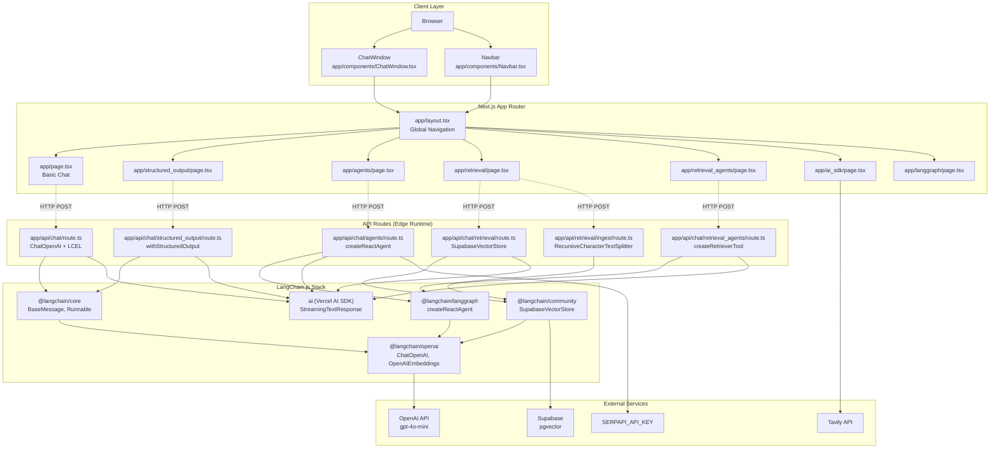
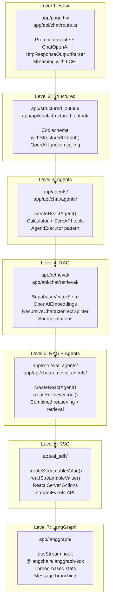
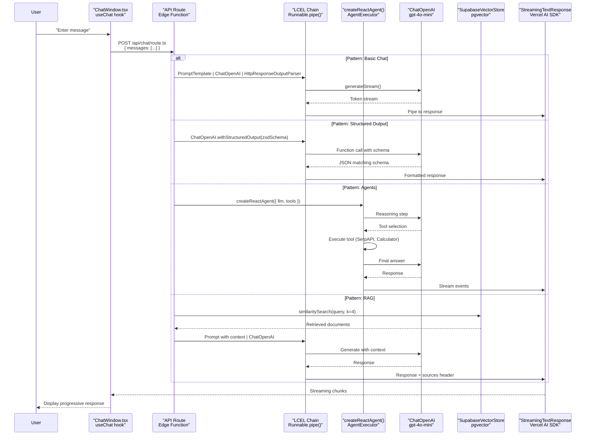
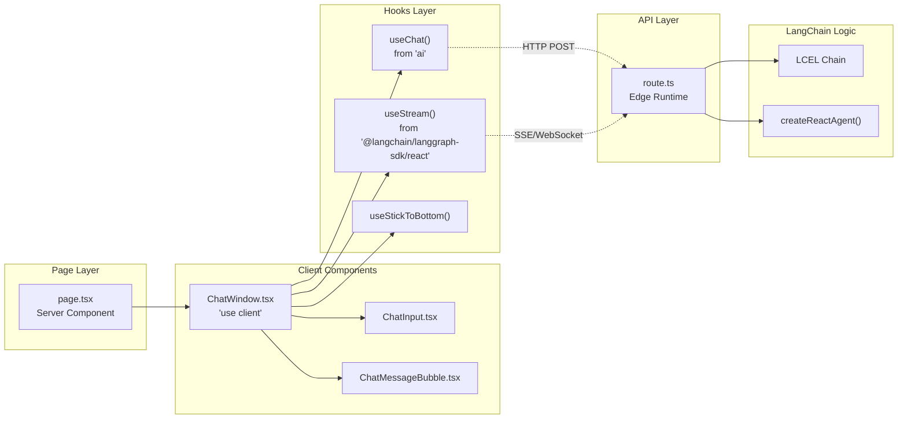

<!-- source: DeepWiki mcp.deepwiki.com · repo langchain-ai/langchain-nextjs-template · page 1 Overview · fetched 2026-10-26 -->

# Overview

Relevant source files

The following files were used as context for generating this wiki page:

- [README.md](README.md)
- [package.json](package.json)

The LangChain Next.js Template is a demonstration and starter project that integrates LangChain.js with Next.js to build AI-powered applications. This template showcases seven progressively complex example patterns, from basic LLM chat to sophisticated graph-based agent orchestration.

## Purpose and Scope

This template serves as both a learning resource and a starter codebase for developers building AI applications with LangChain.js and Next.js. It demonstrates implementation patterns across seven examples:

1. **Basic Chat** ([/app/page.tsx]()) - Simple LLM prompting with streaming responses
2. **Structured Output** ([/app/structured_output/page.tsx]()) - Schema-enforced JSON responses using Zod
3. **Agents** ([/app/agents/page.tsx]()) - ReAct agents with tool calling (SERP API, Calculator)
4. **Retrieval (RAG)** ([/app/retrieval/page.tsx]()) - Document retrieval with vector similarity search
5. **Retrieval Agents** ([/app/retrieval_agents/page.tsx]()) - Agents with retrieval tool access
6. **AI SDK & React Server Components** ([/app/ai_sdk/page.tsx]()) - Streaming with React Server Actions
7. **LangGraph** ([/app/langgraph/page.tsx]()) - Stateful graph-based agent workflows

Each example has a corresponding API route in [/app/api/chat/]() implementing the backend logic. The template is optimized for deployment on Vercel Edge Functions with a bundle size under 40 KB.

For detailed setup instructions, see [Getting Started](#2).

Sources:
- [README.md:1-24]()
- [package.json:1-15]()
- [README.md:9-17]()

## High-Level System Architecture

The template follows a three-tier architecture: a React/Next.js frontend, API routes implementing LangChain patterns, and external service integrations.

### Application Layer Architecture

This architecture demonstrates the **separation of concerns**:
- **Client Layer**: React components ([ChatWindow](), [Navbar]()) manage UI state
- **App Router**: Seven page routes demonstrate progressive complexity
- **API Layer**: Six Edge Function routes implement LangChain patterns
- **LangChain Stack**: Modular packages for core abstractions, model integrations, and agent execution
- **External Services**: OpenAI for LLMs/embeddings, Supabase for vector storage, SERP/Tavily for search tools

Sources:
- [package.json:16-48]()
- [README.md:9-17]()

## Seven Example Patterns

The template showcases seven progressively complex AI patterns, each demonstrating specific LangChain.js capabilities:

### Pattern Complexity Progression

### Pattern-to-Technology Mapping

| Pattern | Page Route | API Route | Key Technologies |
|---------|-----------|-----------|------------------|
| **Basic Chat** | [/app/page.tsx]() | [/app/api/chat/route.ts]() | `ChatOpenAI`, `PromptTemplate`, `HttpResponseOutputParser` |
| **Structured Output** | [/app/structured_output/page.tsx]() | [/app/api/chat/structured_output/route.ts]() | `withStructuredOutput()`, Zod schemas, OpenAI function calling |
| **Agents** | [/app/agents/page.tsx]() | [/app/api/chat/agents/route.ts]() | `createReactAgent()`, `SerpAPI`, `Calculator`, LangGraph |
| **Retrieval (RAG)** | [/app/retrieval/page.tsx]() | [/app/api/chat/retrieval/route.ts]() | `SupabaseVectorStore`, `OpenAIEmbeddings`, `RecursiveCharacterTextSplitter` |
| **Retrieval Agents** | [/app/retrieval_agents/page.tsx]() | [/app/api/chat/retrieval_agents/route.ts]() | `createReactAgent()`, `createRetrieverTool()` |
| **AI SDK (RSC)** | [/app/ai_sdk/page.tsx]() | Server Actions in page | `createStreamableValue()`, `readStreamableValue()`, `streamEvents()` |
| **LangGraph** | [/app/langgraph/page.tsx]() | LangGraph Cloud API | `useStream()` from `@langchain/langgraph-sdk/react`, thread state |

Sources:
- [README.md:9-17]()
- [package.json:16-48]()

### Data Flow: User Query to Streaming Response

Sources:
- [README.md:15-95]()
- [package.json:16-48]()

## Technology Stack

The template is built on a modern, edge-optimized stack with strong typing and component reusability:

| Category | Package / Technology | Version | Purpose |
|----------|---------------------|---------|---------|
| **Frontend Framework** | `next` | ^15.4.8 | App Router, Server Components, Edge Runtime |
| | `react` | ^18.3.1 | UI component library |
| | `react-dom` | ^18.3.1 | DOM rendering |
| **AI Core** | `@langchain/core` | ^0.3.43 | Base abstractions: `Runnable`, `BaseMessage`, LCEL |
| | `@langchain/openai` | ^0.4.9 | `ChatOpenAI`, `OpenAIEmbeddings` |
| | `@langchain/community` | ^0.3.37 | `SupabaseVectorStore`, tools, integrations |
| | `@langchain/langgraph` | ^0.2.57 | `createReactAgent()`, agent graphs |
| | `@langchain/langgraph-sdk` | ^0.0.60 | `useStream()` hook for graph UI |
| | `langchain` | ^0.3.19 | High-level chains and utilities |
| **Streaming** | `ai` (Vercel AI SDK) | ^3.1.12 | `StreamingTextResponse`, `useChat()`, Server Actions |
| **Validation** | `zod` | ^3.23.8 | Schema validation for structured outputs |
| | `zod-to-json-schema` | ^3.23.2 | Convert Zod to OpenAI function schemas |
| **Vector Store** | `@supabase/supabase-js` | ^2.32.0 | Supabase client for pgvector |
| **UI Components** | `@radix-ui/*` | ^1.x | Headless UI primitives (Dialog, Popover, Checkbox, Slot) |
| | `tailwindcss` | 3.3.3 | Utility-first CSS |
| | `lucide-react` | ^0.473.0 | Icon library |
| | `sonner` | ^1.7.2 | Toast notifications |
| **State Management** | `nuqs` | ^2.3.2 | Type-safe URL state management |
| | `use-stick-to-bottom` | ^1.0.44 | Auto-scroll chat to bottom |
| **Build Tools** | `typescript` | 5.1.6 | Type safety |
| | `eslint` | 8.46.0 | Code linting |
| | `prettier` | ^3.4.2 | Code formatting |
| | `@next/bundle-analyzer` | ^13.4.19 | Bundle size analysis |

Sources:
- [package.json:16-58]()

## Implementation Architecture

Each example follows a consistent implementation pattern:

### Component Architecture

### File Organization

Each example consists of:
- **Page**: [/app/{example}/page.tsx]() - Server Component that renders `ChatWindow`
- **API Route**: [/app/api/chat/{example}/route.ts]() - Edge Function with LangChain logic
- **Shared Components**: [/app/components/ChatWindow.tsx](), [/app/components/ChatMessageBubble.tsx]()
- **Utilities**: [/app/utils/convertVercelMessageToLangChainMessage.ts]() for message format conversion

Sources:
- [README.md:46-48]()

## Key Characteristics

### Edge Function Optimization

The template is optimized for Vercel Edge Functions with strict bundle size constraints:

- **Bundle Size**: LangChain.js core is only **37.32 KB** after compression ([README.md:99]())
- **Edge Runtime**: All API routes configured with `export const runtime = 'edge'`
- **1 MB Limit**: Total Edge Function size must stay under 1 MB
- **Bundle Analysis**: Use `ANALYZE=true yarn build` to inspect bundle composition ([README.md:106]())

### Deployment Requirements

| Environment Variable | Required For | Purpose |
|---------------------|--------------|---------|
| `OPENAI_API_KEY` | All examples | OpenAI API authentication |
| `LANGCHAIN_CALLBACKS_BACKGROUND` | Production (set to `false`) | Ensure LangSmith tracing completes in Edge runtime |
| `SUPABASE_URL` | RAG examples | Supabase vector store connection |
| `SUPABASE_PRIVATE_KEY` | RAG examples | Supabase authentication |
| `SERPAPI_API_KEY` | Agent examples | Web search tool access |

### Pedagogical Design

The template follows a **progressive complexity** approach:

1. Start with [/app/page.tsx]() to understand basic LLM streaming
2. Add schema validation with [/app/structured_output/]()
3. Introduce autonomous reasoning with [/app/agents/]()
4. Add knowledge retrieval with [/app/retrieval/]()
5. Combine patterns in [/app/retrieval_agents/]()
6. Learn advanced streaming with [/app/ai_sdk/]()
7. Master stateful orchestration with [/app/langgraph/]()

Each level builds on previous concepts, making the template an effective learning resource for LangChain.js patterns.

Sources:
- [README.md:21-23]()
- [README.md:98-107]()
- [README.md:32]()

## Getting Started

To start using this template, see the [Getting Started](#2) guide for instructions on setting up the project, configuring environment variables, and running the application.

Sources:
- [README.md:25-49]()

---

