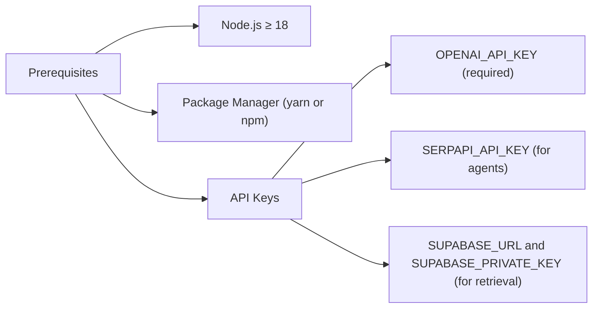
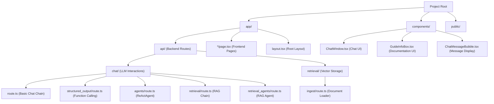
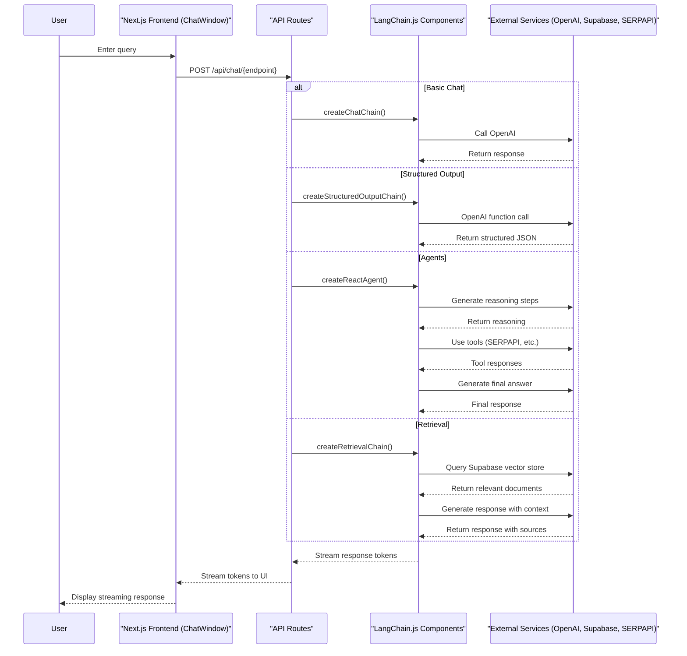

<!-- source: DeepWiki mcp.deepwiki.com · repo langchain-ai/langchain-nextjs-template · page 2 Getting Started · fetched 2026-10-26 -->

# Getting Started

<details>
<summary>Relevant source files</summary>

The following files were used as context for generating this wiki page:

- [README.md](README.md)
- [package.json](package.json)
- [yarn.lock](yarn.lock)

</details>


This document provides instructions on how to set up, configure, and run the LangChain NextJS Template. For information about system architecture, see [System Architecture](#3), and for details on specific features, see the [Features](#4) section.

## Prerequisites

Before beginning, ensure you have:



Sources: [package.json:13-16](), [README.md:29-32]()

## Installation

### Clone the Repository

```bash
git clone https://github.com/langchain-ai/langchain-nextjs-template.git
cd langchain-nextjs-template
```

### Set Up Environment Variables

Create a `.env.local` file in the root directory:

```bash
cp .env.example .env.local
```

At minimum, add your OpenAI API key:

```
OPENAI_API_KEY=your_api_key_here
LANGCHAIN_CALLBACKS_BACKGROUND=false  # For tracing to complete in serverless edge functions
```

### Install Dependencies

```bash
# Using yarn
yarn

# Using npm
npm install
```

Sources: [package.json:5-11](), [README.md:25-34]()

## Running the Application

### Development Server

```bash
# Using yarn
yarn dev

# Using npm
npm run dev
```

Access the application at [http://localhost:3000](http://localhost:3000)

### Production Build

```bash
# Using yarn
yarn build
yarn start

# Using npm
npm run build
npm start
```

Sources: [package.json:6-10]()

## Project Structure Overview

The template is organized according to the Next.js App Router pattern:



Sources: [app/layout.tsx:33-112](), [README.md:8-14]()

## Data Flow and Components

This diagram shows how user requests flow through the system:



Sources: [README.md:9-14]()

## Core Dependencies

The template relies on several key packages:

| Dependency | Version | Purpose |
|------------|---------|---------|
| @langchain/community | ^0.3.37 | Community-contributed LangChain components |
| @langchain/core | ^0.3.43 | Core LangChain functionality |
| @langchain/langgraph | ^0.2.57 | Framework for building agentic workflows |
| @langchain/openai | ^0.4.9 | OpenAI integration for LangChain |
| @supabase/supabase-js | ^2.32.0 | Vector storage for retrieval examples |
| langchain | ^0.3.19 | Main LangChain library |
| next | ^15.2.4 | Next.js framework |
| ai | ^3.1.12 | Vercel AI SDK for streaming responses |
| react | ^18.3.1 | React framework |
| zod | ^3.23.8 | Schema validation and type generation |

Sources: [package.json:16-47]()

## Feature Examples

The template includes multiple examples demonstrating LangChain capabilities:

| Feature | URL Path | API Route | Description |
|---------|----------|-----------|-------------|
| Basic Chat | / | /api/chat/route.ts | Simple conversation with streaming |
| Structured Output | /structured_output | /api/chat/structured_output/route.ts | Generates structured data using function calling |
| Agents | /agents | /api/chat/agents/route.ts | ReAct agents with web search and calculator tools |
| Retrieval | /retrieval | /api/chat/retrieval/route.ts | RAG with Supabase vector store |
| Retrieval Agents | /retrieval_agents | /api/chat/retrieval_agents/route.ts | Combines agents with document retrieval |
| React Server Components | /ai_sdk | Direct server component integration | Server-side streaming without API routes |
| LangGraph | /langgraph | Custom LangGraph implementation | Complex multi-step agent workflows |

Sources: [app/layout.tsx:74-87](), [README.md:9-17]()

## Environment Configuration

Required environment variables for various features:

```bash
# Required for all examples
OPENAI_API_KEY=sk-...

# For tracing in serverless environments
LANGCHAIN_CALLBACKS_BACKGROUND=false

# For agent examples
SERPAPI_API_KEY=serpapi_...

# For retrieval examples
SUPABASE_URL=https://...
SUPABASE_PRIVATE_KEY=eyJ...

# Optional for tracing and debugging
LANGCHAIN_TRACING_V2=true
LANGCHAIN_API_KEY=ls__...
```

Sources: [README.md:29-32](), [README.md:64-86]()

## Next Steps

Once the application is running, you can:

1. Explore the different examples through the navigation bar
2. Examine the code in each API route to understand implementation details
3. Modify the chains, agents, or retrievers to suit your specific use case
4. Deploy to Vercel or another platform that supports Next.js

For deployment instructions, see [README.md:120-124]().

For more detailed information on specific features, refer to the [Features Overview](#4) section.

---

