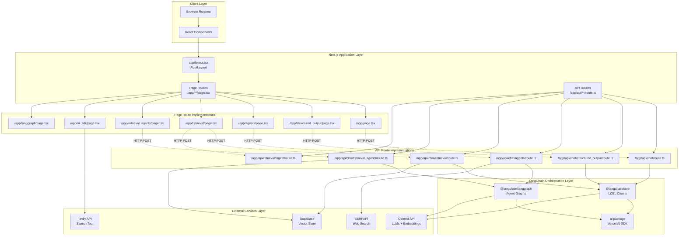
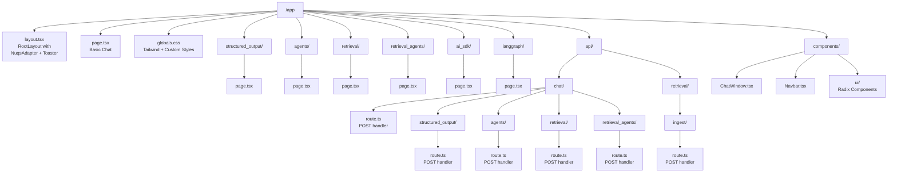
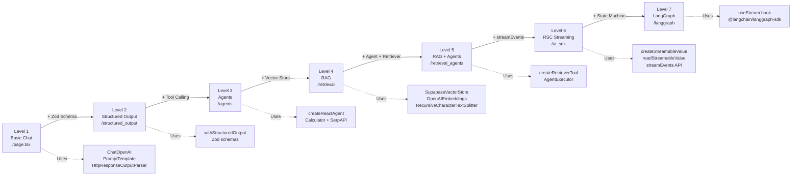
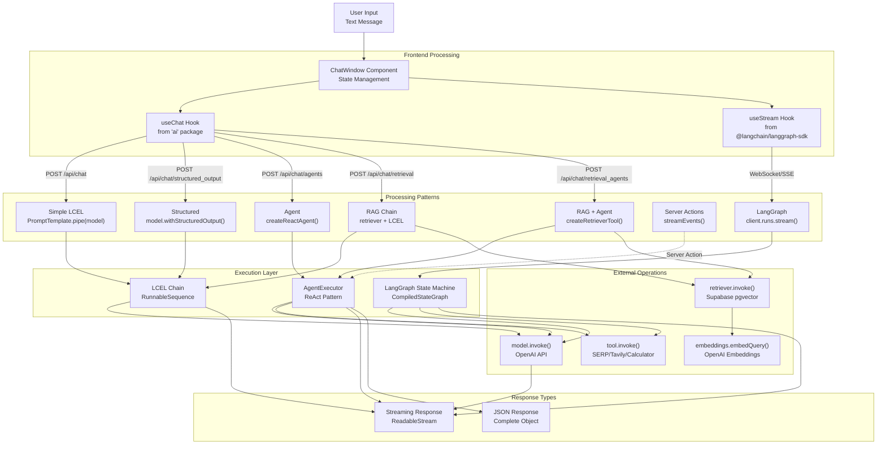
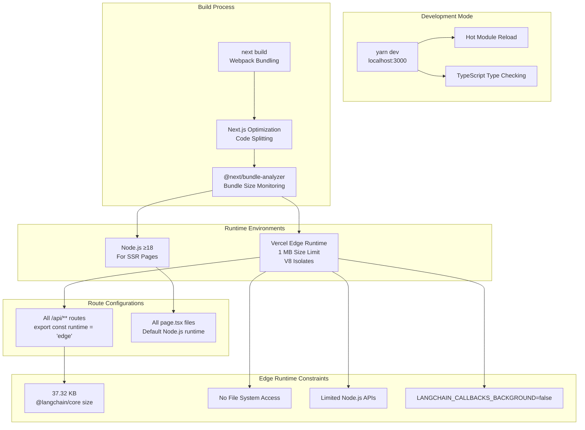
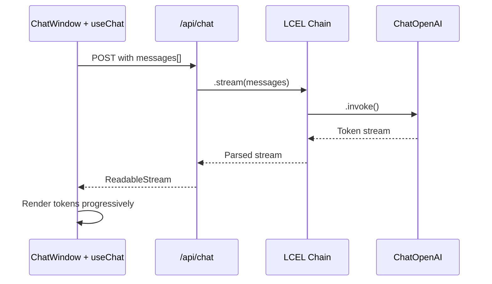
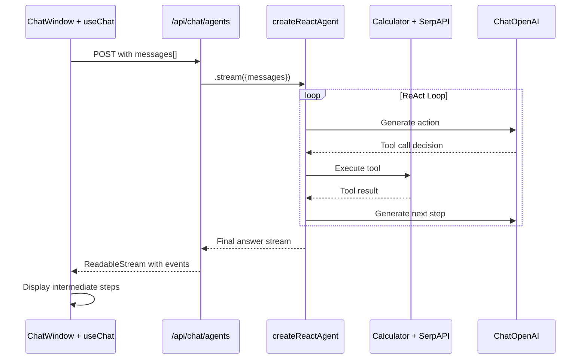
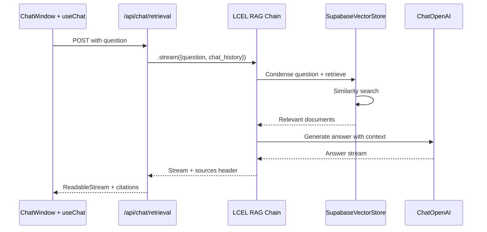
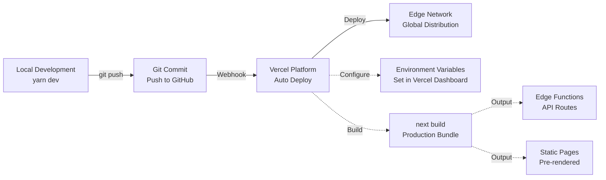

<!-- source: DeepWiki mcp.deepwiki.com · repo langchain-ai/langchain-nextjs-template · page 3 System Architecture · fetched 2026-10-26 -->

# System Architecture

<details>
<summary>Relevant source files</summary>

The following files were used as context for generating this wiki page:

- [README.md](README.md)
- [app/layout.tsx](app/layout.tsx)
- [package.json](package.json)

</details>


## Purpose and Scope

This document provides a comprehensive overview of the application's architectural design, including its multi-layered structure, component organization, and data flow patterns. The architecture is designed around the Next.js App Router and demonstrates seven progressively complex AI patterns using LangChain.js.

For specific details on individual subsystems, see:
- [Project Structure & Dependencies](#3.1) for the technology stack and build system
- [Frontend Architecture](#3.2) for client-side components and state management
- [API Routes Architecture](#3.3) for backend endpoints and streaming patterns
- [External Service Integration](#3.4) for third-party service configuration
- [Features & Examples](#5) for detailed implementation of each AI pattern

**Sources:** [README.md:1-130](), [app/layout.tsx:1-113](), [package.json:1-60]()

---

## Architectural Layers

The application follows a six-layer architecture that separates concerns from user interface to external services. Each layer has distinct responsibilities and interacts with adjacent layers through well-defined interfaces.

### Layer Overview Diagram



### Layer Responsibilities

| Layer | Primary Responsibility | Key Technologies | Implementation Files |
|-------|----------------------|------------------|---------------------|
| **Client** | User interface rendering and interaction | React 18+, Radix UI, Tailwind CSS | `app/components/**` |
| **Next.js Application** | Routing, layout, and request handling | Next.js 14+ App Router | `app/layout.tsx`, `app/**/page.tsx` |
| **Page Routes** | Frontend page components with chat UIs | React Server Components | Seven page.tsx files |
| **API Routes** | Backend logic and LangChain orchestration | Edge Runtime, streaming responses | Six route.ts files in `app/api/**` |
| **Orchestration** | LLM chain composition and agent execution | LangChain.js, LangGraph, Vercel AI SDK | Imported in API routes |
| **External Services** | LLM inference, vector storage, tool execution | OpenAI, Supabase, SERP, Tavily | Configured via env vars |

**Sources:** [README.md:6-17](), [package.json:16-48](), [app/layout.tsx:33-112]()

---

## Next.js App Router Structure

The application uses Next.js 14+'s App Router with file-system based routing. The structure is organized to demonstrate increasing complexity across examples.

### Routing Structure Diagram



### Route-to-API Mapping

The application follows a consistent pattern where each page route communicates with a corresponding API route:

| Page Route | API Route | Pattern Demonstrated |
|-----------|-----------|---------------------|
| `/` | `/api/chat` | Basic streaming chat with `PromptTemplate` + `ChatOpenAI` |
| `/structured_output` | `/api/chat/structured_output` | Zod schema validation with `withStructuredOutput()` |
| `/agents` | `/api/chat/agents` | ReAct agent with `createReactAgent()` |
| `/retrieval` | `/api/chat/retrieval` | RAG chain with `SupabaseVectorStore` |
| `/retrieval_agents` | `/api/chat/retrieval_agents` | Combined agent + retrieval with `createRetrieverTool()` |
| `/ai_sdk` | Server Actions | React Server Components with `createStreamableValue()` |
| `/langgraph` | LangGraph API | Stateful graph execution with `useStream()` hook |

**Sources:** [app/layout.tsx:33-112](), [README.md:9-13]()

---

## Pedagogical Architecture

The template is designed as a learning resource with seven examples that demonstrate progressively complex AI patterns. Each example builds upon concepts introduced in previous ones.

### Complexity Progression



### Conceptual Layering

Each level introduces new architectural concepts:

| Level | Concept Introduced | Key Abstraction | API Implementation |
|-------|-------------------|-----------------|-------------------|
| 1 | **LLM Streaming** | LCEL chain composition | `ChatOpenAI.pipe(HttpResponseOutputParser)` |
| 2 | **Type Safety** | Schema-enforced outputs | `.withStructuredOutput(zodSchema)` |
| 3 | **Autonomous Actions** | Tool selection and execution | `createReactAgent(model, tools)` |
| 4 | **Context Injection** | Vector similarity search | `SupabaseVectorStore.asRetriever()` |
| 5 | **Multi-Modal Reasoning** | Agent with retrieval tool | `createRetrieverTool(retriever, metadata)` |
| 6 | **Transparency** | Stream intermediate events | `streamEvents()` with event filtering |
| 7 | **State Management** | Graph-based workflows | `client.runs.stream()` with checkpoints |

**Sources:** [README.md:6-17](), [README.md:50-95]()

---

## Data Flow Architecture

The application implements multiple data flow patterns depending on the complexity of the interaction. All patterns share common elements but differ in their orchestration logic.

### Request Flow Diagram



### Hook and API Integration

The frontend uses two primary hooks for API communication:

**`useChat` Hook** (from Vercel AI SDK):
- Used by: `/`, `/structured_output`, `/agents`, `/retrieval`, `/retrieval_agents`
- Communication: HTTP POST with streaming response
- Response format: `ReadableStream` parsed by `HttpResponseOutputParser`
- State management: Automatic message state handling

**`useStream` Hook** (from `@langchain/langgraph-sdk`):
- Used by: `/langgraph`
- Communication: Server-Sent Events (SSE) or WebSocket
- Response format: Streamed graph events with state updates
- State management: Thread-based with checkpoint persistence

**Sources:** [README.md:15-16]()

---

## Runtime Architecture

The application is optimized for deployment on Vercel Edge Functions with specific runtime configurations and bundle size constraints.

### Runtime Configuration



### Edge Function Optimization

All API routes are configured for Edge Runtime deployment:

```typescript
// Pattern used in all /app/api/**/route.ts files
export const runtime = "edge";
```

**Edge Runtime Benefits:**
- **Low Latency**: Functions execute close to users globally
- **Fast Cold Starts**: V8 isolates start in <1ms
- **Automatic Scaling**: No server management required

**Edge Runtime Constraints:**
| Constraint | Impact | Mitigation |
|-----------|--------|------------|
| 1 MB bundle size limit | Must minimize dependencies | LangChain.js uses only 37.32 KB |
| No Node.js file system | Cannot read/write local files | Use external vector stores like Supabase |
| Limited Node.js APIs | Some packages incompatible | Use edge-compatible packages |
| Background tasks restricted | Callbacks must complete in request | Set `LANGCHAIN_CALLBACKS_BACKGROUND=false` |

### Build Configuration

The project uses `yarn@3.5.1` with deterministic dependency resolution:

```bash
# Development
yarn dev          # Start Next.js dev server on port 3000

# Production build
yarn build        # Compile TypeScript and bundle with Webpack

# Bundle analysis
ANALYZE=true yarn build  # Generate interactive bundle size report
```

**Sources:** [package.json:1-60](), [README.md:97-107](), [README.md:32-33]()

---

## Component Interaction Patterns

The application uses several interaction patterns to coordinate between layers.

### Pattern 1: Basic Streaming Chain

Used in `/api/chat/route.ts`:



### Pattern 2: Agent with Tools

Used in `/api/chat/agents/route.ts`:



### Pattern 3: RAG with Vector Retrieval

Used in `/api/chat/retrieval/route.ts`:



**Sources:** [README.md:111-114]()

---

## Global Layout and Navigation

The `RootLayout` component provides the application shell that wraps all pages.

### Layout Structure

The [app/layout.tsx:33-112]() file implements:

1. **Global Providers**:
   - `NuqsAdapter`: URL state management wrapper
   - `Toaster`: Toast notification system from Sonner

2. **Navigation Bar**:
   - Seven `ActiveLink` components for each example
   - GitHub repository link button
   - LangChain.js logo with external link

3. **Layout Grid**:
   - Two-row grid: `grid-rows-[auto,1fr]`
   - Header row with navigation
   - Content row with rounded container for pages

### Active Link Pattern

Navigation uses the `ActiveLink` component from [app/components/Navbar.tsx]():

```typescript
// Links in layout.tsx:75-87
<ActiveLink href="/">🏴‍☠️ Chat</ActiveLink>
<ActiveLink href="/structured_output">🧱 Structured Output</ActiveLink>
<ActiveLink href="/agents">🦜 Agents</ActiveLink>
<ActiveLink href="/retrieval">🐶 Retrieval</ActiveLink>
<ActiveLink href="/retrieval_agents">🤖 Retrieval Agents</ActiveLink>
<ActiveLink href="/ai_sdk">🌊 React Server Components</ActiveLink>
<ActiveLink href="/langgraph">🕸️ LangGraph</ActiveLink>
```

Each link includes an emoji for visual identification and highlights the active route.

**Sources:** [app/layout.tsx:33-112]()

---

## Environment Configuration

The application requires environment variables for external service authentication. Configuration is managed through `.env.local`:

| Variable | Required By | Purpose |
|----------|------------|---------|
| `OPENAI_API_KEY` | All examples | OpenAI LLM and embeddings API access |
| `SUPABASE_URL` | `/retrieval`, `/retrieval_agents` | Supabase database endpoint |
| `SUPABASE_PRIVATE_KEY` | `/retrieval`, `/retrieval_agents` | Supabase service role key |
| `SERPAPI_API_KEY` | `/agents` | SERP API web search tool |
| `LANGCHAIN_CALLBACKS_BACKGROUND` | All API routes | Must be `false` for Edge Runtime tracing |

### Minimal Configuration

To run the basic examples, only `OPENAI_API_KEY` is required:

```bash
# .env.local
OPENAI_API_KEY=sk-...
LANGCHAIN_CALLBACKS_BACKGROUND=false
```

Full retrieval and agent examples require additional keys.

**Sources:** [README.md:29-33](), [README.md:64-66](), [README.md:79-81]()

---

## Deployment Architecture

The application is optimized for deployment on Vercel with automatic CI/CD from GitHub.

### Deployment Flow



### Production Considerations

**Bundle Size**: The template tracks bundle size using `@next/bundle-analyzer`. Run `ANALYZE=true yarn build` to generate an interactive report showing that `@langchain/core` contributes only 37.32 KB to the bundle.

**Environment Variables**: Configure all required environment variables in the Vercel dashboard under Project Settings → Environment Variables. These are encrypted at rest and available to Edge Functions at runtime.

**Edge Function Limits**: Each Edge Function has a 1 MB bundle size limit and 30-second execution timeout. The template is designed to operate well within these constraints.

**Sources:** [package.json:50](), [README.md:97-107](), [README.md:120-124]()

---

## Summary

The system architecture demonstrates a modern, edge-optimized Next.js application built around the App Router with seven progressively complex AI patterns. Key architectural characteristics include:

1. **Layer Separation**: Clean separation between client, routing, API, orchestration, and external service layers
2. **Edge-First Design**: All API routes run on Vercel Edge Runtime with <1ms cold starts
3. **Pedagogical Structure**: Seven examples progressing from basic chat to stateful graph execution
4. **Streaming-Native**: All patterns support token streaming for responsive UIs
5. **Type Safety**: TypeScript throughout with Zod schema validation for structured outputs
6. **Modular Orchestration**: LangChain.js LCEL chains and LangGraph for composable AI workflows

The architecture serves as both a production-ready starter template and an educational resource for learning LangChain.js patterns in Next.js applications.

**Sources:** [README.md:1-130](), [package.json:1-60](), [app/layout.tsx:1-113]()

---

