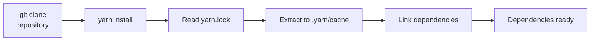
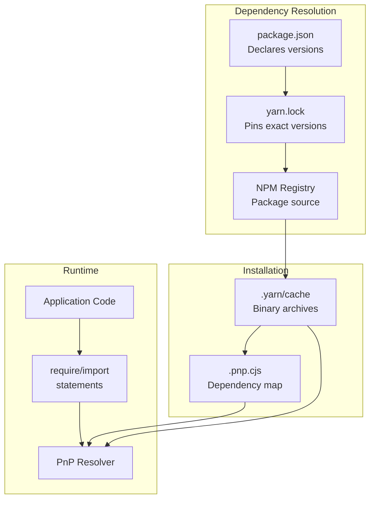

<!-- source: DeepWiki mcp.deepwiki.com · repo langchain-ai/langchain-nextjs-template · page 3.1 Project Structure & Dependencies · fetched 2026-10-26 -->

# Project Structure & Dependencies

<details>
<summary>Relevant source files</summary>

The following files were used as context for generating this wiki page:

- [package.json](package.json)
- [yarn.lock](yarn.lock)

</details>


## Purpose and Scope

This document details the technical foundation of the LangChain + Next.js template, including the complete dependency stack, build system configuration, and deployment constraints. It covers package management with Yarn, TypeScript configuration, the LangChain.js ecosystem integration, UI library composition, and bundle size optimization for Vercel Edge Functions.

For information about the frontend component architecture, see [Frontend Architecture](#3.2). For API route implementation patterns, see [API Routes Architecture](#3.3).

**Sources:** [package.json:1-59]()

---

## Dependency Architecture

The project organizes dependencies into six functional groups: AI/LLM frameworks, Next.js/React ecosystem, UI components, data validation, development tooling, and deployment optimization.

### Dependency Layer Diagram

```mermaid
graph TB
    subgraph Foundation["Foundation Layer"]
        next["next<br/>v15.4.8"]
        react["react<br/>v18.3.1"]
        typescript["typescript<br/>v5.1.6"]
        nodejs["Node.js<br/>≥18"]
    end
    
    subgraph AIFrameworks["AI/LLM Layer"]
        lccore["@langchain/core<br/>v0.3.43"]
        lcopenai["@langchain/openai<br/>v0.4.9"]
        lccommunity["@langchain/community<br/>v0.3.37"]
        lclanggraph["@langchain/langgraph<br/>v0.2.57"]
        lcsdk["@langchain/langgraph-sdk<br/>v0.0.60"]
        langchain["langchain<br/>v0.3.19"]
        ai["ai<br/>v3.1.12"]
    end
    
    subgraph DataLayer["Data & Validation Layer"]
        zod["zod<br/>v3.23.8"]
        zodschema["zod-to-json-schema<br/>v3.23.2"]
        supabase["@supabase/supabase-js<br/>v2.32.0"]
    end
    
    subgraph UILayer["UI Component Layer"]
        radixcheckbox["@radix-ui/react-checkbox"]
        radixdialog["@radix-ui/react-dialog"]
        radixpopover["@radix-ui/react-popover"]
        radixslot["@radix-ui/react-slot"]
        lucide["lucide-react<br/>v0.473.0"]
        sonner["sonner<br/>v1.7.2"]
        vaul["vaul<br/>v1.1.2"]
        nextthemes["next-themes<br/>v0.4.4"]
    end
    
    subgraph StateUtilities["State & Utilities Layer"]
        nuqs["nuqs<br/>v2.3.2"]
        stick["use-stick-to-bottom<br/>v1.0.44"]
        clsx["clsx<br/>v2.1.1"]
        cva["class-variance-authority<br/>v0.7.1"]
        tailwindmerge["tailwind-merge<br/>v2.6.0"]
    end
    
    subgraph DevTools["Development Tooling"]
        eslint["eslint<br/>v8.46.0"]
        prettier["prettier<br/>v3.4.2"]
        bundleanalyzer["@next/bundle-analyzer<br/>v13.4.19"]
        tailwindcss["tailwindcss<br/>v3.3.3"]
    end
    
    nodejs --> next
    nodejs --> typescript
    next --> react
    
    lccore --> lcopenai
    lccore --> lccommunity
    lccore --> lclanggraph
    lclanggraph --> lcsdk
    langchain --> lccore
    ai --> react
    
    zod --> zodschema
    zod --> lccore
    supabase --> lccommunity
    
    react --> radixcheckbox
    react --> radixdialog
    react --> radixpopover
    react --> radixslot
    react --> lucide
    react --> sonner
    react --> vaul
    next --> nextthemes
    
    next --> nuqs
    react --> stick
    tailwindcss --> clsx
    tailwindcss --> cva
    tailwindcss --> tailwindmerge
    
    next --> eslint
    next --> prettier
    next --> bundleanalyzer
    next --> tailwindcss
```



**Sources:** [package.json:16-58]()

---

## Core Dependency Groups

### LangChain.js Ecosystem

The template uses five separate LangChain packages, each serving a distinct role in the AI application stack:

| Package | Version | Purpose | Key Exports |
|---------|---------|---------|-------------|
| `@langchain/core` | 0.3.43 | Base abstractions and interfaces | `Runnable`, `BaseMessage`, `PromptTemplate`, `OutputParser` |
| `@langchain/openai` | 0.4.9 | OpenAI model integration | `ChatOpenAI`, `OpenAIEmbeddings` |
| `@langchain/community` | 0.3.37 | Community integrations and tools | `SupabaseVectorStore`, `Calculator`, `SerpAPI` |
| `@langchain/langgraph` | 0.2.57 | Graph-based agent orchestration | `createReactAgent`, `StateGraph`, `MemorySaver` |
| `@langchain/langgraph-sdk` | 0.0.60 | LangGraph client SDK | `useStream` hook for React |
| `langchain` | 0.3.19 | Meta-package (convenience imports) | Re-exports from core packages |

The `@langchain/core` package provides the foundational `Runnable` interface that all chains and agents implement. Specific integrations like `@langchain/openai` extend these base classes. The `langchain` meta-package is included for backward compatibility but the template primarily uses direct imports from scoped packages.

**Sources:** [package.json:17-21,33]()

### Next.js and React Ecosystem

| Package | Version | Purpose |
|---------|---------|---------|
| `next` | 15.4.8 | App Router framework, Edge Functions, API routes |
| `react` | 18.3.1 | UI library with Server Components support |
| `react-dom` | 18.3.1 | React rendering for web |
| `@types/react` | 18.3.2 | TypeScript definitions for React |
| `@types/react-dom` | 18.3.0 | TypeScript definitions for ReactDOM |

The project requires Node.js version 18 or higher ([package.json:13-15]()) and uses Next.js 15's App Router architecture with React 18's Server Components.

**Sources:** [package.json:13-15,27-29,35,38-39]()

### UI Component Libraries

The UI layer combines Radix UI primitives with Tailwind CSS for styling:

**Radix UI Primitives** (headless, accessible components):
- `@radix-ui/react-checkbox` - Checkbox input component
- `@radix-ui/react-dialog` - Modal dialog primitives  
- `@radix-ui/react-popover` - Popover overlay primitives
- `@radix-ui/react-slot` - Component composition utility

**Styling and Icons**:
- `tailwindcss` (3.3.3) - Utility-first CSS framework
- `tailwind-merge` (2.6.0) - Utility for merging Tailwind classes
- `tailwindcss-animate` (1.0.7) - Animation utilities
- `lucide-react` (0.473.0) - Icon library
- `next-themes` (0.4.4) - Dark mode theme management

**Notification and Layout**:
- `sonner` (1.7.2) - Toast notification system
- `vaul` (1.1.2) - Drawer component
- `class-variance-authority` (0.7.1) - Component variant styling
- `clsx` (2.1.1) - Class name composition utility

**Sources:** [package.json:22-26,31-32,34,36,40-46,51-56]()

### Data Validation and External Services

| Package | Version | Purpose |
|---------|---------|---------|
| `zod` | 3.23.8 | Runtime schema validation and TypeScript type inference |
| `zod-to-json-schema` | 3.23.2 | Convert Zod schemas to JSON Schema format for OpenAI function calling |
| `@supabase/supabase-js` | 2.32.0 | Supabase client for vector store operations |
| `ai` | 3.1.12 | Vercel AI SDK for streaming and Server Actions |

The `zod` library serves dual purposes: runtime validation of structured outputs and compile-time TypeScript type generation. The `ai` package from Vercel provides React hooks (`useChat`) and Server Action utilities (`createStreamableValue`, `readStreamableValue`).

**Sources:** [package.json:26,30,46-47]()

### State Management Utilities

| Package | Version | Purpose |
|---------|---------|---------|
| `nuqs` | 2.3.2 | Type-safe URL query parameter state management |
| `use-stick-to-bottom` | 1.0.44 | Auto-scroll hook for chat interfaces |

The `nuqs` library manages URL-based state, particularly for thread IDs in the LangGraph example ([see LangGraph Integration](#5.7)). The `use-stick-to-bottom` hook keeps chat windows scrolled to the latest message during streaming.

**Sources:** [package.json:37,44]()

---

## Build System Configuration

### Package Manager: Yarn 3.5.1

The project uses Yarn version 3.5.1 with Plug'n'Play (PnP) enabled, specified in [package.json:5]():

```json
"packageManager": "yarn@3.5.1"
```

Yarn 3.x provides:
- **Deterministic dependency resolution** via `yarn.lock` committed to the repository
- **Faster installs** through Plug'n'Play (no `node_modules` extraction)
- **Strict version control** - all developers and CI use identical package versions

The `yarn.lock` file ensures that `yarn install` produces identical dependency trees across environments, critical for reproducible builds and consistent Edge Function bundles.

**Sources:** [package.json:5]()

### TypeScript Configuration

TypeScript 5.1.6 provides static type checking across the entire codebase. The compiler enforces strict type safety for:
- LangChain chain and agent types
- React component props
- API route request/response types
- Zod schema inference

Type definitions are provided for Node.js ([package.json:27]()) and React ([package.json:28-29]()).

**Sources:** [package.json:27-29,57]()

### Code Quality Tools

| Tool | Version | Purpose | Script |
|------|---------|---------|--------|
| `eslint` | 8.46.0 | JavaScript/TypeScript linting | `yarn lint` |
| `eslint-config-next` | 13.4.12 | Next.js-specific ESLint rules | (extends base config) |
| `prettier` | 3.4.2 | Code formatting | `yarn format` |

The ESLint configuration includes Next.js-specific rules for proper App Router usage, Server Component validation, and Edge runtime compatibility. Prettier enforces consistent code style across the `app/` directory ([package.json:11]()).

**Sources:** [package.json:10-11,49,52-53,55]()

### Available Scripts

```bash
yarn dev      # Start development server (localhost:3000)
yarn build    # Production build with TypeScript checking
yarn start    # Serve production build
yarn lint     # Run ESLint on codebase
yarn format   # Format code with Prettier
```

**Sources:** [package.json:6-11]()

---

## Bundle Size Optimization

### Edge Function Constraints

All API routes in this template target the Vercel Edge Runtime, which imposes a **1 MB compressed bundle size limit** per function. This constraint drives several architectural decisions:

1. **Scoped LangChain imports** - Import from `@langchain/core`, `@langchain/openai` rather than the `langchain` meta-package to tree-shake unused code
2. **Minimal dependencies** - Each API route includes only necessary packages
3. **Bundle analysis** - The `@next/bundle-analyzer` package monitors bundle sizes

### Bundle Analyzer Configuration

The `@next/bundle-analyzer` dev dependency (v13.4.19) enables bundle size inspection:

```bash
# Enable bundle analysis
ANALYZE=true yarn build
```

This generates a visual report showing which dependencies contribute to bundle size, critical for staying under the Edge Function 1 MB limit. According to the system diagrams, the LangChain core bundle is approximately 37.32 KB, well within limits.

**Sources:** [package.json:50]()

### Edge Runtime Compatibility

The following dependencies are Edge-compatible (no Node.js-specific APIs):
- All `@langchain/*` packages
- `zod` and `zod-to-json-schema`
- `ai` (Vercel AI SDK)
- `@supabase/supabase-js` (uses `fetch` API)

The `LANGCHAIN_CALLBACKS_BACKGROUND=false` environment variable must be set for LangSmith tracing in Edge Functions, as Edge runtime does not support background tasks.

**Sources:** [package.json:16-21,26,30,46-47]()

---

## Dependency Installation Flow

### Initial Setup



### Dependency Resolution Diagram



The `yarn.lock` file contains exact version numbers and integrity hashes for every transitive dependency. When developers run `yarn install`, Yarn reads this lockfile to ensure identical dependency versions across all environments, preventing "works on my machine" issues.

**Sources:** [package.json:1-59]()

---

## Development Dependencies

Development-only packages not included in production bundles:

| Package | Version | Purpose |
|---------|---------|---------|
| `@next/bundle-analyzer` | 13.4.19 | Bundle size visualization |
| `autoprefixer` | 10.4.14 | PostCSS plugin for CSS vendor prefixes |
| `postcss` | 8.4.27 | CSS transformation tool (required by Tailwind) |
| `tailwindcss` | 3.3.3 | CSS framework (build-time utility generation) |

These tools run during the build process but do not contribute to runtime bundle size. The `tailwindcss` compiler generates static CSS based on class names found in source files, producing a single compiled stylesheet.

**Sources:** [package.json:49-56]()

---

## Version Pinning Strategy

The project uses caret (`^`) version ranges for dependencies, allowing minor and patch updates:

- `^0.3.43` allows `0.3.x` and `0.4.x` (minor versions)
- `^3.1.12` allows `3.x.x` (major version 3)

This strategy balances stability with security updates. The `yarn.lock` file pins exact versions, so updates only occur when explicitly running `yarn upgrade`.

**Critical version constraints**:
- Node.js ≥18 required ([package.json:13-15]())
- Next.js 15.4.8+ for App Router stability
- React 18.3.1+ for Server Components

**Sources:** [package.json:13-47]()

---

## Summary

The LangChain + Next.js template's dependency architecture prioritizes:

1. **Modularity** - Scoped `@langchain/*` packages enable tree-shaking
2. **Type Safety** - TypeScript 5.1.6 with strict checking across the stack
3. **Edge Compatibility** - All production dependencies work in Vercel Edge Functions
4. **Deterministic Builds** - Yarn 3.5.1 with `yarn.lock` ensures reproducible installs
5. **Bundle Efficiency** - Bundle analyzer monitors the 1 MB Edge Function limit
6. **Developer Experience** - ESLint and Prettier enforce code quality standards

The 59-line `package.json` orchestrates a sophisticated stack of 47 dependencies (26 production, 21 development) that together enable serverless LLM application development with streaming, agents, and vector retrieval.

**Sources:** [package.json:1-59]()

---

