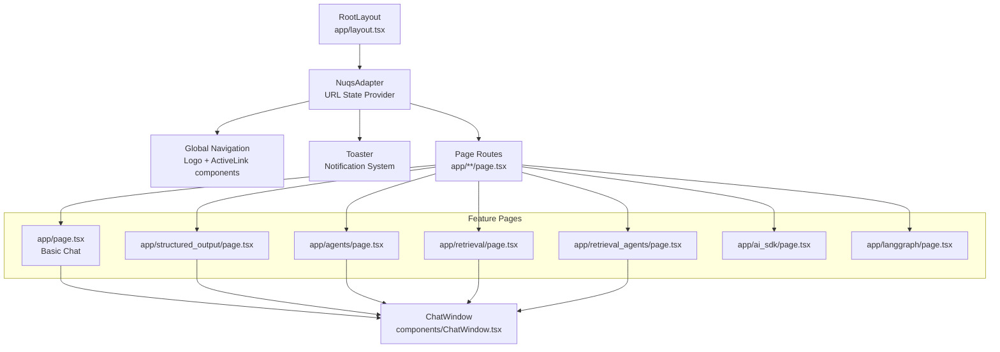
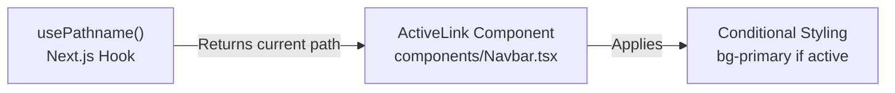
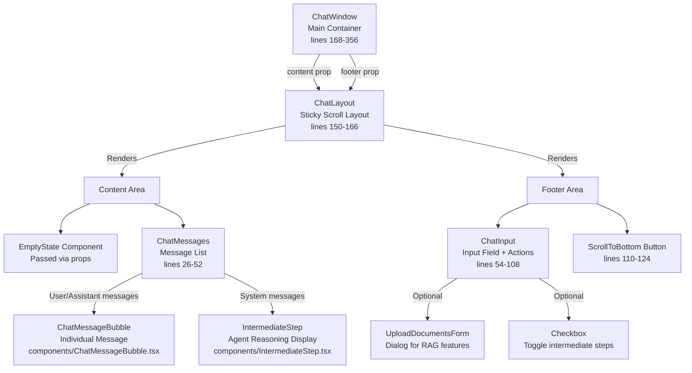
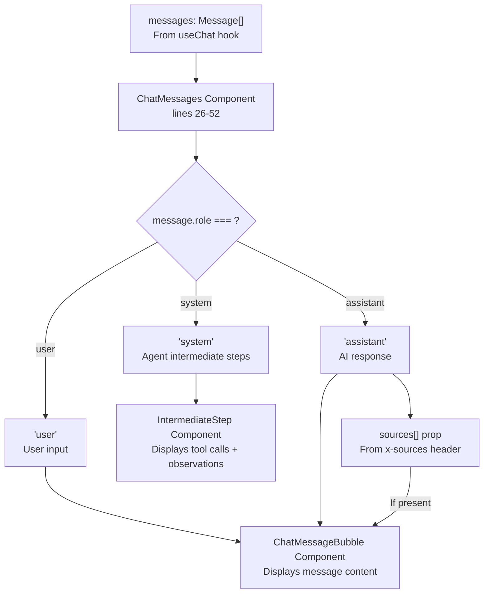
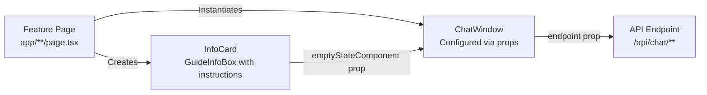

<!-- source: DeepWiki mcp.deepwiki.com · repo langchain-ai/langchain-nextjs-template · page 3.2 Frontend Architecture · fetched 2026-10-26 -->

# Frontend Architecture

<details>
<summary>Relevant source files</summary>

The following files were used as context for generating this wiki page:

- [app/layout.tsx](app/layout.tsx)
- [app/retrieval/page.tsx](app/retrieval/page.tsx)
- [app/retrieval_agents/page.tsx](app/retrieval_agents/page.tsx)
- [app/structured_output/page.tsx](app/structured_output/page.tsx)
- [components/ChatMessageBubble.tsx](components/ChatMessageBubble.tsx)
- [components/ChatWindow.tsx](components/ChatWindow.tsx)
- [components/Navbar.tsx](components/Navbar.tsx)

</details>


This page documents the frontend architecture of the LangChain Next.js template, explaining the component hierarchy, layout structure, state management patterns, and how React components integrate with the backend API layer. For backend API implementation details, see page 3.3.

## Architecture Overview

The frontend architecture follows a hierarchical structure starting from `RootLayout` as the root component. All page routes are wrapped in this layout, which provides global navigation and styling. Individual feature pages then instantiate the reusable `ChatWindow` component, configuring it via props to connect to different API endpoints.

**Frontend Architecture Hierarchy**



Sources: [app/layout.tsx:1-112](), [components/ChatWindow.tsx:168-356](), [app/retrieval_agents/page.tsx:1-86](), [app/retrieval/page.tsx:1-96](), [app/structured_output/page.tsx:1-85]()

## Root Layout & Global Navigation

The `RootLayout` component at [app/layout.tsx:33-112]() serves as the application shell, providing:

| Feature | Implementation | Purpose |
|---------|---------------|---------|
| HTML Structure | Standard `<html>` and `<body>` tags | SEO metadata, viewport configuration |
| NuqsAdapter | Wraps entire application | URL-based state management provider |
| Global Navigation | Logo + 7 `ActiveLink` components | Navigation between feature pages |
| Layout Grid | `grid-rows-[auto,1fr]` | Fixed header, flexible content area |
| Toast Notifications | `Toaster` component from Sonner | Error and status messages |

**Navigation Implementation**

The navigation bar at [app/layout.tsx:64-89]() uses the `ActiveLink` component ([components/Navbar.tsx:8-21]()) which:
- Reads current pathname via `usePathname()` hook
- Applies `bg-primary` styling to active route
- Provides visual feedback for current page location



Sources: [app/layout.tsx:33-112](), [components/Navbar.tsx:1-22]()

## Component Hierarchy

The `ChatWindow` component provides a consistent chat interface across all feature pages. It orchestrates multiple sub-components in a defined hierarchy:

**ChatWindow Component Tree**



Sources: [components/ChatWindow.tsx:1-356](), [components/ChatMessageBubble.tsx:1-54]()

## State Management Patterns

The frontend employs four distinct state management strategies depending on the scope and persistence requirements:

### useChat Hook (Vercel AI SDK)

The primary state management for chat interactions is handled by the `useChat` hook from `ai/react` ([components/ChatWindow.tsx:186-207]()):

| State Property | Type | Purpose |
|---------------|------|---------|
| `messages` | `Message[]` | Array of chat messages (user, assistant, system) |
| `input` | `string` | Current value of input field |
| `isLoading` | `boolean` | Whether API request is in progress |
| `handleSubmit` | `function` | Submits message to API endpoint |
| `handleInputChange` | `function` | Updates input field value |
| `setMessages` | `function` | Manually update message array |
| `setInput` | `function` | Manually update input value |

**useChat Data Flow**

```mermaid
sequenceDiagram
    participant User
    participant ChatInput
    participant useChat["useChat Hook<br/>lines 186-207"]
    participant APIRoute["API Route<br/>/api/chat/*"]
    participant ChatMessages
    
    User->>ChatInput: Types message
    ChatInput->>useChat: handleInputChange(e)
    useChat->>useChat: Updates input state
    
    User->>ChatInput: Clicks Send
    ChatInput->>useChat: handleSubmit(e)
    useChat->>useChat: Adds user message to messages[]
    useChat->>APIRoute: POST request with messages
    
    APIRoute-->>useChat: Streams response chunks
    useChat->>useChat: Appends chunks to assistant message
    useChat->>ChatMessages: Re-renders with updated messages
    ChatMessages-->>User: Displays streaming response
    
    Note over APIRoute,useChat: Headers: x-sources, x-message-index<br/>for retrieval citations
```

Sources: [components/ChatWindow.tsx:186-207]()

### useStream Hook (LangGraph SDK)

For the LangGraph feature at `/langgraph`, the application uses `useStream` from `@langchain/langgraph-sdk/react` instead of `useChat`. This hook provides:
- Stateful graph execution with checkpoints
- Message branching and time-travel debugging
- Thread persistence via URL parameters

The `useStream` hook is referenced in the high-level architecture diagrams but the implementation is in pages not included in the provided files. See page 5.7 for LangGraph integration details.

### nuqs (URL State Management)

The `NuqsAdapter` component ([app/layout.tsx:62]()) wraps the entire application, enabling URL-based state persistence. This allows:
- Sharing specific application states via URL
- Browser back/forward navigation preserving state
- Deep linking to specific configurations

Example usage pattern:
```typescript
// URL: /langgraph?threadId=abc123
const [threadId, setThreadId] = useQueryState('threadId');
```

Sources: [app/layout.tsx:7,62]()

### use-stick-to-bottom (Scroll State)

The `ChatLayout` component uses the `use-stick-to-bottom` library ([components/ChatWindow.tsx:8,152]()) to manage automatic scrolling behavior:

| Context Value | Purpose |
|--------------|---------|
| `scrollRef` | Reference to scrollable container |
| `contentRef` | Reference to content that grows |
| `isAtBottom` | Boolean indicating if scrolled to bottom |
| `scrollToBottom` | Function to manually scroll to bottom |

When `isAtBottom` is `false`, a "Scroll to bottom" button appears ([components/ChatWindow.tsx:110-124]()).

Sources: [components/ChatWindow.tsx:8,110-166]()

## Message Rendering Architecture

Messages are rendered differently based on their `role` property:

**Message Type Routing**



### ChatMessageBubble

The `ChatMessageBubble` component ([components/ChatMessageBubble.tsx:4-54]()) renders messages with role-based styling:

- **User messages**: Right-aligned, `bg-secondary` background
- **Assistant messages**: Left-aligned, includes emoji avatar, optional sources display

Sources are passed via the `sources` prop, populated from the `x-sources` response header ([components/ChatWindow.tsx:189-200]()).

### IntermediateStep

System messages with `role: "system"` represent agent intermediate steps. The `IntermediateStep` component (imported at [components/ChatWindow.tsx:11]()) parses the JSON content containing:
```typescript
{
  action: ToolCall,      // Tool selection by agent
  observation: string    // Tool execution result
}
```

Sources: [components/ChatWindow.tsx:26-52,260-272](), [components/ChatMessageBubble.tsx:1-54]()

## ChatWindow Configuration

The `ChatWindow` component accepts props that configure its behavior for different feature pages:

| Prop | Type | Usage |
|------|------|-------|
| `endpoint` | `string` | API route path (e.g., `"api/chat/agents"`) |
| `emptyStateComponent` | `ReactNode` | Component shown when no messages exist |
| `placeholder` | `string` | Input field placeholder text |
| `emoji` | `string` | Avatar emoji for AI messages |
| `showIngestForm` | `boolean` | Shows document upload dialog for RAG features |
| `showIntermediateStepsToggle` | `boolean` | Shows checkbox to enable agent step visibility |

**Feature Page Configuration Pattern**



### Example: Basic Chat Page

```typescript
// app/page.tsx excerpt
<ChatWindow
  endpoint="api/chat"
  emoji="🏴‍☠️"
  placeholder="I'm an LLM pretending to be a pirate!"
  emptyStateComponent={InfoCard}
/>
```

### Example: Retrieval Agents Page

```typescript
// app/retrieval_agents/page.tsx excerpt
<ChatWindow
  endpoint="api/chat/retrieval_agents"
  emoji="🤖"
  placeholder="Beep boop! I'm a robot retrieval-focused agent!"
  emptyStateComponent={InfoCard}
  showIngestForm={true}
  showIntermediateStepsToggle={true}
/>
```

Sources: [components/ChatWindow.tsx:168-175](), [app/retrieval_agents/page.tsx:75-85](), [app/retrieval/page.tsx:86-95]()

## Intermediate Steps Handling

When `showIntermediateStepsToggle` is enabled and the user checks the box ([components/ChatWindow.tsx:338-351]()), the component switches from streaming mode to JSON mode for agent responses:

**Intermediate Steps Processing Flow**

```mermaid
sequenceDiagram
    participant User
    participant ChatWindow["ChatWindow<br/>sendMessage function<br/>lines 209-290"]
    participant APIRoute["API Route<br/>e.g. /api/chat/agents"]
    participant ChatMessages
    
    User->>ChatWindow: Submits message with checkbox enabled
    
    Note over ChatWindow: Sets intermediateStepsLoading = true<br/>Manually adds user message to state
    
    ChatWindow->>APIRoute: POST with show_intermediate_steps: true
    
    Note over APIRoute: Returns full JSON response<br/>instead of streaming
    
    APIRoute-->>ChatWindow: JSON with messages[] array
    
    Note over ChatWindow: Filters for tool_calls and tool messages<br/>lines 250-258
    
    loop For each tool call pair
        ChatWindow->>ChatWindow: Creates system message<br/>with action + observation
        ChatWindow->>ChatMessages: Adds message with delay
        Note over ChatMessages: Animated display<br/>1-2 second delay per step
    end
    
    ChatWindow->>ChatMessages: Adds final assistant message
    ChatWindow->>ChatWindow: Sets intermediateStepsLoading = false
```

The component transforms tool messages into system messages with this structure:
```typescript
{
  id: string,
  role: "system",
  content: JSON.stringify({
    action: {
      name: string,        // Tool name (e.g., "calculator")
      args: object,        // Tool arguments
      id: string
    },
    observation: string    // Tool execution result
  })
}
```

Sources: [components/ChatWindow.tsx:209-290]()

## Special Features

### Document Upload

When `showIngestForm` is enabled, the `ChatWindow` component displays a document upload button that opens a dialog with the `UploadDocumentsForm` component, allowing users to upload documents for retrieval-based features.

Sources: [components/ChatWindow.tsx:314-336]()

### Intermediate Steps Display

When `showIntermediateStepsToggle` is enabled, the `ChatWindow` component displays a checkbox that toggles the display of intermediate reasoning steps for agent-based features. This provides transparency into the agent's thought process.

Sources: [components/ChatWindow.tsx:338-351](), [components/ChatWindow.tsx:176-181](), [components/ChatWindow.tsx:209-290]()

### Citation Sources

For retrieval-based responses, the `ChatMessageBubble` component can display the source documents that were used to generate the response, providing attribution and context for the information.

Sources: [components/ChatMessageBubble.tsx:28-50]()

## Summary

The frontend components of the LangChain NextJS Template provide a flexible and modular architecture for building AI-powered chat interfaces. The `ChatWindow` component serves as the central building block, adaptable to different use cases through configuration. Each feature page implements this component with specific settings to showcase different LangChain capabilities, while maintaining a consistent user experience.

---

