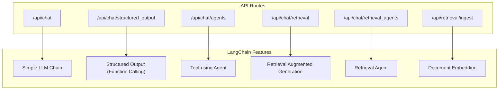
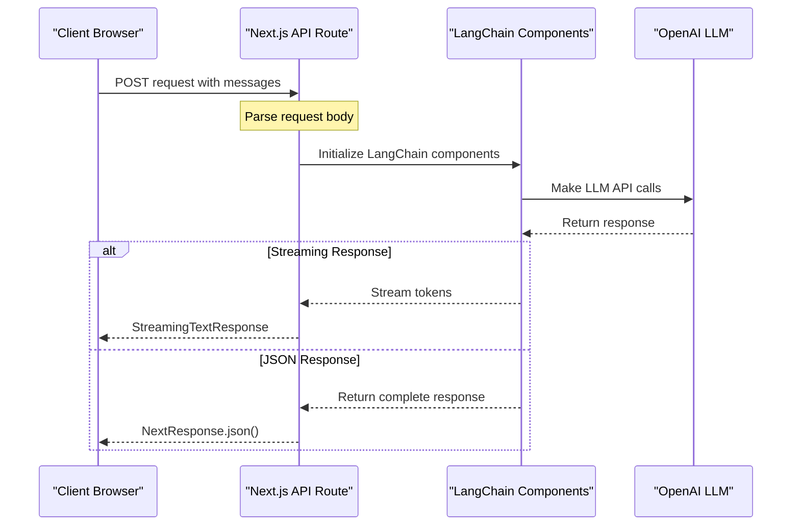
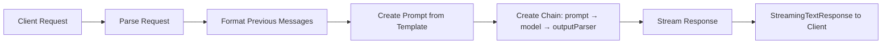
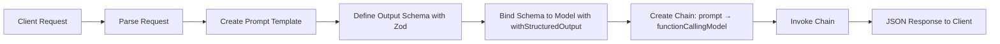
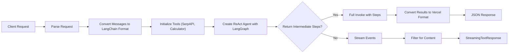
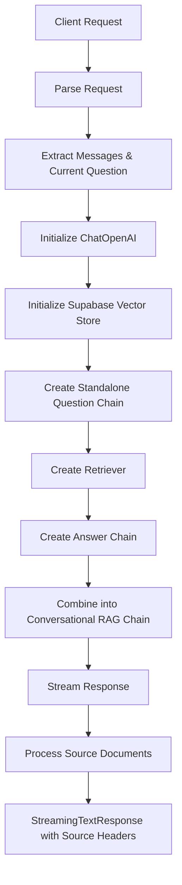
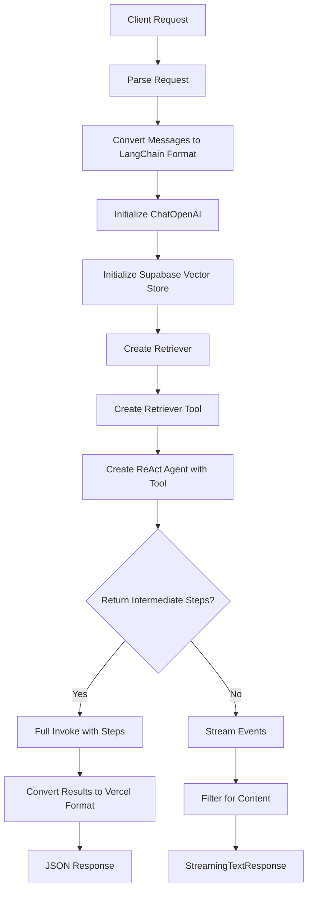
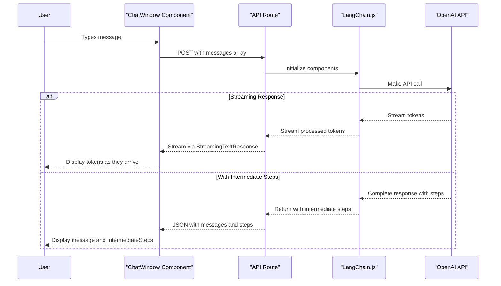

<!-- source: DeepWiki mcp.deepwiki.com · repo langchain-ai/langchain-nextjs-template · page 3.3 API Routes Architecture · fetched 2026-10-26 -->

# API Routes

<details>
<summary>Relevant source files</summary>

The following files were used as context for generating this wiki page:

- [app/api/chat/agents/route.ts](app/api/chat/agents/route.ts)
- [app/api/chat/retrieval/route.ts](app/api/chat/retrieval/route.ts)
- [app/api/chat/route.ts](app/api/chat/route.ts)

</details>


This document explains the backend API routes in the LangChain NextJS Template. These routes implement different AI capabilities using LangChain.js and serve as the connection points between the frontend UI components and the underlying AI functionality.

For information about frontend components that communicate with these routes, see [Frontend Components](#3.1).

## Overview of API Routes

The LangChain NextJS Template provides several API routes that implement different LangChain features, from basic chat to complex retrieval agents. All routes are implemented as Next.js API routes using the App Router pattern, with the Edge Runtime for optimal performance.



Sources: [app/api/chat/route.ts](), [app/api/chat/structured_output/route.ts](), [app/api/chat/agents/route.ts](), [app/api/chat/retrieval/route.ts](), [app/api/chat/retrieval_agents/route.ts](), [app/api/retrieval/ingest/route.ts]()

## Common Patterns

All API routes in the template share common patterns and principles:

1. **Edge Runtime** - All routes use `export const runtime = "edge"` for optimal performance and streaming capabilities
2. **Error Handling** - Try/catch blocks with standardized error responses
3. **Request/Response Format** - JSON for input, streaming or JSON for output
4. **LangChain Integration** - Each route demonstrates a different LangChain functionality

### API Route Structure



Sources: [app/api/chat/route.ts:28-73](), [app/api/chat/structured_output/route.ts:24-80]()

## Basic Chat API Route

The simplest API route is `/api/chat`, which implements a straightforward conversation with an LLM without any advanced features.

### Implementation Details

- **Path**: `/api/chat`
- **Model**: `ChatOpenAI` (OpenAI's chat models)
- **Key Components**:
  - `PromptTemplate` for formatting messages with a pirate persona
  - `HttpResponseOutputParser` for handling streaming responses
  - Simple LCEL chain pattern: `prompt.pipe(model).pipe(outputParser)`
  - Streaming response using `StreamingTextResponse`



Sources: [app/api/chat/route.ts:1-73]()

## Structured Output API Route

The `/api/chat/structured_output` route demonstrates how to generate structured, schema-conformant outputs from an LLM using OpenAI's function calling capability.

### Implementation Details

- **Path**: `/api/chat/structured_output`
- **Model**: `ChatOpenAI` with function calling
- **Key Components**:
  - `zod` library for schema definition
  - `withStructuredOutput` to bind schema to model
  - Returns JSON instead of streaming



Sources: [app/api/chat/structured_output/route.ts:1-80]()

## Agents API Route

The `/api/chat/agents` route implements a ReAct agent that can use external tools to solve complex problems.

### Implementation Details

- **Path**: `/api/chat/agents`
- **Model**: `ChatOpenAI`
- **Key Components**:
  - `createReactAgent` from LangGraph
  - Tools: `SerpAPI` (search) and `Calculator`
  - Message conversion between Vercel and LangChain formats
  - Option to show intermediate steps or stream final output



Sources: [app/api/chat/agents/route.ts:1-140]()

## Retrieval API Route

The `/api/chat/retrieval` route implements Retrieval Augmented Generation (RAG) to answer questions based on a knowledge base stored in Supabase.

### Implementation Details

- **Path**: `/api/chat/retrieval`
- **Model**: `ChatOpenAI`
- **Key Components**:
  - `SupabaseVectorStore` for document retrieval
  - Two-step process: condense question, then answer with context
  - `RunnableSequence` for composing the retrieval chain
  - Streaming with source document metadata



Sources: [app/api/chat/retrieval/route.ts:1-172]()

## Retrieval Agents API Route

The `/api/chat/retrieval_agents` route combines agent capabilities with retrieval, allowing an agent to use a retriever as a tool.

### Implementation Details

- **Path**: `/api/chat/retrieval_agents`
- **Model**: `ChatOpenAI`
- **Key Components**:
  - `SupabaseVectorStore` for document retrieval
  - `createRetrieverTool` to create a tool from the retriever
  - `createReactAgent` for the agent with tools
  - Robot persona implemented via system message



Sources: [app/api/chat/retrieval_agents/route.ts:1-164]()

## Ingest API Route

The `/api/retrieval/ingest` route handles ingestion of text data into the vector store for later retrieval.

### Implementation Details

- **Path**: `/api/retrieval/ingest`
- **Model**: Uses OpenAI embeddings, but no LLM directly
- **Key Components**:
  - `RecursiveCharacterTextSplitter` for chunking text
  - `SupabaseVectorStore` for storing embedded chunks
  - Simple POST endpoint that returns success status

```mermaid
flowchart LR
    Request["Client Request"] --> Parse["Parse Request"]
    Parse --> ExtractText["Extract Text"]
    ExtractText --> CreateClient["Create Supabase Client"]
    CreateClient --> CreateSplitter["Create Text Splitter"]
    CreateSplitter --> SplitDocs["Split Text into Chunks"]
    SplitDocs --> Embed["Embed Documents with OpenAI"]
    Embed --> Store["Store in Supabase"]
    Store --> Response["JSON Response (Success)"]
```



Sources: [app/api/retrieval/ingest/route.ts:1-63]()

## API/UI Integration

The API routes integrate with the frontend UI components primarily through the ChatWindow component. Here's how the data flows between them:



Sources: [app/api/chat/agents/route.ts:88-136](), [components/IntermediateStep.tsx:1-60]()

## Implementation Best Practices

The API routes in this template demonstrate several best practices:

1. **Edge Runtime** - All routes use the Edge Runtime for better performance and streaming capabilities
2. **Error Handling** - Consistent error handling pattern with try/catch and status codes
3. **Message Conversion** - Utilities to convert between Vercel and LangChain message formats
4. **Streaming** - Efficient streaming of responses from LLMs
5. **LCEL** - Use of LangChain Expression Language for composing chains
6. **Personality** - Demonstration of giving AI assistants distinct personalities through system prompts

### Code Structure Example:
```
1. Import dependencies
2. Set runtime to "edge"
3. Define helper functions (e.g., message conversion)
4. Export POST handler that:
   - Parses request
   - Initializes LangChain components
   - Processes the request using LangChain
   - Streams or returns the response
   - Handles errors
```

Sources: [app/api/chat/route.ts:1-73](), [app/api/chat/structured_output/route.ts:1-80](), [app/api/chat/agents/route.ts:1-140]()

## Extension Points

The API routes in this template are designed to be extended in several ways:

1. **New Models**: Replace OpenAI with other LLM providers
2. **Custom Tools**: Add new tools to the agents
3. **Different Vector Stores**: Replace Supabase with other vector databases
4. **Custom Prompts**: Modify the system prompts and templates
5. **New Routes**: Add entirely new capabilities by creating new routes

When adding new routes, follow the established patterns for consistency and maintainability.

---

