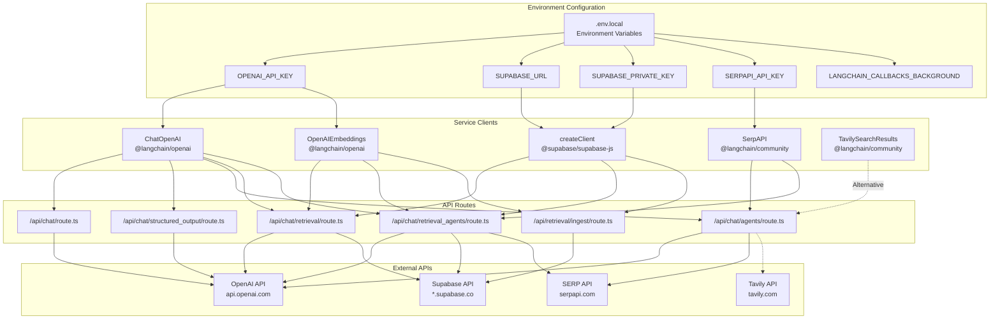
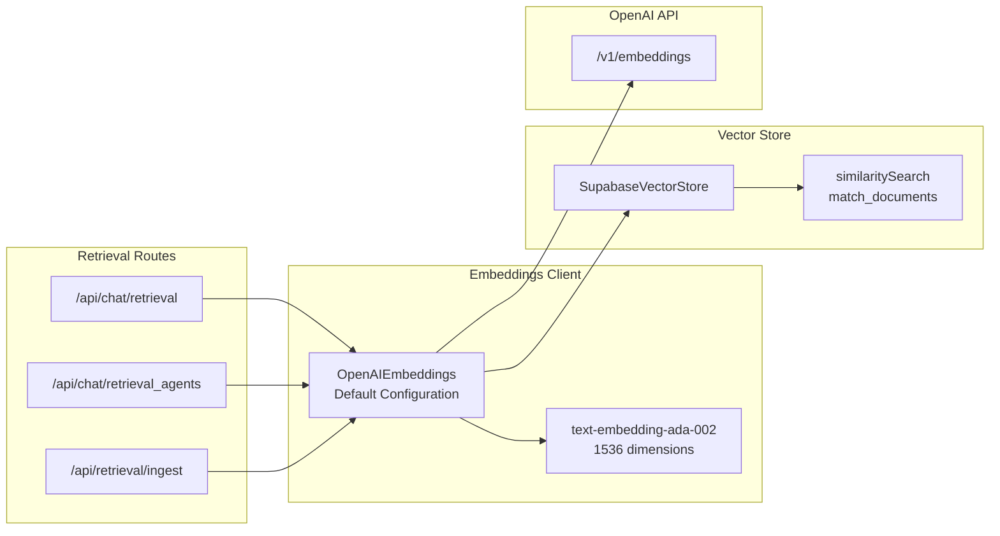
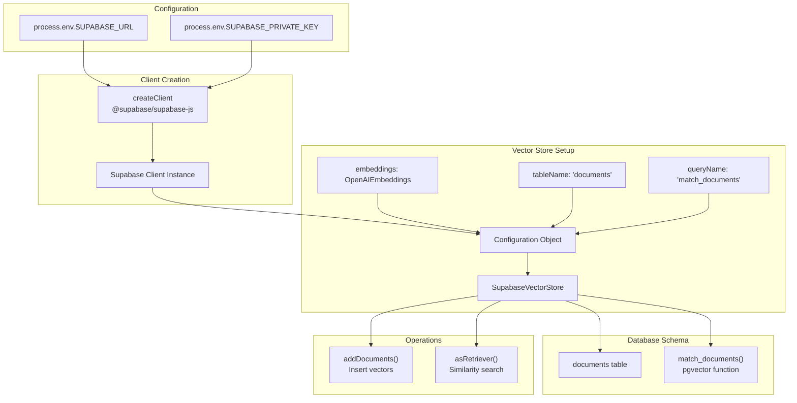
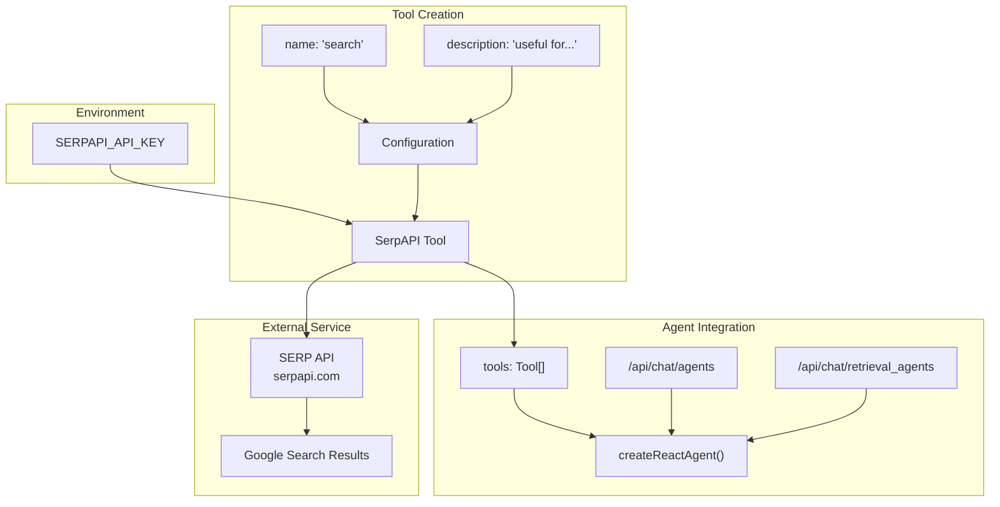
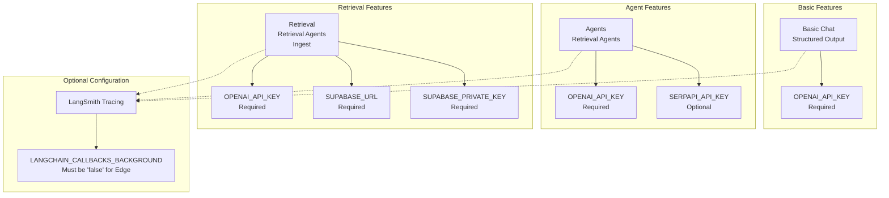
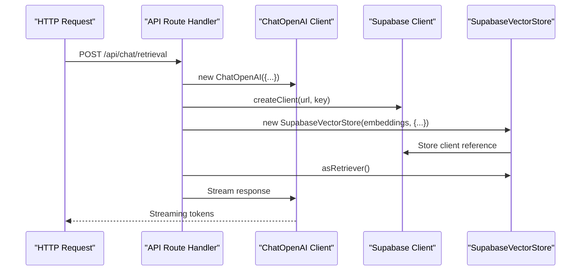

<!-- source: DeepWiki mcp.deepwiki.com · repo langchain-ai/langchain-nextjs-template · page 3.4 External Service Integration · fetched 2026-10-26 -->

# External Service Integration

<details>
<summary>Relevant source files</summary>

The following files were used as context for generating this wiki page:

- [README.md](README.md)
- [app/api/chat/retrieval/route.ts](app/api/chat/retrieval/route.ts)
- [package.json](package.json)

</details>


## Purpose and Scope

This document details the integration with external third-party services used throughout the LangChain + Next.js template. It covers the four primary service integrations (OpenAI, Supabase, SERP API, and Tavily API), their configuration requirements, initialization patterns, and usage across different API routes. For information about how these services are used within specific features, see the Features & Examples section starting at [5](#5). For environment setup instructions, see [Getting Started](#2).

## External Service Architecture

The template integrates with four external services, each serving a distinct role in the AI application stack:



**Service Integration Flow**: Environment variables are loaded from `.env.local` and used to initialize service clients. Each API route instantiates the clients it needs, which then make requests to external APIs. All routes use `ChatOpenAI`, while only retrieval routes use embeddings and vector store clients, and only agent routes use search tools.

**Sources:** [package.json:16-47](), [README.md:29-32](), [README.md:64-65](), [README.md:79-80]()

---

## OpenAI Integration

### LLM Client Configuration

The `ChatOpenAI` client from `@langchain/openai` is the primary language model interface used across all API routes. It provides access to OpenAI's GPT models with streaming capabilities.

| Configuration Parameter | Default Value | Used In Routes |
|------------------------|---------------|----------------|
| `model` | `"gpt-4o-mini"` | All chat routes |
| `temperature` | Varies (0.2-1.0) | All chat routes |
| `streaming` | Implicit | All routes (via streaming parsers) |
| API Key Source | `process.env.OPENAI_API_KEY` | All routes |

**Initialization Pattern:**

The `ChatOpenAI` client is instantiated within each API route handler using this pattern:

```typescript
const model = new ChatOpenAI({
  model: "gpt-4o-mini",
  temperature: 0.2,
});
```

**Sources:** [app/api/chat/retrieval/route.ts:77-80](), [package.json:21]()

### Embeddings Client Configuration

The `OpenAIEmbeddings` client generates vector embeddings for documents and queries in RAG (Retrieval-Augmented Generation) implementations.



**Embeddings Usage Pattern**: The `OpenAIEmbeddings` client is passed to `SupabaseVectorStore` constructor, which automatically handles embedding generation for both document ingestion and query processing. The embeddings model uses OpenAI's `text-embedding-ada-002` by default.

**Sources:** [app/api/chat/retrieval/route.ts:6](), [app/api/chat/retrieval/route.ts:86-90]()

### Model Selection and Temperature Settings

Different routes use different temperature settings to control output randomness:

| Route | Model | Temperature | Rationale |
|-------|-------|-------------|-----------|
| Basic Chat | `gpt-4o-mini` | Higher (0.8-1.0) | Creative, conversational responses |
| Structured Output | `gpt-4o-mini` | Low (0.2) | Consistent schema adherence |
| Agents | `gpt-4o-mini` | Medium (0.5-0.7) | Balanced reasoning and creativity |
| Retrieval | `gpt-4o-mini` | Low (0.2) | Factual responses based on context |

**Sources:** [app/api/chat/retrieval/route.ts:77-80]()

---

## Supabase Vector Store Integration

### Client Initialization

Supabase serves as the vector database for storing and retrieving document embeddings. The integration requires two environment variables and uses a specific table schema.



**Client Creation Pattern**: The Supabase client is created using `createClient()` with URL and private key from environment variables, then passed to `SupabaseVectorStore` constructor along with embeddings client.

**Sources:** [app/api/chat/retrieval/route.ts:4](), [app/api/chat/retrieval/route.ts:82-90](), [package.json:26]()

### Vector Store Configuration

The `SupabaseVectorStore` requires specific configuration to match the database schema:

| Configuration Key | Value | Purpose |
|------------------|-------|---------|
| `client` | Supabase client instance | Database connection |
| `tableName` | `"documents"` | Table storing vectors |
| `queryName` | `"match_documents"` | pgvector similarity function |
| Embeddings | `OpenAIEmbeddings` instance | Vector generation |

**Initialization Pattern:**

```typescript
const client = createClient(
  process.env.SUPABASE_URL!,
  process.env.SUPABASE_PRIVATE_KEY!,
);
const vectorstore = new SupabaseVectorStore(new OpenAIEmbeddings(), {
  client,
  tableName: "documents",
  queryName: "match_documents",
});
```

**Sources:** [app/api/chat/retrieval/route.ts:82-90]()

### Retriever Configuration

The vector store is converted to a retriever with callbacks for tracking retrieved documents:

```typescript
const retriever = vectorstore.asRetriever({
  callbacks: [
    {
      handleRetrieverEnd(documents) {
        resolveWithDocuments(documents);
      },
    },
  ],
});
```

This pattern uses a callback to capture retrieved documents for returning as source citations in the response headers.

**Sources:** [app/api/chat/retrieval/route.ts:112-120]()

### Document Ingestion Flow

Document ingestion follows this sequence:

1. Text splitting (via `RecursiveCharacterTextSplitter`)
2. Embedding generation (via `OpenAIEmbeddings`)
3. Vector storage (via `SupabaseVectorStore.addDocuments()`)

The ingestion is handled by the `/api/retrieval/ingest` route and only needs to be performed once per document set. Repeated ingestion creates duplicates.

**Sources:** [README.md:85-86]()

---

## Search Tool Integration

### SERP API Configuration

The SERP API tool provides web search capabilities to agents. It is implemented using `SerpAPI` from `@langchain/community`.



**SERP API Tool Usage**: The tool is only initialized when `SERPAPI_API_KEY` is present in environment variables. It provides agents with the ability to search the web for current information.

**Sources:** [README.md:64-65](), [package.json:17]()

### Tavily API Alternative

Tavily API serves as an alternative search tool, mentioned in the template but primarily used in AI SDK examples. It provides similar web search functionality with a different API interface.

| Feature | SERP API | Tavily API |
|---------|----------|------------|
| Package | `@langchain/community` | `@langchain/community` |
| Primary Use | Agent routes | AI SDK routes |
| Configuration | `SERPAPI_API_KEY` | Tavily API key |
| Tool Name | `"search"` | Configurable |

**Sources:** High-level architecture diagram

### Calculator Tool

In addition to search tools, agent examples include a basic calculator tool for mathematical operations. This tool is implemented locally without external API dependencies.

**Sources:** [README.md:69]()

---

## Environment Variable Configuration

### Required Variables by Feature



**Feature-Based Configuration**: Different features require different subsets of environment variables. Basic chat only needs OpenAI, agents optionally use SERP API, and retrieval features require both OpenAI and Supabase.

**Sources:** [README.md:29-32](), [README.md:64-65](), [README.md:79-80]()

### Configuration File Structure

The template uses `.env.local` for environment variables, with `.env.example` serving as a template:

| File | Purpose | Version Control |
|------|---------|----------------|
| `.env.example` | Template with variable names | Committed to repo |
| `.env.local` | Actual values | Gitignored |

**Setup Process:**
1. Copy `.env.example` to `.env.local`
2. Fill in API keys for desired features
3. Ensure `LANGCHAIN_CALLBACKS_BACKGROUND=false` for Edge runtime

**Sources:** [README.md:29]()

### Edge Runtime Constraints

The `LANGCHAIN_CALLBACKS_BACKGROUND` variable is critical for Edge runtime compatibility:

```typescript
// Must be set in .env.local
LANGCHAIN_CALLBACKS_BACKGROUND=false
```

This ensures that LangSmith tracing (if enabled) completes synchronously before the Edge function terminates, as Edge Functions cannot maintain background processes.

**Sources:** [README.md:32]()

---

## Service Client Lifecycle

### Per-Request Initialization

All external service clients are instantiated on a per-request basis within API route handlers:



**No Connection Pooling**: Each request creates fresh client instances. This is compatible with serverless Edge Functions which are stateless and short-lived.

**Sources:** [app/api/chat/retrieval/route.ts:70-91]()

### Error Handling

API routes implement try-catch blocks to handle external service errors:

```typescript
try {
  // Service initialization and usage
} catch (e: any) {
  return NextResponse.json(
    { error: e.message }, 
    { status: e.status ?? 500 }
  );
}
```

This pattern returns error messages to the client while preserving HTTP status codes from external services.

**Sources:** [app/api/chat/retrieval/route.ts:169-172]()

---

## Service-Specific Configuration Tables

### OpenAI Service Configuration

| Configuration Aspect | Details |
|---------------------|---------|
| Package | `@langchain/openai` version ^0.4.9 |
| Classes Used | `ChatOpenAI`, `OpenAIEmbeddings` |
| Default LLM Model | `gpt-4o-mini` |
| Default Embeddings Model | `text-embedding-ada-002` (implicit) |
| API Key Variable | `OPENAI_API_KEY` |
| Rate Limiting | Handled by OpenAI API |
| Streaming Support | Yes, via `BytesOutputParser` |

**Sources:** [package.json:21](), [app/api/chat/retrieval/route.ts:77-80]()

### Supabase Service Configuration

| Configuration Aspect | Details |
|---------------------|---------|
| Package | `@supabase/supabase-js` version ^2.32.0 |
| LangChain Integration | `SupabaseVectorStore` from `@langchain/community` |
| Required Variables | `SUPABASE_URL`, `SUPABASE_PRIVATE_KEY` |
| Table Name | `documents` |
| Query Function | `match_documents` |
| Vector Dimensions | 1536 (matching OpenAI embeddings) |
| Setup Required | Yes, see [LangChain.js Supabase docs](https://js.langchain.com/docs/integrations/vectorstores/supabase) |

**Sources:** [package.json:26](), [app/api/chat/retrieval/route.ts:82-90](), [README.md:79]()

### SERP API Service Configuration

| Configuration Aspect | Details |
|---------------------|---------|
| Package | `@langchain/community` (includes SerpAPI tool) |
| Tool Class | `SerpAPI` |
| API Key Variable | `SERPAPI_API_KEY` |
| Usage Scope | Agent routes only |
| Requirement Level | Optional (agents work without it) |
| Signup Location | serpapi.com |
| Free Tier | Available |

**Sources:** [README.md:64-65](), [package.json:17]()

---

## Deployment Considerations

### Vercel Environment Variables

When deploying to Vercel, environment variables must be configured through the Vercel dashboard or CLI:

1. Navigate to Project Settings → Environment Variables
2. Add each required variable for the desired feature set
3. Ensure variables are available in all environments (Production, Preview, Development)

**Edge Function Compatibility**: All API routes use `export const runtime = "edge"` and are deployed as Edge Functions, requiring the `LANGCHAIN_CALLBACKS_BACKGROUND=false` setting for proper LangSmith tracing behavior.

**Sources:** [README.md:120-124](), [app/api/chat/retrieval/route.ts:16]()

### Bundle Size Impact

External service clients contribute to the overall bundle size:

| Service Integration | Approximate Size Contribution |
|--------------------|------------------------------|
| `@langchain/core` | 37.32 KB (compressed) |
| `@langchain/openai` | Included in core metrics |
| `@supabase/supabase-js` | Additional overhead |
| `@langchain/community` | Only used modules included |

The template stays well within Vercel's 1 MB Edge Function limit. Bundle analysis can be performed with `ANALYZE=true yarn build`.

**Sources:** [README.md:99-107]()

---

## Security Considerations

### API Key Protection

API keys are:
- Never committed to version control (`.env.local` is gitignored)
- Accessed via `process.env` at runtime
- Only available server-side (API routes)
- Protected by Next.js automatic environment variable handling

### Private Key vs. Public Key

Supabase integration uses the **private key** (`SUPABASE_PRIVATE_KEY`), not the public anon key, because:
- Vector operations require service role permissions
- API routes run server-side where private keys are safe
- Bypasses Row Level Security (RLS) for vector operations

**Sources:** [app/api/chat/retrieval/route.ts:82-85](), [README.md:80]()

---

