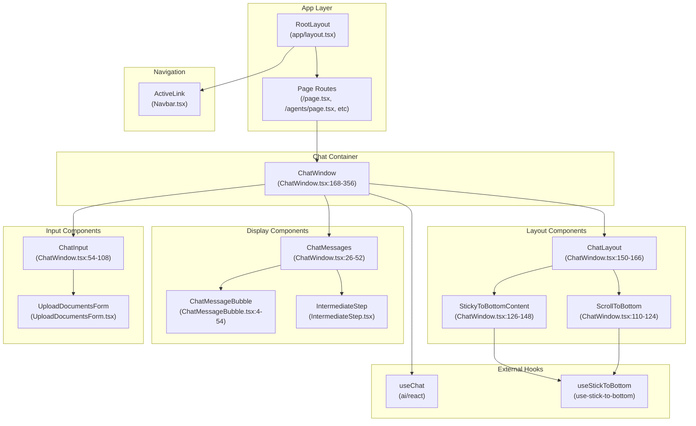
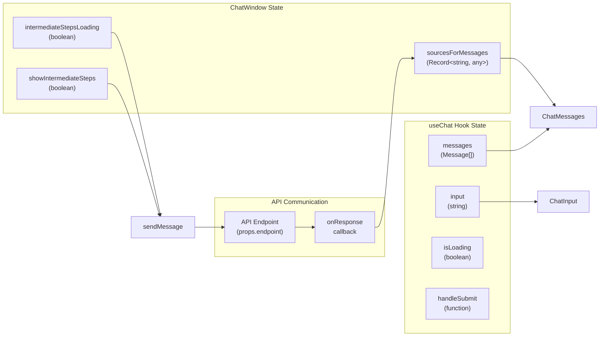
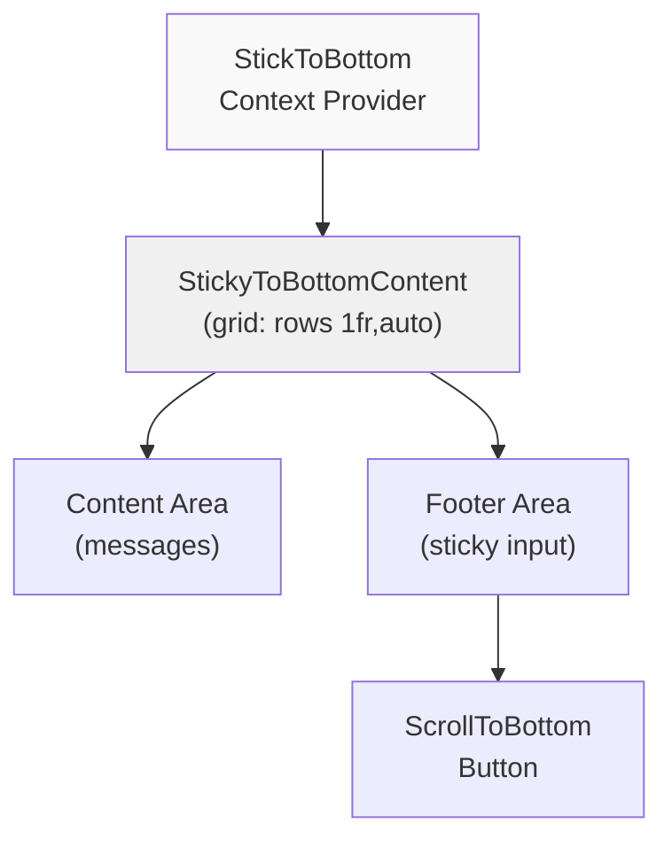
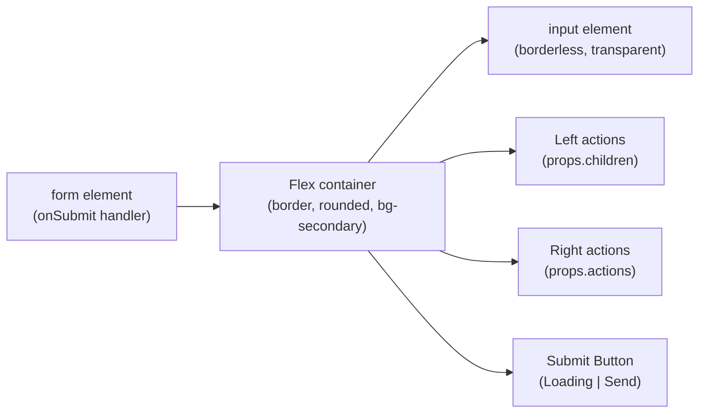
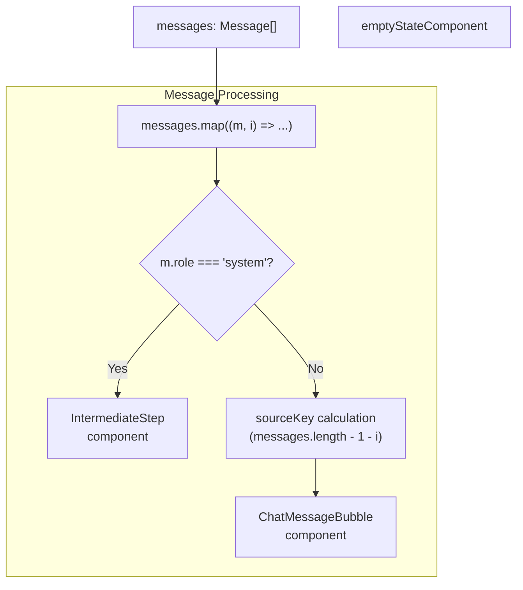
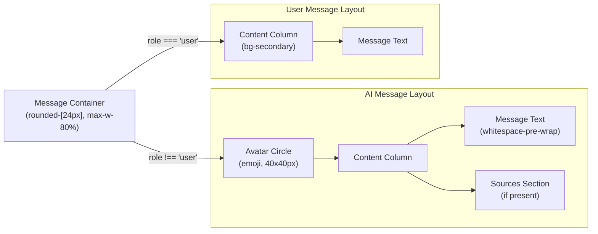
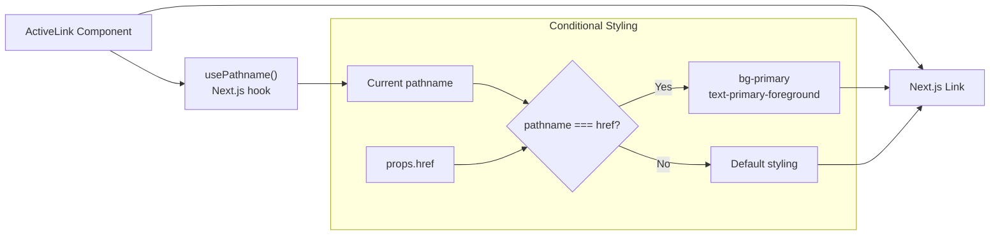
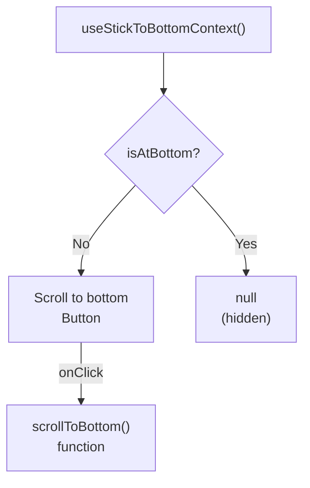

<!-- source: DeepWiki mcp.deepwiki.com · repo langchain-ai/langchain-nextjs-template · page 4 Core UI Components · fetched 2026-10-26 -->

# Core UI Components

<details>
<summary>Relevant source files</summary>

The following files were used as context for generating this wiki page:

- [app/layout.tsx](app/layout.tsx)
- [app/retrieval/page.tsx](app/retrieval/page.tsx)
- [app/retrieval_agents/page.tsx](app/retrieval_agents/page.tsx)
- [app/structured_output/page.tsx](app/structured_output/page.tsx)
- [components/ChatMessageBubble.tsx](components/ChatMessageBubble.tsx)
- [components/ChatWindow.tsx](components/ChatWindow.tsx)
- [components/Navbar.tsx](components/Navbar.tsx)

</details>


## Purpose and Scope

This page documents the reusable UI components that form the foundation of all chat interfaces in the template. These components handle message display, user input, layout structure, navigation, and scroll management. They are shared across all seven example implementations (Basic Chat, Structured Output, Agents, Retrieval, Retrieval Agents, AI SDK, and LangGraph).

For information about the specific example implementations that use these components, see the Features & Examples section ([#5](#5)). For the overall frontend architecture, see [Frontend Architecture](#3.2). For the backend API routes these components communicate with, see [API Routes Architecture](#3.3).

---

## Component Architecture Overview

The core UI layer is organized around a main container component (`ChatWindow`) that orchestrates several specialized sub-components. The architecture follows a component composition pattern where layout, input, and display concerns are separated.



**Sources:** [components/ChatWindow.tsx:1-357](), [components/ChatMessageBubble.tsx:1-54](), [components/Navbar.tsx:1-22](), [app/layout.tsx:1-112]()

---

## ChatWindow Component

The `ChatWindow` component is the primary entry point for all chat interfaces. It manages message state, handles API communication, processes intermediate steps, and coordinates document sources.

### Props Interface

| Prop | Type | Required | Purpose |
|------|------|----------|---------|
| `endpoint` | `string` | Yes | API endpoint URL (e.g., `"api/chat/retrieval"`) |
| `emptyStateComponent` | `ReactNode` | Yes | Component displayed when no messages exist |
| `placeholder` | `string` | No | Input placeholder text |
| `emoji` | `string` | No | Emoji for AI message avatar |
| `showIngestForm` | `boolean` | No | Enable document upload dialog |
| `showIntermediateStepsToggle` | `boolean` | No | Enable agent intermediate steps display |

### Core State Management



The component uses the `useChat` hook from Vercel AI SDK [components/ChatWindow.tsx:186-207]() to manage message state and API communication. When `showIntermediateSteps` is enabled, it performs additional processing to display agent tool calls as system messages [components/ChatWindow.tsx:218-290]().

### Source Attribution Flow

When API responses include source documents (for RAG implementations), the component extracts them from response headers and associates them with specific messages:

1. **Header Extraction**: Sources are Base64-encoded in the `x-sources` header [components/ChatWindow.tsx:189-192]()
2. **Message Indexing**: The `x-message-index` header identifies which message the sources belong to [components/ChatWindow.tsx:194-200]()
3. **State Storage**: Sources are stored in the `sourcesForMessages` Record keyed by message index
4. **Display**: `ChatMessageBubble` receives sources via props and renders them below the message content

**Sources:** [components/ChatWindow.tsx:168-356]()

---

## ChatLayout Component

The `ChatLayout` component provides the structural foundation for the chat interface, implementing a sticky footer pattern with automatic scroll-to-bottom functionality.

### Layout Structure



The component uses the `use-stick-to-bottom` library to manage scroll behavior [components/ChatWindow.tsx:152-164](). It provides two ref attachments:
- `scrollRef`: Applied to the scrollable container, toggles between `overflow: unset` and `overflow: auto` [components/ChatWindow.tsx:137-139]()
- `contentRef`: Applied to the content area for measuring scroll position [components/ChatWindow.tsx:141-143]()

### Props Interface

| Prop | Type | Purpose |
|------|------|---------|
| `content` | `ReactNode` | Main chat message area |
| `footer` | `ReactNode` | Sticky footer content (usually `ChatInput`) |

**Sources:** [components/ChatWindow.tsx:150-166](), [components/ChatWindow.tsx:126-148]()

---

## ChatInput Component

The `ChatInput` component handles user input with support for loading states, custom actions, and flexible child content.

### Component Structure



### Props Interface

| Prop | Type | Purpose |
|------|------|---------|
| `onSubmit` | `(e: FormEvent) => void` | Form submission handler |
| `onStop` | `() => void` | Optional stop handler for streaming |
| `value` | `string` | Controlled input value |
| `onChange` | `(e: ChangeEvent) => void` | Input change handler |
| `loading` | `boolean` | Loading state indicator |
| `placeholder` | `string` | Input placeholder text |
| `children` | `ReactNode` | Left-side action elements |
| `actions` | `ReactNode` | Right-side action elements |
| `className` | `string` | Additional CSS classes |

### Loading State Behavior

The component implements smart button behavior [components/ChatWindow.tsx:65-76]():
- When `loading` is `true` AND `onStop` is provided: Button calls `onStop()` (stop streaming)
- When `loading` is `true` AND `onStop` is `null`: Button is disabled
- When `loading` is `false`: Button calls `onSubmit()` (send message)

The loading UI displays a spinning `LoaderCircle` icon from Lucide React [components/ChatWindow.tsx:94-98]().

**Sources:** [components/ChatWindow.tsx:54-108]()

---

## ChatMessages Component

The `ChatMessages` component renders the list of messages and handles conditional rendering for system messages (intermediate steps).

### Message Rendering Logic



### Source Indexing

The component uses reverse indexing for sources [components/ChatWindow.tsx:40](). The most recent message has index `0`, calculated as:
```
sourceKey = (messages.length - 1 - currentIndex).toString()
```

This matches the indexing scheme used in the `x-message-index` header from API responses.

### Props Interface

| Prop | Type | Purpose |
|------|------|---------|
| `messages` | `Message[]` | Array of chat messages |
| `emptyStateComponent` | `ReactNode` | Displayed when messages array is empty |
| `sourcesForMessages` | `Record<string, any>` | Map of message indices to source documents |
| `aiEmoji` | `string` | Optional emoji for AI avatar |
| `className` | `string` | Additional CSS classes |

**Sources:** [components/ChatWindow.tsx:26-52]()

---

## ChatMessageBubble Component

The `ChatMessageBubble` component renders individual messages with role-based styling and optional source citations.

### Visual Structure



### Styling Patterns

The component uses conditional styling based on message role [components/ChatMessageBubble.tsx:11-17]():

- **User messages**: 
  - Background: `bg-secondary`
  - Alignment: `ml-auto` (right-aligned)
  - Max width: 80% of container
  
- **AI messages**:
  - No background (transparent)
  - Alignment: `mr-auto` (left-aligned)
  - Avatar displayed with emoji

### Source Citation Rendering

When sources are present, they are displayed below the message content [components/ChatMessageBubble.tsx:28-49]():
1. Header: "🔍 Sources:" in a code block
2. Numbered list of source documents
3. Each source shows:
   - Sequential number
   - Page content (quoted)
   - Optional line number range (for code files)

**Sources:** [components/ChatMessageBubble.tsx:1-54]()

---

## Navigation Components

### ActiveLink Component

The `ActiveLink` component provides navigation links with active state indication using Next.js's `usePathname` hook.



### Props Interface

| Prop | Type | Purpose |
|------|------|---------|
| `href` | `string` | Navigation target URL |
| `children` | `ReactNode` | Link content (typically icon + text) |

The component applies the `bg-primary text-primary-foreground` classes when the current pathname matches the link's href [components/Navbar.tsx:13-16]().

**Sources:** [components/Navbar.tsx:1-22](), [app/layout.tsx:74-88]()

---

## Scroll Management System

The template implements automatic scroll-to-bottom behavior using the `use-stick-to-bottom` library, ensuring users always see the latest messages unless they've scrolled up to review history.

### ScrollToBottom Component



The component conditionally renders based on scroll position [components/ChatWindow.tsx:113-123]():
- When `isAtBottom` is `true`: Returns `null` (button hidden)
- When `isAtBottom` is `false`: Displays button with `ArrowDown` icon

### Context Integration

The `StickToBottom` context provider wraps the entire chat layout [components/ChatWindow.tsx:152-164]() and provides:

| Context Property | Type | Purpose |
|-----------------|------|---------|
| `scrollRef` | `RefObject` | Applied to scrollable container |
| `contentRef` | `RefObject` | Applied to content area |
| `isAtBottom` | `boolean` | Current scroll position state |
| `scrollToBottom` | `() => void` | Function to scroll to bottom |

**Sources:** [components/ChatWindow.tsx:110-124](), [components/ChatWindow.tsx:126-148]()

---

## State Management Patterns

### useChat Hook Integration

The `ChatWindow` component integrates with Vercel AI SDK's `useChat` hook [components/ChatWindow.tsx:186-207]() with the following configuration:

```typescript
const chat = useChat({
  api: props.endpoint,           // API endpoint URL
  onResponse(response) { ... },  // Extract sources from headers
  streamMode: "text",            // Text streaming mode
  onError: (e) => { ... },       // Toast error notifications
});
```

### Intermediate Steps Processing

When `showIntermediateSteps` is enabled [components/ChatWindow.tsx:213-290](), the component implements a custom flow:

1. **Manual API Call**: Uses `fetch()` instead of `useChat.handleSubmit()` to get full response
2. **Message Filtering**: Extracts tool call messages (role: "assistant" with tool_calls) and tool result messages (role: "tool")
3. **Step Pairing**: Groups tool calls and results into pairs
4. **System Message Conversion**: Converts pairs to system messages with action/observation structure
5. **Progressive Display**: Adds messages incrementally with staggered timing (1-2 seconds between steps)

This creates a visual representation of the agent's reasoning process [components/ChatWindow.tsx:260-280]().

**Sources:** [components/ChatWindow.tsx:186-290]()

---

## UI Library Integration

### Radix UI Components

The template uses Radix UI primitives for accessible, unstyled component foundations. Key integrations include:

| Radix Component | Usage Location | Purpose |
|----------------|----------------|---------|
| `Dialog` | [components/ChatWindow.tsx:15-23]() | Document upload modal |
| `Checkbox` | [components/ChatWindow.tsx:14]() | Intermediate steps toggle |
| `Button` | [components/ChatWindow.tsx:12]() | All button elements |

### Tailwind CSS Styling

The application uses Tailwind CSS for utility-first styling [app/layout.tsx:1](). Key patterns include:

- **Grid Layouts**: Used for overall page structure [app/layout.tsx:63]()
- **Flexbox Layouts**: Used for chat message layout [components/ChatWindow.tsx:34]()
- **Responsive Design**: Media query classes (e.g., `md:block`, `md:flex-row`) [app/layout.tsx:65,74]()
- **Design Tokens**: Semantic color variables (`bg-primary`, `text-secondary-foreground`) [components/ChatMessageBubble.tsx:14]()

### Utility Function: cn

The `cn` utility function from `@/utils/cn` is used throughout to conditionally merge Tailwind classes [components/ChatMessageBubble.tsx:1](), enabling clean conditional styling patterns.

**Sources:** [components/ChatWindow.tsx:14-24](), [components/ChatMessageBubble.tsx:1-2](), [app/layout.tsx:1-112]()

---

## Toast Notifications

The template uses Sonner for toast notifications [components/ChatWindow.tsx:7](), configured via the `Toaster` component in the root layout [app/layout.tsx:107]().

### Error Handling

API errors trigger toast notifications in two locations:

1. **useChat onError**: For streaming errors [components/ChatWindow.tsx:203-206]()
   ```typescript
   onError: (e) => toast.error(`Error while processing your request`, {
     description: e.message,
   })
   ```

2. **Manual API calls**: For intermediate steps errors [components/ChatWindow.tsx:239-244]()
   ```typescript
   if (!response.ok) {
     toast.error(`Error while processing your request`, {
       description: json.error,
     });
   }
   ```

**Sources:** [components/ChatWindow.tsx:7,203-206,239-244](), [app/layout.tsx:107]()

---

## Example Usage Patterns

### Basic Chat Implementation

```typescript
// app/page.tsx
<ChatWindow
  endpoint="api/chat"
  emptyStateComponent={InfoCard}
  placeholder="What's it like to be a pirate?"
  emoji="🏴‍☠️"
/>
```

### Retrieval with Document Upload

```typescript
// app/retrieval/page.tsx
<ChatWindow
  endpoint="api/chat/retrieval"
  emptyStateComponent={InfoCard}
  showIngestForm={true}
  placeholder="I've got a nose for finding the right documents!"
  emoji="🐶"
/>
```

### Agent with Intermediate Steps

```typescript
// app/retrieval_agents/page.tsx
<ChatWindow
  endpoint="api/chat/retrieval_agents"
  emptyStateComponent={InfoCard}
  showIngestForm={true}
  showIntermediateStepsToggle={true}
  placeholder="Beep boop! I'm a robot retrieval-focused agent!"
  emoji="🤖"
/>
```

**Sources:** [app/retrieval/page.tsx:85-95](), [app/retrieval_agents/page.tsx:74-85](), [app/structured_output/page.tsx:77-84]()

---

