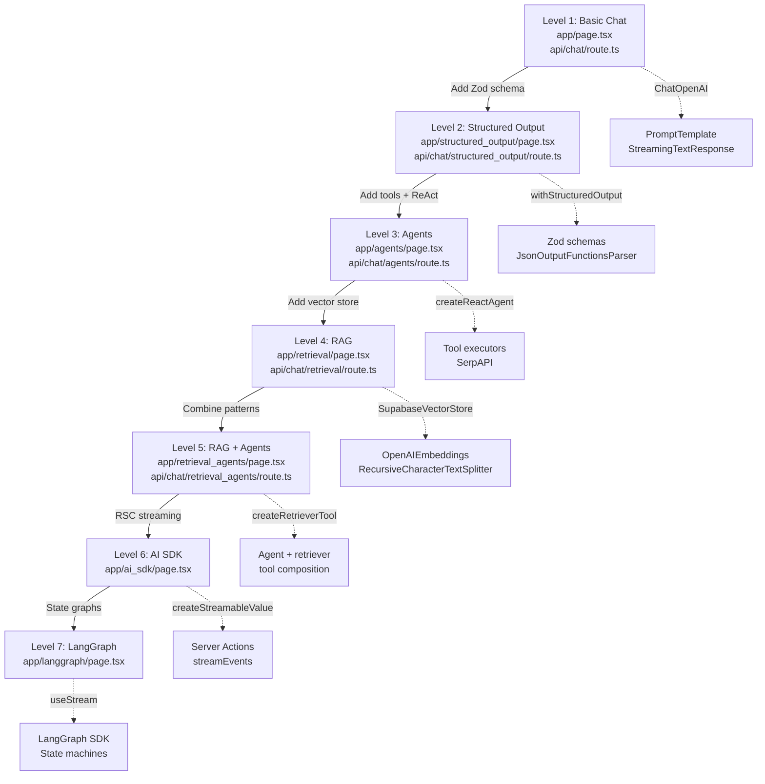
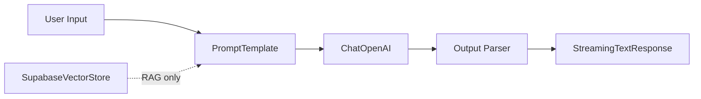
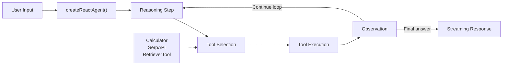
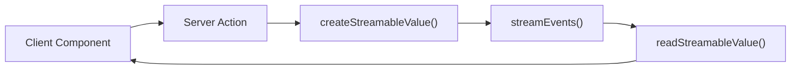

<!-- source: DeepWiki mcp.deepwiki.com · repo langchain-ai/langchain-nextjs-template · page 5 Features & Examples · fetched 2026-10-26 -->

# Features & Examples

Relevant source files

The following files were used as context for generating this wiki page:

- [README.md](README.md)
- [app/agents/page.tsx](app/agents/page.tsx)
- [app/page.tsx](app/page.tsx)

The LangChain Next.js template demonstrates seven progressively complex AI patterns, each building upon the concepts introduced in previous examples. This pedagogical structure allows developers to learn LangChain.js integration incrementally, starting with basic LLM interactions and advancing to sophisticated graph-based orchestration.

Each example is implemented as a complete feature with:
- A dedicated page component under `app/` 
- An API route handler under `app/api/chat/`
- Integration with the shared `ChatWindow` component

The examples progress from simple streaming chat to complex agent workflows, demonstrating different LangChain.js capabilities at each level.

For detailed documentation of each feature, see the respective sub-pages:
- [Basic Chat](#5.1)
- [Structured Output](#5.2)
- [Agents](#5.3)
- [Retrieval (RAG)](#5.4)
- [Retrieval Agents](#5.5)
- [AI SDK & React Server Components](#5.6)
- [LangGraph Integration](#5.7)

For information about the overall system architecture, see [System Architecture](#3).

## Pedagogical Progression

The template is structured as a learning path, with each example introducing new concepts while building on previous ones:

### Complexity Progression Diagram

Sources: [README.md:6-17](). [app/page.tsx](). [app/agents/page.tsx]()

## Implementation Patterns

Each feature demonstrates a specific LangChain.js pattern:

| Level | Feature | Page Component | API Route | Core Pattern | Key Technologies |
|-------|---------|----------------|-----------|--------------|------------------|
| 1 | Basic Chat | `app/page.tsx` | `api/chat/route.ts` | LCEL chain | `ChatOpenAI`, `PromptTemplate`, `HttpResponseOutputParser` |
| 2 | Structured Output | `app/structured_output/page.tsx` | `api/chat/structured_output/route.ts` | Schema enforcement | `Zod`, `withStructuredOutput()`, OpenAI function calling |
| 3 | Agents | `app/agents/page.tsx` | `api/chat/agents/route.ts` | ReAct agent | `createReactAgent()`, `SerpAPI`, Calculator tool |
| 4 | RAG | `app/retrieval/page.tsx` | `api/chat/retrieval/route.ts` | Vector retrieval | `SupabaseVectorStore`, `OpenAIEmbeddings`, retrieval chain |
| 5 | RAG + Agents | `app/retrieval_agents/page.tsx` | `api/chat/retrieval_agents/route.ts` | Combined pattern | `createRetrieverTool()`, agent with memory |
| 6 | AI SDK | `app/ai_sdk/page.tsx` | Server Actions | RSC streaming | `createStreamableValue()`, `streamEvents` API |
| 7 | LangGraph | `app/langgraph/page.tsx` | LangGraph backend | State graphs | `useStream` hook, `@langchain/langgraph-sdk` |

Sources: [README.md:9-17]()

## Data Flow Patterns

The examples demonstrate three main data flow patterns:

### Pattern 1: Simple LCEL Chains (Levels 1-2, 4)

Used by:
- `api/chat/route.ts` - Basic chat with system prompt
- `api/chat/structured_output/route.ts` - Schema-validated output
- `api/chat/retrieval/route.ts` - RAG chain with context injection

### Pattern 2: Agent Execution (Levels 3, 5)

Used by:
- `api/chat/agents/route.ts` - Agent with search and calculator tools
- `api/chat/retrieval_agents/route.ts` - Agent with retriever tool

### Pattern 3: Server Actions (Level 6)

Used by:
- `app/ai_sdk/page.tsx` - React Server Components with progressive streaming

Sources: [README.md:9-17]()

## Feature Capabilities Matrix

| Capability | Basic | Structured | Agents | RAG | RAG+Agents | AI SDK | LangGraph |
|------------|-------|------------|--------|-----|------------|--------|-----------|
| Streaming responses | ✓ | ✓ | ✓ | ✓ | ✓ | ✓ | ✓ |
| Typed outputs | - | ✓ | - | - | - | - | - |
| Tool use | - | - | ✓ | - | ✓ | ✓ | ✓ |
| Vector search | - | - | - | ✓ | ✓ | - | - |
| Memory/history | ✓ | ✓ | ✓ | ✓ | ✓ | ✓ | ✓ |
| Multi-step reasoning | - | - | ✓ | - | ✓ | ✓ | ✓ |
| Intermediate steps | - | - | ✓ | - | ✓ | ✓ | ✓ |
| Source citations | - | - | - | ✓ | ✓ | - | - |
| State management | - | - | - | - | - | - | ✓ |
| Branch/edit history | - | - | - | - | - | - | ✓ |

Sources: [README.md:6-17]()

## Feature Comparison

| Feature | Key Files | Main Technologies | Use Case |
|---------|-----------|-------------------|----------|
| Basic Chat | `/api/chat/route.ts` | ChatOpenAI, LCEL, StreamingTextResponse | Simple conversational AI |
| Structured Output | `/api/chat/structured_output/route.ts` | Zod schema, OpenAI function calling, JsonOutputFunctionsParser | Getting structured data from LLMs |
| Agents | `/api/chat/agents/route.ts` | LangGraph.js, SERP API, Calculator tool | Solving complex, multi-step problems |
| Retrieval | `/api/chat/retrieval/route.ts`, `/api/retrieval/ingest/route.ts` | SupabaseVectorStore, OpenAIEmbeddings, RecursiveCharacterTextSplitter | Enhancing responses with document context |
| Retrieval Agents | `/api/chat/retrieval_agents/route.ts` | Combination of retrieval and agent capabilities | Domain-specific QA with tool use capability |
| AI SDK | `/app/ai_sdk/page.tsx` | Vercel AI SDK, React Server Components | Streamlined AI UX in React applications |
| LangGraph | `/api/chat/langgraph/route.ts` | StateGraph, Agent nodes, Tool nodes | Complex, multi-turn conversational agents |

This table provides a quick reference to compare the different features demonstrated in the template, their implementation files, main technologies used, and target use cases.

Sources: [README.md](). [app/layout.tsx:75-87]()

---

