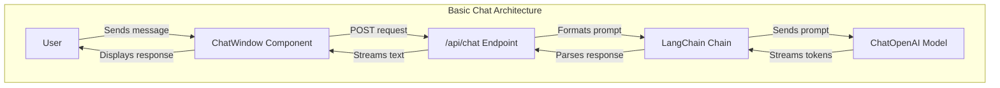
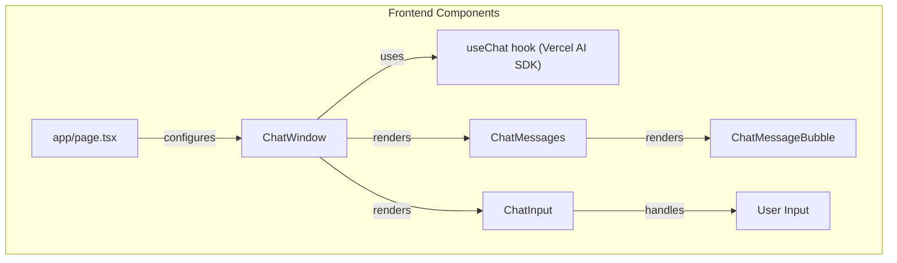
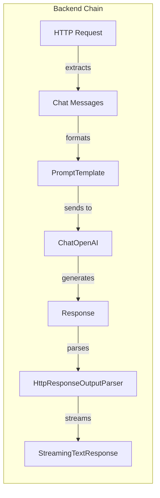
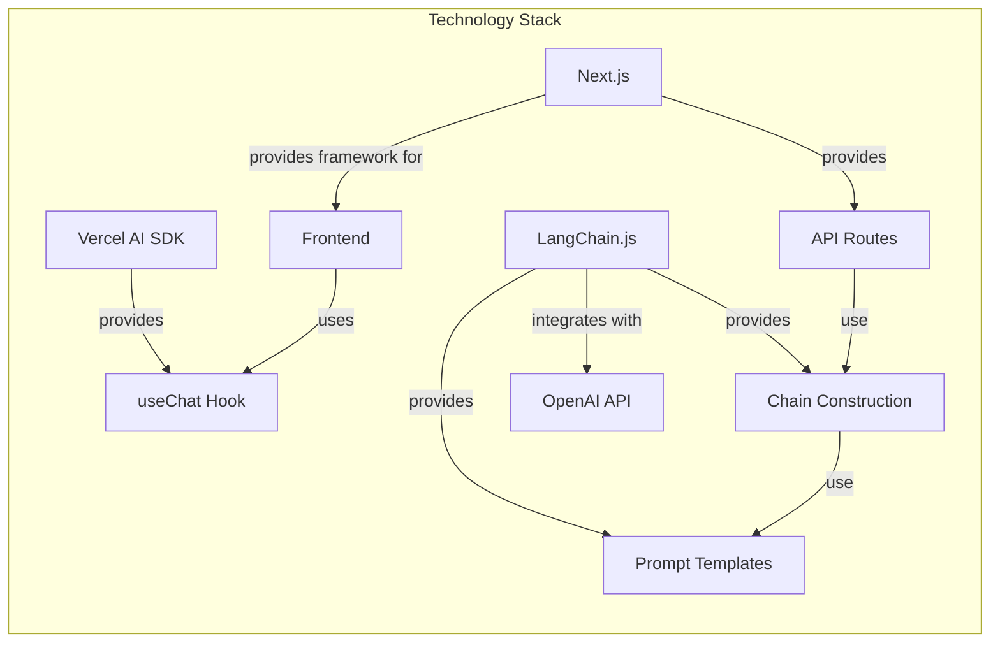

<!-- source: DeepWiki mcp.deepwiki.com · repo langchain-ai/langchain-nextjs-template · page 5.1 Basic Chat · fetched 2026-10-26 -->

# Basic Chat

<details>
<summary>Relevant source files</summary>

The following files were used as context for generating this wiki page:

- [app/agents/page.tsx](app/agents/page.tsx)
- [app/api/chat/route.ts](app/api/chat/route.ts)
- [app/page.tsx](app/page.tsx)

</details>


The Basic Chat feature demonstrates a simple but powerful implementation of a conversational AI interface using LangChain.js and Next.js. This document explains how the basic chat system works, its architecture, and how it serves as the foundation for more advanced features in the LangChain NextJS Template.

For more advanced chatbot implementations, see [Structured Output](#4.2), [Agents](#4.3), or [Retrieval](#4.4).

## Overview

The Basic Chat feature implements a streaming chat interface where users can interact with an OpenAI language model in real-time. By default, it's configured as a pirate-themed chatbot, but the prompt can be easily modified to create different personalities or capabilities.



Sources: [components/ChatWindow.tsx:186-207](), [app/api/chat/route.ts:28-72]()

## Key Components

### Frontend Implementation

The frontend of the Basic Chat feature consists of two primary components:

1. **Page Component**: Configures and renders the chat window
2. **ChatWindow Component**: Handles chat state and user interaction



The main page (`app/page.tsx`) configures the `ChatWindow` component with:
- The API endpoint (`api/chat`)
- An emoji for the AI messages (`🏴‍☠️`)
- A placeholder for the input field
- An information component to display when the chat is empty

Sources: [app/page.tsx:4-63](), [components/ChatWindow.tsx:168-356]()

### Backend Implementation

The backend of the Basic Chat feature is a Next.js API route that processes chat messages using LangChain.js:



Sources: [app/api/chat/route.ts:10-72]()

## Data Flow

The data flow in the Basic Chat system follows these steps:

1. User submits a message through the ChatInput component
2. ChatWindow sends the message to the `/api/chat` endpoint
3. The API route formats the message history and current message
4. A LangChain prompt template structures the input for the model
5. The ChatOpenAI model generates a response
6. The response is streamed back to the frontend
7. ChatWindow displays the streamed response in real-time

Sources: [components/ChatWindow.tsx:209-216](), [app/api/chat/route.ts:28-69]()

## Implementation Details

### Chat Interface

The chat interface is implemented through the `ChatWindow` component, which:
- Manages chat state using the Vercel AI SDK's `useChat` hook
- Renders chat messages with the `ChatMessages` component
- Handles user input with the `ChatInput` component
- Supports streaming responses
- Has a "stick to bottom" behavior for better UX

Sources: [components/ChatWindow.tsx:168-356]()

### API Route

The `/api/chat` API route handles chat requests by:

1. Extracting messages from the request body
2. Formatting previous messages and the current message
3. Creating a prompt template with the pirate-themed prompt
4. Initializing a ChatOpenAI model
5. Setting up an output parser for streaming responses
6. Creating a chain with the prompt, model, and parser
7. Streaming the response back to the client

The most notable part is the prompt template, which defines the chatbot's personality:

```
You are a pirate named Patchy. All responses must be extremely verbose and in pirate dialect.

Current conversation:
{chat_history}

User: {input}
AI:
```

Sources: [app/api/chat/route.ts:14-20](), [app/api/chat/route.ts:28-72]()

### LangChain Chain Construction

The LangChain chain is constructed using the pipe operator:

```javascript
const chain = prompt.pipe(model).pipe(outputParser);
```

This creates a processing pipeline that:
1. Takes the input and formats it using the prompt template
2. Passes the formatted prompt to the language model
3. Parses the model output for streaming

Sources: [app/api/chat/route.ts:62]()

## Configuration Table

The Basic Chat feature can be configured through these parameters:

| Component | Parameter | Default Value | Description |
|-----------|-----------|---------------|-------------|
| ChatOpenAI | model | "gpt-4o-mini" | The OpenAI model to use |
| ChatOpenAI | temperature | 0.8 | Controls randomness (0.0-1.0) |
| PromptTemplate | template | Pirate prompt | The prompt defining the AI's behavior |
| ChatWindow | endpoint | "api/chat" | API endpoint to send messages to |
| ChatWindow | emoji | "🏴‍☠️" | Emoji displayed with AI messages |

Sources: [app/api/chat/route.ts:45-48](), [app/page.tsx:56-61]()

## Customization Opportunities

The Basic Chat feature can be easily customized by:

1. **Changing the prompt**: Modify the template in `route.ts` to create different personalities
2. **Using different models**: Change the model parameter in the ChatOpenAI initialization
3. **Adjusting response style**: Modify the temperature parameter (higher for more creative responses)
4. **Frontend appearance**: Customize through the ChatWindow props in `page.tsx`

Sources: [app/api/chat/route.ts:14-20](), [app/api/chat/route.ts:45-48]()

## System Integration

The Basic Chat system integrates these technologies:

- **Next.js**: Provides the frontend framework and API routes
- **Vercel AI SDK**: Manages chat state and streaming
- **LangChain.js**: Orchestrates the language model interaction
- **OpenAI API**: Provides the underlying language model



Sources: [app/page.tsx:4-63](), [components/ChatWindow.tsx:186-207](), [app/api/chat/route.ts:4-7]()

## Limitations and Extensions

While the Basic Chat feature provides a solid foundation, it has some limitations:

1. No access to external tools or information beyond the model's training
2. No conversation persistence between sessions
3. Limited to text-only interactions

These limitations are addressed by other features in the template:
- [Structured Output](#4.2): For generating data in specific formats
- [Agents](#4.3): For giving the AI access to tools like search and calculators
- [Retrieval](#4.4): For augmenting the AI with external knowledge

Sources: [app/api/chat/route.ts:28-72]()

## Summary

The Basic Chat feature demonstrates the fundamental patterns for building AI-powered chat interfaces with LangChain.js and Next.js. It showcases:

1. Using the Vercel AI SDK for frontend chat state management
2. Implementing streaming responses for a better user experience
3. Constructing simple LangChain chains with prompt templates
4. Configuring language models for different personalities

This feature serves as the foundation for more advanced applications in the template while providing a complete, working example of a conversational AI interface.

Sources: [app/page.tsx:4-63](), [components/ChatWindow.tsx:168-356](), [app/api/chat/route.ts:28-72]()

---

