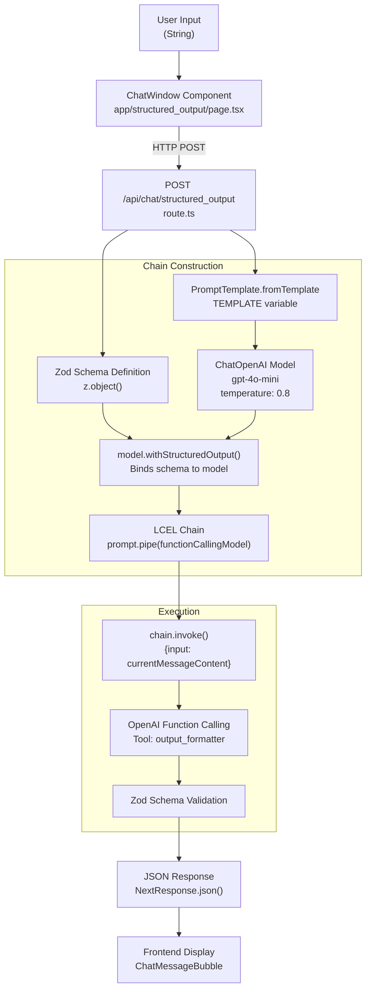
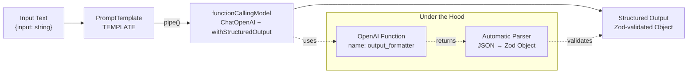
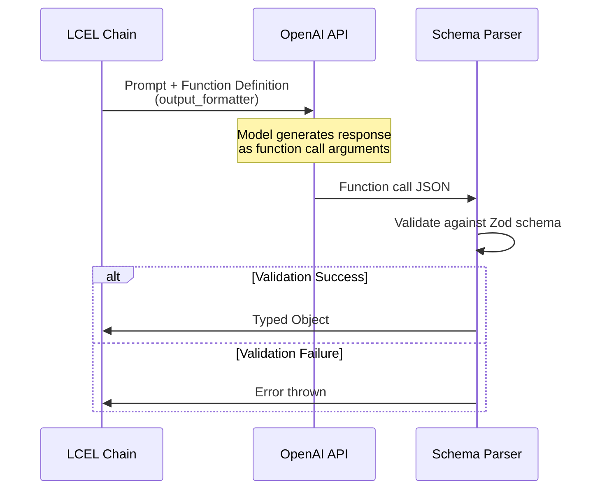
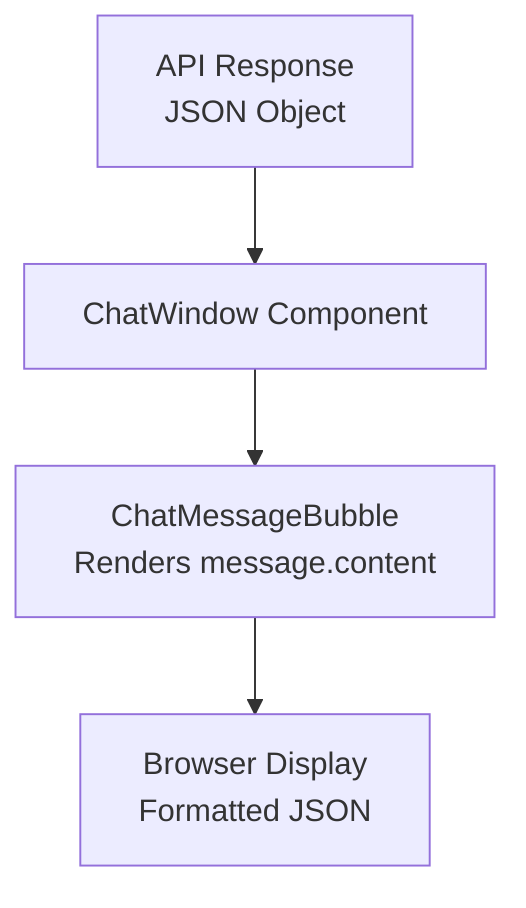

<!-- source: DeepWiki mcp.deepwiki.com · repo langchain-ai/langchain-nextjs-template · page 5.2 Structured Output · fetched 2026-10-26 -->

# Structured Output

<details>
<summary>Relevant source files</summary>

The following files were used as context for generating this wiki page:

- [app/api/chat/structured_output/route.ts](app/api/chat/structured_output/route.ts)
- [app/retrieval/page.tsx](app/retrieval/page.tsx)
- [app/retrieval_agents/page.tsx](app/retrieval_agents/page.tsx)
- [app/structured_output/page.tsx](app/structured_output/page.tsx)
- [components/ChatMessageBubble.tsx](components/ChatMessageBubble.tsx)

</details>


## Purpose and Scope

This document covers the **Structured Output** feature, which demonstrates how to enforce schema-validated JSON responses from LLM calls using Zod schemas and OpenAI function calling. This is the second feature in the pedagogical progression (Level 2), building upon the basic chat pattern by adding type safety and data validation.

For basic LLM interaction without structured output, see [Basic Chat](#5.1). For autonomous agents with tools, see [Agents](#5.3).

**Sources:** [app/structured_output/page.tsx:1-85](), [app/api/chat/structured_output/route.ts:1-81]()

---

## What is Structured Output?

Structured output refers to the capability of forcing an LLM to return responses in a predefined, validated format rather than free-form text. This implementation uses **OpenAI function calling** under the hood to guarantee that responses match a Zod schema, making the output programmatically consumable and type-safe.

The structured output chain in this template:
- Accepts arbitrary user input
- Extracts specific fields according to a schema
- Returns a JSON object with guaranteed structure
- Validates the output against the Zod schema

**Key difference from basic chat:** Instead of streaming unstructured text, this pattern returns a complete JSON response with typed fields.

**Sources:** [app/api/chat/structured_output/route.ts:18-23](), [app/structured_output/page.tsx:26-31]()

---

## Data Flow Architecture

The following diagram illustrates how user input flows through the structured output chain to produce validated JSON output:



**Sources:** [app/api/chat/structured_output/route.ts:24-80](), [app/structured_output/page.tsx:78-84]()

---

## Schema Definition with Zod

The schema defines the exact structure of the output using the **Zod** validation library. The template defines five fields that are extracted from any user input.

### Schema Structure

| Field | Type | Required | Description |
|-------|------|----------|-------------|
| `tone` | `enum` | Yes | One of: "positive", "negative", "neutral" |
| `entity` | `string` | Yes | The first mentioned entity in the input |
| `word_count` | `number` | Yes | Total number of words in the input |
| `chat_response` | `string` | Yes | A conversational response to the user |
| `final_punctuation` | `string` | No | The final punctuation mark, if any |

### Schema Implementation

The schema is defined at [app/api/chat/structured_output/route.ts:43-55]():

```typescript
const schema = z
  .object({
    tone: z
      .enum(["positive", "negative", "neutral"])
      .describe("The overall tone of the input"),
    entity: z.string().describe("The entity mentioned in the input"),
    word_count: z.number().describe("The number of words in the input"),
    chat_response: z.string().describe("A response to the human's input"),
    final_punctuation: z
      .optional(z.string())
      .describe("The final punctuation mark in the input, if any."),
  })
  .describe("Should always be used to properly format output");
```

The `.describe()` methods provide semantic hints to the LLM about what each field should contain.

**Sources:** [app/api/chat/structured_output/route.ts:43-55](), [app/structured_output/page.tsx:43-48]()

---

## Chain Architecture

The structured output implementation uses the **LCEL (LangChain Expression Language)** pattern to compose a chain that processes input and returns structured data.



### Chain Components

1. **PromptTemplate**: Formats the extraction instruction with user input
   - Template defined at [app/api/chat/structured_output/route.ts:10-16]()
   - Instructs the model to extract fields from input

2. **ChatOpenAI Model**: Standard GPT-4o-mini model instance
   - Configured at [app/api/chat/structured_output/route.ts:34-37]()
   - Temperature set to 0.8 for creative responses

3. **withStructuredOutput**: Binds the Zod schema to the model
   - Applied at [app/api/chat/structured_output/route.ts:63-65]()
   - Creates `functionCallingModel` that enforces the schema
   - Names the function "output_formatter" for OpenAI

4. **LCEL Pipe**: Chains the components together
   - Defined at [app/api/chat/structured_output/route.ts:70]()
   - Syntax: `prompt.pipe(functionCallingModel)`

**Sources:** [app/api/chat/structured_output/route.ts:30-70]()

---

## OpenAI Function Calling Mechanism

The `withStructuredOutput` method leverages **OpenAI function calling** (also known as tool calling) to enforce the schema. This mechanism works by:

1. Converting the Zod schema into an OpenAI function/tool definition
2. Instructing the model to always call the "output_formatter" function
3. Parsing the function call arguments as the structured output
4. Validating the result against the original Zod schema



The function is named "output_formatter" at [app/api/chat/structured_output/route.ts:64]().

**Important Note:** Function calling is currently only supported with ChatOpenAI models, as noted in the comment at [app/api/chat/structured_output/route.ts:32-33]().

**Sources:** [app/api/chat/structured_output/route.ts:58-65]()

---

## API Route Implementation

The API route at [app/api/chat/structured_output/route.ts]() implements the complete structured output handler.

### Runtime Configuration

The route uses the **Edge runtime** for low latency and small bundle size:
```typescript
export const runtime = "edge";
```
Defined at [app/api/chat/structured_output/route.ts:8]().

### Request Handler

The `POST` handler at [app/api/chat/structured_output/route.ts:24-80]() performs the following steps:

1. **Parse request body** - Extracts messages array from request
   - [app/api/chat/structured_output/route.ts:26-28]()

2. **Extract latest message** - Gets the most recent user input
   - [app/api/chat/structured_output/route.ts:28]()

3. **Initialize chain components** - Creates prompt, model, and schema
   - [app/api/chat/structured_output/route.ts:30-70]()

4. **Invoke chain** - Executes the structured output chain
   - [app/api/chat/structured_output/route.ts:72-74]()

5. **Return JSON response** - Sends validated object to frontend
   - [app/api/chat/structured_output/route.ts:76]()

### Error Handling

The route includes try-catch error handling at [app/api/chat/structured_output/route.ts:77-79](), returning error messages with appropriate HTTP status codes.

**Sources:** [app/api/chat/structured_output/route.ts:24-80]()

---

## Prompt Template

The extraction prompt is minimal and focused on the task:

```
Extract the requested fields from the input.

The field "entity" refers to the first mentioned entity in the input.

Input:

{input}
```

Defined at [app/api/chat/structured_output/route.ts:10-16]().

The prompt provides:
- Clear extraction instruction
- Specific guidance for the "entity" field
- Placeholder for user input (`{input}`)

The schema descriptions (via `.describe()`) provide additional semantic information to guide extraction.

**Sources:** [app/api/chat/structured_output/route.ts:10-16]()

---

## Frontend Integration

The frontend page at [app/structured_output/page.tsx]() integrates with the API route using the standard `ChatWindow` component pattern.

### Page Configuration

```typescript
<ChatWindow
  endpoint="api/chat/structured_output"
  emptyStateComponent={InfoCard}
  placeholder="No matter what you type here, I'll always return the same JSON object with the same structure!"
  emoji="🧱"
/>
```

Configured at [app/structured_output/page.tsx:78-84]().

### Key Configuration Properties

| Property | Value | Purpose |
|----------|-------|---------|
| `endpoint` | "api/chat/structured_output" | API route to call |
| `emptyStateComponent` | `InfoCard` | Informational guide display |
| `placeholder` | Descriptive text | User input guidance |
| `emoji` | "🧱" | Visual identifier (building blocks) |

**Note:** This implementation does **not** use streaming. The response is a complete JSON object returned via `NextResponse.json()`, unlike the basic chat which streams tokens progressively.

**Sources:** [app/structured_output/page.tsx:78-84](), [app/api/chat/structured_output/route.ts:76]()

---

## Response Rendering

The structured output is rendered by the `ChatWindow` component, which uses `ChatMessageBubble` internally. However, because the response is a JSON object rather than a string, the frontend displays it as formatted JSON.



The message content is displayed at [components/ChatMessageBubble.tsx:26]() using `whitespace-pre-wrap` styling to preserve JSON formatting.

**Sources:** [components/ChatMessageBubble.tsx:4-54](), [app/structured_output/page.tsx:78-84]()

---

## Example Walkthrough

### Input Example
User types: `"What a beautiful day!"`

### Execution Flow

1. **Frontend** sends POST request to `/api/chat/structured_output`
2. **Prompt** is formatted with the user input
3. **Model** processes the input using function calling
4. **Parser** validates the function call result against the schema
5. **API** returns JSON response

### Expected Output Structure

```json
{
  "tone": "positive",
  "entity": "day",
  "word_count": 4,
  "chat_response": "It certainly sounds like you're enjoying the weather!",
  "final_punctuation": "!"
}
```

Each field is guaranteed to:
- Exist (except `final_punctuation` which is optional)
- Match the defined type
- Be validated by Zod

**Sources:** [app/structured_output/page.tsx:71](), [app/api/chat/structured_output/route.ts:43-55]()

---

## Key Differences from Other Patterns

| Aspect | Structured Output | Basic Chat | Agents |
|--------|------------------|------------|---------|
| **Response Type** | JSON Object | Streaming Text | Mixed (JSON/Stream) |
| **Schema Enforcement** | Yes (Zod) | No | Tool-specific |
| **OpenAI Features** | Function Calling | Standard Chat | Tool Calling |
| **Output Validation** | Automatic | None | Tool-specific |
| **Use Case** | Data extraction | Conversation | Task execution |

For basic conversational chat without schemas, see [Basic Chat](#5.1).  
For tool-using agents that can perform actions, see [Agents](#5.3).

**Sources:** [app/api/chat/structured_output/route.ts:1-81](), [app/structured_output/page.tsx:1-85]()

---

## Technical Considerations

### Alternative Schema Formats

While this implementation uses Zod, the `withStructuredOutput` method also accepts raw JSON Schema definitions. The comment at [app/api/chat/structured_output/route.ts:40-42]() notes this flexibility:

```
We use Zod (https://zod.dev) to define our schema for convenience,
but you can pass JSON schema if desired.
```

### Model Compatibility

Function calling is **currently only supported with ChatOpenAI models**, as documented at [app/api/chat/structured_output/route.ts:32-33](). Other providers may require different structured output approaches.

### Edge Runtime Constraints

The route runs on Vercel Edge Functions, which has a **1MB bundle size limit**. The structured output implementation is lightweight and suitable for edge deployment.

**Sources:** [app/api/chat/structured_output/route.ts:8](), [app/api/chat/structured_output/route.ts:32-42]()

---

## Related Documentation

- **LangChain Structured Output Guide**: [https://js.langchain.com/v0.2/docs/how_to/structured_output](https://js.langchain.com/v0.2/docs/how_to/structured_output) (referenced at [app/api/chat/structured_output/route.ts:22]())
- **Zod Documentation**: [https://zod.dev/](https://zod.dev/) (referenced at [app/structured_output/page.tsx:54-56]())

**Sources:** [app/api/chat/structured_output/route.ts:18-23](), [app/structured_output/page.tsx:53-59]()

---

