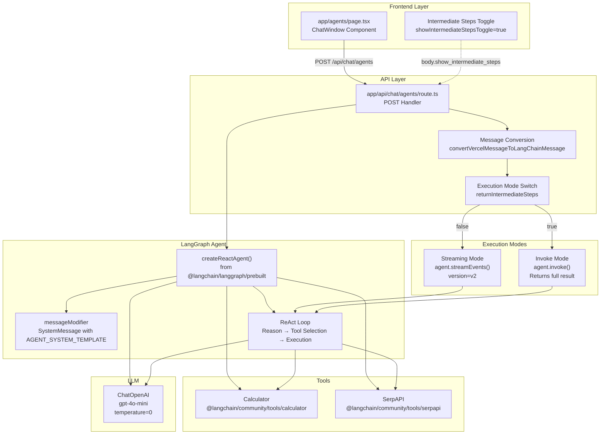
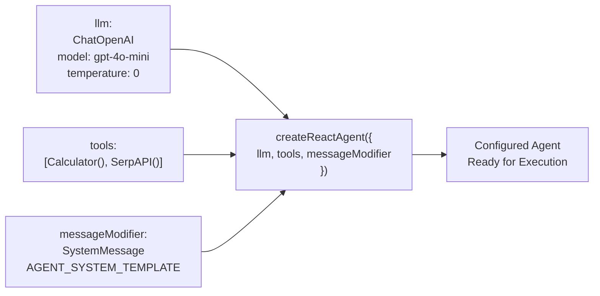
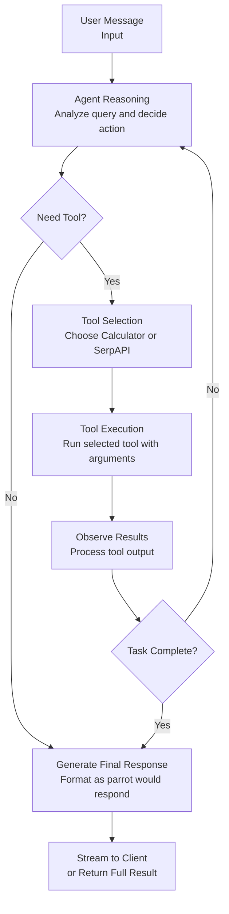
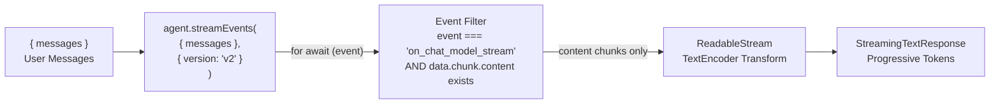
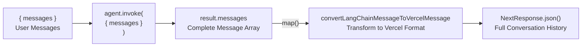
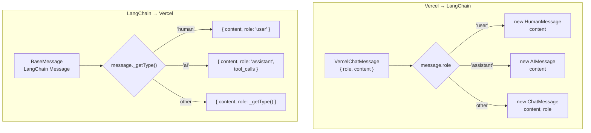
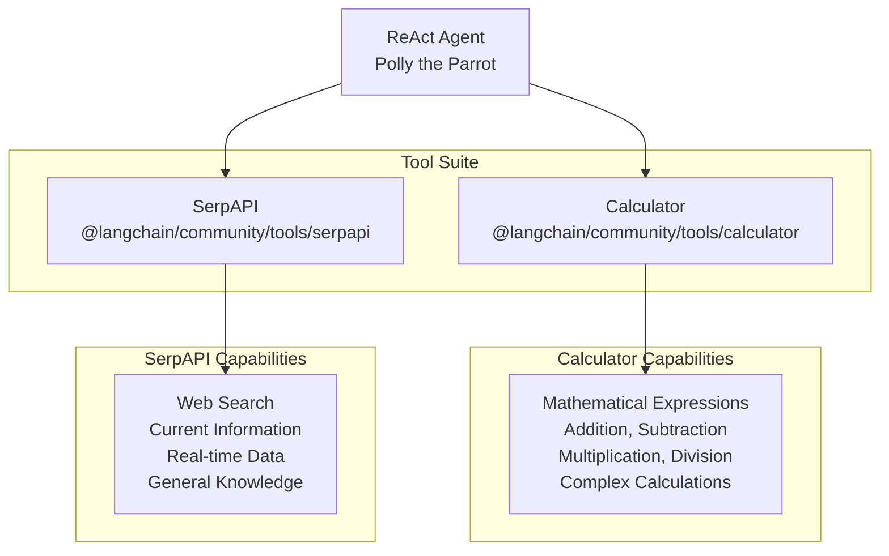
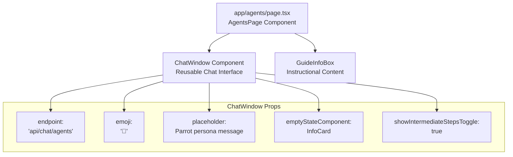

<!-- source: DeepWiki mcp.deepwiki.com · repo langchain-ai/langchain-nextjs-template · page 5.3 Agents · fetched 2026-10-26 -->

# Agents

<details>
<summary>Relevant source files</summary>

The following files were used as context for generating this wiki page:

- [app/agents/page.tsx](app/agents/page.tsx)
- [app/api/chat/agents/route.ts](app/api/chat/agents/route.ts)
- [app/page.tsx](app/page.tsx)

</details>


## Purpose and Scope

This page documents the agent implementation showcased at `/agents`, which demonstrates autonomous tool-calling capabilities using the ReAct (Reasoning and Acting) pattern. The agent can select and execute tools dynamically based on user queries, implementing a think → act → observe loop powered by LangChain's `createReactAgent` function from LangGraph.

The implementation supports two execution modes: streaming responses for real-time feedback, and invoke mode for inspecting intermediate reasoning steps. The agent is configured with two tools: a calculator for mathematical operations and SerpAPI for web search capabilities.

For information about agents combined with retrieval capabilities, see [Retrieval Agents](#5.5). For advanced streaming of agent events using React Server Components, see [AI SDK & React Server Components](#5.6). For stateful graph-based agent orchestration, see [LangGraph Integration](#5.7).

---

## Agent Architecture

The agent system consists of three primary layers: the frontend interface at `/agents/page.tsx`, the API endpoint at `/api/chat/agents/route.ts`, and the underlying LangGraph agent created by `createReactAgent`.



**Sources:** [app/agents/page.tsx](), [app/api/chat/agents/route.ts:1-140]()

---

## ReAct Pattern Implementation

The ReAct (Reasoning and Acting) pattern enables the agent to iteratively reason about a problem, select appropriate tools, execute them, and observe results before generating a final response. This pattern is implemented using LangGraph's prebuilt `createReactAgent` function.

### Agent Initialization

The agent is initialized with three key components:



**Configuration Details:**

| Parameter | Value | Purpose |
|-----------|-------|---------|
| `llm` | `ChatOpenAI({ model: "gpt-4o-mini", temperature: 0 })` | Language model for reasoning and response generation |
| `tools` | `[new Calculator(), new SerpAPI()]` | Available tools for the agent to call |
| `messageModifier` | `new SystemMessage(AGENT_SYSTEM_TEMPLATE)` | System prompt defining agent persona |

**Sources:** [app/api/chat/agents/route.ts:68-86]()

### System Prompt and Persona

The agent uses a custom system prompt to define its persona as "Polly," a talking parrot:

```
You are a talking parrot named Polly. All final responses must be how a talking parrot 
would respond. Squawk often!
```

This persona is applied via the `messageModifier` parameter, which injects the system message into the agent's prompt template. The parrot theme demonstrates how to customize agent behavior while maintaining tool-calling capabilities.

**Sources:** [app/api/chat/agents/route.ts:42](), [app/agents/page.tsx:40-45]()

---

## ReAct Execution Loop

The ReAct agent follows an iterative execution pattern where it reasons about the task, decides whether to use a tool, executes it if necessary, and observes the results before either continuing iteration or producing a final answer.



**Example Execution Trace:**

For the query "What is the weather in Honolulu?":

1. **Reason**: Agent determines it needs to search for current weather information
2. **Select Tool**: Chooses `SerpAPI` over `Calculator` since it's a search query
3. **Execute**: Calls SerpAPI with search query "weather Honolulu"
4. **Observe**: Receives search results from SerpAPI
5. **Reason**: Determines the information is sufficient
6. **Final Answer**: Formats response in parrot persona: "Squawk! The weather in Honolulu is..."

**Sources:** [app/api/chat/agents/route.ts:76-86](), [app/agents/page.tsx:56]()

---

## Execution Modes

The agent API supports two execution modes controlled by the `show_intermediate_steps` request parameter. Each mode serves different use cases: streaming for real-time user experience, and invoke for debugging and inspection.

### Streaming Mode

When `returnIntermediateSteps` is `false`, the agent uses `streamEvents()` to stream only the final response tokens as they're generated. This mode filters out tool calls and intermediate reasoning steps.



**Implementation Details:**

The streaming filter specifically checks for:
- Event type `"on_chat_model_stream"` to capture model output
- Presence of `data.chunk.content` to exclude tool calls (which have no content)

This ensures that only the final answer is streamed, not the intermediate tool invocations.

**Sources:** [app/api/chat/agents/route.ts:88-121]()

### Invoke Mode with Intermediate Steps

When `returnIntermediateSteps` is `true`, the agent uses `invoke()` to return the complete execution history including all intermediate reasoning steps and tool calls.



**Message Types in Result:**

The returned `messages` array contains:
- `HumanMessage`: User input
- `AIMessage`: Agent reasoning and tool call decisions
- `ToolMessage`: Results from tool executions
- `AIMessage` (final): Final response in parrot persona

**Sources:** [app/api/chat/agents/route.ts:122-136]()

---

## Message Format Conversion

The API implements bidirectional message format conversion between Vercel AI SDK's message format and LangChain's `BaseMessage` types. This conversion is critical for integrating the LangChain agent with the Vercel AI SDK frontend.

### Conversion Functions



**Function Signatures and Usage:**

| Function | Input Type | Output Type | Purpose |
|----------|------------|-------------|---------|
| `convertVercelMessageToLangChainMessage` | `VercelChatMessage` | `HumanMessage \| AIMessage \| ChatMessage` | Convert request messages for agent input |
| `convertLangChainMessageToVercelMessage` | `BaseMessage` | `{ content, role, tool_calls? }` | Convert agent response for client display |

**Tool Calls Handling:**

When converting `AIMessage` to Vercel format, the function extracts `tool_calls` from the message. This allows the frontend to display which tools the agent decided to use during its reasoning process.

**Sources:** [app/api/chat/agents/route.ts:18-40](), [app/api/chat/agents/route.ts:58-63](), [app/api/chat/agents/route.ts:132]()

---

## Tools Configuration

The agent has access to two tools that expand its capabilities beyond pure language model reasoning. Tools are configured as instances passed to the `tools` array parameter of `createReactAgent`.

### Available Tools



**Tool Details:**

| Tool | Import Path | Configuration | Typical Use Cases |
|------|-------------|---------------|-------------------|
| `Calculator` | `@langchain/community/tools/calculator` | Default constructor | Mathematical calculations, unit conversions, arithmetic operations |
| `SerpAPI` | `@langchain/community/tools/serpapi` | Requires `SERPAPI_API_KEY` env var | Weather queries, current events, fact checking, general web search |

**Tool Selection Logic:**

The agent autonomously selects which tool to use based on the query content. The LLM receives descriptions of each tool's capabilities and decides:
- Use `Calculator` for queries requiring numerical computation
- Use `SerpAPI` for queries requiring up-to-date information from the web
- Use neither for queries answerable from the model's training data

**Sources:** [app/api/chat/agents/route.ts:6-7](), [app/api/chat/agents/route.ts:67](), [app/agents/page.tsx:28-30]()

### SerpAPI Integration

SerpAPI requires an API key configured in environment variables. The route includes a comment indicating this requirement.

**Environment Variable:**
```
SERPAPI_API_KEY=your_serpapi_key_here
```

If this variable is not set, the SerpAPI tool will fail when invoked. The Calculator tool has no external dependencies.

**Sources:** [app/api/chat/agents/route.ts:65-66]()

---

## Frontend Integration

The agent's frontend page at `/agents` uses the reusable `ChatWindow` component with specific configuration for agent interactions.

### Page Configuration



**Props Configuration:**

| Prop | Value | Purpose |
|------|-------|---------|
| `endpoint` | `"api/chat/agents"` | API route for agent requests |
| `emoji` | `"🦜"` | Display icon matching parrot persona |
| `placeholder` | `"Squawk! I'm a conversational agent! Ask me about the current weather in Honolulu!"` | User input placeholder text |
| `emptyStateComponent` | `InfoCard` | Instructional content shown before first message |
| `showIntermediateStepsToggle` | `true` | Enable toggle for intermediate steps display |

**Sources:** [app/agents/page.tsx:64-71]()

### Intermediate Steps Toggle

The `showIntermediateStepsToggle` prop is unique to the agents page. When enabled, it adds a UI toggle that allows users to switch between:
- **Streaming mode**: Real-time response generation
- **Invoke mode**: Full conversation history with intermediate reasoning steps

This toggle controls the `show_intermediate_steps` parameter sent in the API request body.

**Sources:** [app/agents/page.tsx:69](), [app/api/chat/agents/route.ts:53]()

---

## Runtime Configuration

The agent API route runs on the Vercel Edge Runtime, which imposes specific constraints and optimizations.

### Edge Runtime

```typescript
export const runtime = "edge";
```

This configuration enables:
- **Low latency**: Execution at edge locations near users
- **Global distribution**: Automatic deployment to edge network
- **Bundle size limit**: 1 MB maximum bundle size
- **Cold start optimization**: Faster initialization than traditional serverless

**Implications:**

The Edge runtime restricts certain Node.js APIs. All dependencies (LangChain, OpenAI SDK, tools) must be compatible with the Edge environment. The template's careful dependency selection ensures edge compatibility.

**Sources:** [app/api/chat/agents/route.ts:16]()

---

## Error Handling

The API implements try-catch error handling that returns appropriate HTTP status codes and error messages.

**Error Response Format:**

```typescript
{
  error: string,  // Error message
  status: number  // HTTP status code (default 500)
}
```

Errors may occur from:
- Missing environment variables (SERPAPI_API_KEY, OPENAI_API_KEY)
- Invalid message format
- Tool execution failures
- LLM API errors
- Network timeouts

**Sources:** [app/api/chat/agents/route.ts:137-139]()

---

## Usage Examples

### Example 1: Weather Query (Uses SerpAPI)

**User Input:**
```
What is the weather in Honolulu?
```

**Agent Execution:**
1. Reason: Needs current weather information
2. Select: SerpAPI (search capability)
3. Execute: Search for "weather Honolulu"
4. Observe: Process search results
5. Respond: "Squawk! The weather in Honolulu is sunny and 82°F! Perfect beach weather! Squawk!"

### Example 2: Calculation (Uses Calculator)

**User Input:**
```
What is 1234 * 5678?
```

**Agent Execution:**
1. Reason: Needs mathematical calculation
2. Select: Calculator (arithmetic capability)
3. Execute: Calculate 1234 * 5678
4. Observe: Result is 7006652
5. Respond: "Squawk! The answer is 7,006,652! I counted all the crackers! Squawk!"

### Example 3: No Tool Required

**User Input:**
```
Tell me a joke about parrots.
```

**Agent Execution:**
1. Reason: Can answer from training data, no tools needed
2. Respond directly: "Squawk! Why did the parrot wear a raincoat? Because it wanted to be a polytalkest! Squawk squawk!"

**Sources:** [app/agents/page.tsx:56](), [app/agents/page.tsx:40-44]()

---

## Summary

The agents implementation demonstrates autonomous tool-calling using the ReAct pattern via LangGraph's `createReactAgent`. Key characteristics:

- **Two execution modes**: Streaming for real-time responses, invoke for debugging
- **Tool suite**: Calculator and SerpAPI for expanded capabilities
- **Message conversion**: Bidirectional format translation between Vercel AI SDK and LangChain
- **Custom persona**: System prompt modification for personality injection
- **Edge runtime**: Optimized for low-latency global deployment
- **Frontend integration**: Reusable ChatWindow with intermediate steps toggle

The implementation serves as a foundation for building autonomous AI agents that can reason about tasks and select appropriate tools to accomplish goals.

**Sources:** [app/api/chat/agents/route.ts:1-140](), [app/agents/page.tsx:1-72]()

---

