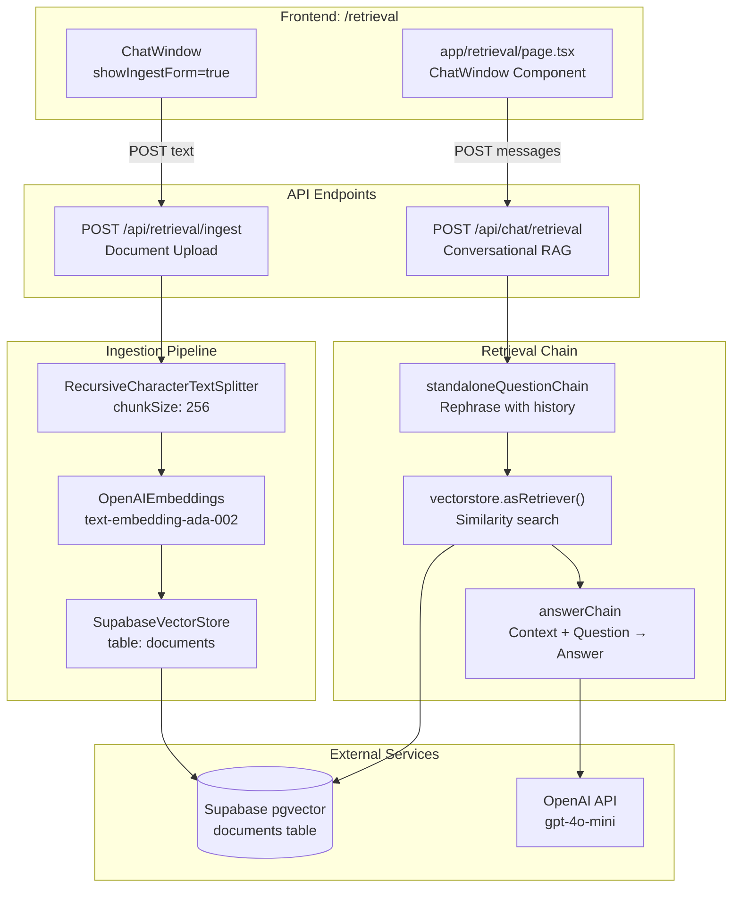
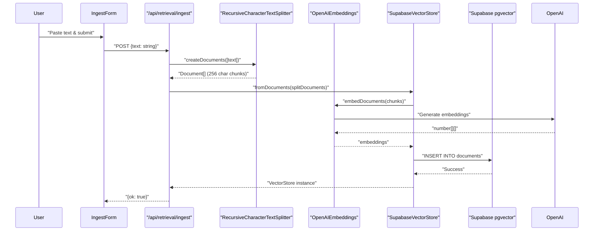

<!-- source: DeepWiki mcp.deepwiki.com · repo langchain-ai/langchain-nextjs-template · page 5.4 Retrieval (RAG) · fetched 2026-10-26 -->

# Retrieval (RAG)

<details>
<summary>Relevant source files</summary>

The following files were used as context for generating this wiki page:

- [app/api/chat/retrieval/route.ts](app/api/chat/retrieval/route.ts)
- [app/api/retrieval/ingest/route.ts](app/api/retrieval/ingest/route.ts)
- [app/retrieval/page.tsx](app/retrieval/page.tsx)
- [app/retrieval_agents/page.tsx](app/retrieval_agents/page.tsx)
- [app/structured_output/page.tsx](app/structured_output/page.tsx)
- [components/ChatMessageBubble.tsx](components/ChatMessageBubble.tsx)
- [components/IntermediateStep.tsx](components/IntermediateStep.tsx)
- [data/DefaultRetrievalText.ts](data/DefaultRetrievalText.ts)

</details>


## Purpose and Scope

This document explains the Retrieval-Augmented Generation (RAG) implementation in the template, which demonstrates how to perform question-answering over custom documents using vector similarity search. The RAG pattern combines document retrieval with LLM generation to produce answers grounded in a knowledge base.

This page covers the standalone RAG chain implementation. For the combined pattern of agents with retrieval capabilities, see [Retrieval Agents](#5.5). For basic chat without retrieval, see [Basic Chat](#5.1).

---

## System Overview

The RAG implementation consists of two primary operations: **document ingestion** (uploading and indexing documents into a vector store) and **retrieval-augmented answering** (retrieving relevant documents and generating answers based on them).

### RAG Architecture Diagram



**Sources:** [app/retrieval/page.tsx](), [app/api/chat/retrieval/route.ts](), [app/api/retrieval/ingest/route.ts]()

---

## Document Ingestion Process

The ingestion endpoint at `/api/retrieval/ingest` processes raw text and stores it in a vector database for later retrieval.

### Ingestion Pipeline Components

| Component | Configuration | Purpose |
|-----------|--------------|---------|
| `RecursiveCharacterTextSplitter` | `chunkSize: 256`<br/>`chunkOverlap: 20` | Splits text into overlapping chunks |
| `OpenAIEmbeddings` | Default model | Generates vector embeddings |
| `SupabaseVectorStore` | `tableName: "documents"`<br/>`queryName: "match_documents"` | Stores vectors with pgvector |

### Ingestion Flow



**Sources:** [app/api/retrieval/ingest/route.ts:20-63]()

### Text Splitting Configuration

The template uses `RecursiveCharacterTextSplitter` configured for markdown:

```typescript
// app/api/retrieval/ingest/route.ts:42-45
const splitter = RecursiveCharacterTextSplitter.fromLanguage("markdown", {
  chunkSize: 256,
  chunkOverlap: 20,
});
```

The small `chunkSize` of 256 characters ensures fine-grained retrieval, while the 20-character overlap maintains context across chunk boundaries.

**Sources:** [app/api/retrieval/ingest/route.ts:42-45]()

### Supabase Vector Store Setup

The vector store is initialized with specific table and query function names:

```typescript
// app/api/retrieval/ingest/route.ts:49-56
const vectorstore = await SupabaseVectorStore.fromDocuments(
  splitDocuments,
  new OpenAIEmbeddings(),
  {
    client,
    tableName: "documents",
    queryName: "match_documents",
  },
);
```

The `match_documents` query function must be created in Supabase as documented in the [LangChain.js Supabase integration guide](https://js.langchain.com/v0.2/docs/integrations/vectorstores/supabase).

**Sources:** [app/api/retrieval/ingest/route.ts:49-57]()

---

## Retrieval Chain Architecture

The retrieval endpoint at `/api/chat/retrieval` implements a conversational RAG chain that handles multi-turn conversations with context from retrieved documents.

### Two-Stage Chain Design

The chain operates in two sequential stages:

```mermaid
graph LR
    subgraph "Stage 1: Question Condensation"
        Input["Current question +<br/>Chat history"]
        CondensePrompt["condenseQuestionPrompt<br/>CONDENSE_QUESTION_TEMPLATE"]
        CondenseModel["ChatOpenAI<br/>gpt-4o-mini"]
        StandaloneQ["Standalone question<br/>(dereferenced)"]
        
        Input --> CondensePrompt
        CondensePrompt --> CondenseModel
        CondenseModel --> StandaloneQ
    end
    
    subgraph "Stage 2: Retrieval & Answer"
        StandaloneQ2["Standalone question"]
        VectorRetrieval["vectorstore.asRetriever()"]
        CombineDocs["combineDocumentsFn"]
        AnswerPrompt["answerPrompt<br/>ANSWER_TEMPLATE"]
        AnswerModel["ChatOpenAI<br/>gpt-4o-mini"]
        StreamOut["BytesOutputParser<br/>Streaming response"]
        
        StandaloneQ2 --> VectorRetrieval
        VectorRetrieval --> CombineDocs
        CombineDocs --> AnswerPrompt
        AnswerPrompt --> AnswerModel
        AnswerModel --> StreamOut
    end
    
    StandaloneQ -.->|"Passes to"| StandaloneQ2
```



**Sources:** [app/api/chat/retrieval/route.ts:101-144]()

### Stage 1: Standalone Question Chain

The first chain converts a follow-up question into a standalone question by dereferencing pronouns based on chat history:

```typescript
// app/api/chat/retrieval/route.ts:101-105
const standaloneQuestionChain = RunnableSequence.from([
  condenseQuestionPrompt,
  model,
  new StringOutputParser(),
]);
```

The prompt template at [app/api/chat/retrieval/route.ts:36-46]() instructs the model to rephrase questions like "What does it do?" into "What does task decomposition do?" by referencing the conversation context.

**Sources:** [app/api/chat/retrieval/route.ts:36-46](), [app/api/chat/retrieval/route.ts:101-105]()

### Stage 2: Answer Generation Chain

The second chain retrieves relevant documents and generates an answer:

```typescript
// app/api/chat/retrieval/route.ts:124-135
const answerChain = RunnableSequence.from([
  {
    context: RunnableSequence.from([
      (input) => input.question,
      retrievalChain,
    ]),
    chat_history: (input) => input.chat_history,
    question: (input) => input.question,
  },
  answerPrompt,
  model,
]);
```

The chain constructs three parallel inputs:
- `context`: Retrieved documents combined into a single string
- `chat_history`: Formatted conversation history
- `question`: The standalone question from stage 1

**Sources:** [app/api/chat/retrieval/route.ts:124-135]()

### Persona: Dana the Puppy

The answer prompt at [app/api/chat/retrieval/route.ts:48-62]() instructs the model to respond as "Dana, an energetic talking puppy" who uses lots of puns. This demonstrates how persona can be injected into RAG systems.

**Sources:** [app/api/chat/retrieval/route.ts:48-62]()

---

## Query Processing Pipeline

### Complete LCEL Chain Composition

The final conversational retrieval chain combines both stages:

```typescript
// app/api/chat/retrieval/route.ts:137-144
const conversationalRetrievalQAChain = RunnableSequence.from([
  {
    question: standaloneQuestionChain,
    chat_history: (input) => input.chat_history,
  },
  answerChain,
  new BytesOutputParser(),
]);
```

This creates the full pipeline: `question → standalone question → retrieval → answer → streaming bytes`.

**Sources:** [app/api/chat/retrieval/route.ts:137-144]()

### Message Format Conversion

The utility function `formatVercelMessages` converts Vercel AI SDK message format to a simple text format for the LLM:

```typescript
// app/api/chat/retrieval/route.ts:23-34
const formatVercelMessages = (chatHistory: VercelChatMessage[]) => {
  const formattedDialogueTurns = chatHistory.map((message) => {
    if (message.role === "user") {
      return `Human: ${message.content}`;
    } else if (message.role === "assistant") {
      return `Assistant: ${message.content}`;
    } else {
      return `${message.role}: ${message.content}`;
    }
  });
  return formattedDialogueTurns.join("\n");
};
```

This produces a format like:
```
Human: What is task decomposition?
Assistant: Task decomposition is...
Human: How does it work?
```

**Sources:** [app/api/chat/retrieval/route.ts:23-34]()

### Retriever Callback Pattern

The implementation uses a Promise-based callback to capture retrieved documents:

```typescript
// app/api/chat/retrieval/route.ts:107-120
let resolveWithDocuments: (value: Document[]) => void;
const documentPromise = new Promise<Document[]>((resolve) => {
  resolveWithDocuments = resolve;
});

const retriever = vectorstore.asRetriever({
  callbacks: [
    {
      handleRetrieverEnd(documents) {
        resolveWithDocuments(documents);
      },
    },
  ],
});
```

This allows the handler to await the documents after streaming begins, enabling source citation in response headers.

**Sources:** [app/api/chat/retrieval/route.ts:107-120]()

---

## Source Citation System

### Embedding Sources in Response Headers

Retrieved documents are serialized and sent via the `x-sources` header:

```typescript
// app/api/chat/retrieval/route.ts:151-168
const documents = await documentPromise;
const serializedSources = Buffer.from(
  JSON.stringify(
    documents.map((doc) => {
      return {
        pageContent: doc.pageContent.slice(0, 50) + "...",
        metadata: doc.metadata,
      };
    }),
  ),
).toString("base64");

return new StreamingTextResponse(stream, {
  headers: {
    "x-message-index": (previousMessages.length + 1).toString(),
    "x-sources": serializedSources,
  },
});
```

The sources are base64-encoded JSON containing truncated page content (first 50 characters) and full metadata.

**Sources:** [app/api/chat/retrieval/route.ts:151-168]()

### Source Display in UI

The `ChatMessageBubble` component renders sources below assistant messages:

```typescript
// components/ChatMessageBubble.tsx:28-50
{props.sources && props.sources.length ? (
  <>
    <code className="mt-4 mr-auto bg-primary px-2 py-1 rounded">
      <h2>🔍 Sources:</h2>
    </code>
    <code className="mt-1 mr-2 bg-primary px-2 py-1 rounded text-xs">
      {props.sources?.map((source, i) => (
        <div className="mt-2" key={"source:" + i}>
          {i + 1}. &quot;{source.pageContent}&quot;
          {source.metadata?.loc?.lines !== undefined ? (
            <div>
              <br />
              Lines {source.metadata?.loc?.lines?.from} to{" "}
              {source.metadata?.loc?.lines?.to}
            </div>
          ) : (
            ""
          )}
        </div>
      ))}
    </code>
  </>
) : null}
```

This displays each source with:
- Numbered list (1, 2, 3...)
- Truncated page content in quotes
- Line numbers if available in metadata

**Sources:** [components/ChatMessageBubble.tsx:28-50]()

---

## Frontend Integration

### ChatWindow Configuration

The retrieval page configures `ChatWindow` with ingestion and source display enabled:

```typescript
// app/retrieval/page.tsx:86-95
<ChatWindow
  endpoint="api/chat/retrieval"
  emptyStateComponent={InfoCard}
  showIngestForm={true}
  placeholder={
    'I\'ve got a nose for finding the right documents! Ask, "What is a document loader?"'
  }
  emoji="🐶"
/>
```

Key props:
- `endpoint`: Routes to `/api/chat/retrieval`
- `showIngestForm={true}`: Displays document upload form
- `emoji="🐶"`: Shows puppy emoji matching Dana persona

**Sources:** [app/retrieval/page.tsx:86-95]()

### Default Ingestion Text

The template includes comprehensive example text about RAG systems in [data/DefaultRetrievalText.ts](), covering topics like:
- Document loaders and text splitters
- Vector stores and embeddings
- RetrievalQA chains
- Conversational retrieval agents

This text can be used to test the retrieval system immediately after setup.

**Sources:** [data/DefaultRetrievalText.ts:1-540]()

---

## Configuration Requirements

### Environment Variables

The RAG implementation requires:

| Variable | Purpose | Used By |
|----------|---------|---------|
| `SUPABASE_URL` | Supabase project URL | Ingestion & Retrieval |
| `SUPABASE_PRIVATE_KEY` | Service role key | Ingestion & Retrieval |
| `OPENAI_API_KEY` | OpenAI API access | Embeddings & LLM |

**Sources:** [app/api/chat/retrieval/route.ts:82-85](), [app/api/retrieval/ingest/route.ts:37-40]()

### Supabase Database Setup

Before using the RAG feature, you must:

1. Create a `documents` table in Supabase with pgvector extension
2. Create a `match_documents` function for similarity search
3. Configure appropriate indexes for vector operations

See the LangChain.js documentation for detailed setup instructions.

**Sources:** [app/api/retrieval/ingest/route.ts:10-11](), [app/retrieval/page.tsx:68-73]()

### Edge Runtime Configuration

Both API routes are configured for Edge runtime:

```typescript
// app/api/chat/retrieval/route.ts:16
export const runtime = "edge";

// app/api/retrieval/ingest/route.ts:8
export const runtime = "edge";
```

This ensures low-latency responses but imposes a 1MB bundle size limit.

**Sources:** [app/api/chat/retrieval/route.ts:16](), [app/api/retrieval/ingest/route.ts:8]()

---

## Key Implementation Details

### Document Combination Function

Retrieved documents are combined into a single context string:

```typescript
// app/api/chat/retrieval/route.ts:18-21
const combineDocumentsFn = (docs: Document[]) => {
  const serializedDocs = docs.map((doc) => doc.pageContent);
  return serializedDocs.join("\n\n");
};
```

Documents are separated by double newlines to maintain clear boundaries.

**Sources:** [app/api/chat/retrieval/route.ts:18-21]()

### Model Configuration

The retrieval chain uses `gpt-4o-mini` with reduced temperature for more consistent responses:

```typescript
// app/api/chat/retrieval/route.ts:77-80
const model = new ChatOpenAI({
  model: "gpt-4o-mini",
  temperature: 0.2,
});
```

The lower temperature (0.2 vs default 0.7) reduces creativity in favor of factual consistency when answering from documents.

**Sources:** [app/api/chat/retrieval/route.ts:77-80]()

### Demo Mode Protection

The ingestion endpoint blocks uploads in demo mode:

```typescript
// app/api/retrieval/ingest/route.ts:24-34
if (process.env.NEXT_PUBLIC_DEMO === "true") {
  return NextResponse.json(
    {
      error: [
        "Ingest is not supported in demo mode.",
        "Please set up your own version of the repo here: https://github.com/langchain-ai/langchain-nextjs-template",
      ].join("\n"),
    },
    { status: 403 },
  );
}
```

This prevents abuse of the hosted demo while allowing local development.

**Sources:** [app/api/retrieval/ingest/route.ts:24-34]()

---

