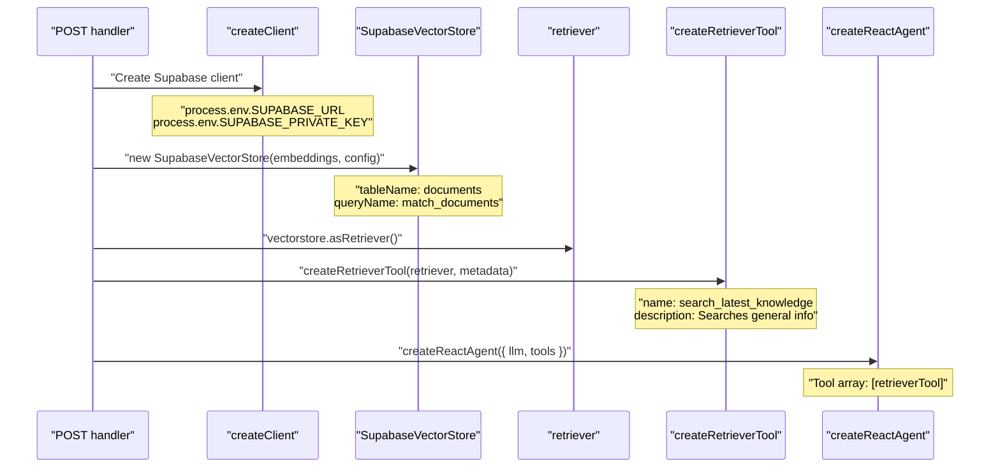
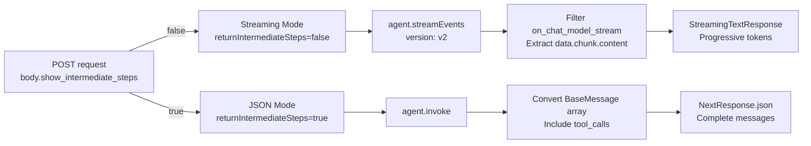
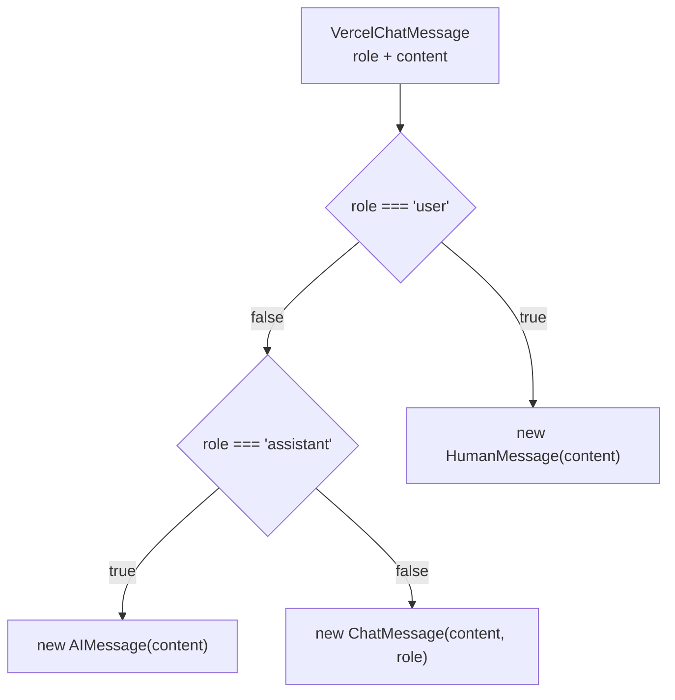
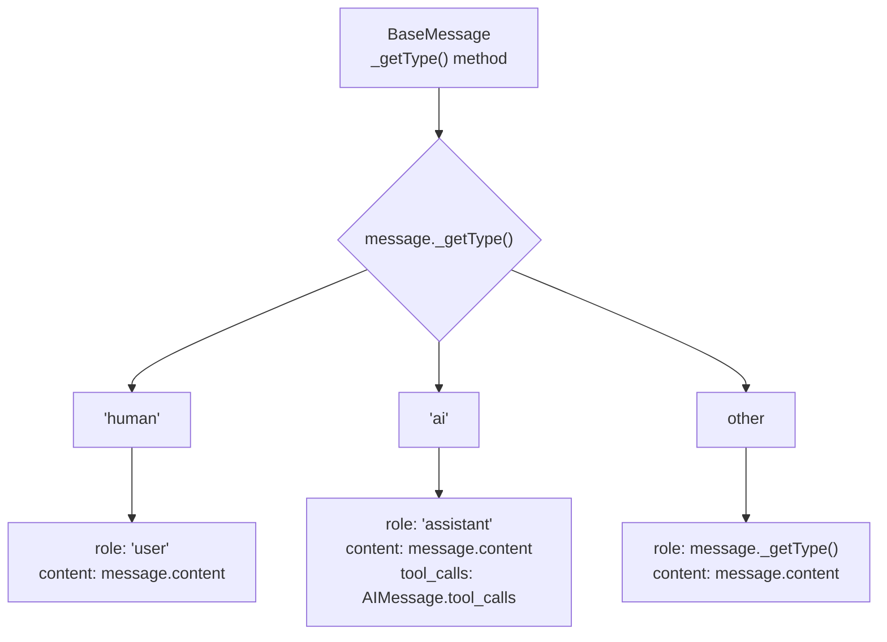
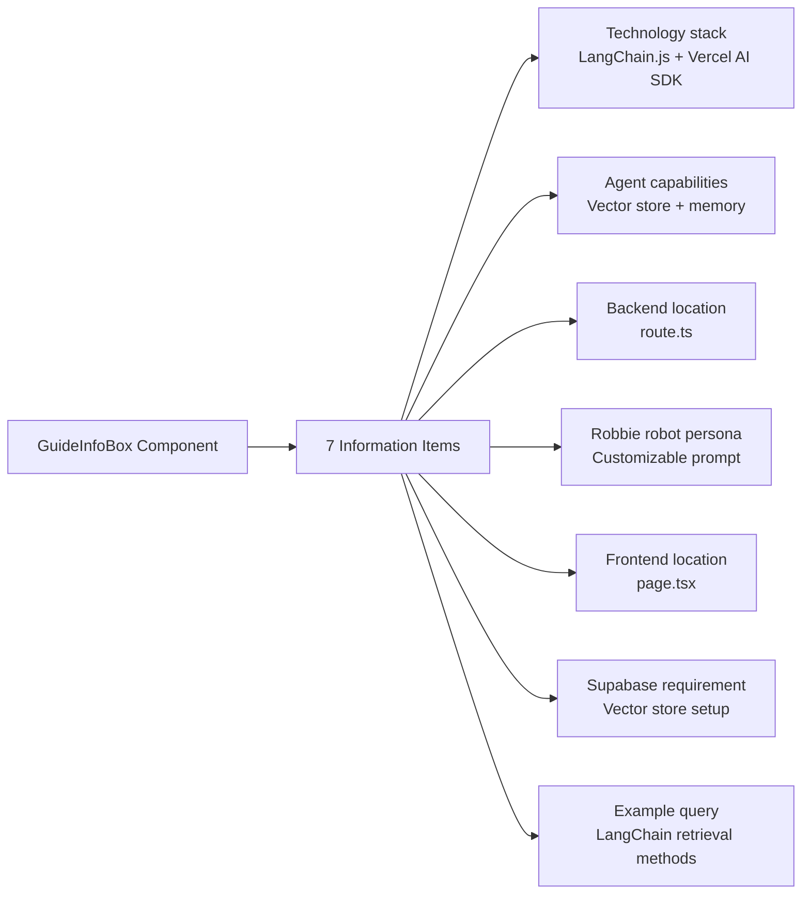
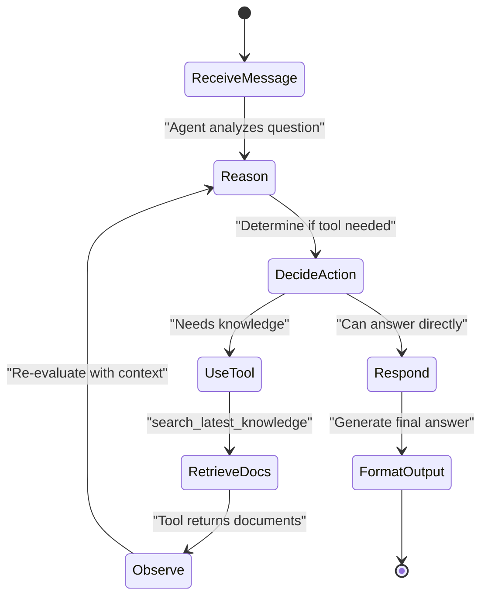
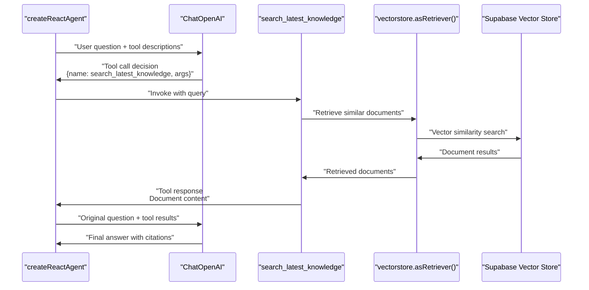

<!-- source: DeepWiki mcp.deepwiki.com · repo langchain-ai/langchain-nextjs-template · page 5.5 Retrieval Agents · fetched 2026-10-26 -->

# Retrieval Agents

<details>
<summary>Relevant source files</summary>

The following files were used as context for generating this wiki page:

- [app/api/chat/retrieval_agents/route.ts](app/api/chat/retrieval_agents/route.ts)
- [app/retrieval/page.tsx](app/retrieval/page.tsx)
- [app/retrieval_agents/page.tsx](app/retrieval_agents/page.tsx)
- [app/structured_output/page.tsx](app/structured_output/page.tsx)
- [components/ChatMessageBubble.tsx](components/ChatMessageBubble.tsx)

</details>


This page documents the Retrieval Agents implementation, which combines autonomous agent capabilities with vector store retrieval. This pattern allows agents to dynamically access a knowledge base through tool calling while maintaining multi-step reasoning capabilities.

For pure retrieval without agent reasoning, see [Retrieval (RAG)](#5.4). For agent capabilities without retrieval, see [Agents](#5.3).

---

## Overview

The Retrieval Agents pattern integrates two powerful capabilities:
1. **Agent reasoning**: Multi-step decision making using the ReAct pattern (Reason + Act)
2. **Knowledge retrieval**: Access to a Supabase vector store through a retriever tool

The implementation creates an agent that can autonomously decide when to query the knowledge base, making it particularly effective for questions that require both reasoning and factual information from documents.

**Sources:** [app/api/chat/retrieval_agents/route.ts:1-164](), [app/retrieval_agents/page.tsx:1-87]()

---

## Architecture Overview

```mermaid
graph TB
    subgraph Frontend["Frontend Layer"]
        Page["app/retrieval_agents/page.tsx<br/>ChatWindow Component"]
        InfoBox["GuideInfoBox<br/>Instructions"]
    end
    
    subgraph API["API Route"]
        Route["app/api/chat/retrieval_agents/route.ts<br/>POST handler"]
        MessageConv["convertVercelMessageToLangChainMessage<br/>convertLangChainMessageToVercelMessage"]
    end
    
    subgraph VectorStore["Vector Store Layer"]
        SupabaseClient["createClient<br/>Supabase connection"]
        VectorStore["SupabaseVectorStore<br/>tableName: documents"]
        Embeddings["OpenAIEmbeddings"]
        Retriever["vectorstore.asRetriever()"]
    end
    
    subgraph AgentLayer["Agent Layer"]
        RetrieverTool["createRetrieverTool<br/>name: search_latest_knowledge"]
        ReactAgent["createReactAgent<br/>LangGraph prebuilt"]
        SystemMsg["SystemMessage<br/>AGENT_SYSTEM_TEMPLATE<br/>Robbie persona"]
        ChatModel["ChatOpenAI<br/>gpt-4o-mini"]
    end
    
    subgraph Execution["Execution Modes"]
        StreamMode["streamEvents<br/>v2 API"]
        InvokeMode["agent.invoke<br/>JSON response"]
    end
    
    Page -->|"HTTP POST"| Route
    Route --> MessageConv
    Route --> SupabaseClient
    Route --> ChatModel
    
    SupabaseClient --> VectorStore
    Embeddings --> VectorStore
    VectorStore --> Retriever
    Retriever --> RetrieverTool
    
    RetrieverTool --> ReactAgent
    ChatModel --> ReactAgent
    SystemMsg --> ReactAgent
    
    ReactAgent -->|"returnIntermediateSteps=false"| StreamMode
    ReactAgent -->|"returnIntermediateSteps=true"| InvokeMode
    
    StreamMode -->|"StreamingTextResponse"| Page
    InvokeMode -->|"NextResponse.json"| Page
```

**Component Hierarchy**: The architecture separates concerns into four layers - frontend presentation, API routing, vector store management, and agent orchestration with dual execution modes.

**Sources:** [app/api/chat/retrieval_agents/route.ts:55-164](), [app/retrieval_agents/page.tsx:74-86]()

---

## Agent Configuration

### System Prompt

The agent uses the "Robbie" robot persona defined in `AGENT_SYSTEM_TEMPLATE`:

| Aspect | Configuration |
|--------|---------------|
| **Persona** | Stereotypical robot named "Robbie" |
| **Speech Pattern** | Uses interjections like "BEEP" and "BOOP" |
| **Tool Usage** | Instructed to use retrieval for unknown information |
| **Specialization** | Particularly focused on LangChain questions |
| **Implementation** | [route.ts:44-46]() |

The system prompt is passed to `createReactAgent` via the `messageModifier` parameter as a `SystemMessage` object at [route.ts:108]().

**Sources:** [app/api/chat/retrieval_agents/route.ts:44-109]()

### Model Configuration

```typescript
// Configuration at route.ts:70-73
const chatModel = new ChatOpenAI({
  model: "gpt-4o-mini",
  temperature: 0.2,
});
```

| Parameter | Value | Purpose |
|-----------|-------|---------|
| `model` | `gpt-4o-mini` | Lightweight, fast model for agent reasoning |
| `temperature` | `0.2` | Low temperature for consistent, factual responses |

**Sources:** [app/api/chat/retrieval_agents/route.ts:70-73]()

---

## Vector Store Integration

### Retriever Tool Creation



**Process Flow**: The vector store is initialized and wrapped in a tool interface before being passed to the agent.

**Sources:** [app/api/chat/retrieval_agents/route.ts:75-109]()

### Retriever Tool Metadata

The retriever is wrapped with specific metadata that the agent uses to decide when to invoke it:

| Property | Value | Purpose |
|----------|-------|---------|
| `name` | `"search_latest_knowledge"` | Identifier for the agent's tool selection |
| `description` | `"Searches and returns up-to-date general information."` | Helps agent understand when to use this tool |

Implementation: [app/api/chat/retrieval_agents/route.ts:91-94]()

**Sources:** [app/api/chat/retrieval_agents/route.ts:85-94]()

---

## Execution Flow

### Dual Execution Modes

The route supports two execution modes controlled by the `show_intermediate_steps` body parameter:



**Mode Selection**: The execution path diverges based on whether intermediate steps (tool calls, reasoning) should be displayed.

**Sources:** [app/api/chat/retrieval_agents/route.ts:111-160]()

### Streaming Mode Implementation

When `returnIntermediateSteps` is `false`, the route uses `streamEvents` to stream only the final output:

```typescript
// Implementation at route.ts:124-146
const eventStream = await agent.streamEvents(
  { messages },
  { version: "v2" },
);

// Filter events to only stream final content
for await (const { event, data } of eventStream) {
  if (event === "on_chat_model_stream") {
    if (!!data.chunk.content) {
      controller.enqueue(textEncoder.encode(data.chunk.content));
    }
  }
}
```

**Filtering Logic**: The `on_chat_model_stream` events are filtered to exclude intermediate tool calls (which have no `content`) and only stream final response content.

**Sources:** [app/api/chat/retrieval_agents/route.ts:111-146]()

### JSON Mode Implementation

When `returnIntermediateSteps` is `true`, the route invokes the agent and returns the complete message history:

```typescript
// Implementation at route.ts:153-159
const result = await agent.invoke({ messages });
return NextResponse.json(
  {
    messages: result.messages.map(convertLangChainMessageToVercelMessage),
  },
  { status: 200 },
);
```

The returned messages include:
- User messages
- Assistant messages
- Tool call messages with `tool_calls` property
- Tool response messages

**Sources:** [app/api/chat/retrieval_agents/route.ts:147-160]()

---

## Message Conversion

### Vercel to LangChain Conversion



Implementation: [app/api/chat/retrieval_agents/route.ts:20-28]()

**Sources:** [app/api/chat/retrieval_agents/route.ts:20-28]()

### LangChain to Vercel Conversion



**Special Handling**: AI messages include the `tool_calls` property to preserve agent reasoning steps.

Implementation: [app/api/chat/retrieval_agents/route.ts:30-42]()

**Sources:** [app/api/chat/retrieval_agents/route.ts:30-42]()

---

## Frontend Configuration

### ChatWindow Component Props

The frontend page at [app/retrieval_agents/page.tsx]() configures the `ChatWindow` component with retrieval-agent-specific settings:

| Prop | Value | Purpose |
|------|-------|---------|
| `endpoint` | `"api/chat/retrieval_agents"` | Routes requests to the retrieval agents API |
| `showIngestForm` | `true` | Displays document upload form |
| `showIntermediateStepsToggle` | `true` | Enables toggle for tool call visibility |
| `placeholder` | Robot greeting with example query | Suggests appropriate questions |
| `emoji` | `"🤖"` | Robot emoji for agent messages |

**Sources:** [app/retrieval_agents/page.tsx:74-86]()

### Information Display

The page includes a `GuideInfoBox` with implementation details:



**Sources:** [app/retrieval_agents/page.tsx:5-72]()

---

## Agent Execution Pattern

### ReAct Loop

The `createReactAgent` function from `@langchain/langgraph/prebuilt` implements the ReAct (Reasoning + Acting) pattern:



**Loop Mechanics**: The agent can perform multiple reasoning-action cycles until it has sufficient information to provide a final answer.

**Sources:** [app/api/chat/retrieval_agents/route.ts:99-109]()

### Tool Invocation

When the agent decides to use the retriever tool, the following sequence occurs:



**Search Mechanism**: The retriever performs vector similarity search in Supabase using embeddings from the user's query.

**Sources:** [app/api/chat/retrieval_agents/route.ts:85-109]()

---

## Environment Requirements

The Retrieval Agents implementation requires the following environment variables:

| Variable | Purpose | Used At |
|----------|---------|---------|
| `SUPABASE_URL` | Supabase project URL | [route.ts:76]() |
| `SUPABASE_PRIVATE_KEY` | Supabase service role key | [route.ts:77]() |
| `OPENAI_API_KEY` | OpenAI API authentication | Implicit in ChatOpenAI/Embeddings |

**Note**: The Supabase vector store must be pre-configured with the `documents` table and `match_documents` query function. See [Retrieval (RAG)](#5.4) for vector store setup details.

**Sources:** [app/api/chat/retrieval_agents/route.ts:75-83]()

---

## Edge Runtime Configuration

The route is configured for Vercel Edge runtime:

```typescript
export const runtime = "edge";
```

Implementation: [app/api/chat/retrieval_agents/route.ts:18]()

**Implications**:
- 1 MB bundle size limit
- Lower latency due to global distribution
- No Node.js-specific APIs available
- Cold start optimization critical

**Sources:** [app/api/chat/retrieval_agents/route.ts:18]()

---

## Comparison with Related Patterns

| Feature | Agents [5.3](#5.3) | Retrieval [5.4](#5.4) | Retrieval Agents [5.5](#5.5) |
|---------|-----------|-----------|------------------|
| **Tool Calling** | ✅ SERP/Calculator | ❌ | ✅ Retriever |
| **Vector Store** | ❌ | ✅ | ✅ |
| **Multi-step Reasoning** | ✅ | ❌ | ✅ |
| **Autonomous Decisions** | ✅ | ❌ | ✅ |
| **Orchestration** | LangGraph createReactAgent | LCEL Chain | LangGraph createReactAgent |
| **Use Case** | General reasoning + web search | Document QA | Knowledge-augmented reasoning |

**Architecture Choice**: Retrieval Agents combines the strengths of both patterns, enabling autonomous decision-making with access to a knowledge base.

**Sources:** [app/api/chat/retrieval_agents/route.ts:1-164](), [app/retrieval_agents/page.tsx:1-87]()

---

