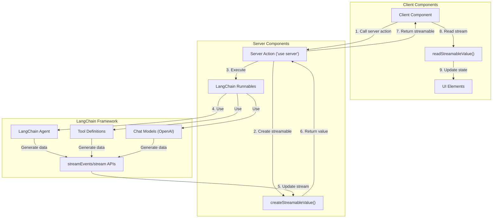
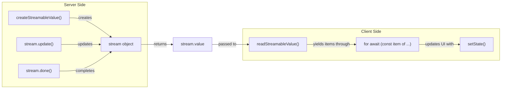
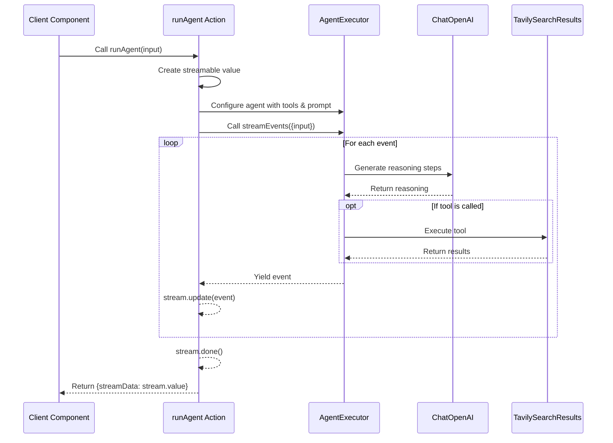
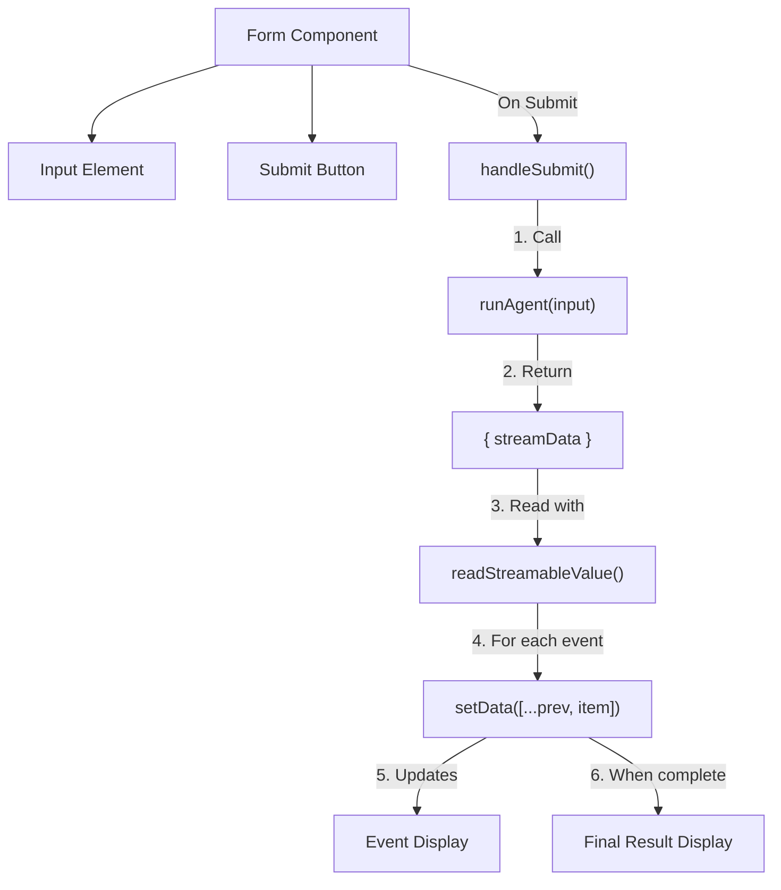
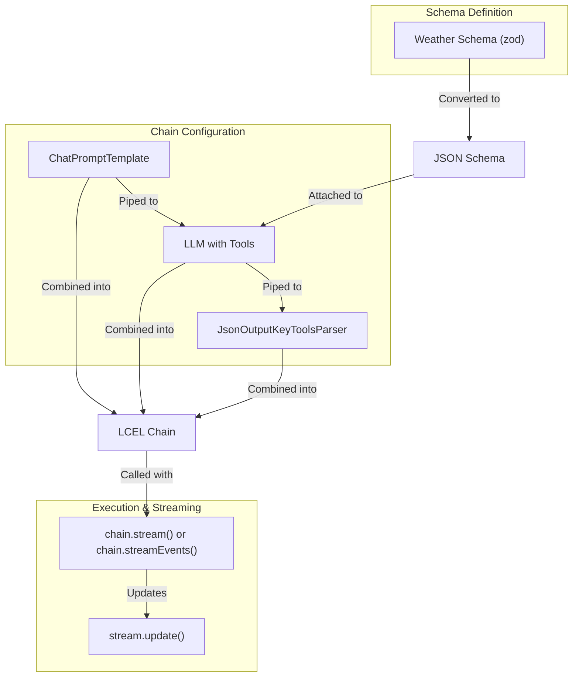
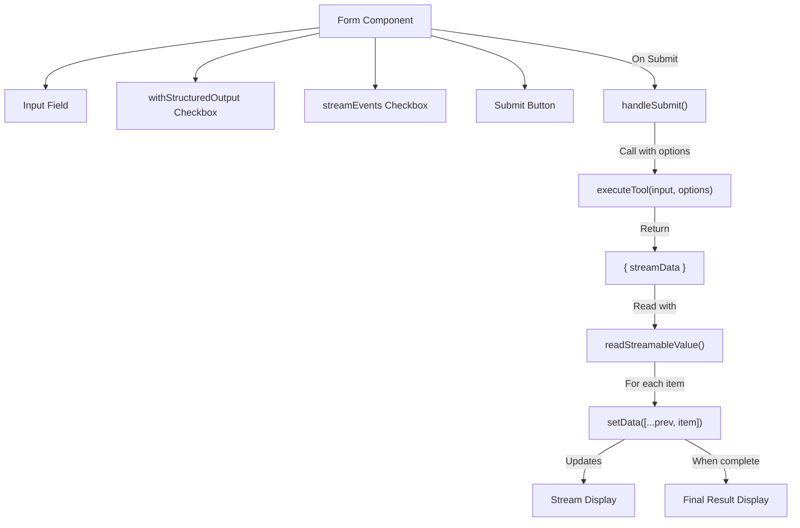

<!-- source: DeepWiki mcp.deepwiki.com · repo langchain-ai/langchain-nextjs-template · page 5.6 AI SDK & React Server Components · fetched 2026-10-26 -->

# AI SDK & React Server Components

<details>
<summary>Relevant source files</summary>

The following files were used as context for generating this wiki page:

- [app/ai_sdk/agent/README.md](app/ai_sdk/agent/README.md)
- [app/ai_sdk/agent/action.ts](app/ai_sdk/agent/action.ts)
- [app/ai_sdk/page.tsx](app/ai_sdk/page.tsx)
- [app/ai_sdk/tools/README.md](app/ai_sdk/tools/README.md)
- [app/ai_sdk/tools/action.ts](app/ai_sdk/tools/action.ts)

</details>


This document explains how the LangChain NextJS Template integrates Vercel's AI SDK with React Server Components (RSC) to create seamless, streaming AI experiences. The integration enables complex AI operations to run on the server while efficiently streaming results back to the client.

## Overview

The AI SDK & React Server Components integration in this codebase demonstrates how to:

1. Execute complex LangChain.js operations server-side using React Server Actions
2. Stream AI responses, including intermediate steps and structured data, back to the client
3. Build responsive UIs that display real-time agent reasoning and tool usage

This page covers two main implementation examples: streaming agent execution and structured output with tool calling.

Sources: [app/ai_sdk/page.tsx:38-88]()

## System Architecture

The integration of AI SDK with React Server Components follows a particular architecture pattern that enables efficient streaming of AI data:



The architecture leverages several key components:

1. **Server Actions**: JavaScript functions with the `"use server"` directive that can be called directly from client components
2. **Streamable Values**: Created with `createStreamableValue()` from the AI SDK to enable streaming from server to client
3. **LangChain Runnables**: Chains, agents, and tools configured for streaming responses
4. **Client Readers**: Uses `readStreamableValue()` to progressively process streamed data

Sources: [app/ai_sdk/agent/action.ts:1-43](), [app/ai_sdk/tools/action.ts:1-102]()

## AI SDK Integration Points

The AI SDK integration centers around two key functions that enable streaming:



This pattern enables progressive rendering of AI outputs without waiting for the entire response to complete.

Sources: [app/ai_sdk/agent/README.md:64-71](), [app/ai_sdk/agent/README.md:149-154]()

## Agent Example Implementation

The Agent example demonstrates how to stream the full execution trace of a LangChain agent back to the client.

### Server-Side Implementation

The server-side code creates an agent that uses the Tavily search tool to answer user queries:



The server code initializes tools, retrieves a prompt from LangChain Hub, creates an agent, and streams execution events back to the client.

Sources: [app/ai_sdk/agent/action.ts:1-43](), [app/ai_sdk/agent/README.md:35-125]()

### Client-Side Implementation

The client component renders a form for user input and displays streamed events:



The client code uses the `readStreamableValue` function to process the stream and update the UI as new events arrive.

Sources: [app/ai_sdk/agent/page.tsx:1-86](), [app/ai_sdk/agent/README.md:130-153]()

## Structured Output Example

The Tools example demonstrates how to stream structured data from a model using tool calling:

### Server-Side Implementation

The server code defines a schema for weather data and streams tool calling results:



The implementation supports two streaming modes:
1. Basic streaming with `chain.stream()`
2. Detailed event streaming with `chain.streamEvents()`

Sources: [app/ai_sdk/tools/action.ts:1-102](), [app/ai_sdk/tools/README.md:28-130]()

### Client-Side Implementation

The client component provides options for different streaming modes:



The client can toggle between different modes of structured output streaming.

Sources: [app/ai_sdk/tools/page.tsx:1-114](), [app/ai_sdk/tools/README.md:131-]()

## Implementation Details

### Key Components

| Component | Purpose | Usage |
|-----------|---------|-------|
| `createStreamableValue()` | Creates a streamable value on the server | Used in server actions to create a stream for updates |
| `stream.update()` | Updates the streamable value with new data | Called for each new piece of data from LangChain |
| `stream.done()` | Signals the end of the stream | Called when all data has been processed |
| `readStreamableValue()` | Reads from a streamable value on the client | Used in client components to process the stream |
| `AgentExecutor.streamEvents()` | Streams detailed agent execution events | Used to send the full agent trace to the client |
| `chain.stream()` | Streams the output of a LangChain chain | Used for simpler streaming scenarios |

Sources: [app/ai_sdk/agent/action.ts:13-43](), [app/ai_sdk/tools/action.ts:27-101]()

### Server Actions

Server Actions are a key part of the implementation, denoted by the `"use server"` directive:

```typescript
export async function runAgent(input: string) {
  "use server";
  
  // Server-side code here
  
  return { streamData: stream.value };
}
```

These functions can be imported and called directly from client components, providing a seamless bridge between client and server code.

Sources: [app/ai_sdk/agent/action.ts:10-43](), [app/ai_sdk/tools/action.ts:18-102]()

## Best Practices

When working with AI SDK and React Server Components:

1. **Handle JSON Serialization Properly**
   - Use `JSON.parse(JSON.stringify(item))` when sending data through the stream to avoid issues with non-serializable objects
   - This pattern is used to work around a bug in RSC streaming

2. **Manage Loading States**
   - Set loading states to give users feedback during processing
   - Clear previous data when starting a new request

3. **Use Async Code Pattern**
   - Wrap long-running operations in an immediately invoked async function
   - This allows returning the stream value immediately while continuing to update it

4. **Stream Progressive Results**
   - Use streaming APIs (`stream()` or `streamEvents()`) rather than awaiting the full result
   - This provides a more responsive user experience

Sources: [app/ai_sdk/agent/README.md:110-116](), [app/ai_sdk/agent/page.tsx:23-39](), [app/ai_sdk/tools/page.tsx:27-38]()

## Conclusion

The AI SDK & React Server Components integration provides a powerful framework for building AI applications with streaming capabilities. By leveraging server-side processing and efficient streaming, complex AI operations can be performed without blocking the UI, resulting in a more responsive user experience.

The examples provided in the codebase demonstrate patterns that can be extended to build sophisticated AI applications with real-time feedback and progressive rendering.

---

