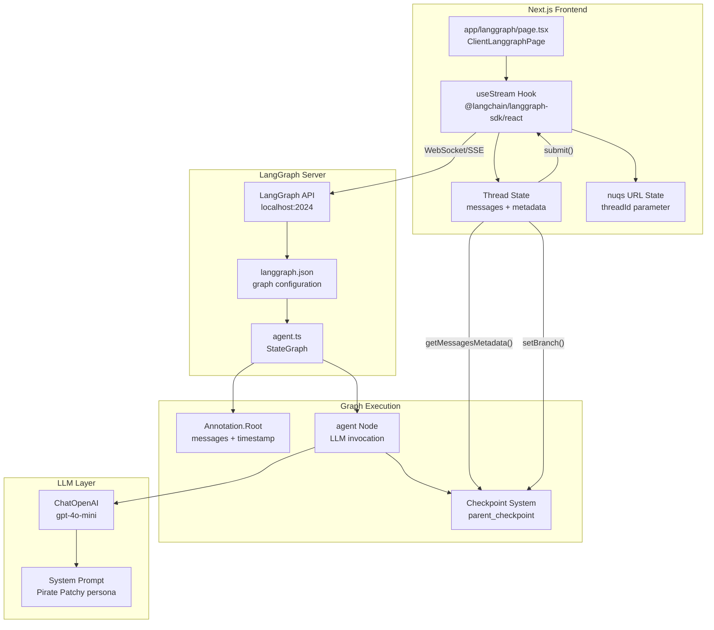
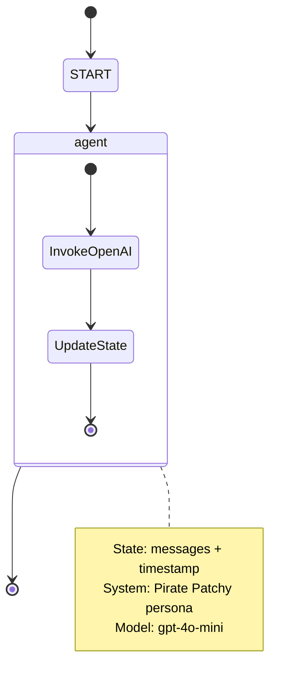
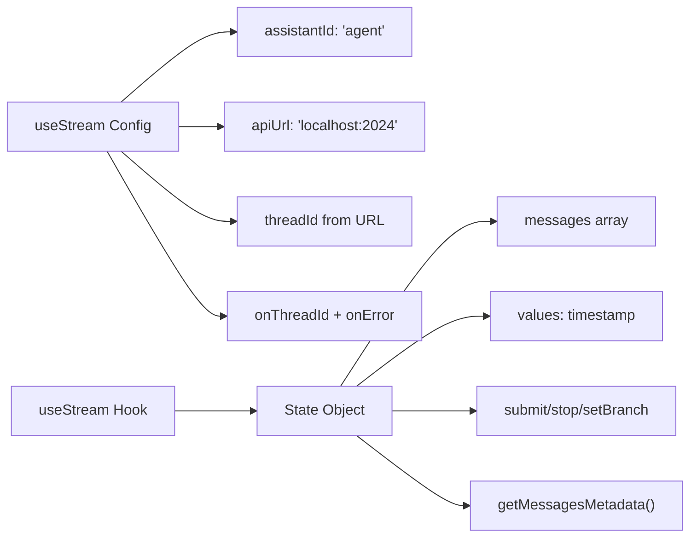
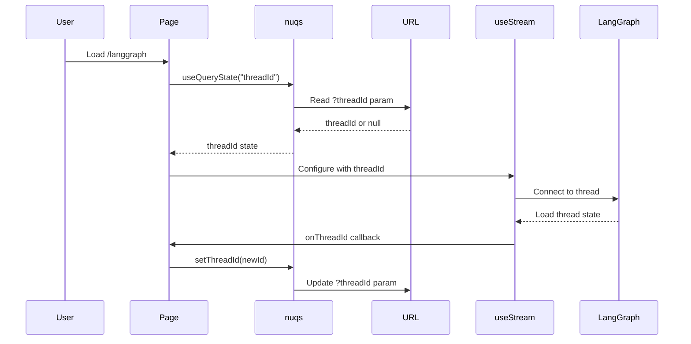
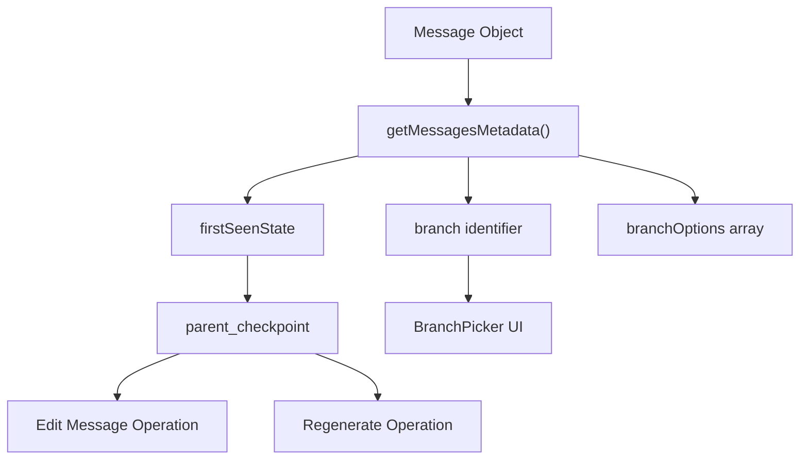
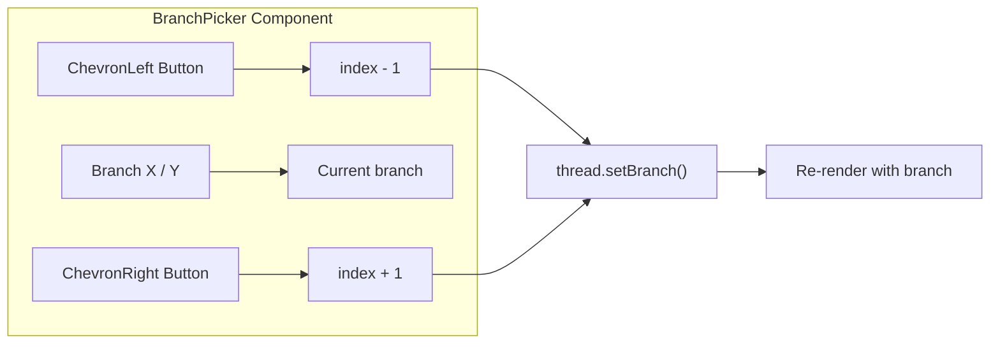
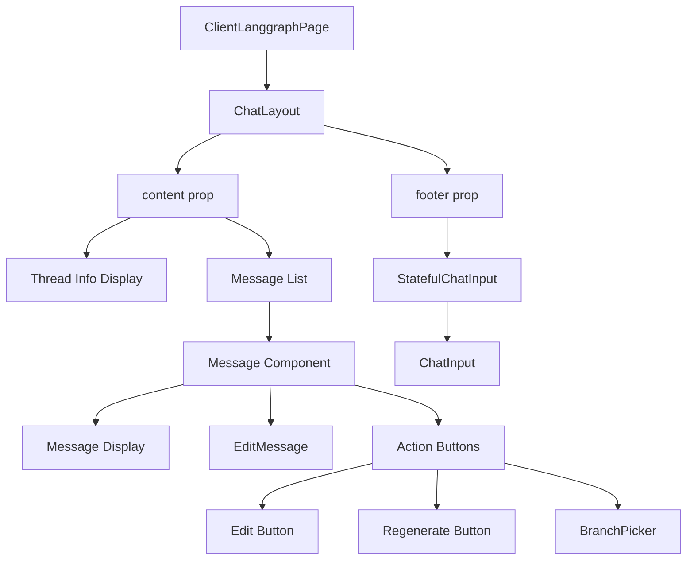
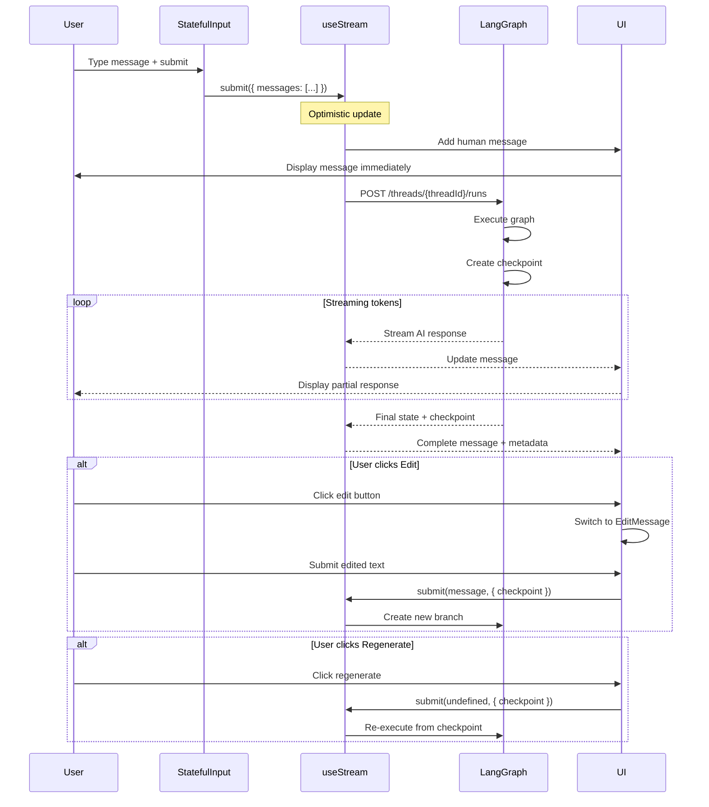

<!-- source: DeepWiki mcp.deepwiki.com · repo langchain-ai/langchain-nextjs-template · page 5.7 LangGraph Integration · fetched 2026-10-26 -->

# LangGraph Integration

<details>
<summary>Relevant source files</summary>

The following files were used as context for generating this wiki page:

- [app/langgraph/agent/.gitignore](app/langgraph/agent/.gitignore)
- [app/langgraph/agent/agent.ts](app/langgraph/agent/agent.ts)
- [app/langgraph/agent/langgraph.json](app/langgraph/agent/langgraph.json)
- [app/langgraph/page.tsx](app/langgraph/page.tsx)

</details>


This document describes the LangGraph integration implementation, which represents the most advanced example in the template. This feature demonstrates stateful graph execution with checkpoint-based branching, time-travel debugging, and persistent thread management. Unlike the simpler agent examples (see [Agents](#5.3) and [Retrieval Agents](#5.5)), this implementation uses LangGraph's dedicated server architecture and React SDK for full state graph capabilities.

The implementation consists of three key components:
1. A **LangGraph server** running the agent graph
2. A **frontend page** using the `useStream` hook from `@langchain/langgraph-sdk/react`
3. A **stateful agent graph** with checkpoint persistence

---

## Architecture Overview

The LangGraph integration follows a client-server architecture where a dedicated LangGraph API server runs the stateful graph, while the Next.js frontend connects via the `useStream` hook. This enables advanced features like checkpoint-based branching and persistent thread state.



**Sources:** [app/langgraph/page.tsx:1-280](), [app/langgraph/agent/langgraph.json:1-6](), [app/langgraph/agent/agent.ts:1-33]()

---

## LangGraph Server Configuration

The LangGraph server is configured through `langgraph.json`, which specifies the graph exports and environment file location. The server must be started separately from the Next.js development server.

### Configuration File

| Property | Value | Purpose |
|----------|-------|---------|
| `graphs.agent` | `./agent.ts:graph` | Exports the compiled graph as the "agent" assistant |
| `env` | `.env` | Environment variables file for API keys |

**Server Start Command:**
```bash
# Run from app/langgraph/agent directory
langgraph dev
```

The server runs on `localhost:2024` by default and provides a WebSocket/SSE interface for streaming graph execution.

**Sources:** [app/langgraph/agent/langgraph.json:1-6]()

---

## Agent Graph Definition

The agent is defined as a `StateGraph` with custom state annotation containing messages and a timestamp field. The graph implements a single-node execution pattern with a pirate-themed system prompt.



### State Annotation

The graph uses `Annotation.Root` to define custom state beyond the default `MessagesAnnotation`:

| Field | Type | Source | Purpose |
|-------|------|--------|---------|
| `messages` | `MessagesAnnotation.spec["messages"]` | LangGraph | Message history array |
| `timestamp` | `number` | Custom | Millisecond timestamp of execution |

### Agent Node Implementation

The `agent` node performs the following operations:

1. **System Prompt Injection** - Prepends a pirate persona system message [app/langgraph/agent/agent.ts:21-24]()
2. **LLM Invocation** - Calls `ChatOpenAI` with message history [app/langgraph/agent/agent.ts:18-26]()
3. **State Update** - Returns new message and timestamp [app/langgraph/agent/agent.ts:28]()

**Sources:** [app/langgraph/agent/agent.ts:1-33]()

---

## Frontend Integration with useStream Hook

The frontend uses the `useStream` hook from `@langchain/langgraph-sdk/react` to establish a connection to the LangGraph server. This hook provides real-time state synchronization and checkpoint management.

### Hook Configuration



### useStream Return Object

The hook returns an object with the following interface:

| Property | Type | Description |
|----------|------|-------------|
| `messages` | `Message[]` | Array of conversation messages |
| `values` | `{ timestamp?: number }` | Custom state values from graph |
| `isLoading` | `boolean` | Whether graph is executing |
| `error` | `Error \| null` | Error if execution failed |
| `submit()` | `function` | Submit new input or checkpoint |
| `stop()` | `function` | Stop current execution |
| `setBranch()` | `function` | Switch between branches |
| `getMessagesMetadata()` | `function` | Get checkpoint metadata for message |

**Sources:** [app/langgraph/page.tsx:183-190]()

---

## Thread and State Management

Thread persistence is achieved through URL parameter synchronization using the `nuqs` library. This enables sharing conversations via URL and maintains state across page refreshes.

### Thread ID Synchronization



### New Thread Creation

The UI provides a "New thread" button that clears the thread ID, causing the server to create a new thread on the next submission:

**Sources:** [app/langgraph/page.tsx:181](), [app/langgraph/page.tsx:203-209]()

---

## Checkpoint-Based Operations

Checkpoints are immutable snapshots of graph state that enable time-travel debugging and branching. Each message has associated checkpoint metadata retrieved via `getMessagesMetadata()`.

### Checkpoint Metadata Structure



### Edit Message Operation

When editing a message, the system submits the edited content along with the parent checkpoint, creating a new branch from that point:

**Message Edit Flow:**

| Step | Code Reference | Action |
|------|----------------|--------|
| 1. Get metadata | `thread.getMessagesMetadata(message, index)` | Retrieve checkpoint info |
| 2. Extract checkpoint | `meta?.firstSeenState?.parent_checkpoint` | Get parent checkpoint |
| 3. Submit edit | `thread.submit({ messages: [message] }, { checkpoint })` | Create new branch |

### Regenerate Operation

Regeneration resubmits without new messages, causing the graph to re-execute from the checkpoint:

**Sources:** [app/langgraph/page.tsx:213-223]()

---

## Message Branching System

When messages are edited or regenerated, the graph creates branches. The `BranchPicker` component allows navigation between these alternative conversation paths.

### Branch Navigation UI



### BranchPicker Implementation

The component receives:
- `current`: Current branch identifier string
- `branches`: Array of all branch identifiers
- `onSelect`: Callback to switch branches (bound to `thread.setBranch`)

Navigation logic:
- **Previous**: `Math.max(0, index - 1)` prevents going below first branch
- **Next**: `Math.min(branches.length - 1, index + 1)` prevents exceeding last branch

**Sources:** [app/langgraph/page.tsx:118-156](), [app/langgraph/page.tsx:225-232]()

---

## UI Component Architecture

The page implements three specialized components for stateful chat interactions: `EditMessage`, `Message`, and `StatefulChatInput`.

### Component Hierarchy



### Message Component State Machine

The `Message` component switches between display and edit modes:

| State | Condition | Rendered Component | Actions |
|-------|-----------|-------------------|---------|
| **Display** | `!isEditing` | Standard bubble | Edit, Regenerate, Branch picker |
| **Edit** | `isEditing` | `EditMessage` | Submit, Cancel |

### Optimistic Updates

When submitting a new message, the system uses optimistic updates to immediately show the user's message before graph execution completes:

**Sources:** [app/langgraph/page.tsx:20-116](), [app/langgraph/page.tsx:158-178](), [app/langgraph/page.tsx:252-268]()

---

## State Flow Diagram

The complete state flow from user input to graph execution and UI update:



**Sources:** [app/langgraph/page.tsx:183-272]()

---

## Key Differences from Other Agent Examples

| Feature | Basic Agents (5.3) | Retrieval Agents (5.5) | LangGraph Integration (5.7) |
|---------|-------------------|------------------------|----------------------------|
| **Execution** | Single invocation | Single invocation | Stateful stream |
| **State** | In-memory only | In-memory only | Persistent checkpoints |
| **Editing** | Not supported | Not supported | Full edit/regenerate |
| **Branching** | Not supported | Not supported | Multi-branch navigation |
| **Server** | Next.js API route | Next.js API route | Dedicated LangGraph server |
| **Protocol** | HTTP POST | HTTP POST | WebSocket/SSE streaming |
| **Thread persistence** | None | None | URL parameter + server storage |

**Sources:** [app/langgraph/page.tsx:1-280]()

---

