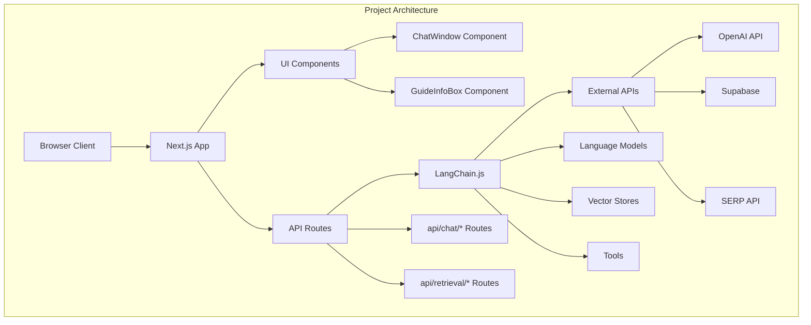
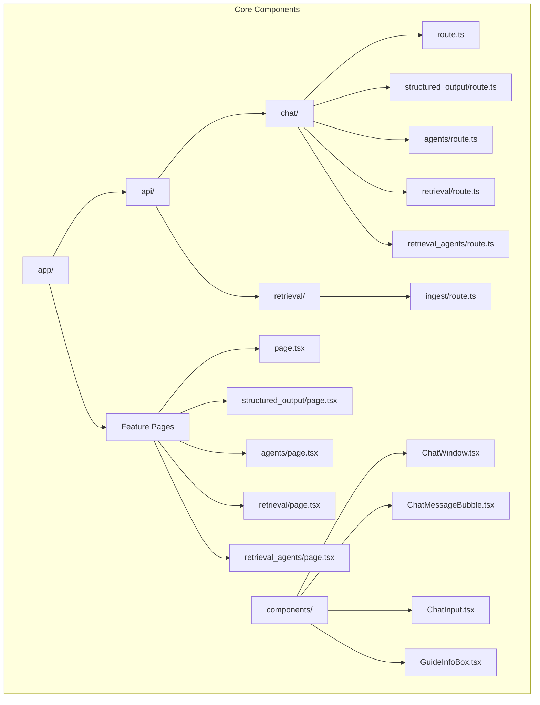
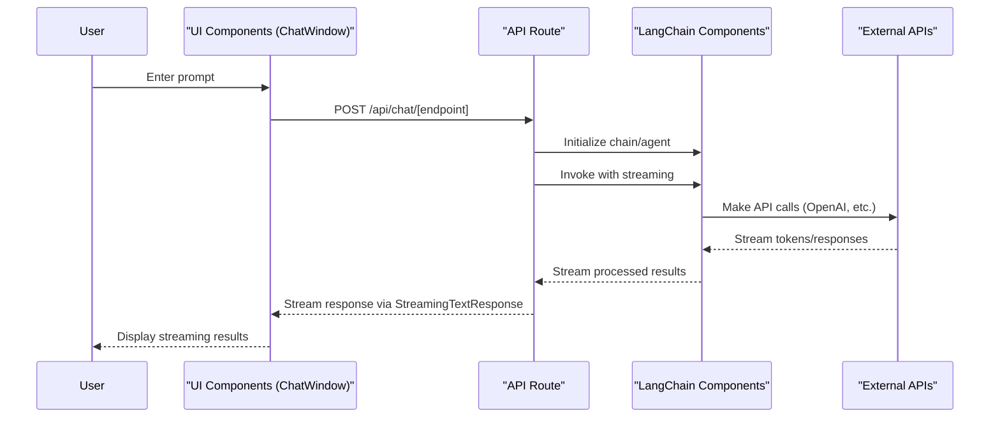
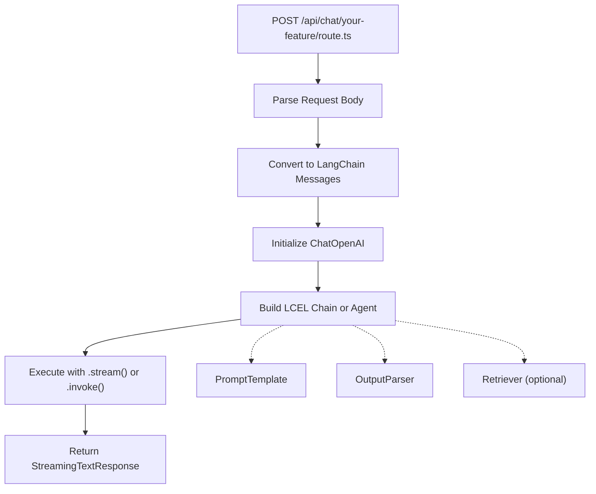
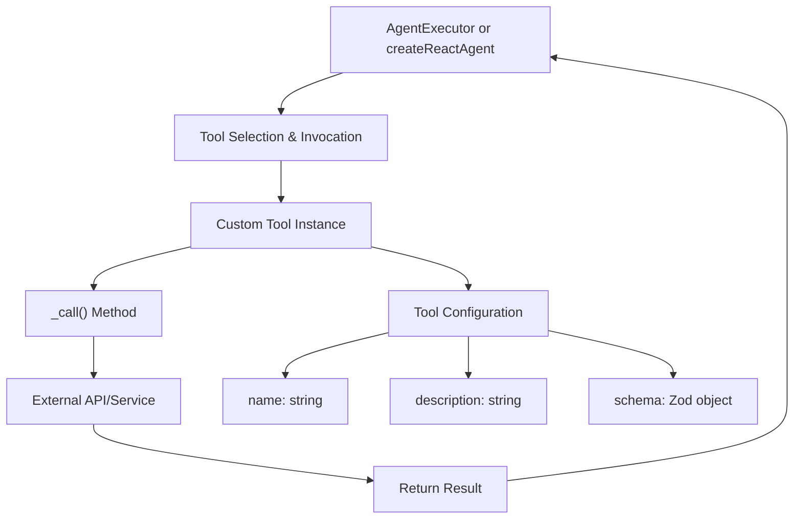
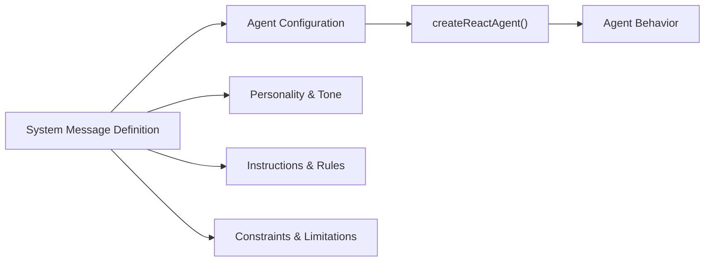
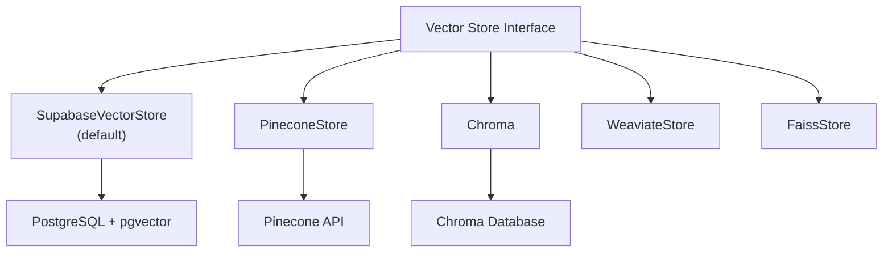
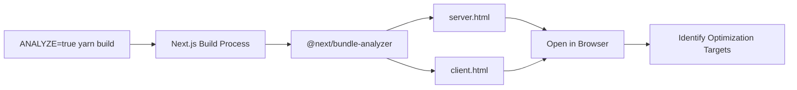
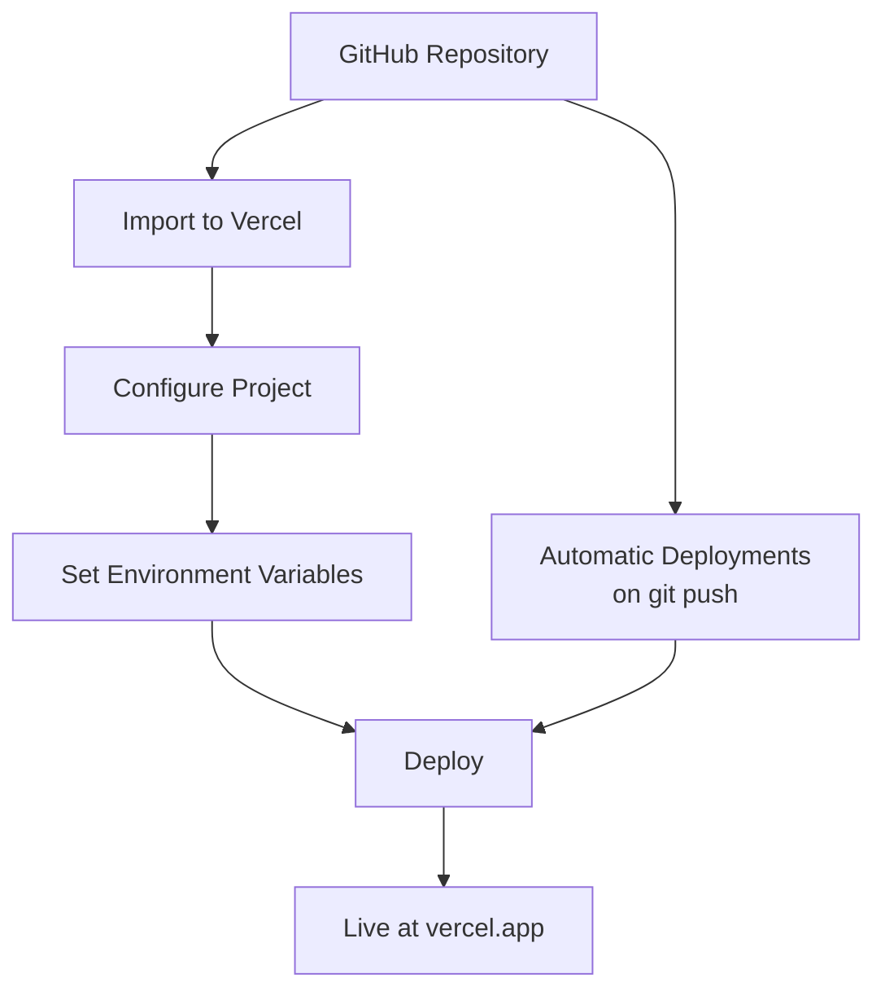
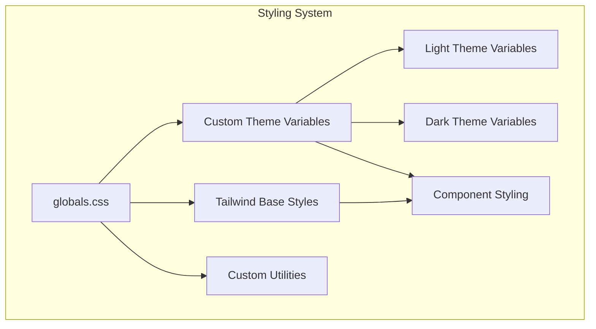

<!-- source: DeepWiki mcp.deepwiki.com · repo langchain-ai/langchain-nextjs-template · page 6 Development Guide · fetched 2026-10-26 -->

# Development Guide

<details>
<summary>Relevant source files</summary>

The following files were used as context for generating this wiki page:

- [README.md](README.md)
- [package.json](package.json)
- [yarn.lock](yarn.lock)

</details>


This guide provides essential information for developers working on or extending the [LangChain NextJS Template](https://github.com/langchain-ai/langchain-nextjs-template). It covers development setup, project architecture, and guidelines for implementing new features.

## Purpose and Scope

This guide provides practical instructions for developers extending the LangChain NextJS Template. It covers:

- Adding new API routes and features
- Creating custom tools for agents
- Modifying agent personas and behavior
- Configuring alternative vector stores
- Monitoring and optimizing bundle size
- Deploying to Vercel with proper configuration

For general architecture and feature documentation, see [System Architecture](#3) and [Features & Examples](#5).

## Development Environment Setup

### Prerequisites and Dependencies

The project requires:

| Requirement | Version | Notes |
|-------------|---------|-------|
| Node.js | ≥ 18.0.0 | Specified in package.json engines |
| Yarn | 3.5.1 | Used as package manager |

Key dependencies include:

| Dependency | Purpose |
|------------|---------|
| Next.js | React framework |
| @langchain/core | Core LangChain functionality |
| @langchain/openai | OpenAI integration |
| @langchain/community | Community components |
| @langchain/langgraph | For complex agent workflows |
| @supabase/supabase-js | Vector storage for retrieval |

Sources:
- [package.json:13-15]()
- [package.json:16-47]()

### Development Commands

```bash
# Install dependencies
yarn install

# Start development server
yarn dev

# Build for production
yarn build

# Start production server
yarn start

# Format code
yarn format

# Lint code
yarn lint
```

Sources:
- [package.json:6-11]()

## Project Architecture

### High-Level Architecture



Sources:
- [package.json:16-47]()

### Core Components and Files



## Data Flow and Component Interaction

Understanding how data flows through the application is critical for development:



## Implementation Patterns

### API Route Pattern

All API routes follow a consistent pattern:

```typescript
// /app/api/chat/[feature]/route.ts
import { StreamingTextResponse } from 'ai';
import { LangChainStream } from 'ai/langchain';
import { ChatOpenAI } from '@langchain/openai';

export async function POST(req: Request) {
  // 1. Parse request body
  const { messages } = await req.json();
  
  // 2. Set up streaming
  const { stream, handlers } = LangChainStream();
  
  // 3. Initialize language model
  const llm = new ChatOpenAI({
    streaming: true,
  });
  
  // 4. Set up chain or agent
  const chain = /* create your LangChain implementation */;
  
  // 5. Execute chain (non-blocking)
  chain.invoke(
    { messages },
    { callbacks: [handlers] }
  ).catch(console.error);
  
  // 6. Return streaming response
  return new StreamingTextResponse(stream);
}
```

### Page Implementation Pattern

All feature pages follow this structure:

```typescript
// /app/[feature]/page.tsx
import { ChatWindow } from '@/components/ChatWindow';
import { GuideInfoBox } from '@/components/GuideInfoBox';

export default function FeaturePage() {
  // 1. Define constants
  const API_ENDPOINT = "/api/chat/[feature]";
  const examples = ["Example prompt 1", "Example prompt 2"];
  
  // 2. Return UI
  return (
    <div className="flex flex-col justify-center pb-20">
      <div className="flex flex-col items-center p-4 md:p-8">
        <h1 className="text-2xl font-bold">Feature Title</h1>
        
        {/* 3. Add documentation */}
        <GuideInfoBox
          title="Feature Title"
          description="Feature description"
        />
        
        {/* 4. Add chat interface */}
        <div className="w-full max-w-4xl">
          <ChatWindow
            endpoint={API_ENDPOINT}
            examples={examples}
            showIntermediateSteps={true}
          />
        </div>
      </div>
    </div>
  );
}
```

## Adding New API Routes

### Creating a New Chat Endpoint

Follow the established pattern in existing routes:

**File Structure:**
```
app/api/chat/
├── route.ts                    # Basic chat
├── structured_output/route.ts  # With Zod schema
├── agents/route.ts            # ReAct agent
├── retrieval/route.ts         # RAG chain
├── retrieval_agents/route.ts  # RAG + agent
└── [your-feature]/route.ts    # Your new route
```

**Implementation Steps:**

1. **Create Route File**: `app/api/chat/[your-feature]/route.ts`

2. **Import Dependencies**:
```typescript
import { NextRequest, NextResponse } from "next/server";
import { Message as VercelChatMessage } from "ai";
import { ChatOpenAI } from "@langchain/openai";
import { AIMessage, HumanMessage } from "@langchain/core/messages";
```

3. **Implement POST Handler**:
```typescript
export async function POST(req: NextRequest) {
  try {
    const body = await req.json();
    const messages = (body.messages ?? []).filter(
      (message: VercelChatMessage) =>
        message.role === "user" || message.role === "assistant",
    );
    
    // Convert to LangChain message format
    const previousMessages = messages.map((message: VercelChatMessage) => {
      if (message.role === "user") {
        return new HumanMessage(message.content);
      } else {
        return new AIMessage(message.content);
      }
    });
    
    // Your LangChain logic here
    // ...
    
    return NextResponse.json({ /* response */ });
  } catch (e: any) {
    return NextResponse.json({ error: e.message }, { status: 500 });
  }
}
```

4. **Configure Edge Runtime** (optional for faster cold starts):
```typescript
export const runtime = "edge";
```

**Title: API Route Implementation Pattern**


Sources:
- [app/api/chat/route.ts:1-100]()
- [app/api/chat/agents/route.ts:1-150]()
- [app/api/chat/retrieval/route.ts:1-200]()

### Creating a Page for Your Feature

1. **Create Page File**: `app/[your-feature]/page.tsx`

2. **Basic Page Template**:
```typescript
import { ChatWindow } from "@/components/ChatWindow";

export default function YourFeaturePage() {
  const InfoCard = (
    <div className="p-4 md:p-8 rounded bg-[#25252d] w-full max-h-[85%] overflow-hidden">
      <h1 className="text-3xl md:text-4xl mb-4">Your Feature Name</h1>
      <p>Description of what this feature does...</p>
    </div>
  );
  
  return (
    <ChatWindow
      endpoint="api/chat/your-feature"
      emptyStateComponent={InfoCard}
      placeholder="Ask me anything..."
      titleText="Your Feature"
      emoji="🎯"
      showIngestForm={false}
      showIntermediateStepsToggle={true}
    ></ChatWindow>
  );
}
```

3. **Update Navigation**: Add link in `app/components/Navbar.tsx`

Sources:
- [app/page.tsx:1-50]()
- [app/agents/page.tsx:1-50]()
- [app/structured_output/page.tsx:1-50]()

## Creating Custom Tools

Tools extend agent capabilities by providing access to external APIs, databases, or computation.

### Tool Implementation Pattern

**Title: Custom Tool Architecture**


Sources:
- [app/api/chat/agents/route.ts:1-150]()

### Example: Creating a Calculator Tool

```typescript
import { DynamicStructuredTool } from "@langchain/core/tools";
import { z } from "zod";

const calculatorTool = new DynamicStructuredTool({
  name: "calculator",
  description: "Performs basic arithmetic operations. Use this when you need to calculate numbers.",
  schema: z.object({
    operation: z.enum(["add", "subtract", "multiply", "divide"]),
    a: z.number().describe("First number"),
    b: z.number().describe("Second number"),
  }),
  func: async ({ operation, a, b }) => {
    let result: number;
    switch (operation) {
      case "add":
        result = a + b;
        break;
      case "subtract":
        result = a - b;
        break;
      case "multiply":
        result = a * b;
        break;
      case "divide":
        if (b === 0) throw new Error("Cannot divide by zero");
        result = a / b;
        break;
    }
    return `The result is ${result}`;
  },
});
```

### Example: Creating a Web Search Tool

```typescript
import { DynamicStructuredTool } from "@langchain/core/tools";
import { z } from "zod";

const searchTool = new DynamicStructuredTool({
  name: "web_search",
  description: "Search the web for current information. Use this when you need up-to-date information.",
  schema: z.object({
    query: z.string().describe("The search query"),
  }),
  func: async ({ query }) => {
    // Use SERP API or similar
    const response = await fetch(
      `https://serpapi.com/search?q=${encodeURIComponent(query)}&api_key=${process.env.SERPAPI_API_KEY}`
    );
    const data = await response.json();
    return JSON.stringify(data.organic_results.slice(0, 3));
  },
});
```

### Integrating Tools with Agents

**In `app/api/chat/agents/route.ts`:**

```typescript
import { createReactAgent } from "@langchain/langgraph/prebuilt";
import { ChatOpenAI } from "@langchain/openai";

const tools = [calculatorTool, searchTool];

const model = new ChatOpenAI({
  modelName: "gpt-4o-mini",
  temperature: 0,
});

const agent = createReactAgent({
  llm: model,
  tools: tools,
});

// Use agent.stream() to execute
```

Sources:
- [app/api/chat/agents/route.ts:50-100]()

## Modifying Agent Personas

Agent personas control the behavior, tone, and capabilities of your agents.

### System Message Configuration

**Title: Agent Persona Configuration Flow**


### Example: Basic Persona

```typescript
const agent = createReactAgent({
  llm: model,
  tools: tools,
  messageModifier: `You are a helpful assistant that answers questions accurately and concisely.
  
Always:
- Provide clear, direct answers
- Use tools when you need current information
- Admit when you don't know something

Never:
- Make up information
- Provide advice on illegal activities
`,
});
```

### Example: Specialized Persona (from retrieval_agents)

```typescript
const agent = createReactAgent({
  llm: model,
  tools: [retrieverTool],
  messageModifier: `You are Robbie the Retrieval Robot, a helpful assistant.
  
Your personality:
- Friendly and enthusiastic about helping
- Clear communicator
- Always cites sources from your knowledge base

When answering:
1. Always check the knowledge base first using the retriever tool
2. Cite specific sources in your response
3. If information isn't in the knowledge base, say so clearly
`,
});
```

Sources:
- [app/api/chat/retrieval_agents/route.ts:80-120]()

### Persona Design Guidelines

| Aspect | Consideration |
|--------|--------------|
| **Tone** | Professional, casual, playful, formal |
| **Verbosity** | Concise vs detailed responses |
| **Tool Usage** | When to use tools vs rely on training |
| **Safety** | Constraints on harmful content |
| **Domain** | Area of expertise (medical, legal, technical) |

## Configuring Alternative Vector Stores

The template uses Supabase by default, but supports multiple vector stores.

### Supported Vector Stores

**Title: Vector Store Integration Options**


Sources:
- [app/api/chat/retrieval/route.ts:1-50]()
- [app/api/retrieval/ingest/route.ts:1-100]()

### Example: Switching to Pinecone

1. **Install Dependency**:
```bash
yarn add @langchain/pinecone @pinecone-database/pinecone
```

2. **Update Environment Variables** (`.env.local`):
```
PINECONE_API_KEY=your_key_here
PINECONE_INDEX=your_index_name
```

3. **Modify Ingestion Route** (`app/api/retrieval/ingest/route.ts`):
```typescript
import { PineconeStore } from "@langchain/pinecone";
import { Pinecone } from "@pinecone-database/pinecone";
import { OpenAIEmbeddings } from "@langchain/openai";

export async function POST(req: Request) {
  const body = await req.json();
  const text = body.text;
  
  // Split text into chunks
  const splitter = new RecursiveCharacterTextSplitter({
    chunkSize: 1000,
    chunkOverlap: 200,
  });
  const splitDocuments = await splitter.createDocuments([text]);
  
  // Initialize Pinecone
  const pinecone = new Pinecone({
    apiKey: process.env.PINECONE_API_KEY!,
  });
  const pineconeIndex = pinecone.Index(process.env.PINECONE_INDEX!);
  
  // Create embeddings and store
  await PineconeStore.fromDocuments(
    splitDocuments,
    new OpenAIEmbeddings(),
    { pineconeIndex }
  );
  
  return NextResponse.json({ success: true });
}
```

4. **Modify Retrieval Route** (`app/api/chat/retrieval/route.ts`):
```typescript
const pinecone = new Pinecone({
  apiKey: process.env.PINECONE_API_KEY!,
});
const pineconeIndex = pinecone.Index(process.env.PINECONE_INDEX!);

const vectorstore = await PineconeStore.fromExistingIndex(
  new OpenAIEmbeddings(),
  { pineconeIndex }
);

const retriever = vectorstore.asRetriever();
```

### Vector Store Comparison

| Store | Hosting | Scalability | Cost | Setup Complexity |
|-------|---------|-------------|------|-----------------|
| **Supabase** | Managed | High | Free tier available | Low |
| **Pinecone** | Managed | Very High | Free tier limited | Low |
| **Chroma** | Self-hosted | Medium | Free | Medium |
| **FAISS** | Local/Memory | Low | Free | Low |

Sources:
- [app/api/retrieval/ingest/route.ts:1-100]()
- [app/api/chat/retrieval/route.ts:40-80]()

## Monitoring Bundle Size

The template includes `@next/bundle-analyzer` for monitoring JavaScript bundle sizes.

### Running Bundle Analysis

**Using the Analyzer:**

```bash
ANALYZE=true yarn build
```

This generates an interactive visualization showing:
- Size of each package
- Size of each route/page
- Gzip and parsed sizes
- Unused code

**Title: Bundle Analysis Workflow**


Sources:
- [package.json:50]()
- [README.md:99-107]()

### Bundle Size Targets

The Edge Function limit on Vercel is **1 MB compressed**. Current sizes:

| Component | Size (Compressed) | % of Limit |
|-----------|------------------|------------|
| @langchain/core | 37.32 KB | 3.6% |
| Next.js runtime | ~200 KB | 19.5% |
| Available | ~760 KB | 74% |

### Optimization Strategies

1. **Lazy Loading**:
```typescript
// Instead of:
import { HeavyComponent } from './HeavyComponent';

// Use:
const HeavyComponent = dynamic(() => import('./HeavyComponent'), {
  loading: () => <p>Loading...</p>,
});
```

2. **Tree Shaking**: Ensure imports are specific
```typescript
// Good:
import { ChatOpenAI } from "@langchain/openai";

// Bad (imports everything):
import * as langchain from "langchain";
```

3. **Edge-Compatible Packages**: Use edge-compatible versions
```typescript
// For edge runtime, avoid Node.js-specific packages
export const runtime = "edge";
```

Sources:
- [README.md:97-107]()
- [package.json:50]()

## Deploying to Vercel

### Prerequisites

1. **Vercel Account**: Sign up at [vercel.com](https://vercel.com)
2. **GitHub Repository**: Push your code to GitHub
3. **Environment Variables**: Prepare your API keys

### Deployment Process

**Title: Vercel Deployment Flow**


### Step-by-Step Deployment

1. **Push to GitHub**:
```bash
git init
git add .
git commit -m "Initial commit"
git branch -M main
git remote add origin https://github.com/yourusername/your-repo.git
git push -u origin main
```

2. **Import to Vercel**:
   - Go to [vercel.com/new](https://vercel.com/new)
   - Click "Import" next to your repository
   - Select the repository

3. **Configure Environment Variables**:

**Required Variables:**

| Variable | Purpose | Where to Get |
|----------|---------|--------------|
| `OPENAI_API_KEY` | OpenAI API access | [platform.openai.com](https://platform.openai.com) |
| `LANGCHAIN_CALLBACKS_BACKGROUND` | Set to `false` for Edge runtime | N/A - set to `false` |

**Optional Variables:**

| Variable | Purpose | Required For |
|----------|---------|--------------|
| `SUPABASE_PRIVATE_KEY` | Supabase access | Retrieval features |
| `SUPABASE_URL` | Supabase endpoint | Retrieval features |
| `SERPAPI_API_KEY` | Web search | Agent features |
| `TAVILY_API_KEY` | Alternative search | Agent features |
| `LANGCHAIN_TRACING_V2` | LangSmith tracing | Debugging (optional) |
| `LANGCHAIN_API_KEY` | LangSmith access | Debugging (optional) |

4. **Deploy**:
   - Click "Deploy"
   - Wait for build to complete (~2-3 minutes)
   - Access your app at `your-project.vercel.app`

Sources:
- [README.md:29-32]()
- [README.md:120-124]()

### Post-Deployment Configuration

**Adding Environment Variables After Deployment:**

1. Go to your project in Vercel Dashboard
2. Navigate to Settings → Environment Variables
3. Add variables for Production, Preview, and Development environments
4. Redeploy for changes to take effect

**Triggering Redeployment:**
- Push to main branch (automatic)
- Or: Vercel Dashboard → Deployments → Redeploy

### Edge Runtime Considerations

When deploying to Edge Functions:

1. **Bundle Size**: Must be under 1 MB compressed
2. **Runtime APIs**: Only Edge-compatible APIs work
3. **Background Callbacks**: Set `LANGCHAIN_CALLBACKS_BACKGROUND=false`

```typescript
// In your API routes
export const runtime = "edge";
```

Sources:
- [app/api/chat/route.ts:80-82]()
- [README.md:32]()

### Monitoring Deployments

**Check Deployment Status:**
- View logs in Vercel Dashboard
- Monitor Edge Function execution time
- Track error rates in Analytics tab

**Common Deployment Issues:**

| Issue | Solution |
|-------|----------|
| Environment variables not working | Verify they're set for correct environment (Production/Preview) |
| Bundle size too large | Run bundle analyzer and optimize |
| Edge Function timeout | Optimize chain execution, add streaming |
| API errors | Check environment variables and API key validity |

Sources:
- [README.md:120-124]()

## Styling and UI Customization

The template uses TailwindCSS for styling. Global styles are defined in `globals.css`:



Sources:
- [app/globals.css:1-82]()

### Theme Customization

The application uses CSS variables for theming, defined in `globals.css`:

```css
:root {
  --background: 0 0% 100%;
  --foreground: 222.2 47.4% 11.2%;
  /* More theme variables */
}

@media (prefers-color-scheme: dark) {
  :root {
    --background: 224 71% 4%;
    --foreground: 213 31% 91%;
    /* Dark theme variables */
  }
}
```

Sources:
- [app/globals.css:5-51]()

## Best Practices

### LangChain Implementation

1. **Chain Construction**: Separate chain/agent construction from the API route handler
2. **Error Handling**: Implement robust error handling for API and model errors
3. **Streaming**: Always use streaming for better user experience
4. **Modular Design**: Break down complex chains into manageable components

### UI Development

1. **Reuse Components**: Leverage existing components like ChatWindow
2. **Consistent Styling**: Use TailwindCSS classes consistently
3. **Responsive Design**: Ensure UI works well on different screen sizes
4. **Error States**: Always handle loading and error states

## Troubleshooting

Common issues and solutions:

| Issue | Solution |
|-------|----------|
| API key errors | Ensure environment variables are set correctly |
| Streaming not working | Check stream setup in API route |
| UI not updating | Verify React state management |
| LangChain errors | Check console for detailed error messages |

## Further Development Resources

- [LangChain.js Documentation](https://js.langchain.com/docs/)
- [Next.js Documentation](https://nextjs.org/docs)
- [OpenAI API Documentation](https://platform.openai.com/docs/api-reference)
- [Supabase Documentation](https://supabase.com/docs)

Sources:
- [package.json:16-47]()