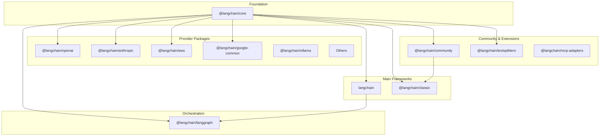
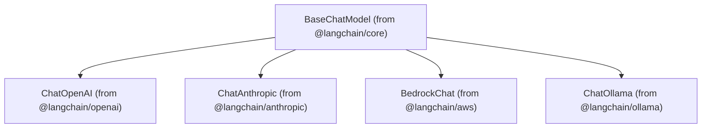
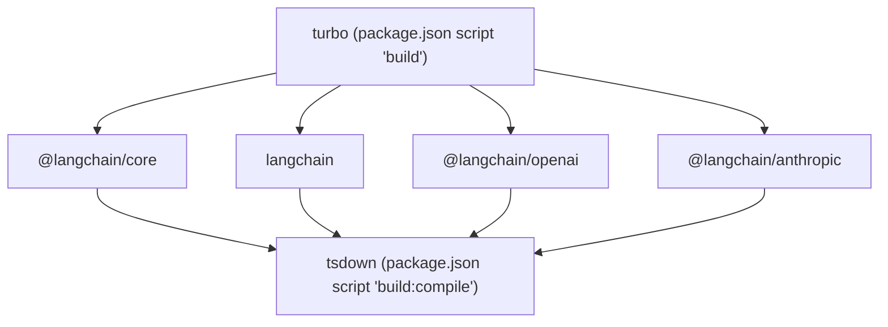

<!-- source: DeepWiki mcp.deepwiki.com · repo langchain-ai/langchainjs · page 1 Overview · fetched 2026-10-26 -->

# Overview

<details>
<summary>Relevant source files</summary>

The following files were used as context for generating this wiki page:

- [README.md](README.md)
- [examples/package.json](examples/package.json)
- [internal/model-profiles/package.json](internal/model-profiles/package.json)
- [libs/langchain-classic/package.json](libs/langchain-classic/package.json)
- [libs/langchain-core/CHANGELOG.md](libs/langchain-core/CHANGELOG.md)
- [libs/langchain-core/README.md](libs/langchain-core/README.md)
- [libs/langchain-core/package.json](libs/langchain-core/package.json)
- [libs/langchain-mcp-adapters/package.json](libs/langchain-mcp-adapters/package.json)
- [libs/langchain/CHANGELOG.md](libs/langchain/CHANGELOG.md)
- [libs/langchain/README.md](libs/langchain/README.md)
- [libs/langchain/package.json](libs/langchain/package.json)
- [libs/providers/langchain-anthropic/CHANGELOG.md](libs/providers/langchain-anthropic/CHANGELOG.md)
- [libs/providers/langchain-anthropic/package.json](libs/providers/langchain-anthropic/package.json)
- [libs/providers/langchain-aws/CHANGELOG.md](libs/providers/langchain-aws/CHANGELOG.md)
- [libs/providers/langchain-aws/package.json](libs/providers/langchain-aws/package.json)
- [libs/providers/langchain-ibm/package.json](libs/providers/langchain-ibm/package.json)
- [package.json](package.json)
- [pnpm-lock.yaml](pnpm-lock.yaml)

</details>


LangChain.js is a framework for building LLM-powered applications in TypeScript and JavaScript. It provides a modular, component-based architecture for connecting language models to external data sources, tools, and systems through standardized interfaces. The framework enables rapid prototyping and production deployment of AI applications across Node.js, edge runtimes, and browsers.

This document introduces the LangChain.js ecosystem structure and core architectural principles. For detailed package relationships, see [Package Architecture](#1.1). For terminology definitions, see [Core Concepts and Terminology](#1.2). For installation instructions, see [Installation and Setup](#1.3).

## What is LangChain.js?

LangChain.js helps developers build applications powered by Large Language Models (LLMs) through:

- **Standardized interfaces** for models, embeddings, vector stores, retrievers, and tools.
- **Model interoperability** allowing swapping between providers (OpenAI, Anthropic, Google, AWS, etc.).
- **Real-time data augmentation** connecting LLMs to diverse data sources and external/internal systems.
- **Agent orchestration** for complex, multi-step reasoning workflows using stateful graphs.
- **Production-ready features** including monitoring, evaluation, and debugging integrations.

The framework consists of a core abstraction layer ([libs/langchain-core/package.json:1-4]()) that defines base interfaces, with provider-specific packages implementing these interfaces for interoperability.

Sources: [README.md:1-79](), [libs/langchain/README.md:1-68]()

## Ecosystem Structure

The LangChain.js ecosystem follows a hierarchical package architecture organized as a pnpm monorepo. The structure ensures modularity while maintaining type safety and version consistency across dozens of packages.

### Ecosystem Hierarchy



**Diagram: LangChain.js Package Ecosystem**

### Package Categories

| Category | Packages | Purpose |
|----------|----------|---------|
| **Foundation** | `@langchain/core` | Base abstractions and schemas (BaseChatModel, BaseRetriever, Runnable, etc.) |
| **Main Framework** | `langchain`, `@langchain/classic` | High-level APIs for agents, chains, and legacy components |
| **Provider Integrations** | `@langchain/openai`, `@langchain/anthropic`, `@langchain/aws`, etc. | Model-specific implementations for major LLM vendors |
| **Community** | `@langchain/community` | Optional third-party integrations (vector stores, loaders, tools) |
| **Specialized** | `@langchain/langgraph`, `@langchain/textsplitters`, `@langchain/mcp-adapters` | Advanced orchestration, text processing utilities, and Model Context Protocol adapters |

Sources: [pnpm-lock.yaml:1-45](), [libs/langchain-core/package.json:1-32](), [libs/langchain/package.json:1-50](), [libs/langchain-classic/package.json:1-20](), [libs/langchain-mcp-adapters/package.json:1-10]()

## Key Architectural Principles

### 1. Peer Dependency Pattern

All packages declare `@langchain/core` as a peer dependency using the `workspace:^` protocol. The root `pnpm` configuration enforces consistency:

```yaml
overrides:
  '@langchain/core': workspace:^
  langchain: workspace:^
```

This ensures a single instance of core abstractions across the entire dependency tree, preventing type incompatibilities when multiple packages are used together. This is critical for avoiding TypeScript OOM issues caused by deep structural comparisons of Zod types.

Sources: [package.json:55-58](), [libs/langchain/package.json:73-75](), [libs/providers/langchain-anthropic/package.json:33-35](), [libs/langchain-core/CHANGELOG.md:84-87]()

### 2. Base Class Extension Model

Provider packages extend base classes from `@langchain/core` to ensure uniform interfaces.



**Diagram: Chat Model Inheritance Hierarchy**

This pattern allows applications to swap providers with minimal code changes while enabling provider-specific features when needed.

Sources: [libs/langchain-core/package.json:81-91](), [libs/providers/langchain-anthropic/package.json:33-35](), [libs/providers/langchain-aws/package.json:32-34]()

### 3. Dual Module Format

All packages support both CommonJS (CJS) and ECMAScript Modules (ESM) through dual exports defined in `package.json`. For example, in `@langchain/core`:

```json
{
  "main": "./dist/index.cjs",
  "types": "./dist/index.d.cts",
  "exports": {
    ".": {
      "require": {
        "types": "./dist/index.d.cts",
        "default": "./dist/index.cjs"
      },
      "import": {
        "types": "./dist/index.d.ts",
        "default": "./dist/index.js"
      }
    }
  }
}
```

The build pipeline uses `tsdown` to compile TypeScript into both formats with corresponding type definitions.

Sources: [libs/langchain-core/package.json:9-80](), [libs/langchain/package.json:99-113](), [README.md:58-69]()

### 4. Monorepo Build Orchestration

The repository uses Turbo for parallel build orchestration with intelligent caching.



**Diagram: Build Pipeline**

The `turbo.json` configuration defines task dependencies, ensuring that `build:compile` runs in the correct order across the workspace.

Sources: [package.json:12-16](), [libs/langchain/package.json:35-37](), [libs/langchain-core/package.json:17-18]()

## Supported Environments

LangChain.js is written in TypeScript and supports diverse JavaScript runtimes:

| Environment | Support Level | Notes |
|-------------|---------------|-------|
| **Node.js** | Full support | Versions 20.x, 22.x, 24.x |
| **Cloudflare Workers** | Full support | Edge runtime |
| **Vercel / Next.js** | Full support | Browser, Serverless, and Edge functions |
| **Supabase Edge Functions**| Full support | Deno-based |
| **Browser** | Full support | Modern browsers |
| **Deno** | Full support | Native ESM support |
| **Bun** | Full support | Native support |

All packages specify `"type": "module"` and require `"node": ">=20"` in their engine constraints.

Sources: [README.md:58-69](), [libs/langchain-core/package.json:6-8](), [libs/langchain/package.json:7-10]()

## Integration with LangSmith and LangGraph

LangChain.js integrates deeply with the broader LangChain ecosystem:

- **LangSmith**: Unified developer platform for monitoring, debugging, and evaluating LLM applications. Core and framework packages include `langsmith` as a dependency ([libs/langchain-core/package.json:30](), [libs/langchain/package.json:79]()).
- **LangGraph**: A low-level agent orchestration framework. The main `langchain` package utilizes `@langchain/langgraph` ([libs/langchain/package.json:77]()) to provide high-level agent creation APIs like `createAgent`.

Sources: [README.md:50-55](), [libs/langchain/package.json:77-79](), [libs/langchain-core/package.json:30]()

## Repository Structure

The codebase is organized as a pnpm monorepo:

```
langchainjs/
├── libs/
│   ├── langchain-core/          # Foundation abstractions
│   ├── langchain/               # Main framework (Agents, Middleware)
│   ├── langchain-classic/       # Legacy components
│   ├── langchain-textsplitters/ # Text processing utilities
│   ├── langchain-mcp-adapters/  # Model Context Protocol adapters
│   └── providers/               # Dedicated provider packages
│       ├── langchain-openai/
│       ├── langchain-anthropic/
│       ├── langchain-aws/
│       └── ...
├── internal/                    # Build and config utilities
├── examples/                    # Usage examples
└── package.json                 # Root workspace config
```

Sources: [package.json:1-11](), [libs/langchain-core/package.json:11-15](), [libs/langchain/package.json:29-33](), [libs/langchain-mcp-adapters/package.json:1-10]()

## Release Management

The project uses Changesets for coordinated versioning and changelog generation across all packages. Release tasks are managed via the root `package.json` scripts:

- `pnpm changeset`: Generate a new changeset.
- `pnpm changeset:version`: Bump versions based on changesets.
- `pnpm release`: Publish updated packages to npm.

Sources: [package.json:33-34](), [pnpm-lock.yaml:52-54](), [libs/langchain/CHANGELOG.md:1-26]()

---

