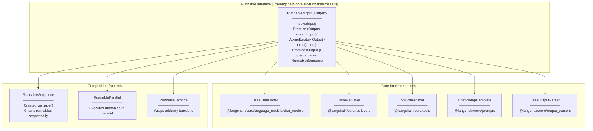
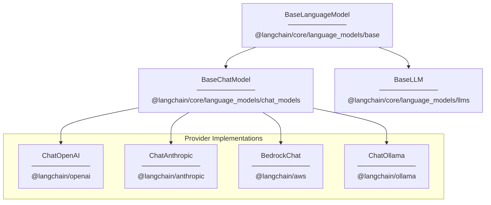
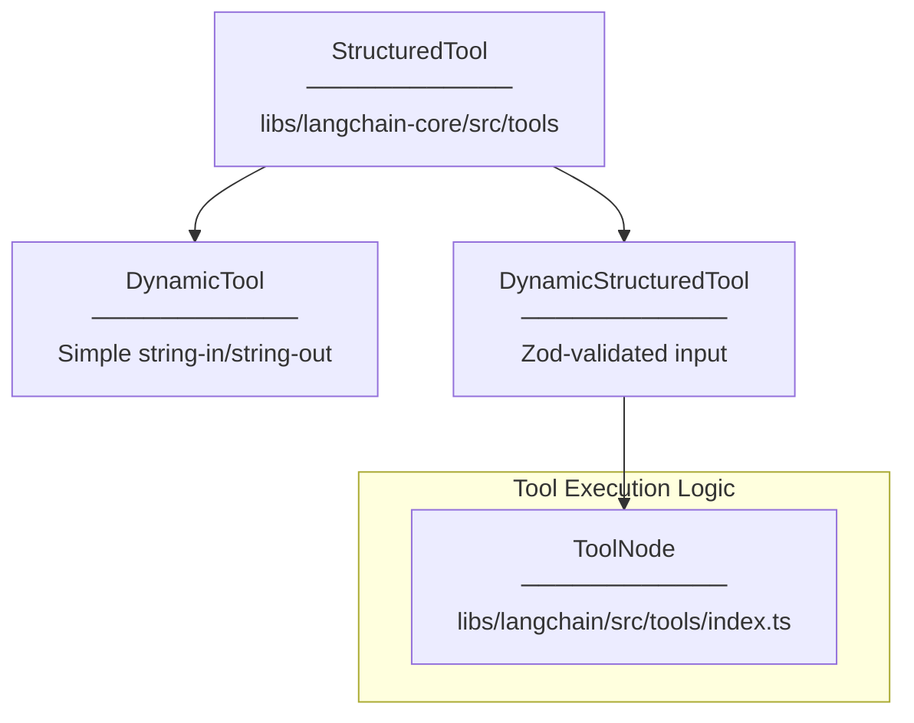
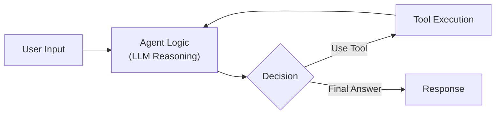
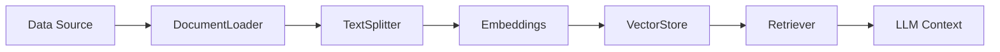

<!-- source: DeepWiki mcp.deepwiki.com · repo langchain-ai/langchainjs · page 1.2 Core Concepts and Terminology · fetched 2026-10-26 -->

# Core Concepts and Terminology

Relevant source files

The following files were used as context for generating this wiki page:

- [README.md](README.md)
- [libs/langchain-classic/src/hub/index.ts](libs/langchain-classic/src/hub/index.ts)
- [libs/langchain-classic/src/load/index.ts](libs/langchain-classic/src/load/index.ts)
- [libs/langchain-core/README.md](libs/langchain-core/README.md)
- [libs/langchain-core/src/load/index.ts](libs/langchain-core/src/load/index.ts)
- [libs/langchain-core/src/load/serializable.ts](libs/langchain-core/src/load/serializable.ts)
- [libs/langchain-core/src/load/tests/index.test.ts](libs/langchain-core/src/load/tests/index.test.ts)
- [libs/langchain-core/src/load/validation.ts](libs/langchain-core/src/load/validation.ts)
- [libs/langchain-core/src/runnables/base.ts](libs/langchain-core/src/runnables/base.ts)
- [libs/langchain-core/src/runnables/history.ts](libs/langchain-core/src/runnables/history.ts)
- [libs/langchain/README.md](libs/langchain/README.md)
- [libs/langchain/src/hub/tests/hub.int.test.ts](libs/langchain/src/hub/tests/hub.int.test.ts)
- [libs/langchain/src/load/index.ts](libs/langchain/src/load/index.ts)
- [libs/langchain/src/load/tests/load.test.ts](libs/langchain/src/load/tests/load.test.ts)

This document defines the fundamental concepts and terminology used throughout LangChain.js. Understanding these concepts is essential for working with any LangChain package or integration. For information about the package structure itself, see [Package Architecture](./1.1).

## Purpose and Scope

LangChain.js is built around a set of core abstractions that enable interoperability across different LLM providers, data sources, and tools. This page defines the key terminology including:

- **Execution model**: Runnables and the piping pattern (LCEL).
- **Model interfaces**: Chat models, language models, and message types.
- **Tool system**: Tool definitions, dynamic tools, and function calling.
- **Application patterns**: Chains and agents.
- **Retrieval components**: Retrievers, vector stores, and embeddings.
- **Data processing**: Document loaders, text splitters, and output parsers.

---

## Core Execution Model: Runnables and LCEL

The `Runnable` interface is the foundational abstraction in LangChain.js. All major components (models, prompts, retrievers, tools) implement this interface, enabling standardized execution and composition via the **LangChain Expression Language (LCEL)**.

### Runnable Interface

The `Runnable` class provides a standard interface for creating custom chains. It defines several methods that allow for different execution modes.

Title: Runnable Interface and Implementations

**Sources**: [libs/langchain-core/src/runnables/base.ts:124-133](), [libs/langchain-core/README.md:5-10]()

### Execution Methods

| Method | Purpose | Return Type | Use Case |
|--------|---------|-------------|----------|
| `invoke(input)` | Single execution | `Promise<Output>` | Standard one-off requests |
| `stream(input)` | Streaming execution | `AsyncIterator<Output>` | Real-time UI updates |
| `batch(inputs)` | Batch processing | `Promise<Output[]>` | Processing multiple inputs efficiently |
| `pipe(runnable)` | Composition | `RunnableSequence` | Building LCEL chains |

The piping pattern allows developers to compose complex logic from simple components:
`const chain = prompt.pipe(model).pipe(outputParser);`

**Sources**: [libs/langchain-core/src/runnables/base.ts:145-148](), [libs/langchain-core/README.md:29-70]()

---

## Language Model Interfaces

LangChain.js distinguishes between two types of models: **Chat Models** (message-based) and **LLMs** (string-based).

### Model Hierarchy

Title: Model Interface Hierarchy

**Sources**: [libs/langchain-core/README.md:5-10]()

### Message System and Content Blocks

Chat models exchange `BaseMessage` objects. Modern models support **Standard Content Blocks** for multimodal data (images, tool calls).

| Message Type | Purpose | Key Fields |
|--------------|---------|------------|
| `SystemMessage` | High-level instructions | `content` |
| `HumanMessage` | User-generated input | `content` |
| `AIMessage` | Model-generated response | `content`, `tool_calls` |
| `ToolMessage` | Result of a tool execution | `content`, `tool_call_id` |

**Sources**: [libs/langchain-core/src/runnables/history.ts:6-10]()

---

## Tools and Dynamic Tools

Tools are interfaces that allow LLMs to interact with the world. In LangChain.js, tools are defined using Zod schemas to ensure type safety.

### Tool Types

- **StructuredTool**: The base class for all tools requiring a schema.
- **DynamicTool**: A simple tool created from a function that takes a string input.
- **DynamicStructuredTool**: A tool created from a function that takes a structured (Zod) input.

Title: Tool Abstractions and Dynamic Creation

**Sources**: [libs/langchain-core/src/runnables/base.ts:60-61]()

---

## Chains vs Agents

While both orchestrate LLM calls, they differ in how the "next step" is decided.

### Chains (Static)
A **Chain** is a hardcoded sequence of steps. It uses LCEL to pipe components together. The developer defines the flow entirely at design time.

### Agents (Dynamic)
An **Agent** uses an LLM as a reasoning engine to determine which actions to take and in what order.
- **createAgent**: The high-level API in the `langchain` package for creating agents.
- **ReactAgent**: A common pattern where the agent follows a "Reasoning + Acting" loop.

Title: Agent Orchestration Flow

**Sources**: [README.md:17-17](), [libs/langchain/README.md:5-5]()

---

## Retrieval and Vector Stores

The retrieval system allows models to access data not present in their training set (RAG).

### Key Components

1.  **Document Loaders**: Classes that bring data in from external sources.
2.  **Text Splitters**: Utilities in `@langchain/textsplitters` that break long documents into manageable chunks.
3.  **Embeddings**: Models that convert text into numerical vectors.
4.  **Vector Stores**: Databases (e.g., Pinecone, PGVector) that store these vectors for similarity search.
5.  **Retrievers**: High-level interfaces that take a query and return relevant `Document` objects.

Title: RAG Pipeline Terminology

**Sources**: [libs/langchain-core/README.md:18-25]()

---

## Terminology Summary Table

| Term | Code Entity | Package | Role |
| :--- | :--- | :--- | :--- |
| **Runnable** | `Runnable` | `@langchain/core` | The atomic unit of composition. |
| **Chain** | `RunnableSequence` | `@langchain/core` | A static sequence of runnables. |
| **Agent** | `createAgent` | `langchain` | A dynamic loop using LLM reasoning. |
| **Retriever** | `BaseRetriever` | `@langchain/core` | An interface for fetching relevant docs. |
| **Vector Store** | `VectorStore` | `@langchain/core` | A database for embedding-based search. |
| **Tool** | `StructuredTool` | `@langchain/core` | A function the LLM can decide to call. |

**Sources**: [libs/langchain-core/src/runnables/base.ts:124-133](), [libs/langchain-core/README.md:5-10](), [libs/langchain/README.md:5-5]()

---

