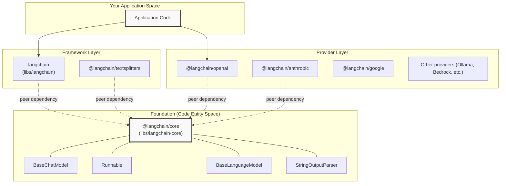
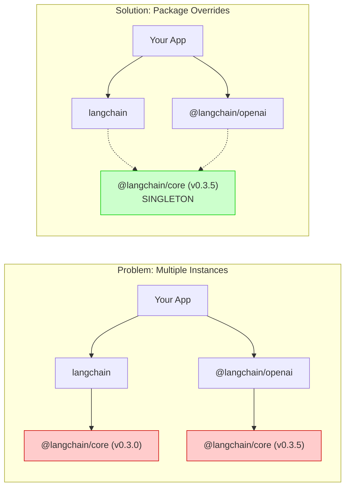
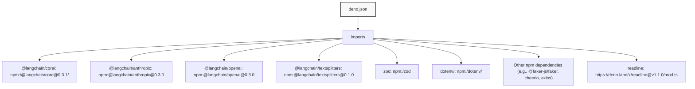

<!-- source: DeepWiki mcp.deepwiki.com · repo langchain-ai/langchainjs · page 1.3 Installation and Setup · fetched 2026-10-26 -->

# Installation and Setup

<details>
<summary>Relevant source files</summary>

The following files were used as context for generating this wiki page:

- [.vscode/extensions.json](.vscode/extensions.json)
- [.vscode/settings.json](.vscode/settings.json)
- [deno.json](deno.json)
- [examples/.env.example](examples/.env.example)

</details>


This page guides you through installing LangChain.js packages, selecting the appropriate packages for your use case, and configuring your development environment. It covers the monorepo package structure, version consistency requirements, and environment setup for LLM provider integrations.

For information about the architectural principles underlying the package structure, see **1.1 Package Architecture**. For details on building and developing LangChain.js itself, see **6.1 Monorepo Management**.

---

## Understanding the Package Ecosystem

LangChain.js is distributed as a collection of npm packages organized in a hierarchical structure. Understanding this structure is essential for selecting the correct packages to install.

### Package Categories

The ecosystem consists of several primary package categories:

| Category | Package Pattern | Purpose | Path in Monorepo |
|----------|----------------|---------|------------------|
| **Core** | `@langchain/core` | Base abstractions, schemas, and interfaces | `libs/langchain-core` |
| **Main Framework** | `langchain` | High-level agent API, chains, utilities | `libs/langchain` |
| **Text Splitters** | `@langchain/textsplitters` | Text splitting utilities | `libs/langchain-textsplitters` |
| **Provider Packages** | `@langchain/{provider}` | Dedicated packages for major LLM providers | `libs/providers/langchain-*` |
| **Build Tools** | `@langchain/build` | Internal build pipeline orchestration | `internal/build` |

**Sources:** [libs/langchain-core/README.md:5-7](), [libs/langchain-core/README.md:16-20](), [internal/build/package.json:2-6]()

### Package Dependency Architecture

The following diagram illustrates how your application interacts with the LangChain ecosystem and how internal dependencies are structured.

**LangChain.js Dependency Flow**



**Key Principle:** All packages declare `@langchain/core` as a **peer dependency**, not a direct dependency. This ensures that your application uses a single, consistent version of core abstractions across all packages.

**Sources:** [libs/langchain-core/README.md:72-82](), [libs/langchain-core/README.md:93-100]()

---

## Basic Installation

### Installing the Main Package

For most applications, start by installing the `langchain` package:

```bash
npm install -S langchain
# or
pnpm install langchain
# or
yarn add langchain
```

This provides access to high-level features like agents and orchestration.

**Sources:** [README.md:31-35](), [libs/langchain/README.md:17-27]()

### Installing Provider Packages

To use specific LLM providers, install their dedicated packages. These packages extend core classes like `BaseChatModel`.

```bash
# OpenAI (GPT-4o, etc.)
pnpm install @langchain/openai

# Anthropic (Claude)
pnpm install @langchain/anthropic

# Google Gemini
pnpm install @langchain/google

# Ollama (Local models)
pnpm install @langchain/ollama
```

**Sources:** [libs/langchain-core/README.md:21-25](), [libs/langchain-core/README.md:78-79]()

---

## Ensuring Core Version Consistency

**Critical:** All LangChain packages in your project must share the same version of `@langchain/core`. Mismatched versions cause runtime errors due to incompatible type definitions and schema mismatches.

### Version Resolution Strategy



### Configuring package.json Overrides

To force version consistency, use the `overrides` (npm/pnpm) or `resolutions` (yarn) field in your root `package.json`. Within the LangChain.js monorepo itself, the `pnpm.overrides` field is used to link all packages to the local workspace version of core.

```json
{
  "pnpm": {
    "overrides": {
      "@langchain/core": "workspace:^",
      "langchain": "workspace:^"
    }
  }
}
```

For end-users, use standard semver to ensure a singleton instance of core:
```json
{
  "overrides": {
    "@langchain/core": "^0.3.0"
  }
}
```

**Sources:** [libs/langchain-core/README.md:72-82](), [package.json:55-58]()

---

## Environment Configuration

### API Key Management

Most LLM providers require API authentication. Configure credentials using environment variables. The codebase looks for specific variable names by default.

| Provider | Default Environment Variable | Source |
|----------|-----------------------------|--------|
| **Anthropic** | `ANTHROPIC_API_KEY` | [examples/.env.example:1]() |
| **OpenAI** | `OPENAI_API_KEY` | [examples/.env.example:9]() |
| **Google** | `GOOGLE_PALM_API_KEY` | [examples/.env.example:3]() |
| **AWS** | `AWS_ACCESS_KEY_ID`, `AWS_SECRET_ACCESS_KEY` | [examples/.env.example:72-73]() |
| **Azure OpenAI**| `AZURE_OPENAI_API_KEY` | [examples/.env.example:11]() |
| **Pinecone** | `PINECONE_API_KEY` | [examples/.env.example:31]() |

### Example .env Setup

Create a `.env` file in your project root. You can use `examples/.env.example` as a template:

```bash
# Core Provider Keys
ANTHROPIC_API_KEY=ADD_YOURS_HERE
OPENAI_API_KEY=ADD_YOURS_HERE

# Search & Tools
SERPAPI_API_KEY=ADD_YOURS_HERE
TAVILY_API_KEY=ADD_YOURS_HERE

# Vector Databases
PINECONE_API_KEY=ADD_YOURS_HERE
WEAVIATE_API_KEY=ADD_YOURS_HERE
```

**Sources:** [examples/.env.example:1-91]()

---

## Supported Environments

LangChain.js is written in TypeScript and supports a wide range of modern runtimes:

| Environment | Supported Versions / Context |
|------------|-----------------------------|
| **Node.js** | 20.x, 22.x, 24.x (ESM & CommonJS) |
| **Cloudflare Workers** | Supported |
| **Vercel / Next.js** | Browser, Serverless, and Edge functions |
| **Deno** | Supported |
| **Bun** | Supported |
| **Browser** | Supported |

**Sources:** [README.md:59-69](), [libs/langchain/README.md:44-54]()

---

## Workspace and Examples Setup

If you are contributing to the LangChain.js repository or running the provided examples, you must use `pnpm` (version `10.14.0` specified in the root).

### Monorepo Setup
The repository uses `pnpm` workspaces and `turbo` for build orchestration.

1. **Install Dependencies:**
   ```bash
   pnpm install
   ```
2. **Build All Packages:**
   ```bash
   pnpm build
   ```
   This triggers the `turbo build:compile` task, which respects dependency order. [package.json:13](), [turbo.json:7-12]()

### Running Examples
The `examples/` directory contains a dedicated suite for testing and demonstrating functionality.

1. **Setup Environment:**
   ```bash
   cd examples
   cp .env.example .env
   # Edit .env with your keys
   ```
2. **Execute an Example:**
   Examples are run via a dispatcher that handles path resolution and callback cleanup.
   ```bash
   pnpm run start ./src/prompts/few_shot.ts
   ```
   The dispatcher in `examples/src/index.ts` handles the `run` function exported by the example file and ensures `awaitAllCallbacks()` is called upon completion. [examples/src/index.ts:32-56](), [examples/src/README.md:18-24]()

---

## Deno Configuration

For Deno users, the `deno.json` file at the root of the repository defines import maps for various LangChain.js packages and external npm dependencies. This allows Deno to resolve npm packages directly.

**Deno Import Map Structure**



The `imports` field maps package names to their npm URLs, specifying a particular version. For example, `@langchain/core` is mapped to `npm:/@langchain/core@0.3.1/` [deno.json:11](). This ensures that Deno uses the specified npm package directly.

**Sources:** [deno.json:1-39]()

---

## VS Code Settings

The `.vscode/settings.json` file configures VS Code for an optimal development experience within the LangChain.js monorepo.

**Key Settings:**

*   `typescript.tsdk`: Points to the TypeScript SDK within `node_modules` [.vscode/settings.json:5](), ensuring the correct TypeScript version is used.
*   `editor.formatOnSave`: Enables automatic code formatting on save [.vscode/settings.json:14]().
*   `files.exclude` and `search.exclude`: Configures file and folder exclusions for better performance and cleaner search results, ignoring build artifacts and dependency directories like `dist`, `dist-cjs`, `node_modules`, and `.turbo` [.vscode/settings.json:15-24]().
*   `typescript.preferences.importModuleSpecifier`: Sets import module specifiers to `relative` [.vscode/settings.json:25]().
*   `editor.defaultFormatter`: Specifies `oxc.oxc-vscode` as the default formatter for JavaScript and TypeScript files [.vscode/settings.json:26-31]().
*   `deno.enable`: Explicitly disables Deno language server integration for the workspace [.vscode/settings.json:33](), as the primary development environment is Node.js.

The `.vscode/extensions.json` file also recommends essential extensions for contributors, including ESLint, Prettier, TypeScript, Code Spell Checker, and YAML support [.vscode/extensions.json:1-8]().

**Sources:** [.vscode/settings.json:1-34](), [.vscode/extensions.json:1-11]()

---

## Installation Verification

### Basic Import Test

Verify your installation by instantiating a model and output parser from core. The following pattern uses the standard `Runnable` interface's `pipe` method:

```typescript
import { ChatOpenAI } from "@langchain/openai";
import { StringOutputParser } from "@langchain/core/output_parsers";
import { ChatPromptTemplate } from "@langchain/core/prompts";

const model = new ChatOpenAI({
  model: "gpt-4o-mini",
  temperature: 0.8,
});

const prompt = ChatPromptTemplate.fromTemplate(
  "Answer the following question to the best of your ability:\n{question}"
);

const outputParser = new StringOutputParser();

// Create a chain using LCEL (LangChain Expression Language)
const chain = prompt.pipe(model).pipe(outputParser);

const stream = await chain.stream({
  question: "Why is the sky blue?",
});

for await (const chunk of stream) {
  process.stdout.write(chunk);
}
```

**Sources:** [libs/langchain-core/README.md:29-53]()

---

