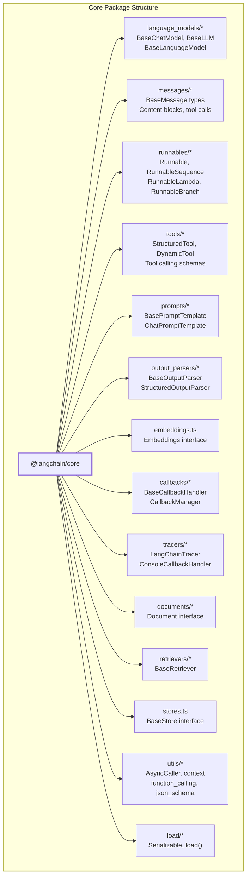
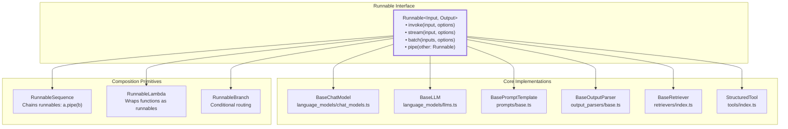
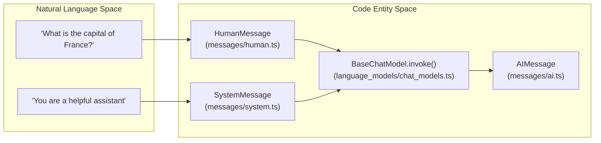
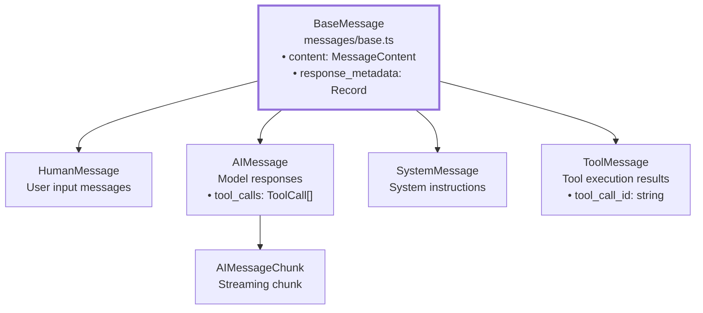
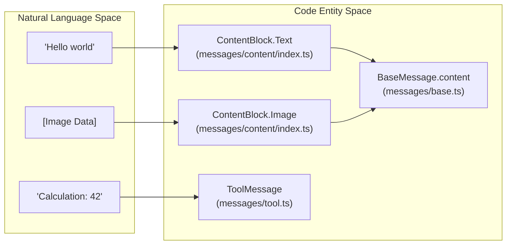
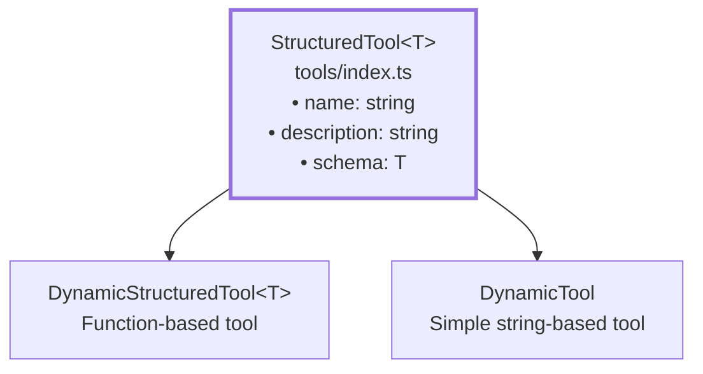

<!-- source: DeepWiki mcp.deepwiki.com · repo langchain-ai/langchainjs · page 2 Core Abstractions (@langchain/core) · fetched 2026-10-26 -->

# Core Abstractions (@langchain/core)

Relevant source files

The following files were used as context for generating this wiki page:

- [libs/langchain-classic/src/hub/index.ts](libs/langchain-classic/src/hub/index.ts)
- [libs/langchain-classic/src/load/index.ts](libs/langchain-classic/src/load/index.ts)
- [libs/langchain-core/src/language_models/base.ts](libs/langchain-core/src/language_models/base.ts)
- [libs/langchain-core/src/language_models/chat_models.ts](libs/langchain-core/src/language_models/chat_models.ts)
- [libs/langchain-core/src/language_models/llms.ts](libs/langchain-core/src/language_models/llms.ts)
- [libs/langchain-core/src/language_models/tests/chat_models.test.ts](libs/langchain-core/src/language_models/tests/chat_models.test.ts)
- [libs/langchain-core/src/language_models/tests/count_tokens.test.ts](libs/langchain-core/src/language_models/tests/count_tokens.test.ts)
- [libs/langchain-core/src/language_models/tests/llms.test.ts](libs/langchain-core/src/language_models/tests/llms.test.ts)
- [libs/langchain-core/src/language_models/utils.ts](libs/langchain-core/src/language_models/utils.ts)
- [libs/langchain-core/src/load/index.ts](libs/langchain-core/src/load/index.ts)
- [libs/langchain-core/src/load/serializable.ts](libs/langchain-core/src/load/serializable.ts)
- [libs/langchain-core/src/load/tests/index.test.ts](libs/langchain-core/src/load/tests/index.test.ts)
- [libs/langchain-core/src/load/validation.ts](libs/langchain-core/src/load/validation.ts)
- [libs/langchain-core/src/runnables/base.ts](libs/langchain-core/src/runnables/base.ts)
- [libs/langchain-core/src/runnables/history.ts](libs/langchain-core/src/runnables/history.ts)
- [libs/langchain/src/hub/tests/hub.int.test.ts](libs/langchain/src/hub/tests/hub.int.test.ts)
- [libs/langchain/src/load/index.ts](libs/langchain/src/load/index.ts)
- [libs/langchain/src/load/tests/load.test.ts](libs/langchain/src/load/tests/load.test.ts)
- [libs/providers/langchain-google-common/src/llms.ts](libs/providers/langchain-google-common/src/llms.ts)
- [libs/providers/langchain-openai/src/chat_models/tests/index.int.test.ts](libs/providers/langchain-openai/src/chat_models/tests/index.int.test.ts)

## Purpose and Scope

The `@langchain/core` package defines the foundational abstractions, interfaces, and base classes that all other packages in the LangChain.js ecosystem implement. It provides type-safe schemas, base implementations for language models, message systems, tool calling, runnables (LCEL), and observability primitives. This page documents the core abstractions and their relationships.

For specific implementation details of chat models and LLMs, see [Base Chat Model and LLM Interfaces](#2.1). For message content structures, see [Message System and Content Blocks](#2.2). For tool definitions, see [Tools and Dynamic Tools](#2.3). For execution logic, see [Runnables and Execution](#2.4). For output parsing and serialization, see [Output Parsers, Serialization, and Utilities](#2.5). For integration testing, see [Standard Test Framework and Testing Utilities](#2.6).

## Package Structure

The `@langchain/core` package is organized into logical modules, each exported as a separate entrypoint to enable tree-shaking and minimize bundle sizes.

### Module Organization

**Key Export Categories**:

| Export Path | Purpose | Key Classes/Interfaces |
|-------------|---------|------------------------|
| `language_models/base` | Base language model abstractions | `BaseLanguageModel`, `BaseLanguageModelCallOptions` |
| `language_models/chat_models` | Chat model interface | `BaseChatModel`, `BaseChatModelCallOptions` |
| `language_models/llms` | Text completion interface | `BaseLLM`, `BaseLLMCallOptions` |
| `messages` | Message type system | `BaseMessage`, `HumanMessage`, `AIMessage`, `SystemMessage`, `ToolMessage` |
| `messages/tool` | Tool calling structures | `ToolCall`, `ToolCallChunk`, `InvalidToolCall` |
| `runnables` | LCEL composition primitives | `Runnable`, `RunnableSequence`, `RunnableLambda` |
| `tools` | Tool abstractions | `StructuredTool`, `DynamicTool`, `DynamicStructuredTool` |
| `prompts` | Prompt templates | `BasePromptTemplate`, `ChatPromptTemplate` |
| `callbacks/manager` | Callback orchestration | `CallbackManager`, `CallbackManagerForLLMRun` |
| `load` | Serialization and deserialization | `Serializable`, `load` |

Sources: [libs/langchain-core/src/language_models/chat_models.ts:1-74](), [libs/langchain-core/src/messages/index.ts:1-17]()

## The Runnable Interface

The `Runnable` interface is the foundational abstraction in LangChain.js, enabling LangChain Expression Language (LCEL). All components that can be invoked, streamed, or composed implement this interface. For details, see [Runnables and Execution](#2.4).

### Runnable Hierarchy

### Runnable Methods

The `Runnable` interface defines standard methods that all components implement:

| Method | Description | Return Type |
|--------|-------------|-------------|
| `invoke(input, options?)` | Synchronously invoke with input | `Promise<Output>` |
| `stream(input, options?)` | Stream output chunks | `AsyncGenerator<Output>` |
| `batch(inputs, options?)` | Process multiple inputs | `Promise<Output[]>` |
| `pipe(other)` | Compose with another runnable | `RunnableSequence<Input, NewOutput>` |

**CallOptions Parameter**:

All methods accept a `RunnableConfig` parameter containing:
- `signal?: AbortSignal` - For cancellation [libs/langchain-core/src/language_models/llms.ts:44-45]().
- `callbacks?: Callbacks` - For observability [libs/langchain-core/src/language_models/base.ts:232-233]().
- `tags?: string[]` - For metadata tagging [libs/langchain-core/src/language_models/base.ts:233-234]().
- `metadata?: Record<string, unknown>` - Additional metadata [libs/langchain-core/src/language_models/base.ts:234-235]().

Sources: [libs/langchain-core/src/runnables/base.ts:124-130](), [libs/langchain-core/src/language_models/base.ts:240-258](), [libs/langchain-core/src/language_models/llms.ts:58-69]()

## Language Model Abstractions

Language models are the primary components in LangChain.js. The core package defines three base classes in a hierarchy: `BaseLanguageModel` → `BaseChatModel` / `BaseLLM`. For details, see [Base Chat Model and LLM Interfaces](#2.1).

### Natural Language to Code Entity Space: Language Models

### BaseChatModel Interface

`BaseChatModel` is the foundation for conversational AI models that work with structured message objects. It extends `BaseLanguageModel` [libs/langchain-core/src/language_models/chat_models.ts:28-34]().

**Structured Output Support**:
The `withStructuredOutput()` method enables models to return validated objects (e.g., via Zod) instead of raw strings or messages [libs/langchain-core/src/language_models/chat_models.ts:69](). It supports both Zod schemas and the Standard Schema specification [libs/langchain-core/src/language_models/chat_models.ts:55-57]().

Sources: [libs/langchain-core/src/language_models/chat_models.ts:216-240](), [libs/langchain-core/src/language_models/base.ts:33-59]()

## Message System

The message system provides a type-safe abstraction for conversational interactions. All messages inherit from `BaseMessage` and contain typed content blocks. For details, see [Message System and Content Blocks](#2.2).

### Message Type Hierarchy

### Natural Language to Code Entity Space: Messages

Sources: [libs/langchain-core/src/messages/base.ts:215-225](), [libs/langchain-core/src/messages/ai.ts:33-43](), [libs/langchain-core/src/messages/system.ts:18-25]()

## Tool Abstractions

Tools enable language models to interact with external systems. The core package defines base tool classes and factory functions. For details, see [Tools and Dynamic Tools](#2.3).

### Tool Class Hierarchy

Sources: [libs/langchain-core/src/language_models/chat_models.ts:44-51](), [libs/langchain-core/src/language_models/chat_models.ts:204-210]()

## Other Core Abstractions

### Callbacks and Tracing
The callback system enables observability and instrumentation. `CallbackManager` orchestrates handlers for lifecycle events like `handleLLMStart` and `handleLLMEnd` [libs/langchain-core/src/callbacks/manager.ts:10-12](). For details, see [Runnables and Execution](#2.4).

Sources: [libs/langchain-core/src/language_models/chat_models.ts:37-40](), [libs/langchain-core/src/language_models/llms.ts:122-131]()

### Serialization
Core components extend `Serializable`, allowing them to be serialized to JSON and reconstructed using the `load` utility [libs/langchain-core/src/load/serializable.ts:97-100](). This system includes mechanisms to prevent secret injection and ensure data integrity during deserialization [libs/langchain-core/src/load/index.ts:1-67](). For details, see [Output Parsers, Serialization, and Utilities](#2.5).

Sources: [libs/langchain-core/src/load/index.ts:70-75](), [libs/langchain-core/src/load/validation.ts:101-110]()

---

