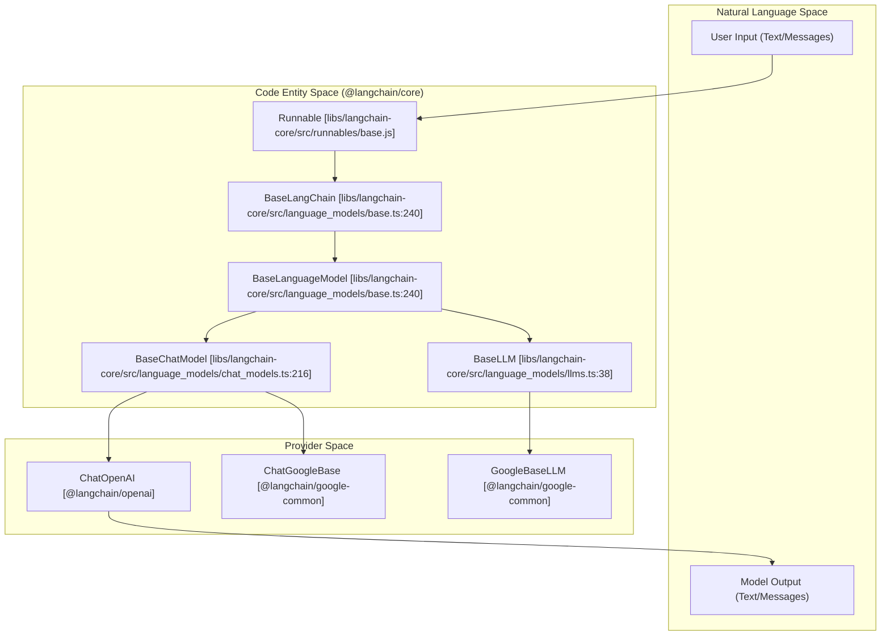
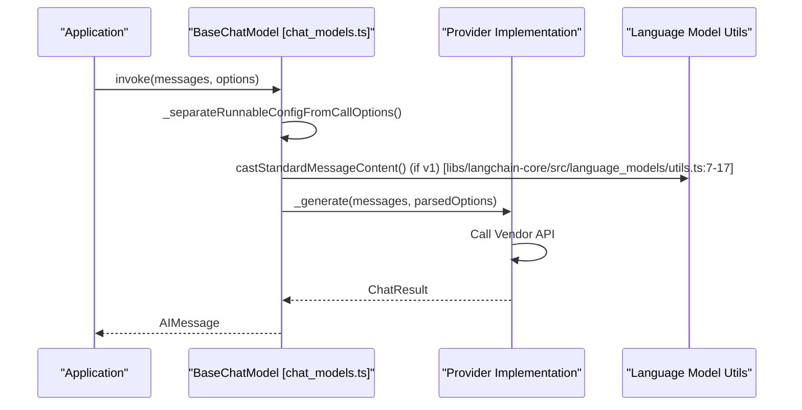

<!-- source: DeepWiki mcp.deepwiki.com · repo langchain-ai/langchainjs · page 2.1 Base Chat Model and LLM Interfaces · fetched 2026-10-26 -->

# Base Chat Model and LLM Interfaces

Relevant source files

The following files were used as context for generating this wiki page:

- [libs/langchain-core/src/language_models/base.ts](libs/langchain-core/src/language_models/base.ts)
- [libs/langchain-core/src/language_models/chat_models.ts](libs/langchain-core/src/language_models/chat_models.ts)
- [libs/langchain-core/src/language_models/llms.ts](libs/langchain-core/src/language_models/llms.ts)
- [libs/langchain-core/src/language_models/tests/chat_models.test.ts](libs/langchain-core/src/language_models/tests/chat_models.test.ts)
- [libs/langchain-core/src/language_models/tests/count_tokens.test.ts](libs/langchain-core/src/language_models/tests/count_tokens.test.ts)
- [libs/langchain-core/src/language_models/tests/llms.test.ts](libs/langchain-core/src/language_models/tests/llms.test.ts)
- [libs/langchain-core/src/language_models/utils.ts](libs/langchain-core/src/language_models/utils.ts)
- [libs/providers/langchain-deepseek/src/profiles.ts](libs/providers/langchain-deepseek/src/profiles.ts)
- [libs/providers/langchain-google-common/src/llms.ts](libs/providers/langchain-google-common/src/llms.ts)
- [libs/providers/langchain-google-common/src/profiles.ts](libs/providers/langchain-google-common/src/profiles.ts)
- [libs/providers/langchain-google-genai/src/profiles.ts](libs/providers/langchain-google-genai/src/profiles.ts)
- [libs/providers/langchain-google/profiles.toml](libs/providers/langchain-google/profiles.toml)
- [libs/providers/langchain-google/src/chat_models/profiles.ts](libs/providers/langchain-google/src/chat_models/profiles.ts)
- [libs/providers/langchain-groq/src/profiles.ts](libs/providers/langchain-groq/src/profiles.ts)
- [libs/providers/langchain-openai/src/chat_models/profiles.ts](libs/providers/langchain-openai/src/chat_models/profiles.ts)
- [libs/providers/langchain-openai/src/chat_models/tests/index.int.test.ts](libs/providers/langchain-openai/src/chat_models/tests/index.int.test.ts)
- [libs/providers/langchain-xai/src/profiles.ts](libs/providers/langchain-xai/src/profiles.ts)

## Purpose and Scope

This document explains the foundational base classes and interfaces in `@langchain/core` that enable Language Model (LLM) provider interoperability across the LangChain.js ecosystem. The primary abstractions are `BaseChatModel` and `BaseLanguageModel`, which define standardized interfaces that all LLM provider packages must implement.

This page covers:
- The implementation details of `BaseChatModel` and `BaseLLM`.
- Model profiles and capability tracking.
- Structured output base classes and Zod integration.
- Language model utility functions for token counting and message casting.
- The `ChatModelStream` system for protocol-compliant streaming.

## Overview of Base Abstractions

The `@langchain/core` package provides two fundamental base classes for working with language models, both of which inherit from a common `BaseLanguageModel` [libs/langchain-core/src/language_models/base.ts:240-247]():

| Base Class | Purpose | Primary Use Cases |
|------------|---------|-------------------|
| `BaseChatModel` | Conversational AI with message-based interfaces [libs/langchain-core/src/language_models/chat_models.ts:216-220]() | Chat applications, multi-turn conversations, tool calling |
| `BaseLLM` | Text-in, text-out completion interface [libs/langchain-core/src/language_models/llms.ts:38-40]() | Legacy completion models, simple text generation |

Both classes implement the `Runnable` interface [libs/langchain-core/src/language_models/base.ts:20-21](), providing a unified execution model with support for streaming, batching, and composition.

## Base Class Hierarchy

The following diagram maps the code entities from the core abstractions to specific provider implementations.

**Diagram: Entity mapping from core abstractions to provider implementations.**
Sources: [libs/langchain-core/src/language_models/base.ts:240](), [libs/langchain-core/src/language_models/chat_models.ts:216](), [libs/langchain-core/src/language_models/llms.ts:38](), [libs/providers/langchain-google-common/src/llms.ts:71]()

## BaseChatModel Interface

`BaseChatModel` is the core abstraction for models that operate on message sequences (`BaseMessage[]`) [libs/langchain-core/src/language_models/chat_models.ts:216]().

### Configuration and Parameters
Models are configured via `BaseChatModelParams`, which includes:
- `disableStreaming`: Whether to bypass `stream()` and defer to `invoke()` [libs/langchain-core/src/language_models/chat_models.ts:110]().
- `outputVersion`: Controls the format of `AIMessage` output. "v0" uses provider-specific formats, while "v1" uses standardized content blocks [libs/langchain-core/src/language_models/chat_models.ts:125-126]().

### Core Execution Flow
The internal execution flow for a chat model call involves several stages of normalization and callback handling.

**Diagram: Internal data flow for BaseChatModel.invoke().**
Sources: [libs/langchain-core/src/language_models/chat_models.ts:216](), [libs/langchain-core/src/language_models/utils.ts:7-17]()

### Tool Binding and Structured Output
Chat models support two primary patterns for specialized output:
1. **`bindTools(tools)`**: Attaches tool definitions to the model call [libs/langchain-core/src/language_models/chat_models.ts:204-210]().
2. **`withStructuredOutput(schema)`**: Uses `assembleStructuredOutputPipeline` to create a `Runnable` that returns parsed objects instead of messages [libs/langchain-core/src/language_models/chat_models.ts:69](). This supports Zod schemas, JSON schemas, and `SerializableSchema` [libs/langchain-core/src/language_models/chat_models.ts:67-68]().

## Streaming Architecture

LangChain.js utilizes a sophisticated streaming protocol to handle real-time model outputs, including text, reasoning (thinking), and tool calls.

### ChatModelStream
The `ChatModelStream` class [libs/langchain-core/src/language_models/chat_models.ts:71]() manages an async generator of `ChatModelStreamEvent`. It provides sub-streams for specific content types:
- `.text`: An async iterable yielding incremental text deltas.
- `.reasoning`: An async iterable for model "thinking" or reasoning tokens.

### Delta Application
The `applyDelta` function (not shown in provided files, but conceptually part of the streaming implementation) is responsible for merging incremental updates into accumulated content blocks:
- `text-delta`: Appends text to a text block.
- `reasoning-delta`: Appends reasoning text to "thinking" or "reasoning" blocks.
- `block-delta`: Shallow merges fields for tool call chunks.

## Model Profiles and Capabilities

LangChain.js uses `ModelProfile` to track the technical capabilities of specific models, such as context limits and input/output support [libs/langchain-core/src/language_models/base.ts:28]().

### Profile Attributes
A `ModelProfile` typically defines:
- `maxInputTokens`: The context window size [libs/providers/langchain-openai/src/chat_models/profiles.ts:7]().
- `maxOutputTokens`: Maximum tokens the model can generate [libs/providers/langchain-openai/src/chat_models/profiles.ts:12]().
- `toolCalling` / `structuredOutput`: Boolean flags for feature support [libs/providers/langchain-openai/src/chat_models/profiles.ts:17-18]().
- `reasoningOutput`: Support for "thinking" or reasoning tokens [libs/providers/langchain-openai/src/chat_models/profiles.ts:13]().

Examples of model profiles can be found in provider packages:
- OpenAI: [libs/providers/langchain-openai/src/chat_models/profiles.ts]()
- DeepSeek: [libs/providers/langchain-deepseek/src/profiles.ts]()
- Google: [libs/providers/langchain-google/src/chat_models/profiles.ts]()
- xAI: [libs/providers/langchain-xai/src/profiles.ts]()
- Groq: [libs/providers/langchain-groq/src/profiles.ts]()

### Capability Utility Functions
`@langchain/core` provides utilities to query model limits:
- `getModelContextSize(modelName)`: Returns the max input tokens for known models (e.g., GPT-4o: 128k, Gemini 1.5: 1M, Claude 3.5: 200k) [libs/langchain-core/src/language_models/base.ts:81-170]().
- `calculateMaxTokens({ prompt, modelName })`: Calculates remaining tokens by encoding the prompt via `js-tiktoken` and subtracting from the model's context size [libs/langchain-core/src/language_models/base.ts:198-220]().

## Language Model Utility Functions

The following utilities assist in message handling and provider interoperability:

### Message Casting
`castStandardMessageContent` is used to convert messages to the "v1" standardized format, moving `contentBlocks` into the primary `content` field and updating `response_metadata` [libs/langchain-core/src/language_models/utils.ts:7-17]().

### Input Normalization
`BaseChatModel` includes `_formatForTracing`, which prepares messages for observability platforms by converting multimodal content (like base64 images) into OpenAI-compatible image blocks for consistent visualization [libs/langchain-core/src/language_models/chat_models.ts:166-192]().

## Summary of Key Classes

| Symbol | File Path | Role |
|--------|-----------|------|
| `BaseLanguageModel` | [libs/langchain-core/src/language_models/base.ts:240]() | Common base for LLMs and Chat Models. |
| `BaseChatModel` | [libs/langchain-core/src/language_models/chat_models.ts:216]() | Abstract class for message-based models. |
| `BaseLLM` | [libs/langchain-core/src/language_models/llms.ts:38]() | Abstract class for string-based models. |
| `ChatModelStream` | [libs/langchain-core/src/language_models/chat_models.ts:71]() | Orchestrates streaming events and sub-streams. |
| `ModelProfile` | [libs/langchain-core/src/language_models/base.ts:28]() | Interface for model capability metadata. |

Sources: [libs/langchain-core/src/language_models/base.ts](), [libs/langchain-core/src/language_models/chat_models.ts](), [libs/langchain-core/src/language_models/llms.ts](), [libs/langchain-core/src/language_models/utils.ts]()

---

