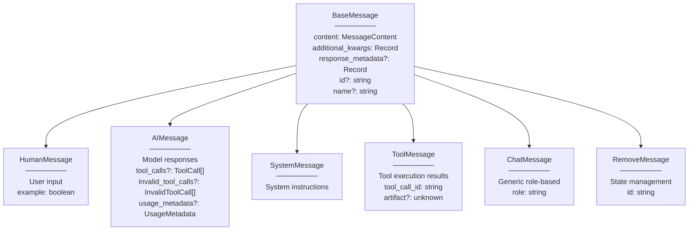
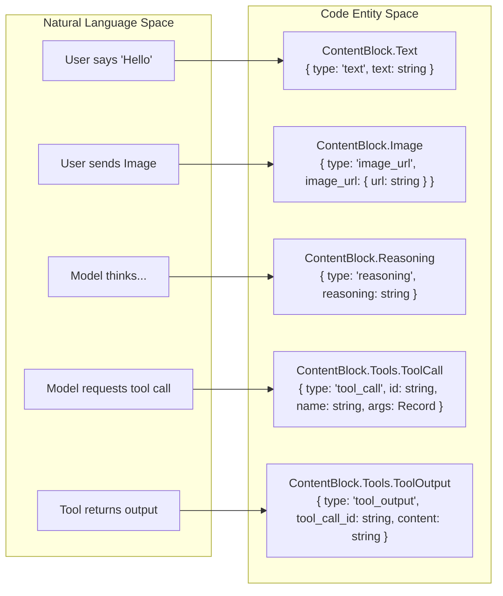
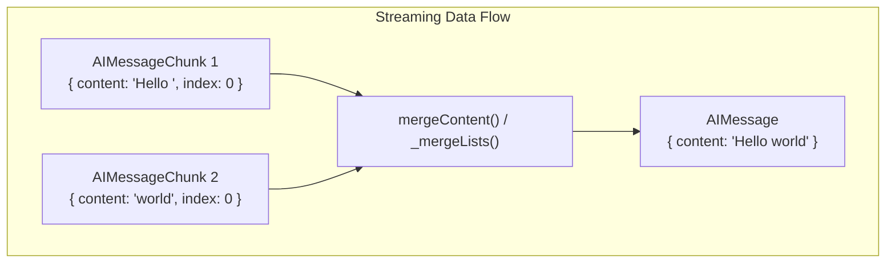

<!-- source: DeepWiki mcp.deepwiki.com · repo langchain-ai/langchainjs · page 2.2 Message System and Content Blocks · fetched 2026-10-26 -->

# Message System and Content Blocks

Relevant source files

The following files were used as context for generating this wiki page:

- [libs/langchain-core/src/messages/ai.ts](libs/langchain-core/src/messages/ai.ts)
- [libs/langchain-core/src/messages/base.ts](libs/langchain-core/src/messages/base.ts)
- [libs/langchain-core/src/messages/chat.ts](libs/langchain-core/src/messages/chat.ts)
- [libs/langchain-core/src/messages/format.ts](libs/langchain-core/src/messages/format.ts)
- [libs/langchain-core/src/messages/function.ts](libs/langchain-core/src/messages/function.ts)
- [libs/langchain-core/src/messages/human.ts](libs/langchain-core/src/messages/human.ts)
- [libs/langchain-core/src/messages/modifier.ts](libs/langchain-core/src/messages/modifier.ts)
- [libs/langchain-core/src/messages/system.ts](libs/langchain-core/src/messages/system.ts)
- [libs/langchain-core/src/messages/tests/ai.test.ts](libs/langchain-core/src/messages/tests/ai.test.ts)
- [libs/langchain-core/src/messages/tests/base_message.test.ts](libs/langchain-core/src/messages/tests/base_message.test.ts)
- [libs/langchain-core/src/messages/tests/message_utils.test.ts](libs/langchain-core/src/messages/tests/message_utils.test.ts)
- [libs/langchain-core/src/messages/tool.ts](libs/langchain-core/src/messages/tool.ts)
- [libs/langchain-core/src/messages/transformers.ts](libs/langchain-core/src/messages/transformers.ts)
- [libs/langchain-core/src/messages/utils.ts](libs/langchain-core/src/messages/utils.ts)
- [libs/langchain-core/src/utils/env.ts](libs/langchain-core/src/utils/env.ts)
- [libs/langchain-core/src/utils/namespace.ts](libs/langchain-core/src/utils/namespace.ts)
- [libs/providers/langchain-openai/src/tools/mcp.ts](libs/providers/langchain-openai/src/tools/mcp.ts)
- [libs/providers/langchain-openai/src/tools/tests/mcp.int.test.ts](libs/providers/langchain-openai/src/tools/tests/mcp.int.test.ts)
- [libs/providers/langchain-openai/src/tools/tests/mcp.test.ts](libs/providers/langchain-openai/src/tools/tests/mcp.test.ts)
- [libs/providers/langchain-openai/src/utils/tools.ts](libs/providers/langchain-openai/src/utils/tools.ts)

## Purpose and Scope

This document describes the message system in LangChain.js, which defines how conversational data is structured and passed through the framework. Messages are the fundamental unit of communication between users, AI models, and tools. The message system provides a standardized representation that works across all LLM providers while preserving provider-specific metadata.

This page covers message types (`AIMessage`, `HumanMessage`, etc.), the content block system for multimodal data, provider-specific block translators, and message merging utilities used during streaming.

## Message Type Hierarchy

LangChain.js defines a hierarchy of message classes representing different participants in a conversation. All message types extend from the `BaseMessage` class, which implements `Serializable` for cross-environment persistence [libs/langchain-core/src/messages/base.ts:215-221]().

**Message Type Roles**

| Message Type | Purpose | Key Fields |
|--------------|---------|------------|
| `HumanMessage` | User input to the model | `content`, `name` |
| `AIMessage` | Model-generated responses | `tool_calls`, `usage_metadata`, `invalid_tool_calls` |
| `SystemMessage` | System-level instructions | `content` |
| `ToolMessage` | Results from tool execution | `tool_call_id`, `status`, `artifact` |
| `ChatMessage` | Generic message with custom role | `role` string |
| `RemoveMessage` | State management (deletion) | `id` of message to remove |

Sources: [libs/langchain-core/src/messages/base.ts:215-221](), [libs/langchain-core/src/messages/ai.ts:33-43](), [libs/langchain-core/src/messages/modifier.ts:22-29](), [libs/langchain-core/src/messages/system.ts:18-20](), [libs/langchain-core/src/messages/tool.ts:24-26]()

## Content Block System

The `content` field of a message can be a simple string or an array of `ContentBlock` objects [libs/langchain-core/src/messages/base.ts:52-53](). This enables multimodal interactions (text + images) and structured reasoning.

### Standard Content Blocks
LangChain.js uses a standardized block format to ensure interoperability between providers like OpenAI, Anthropic, and Google.

**Key Block Types:**
- **Text**: Standard text content.
- **Image**: Multimodal input using URLs or base64 data. Supported via `image_url` or standard image blocks [libs/langchain-core/src/messages/tests/base_message.test.ts:60-66]().
- **Reasoning**: Internal model "thinking" or chain-of-thought. OpenAI's reasoning summary is elevated to the content array as a `reasoning` block [libs/langchain-core/src/messages/tests/ai.test.ts:180-182]().
- **Tool Call**: Structured request to execute a tool, often represented as a `tool_call` type block in v1 content [libs/langchain-core/src/messages/ai.ts:125-132]().
- **Citation**: Source attribution blocks used by providers like OpenAI Responses API, mapping `url_citation` or `file_citation` to standard `citation` blocks [libs/langchain-core/src/messages/tests/ai.test.ts:193-196]().

Sources: [libs/langchain-core/src/messages/base.ts:52-53](), [libs/langchain-core/src/messages/ai.ts:125-132](), [libs/langchain-core/src/messages/tests/base_message.test.ts:60-66](), [libs/langchain-core/src/messages/tests/ai.test.ts:180-182](), [libs/langchain-core/src/messages/tests/ai.test.ts:193-196]()

## Block Translators

Since different providers use incompatible formats for multimodal data and tool calls, LangChain uses `StandardContentBlockTranslator` implementations to normalize provider-specific responses into the standard `contentBlocks` array.

| Translator | Provider | Behavior |
|------------|----------|----------|
| `convertToV1FromChatCompletions` | OpenAI | Normalizes `tool_calls` and text into standard blocks [libs/langchain-core/src/messages/block_translators/openai.ts:49-73](). |
| `convertToV1FromOpenAIResponses` | OpenAI | Converts reasoning summaries, annotations, and tool outputs into standard blocks [libs/langchain-core/src/messages/block_translators/openai.ts:204-213](). |
| `convertToV1FromAnthropicInput` | Anthropic | Converts Anthropic's tool use and text blocks into standard blocks [libs/langchain-core/src/messages/base.ts:4-5](). |

The `AIMessage.contentBlocks` getter dynamically invokes these translators based on the `model_provider` found in `response_metadata` [libs/langchain-core/src/messages/ai.ts:184-193]().

Sources: [libs/langchain-core/src/messages/ai.ts:184-193](), [libs/langchain-core/src/messages/base.ts:4-5]()

## Message Merging and Concatenation

During streaming, messages are received as "chunks" (`AIMessageChunk`, `ToolMessageChunk`, etc.). LangChain provides utilities to merge these chunks into a single message.

### `mergeContent` Function
This utility handles merging two `MessageContent` values. It concatenates strings, joins arrays, and handles the transition from string to array if multimodal content is added [libs/langchain-core/src/messages/base.ts:110-162]().

### `_mergeLists` Logic
Used primarily for streaming tool calls and reasoning blocks. It merges blocks based on an `index` or `id`. If an index is missing (common in some OpenAI-compatible APIs), it falls back to `id`-based merging to prevent duplicate entries [libs/langchain-core/src/messages/tests/base_message.test.ts:217-260]().

Sources: [libs/langchain-core/src/messages/base.ts:110-162](), [libs/langchain-core/src/messages/tests/base_message.test.ts:217-260]()

## Tool Calling Integration

`AIMessage` objects track tool requests through `tool_calls` and `invalid_tool_calls`.

- **`tool_calls`**: Successfully parsed tool requests containing `name`, `args`, and a unique `id` [libs/langchain-core/src/messages/ai.ts:52-52]().
- **`invalid_tool_calls`**: Requests that failed JSON parsing or schema validation, preserved so the agent can see the model's error [libs/langchain-core/src/messages/ai.ts:54-54]().

The constructor automatically synchronizes `tool_calls` with `contentBlocks` if the output version is "v1". It adds missing tool calls to the content array to ensure consistency across the message state [libs/langchain-core/src/messages/ai.ts:115-158]().

Sources: [libs/langchain-core/src/messages/ai.ts:52-54](), [libs/langchain-core/src/messages/ai.ts:115-158](), [libs/langchain-core/src/messages/tests/base_message.test.ts:88-118]()

## Formatting Utilities

The `convertToFormattedString` function provides a "pretty" print version of messages, which is useful for logging and debugging. It extracts tool calls, arguments, and content into a human-readable format [libs/langchain-core/src/messages/format.ts:7-60]().

Sources: [libs/langchain-core/src/messages/format.ts:7-60]()

---

