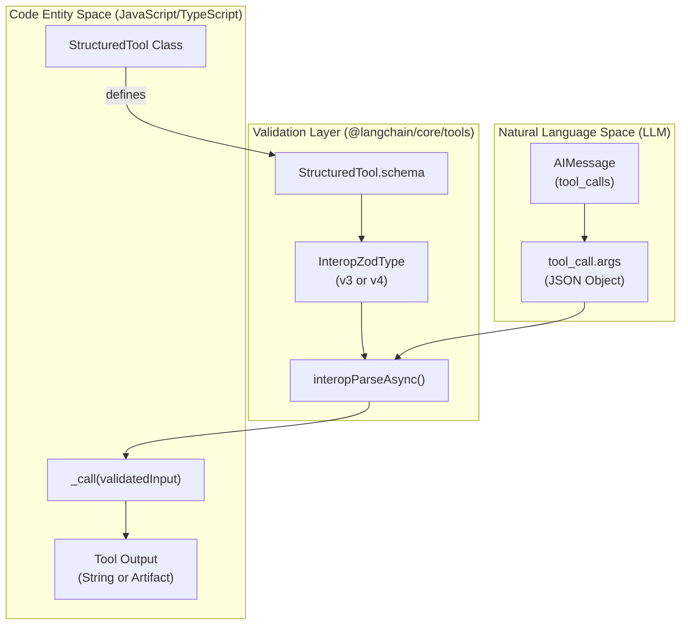
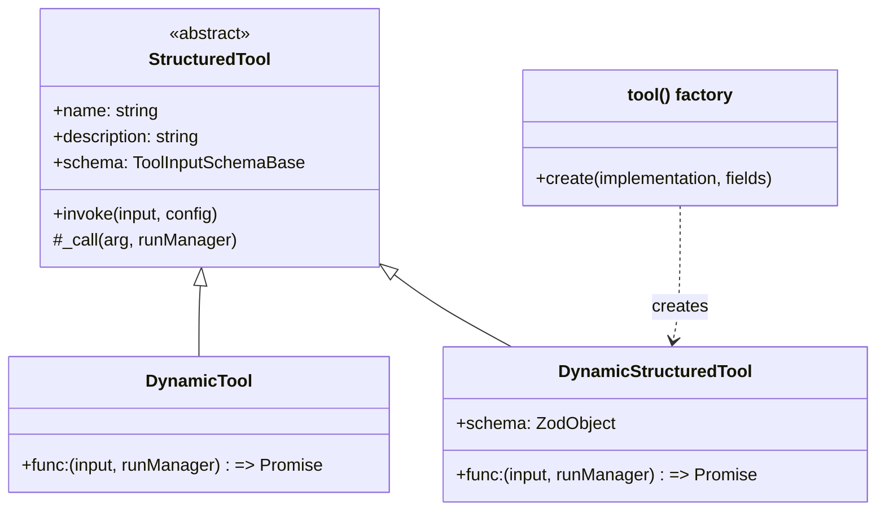

<!-- source: DeepWiki mcp.deepwiki.com · repo langchain-ai/langchainjs · page 2.3 Tools and Dynamic Tools · fetched 2026-10-26 -->

# Tools and Dynamic Tools

Relevant source files

The following files were used as context for generating this wiki page:

- [internal/build/src/plugins/import-constants.ts](internal/build/src/plugins/import-constants.ts)
- [libs/langchain-classic/src/chains/base.ts](libs/langchain-classic/src/chains/base.ts)
- [libs/langchain-core/src/language_models/structured_output.ts](libs/langchain-core/src/language_models/structured_output.ts)
- [libs/langchain-core/src/language_models/tests/structured_output.test.ts](libs/langchain-core/src/language_models/tests/structured_output.test.ts)
- [libs/langchain-core/src/messages/tests/messages.test-d.ts](libs/langchain-core/src/messages/tests/messages.test-d.ts)
- [libs/langchain-core/src/output_parsers/index.ts](libs/langchain-core/src/output_parsers/index.ts)
- [libs/langchain-core/src/output_parsers/openai_tools/json_output_tools_parsers.ts](libs/langchain-core/src/output_parsers/openai_tools/json_output_tools_parsers.ts)
- [libs/langchain-core/src/tools/index.ts](libs/langchain-core/src/tools/index.ts)
- [libs/langchain-core/src/tools/tests/tools.test.ts](libs/langchain-core/src/tools/tests/tools.test.ts)
- [libs/langchain-core/src/tools/tests/types.test-d.ts](libs/langchain-core/src/tools/tests/types.test-d.ts)
- [libs/langchain-core/src/tools/types.ts](libs/langchain-core/src/tools/types.ts)
- [libs/langchain-core/src/utils/json_schema.ts](libs/langchain-core/src/utils/json_schema.ts)
- [libs/langchain-core/src/utils/signal.ts](libs/langchain-core/src/utils/signal.ts)
- [libs/langchain-core/src/utils/tests/json_schema.test.ts](libs/langchain-core/src/utils/tests/json_schema.test.ts)
- [libs/langchain-core/src/utils/types/tests/zod.test.ts](libs/langchain-core/src/utils/types/tests/zod.test.ts)
- [libs/langchain-core/src/utils/types/zod.ts](libs/langchain-core/src/utils/types/zod.ts)
- [libs/langchain/src/agents/tests/tools.test-d.ts](libs/langchain/src/agents/tests/tools.test-d.ts)
- [libs/langchain/src/agents/tests/tools.test.ts](libs/langchain/src/agents/tests/tools.test.ts)
- [libs/langchain/src/agents/tests/types.test-d.ts](libs/langchain/src/agents/tests/types.test-d.ts)
- [libs/langchain/src/browser.ts](libs/langchain/src/browser.ts)
- [libs/langchain/src/tools/headless.ts](libs/langchain/src/tools/headless.ts)
- [libs/langchain/src/tools/index.ts](libs/langchain/src/tools/index.ts)
- [libs/langchain/src/tools/tests/headless.test-d.ts](libs/langchain/src/tools/tests/headless.test-d.ts)
- [libs/langchain/src/tools/tests/headless.test.ts](libs/langchain/src/tools/tests/headless.test.ts)

This page documents the tool abstraction system in LangChain.js, focusing on the foundational interfaces and dynamic tool creation patterns defined in `@langchain/core/tools`. Tools are functional units that language models can invoke to perform actions, retrieve data, or interact with external systems. This guide covers tool definitions, `StructuredTool`, `DynamicTool`, `DynamicStructuredTool`, and the integration with Zod and JSON schema utilities.

---

## Overview

The LangChain.js tool system provides a standardized interface for bridging the gap between Natural Language (LLM prompts) and Code Entities (executable functions). Key features include:

- **Unified Interface**: All tools implement a common `StructuredToolInterface` [libs/langchain-core/src/tools/index.ts:106-106]().
- **Schema-Driven**: Input validation and LLM instructions are derived from Zod or JSON schemas [libs/langchain-core/src/tools/index.ts:112-112]().
- **Flexible Execution**: Supports both simple string-based tools and complex structured tools with multiple parameters [libs/langchain-core/src/tools/index.ts:95-100]().
- **Response Formats**: Tools can return simple content or a tuple of (content, artifact) for downstream processing [libs/langchain-core/src/tools/index.ts:145-145]().
- **Headless Tools**: Support for lightweight tool definitions using the `tool()` factory function [libs/langchain/src/browser.ts:43-48]().

**Sources:** [libs/langchain-core/src/tools/index.ts:95-161](), [libs/langchain-core/src/tools/types.ts:30-35](), [libs/langchain/src/browser.ts:43-48]()

---

## Tool Architecture and Data Flow

The following diagram illustrates how a natural language request from an LLM is transformed into a validated code execution through the tool system.

### Natural Language to Code Entity Mapping

**Diagram: Data Flow from LLM Tool Call to Function Execution**

**Sources:** [libs/langchain-core/src/tools/index.ts:235-260](), [libs/langchain-core/src/utils/types/zod.ts:169-171]()

---

## Core Tool Abstractions

### StructuredTool

`StructuredTool` is the base class for all tools that accept structured input. It extends `BaseLangChain` and implements `StructuredToolInterface` [libs/langchain-core/src/tools/index.ts:95-107]().

| Property | Type | Description |
| :--- | :--- | :--- |
| `name` | `string` | Unique identifier for the tool used by the LLM [libs/langchain-core/src/tools/index.ts:108-108](). |
| `description` | `string` | Instructions for the LLM on when and how to use the tool [libs/langchain-core/src/tools/index.ts:110-110](). |
| `schema` | `ZodObject \| JSONSchema` | The schema defining valid inputs for the tool [libs/langchain-core/src/tools/index.ts:112-112](). |
| `returnDirect` | `boolean` | If true, the agent stops after this tool call and returns the result [libs/langchain-core/src/tools/index.ts:128-128](). |
| `responseFormat` | `"content" \| "content_and_artifact"` | Determines if the tool returns just text or additional metadata [libs/langchain-core/src/tools/index.ts:145-145](). |
| `extras` | `Record<string, unknown>` | Optional provider-specific extra fields for the tool [libs/langchain-core/src/tools/index.ts:120-120](). |

**Sources:** [libs/langchain-core/src/tools/index.ts:108-150](), [libs/langchain-core/src/tools/types.ts:86-118]()

---

## Dynamic Tools and Factory Functions

Dynamic tools allow developers to create tool instances from functions without subclassing `StructuredTool`.

### DynamicTool
A simple wrapper for functions that take a single string input. It uses a default `StringInputToolSchema` [libs/langchain-core/src/tools/types.ts:203-203]().

### DynamicStructuredTool
A wrapper for functions that take structured objects as input, validated against a provided Zod schema.

### Headless Tool Factory
The `tool()` function provides a streamlined way to create `DynamicStructuredTool` instances [libs/langchain/src/browser.ts:43-48]().

**Diagram: Tool Creation and Class Hierarchy**

**Sources:** [libs/langchain-core/src/tools/index.ts:95-107](), [libs/langchain/src/browser.ts:32-48](), [libs/langchain-core/src/tools/tests/types.test-d.ts:9-31]()

---

## Schema Integration and Zod Utilities

LangChain.js provides extensive utilities for handling different schema versions and formats, primarily through the `InteropZodType` abstraction.

### Zod Version Interoperability
The codebase supports both Zod v3 and Zod v4 schemas. To prevent massive structural comparisons that crash the TypeScript compiler, `@langchain/core` uses "Like" interfaces (e.g., `ZodV3Like`, `ZodV4Like`) that capture only the properties required at runtime [libs/langchain-core/src/utils/types/zod.ts:35-55]().

- **`isInteropZodSchema(schema)`**: Detects if a schema is a valid Zod v3 or v4 object [libs/langchain-core/src/utils/types/zod.ts:90-113]().
- **`interopParseAsync(schema, data)`**: Parses data using the appropriate Zod version logic [libs/langchain-core/src/utils/types/zod.ts:34-34]().
- **`interopZodTransformInputSchema(schema)`**: Extracts the input schema from a Zod transform, ensuring the LLM sees the pre-transformed structure [libs/langchain-core/src/utils/json_schema.ts:9-9]().

### JSON Schema Conversion
Tools are often sent to LLM providers as JSON Schemas. The `toJsonSchema` utility handles this conversion, including support for the "Standard Schema" specification [libs/langchain-core/src/utils/json_schema.ts:48-51]().

- **Caching**: Results are cached in a `WeakMap` to avoid redundant serializations across agent steps [libs/langchain-core/src/utils/json_schema.ts:39-40]().
- **Standard Schema Support**: Detects and uses the `~standard` interface for modern schema libraries [libs/langchain-core/src/utils/json_schema.ts:64-67]().

**Sources:** [libs/langchain-core/src/utils/types/zod.ts:57-101](), [libs/langchain-core/src/utils/json_schema.ts:39-87](), [libs/langchain-core/src/utils/types/zod.ts:90-113](), [libs/langchain-core/src/utils/json_schema.ts:9-9]()

---

## Tool Calling Interface

When a tool is invoked via `invoke()`, the system handles the transition from a `ToolCall` (generated by an LLM) to the final `ToolMessage` [libs/langchain-core/src/tools/index.ts:175-181]().

1.  **Input Normalization**: If the input is a `ToolCall` object, the system extracts the `args` [libs/langchain-core/src/tools/index.ts:190-194]().
2.  **Validation**: The input is validated against `this.schema` using `interopParseAsync` [libs/langchain-core/src/tools/index.ts:235-240]().
3.  **Execution**: The internal `_call` method is executed with the validated object [libs/langchain-core/src/tools/index.ts:163-167]().
4.  **Result Wrapping**: If the execution was triggered by a `ToolCall`, the output is wrapped in a `ToolMessage` containing the `tool_call_id` [libs/langchain-core/src/tools/index.ts:206-208]().

**Sources:** [libs/langchain-core/src/tools/index.ts:175-210](), [libs/langchain-core/src/messages/tool.ts:21-21](), [libs/langchain-core/src/tools/index.ts:163-167]()

---

## Tool Types and Definitions

| Type | Source | Purpose |
| :--- | :--- | :--- |
| `ToolInputSchemaBase` | `types.ts` | Union of `InteropZodType` and `JSONSchema` [libs/langchain-core/src/tools/types.ts:81-81](). |
| `ToolReturnType` | `types.ts` | Conditional type determining if the tool returns a string or `ToolMessage` [libs/langchain-core/src/tools/types.ts:64-75](). |
| `ToolRunnableConfig` | `types.ts` | Configuration object for tool execution, including optional `toolCall` metadata [libs/langchain-core/src/tools/types.ts:120-128]().
| `ToolRuntime` | `types.ts` | Provides access to agent state, context, and configuration during tool execution [libs/langchain-core/src/tools/types.ts:59-59]().

**Sources:** [libs/langchain-core/src/tools/types.ts:64-128](), [libs/langchain-core/src/tools/types.ts:59-59]()

---

